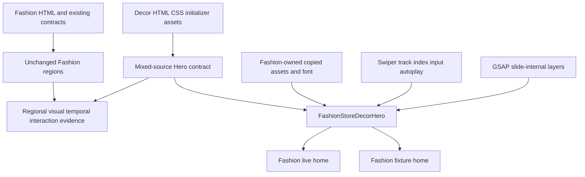
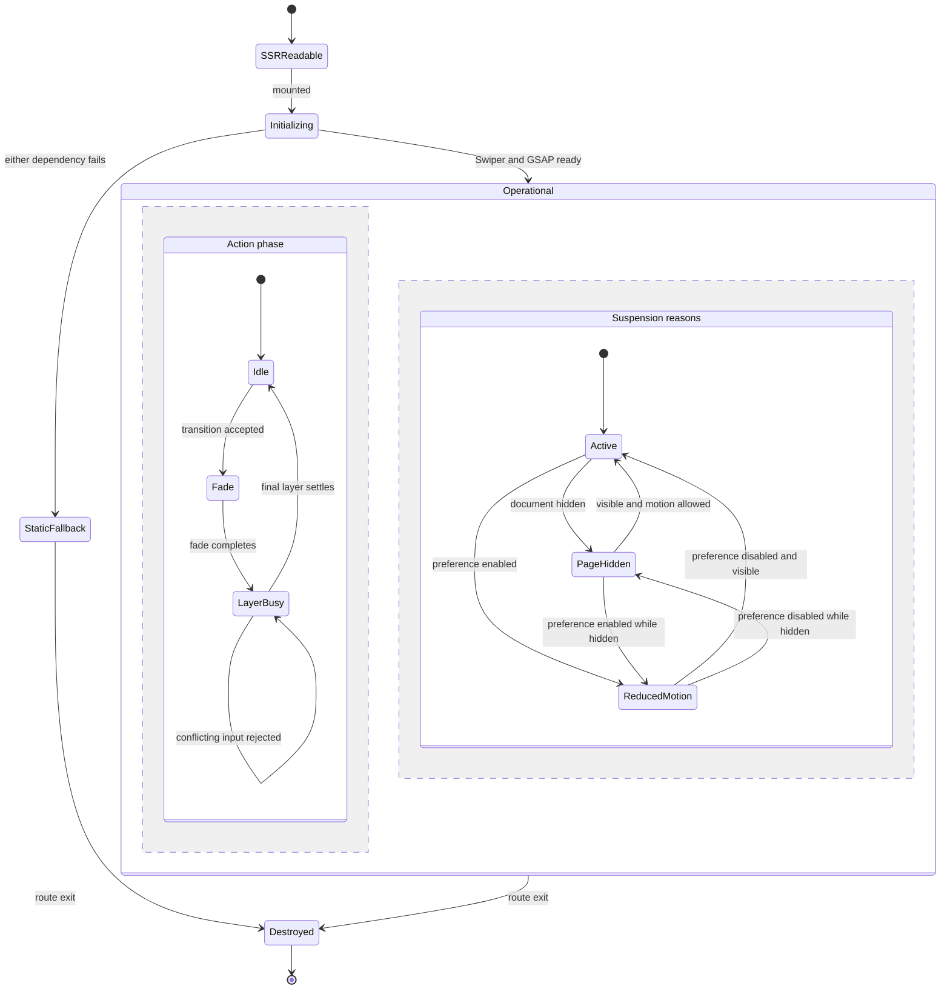
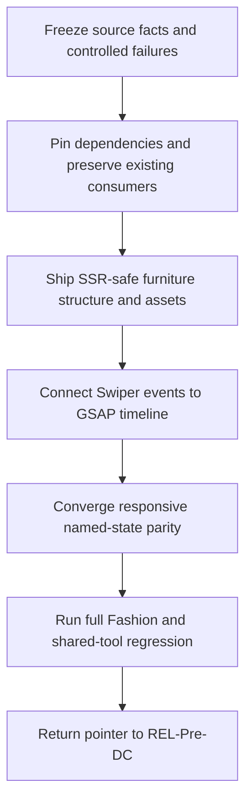

# Fashion Store Decor Hero Migration - Plan

## Goal Capsule

- **Objective:** Fashion Store shoppers see the same three-slide furniture Hero content and experience as the accepted Decor Store homepage, in preview and live home rendering, without changing the rest of either template.
- **Means:** Build one Fashion-owned Hero with Swiper 14.2.0 for carousel mechanics and GSAP 3.15.0 for source-derived layer timelines, backed by a mixed-source acceptance contract that compares only the Hero to the Decor source (KTD1-KTD5).
- **Authority:** The product master controls execution order; the Fashion functional plan governs product behavior; completed FS-R1 and FS-F3 govern the inherited Fashion carousel baseline; the frozen Decor source and accepted Decor Hero behavior govern this Hero's visible result.
- **Execution profile:** Work test-first in the existing primary worktree. Freeze mixed-source authority and upgrade risk before changing the Hero, then deliver SSR structure, motion, responsive parity, full Fashion carousel regression, and REL handback. No PR, deployment, candidate freeze, or production promotion is required.
- **Stop conditions:** Stop if Swiper 14.2.0 cannot meet the approved browser matrix or a safe public-API replacement for the Product Gallery compatibility hook cannot preserve FS-F3. Also stop before importing Decor runtime code, weakening source-equivalence thresholds, changing non-Hero commerce, or modifying `decor-store` implementation files.
- **Tail ownership:** FS-R2 owns U1-U6, focused evidence, dependency and regression fixes, and final handback. REL retains Pre-DC, DC, and PG authority.

## Authority and Lineage

- **Upstream product authority:** `docs/plans/2026-08-13-001-refactor-shoppp-product-master-plan.md` owns the product map and active pointer. `docs/plans/2026-08-11-001-feat-fashion-store-functional-integration-plan.md` remains the Fashion Store product authority.
- **Inherited baseline:** `docs/plans/2026-09-03-1750-refactor-fashion-store-components-dependencies-plan.md` (FS-R1) supplies the single-Swiper architecture, selected-theme isolation, browser matrix, bundle budget, no-jQuery posture, shared carousel ownership, and fixture/live regression requirements. `docs/plans/2026-09-04-1336-fix-fashion-store-product-gallery-carousel-plan.md` (FS-F3) supplies the five-second Product cadence, sole semantic index, application-owned active marker, visibility-aware thumbnail movement, and lightbox/pause behavior.
- **Decor reference authority:** `docs/plans/2026-08-10-001-feat-decor-store-source-parity-plan.md`, `apps/storefront/app/themes/decor-store/upstream/demo-decor-store.html`, its adjacent Hero CSS and initializer, and the accepted Decor source/behavior contracts are read-only reference authority. This plan implements the earlier deferred framework-Hero option only inside Fashion; it does not supersede Decor's Revolution implementation.
- **Explicit supersessions:** FS-R2 supersedes only FS-R1-U5's Fashion Home Hero presentation, its Fashion apparel Hero assets/copy/editor controls, and FS-R1's exact `swiper@11.2.10` version evidence. It does not reopen completed FS-R1/FS-F3 units or supersede other Fashion carousel behavior.
- **Parallel plans:** REL pauses at Pre-DC while FS-R2 executes and resumes after U6. Decor, Commerce, Theme Platform, IAM, AI, Admin, and CI retain the responsibilities recorded in the product master. The Decor source comparison in this plan is feature acceptance, not a DC3 Candidate Template Matrix claim.
- **Tail ownership:** FS-R2 owns the Fashion fixture and live Home Hero, mixed-source acceptance seam, safe Swiper/GSAP dependency state, affected Fashion carousel regressions, maintenance evidence, and master-pointer return to REL.

## Activation Checkpoint

- **Plan classification:** Active bounded successor; implementation and focused verification completed through U5 on 2026-09-06, with the full-regression handback still open.
- **Current unit:** U6 — close full regression, maintenance evidence, and REL handback.
- **Unit state:** U1-U5 Complete; U6 Active.
- **Blocker:** The full Fashion Home page acceptance still fails on inherited non-Hero header/announcement navigation and source-only sticky-social-rail differences, while the complete live suite retains one existing cookie-consent timeout and one overall flow timeout. Those areas are outside FS-R2's approved Hero scope and cannot be changed or waived here. REL's capability-scope and candidate-identity blockers remain preserved.
- **Next concrete action:** Reconcile the inherited non-Hero Fashion acceptance baseline under its owning authority, then rerun the full Home page/theme/live gates; if they pass without weakening thresholds, close U6 and return the product pointer to REL-Pre-DC.
- **Update rule:** This checkpoint is the sole authority for FS-R2's current unit, per-unit state, blocker, next action, and implementation tail. Update it and the product master pointer in the same change whenever those facts change. Evidence under `docs/progress/` must not maintain a second unit queue.

---

## Product Contract

### Summary

Replace the current Fashion Store Home Hero in both fixture and live rendering with the accepted Decor Store furniture Hero. The delivered Hero permanently uses Decor's three furniture compositions and copy while remaining implemented, bundled, and maintained inside the Fashion namespace with Swiper and GSAP.

### Problem Frame

Fashion currently has a simpler Swiper Hero with apparel images, a four-second cadence, different responsive geometry, and no complete per-layer timeline. Decor has the target three-slide composition but preserves it through a theme-local jQuery and Slider Revolution chain. Sharing that runtime would reintroduce jQuery into Fashion, violate selected-theme isolation, and couple two template implementations.

The repository's current Fashion acceptance assumes one page-level source, `demo-fashion-store.html`. This change deliberately creates a mixed-source page: the Hero follows `demo-decor-store.html`, while the header and every later Fashion section continue following the Fashion source. The acceptance model must represent that authority split explicitly rather than hiding it behind a whole-page waiver or looser visual threshold.

### Requirements

**Content, source authority, and scope**

- R1. The Fashion fixture and live homepage render the same three furniture slides, visible English copy, layer order, presentation prices, calls to action, Next cards, thumbnail imagery, and composition as the accepted Decor Hero; this content is permanent delivery content, not a test-only fixture. Fashion deliberately omits Decor's `More information` trigger and tooltip at every viewport.
- R2. The Hero's twelve source images and any required typeface bytes are copied into a Fashion-owned asset namespace, renamed where required for build isolation, registered through Fashion resources, and documented with Decor-source provenance. Acceptance requires the same visible image content, dimensions, crop, and rendered result; checksums support provenance but are not a product-completion gate.
- R3. The Decor implementation, Revolution loader, runtime, resources, contracts, and source bytes remain unchanged. Fashion imports no Decor module, jQuery, Revolution JavaScript, Revolution CSS bundle, remote thumbnail, source PHP, analytics, or tracking resource.
- R4. Fashion header, sections after the Hero, routes, section ordering, product/cart/checkout truth, typed intents, and all non-Hero fixture/live behavior remain unchanged. The copied prices are static template presentation copy rather than catalog/product truth, and every primary Hero CTA initially routes to `/shop` through a typed content/config boundary that a future console editor can replace without changing the component.

**Carousel and layer behavior**

- R5. Swiper owns the three-slide track, real index, 300ms fade, keyboard navigation, pointer/touch gesture recognition, Next navigation, autoplay clock, native 75px threshold, adjacent-slide lazy preload, resize, and destruction. The application reproduces the observed 9000ms cadence and source stop-loop/stop-target result without a second timer, drag engine, custom image decode queue, or exact-pixel gesture comparator. Acceptance samples clearly below and above the configured boundary instead of requiring cross-device equality at exactly 75px.
- R6. GSAP owns only marked elements inside a semantic slide. The server-rendered first slide remains in its complete final readable state and does not replay a client-side entrance timeline. For later accepted slide changes, GSAP reproduces the retained source layer initial states, order, delays, duration, easing, enter/exit/reset result, and final readable state without writing transforms or opacity on Swiper's wrapper or slide elements; the omitted `More information` layers have no Fashion timeline or interaction.
- R7. All automatic, pointer, keyboard, touch, and programmatic transitions enter through one request boundary. While the source-equivalent layer phase is busy, conflicting input is rejected rather than queued; stale callbacks cannot change the semantic index or DOM after a newer generation or destruction.
- R8. The Hero reproduces the source breakpoint compositions and full-screen geometry at the canonical 1440x1000, 1024x900, 768x1024, and 390x844 viewports, plus in-place resize across 1240, 1024, 778, 480, and landscape boundaries, with no stale layer transform or horizontal overflow.

**SSR, fallback, accessibility, and lifecycle**

- R9. SSR and no-JavaScript output contain a complete, readable first furniture slide with stable geometry, usable Fashion CTA destinations, correct preload priority, and no hydration-only blank or material layout jump. A Swiper or GSAP initialization failure falls back atomically to that state instead of leaving a moving carousel with hidden layers.
- R10. Reduced motion stops autoplay and exposes the current slide's final readable layer state while preserving manual navigation. Page hiding suspends only this Hero's autoplay and active timeline and resumes from the retained state.
- R11. Use native links/buttons and Swiper's default carousel and focus behavior. This unit adds no Hero-specific focus transfer/recovery state machine, custom keyboard-focus protocol, duplicate global announcer, or visible pause control.
- R12. Route exit and remount remove every Hero-owned listener, Swiper instance, GSAP timeline/context, inline animation state, and late callback. Repeated remounts create one current instance without accumulated DOM or work.

**Dependencies, regression, and acceptance**

- R13. Replace the vulnerable exact `swiper@11.2.10` dependency with exact `swiper@14.2.0`, whose official release closes the later prototype-method override bypass, and add exact `gsap@3.15.0` as a direct dependency. Record source, integrity, release notes, browser/runtime compatibility, bundle contribution, and GSAP Standard License applicability.
- R14. Home collection, Shop arrivals, About carousel, and Product main/thumbnail gallery preserve their inherited Swiper behavior after the upgrade. Product's private compatibility hook receives characterization first and, if incompatible, is replaced with a public Swiper event/API or application-owned cancellation seam without changing FS-F3 outcomes.
- R15. Mixed-source acceptance keeps Fashion as the page-level source and assigns only the Hero region to the independent Decor source. It compares visible content, geometry, typography, named states, timed samples, and interactions without a whole-page source switch, source mutation, blanket waiver, or relaxed existing thresholds.
- R16. Fashion stays within the existing 300 KiB initial JavaScript gzip budget and current performance gates. The final build contains only required Swiper modules/CSS and GSAP core, includes no inactive Decor runtime, makes no remote Hero request, and records the before/after Hero and route resource delta.

### Key Decisions

- **Copy the complete Decor furniture experience into Fashion.** (session-settled: user-directed — chosen over retaining Fashion apparel content or using a temporary acceptance fixture: the user requested the Decor images and copy as permanent Fashion Hero content.) Governs R1-R4.
- **Use GSAP plus Swiper and leave Decor unchanged.** (session-settled: user-directed — chosen over Slider Revolution, jQuery, or modifying the Decor carousel: the user requires a jQuery-free Fashion implementation that looks and behaves like Decor.) Governs R3, R5-R7, R13.
- **Match the accepted Decor behavior, not a generic carousel redesign.** (session-settled: user-approved — chosen over adding new controls or Fashion's inherited pause defaults: direct visual and interaction comparison is the acceptance goal.) Governs R5-R11, R15.
- **Keep the intentional Fashion exceptions small and explicit.** (session-settled: user-directed — Fashion omits `More information` on PC and H5, treats copied prices as presentation copy, routes all initial primary CTAs to `/shop`, and defers a replacement three-slide console editor.) Governs R1, R4, R11, R15.

### Acceptance Examples

- AE1. Given fixture preview, live home rendering, SSR, or JavaScript disabled, the first Hero shows the same furniture composition and copy as Decor, its Fashion destinations remain usable, and hydration does not blank or materially move the Hero.
- AE2. After the static initial display, selecting a slide by Next card, keyboard, native Swiper swipe, or autoplay results in the same semantic slide, 300ms fade, source layer order, and final composition as Decor. A deterministic 74px trace is rejected and a 76px trace is accepted; exact equality at the configured 75px threshold is not a cross-device contract.
- AE3. Given the layer timeline is busy, rapid repeated click, key, reverse swipe, or an autoplay/manual race does not queue a second transition, duplicate a timeline, expose two active slides, or leave a non-active layer transformed.
- AE4. At every viewport, Fashion renders no `More information` label, information icon, tooltip content, trigger listener, or related animation while the surrounding Decor-derived composition remains aligned.
- AE5. Given normal motion, reduced motion, page hiding, or an initialization exception, the Hero enters the corresponding ready, suspended, final-readable, or static-fallback state and returns only through defined transitions; manual navigation remains available only where the contract permits it.
- AE6. Given an in-place resize across the source grid boundaries while idle or busy, layer geometry follows the matching Decor composition, no old transform survives, and page width does not overflow the viewport.
- AE7. Given Swiper 14.2.0, the Home collection, Shop, About, and Product consumers preserve loop/rewind, timing, direction, touch, keyboard, reduced-motion, thumbnail boundary, lightbox synchronization, and sole current-marker behavior established by FS-R1 and FS-F3.
- AE8. Given a Fashion production build, dependency and resource inspection shows exact Swiper/GSAP versions, a documented GSAP license decision, no jQuery/Revolution/Decor runtime import or request, no remote Hero asset, and route bundles within existing budgets.

### Success Criteria

- All three slides and named initial, moving, settled, reduced-motion, hidden-page, fallback, and remount states have observable evidence at applicable canonical viewports and inputs; absence of `More information` is asserted separately.
- Hero element edges and dimensions remain within the existing source-equivalence tolerance, and regional visual differences remain within the current Hero threshold without a new waiver.
- Controlled defects for a missing layer, wrong delay, clearly below/above-threshold swipe behavior, wrong stop target, or permitted re-entry fail the intended gate before the implementation is accepted.
- Every existing Fashion Swiper consumer passes focused and full fixture/live regression after the dependency upgrade.
- Fashion build, static, accessibility, source-equivalence, selected-theme isolation, bundle, and performance gates pass; any shared acceptance-tool change also passes Decor's unchanged reference suite.

### Scope Boundaries

**Included**

- The Hero rendered by `FashionStoreHome.vue` and `FashionStoreLiveHomePage.vue`, including replacement of visible live `viewModel.hero` content by the permanent three-slide furniture Hero while retaining the live page's section order and non-Hero view-model data.
- Fashion-owned Hero component, motion controller, content/behavior contract, copied assets and scoped typography/styles.
- Removal of the obsolete Fashion single-Hero controls from the Fashion manifest/editor surface while retaining tolerant transport of already-saved values; building the future three-slide Hero editor is excluded.
- Exact Swiper and GSAP dependency state, all affected Fashion carousel regression, mixed-source acceptance tooling, focused evidence, and REL handback.

**Excluded**

- Any change to `apps/storefront/app/themes/decor-store/**`, its source manifests, its Slider Revolution runtime, or its rendered behavior.
- Replacing other Fashion section content, changing catalog/cart/checkout logic, creating a cross-template runtime component, restoring old vendor bundles, or migrating the internal Decor code ID.
- Building console controls for the new slides, prices, copy, images, or per-slide links; that is a future successor and the initial CTA default remains `/shop`.
- Deployment, candidate selection, DC3 formal cross-template qualification, production promotion, or a general animation platform for non-Hero page effects.

---

## Planning Contract

### Key Technical Decisions

- KTD1. **Use a dedicated Fashion Hero boundary.** `FashionStoreDecorHero` owns Decor-specific controls, timing, stop behavior, fallback, and GSAP coordination. It may consume shared Fashion icons and asset resolution, but it does not extend `FashionStoreCarousel` with page-specific APIs or change other consumers. (session-settled: user-directed — chosen over retrofitting the generic wrapper because this composition, threshold, stop-loop, and layer contract are Home-specific.) Governs R1, R4-R12.
- KTD2. **Represent mixed-source authority explicitly.** Keep Fashion's page-level source identity for the header and later sections, add a region-level Decor source override for Hero capture/behavior, and run the original Decor Revolution page as the independent reference. Never compare Fashion to the mutable Decor Nuxt implementation or hide divergence with a waiver. Governs R1, R3-R4, R15.
- KTD3. **Duplicate visual assets, not runtime ownership.** Copy the twelve Hero images and the minimum proven typography dependency into Fashion-owned `assets/`, rename them so selected-theme scans remain truthful, and retain source provenance plus source/delivered checksums in the manifest and `UPSTREAM.md`. Checksums trace origin; visual equivalence governs acceptance, so approved metadata cleanup or re-encoding may produce a different delivered checksum when the rendered result remains equivalent. Extract only the Hero CSS dependency closure into a Fashion-scoped root. Governs R2-R4, R8-R9, R16.
- KTD4. **Pin the version with the confirmed security closure.** Use `swiper@14.2.0`, not the vulnerable v11 line or the earlier v12 patch path, because the official 14.2.0 release explicitly closes the subsequent prototype-method override bypass and its browser floor fits the approved Fashion matrix. Pin `gsap@3.15.0`, import GSAP core only, and retain its Standard License notice and applicability decision. If the v14 tooling/runtime preflight fails, stop rather than silently downgrade. Governs R13-R16.
- KTD5. **Separate carousel and layer mutations.** Swiper alone writes wrapper/slide motion; GSAP selectors are scoped to `[data-fashion-hero-layer]` descendants. A monotonic transition generation invalidates late callbacks, and component-local revert/kill restores layer styles before a new accepted transition or teardown. Governs R5-R7, R10-R12.
- KTD6. **Use one semantic real index and one finite lifecycle.** Pagination, current state, CTA availability, Next card, GSAP target, and evidence consume the same real index. Lifecycle priority is destroyed, fallback, reduced-motion, page-hidden, then ready; action phases are idle, fade, layer-busy, then idle. Governs R5-R12.
- KTD7. **Characterize before upgrading private behavior.** Capture Product Gallery's existing private-hook, transform, interruption, and thumbnail-boundary outcomes before changing Swiper. Prefer public v14 APIs; if no public seam preserves the result, use a narrow application-owned cancellation mechanism rather than binding another undocumented Swiper property. Governs R14.
- KTD8. **Avoid premature accessibility orchestration.** Preserve native links/buttons and Swiper defaults, but add no Hero-specific focus transfer/recovery, global live region, keyboard-focus state machine, or visible pause control while the product interaction is unsettled. Governs R4, R10-R11, R15.

### High-Level Technical Design

The diagrams define the intended responsibility and evidence shape; implementation may choose local helper names while preserving these boundaries.

### Execution Constraints

- The Fashion source remains authoritative outside the Hero. Page-level source hashes and thresholds are not rewritten to make the deliberate Hero replacement disappear.
- Establish actual source observations for stop-loop target, autoplay clock origin, and retained layer checkpoints before implementation; runtime option literals alone are supporting evidence. Record `More information` as an intentional Fashion omission rather than an equivalence failure.
- The dedicated `fashion-store-decor-hero.spec.ts` owns the independent Decor-page versus Fashion-Hero temporal comparison. Do not generalize the existing single-source named-state capture utility merely to support this one mixed-source region.
- SSR renders deterministic content without reading `window`, `matchMedia`, dimensions, or time. Browser-only GSAP work begins after mount and always has an atomic static fallback.
- Swiper modules and CSS are imported by capability rather than through a bundle entry. GSAP plugins are not added unless the frozen Hero contract proves one necessary.
- Preview generation can rewrite generated active-theme/experience files; preserve unrelated generated-file content according to the existing maintenance procedure.

### System-Wide Impact

| Surface | Change and ownership | Failure boundary and required evidence |
| --- | --- | --- |
| Fixture/live Home renderers and editor | Both renderers consume one Fashion-owned fixed Hero contract and resource resolver; neither passes its full fixture section or `HomeViewModel` into the Hero. Existing live Hero fields remain tolerated in saved data/composition transport but no longer control visible Fashion Home output, and their obsolete single-Hero controls are removed from the Fashion manifest/editor surface. There is no stored-data migration; a future successor owns a proper three-slide editor. | A Hero failure stays local: Shell, Header, later sections, routes, and commerce continue normally. The page ready gate accepts either an operational Hero or the declared static Hero fallback, never a half-initialized state. Manifest/editor tests prove the obsolete controls are absent while old saved values do not break composition. |
| Dependency graph and existing carousels | The Swiper v14 change propagates through Home collection, Shop, About, Product main/thumbs, shared CSS, SSR imports, and the lockfile. Product's private compatibility behavior is a hard U2 gate before Hero integration. GSAP execution and Hero media requests are Home-only. New Hero CSS may remain in the Fashion theme stylesheet when rooted under the Hero selector and within the existing budget; no route-level CSS loader is introduced. | Install, lock, ESM/SSR import, or build failure blocks U2 and cannot be caught by runtime fallback. Browser construction/timeline/media failure may degrade only the Hero. Swiper JS and CSS regression evidence covers transforms, opacity, pointer events, z-index, and the thumbnail rail for every consumer. |
| Runtime state | Component lifecycle (`initializing`, `operational`, `fallback`, `destroyed`) is independent from action phase (`idle`, `fade`, `layer-busy`); hidden-page and reduced-motion are orthogonal suspension reasons. Priority is destroyed, fallback, reduced motion, hidden, then operational. One transition arbiter and generation token own all input and callback completion. | Busy-to-hidden, hidden-to-reduced, visible-while-reduced, preference reversal, and destroy-from-every-phase have explicit tests. The Hero does not move focus or implement a custom keyboard-focus state machine. |
| Assets, chunks, and source evidence | Fashion owns the runtime images/font and scoped new-Hero CSS; immutable Decor and Fashion source snapshots/digests remain evidence. Obsolete Fashion apparel-Hero runtime assets, registrations, preload branches, and selectors are removed when no other consumer references them; immutable upstream evidence remains. | Non-Home Fashion and Decor routes execute no GSAP Hero code and request no Hero media. Scoped static Fashion CSS may be shared when it stays within existing budgets and cannot match outside the Hero root. |
| Mixed-source acceptance tooling | Region authority is a backward-compatible, theme-neutral chain from policy to adapter, source page, ready/region selectors, digest, and capture artifact. It contains no Fashion/Decor conditional and accepts only enumerated repository sources. | Decor source capture failure blocks acceptance but cannot affect production rendering. Because U1 changes shared policy/tooling, Decor compatibility is mandatory in U6; it remains supporting evidence rather than a DC3 claim. |

#### Performance and media loading

Retain a production-build before/after comparison for initial JavaScript gzip bytes, request count/bytes, and emitted resources. Use the repository's existing performance gates rather than introducing a five-run sampling regime, new LCP/CLS percentages, Long Task limits, frame-percentile thresholds, or heap SLOs for this feature.

- The existing 300 KiB initial JavaScript budget includes any eagerly requested Hero/GSAP async chunk before the Hero becomes interactive; moving bytes behind an immediate dynamic import does not evade it.
- The first-slide critical image is eager/high-priority for SSR and first paint. Later-slide `` elements use Swiper 14's native `lazyPreload: true` and `lazyPreloadPrevNext: 1`; the application adds no `Image.decode()` queue, pending-transition state, or wait-before-switch logic.
- Build/unit checks validate that every declared local Hero image exists and is decodable. Runtime does not add a bespoke broken-image placeholder or fallback state.
- Geometry reads precede batched writes and resize work is frame-coalesced. Only animated layers receive temporary compositor promotion, removed at settlement/revert. Hidden-page state pauses Swiper autoplay and the active GSAP timeline without managing browser-owned fetching/decoding. Repeated remount verification proves one live instance and no post-destroy mutation without defining a new heap threshold.

### Risks and Dependencies

| Risk / dependency | Treatment and decision gate |
| --- | --- |
| Vulnerable or duplicate Swiper survives resolution | Inspect the complete lockfile and emitted chunks, not only `package.json`, for one approved Swiper version and integrity. Hero rollback never restores `swiper@11.2.10`; if Swiper 14 cannot preserve inherited consumers or budgets through public APIs or the narrow application seam, stop at U2. |
| Security fix crosses three major-version behavior boundaries | U2 verifies build runtime, approved browser floors, SSR/ESM import, modular CSS/navigation, loop/rewind, and every existing Fashion consumer before U3. Failure never authorizes an undocumented v12/v11 downgrade. |
| Copied image/font rights are unproven | Before copying in U3, record the governing template, media, and font licenses; attribution/notice duties; redistribution permission; cross-template and renamed-copy permission; and effective source. Missing authorization is a blocker, not a visual-parity exception, and GSAP's license does not cover these assets. |
| Copied source media needs sanitation or re-encoding | Validate expected passive file types and successful decode. If metadata removal or re-encoding is warranted, record source and delivered checksums and re-run visual equivalence; byte identity is not required when visible content, dimensions, crop, and rendered result remain equivalent. |
| Region source override broadens trusted paths | The schema accepts only enumerated repository-relative files and approved local preview origins, rejecting absolute/traversal paths, schemes, redirects, unknown hosts, query-selected sources, and shell metacharacters before file access or browser launch. Controlled hostile cases are required in U1. |
| Transcribed source becomes an injection seam | Keep content, labels, local resource identities, and Fashion route targets typed and static; render through Vue escaping and route helpers. Prohibit `v-html`, `innerHTML`, runtime evaluation, source-HTML execution, `javascript:` targets, and raw external URLs; a hostile-string fixture must remain inert text. |
| Runtime animation pressures CSP or license scope | Verify deployed-equivalent CSP behavior without adding broad `unsafe-inline`, weakening `script-src`, CDN execution, blob/data scripts, or remote font/style fetches. Record GSAP Standard License text/effective date, integrity, notice, and ordinary-site applicability; a future merchant animation builder requires fresh license review. |
| Dependency or Hero rollback conflates layers | Runtime constructor or timeline errors use the static first-slide fallback. A U3/U4 performance or parity failure rolls presentation back to the pre-U3 Hero while retaining the verified secure Swiper 14 baseline. Build/install failure or unresolved inherited-consumer regression stops at U2. U6 owns exact dead-asset/chunk cleanup, while immutable upstream evidence remains. |
| Lifecycle work accumulates after navigation | Generation/destroy guards, component-scoped cleanup, and the atomic ready-or-static boundary cover thrown initialization, rapid input, visibility races, and unmount during animation. U6 requires one live instance/listener set, no post-destroy mutation or timeline work, and plateauing retained-object counts. |

### Research and References

- `apps/storefront/app/themes/fashion-store/components/FashionStoreHome.vue` and `components/FashionStoreLiveHomePage.vue` are the two Home renderers that receive the permanent Hero.
- `apps/storefront/app/themes/fashion-store/components/shared/FashionStoreCarousel.vue` and `FashionStoreProductGallery.vue` define the inherited Swiper ownership and highest-risk upgrade seam.
- `apps/storefront/app/themes/decor-store/upstream/demo-decor-store.html`, `runtime/revolution-loader.client.ts`, `source-contract.ts`, and `behavior-contract.ts` define the target Hero content, responsive settings, interactions, and observable states.
- `docs/solutions/workflow-issues/html-source-parity-reconstruction-workflow-2026-08-06.md` requires separate structural, behavioral, and absence-parity evidence and rejects initialized-class-only or frozen-animation proof.
- [Swiper 14.2.0 release](https://github.com/nolimits4web/swiper/releases/tag/v14.2.0), [Swiper Vue](https://swiperjs.com/vue), and [Swiper API](https://swiperjs.com/swiper-api) define the selected runtime, modular Vue integration, real index, events, autoplay, and destruction behavior.
- [GitHub Advisory GHSA-hmx5-qpq5-p643](https://github.com/advisories/GHSA-hmx5-qpq5-p643) defines the vulnerable range and first patched line; [Swiper issue 8189](https://github.com/nolimits4web/swiper/issues/8189) and the 14.2.0 release establish the later bypass closure used by KTD4.
- [GSAP installation](https://gsap.com/docs/v3/Installation/), [context](https://gsap.com/docs/v3/GSAP/gsap.context%28%29/), [matchMedia](https://gsap.com/docs/v3/GSAP/gsap.matchMedia%28%29/), and [Standard License](https://gsap.com/community/standard-license/) define the direct dependency, scoped lifecycle, responsive/reduced-motion cleanup, and commercial-use boundary.
- [Nuxt hydration guidance](https://nuxt.com/docs/4.x/guide/best-practices/hydration) and [Vue lifecycle](https://vuejs.org/api/composition-api-lifecycle) define SSR-safe initialization and cleanup.

---

## Implementation Units

### U1. Freeze mixed-source authority and failing Hero evidence

- **Goal:** Make the deliberate Fashion/Decor authority split executable and ensure current Fashion Hero behavior fails only the newly approved Hero contract.
- **Requirements:** R1, R3-R7, R15; KTD2, KTD6.
- **Dependencies:** None.
- **Files:** `apps/storefront/app/themes/fashion-store/contracts/home-hero.ts` (new), `source-contract.ts`, `behavior-contract.ts`, `acceptance-adapter.ts`, `apps/storefront/e2e/support/theme-fidelity-matrix.ts`, `apps/storefront/e2e/fashion-store-acceptance-slice.spec.ts`, `apps/storefront/e2e/fashion-store-theme.spec.ts`, `apps/storefront/e2e/fashion-store-decor-hero.spec.ts` (new), `apps/storefront/tests/theme-fidelity-matrix.test.ts`, `apps/storefront/tests/fashion-store-theme.test.ts`, `tools/storefront-source-equivalence-policy.json`, `tools/verify-source-equivalent-themes.ts`, `tools/verify-source-equivalent-themes.test.ts`, this plan, and the product master.
- **Approach:**
  1. Record the three slides, exact retained visible copy, twelve assets, layer roles, source timings/eases, 300ms fade, 9000ms cadence origin, stop-loop result, native Swiper 75px threshold behavior, control appearance and input acceptance while fade/layer work is busy, four responsive grids, and fallback states from the independent Decor source and accepted evidence. Mark `More information` and its tooltip layers as an intentional all-viewport Fashion omission.
  2. Keep the Fashion home page identity and non-Hero regions on `demo-fashion-store.html`; add the narrow region-level source path/digest needed for Hero captures and behavior. Open a second source page for mixed visible-copy inventory instead of switching the whole page source.
  3. Add controlled contract defects for a missing layer, shifted delay, below/above-threshold collapse, wrong stop target, allowed busy re-entry, and a busy-control state that differs from the observed Decor result. Do not change production Hero code in this unit.
- **Execution note:** Begin with characterization and controlled failures. The old Fashion Hero should fail the new Hero assertions while existing non-Hero source checks remain green.
- **Patterns to follow:** Decor's source/behavior contracts and acceptance slice; Fashion's existing behavior evidence records; the repository source-parity solution.
- **Test scenarios:**
  1. The Fashion header and every post-Hero region still compare to Fashion source while the Hero resolves to the Decor source and all source digests validate.
  2. Decor source observation reaches all three target slides and records the stop-loop/autoplay result rather than inferring it from Revolution option names.
  3. Each controlled omission or timing/interaction mutation fails its named Hero gate; the unmodified reference contract passes.
  4. A whole-page source switch, blanket waiver, changed source byte, or loosened Hero threshold is rejected.
- **Verification:** One mixed-source contract is authoritative, current implementation failures are isolated to the approved Hero delta, and no `decor-store` implementation file changed.

### U2. Upgrade Swiper safely and register GSAP

- **Goal:** Establish a secure, reproducible dependency baseline before Hero implementation while preserving every existing Fashion Swiper consumer.
- **Requirements:** R13-R14, R16; AE7-AE8; KTD4, KTD7.
- **Dependencies:** U1.
- **Files:** `apps/storefront/package.json`, `bun.lock`, `apps/storefront/app/themes/fashion-store/styles/vendor.css`, `components/shared/FashionStoreCarousel.vue`, `components/shared/FashionStoreProductGallery.vue`, `apps/storefront/e2e/fashion-store-theme.spec.ts`, `fashion-store-product.spec.ts`, `fashion-store-shop.spec.ts`, `fashion-store-information-pages.spec.ts`, `apps/storefront/tests/fashion-store-product.test.ts`, `docs/progress/fashion-store-dependency-versions.md`, and `docs/progress/fashion-store-dependency-maintenance.md`.
- **Approach:**
  1. Pin Swiper 14.2.0 and GSAP 3.15.0 exactly, refresh the lockfile, and record release, integrity, browser/runtime, modular imports, security rationale, and GSAP license applicability.
  2. Characterize Product Gallery's interruption, transform, private-hook, final-thumbnail, resize, lightbox, and sole-marker behavior before the Swiper change. Replace any incompatible private hook through a public API or narrow application-owned cancellation seam.
  3. Run the existing Home collection, Shop, About, and Product carousel matrix before introducing the new Hero timeline; keep the approved browser minimums and record unavailable real devices honestly.
- **Execution note:** Treat the dependency change as its own regression boundary. Do not proceed to U3 with an unresolved Product Gallery or SSR import regression, and do not downgrade silently to an affected Swiper line.
- **Patterns to follow:** FS-R1 dependency update procedure and FS-F3 semantic-index/thumbnail tests.
- **Test scenarios:**
  1. The lockfile resolves only exact Swiper 14.2.0 and GSAP 3.15.0 for the storefront, and the dependency evidence records their license and source metadata.
  2. Home collection, Shop, and About retain their visible counts, direction, autoplay, keyboard, touch, loop/rewind, reduced-motion, and remount behavior.
  3. Product retains five-second autoplay, exactly one selected thumbnail, boundary-safe final-image reveal, interrupted transition recovery, responsive orientation, and lightbox synchronization.
  4. A package-level ESM/SSR import and production-build preflight proves the pinned GSAP package can remain outside server-side execution; production Hero hydration is verified after U4 connects GSAP to the component lifecycle.
- **Verification:** The secure dependency baseline builds and every pre-existing Fashion carousel passes focused fixture regression before Hero replacement begins.

### U3. Deliver the Fashion-owned furniture Hero structure

- **Goal:** Render the permanent three-slide Decor furniture content in both Fashion Home modes with stable SSR/no-JavaScript presentation and isolated assets/styles.
- **Requirements:** R1-R4, R8-R9, R11, R15-R16; AE1, AE8; KTD1-KTD3, KTD8.
- **Dependencies:** U1, U2.
- **Files:** `apps/storefront/app/themes/fashion-store/components/FashionStoreDecorHero.vue` (new), `components/FashionStoreHome.vue`, `components/FashionStoreLiveHomePage.vue`, `fixtures/home.ts`, `manifest.ts`, `resources.ts`, `integration.css`, `UPSTREAM.md`, `assets/` (new Fashion-owned Hero media/font bytes), `apps/storefront/app/theme-engine/composer.ts` if compatibility handling is required, `tools/storefront-theme-source-manifest.json`, `apps/storefront/tests/fashion-store-theme.test.ts`, `apps/storefront/tests/theme-engine.test.ts`, `apps/storefront/e2e/fashion-store-decor-hero.spec.ts`, and `fashion-store-theme.spec.ts`.
- **Approach:**
  1. Copy the twelve Hero images into renamed Fashion asset identities, retain source and delivered checksums for provenance, add the minimum scoped Plus Jakarta Sans dependency if measurements prove it necessary, and eager/high-priority load only the first critical composition. Declare later images as lazy and let Swiper preload one adjacent slide in each direction. Visual content, dimensions, crop, and rendered equivalence govern acceptance rather than checksum equality.
  2. Transcribe the three retained slide compositions into typed Fashion-owned content/layer data, excluding every `More information` trigger and tooltip layer. Preserve the Decor names and prices as static presentation copy, default every primary CTA to `/shop` through the typed data boundary, and use native link/button semantics for CTA and Next controls.
  3. Replace the fixture and live Home Hero regions with the dedicated component. Retain live section order and all later view-model-driven data, but stop rendering live `viewModel.hero` as the visible top Hero.
  4. Remove the obsolete single-Hero settings from the Fashion manifest/editor inventory while keeping already-saved values tolerated by composition transport. Add a root-scoped new-Hero CSS dependency closure that produces correct first-slide geometry before initialization; it may live in the Fashion theme stylesheet and must not require a route-level CSS loader. Do not import Decor CSS or reintroduce an icon font for one glyph.
- **Execution note:** Complete static, no-JavaScript, asset, typography, and hydration stability before enabling autoplay or layer motion.
- **Patterns to follow:** Fashion resource mapping/selected-theme scans; Decor Hero source markup; Fashion's inert inactive-slide and preload conventions.
- **Test scenarios:**
  1. Fixture and live home render identical furniture Hero slide inventory and copy while their non-Hero content remains mode-correct.
  2. SSR and JavaScript-disabled output expose one complete first slide, usable `/shop` CTA, stable height/crop, local assets, and no remote request.
  3. Every declared Hero image exists and decodes in build/test fixtures; runtime introduces no custom image-error state. A carousel/animation initialization failure leaves the atomic first-slide state.
  4. Fashion resource output contains renamed Fashion-owned assets with recorded Decor provenance and source/delivered checksums, visually equivalent rendering, and no cross-theme module import; obsolete single-Hero editor controls are absent while old saved values remain harmless.
- **Verification:** The new Hero is permanently visible in both Home modes, source-traceable and usable before client animation, while all post-Hero sections remain unchanged.

### U4. Coordinate Swiper and GSAP motion

- **Goal:** Reproduce the Decor Hero's transition, layered timeline, controls, gestures, stop behavior, visibility, reduced-motion, and cleanup with one deterministic controller.
- **Requirements:** R5-R12; AE2-AE6; KTD1, KTD5-KTD8.
- **Dependencies:** U3.
- **Files:** `apps/storefront/app/themes/fashion-store/components/FashionStoreDecorHero.vue`, `composables/useFashionStoreDecorHeroMotion.ts` (new), `contracts/home-hero.ts`, `behavior-contract.ts`, `acceptance-adapter.ts`, `integration.css`, `apps/storefront/e2e/fashion-store-decor-hero.spec.ts`, and `apps/storefront/tests/fashion-store-runtime.test.ts`.
- **Approach:**
  1. Configure only the required Swiper modules for real-index identity, source fade, keyboard, gesture, autoplay, native lazy preload (`lazyPreload: true`, `lazyPreloadPrevNext: 1`), and Swiper's default accessibility behavior. Reproduce the observed stop-loop result in application coordination where Swiper has no equivalent option.
  2. Keep the first slide in its server-rendered final state. For later accepted changes, build component-scoped GSAP timelines from the frozen layer ledger. Reset non-target slides, reproduce the Decor-observed control appearance and input acceptance while busy without inventing a Fashion-only disabled treatment, invalidate stale callbacks by generation, and restore inline styles on preference changes, accepted transitions, fallback, and teardown.
  3. Treat dependency startup as atomic: both carousel and layer controller become ready, or the component remains the static first-slide fallback. Suspend Swiper autoplay and the component-local GSAP timeline for page hiding and set final states for reduced motion without touching a global timeline.
  4. Add no `More information` UI, tooltip state, hover/touch substitute, or custom focus movement. Let native controls and Swiper retain their default focus behavior.
- **Execution note:** Validate Swiper-only index/input behavior before connecting the layer timeline, then add race and teardown tests before visual tuning.
- **Patterns to follow:** Swiper Vue event lifecycle, GSAP scoped context/matchMedia cleanup, and FS-F3's application-owned semantic state.
- **Test scenarios:**
  1. Next, keyboard, pointer, native Swiper swipe, and autoplay select the expected real index; a deterministic 74px trace is rejected, a 76px trace is accepted, exact 75px equality is not asserted across devices, and vertical page scroll is not hijacked.
  2. The initial slide remains statically complete through hydration. Later source timeline checkpoints show the correct layer order and final state; GSAP never changes `.swiper-wrapper` or `.swiper-slide` transforms/opacity.
  3. Rapid double click, key repeat, reverse swipe, and timer/manual collision while busy produce one accepted generation and no queued or zombie timeline.
  4. Hiding the page freezes local progress, showing it resumes valid state, reduced motion resolves immediately and stops autoplay, and disabling reduced motion does not replay the current slide.
  5. PC and H5 contain no `More information` trigger, tooltip content, listener, or tooltip timeline, and the Hero performs no application-owned focus transfer during transitions.
  6. Initialization exception, fast unmount, and repeated route remount leave a readable fallback, no late DOM mutation, and exactly one live Hero instance.
  7. Production SSR generation and client hydration complete with the GSAP-consuming Hero active, without browser-only server side effects, hydration mismatch, or a blank initial composition.
- **Verification:** All structural state attributes and user-visible motion outcomes match the frozen contract under normal, competing, fallback, and teardown paths.

### U5. Converge responsive and mixed-source parity

- **Goal:** Close observable Decor-to-Fashion Hero differences without weakening the unchanged Fashion page contract.
- **Requirements:** R1, R4-R12, R15-R16; AE1-AE6; KTD2-KTD3, KTD5-KTD8.
- **Dependencies:** U4.
- **Files:** `apps/storefront/app/themes/fashion-store/components/FashionStoreDecorHero.vue`, `integration.css`, `contracts/home-hero.ts`, `source-contract.ts`, `behavior-contract.ts`, `apps/storefront/e2e/support/theme-fidelity-matrix.ts`, `apps/storefront/e2e/fashion-store-decor-hero.spec.ts`, `fashion-store-acceptance-slice.spec.ts`, `fashion-store-theme.spec.ts`, `apps/storefront/tests/theme-fidelity-matrix.test.ts`, and `docs/progress/fashion-store-decor-hero.md` (new).
- **Approach:**
  1. Compare the independent Decor source Hero and Fashion implementation at all canonical viewports and named static, temporal, interaction, reduced-motion, and fallback states while continuing to compare other regions against Fashion source. Mask only the contract-declared `More information` region and separately assert its absence in Fashion.
  2. Sample the source-derived layer checkpoints near 0, 500, 900, 1000, 1200, 1500, 1700, 2200, 2600, and final settlement; static reveal CSS never counts as temporal evidence.
  3. Exercise in-place resize at source grid and landscape boundaries while idle and busy, then reconcile scoped CSS, crops, z-order, typography, and visibility within current regional thresholds.
  4. Retain the current native-cursor adaptation and absence-parity rules; do not add visible acceptance-only labels or controls.
- **Execution note:** Every human-discovered difference adds or tightens a contract assertion before its implementation correction.
- **Patterns to follow:** Decor named-state/source-equivalence capture and the repository's HTML reconstruction workflow.
- **Test scenarios:**
  1. All three slides match content, layer geometry, crop, typography, z-order, control state, and final composition at 1440, 1024, 768, and 390 widths.
  2. The initial hydrated slide is statically complete; timed samples for subsequent changes distinguish fade, layer-busy, and settled states and fail when a declared layer is absent, mistimed, or left transformed.
  3. Resize across 1240/1024/778/480 and landscape boundaries during idle and motion causes no replay, stale transform, clipped required control, or horizontal overflow.
  4. Header and post-Hero Fashion captures remain within their previous thresholds; the Hero passes its existing regional threshold against Decor with no waiver.
  5. Pointer, keyboard, touch, current state, reduced motion, and fallback remain functional through native elements and Swiper defaults; no feature-owned focus protocol or duplicate live-region protocol is introduced.
- **Verification:** Automated and human side-by-side review find no unresolved P0/P1 Hero difference, and the mixed-source page remains honest about both authorities.

### U6. Close full regression, maintenance evidence, and REL handback

- **Goal:** Prove the dependency and Hero change is safe across Fashion, remove abandoned paths, and return execution authority without advancing release state.
- **Requirements:** R3-R4, R12-R16; AE7-AE8; KTD4, KTD7-KTD8.
- **Dependencies:** U2-U5.
- **Files:** All files changed by U1-U5 as required for regression correction, `docs/progress/fashion-store-decor-hero.md`, `docs/progress/fashion-store-dependency-versions.md`, `docs/progress/fashion-store-dependency-maintenance.md`, this plan, and `docs/plans/2026-08-13-001-refactor-shoppp-product-master-plan.md`.
- **Approach:**
  1. Run focused Home Hero acceptance, all Fashion carousel consumer tests, complete fixture/live Fashion acceptance, available three-engine compatibility, type/lint/static/source/theme checks, bundle/resource comparison, performance, no-JS, reduced-motion, and repeated remount evidence.
  2. Run Decor acceptance as a mandatory non-target compatibility regression because U1/U5 change shared source-equivalence and fidelity tooling. Always prove the Fashion bundle contains no Decor runtime and the implementation diff contains no `decor-store` change.
  3. Remove the obsolete Fashion apparel Hero render path, single-Hero editor controls, runtime imports, dedicated selectors, unshared resource registrations, preload references, fixture branches, generated output, diagnostics, dead timeline experiments, duplicate CSS/module imports, and undocumented private Swiper hooks introduced during migration. Delete an old image/style only after proving it has no other consumer; retain any byte or digest that belongs to the immutable Fashion upstream/source snapshot.
  4. Record actual engines, unverified devices, dependency/license/bundle deltas, visual checkpoints, and any approved bounded adaptation; mark U1-U6 complete and return the product master pointer to REL-Pre-DC.
- **Execution note:** A regression belongs back to its owning unit; U6 records final evidence and handback rather than masking failures with retries or threshold changes.
- **Patterns to follow:** FS-R1 U11 maintenance handoff and FS-F3 U3 corrective handback.
- **Test scenarios:**
  1. Full Fashion fixture and live suites pass with one Hero instance and preserved non-Hero commerce/navigation results.
  2. Home collection, Shop, About, and Product pass in available Chromium, Firefox, and WebKit across applicable desktop/tablet/mobile and motion modes.
  3. Static output and resource scans contain exact approved dependencies and no jQuery, Revolution, remote Hero asset, inactive Decor runtime, duplicate Swiper CSS, or second carousel initializer.
  4. Initial JavaScript remains at or below 300 KiB gzip, current repository performance gates pass, and before/after Hero and representative-route resource totals are retained.
  5. Repeated Home route mounts leave one active instance, no post-destroy callback/DOM mutation, and no accumulating document listener or timeline count.
  6. The shared U1/U5 tooling changes preserve Decor acceptance without modifying Decor implementation; unavailable historical browsers and real devices remain explicitly unverified rather than silently certified.
- **Verification:** All plan gates pass, evidence is retained without a duplicate queue, abandoned code is absent, FS-R2 has no tail, and the master pointer returns to unchanged REL-Pre-DC blockers.

---

## Verification Contract

| Gate | Scope | Passing outcome |
| --- | --- | --- |
| Focused contracts | Fashion Hero contract, source hashes, controlled defects, dependency resolution | Mixed-source authority is valid; each controlled defect fails; exact Swiper/GSAP versions and provenance pass |
| Home browser acceptance | `bun tools/run-fashion-store-acceptance.ts --scope=page --page=home` plus the dedicated Hero spec | Decor-referenced Hero and Fashion-referenced non-Hero regions pass static, temporal, interaction, fallback, and remount evidence |
| Carousel consumers | Fashion Home collection, Shop, About, and Product focused unit/browser suites | FS-R1 and FS-F3 timing, indices, gestures, geometry, lightbox, pause, and cleanup behavior is unchanged |
| Full Fashion acceptance | `bun tools/run-fashion-store-acceptance.ts --scope=theme` and `bun run --cwd apps/storefront test:fashion-store-live` | Fixture/live routes and behavior ledger pass with no non-Hero regression |
| Available compatibility | Fashion Playwright Chromium, Firefox, and WebKit matrix at applicable viewports and motion preferences | Actual engine versions are recorded; target behavior passes; unavailable real browsers/devices remain unverified |
| Repository quality | `bun run typecheck`, `bun run lint`, `bun run verify:source-equivalence`, `bun run verify:themes`, and `bun run verify:static` | Types, boundaries, contracts, selected-theme output, source policy, and static output pass |
| Bundle and performance | Fashion preview build, static verifier, bundle budget, route resource diff, and Fashion performance suite | Initial JS is at most 300 KiB gzip, current performance thresholds pass, and no forbidden/remote/duplicate runtime is emitted |
| Decor compatibility | Existing Decor acceptance after the shared U1/U5 acceptance-tool changes | The unchanged Decor source/implementation contract still passes; this is supporting compatibility evidence, not DC3 |

`release:validate`, deployed staging, candidate freeze, DC1-DC4, PG, and production promotion are outside this plan. Any candidate-affecting implementation completed here must be reconciled by REL before a later candidate can be frozen.

---

## Definition of Done

- U1-U6 are Complete in the Activation Checkpoint with focused evidence and no unresolved blocker or implementation tail.
- Both Fashion Home renderers permanently use the Fashion-owned furniture Hero; its three slides match the retained Decor content, style, operation, interaction, animation, and responsive behavior within existing acceptance thresholds, with `More information` deliberately absent on PC and H5.
- Swiper 14.2.0 and GSAP 3.15.0 are exact, source/license/integrity documented, modularly bundled, and safe under SSR, hydration, route lifecycle, reduced motion, and page visibility.
- All existing Fashion Swiper consumers preserve FS-R1 and FS-F3 outcomes after the major upgrade, including Product's sole marker, boundary-safe thumbnail rail, five-second cadence, and lightbox synchronization.
- Fashion and Decor remain isolated: no Decor implementation file changed, Fashion imports no Decor runtime/module, and Fashion output contains no jQuery/Revolution/remote Hero request.
- Mixed-source acceptance keeps Fashion authority outside Hero and Decor authority inside Hero without a blanket waiver, source mutation, or relaxed threshold.
- The obsolete Fashion single-Hero editor controls and unshared old-Hero runtime/style/media paths are absent; already-saved legacy values remain tolerated, and a future successor owns configurable three-slide content and links.
- Full Fashion, available three-engine, type, lint, static, source, theme, bundle, accessibility, and performance gates pass; shared-tool changes preserve Decor acceptance.
- Abandoned experiments, obsolete Hero runtime branches/registrations/preloads/generated output, duplicate imports/styles, stale selectors, test-only visible content, and temporary diagnostics are absent from the final diff; immutable Fashion upstream bytes and digests remain intact.
- The plan and product master return the pointer to `REL-Pre-DC`; the handback changes no candidate, DC, PG, deployment, or production state.
