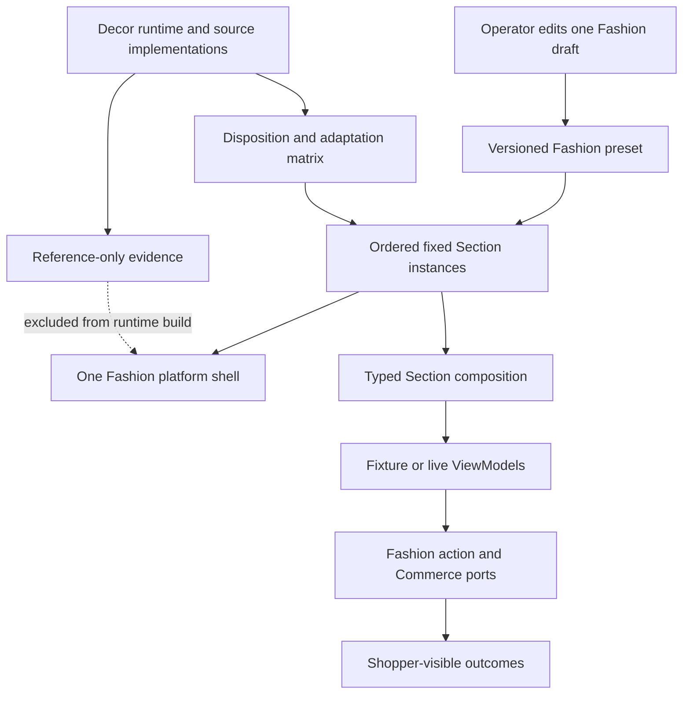
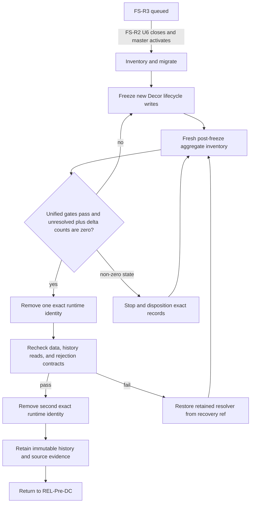

# Fashion Store and Decor Unification - Plan

## Goal Capsule

- **Objective:** Operators build one configurable `fashion-store` experience that can use approved Decor-derived presentations, while shoppers receive one consistent set of live catalog, cart, and checkout behavior instead of two competing storefront implementations.
- **Means:** Extend the existing Theme Platform so `fashion-store` owns a single template shell, fixed configurable Sections, versioned presets, and typed Section composition; migrate only U1-approved Decor-specific presentations into that namespace, then retire the selectable `decor` and `decor-store` runtimes after an explicit data and evidence gate (KTD1-KTD8).
- **Authority:** The product master remains the product authority. THEME governs package, preset, override, preview, and build isolation. FS, FS-R1, FS-F3, and FS-R2 govern the inherited functional Fashion baseline. DS-H1, DS, and DS-P1 remain historical source and acceptance authorities until this successor completes their runtime tail.
- **Execution profile:** Activate only after FS-R2-U6 closes and returns the pointer through the product master. Work characterization-first in the long-lived primary Shoppp worktree, preserving stable IDs and exact package history. No PR, deployment, candidate freeze, DC advance, or production promotion is required.
- **Stop conditions:** Stop before activation while FS-R2 is active. Stop runtime retirement if an authorized environment contains unresolved `decor` or `decor-store` state, if an existing Fashion draft cannot migrate without losing overrides, if the unified build imports a legacy Decor runtime or source fragment, or if the inherited Decor Hero or Fashion commerce contract regresses.
- **Tail ownership:** Once activated, FS-R3 owns the bounded Theme Platform extension, Fashion package successor, Decor capability disposition, both Decor runtime identities, local verification, and REL handback. If U1-U6 are complete but U7 is blocked solely by unresolved external Decor state, the same-change master update may classify FS-R3 blocked at U7, retain its retirement tail without a second execution queue, and reactivate REL; FS-R3 must be reactivated before U7/U8 resume. REL retains Candidate Template Matrix, DC, and PG authority.

---

## Authority and Lineage

- **Upstream product authority:** `docs/plans/2026-08-13-001-refactor-shoppp-product-master-plan.md` owns the product map, plan register, active pointer, product-level order, aliases, and supersession history.
- **Inherited platform baseline:** `docs/plans/2026-07-30-002-feat-versioned-storefront-theme-platform-plan.md` supplies versioned packages, namespaced registries, ordered Sections, bounded settings, stable instance IDs, operator overrides, isolated preview, and selected-theme build isolation. This plan preserves those boundaries while changing the initial two-package product shape.
- **Inherited Fashion baseline:** `docs/plans/2026-08-11-001-feat-fashion-store-functional-integration-plan.md` owns the live storefront behavior. `docs/plans/2026-09-03-1750-refactor-fashion-store-components-dependencies-plan.md` supplies the shared Fashion components, reduced vendor surface, single-Swiper posture, bundle budget, and fixture/live regression contract. `docs/plans/2026-09-04-1336-fix-fashion-store-product-gallery-carousel-plan.md` retains Product gallery behavior.
- **Inherited Hero baseline:** `docs/plans/2026-09-05-1414-refactor-fashion-store-decor-hero-plan.md` and `apps/storefront/app/themes/fashion-store/components/FashionStoreDecorHero.vue` own the already-migrated Decor Hero. FS-R3 verifies but does not reimplement or reopen it.
- **Decor reference authority:** `docs/plans/2026-08-10-001-feat-decor-store-source-parity-plan.md`, `docs/plans/2026-08-12-002-fix-decor-motion-responsive-parity-plan.md`, and `docs/plans/2026-08-19-1518-feat-decor-store-page-suite-plan.md` retain their completed source, behavior, and reconstruction evidence. Their runnable theme tails transfer to FS-R3 only when it activates.
- **Explicit supersessions on activation:** FS-R3 supersedes THEME-R4 only where it requires Fashion and Decor to remain separate selectable packages. It supersedes the product master's two-current-template model, the standalone `decor` to `decor-store` migration follow-up, and the independent DS/DS-P1 runtime tail. Historical stable R/F/AE/KTD/U identifiers and evidence remain unchanged.
- **Parallel plans:** FS-R2 remains active until its U6 handback. REL remains paused without changing its existing blockers, candidate identity, DC, or PG state. Commerce, IAM, AI, Admin, CI, and completed Fashion plans retain their recorded responsibilities.
- **Activation and handback:** Creating this plan does not change the active pointer. Activation requires a same-change master update and an FS-R3 execution checkpoint. Completion returns execution to REL-Pre-DC without implying a candidate selection or production approval. A U7 external-state blocker may use the bounded handback branch above without marking FS-R3 complete or authorizing Decor removal; Decor does not block a Fashion-only candidate unless REL explicitly freezes it into the Candidate Template Matrix.

---

## Execution Checkpoint

- **Plan state:** Complete on 2026-09-07; execution returned to `REL-Pre-DC`.
- **Current parent/child stage:** None. `U8.2` completed the second exact-identity retirement and closed the plan.
- **Current unit status:** `U1`–`U8` are complete. `fashion-store` is the sole selectable/runtime package; immutable Decor reads, stable retirement errors, the frozen reference tree, and recovery ref remain intact.
- **Next concrete action:** `REL-Pre-DC` reconciles the intended release capability set and candidate-identity enforcement. This handback does not select a candidate or advance DC/PG.
- **Blocker:** No FS-R3 blocker or implementation tail remains. REL retains its existing Pre-DC blockers.
- **U6.1 evidence:** [`docs/progress/fashion-store-u6-1-package-boundary.md`](../progress/fashion-store-u6-1-package-boundary.md) records the frozen digest, exact direct boundary, lifecycle enforcement, and verification results.
- **U3 evidence:** [`docs/progress/fashion-store-u3-home-sections.md`](../progress/fashion-store-u3-home-sections.md) records characterization, provisional composition, review corrections, and verification without acting as a second execution queue.
- **U4/U5 evidence:** [`docs/progress/fashion-decor-u4-u5-presentations.md`](../progress/fashion-decor-u4-u5-presentations.md) records the six Home variants, Product groups Section, U5 no-op disposition, review corrections, and focused/browser verification.
- **U6 evidence:** [`docs/progress/fashion-decor-u6-migration-publication.md`](../progress/fashion-decor-u6-migration-publication.md) records unified-preset publication, production-wired exact migration, preserved source/preset/binding identity, review correction, and API/Admin/preview verification.
- **U7/U8 evidence:** [`docs/progress/fashion-decor-runtime-retirement.md`](../progress/fashion-decor-runtime-retirement.md) records provider reconciliation, freeze versions/times, aggregate-only zero state, reference separation, recovery identities, and the staged deletion evidence.
- **Execution boundary:** U8 removes one exact runtime identity at a time only after a fresh authorized zero-state query. Preserve the reference-only tree and immutable historical reads; do not create a production Worker, delete remote data/artifacts, select a release candidate, or advance DC/PG.

| Unit | Status | Owned outcome |
| --- | --- | --- |
| U1 | Complete (approved 2026-09-07) | Exact capability/identity disposition and unified-preset IA freeze |
| U2 | Complete (verified 2026-09-07; `U2.1` reconciliation verified 2026-09-07) | Dormant single-shell multi-Section composition seam with explicit page-type descriptor coverage |
| U6 | Complete (verified 2026-09-07) | Exact source packages remain frozen; unified preset and direct production migration are published and verified |
| U3 | Complete (verified 2026-09-07) | Stable shell-free fixture/live Home Sections, compatible renderer shell ownership, local all-hidden recovery, and merchandising-order ownership verified |
| U4 | Complete (verified 2026-09-07) | Six approved Home presentation variants and the default-hidden Product groups Section are Fashion-owned and verified |
| U5 | Complete (verification-only no-op 2026-09-07) | U1 rejected Shop/Product Decor variants; existing Fashion commerce routes remain sole authority |
| U7 | Complete (verified 2026-09-07) | Reconciled all namespaces, deployed the exact-ID write freeze, proved zero unresolved state/delta, and separated reference evidence |
| U8 | Complete (verified 2026-09-07; U8.1/U8.2 staged gates) | Both exact Decor runtimes retired after independent fresh zero-state gates; Fashion-only runtime proved and authority returned to REL |

---

## Product Contract

### Summary

Make `fashion-store` the sole configurable storefront package and absorb approved Decor-specific presentations as reusable Sections, variants, assets, and preset defaults. Preserve one Fashion-owned business path, the completed Decor Hero, and independent Decor source evidence while removing duplicate selectable runtimes only after migration and regression gates pass.

### Problem Frame

Shoppp currently exposes `decor`, `decor-store`, and `fashion-store` as technical theme identities even though the product model recognizes only Fashion Store and Decor Store. `fashion-store` contains the functional live catalog, search, product, cart, and checkout integration. The Decor implementations are split between a modular fixture theme under `apps/storefront/app/themes/decor/` and a source-replica theme under `apps/storefront/app/themes/decor-store/`; the latter renders secondary-page HTML fragments and adds local DOM event patches rather than using live Commerce.

The visual products overlap heavily. Fashion and Decor both contain service rows, category presentations, product grids, marquees, collections, brand/client strips, editorial content, shells, and the same commerce routes. Migrating these as another full store would preserve the duplication and reintroduce source runtimes that Fashion has already removed. Deleting Decor first would lose the independent comparison source and could strand drafts, snapshots, builds, or preview state.

The Theme Platform already models ordered Sections and permits operators to reorder, hide, configure, and reset preset instances. Fashion does not yet use that model at the required granularity: each page is registered as one large Section, Home owns its own shell, and live composition assumes one Home Section type. The unification therefore begins with a bounded platform seam, not with wholesale Decor component copying.

### Actors

- A1. **Operator:** Creates or upgrades a Fashion experience, configures approved Sections, validates it, previews it, and approves a successor through existing permissions and audit flows.
- A2. **Shopper:** Browses one Fashion-owned storefront and receives the same authoritative catalog, product, cart, and checkout behavior regardless of the selected presentation variant.
- A3. **Validation automation:** Enforces package compatibility, source/reference separation, migration continuity, selected-theme isolation, behavior, accessibility, performance, and bundle gates.
- A4. **Maintainer:** Classifies Decor capability ownership, activates the successor through the product master, inventories legacy state, and preserves immutable evidence while retiring duplicate runtime code.

### Requirements

**Product identity and capability disposition**

- R1. After FS-R3 completes, `fashion-store` is the only theme package available for new experience creation or activation; `decor` and `decor-store` remain historical technical identities only where immutable records require them.
- R2. Every current Decor component, source region, route, fixture, interaction, asset group, and runtime entry receives exactly one recorded disposition: reuse a Fashion capability, become a Fashion visual variant, become a unique Fashion Section, remain reference-only, or retire.
- R3. The completed `FashionStoreDecorHero` remains the only delivered Decor Hero. FS-R3 may adjust its enclosing Section boundary for composition but cannot rebuild, duplicate, or change its accepted content and behavior.
- R4. Header, footer, search, mini-cart, product card, product gallery, quantity, shop, product, cart, checkout, account, wishlist, and content-page business behavior remain Fashion-owned; no Decor replica becomes a second state or transaction source.

**Composition and operator behavior**

- R5. A Fashion template applies one shell around its ordered Sections in fixture preview, live preview, and routed storefront rendering; shell ownership is an explicit registry opt-in activated only when page-owned shells are removed, and no valid composition may omit or duplicate the shell, header, footer, or `fashion-store-main` landmark.
- R6. The initial unified package exposes a fixed set of stable Section instances that an operator can show, hide, configure, reorder, and reset with the existing override model. At least one meaningful Home content Section must remain visible; an all-hidden shell-only composition is rejected with a local validation error and focus returns to the Section tree. Arbitrary insertion, duplication, nesting, and freeform HTML/CSS/JavaScript are not supported.
- R7. U1 evaluates category/promotion, product-tab merchandising, collection feature, client/brand strip, journal/editorial, service-strip, and marquee presentations as candidates. The U1-approved subset becomes the binding unified Home scope and is consolidated with the corresponding Fashion capability wherever behavior overlaps.
- R8. Fashion shop and product routes expose only Decor presentation variants whose U1 disposition proves distinct configurable operator or shopper value; U5 may remain verification-only when none qualify. Any delivered variant keeps collection bindings, product identity, availability, prices, variants, cart actions, navigation, and error states on the existing Fashion live adapters.
- R9. The package provides an operator-selectable unified preset with stable defaults for new drafts. Existing Fashion presets and stable instance/binding IDs remain on their original preset IDs and migrate to the exact successor package version without silently changing their rendered output.

**Fixture, live, and interaction truth**

- R10. Every delivered Decor-derived Section has an explicit registry-local composition descriptor declaring its resolver, discriminated ViewModel kind/schema, named binding slots, required/optional cardinality, fixture and live inputs, empty and unavailable states, and bounded action surface. Manifest Section definitions, registry components, and descriptors match one-to-one. A missing or invalid binding produces the defined fallback instead of fixture content or a fabricated success.
- R11. Product, collection, wishlist, cart, checkout, account, newsletter, search, and navigation affordances either invoke an existing Fashion typed route/action/Commerce port or render a truthful non-interactive/unavailable state. Source-only anchors and local DOM patches cannot appear as functional controls.
- R12. Fixture preview remains deterministic and transaction-free. Live preview and routed storefront rendering do not import fixture data, Decor HTML fragments, network clients inside theme components, or a second cart state.

**Package evolution, evidence, and retirement**

- R13. The unified composition ships as a new exact Fashion theme/configuration version with a direct pure migration from every still-supported Fashion schema. Existing drafts retain their preset and binding IDs unchanged; the migration transforms only overrides, preserves stable settings/visibility, inserts new stable instance IDs into complete reorder operations at deterministic positions, and reports a reviewable conflict before creating a successor. The source draft remains byte-for-byte unchanged.
- R14. Before either Decor runtime is removed, every mutation whose resolved theme ID is exact `decor` or `decor-store` is frozen while old records remain resolvable: draft create/update/save/clone/successor, migration dry-run/approval, validation, snapshot approval, preview build/rebuild/retry, and grant/session create/renewal. The authoritative environment/database/artifact namespace set is reconciled from deployment configuration and provider metadata before the freeze. Afterward every resolved entry receives a fresh authorized aggregate inventory, with the freeze effective time/version plus post-freeze row-count and record-version/`updated_at` deltas retained as evidence.
- R15. Retirement tracks two counts per exact identity and environment: historical records may remain non-zero and immutable/readable, while unresolved active or runtime-dependent records and all post-freeze row/version mutations must be zero. Any record that still requires old rendering, editing, validation, migration, preview creation/renewal/rebuild, retry, or artifact cleanup blocks deletion until it has an explicit outcome; a missing/unauthorized inventory, unmatched namespace, or newly discovered deployment identity is unknown and invalidates prior zero-state evidence.
- R16. Original Decor HTML, approved assets, provenance, digests, source contracts, behavior ledgers, screenshots, and completed plan evidence remain available from a reference-only path that is not a selectable theme package and cannot enter the Fashion production dependency graph. U7 names the supported historical audit use cases; if an owning authority requires exact visual replay, a sealed immutable build artifact is retained outside the selectable/runtime registry, otherwise the accepted boundary is metadata/payload/audit readability plus independent source evidence.
- R17. Fashion imports no `decor` or `decor-store` registry, component, runtime, source fragment, global theme CSS, jQuery, Slider Revolution, inactive font bundle, remote media, analytics, or tracking resource. Approved media and minimum scoped styles become Fashion-owned resources with provenance.
- R18. Runtime retirement removes both Decor identities from new-package APIs, generated catalogs, build allowlists, preview fixture creation, package scripts, active-theme generation, and active regression matrices while preserving historical record readability and independent source verification.

**Quality and governance**

- R19. The unified Fashion fixture and live paths preserve the approved browser target, reduced-motion, no-JavaScript, route-remount, keyboard, pointer, touch, accessibility, SEO, static-output, resource isolation, 300 KiB initial JavaScript gzip budget, and performance gates inherited from FS-R1 and FS-R2.
- R20. Standard roles, modal focus containment, keyboard interaction, and trigger focus restoration remain owned by existing libraries and shared primitives. New application code supplies meaningful text, names, labels, error association, and non-color state without duplicate global announcers or page-wide focus state machines.
- R21. FS-R3 updates the product master, Theme Platform architecture, REL assumptions, catalogs, tests, and maintenance documentation without advancing Candidate, DC, PG, deployment, or production state.

### Key Decisions

- **One complete storefront package.** `(session-settled: user-approved — chosen over completing and maintaining Fashion Store and Decor Store as separate themes: the user confirmed that overlapping layout, function, and interaction should share one Fashion-owned implementation.)` Governs R1, R4, R7-R9, R18.
- **Retire Decor progressively.** `(session-settled: user-approved — chosen over deleting Decor runtimes before migration: the user confirmed that they should remain frozen comparison sources until capability and data disposition is complete.)` Governs R2, R14-R18.
- **Migrate unique value, not fifteen replica pages.** `(session-settled: user-approved — chosen over moving every Decor route into Fashion: the user confirmed that duplicate pages should reuse Fashion and only distinct components or meaningful visual variants should migrate.)` Governs R2, R4, R7-R8, R11.
- **Treat the Decor Hero as inherited delivery.** Repository evidence confirms that fixture and live Fashion Home already render `FashionStoreDecorHero`; this successor protects that result instead of creating another migration. Governs R3, R19.

### Key Flows

- F1. **Configure and preview the unified store**
  - **Trigger:** A1 creates a new unified Fashion draft or upgrades an existing Fashion draft.
  - **Actors:** A1, A3.
  - **Steps:** The exact package resolves stable preset Sections, the operator changes approved visibility/order/settings and bindings, validation resolves typed ViewModels, and the saved version opens in isolated preview.
  - **Outcome:** The preview shows one Fashion shell and the selected Fashion/Decor presentation mix without exposing fixture state as live commerce.
  - **Covered by:** R5-R13, R19-R20.
- F2. **Shop through a Decor-derived presentation**
  - **Trigger:** A2 follows a product, collection, search, cart, or checkout action from a Decor-derived Section.
  - **Actors:** A2.
  - **Steps:** The Section emits the same typed Fashion destination or action, the existing live adapter resolves authoritative state, and shared Fashion components render success, empty, unavailable, or failure outcomes.
  - **Outcome:** Presentation changes without creating a second commerce implementation or conflicting state.
  - **Covered by:** R4, R8, R10-R12, R19-R20.
- F3. **Upgrade an existing Fashion configuration**
  - **Trigger:** A1 selects the new Fashion package version for an older Fashion draft.
  - **Actors:** A1, A3.
  - **Steps:** A dry run keeps the original preset and binding IDs, maps stable instances, transforms supported overrides, completes reorder operations with deterministic insertion points, surfaces conflicts, and creates a successor only after validation and approval.
  - **Outcome:** The old draft stays byte-for-byte immutable and the successor preserves every supported override without cross-preset or binding migration.
  - **Covered by:** R9, R13.
- F4. **Retire the Decor runtime lineage**
  - **Trigger:** All migrated Sections and unified regression gates pass.
  - **Actors:** A3, A4.
  - **Steps:** New Decor lifecycle writes are frozen while historical reads remain available; a fresh authorized aggregate inventory evaluates `decor` and `decor-store` separately; unresolved runtime-dependent state is dispositioned to zero; source evidence moves outside the runtime dependency graph; both runtime identities and redundant tests are removed.
  - **Outcome:** Fashion is the sole selectable storefront while historical records and source comparison remain auditable.
  - **Covered by:** R1-R3, R14-R18, R21.

### Acceptance Examples

- AE1. **Mixed Fashion and Decor Home**
  - **Covers:** R3, R5-R7, R9-R12.
  - **Given:** A unified Fashion draft contains the inherited Decor Hero, a Decor-style category Section, a Fashion product Section, and a Decor-style journal Section.
  - **When:** The operator reorders one optional Section, hides another, changes an approved setting, saves, validates, and previews.
  - **Then:** One header/footer pair surrounds the chosen order, the Hero remains unchanged, reset restores defaults, and no source fragment or duplicate shell appears.
- AE2. **Live product action from a Decor presentation**
  - **Covers:** R4, R8, R10-R12.
  - **Given:** A Decor-style product tab is bound to a published collection containing available, sold-out, and missing-media products.
  - **When:** The shopper changes tabs, opens a product, selects a variant, and adds it to the cart.
  - **Then:** Fashion catalog and cart ports determine every product fact and outcome, sold-out state remains truthful, missing media uses the approved fallback, and Header MiniCart agrees with the cart page.
- AE3. **Failed live action**
  - **Covers:** R10-R12, R20.
  - **Given:** A shopper activates a Decor-derived control while its binding is invalid or its Fashion action adapter returns a failure.
  - **When:** The action resolves.
  - **Then:** The local component exposes the existing visible error/unavailable result without fake success, duplicate status output, focus loss, or fixture mutation.
- AE4. **Fashion draft migration with reordered Sections**
  - **Covers:** R9, R13.
  - **Given:** An older Fashion draft has custom settings, a hidden optional Section, catalog bindings, and a complete custom reorder list.
  - **When:** The operator dry-runs the new package migration.
  - **Then:** The preset and binding IDs remain unchanged, new stable optional instances appear at deterministic positions, supported override values remain intact, incomplete reorder state is rejected before approval, and the original draft is byte-for-byte unchanged.
- AE5. **Legacy Decor state blocks deletion**
  - **Covers:** R14-R16, R18.
  - **Given:** One configured environment contains a `decor-store` snapshot that still requires old-runtime rendering or an active preview session.
  - **When:** A4 freezes new writes and runs the post-freeze retirement preflight.
  - **Then:** Physical runtime removal stops because the record still depends on the old runtime, the exact identity and aggregate state receive an explicit disposition, and immutable validation, migration, snapshot, catalog-release, and audit history is not deleted or rewritten.
- AE6. **Zero-state Decor retirement**
  - **Covers:** R1, R14-R18, R21.
  - **Given:** Both exact Decor identities have zero unresolved mutable or active state in every configured environment and reference evidence has an independent path.
  - **When:** The retirement unit completes.
  - **Then:** Admin/API catalogs cannot create either Decor package, builds cannot select or import them, Fashion and reference verification still pass, and historical plans and immutable records remain readable.
- AE7. **Selected-theme isolation**
  - **Covers:** R16-R19.
  - **Given:** A production-shaped Fashion build uses the unified preset.
  - **When:** Static, request, bundle, and source scans run.
  - **Then:** No Decor runtime, jQuery, Revolution, source fragment, inactive global CSS, remote asset, or second cart implementation appears, and inherited budgets remain within their approved thresholds.

### Success Criteria

- Operators can create or upgrade one `fashion-store` draft, use every U1-approved Decor-derived presentation through fixed configurable Sections, and complete save, validation, preview, reset, and approval flows without selecting a Decor package.
- Shoppers can traverse Decor-derived merchandising into Fashion-owned product, cart, and checkout flows with one authoritative state and no fake or inert action presented as functional.
- Every Decor capability and both Decor technical identities have a recorded, verified terminal disposition; the already-migrated Hero appears only once in the implementation plan and runtime.
- Both Decor runtimes are absent from new-selection and production dependency paths only after legacy data and evidence gates pass; retained source verification remains reproducible.

### Scope Boundaries

#### Included

- A bounded Theme Platform extension for one template shell and typed multi-Section composition.
- Granular Fashion Home Sections, a unified preset, fixed configurable instances, versioned Fashion configuration migration, and existing Admin visibility/order/settings controls.
- Approved Decor-derived Home presentations and approved shop/product visual variants using Fashion-owned shared components and live adapters.
- Exact inventory and retirement of both `decor` and `decor-store` runtime identities, with retained reference evidence.
- Fixture/live/Admin preview, migration, browser, accessibility, source, isolation, performance, bundle, documentation, and governance verification.

#### Deferred to Follow-Up Work

- Arbitrary Section insertion, deletion, duplication, nested layouts, drag-and-drop canvas editing, reusable merchant-defined blocks, or freeform page building.
- A general cross-theme draft migration framework. Non-zero Decor configuration receives an explicit reviewed disposition before this plan resumes retirement.
- New shopper capabilities that Fashion does not already own, including customer accounts, saved wishlists, reviews, newsletter delivery, comments, or payment behavior.
- Additional Decor-derived Sections whose value is not approved by the U1 disposition matrix.

#### Outside This Product's Identity

- A second complete Decor storefront, shopper-facing runtime theme switching, or duplicate Catalog/Commerce state owned by presentation components.
- Importing or executing user-supplied HTML, JavaScript, jQuery, Slider Revolution, arbitrary CSS, remote scripts, or legacy source fragments in the delivered Fashion package.
- Rewriting historical plans, evidence, immutable snapshots, audit events, or source assets to make the unified result appear source-identical.

### Dependencies

- FS-R2-U6 must close and return the master pointer before FS-R3 activation.
- Existing Fashion live catalog, cart, checkout, preview, migration, and versioned-package infrastructure remain available and authoritative.
- Authorized aggregate-only access to every configured environment is required before U7 can authorize retirement.
- Product-source rights and existing Decor provenance remain valid for approved asset and presentation migration.

---

## Planning Contract

### Key Technical Decisions

- KTD1. **Use fixed configurable Sections, not a general component insertion protocol.** The unified preset declares stable singleton instances that existing overrides can reorder, hide, configure, and reset while validation preserves at least one visible content Section. This delivers operator control without expanding contracts, API, and Admin into arbitrary add/remove/duplicate operations. Governs R5-R7, R9, R13.
- KTD2. **Add an opt-in renderer-owned shell and registry-local Section composition descriptors.** Do not change the current meaning of `platformShell` in place. First add a compatibility-preserving shell-ownership opt-in; each descriptor maps one Section type to a resolver, discriminated ViewModel schema, named binding slots, and cardinality. U3 enables renderer ownership only in the same change that removes Fashion Home's page-owned shells and assigns the sole `fashion-store-main` landmark. This avoids a transitional double shell and replaces the current implicit non-Home-to-product fallback. Governs R5, R10, R12.
- KTD3. **Publish an exact Fashion successor version without pretending the current migration can move presets or bindings.** Existing drafts remain on their original preset IDs and keep binding IDs unchanged; the pure migration transforms overrides and deterministically completes reorder operations only. The unified preset is available to new drafts. At activation, freeze the exact supported source-version/schema to target-version/schema pairs; register one direct migration for each supported source because the service does not chain migrations. The default production registry, not test-only injection, must resolve every pair. Never mutate an approved exact package version. Governs R9, R13.
- KTD4. **Consolidate by capability before preserving visual difference.** Header/footer/search/cart/commerce use Fashion shared components. Candidate category, service, marquee, collection, brand/client, journal, and product-tab presentations migrate only when U1 proves distinct configurable value; product tabs become a distinct merchandising Section only if their observable interaction cannot be expressed by an existing Fashion Section. `(session-settled: user-approved — chosen over copying every Decor component and page: the user approved retaining only unique value and meaningful differences.)` Governs R2, R4, R7-R8.
- KTD5. **Keep all business truth behind Fashion ports.** Decor-derived Sections emit existing typed destinations and actions and consume Fashion catalog-bound ViewModels. They never calculate authoritative price, availability, totals, inventory, authentication, or checkout state. Governs R4, R8, R10-R12.
- KTD6. **Copy approved presentation assets, not runtime ownership.** Move the minimum approved media and scoped styles into the Fashion namespace with provenance; place source HTML, digests, ledgers, and captures in a reference-only path excluded from selected-theme builds. Import boundaries and source scans enforce both sides. Governs R16-R17, R19.
- KTD7. **Treat `decor` and `decor-store` as two technical identities in one retirement lineage.** Freeze new lifecycle writes, inventory them separately, and reuse the Retired Fashion Runtime aggregate-only decision pattern. Historical immutable/readable counts may remain non-zero; unresolved active/runtime-dependent counts and post-freeze deltas must be zero. Non-zero unresolved or unknown state is a stop condition, not authorization for speculative cross-theme migration or destructive cleanup. `(session-settled: user-approved — chosen over immediate deletion: the user approved staged retirement after safe migration and verification.)` Governs R1-R2, R14-R18.
- KTD8. **Separate development completion from release authority.** FS-R3 may remove selectable local runtime entries and return a verified Fashion-only development baseline, but REL owns candidate identity, formal DC3 scope, DC evidence, and PG. Governs R18-R21.

### High-Level Technical Design

#### Unified composition and data ownership



The Fashion package owns all runtime nodes after migration. The Decor lineage can inform a Section's accepted presentation but cannot appear on the runtime dependency path.

#### Retirement lifecycle and stop gate



Runtime deletion is downstream of functional migration, exact-state disposition, reference separation, and regression proof. A missing environment result is not equivalent to zero.

### Disposition Baseline

| Decor capability | Fashion target | Planned treatment | Runtime authority |
| --- | --- | --- | --- |
| Hero carousel | Existing `FashionStoreDecorHero` | Inherited; regression only | Fashion |
| Header, footer, search, mini-cart, shell | Fashion shared shell components | Reuse; retain only approved presentation settings | Fashion |
| Category showcase and promotion cards | Fashion category/promotion Section | Consolidated visual variant | Fashion |
| Product tabs/grid | Fashion product card and catalog binding | Candidate distinct merchandising selector; otherwise reuse | Fashion |
| Marquee | Fashion marquee behavior | Consolidated content/visual variant | Fashion |
| Collection feature | Fashion collection/editorial capability | Consolidated visual variant | Fashion |
| Client strip | Fashion brand strip | Consolidated visual/motion variant | Fashion |
| Journal | Fashion magazine/editorial cards | Consolidated visual variant | Fashion |
| Service strip | Fashion service presentation | Consolidated visual variant | Fashion |
| Shop and product replicas | Fashion live catalog/product routes | Optional presentation settings only; no replica logic | Fashion |
| Cart, checkout, account, wishlist, content replicas | Existing Fashion routes or truthful unavailable state | Do not migrate | Fashion |
| HTML fragments, DOM patches, jQuery, Revolution | Reference evidence or deletion | Never enter unified runtime | None |

Every row above is a candidate except the inherited Hero and Fashion-owned reuse/retirement rows. U1 approves migration only when the row names a concrete operator job or shopper outcome it uniquely improves, an observable difference that the existing Fashion capability cannot already express, and an ongoing Fashion maintenance owner. Product authority approves the frozen matrix before U4; absent that case, the default disposition is Fashion reuse or reference-only retirement. U1 cannot add a second business implementation or reopen the Hero.

U1 also freezes the unified-preset information architecture as the implementation authority for `unified-store.ts`: every approved stable instance ID, default order, default visibility, required/optional status, Admin label/group, and priority rationale. That table governs reset behavior and deterministic migration insertion positions; operator-facing names describe capabilities, not Fashion/Decor lineage.

### Sequencing

1. Activate only after FS-R2 handback, then freeze the capability and identity inventory.
2. Establish a dormant opt-in shell seam and typed multi-Section composition descriptors before moving visual regions.
3. Execute U6.1 to freeze immutable source packages and create the successor-only registry path before any Fashion structure changes.
4. Decompose Fashion into stable Sections and enable renderer shell ownership in the same change that removes page-owned shells.
5. Connect all presentation variants to Fashion fixture/live bindings and actions before exposing them to operators.
6. Execute U6.2 to publish the new creatable version and migrate Fashion overrides while retaining existing preset/binding IDs.
7. Freeze new Decor lifecycle writes, inventory both identities after the freeze, and separate reference evidence before removing runtime/catalog entries.
8. Run full Fashion and repository gates, update governance, and hand back to REL.

### Research Inputs

- `apps/storefront/app/themes/fashion-store/registry.ts`, `fixture-registry.ts`, `manifest.ts`, `composition.ts`, and `presets/source-parity.ts` define the functional Fashion package and its current page-sized Sections.
- `apps/storefront/app/theme-engine/renderer.vue` and `composer.ts` expose the one-shell and typed multi-Section gaps.
- `apps/storefront/app/themes/decor/registry.ts` provides modular Decor Home regions; `apps/storefront/app/themes/decor-store/components/pages/DecorStoreSourceReplicaPage.vue` proves that secondary replicas are reference-oriented DOM adaptations rather than live Commerce components.
- `apps/api/src/storefront-experience/service.ts`, `packages/contracts/src/storefront-experience.ts`, and `apps/admin/src/pages/storefront/theme-editor-page.tsx` define exact package versions, pure same-theme migration, fixed override operations, and operator editing.
- `docs/solutions/workflow-issues/html-source-parity-reconstruction-workflow-2026-08-06.md` requires structural, behavioral, and absence contracts and places legacy deletion after migration and repository regression.
- `docs/plans/2026-08-13-002-refactor-retired-fashion-runtime-plan.md` supplies the aggregate-only, zero/non-zero retirement precedent.

---

## Output Structure

The exact filenames may be refined during implementation, but runtime and reference ownership must remain visibly separate.

```text
apps/storefront/
├── app/theme-engine/
│   ├── composition.ts
│   ├── composer.ts
│   └── renderer.vue
├── theme-references/
│   └── decor-store/
│       ├── README.md
│       ├── source-contract.ts
│       └── behavior-contract.ts
└── app/themes/fashion-store/
    ├── components/sections/
    │   └── FashionStore<ApprovedCapability>Section.vue
    ├── migrations.ts
    └── presets/unified-store.ts
```

---

## Implementation Units

### U1. Reconcile Decor capabilities and identities

- **Goal:** Freeze the exact migration/retirement inventory before changing composition or runtime ownership.
- **Requirements:** R2-R4, R14-R18; Key Decisions 2-4.
- **Dependencies:** FS-R2-U6 closed and FS-R3 activated through the product master.
- **Files:**
  - `apps/storefront/app/themes/decor/**`
  - `apps/storefront/app/themes/decor-store/**`
  - `apps/storefront/app/themes/fashion-store/**`
  - `tools/storefront-source-equivalence-policy.json`
  - `docs/progress/fashion-decor-component-disposition.md`
  - `apps/storefront/tests/theme-source-contract.test.ts`
  - `apps/storefront/tests/decor-store-source-contract.test.ts`
- **Approach:**
  1. Inventory both Decor package identities, every registered component/route/fixture/runtime, current source regions, and every Fashion counterpart.
  2. Record one disposition per item using R2 and the baseline matrix; include trigger, dependency, visible result, input modes, responsive/accessibility branch, target owner, and verification for stateful capabilities.
  3. Require every migration candidate to name its unique operator job or shopper outcome, observable difference from the Fashion capability, and ongoing Fashion maintenance owner; product authority approves the matrix, otherwise the item defaults to reuse or reference-only retirement.
  4. Freeze the unified-preset IA table with stable ID, default order/visibility, required status, Admin capability label/group, and priority rationale; at least one meaningful Home content Section must remain visible.
  5. Mark the Hero inherited and complete, reject secondary replica commerce as a migration source, and freeze the runtime/reference paths that later units may remove or retain.
- **Execution note:** Add characterization and absence coverage before editing the legacy Decor subtrees.
- **Patterns to follow:** `docs/solutions/workflow-issues/html-source-parity-reconstruction-workflow-2026-08-06.md`; `docs/progress/fashion-store-dependency-inventory.md`.
- **Test scenarios:**
  1. Every registry component, enabled Decor Store route, generated fragment family, package descriptor, and selectable build entry appears once in the disposition record.
  2. `FashionStoreDecorHero` resolves to inherited Fashion ownership and no migration target proposes another Hero component.
  3. Every stateful source affordance has an owner and acceptance path; a missing disposition or owner fails the inventory check.
  4. Cart, checkout, account, wishlist, and secondary source replicas resolve to Fashion reuse or reference/retirement, never to duplicate business implementation.
  5. The approved IA table yields one coherent Fashion-first starter composition and uses capability language without exposing retired Decor lineage to operators.
- **Verification:** Reviewers can trace every Decor runtime and source item to one terminal outcome, and later units have no unclassified deletion or migration target.

### U2. Add the single-shell multi-Section composition seam

- **Goal:** Add a dormant, compatibility-preserving opt-in that can render multiple independently resolved Sections inside exactly one renderer-owned shell.
- **Requirements:** R5-R6, R10, R12-R13, R20.
- **Dependencies:** U1.
- **Files:**
  - `apps/storefront/app/theme-engine/composition.ts`
  - `apps/storefront/app/theme-engine/composer.ts`
  - `apps/storefront/app/theme-engine/renderer.vue`
  - `apps/storefront/app/theme-engine/view-models.ts`
  - `apps/storefront/app/theme-engine/providers/**`
  - `apps/storefront/app/theme-engine/presentation-context.ts`
  - `apps/storefront/app/StorefrontExperience.vue`
  - `packages/contracts/src/storefront-experience.ts`
  - `packages/contracts/test/storefront-experience.test.ts`
  - `packages/domain/test/storefront-experience.test.ts`
  - `apps/storefront/tests/theme-engine.test.ts`
  - `apps/api/test/storefront-experience/experience-api.test.ts`
- **Approach:**
  1. Add a registry-local composition descriptor keyed by Section type. Each entry declares its resolver, discriminated fixture/live ViewModel kind/schema, named binding slots, and required/optional cardinality; validate one-to-one correspondence with manifest Section definitions and registry components.
  2. Add an explicit renderer-owned shell opt-in without changing existing `platformShell` behavior. Keep it disabled for all current registries in U2 so existing page-owned shells and output remain unchanged.
  3. Resolve shell input as its own typed fixture/live value and remove the Home-only implicit product fallback only for registries using the new descriptors.
  4. Validate missing/extra descriptors, duplicate shell ownership, unsupported ViewModels, fixture/live kind drift, and required bindings before preview.
- **Patterns to follow:** Existing `ThemeCompositionAdapter`, `composeExperienceShell`, Zod package validation, and `composeThemeRegistries` boundaries.
- **Test scenarios:**
  1. A probe registry with three Sections and the opt-in enabled renders one shell, one header/footer pair, one main destination, and the declared Section order.
  2. A registry without `platformShell` keeps its current renderer behavior.
  3. An unknown or mismatched Section resolver is rejected before component rendering.
  4. A decorative Section with no catalog binding receives its declared typed ViewModel rather than a product-binding error.
  5. A commerce Section missing its required binding fails validation with the existing local field association.
  6. Fixture and live modes produce the same Section identities, ViewModel kinds, and shell configuration while live resolution never falls back to fixture data.
  7. SSR and hydration produce the same shell/Section tree without duplicate IDs or landmarks.
- **Verification:** Contract, domain, API, renderer, provider, fixture-preview, and live-composition tests prove the dormant seam without changing any existing package output.

### U3. Decompose Fashion Home into stable Sections

- **Goal:** Convert the Fashion Home page-sized implementation into shell-free, stable, configurable Section components while preserving its accepted behavior.
- **Requirements:** R3-R7, R9-R13, R19-R20.
- **Dependencies:** U2 and U6.1 (the immutable source package plus successor-only registry path exist).
- **Files:**
  - `apps/storefront/app/themes/fashion-store/components/FashionStoreHome.vue`
  - `apps/storefront/app/themes/fashion-store/components/FashionStoreLiveHomePage.vue`
  - `apps/storefront/app/themes/fashion-store/components/FashionStoreHomeRoute.vue`
  - `apps/storefront/app/themes/fashion-store/components/FashionStoreDecorHero.vue`
  - `apps/storefront/app/themes/fashion-store/components/sections/**`
  - `apps/storefront/app/themes/fashion-store/registry.ts`
  - `apps/storefront/app/themes/fashion-store/fixture-registry.ts`
  - `apps/storefront/app/themes/fashion-store/manifest.ts`
  - `apps/storefront/app/themes/fashion-store/presets/source-parity.ts`
  - `apps/storefront/fixtures/experience/fashion-store.json`
  - `apps/storefront/app/themes/fashion-store/source-contract.ts`
  - `apps/storefront/tests/fashion-store-home-source.test.ts`
  - `apps/storefront/tests/fashion-store-runtime.test.ts`
  - `apps/storefront/e2e/fashion-store-theme.spec.ts`
  - `apps/storefront/e2e/fashion-store-decor-hero.spec.ts`
- **Approach:**
  1. Freeze the old instance/setting/binding-to-new-owner map. Retain the existing binding IDs on their compatibility Section and give every new fixed Section an explicit fixture input and discriminated fixture/live ViewModel.
  2. Extract the current Home regions into shell-free Section components with stable IDs and the narrowest existing shared component dependencies.
  3. In the same change that removes both Home components' internal `FashionStoreShell`, enable renderer shell ownership and assign the shell the sole `fashion-store-main` landmark; Sections cannot render their own main landmark.
  4. Preserve fixture and live providers as separate inputs to the same presentation boundaries; do not move business state into Sections or use fixture fallback in live mode.
  5. Keep the Hero implementation untouched except for its enclosing Section registration and regression selectors.
- **Execution note:** Characterize current fixture/live DOM order, actions, no-JS content, and remount behavior before extraction.
- **Patterns to follow:** FS-R1 shared component ownership; existing `FashionStoreProductCard`, `FashionStoreEditorialCard`, `FashionStoreCarousel`, and `FashionStoreShell` APIs.
- **Test scenarios:**
  1. Existing Fashion source-parity preset produces the same visible region order, content, typed destinations, and responsive outcomes after decomposition.
  2. Fixture and live Home each render one shell and the same declared Section identities without importing the other's data source.
  3. The Decor Hero retains its three slides, timing, actions, reduced-motion, fallback, resize, and remount behavior.
  4. Hiding or reordering one optional non-Hero Section changes only that Section and survives save/reload; reset restores the exact preset visibility and order defaults.
  5. Empty live collections and missing featured products render existing truthful states without fixture fallback.
  6. No-JavaScript output retains meaningful first content and navigation with stable geometry.
  7. Existing `fashion-store-home` binding IDs resolve to their frozen compatibility owner and no binding becomes orphaned or changes meaning.
  8. Attempting to hide the final visible Home content Section fails local validation, keeps the last valid preview, and focuses the owning Section-tree error; reset restores the frozen starter composition.
- **Verification:** Focused Home/unit/browser evidence matches the inherited Fashion and FS-R2 contracts with no duplicated shell or Hero.

### U4. Consolidate U1-approved Decor Home presentations

- **Goal:** Make only the U1-approved Decor-derived Home presentations selectable inside Fashion without importing Decor runtime ownership; if no candidate qualifies, close as a verification-only no-op.
- **Requirements:** R2-R4, R6-R12, R16-R17, R19-R20.
- **Dependencies:** U1, U3.
- **Files:**
  - `apps/storefront/app/themes/fashion-store/components/sections/**`
  - `apps/storefront/app/themes/fashion-store/components/shared/FashionStoreProductCard.vue`
  - `apps/storefront/app/themes/fashion-store/components/shared/FashionStoreEditorialCard.vue`
  - `apps/storefront/app/themes/fashion-store/fixtures/home.ts`
  - `apps/storefront/app/themes/fashion-store/manifest.ts`
  - `apps/storefront/app/themes/fashion-store/resources.ts`
  - `apps/storefront/app/themes/fashion-store/integration.css`
  - `apps/storefront/app/themes/fashion-store/UPSTREAM.md`
  - `apps/storefront/app/themes/fashion-store/source-contract.ts`
  - `apps/storefront/tests/fashion-store-theme.test.ts`
  - `apps/storefront/tests/fashion-store-live-commerce.test.ts`
  - `apps/storefront/app/theme-engine/composer.ts`
  - `apps/storefront/app/theme-engine/view-models.ts`
  - `apps/storefront/app/theme-engine/providers/**`
  - `apps/storefront/fixtures/experience/fashion-store.json`
  - `apps/storefront/e2e/fashion-store-content.spec.ts`
  - `apps/storefront/e2e/fashion-store-live-commerce.spec.ts`
- **Approach:**
  1. Implement only the U1-approved candidate treatments using the KTD4 consolidation rule; do not treat the candidate list as a mandatory feature list.
  2. Copy only approved media and minimum scoped styles into Fashion resources with source/delivered provenance; use existing icons, carousel, cards, and motion primitives.
  3. Add concrete registry descriptors/resolvers and segmented fixture bindings for every delivered Section; fixture and live providers emit the same discriminated ViewModel kinds.
  4. If product-tab merchandising qualifies, implement it as a native-button merchandising selector rather than a custom ARIA tab widget: Enter/Space activates, selection does not move focus automatically, small screens scroll the selector horizontally, panels expose loading/empty/error states, remount resets to the first available choice, and reduced motion removes transition animation.
  5. Map fixture controls to preview intents and live controls to existing Fashion actions, including empty, unavailable, sold-out, missing-media, and action-failure outcomes.
- **Patterns to follow:** `FashionStoreDecorHero` resource isolation, Fashion shared component contracts, and local accessibility ownership rules.
- **Test scenarios:**
  1. Covers AE1. An operator mixes Fashion and Decor-derived Sections, reorders/hides/configures them, and preview renders the exact saved order inside one shell.
  2. Covers AE2 when product tabs qualify. The selector uses published collection membership and shared product cards; available, sold-out, and missing-media products remain truthful.
  3. Covers AE3. Invalid bindings and failed actions expose existing local failure states without fabricated success or duplicate live regions.
  4. Keyboard, pointer, touch, reduced-motion, resize, and route-remount behavior follows the owning shared primitive for every interactive migrated Section.
  5. Source scans find no Decor component, global stylesheet, fragment, jQuery, Revolution, remote asset, or inactive font import.
  6. A controlled missing item, wrong order, stale action, or unscoped style defect fails its intended structural, behavioral, or absence gate.
- **Verification:** Every approved presentation is operator-usable in fixture and live preview, uses Fashion actions, and passes focused visual/behavior/isolation gates.

### U5. Apply U1-approved Decor presentation variants to shared commerce routes

- **Goal:** Preserve only U1-approved Decor shop/product visual value through Fashion components without migrating replica-page logic; if no variant qualifies, close as a verification-only no-op.
- **Requirements:** R4, R8, R10-R12, R17, R19-R20.
- **Dependencies:** U3, U4.
- **Files:**
  - `apps/storefront/app/themes/fashion-store/components/pages/FashionStoreLiveCollectionPage.vue`
  - `apps/storefront/app/themes/fashion-store/components/pages/FashionStoreLiveProductPage.vue`
  - `apps/storefront/app/themes/fashion-store/components/shared/FashionStoreLiveCatalog.vue`
  - `apps/storefront/app/themes/fashion-store/components/shared/FashionStoreProductCard.vue`
  - `apps/storefront/app/themes/fashion-store/components/shared/FashionStoreProductGallery.vue`
  - `apps/storefront/app/themes/fashion-store/manifest.ts`
  - `apps/storefront/app/themes/fashion-store/contracts/pages/collection.ts`
  - `apps/storefront/app/themes/fashion-store/contracts/pages/product.ts`
  - `apps/storefront/app/theme-engine/composer.ts`
  - `apps/storefront/app/theme-engine/view-models.ts`
  - `apps/storefront/app/theme-engine/providers/**`
  - `apps/storefront/tests/fashion-store-shop.test.ts`
  - `apps/storefront/tests/fashion-store-product.test.ts`
  - `apps/storefront/e2e/fashion-store-shop.spec.ts`
  - `apps/storefront/e2e/fashion-store-product.spec.ts`
- **Approach:**
  1. Add only U1-approved presentation settings as schema-validated ViewModel presentation fields (or an equivalent typed presentation config) produced identically by fixture and live composition; components do not read raw Section instances.
  2. Keep filtering, sorting, pagination, variants, gallery, wishlist availability, pricing, cart actions, and destinations on their current contracts.
  3. Explicitly exclude Decor cart, checkout, account, wishlist, blog, About, FAQ, and Contact replica implementations; existing Fashion routes remain authoritative.
- **Patterns to follow:** Fashion live/fixture route split, `FashionStoreLiveCatalog`, FS-F3 gallery behavior, and capability-matrix truthfulness.
- **Test scenarios:**
  1. The same live collection and product records render under Fashion and approved Decor presentation settings without changing IDs, prices, availability, or action payloads.
  2. Sorting, filtering, pagination, product navigation, variant selection, gallery/lightbox, add-to-cart, and MiniCart synchronization preserve existing outcomes.
  3. Unsupported wishlist/account/newsletter behavior remains absent or truthfully unavailable rather than adopting source-replica DOM patches.
  4. Empty, unavailable, sold-out, invalid-variant, cart failure, and missing-media states remain reachable and correctly named.
  5. Route navigation and back/forward remount do not retain visual state from the previous presentation variant.
  6. Switching presentation variants changes only presentation fields; product IDs, prices, availability, destinations, and action payloads are byte-for-byte equal.
- **Verification:** Full Fashion shop/product fixture and live suites pass for default and Decor presentation configurations with one business state source.

### U6. Publish and migrate the unified Fashion package

- **Goal:** Expose the unified preset for new drafts and migrate existing Fashion overrides to the exact successor version without changing their preset or bindings.
- **Requirements:** R5-R6, R9-R13, R19-R21.
- **Dependencies:** U6.1 depends on U2 and must complete before U3; U6.2 depends on U3-U5 and U6.1.
- **Files:**
  - `apps/storefront/app/themes/fashion-store/manifest.ts`
  - `apps/storefront/app/themes/fashion-store/migrations.ts`
  - `apps/storefront/app/themes/fashion-store/presets/source-parity.ts`
  - `apps/storefront/app/themes/fashion-store/presets/unified-store.ts`
  - `apps/api/src/storefront-experience/service.ts`
  - `apps/api/test/storefront-experience/experience-api.test.ts`
  - `packages/domain/src/storefront-experience.ts`
  - `packages/domain/test/storefront-experience.test.ts`
  - `apps/admin/src/pages/storefront/themes-page.tsx`
  - `apps/admin/src/pages/storefront/theme-editor-page.tsx`
  - `apps/admin/src/pages/storefront/theme-editor-page.test.tsx`
  - `apps/admin/src/pages/storefront/theme-editor-page.browser.test.tsx`
  - `apps/storefront/tests/fashion-store-theme.test.ts`
- **Approach:**
  1. **U6.1 — version boundary before decomposition:** At activation, freeze byte-stable copies of every supported source package/preset and the exact source-version/schema to successor-version/schema pairs. Register a successor-only implementation path plus a historical exact-package registry before U3 changes any manifest, preset, registry, or component structure.
  2. Add an explicit package lifecycle eligibility contract: only the current successor version appears in the creatable/activatable catalog; historical exact versions remain available solely for immutable reads, validation of retained history, and migration-source resolution. A direct create request for a historical version receives the stable non-creatable-package response.
  3. **U6.2 — migration and operator publication:** Register the unified preset for new drafts and a direct pure migration from every supported source schema in the default production registry. It transforms overrides only, retains source preset/binding IDs unchanged, and inserts new stable optional instance IDs into reorder operations at deterministic positions; do not assume chained migration execution.
  4. Keep the existing Admin interaction model; improve labels and feedback only where operators need to distinguish presentation variants, migration conflicts, or retained legacy drafts.
- **Patterns to follow:** Existing dry-run migration, immutable successor, conflict, optimistic-version, field-focus, permission, and preview-grant flows.
- **Test scenarios:**
  1. Covers AE4. A draft with no overrides migrates to the new version with the preset defaults and no conflict.
  2. Covers AE4. Settings, hidden state, catalog bindings, preset ID, and custom complete order survive migration; new IDs appear once at deterministic positions.
  3. A removed/renamed stable instance, invalid setting, incomplete order, stale draft version, missing package, or missing migration chain blocks approval and leaves the source draft unchanged.
  4. An operator without write, preview, or approval permission retains the existing read-only boundaries for the new package.
  5. Saved unified overrides reset to their exact preset defaults and preview resolves the saved version rather than local unsaved state.
  6. Old exact Fashion records remain readable while new drafts can choose the unified package/preset.
  7. API tests without test-only migration injection resolve the historical and successor exact packages plus every supported direct migration; the source draft remains byte-for-byte unchanged after dry-run, conflict, and success paths.
  8. Direct API creation/activation against a historical Fashion version receives the stable non-creatable-package response, while immutable reads and migration-source resolution still work.
- **Verification:** Contract, domain, API, Admin unit/browser, and Fashion package tests prove production-wired exact-version resolution and lossless supported override migration.

### U7. Inventory and separate the Decor retirement lineage

- **Goal:** Freeze new Decor lifecycle writes, prove whether unresolved runtime-dependent state exists, and detach retained source evidence from selectable runtime code.
- **Requirements:** R14-R18, R21.
- **Dependencies:** U4-U6.
- **Files:**
  - `docs/progress/fashion-decor-runtime-retirement.md`
  - `apps/storefront/theme-references/decor-store/**`
  - `apps/storefront/app/themes/decor-store/UPSTREAM.md`
  - `apps/storefront/app/themes/decor-store/source-contract.ts`
  - `apps/storefront/app/themes/decor-store/behavior-contract.ts`
  - `tools/storefront-source-equivalence-policy.json`
  - `tools/verify-source-equivalent-themes.ts`
  - `tools/verify-source-equivalent-themes.test.ts`
  - `apps/storefront/tests/theme-source-contract.test.ts`
  - `docs/runbooks/storefront-theme-retirement.md`
  - `apps/api/src/storefront-experience/service.ts`
  - `apps/api/src/storefront-experience/preview.ts`
  - `apps/api/test/storefront-experience/experience-api.test.ts`
  - `apps/api/test/storefront-experience/preview-api.test.ts`
- **Approach:**
  1. Reconcile one authoritative inventory of deployment environments, unique database IDs, and artifact namespaces from checked-in deployment configuration plus provider metadata; retain unmatched/new identities as blockers rather than silently excluding them.
  2. Add one exact-ID retirement policy used by every draft create/update/save/clone/successor, migration dry-run/approval, validation, snapshot approval, preview build/rebuild/retry, and grant/session create/renewal path. For grants and sessions, resolve the theme identity through immutable snapshot/build lineage inside the same transaction before insert or renewal.
  3. In every resolved environment, enable that policy for both exact Decor IDs while retaining the old package resolver for historical reads. Record the effective deployment/version/time.
  4. After the freeze, reuse the retirement runbook's aggregate-only method for each exact ID × unique configured database. Count drafts; validations and migrations through drafts; snapshots; builds through build identity or immutable snapshot; grants/sessions through snapshots/builds; artifact lifecycle and `cleaned_at` state; and immutable catalog-release references. Deduplicate database identities and account for deployed-schema variants.
  5. Record historical totals separately from unresolved active/runtime-dependent totals plus post-freeze row-count and record-version/`updated_at` deltas without exposing row content. Stop unless unresolved and every delta are zero; authorization failure, missing schema/table, missing environment, unmatched namespace, or newly discovered deployment identity remains unknown and invalidates earlier zero evidence.
  6. Enumerate and obtain owning-authority acceptance for historical audit use cases. Prove metadata/payload/audit readability against representative records; when exact visual replay is required, retain the corresponding sealed immutable build artifact outside selectable/runtime registries and count it in the artifact lifecycle inventory.
  7. Move or copy the minimum authoritative source contracts, manifests, ledgers, and provenance into a reference-only tree; update tools so evidence remains verifiable without a runtime package import.
  8. Retain per-ID pre-removal descriptors, packages, presets, fixtures, generated catalogs, exact file manifests, and a recoverable Git ref so a failed retirement can restore the resolver without rewriting historical data.
- **Execution note:** Treat this as a destructive-boundary preflight. Do not remove a runtime path in this unit. FS-R3 remains active while the named operator with authorized aggregate-only environment access performs the freeze and inventory; lack of that access is an FS-R3 blocker and does not transfer U8 deletion authority to paused REL.
- **Patterns to follow:** `docs/plans/2026-08-13-002-refactor-retired-fashion-runtime-plan.md` and `docs/progress/retired-fashion-runtime.md`.
- **Test scenarios:**
  1. Covers AE5. A record that still needs old rendering/editing/validation/migration/preview or an uncleaned artifact blocks retirement for the exact identity and environment, while immutable readable history is counted separately.
  2. A missing environment result or failed authorization is reported as unknown and cannot be treated as zero.
  3. `decor` and `decor-store` are counted separately and neither approximate text matches nor prefixes authorize deletion.
  4. Reference verification resolves original source entries, digests, behavior regions, and captures without importing the retired runtime registry.
  5. A Fashion production-shaped dependency scan rejects any path from Fashion runtime code to the reference-only tree.
  6. Each guarded mutation, including existing draft save, retry paths, preview grant renewal, and session creation through indirect snapshot/build lineage, receives the stable retired-package response and produces no row or record-version/`updated_at` delta after the freeze; historical snapshot metadata/payload and audit reads remain available.
  7. Deployment configuration and provider metadata resolve to the same complete environment/database/artifact set; an injected unmatched namespace invalidates prior zero evidence.
  8. Representative historical records remain auditable through the accepted metadata/payload boundary, and any authority-required exact replay resolves only through its sealed immutable artifact rather than the selectable theme registry.
- **Verification:** Both identities have exact retained freeze/inventory/recovery evidence, unresolved runtime-dependent and post-freeze counts are zero or retirement remains stopped, and source verification no longer depends on a selectable Decor package.

### U8. Retire Decor runtimes and return to REL

- **Goal:** Remove duplicate selectable/runtime identities, prove the Fashion-only product baseline, and synchronize governance.
- **Requirements:** R1-R4, R14-R21.
- **Dependencies:** U1-U7; U7 reports zero unresolved runtime-dependent state and zero post-freeze delta for both exact identities in every configured environment.
- **Files:**
  - `apps/api/src/storefront-experience/service.ts`
  - `apps/storefront/app/themes/decor/**`
  - `apps/storefront/app/themes/decor-store/**`
  - `apps/storefront/app/generated/theme-catalog.ts`
  - `apps/api/src/generated/storefront-theme-catalog.ts`
  - `apps/storefront/scripts/prepare-experience.ts`
  - `apps/storefront/scripts/prepare-theme-preview-fixture.ts`
  - `apps/storefront/scripts/resolve-prerender-routes.ts`
  - `apps/storefront/nuxt.config.ts`
  - `apps/storefront/package.json`
  - `tools/generate-storefront-theme-catalog.ts`
  - `tools/run-decor-acceptance.ts`
  - `tools/run-decor-store-acceptance.ts`
  - `tools/verify-source-equivalent-themes.ts`
  - `apps/storefront/tests/catalog-release-source.test.ts`
  - `apps/storefront/tests/verify-themes.test.ts`
  - `apps/storefront/e2e/fashion-store-compatibility-baseline.spec.ts`
  - `docs/architecture/storefront-theme-platform.md`
  - `docs/plans/2026-08-12-003-refactor-development-candidate-readiness-plan.md`
  - `docs/plans/2026-08-13-001-refactor-shoppp-product-master-plan.md`
- **Approach:**
  1. Re-run the authorized aggregate inventory immediately before deletion and require the U7 freeze to remain effective with zero post-freeze delta and zero unresolved runtime dependency.
  2. Remove one exact identity from runtime registries, catalogs, allowlists, generated imports, CSS/build entries, scripts, and active matrices, then delete only runtime files U1/U7 classified as retired.
  3. Verify historical read contracts and stable rejection of create/edit/validate/migrate/preview operations, then repeat the preflight and removal for the second exact identity.
  4. Preserve immutable record decoding and reference-only source verification; replace runtime acceptance commands with Fashion unified and reference-evidence commands.
  5. Run full Fashion and repository regression, update the master classification and REL assumptions, close the FS-R3 checkpoint, and return the active pointer to REL-Pre-DC without changing DC/PG state.
- **Execution note:** Remove one exact runtime identity at a time with a fresh authorized data, status, source, and dependency scan between them. If any gate fails, restore its retained descriptor/runtime resolver from the recorded Git ref and leave the other identity untouched; do not combine evidence retention and physical deletion into an unreviewed bulk removal.
- **Patterns to follow:** Retired Fashion runtime catalog/registry cleanup, generated-catalog checks, selected-theme isolation, and the master same-change pointer rule.
- **Test scenarios:**
  1. Covers AE6. Theme discovery and draft creation expose only the supported Fashion package while old immutable Decor snapshot metadata/payload and audit records retain their IDs and remain readable.
  2. Covers AE7. Fashion fixture/live builds include unified Sections and exclude both Decor registries, runtimes, global styles, fragments, jQuery, Revolution, and remote resources.
  3. Existing Fashion Home, Hero, shop, collection, product, content, cart, checkout, search, accessibility, no-JS, reduced-motion, remount, performance, and bundle gates pass.
  4. Reference-only source verification still detects a controlled missing region, changed digest, behavioral mismatch, or forbidden Fashion-to-reference import.
  5. Admin cannot select `decor` or `decor-store`; API and Admin return the documented stable retired-package status for old draft edit/validate/migrate/preview attempts instead of a missing-package crash or broken editable form.
  6. The product master names FS-R3 complete and REL current, while the REL plan keeps candidate selection, DC3, and PG unadvanced.
- **Verification:** The repository has one selectable storefront runtime, one Fashion business path, reproducible Decor reference evidence, no unresolved Decor data, and synchronized master/REL authority.

---

## System-Wide Impact

- **Contracts and domain:** Composition gains typed per-Section resolution while override operations remain fixed. Exact package/configuration versions and stable IDs become the migration boundary.
- **Presentation boundary:** Registry-local descriptors and ViewModel schemas gain typed presentation fields, shell inputs, and named binding slots; Commerce/action ports and authoritative product payloads do not expand.
- **Storefront:** Fashion changes from page-sized Home ownership to one shell plus granular Sections; shared live commerce remains authoritative.
- **API and persistence:** Same-theme Fashion migrations become production-wired. Legacy Decor rows remain immutable/readable and are never silently rewritten to Fashion.
- **Admin:** Operators continue using the existing form/tree editor and gain a unified Fashion preset with approved Sections and presentation settings; permissions and approval flows remain unchanged.
- **Build and tooling:** Selected-theme generation becomes Fashion-only after retirement, while source-equivalence tools read a reference-only Decor authority.
- **Release governance:** FS-R3 changes product/template membership but does not select a candidate or satisfy formal DC/PG gates.

---

## Risks and Mitigations

| Risk | Impact | Mitigation |
| --- | --- | --- |
| Home decomposition changes source parity or Hero behavior | Shopper-visible regression | Characterize first, isolate the shell seam, retain Hero code, and run focused plus full Fashion gates after each unit |
| New Sections resolve the wrong data or bypass Commerce | False prices, availability, or cart state | Typed per-Section composition, declared binding needs, Fashion action ports, and fixture/live import-boundary tests |
| Preset changes invalidate saved Fashion reorder operations | Draft migration failure or silent layout drift | Keep original preset/binding IDs, migrate overrides only, use exact direct schema migrations, deterministic reorder completion, and immutable source drafts |
| Decor CSS or runtime leaks into Fashion | Reverses FS-R1 dependency and bundle gains | Fashion-owned scoped assets/styles, forbidden-import scans, request/bundle inspection, and reference-only path separation |
| Legacy Decor state is stranded by package removal | Broken previews or unauditable records | Exact per-environment aggregate inventory, non-zero stop gate, read-only record support, and separate disposition authority |
| Decor state is created after the retirement inventory | A clean inventory incorrectly authorizes destructive removal | Freeze lifecycle writes first, record its effective version/time, re-inventory immediately before each identity removal, and require zero post-freeze delta |
| Removing both Decor identities erases comparison authority | Future regressions cannot be diagnosed | Preserve source HTML, contracts, digests, ledgers, captures, and controlled-defect verification outside the runtime graph |
| Plan scope grows into a generic page builder | Delays the product outcome and adds migration complexity | Fixed optional singleton Sections only; arbitrary instance operations remain deferred |
| Local completion is mistaken for release approval | Incorrect candidate or production state | Master same-change updates and REL ownership of Candidate, DC, and PG |

---

## Verification Contract

| Gate | Scope | Required outcome |
| --- | --- | --- |
| Contract and domain tests | `bun test packages/contracts/test/storefront-experience.test.ts packages/domain/test/storefront-experience.test.ts` | Multi-Section composition, fixed overrides, exact versions, stable IDs, and migration conflict rules pass |
| API experience tests | `bun test apps/api/test/storefront-experience/experience-api.test.ts` | Package discovery, production-wired direct migration, unchanged preset/binding IDs, byte-stable source drafts, freeze/rejection contracts, permissions, and immutable history pass |
| Admin editor tests | `bun run --cwd apps/admin test -- src/pages/storefront/theme-editor-page.test.tsx` and `bun run --cwd apps/admin test:browser -- src/pages/storefront/theme-editor-page.browser.test.tsx` | Unified preset editing, reorder/visibility/settings/reset, conflicts, focus, and permissions pass |
| Focused Storefront tests | `bun test apps/storefront/tests/fashion-store-*.test.ts apps/storefront/tests/theme-engine.test.ts apps/storefront/tests/theme-source-contract.test.ts` | Fashion fixture/live components, composition, Hero, commerce truth, and reference isolation pass |
| Fashion browser acceptance | `bun run --cwd apps/storefront test:fashion-store` and `bun run --cwd apps/storefront test:fashion-store-live` | All fifteen Fashion routes, unified Home variants, Hero, live commerce, input modes, reduced motion, no-JS, and remount pass |
| Theme and source verification | `bun run verify:themes` and `bun run verify:source-equivalence` | Generated catalogs, exact package declarations, retained reference evidence, controlled defects, and forbidden runtime imports pass |
| Static, accessibility, and performance | `bun run verify:static`, `bun run test:a11y`, and `bun run --cwd apps/storefront test:perf:fashion-store -- --workers=1` | Static/SEO/a11y gates pass; initial JS remains at or below 300 KiB gzip and inherited performance budgets do not regress |
| Repository regression | `bun run typecheck`, `bun run lint`, `bun run format:check`, and `bun run ci:fast` | Workspace types, boundaries, formatting, generated files, and fast regression pass |
| Release-policy check | `bun run release:validate` only when candidate/release surfaces are intentionally changed during handback | Release validation passes without selecting a candidate or advancing DC/PG |

Authorized aggregate inventory and any destructive runtime removal require retained operational evidence under `docs/progress/fashion-decor-runtime-retirement.md`. That file records exact identities, deduplicated environments/databases, freeze version/time, historical and unresolved counts, post-freeze deltas, retained/recovery paths, and deletion commands but cannot maintain a second current-unit queue.

---

## Definition of Done

- FS-R2-U6 was closed before FS-R3 activation, and every FS-R3 unit was executed under the active plan checkpoint and same-change master pointer rules.
- U1 assigns every Decor capability and both technical identities one verified disposition; no item remains implicitly copied or implicitly deleted.
- U2-U3 deliver one shell and stable typed Sections in fixture/live rendering while preserving the existing Fashion and Decor Hero behavior.
- U4-U5 expose every approved Decor-derived presentation through Fashion-owned components, ViewModels, bindings, actions, states, assets, and scoped styles.
- U6 proves exact Fashion package evolution, production-wired direct migrations, unchanged preset/binding IDs, and lossless supported override migration through contract, API, Admin, and preview evidence.
- U7 proves the write freeze plus zero unresolved/runtime-dependent state and zero post-freeze delta in every configured environment or retains the retirement stop until a separately approved disposition completes; historical counts may remain non-zero/readable and reference evidence is independent of runtime imports.
- U8 removes both Decor selectable/runtime identities, passes the Verification Contract, preserves immutable history and source comparison, and synchronizes the master and REL documents.
- The final diff contains no duplicate Decor commerce implementation, no second Hero, no unused migrated assets/styles, no legacy runtime dependency, no abandoned experiment, and no weakened acceptance threshold.
- Completion returns the product pointer to REL-Pre-DC and explicitly leaves candidate selection, DC, PG, deployment, and production promotion unchanged.
