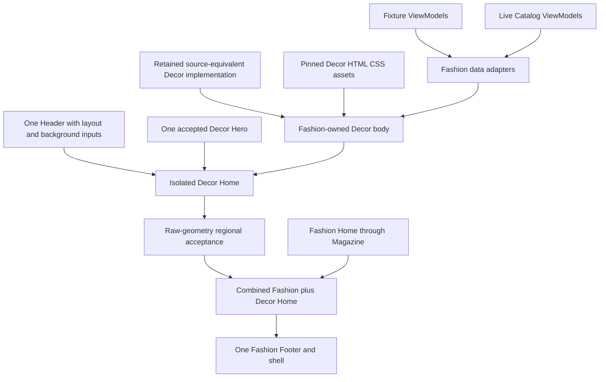
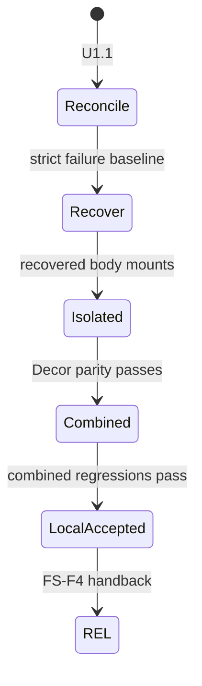

# Fashion Store Decor Home Visual Recovery - Plan

## Goal Capsule

- **Objective:** Developers can review one usable Fashion Store Home that preserves the accepted Decor Store visual quality and, in its final state, presents the existing Fashion Home together with the migrated Decor Home regions.
- **Means:** Recover the source-equivalent Decor Home body from retained history, prove it first in an isolated Home composition, then append it after Fashion Magazine and before the single Fashion Footer; add independently selectable Header layout and background modes in the same work (KTD1-KTD8).
- **Authority:** The product master remains the product authority. Completed FS-R3 remains the Fashion-owned runtime baseline. Commit `c622a241`, recovery descendant `f2c8a86d`, and the pinned Decor HTML/CSS/assets are the visual recovery authorities.
- **Execution profile:** Work in the long-lived primary Shoppp checkout. Optimize for a locally reviewable page; hardcoded development composition is allowed. No new worktree, PR, Admin migration, immutable Preview, deployment, candidate freeze, or production promotion is required.
- **Stop conditions:** Stop if recovery would restore a selectable Decor runtime, import retired jQuery/Revolution/global runtime dependencies into Fashion, change Fashion commerce truth, or modify a non-Home route beyond regression protection.
- **Tail ownership:** FS-F4 owns U1-U7, local visual evidence, and REL handback. REL retains candidate, DC, deployment, and PG authority.

---

## Authority and Lineage

- **Upstream product authority:** `docs/plans/2026-08-13-001-refactor-shoppp-product-master-plan.md` owns the product map, plan register, active pointer, product sequence, and release authority.
- **Inherited baseline:** `docs/plans/2026-09-06-1346-refactor-fashion-decor-unification-plan.md` completed FS-R3 and established `fashion-store` as the sole selectable runtime package. This plan does not reopen runtime retirement.
- **Visual recovery authority:** Commit `c622a241` contains the former `decor-store` source-markup implementation and records four-viewport full-page changed-pixel ratios of `0.001492`, `0.000920`, `0.001098`, and `0.000947`. Recovery descendant `f2c8a86d` retains the files as readable Git objects. The pinned source wins when retained implementation and source differ.
- **Retirement boundary:** Commits `d9a6378f` and `24252367` retired the `decor` and `decor-store` runtimes. Recovery may port DOM, scoped CSS, passive assets, and observable behavior into Fashion ownership; it must not reverse those commits as product architecture.
- **Explicit supersession:** This revision supersedes FS-F4's earlier claim that U1-U6 were visually complete and that U7 Admin/Preview access was the next blocker. The simplified reconstruction and permissive visual gate did not prove fidelity.
- **Product Contract preservation:** Changed R2-R11 and R15-R20 to reflect the user-confirmed isolated-then-combined Home, independent Header modes, page-first execution, and local acceptance; retained R1 and Fashion-owned runtime, data, accessibility, and isolation intent from R12-R14 and R17-R19.
- **Parallel plans:** REL remains next in product sequence after FS-F4. Commerce, IAM, AI, Admin, CI, and completed Fashion plans keep their existing ownership.
- **Tail ownership:** FS-F4 completes on local source-grounded visual and regression evidence. Admin configurability and immutable Preview acceptance require a later explicitly activated plan before formal release.

## Activation Checkpoint

- **Plan classification:** Complete corrective follow-up. Direct-review stage U1.6 closed on 2026-09-10 after interaction geometry, compact Header, and migration-pattern audit work.
- **Current parent/child stage:** `U1.6` complete — Decor card glyphs are geometrically centered, context-menu focus preserves the action layer's horizontal center, compact Decor Header uses a stable two-ended composition, and the same-pattern audit is retained in the progress evidence.
- **Unit state:** U1-U7 and U1.1-U1.6 are complete within FS-F4's local Home boundary.
- **Blocker:** None in FS-F4. REL's deferred Home configuration/immutable-Preview, capability, and candidate-identity work remains unchanged.
- **Next concrete action:** None in FS-F4. Product execution returns to `REL-Pre-DC` without advancing candidate, DC, deployment, or PG state.
- **Evidence:** `docs/progress/fashion-store-decor-home-visuals.md` retains the invalidated baseline and final U1-U7 local verification without owning a second execution queue.
- **Update rule:** This plan is the only authority for FS-F4 unit state, current stage, blocker, next action, and implementation tail. Update this checkpoint and the product-master pointer together whenever those facts change.

---

## Product Contract

### Summary

Recover the high-fidelity Decor Store Home as Fashion-owned Home content. During migration, the storefront can temporarily hide the existing Fashion Home body so the Decor result can be judged without interference. After Decor parity passes, restore the Fashion Home and append the Decor content group after Fashion Magazine and before the single Footer.

### Problem Frame

The current FS-F4 implementation replaced the former source-equivalent Decor structure with generic Vue markup and broad CSS approximations. Its automated comparison stretches source and implementation captures to matching dimensions and allows up to `0.9` changed pixels, so visibly incorrect geometry can pass. Local verification therefore produced a false completion signal.

At this development stage, preserving configuration compatibility around an unusable page is the wrong priority. The immediate need is a trustworthy local storefront that can be reviewed quickly. Admin persistence and formal Preview remain later release concerns, after the page itself is correct.

### Requirements

**Recovery and isolated acceptance**

- R1. The existing accepted Fashion-owned Decor Hero remains the Home Hero unless raw source comparison proves a regression that requires correction.
- R2. A development-only isolated composition hides the existing Fashion Home body and renders the migrated Decor content regions between the single Header/Hero and single Footer.
- R3. The isolated Decor body reproduces the source order and composition of featured categories, products, promotional marquee, collection carousel, client marquee, journal, and services.
- R4. The recovery uses retained source-equivalent DOM/CSS/assets as its starting point instead of extending the current simplified component tree.

**Final combined Home**

- R5. After isolated Decor acceptance, the final Home restores all existing Fashion Home sections and appends one Decor content group immediately after Fashion Magazine and before the Footer.
- R6. The combined Home contains exactly one Header, one Hero, one sticky/social shell owner, one cookie/scroll-control owner, and one Footer; page-level Decor duplicates are excluded.
- R7. Product, Collection, Shop, Cart, Checkout, Account, Magazine, About, FAQ, Contact, and Article routes retain their existing Fashion layouts and behavior.

**Header variants**

- R8. `FashionStoreHeader` supports two explicit desktop layouts: Fashion left/center/right and Decor left/right.
- R9. Header background is selected independently from layout: solid or transparent-overlay.
- R10. Transparent-overlay places the Header over the Hero without duplicate Header DOM, unreadable controls, content jumps, or leakage to internal routes; compact/mobile behavior continues to use the existing Fashion interaction owner.

**Ownership and development posture**

- R11. `dev:fashion-store` defaults to the combined Home with Decor desktop layout and transparent-overlay background; a dedicated `dev:fashion-store:decor-isolated` entry shows the isolated Decor Home with the same Header defaults. Header matrix tests override those code-owned values without adding Admin persistence.
- R12. Fashion remains authoritative for catalog IDs, copy, prices, availability, destinations, cart/search/account capabilities, and commerce actions.
- R13. Fixture and live renderers share the same Fashion-owned Decor presentation body while keeping their existing data-provider boundaries.
- R14. No production code imports retired `decor` or `decor-store` runtimes, upstream global Decor CSS, remote fonts, jQuery, Revolution, or source fragments at runtime.

**Visual and behavioral acceptance**

- R15. Decor-owned regions are captured at their natural source and implementation dimensions; a geometry mismatch fails before pixel comparison, and screenshots are never resized with `fit: fill` to manufacture comparability.
- R16. At 1440x1000, 1024x900, 768x1024, and 390x844, each static source-owned region targets a changed-pixel ratio at or below `0.01`; approved Fashion content adaptations use narrow masks plus explicit typography and geometry budgets instead of a broader global threshold.
- R17. Source-observable tabs, carousel controls, marquee direction, timing, reduced-motion behavior, hidden-document behavior, resize recomputation, route teardown, and remount outcomes remain functional without restoring the retired runtime.
- R18. The isolated and combined Homes have no horizontal document overflow, clipped decision-relevant control, duplicate interactive owner, broken local asset, or implementation-only content that changes the source composition.
- R19. Existing shared primitives retain native semantics, accessible names, focus behavior, keyboard/touch operation, and truthful empty, missing-media, and action-failure outcomes.
- R20. Completion removes abandoned simplified-only code and stale permissive tests, updates this checkpoint and the product master together, and returns the pointer to REL without advancing candidate, DC, deployment, or PG state; REL cannot freeze a candidate containing this Home until it names and completes the deferred configuration/immutable-Preview successor.

### Key Decisions

- **Recover the former high-fidelity Decor implementation instead of patching the simplified reconstruction.** (session-settled: user-directed — chosen over incremental visual repair because the former Decor page already met the desired quality.) Governs R3, R4, R15-R18.
- **Limit migration to the Home route.** (session-settled: user-directed — chosen over migrating Decor secondary pages because the reusable Fashion routes already cover those journeys.) Governs R2, R5-R7.
- **Use isolated acceptance before composing the long page.** (session-settled: user-approved — chosen over judging Decor inside the full Fashion page so visual differences remain attributable.) Governs R2, R5, R15-R18.
- **Make Header layout and background independent.** (session-settled: user-directed — chosen over bundled presets so Decor geometry and transparent Hero overlay can be selected separately.) Governs R8-R10.
- **Prioritize the visible page over Admin configuration.** (session-settled: user-directed — chosen over preserving the current draft/Preview workflow because the product is still in development and has no active users.) Governs R11, R20.

### Acceptance Examples

- AE1. Covers R2-R4, R15-R18. Given isolated mode at a canonical viewport, the page shows one Header, the accepted Hero, the seven Decor body regions in source order, and one Footer; raw-size regional checks pass before source-owned static pixels meet the `0.01` budget.
- AE2. Covers R5-R7. Given combined mode, all existing Fashion Home sections remain visible, Fashion Magazine is followed by the complete Decor group, and the Fashion Footer follows that group; Product, Cart, and Checkout show no Decor leakage.
- AE3. Covers R8-R10. Given any supported Header layout and background combination, desktop geometry matches its selected mode, transparent mode overlays the Hero legibly, and the existing compact Header retains one interaction path below 992 pixels.
- AE4. Covers R12-R14, R19. Given live products and commerce actions, Decor presentation changes layout only; identity, price, availability, destination, capability visibility, action payload, and failure truth remain Fashion-owned.
- AE5. Covers R17-R19. Given pointer, keyboard, touch, reduced motion, document hiding, viewport resize, route-away, and route-return, each interactive or continuous region reaches the named state and leaves one clean runtime owner.
- AE6. Covers R11, R20. Given no Admin session or Preview build, `dev:fashion-store` opens the combined Home and `dev:fashion-store:decor-isolated` opens the isolated review Home; local acceptance can complete FS-F4, but REL refuses candidate freeze until the deferred configuration/Preview successor completes.

### Scope Boundaries

- **In scope:** Home-only recovery; isolated Decor review mode; final Fashion-plus-Decor long Home; retained Decor Hero; seven Decor body regions; Fashion-owned assets and scoped styles; independent Header layout/background modes; fixture/live data adapters; strict local visual, behavior, accessibility, overflow, and route-regression evidence.
- **Outside this correction:** Restoring a selectable Decor template or runtime; Decor secondary routes; Decor top bar, language picker, MiniCart, search implementation, sticky rail, Footer, cookie, or scroll implementation; changing Fashion commerce facts or enabling new account/wishlist behavior; deployment, candidate, DC, or production work.
- **Deferred to follow-up work:** Admin fields for Header mode, Section visibility/order, and isolated/final composition; saved-draft migrations; immutable Preview and operator acceptance; production rollout.

---

## Planning Contract

### Key Technical Decisions

- KTD1. **Recover source structure before abstracting it.** Start from retained source-equivalent body markup, source selectors, scoped CSS, and passive assets. Extract Fashion-owned components only after isolated parity proves the recovered structure. Governs R3, R4, R15-R18.
- KTD2. **Keep history as evidence, not a runtime dependency.** Read files from `c622a241` or `f2c8a86d`, then port required structure into current Fashion paths; never import those deleted paths at runtime. Governs R4, R14.
- KTD3. **Use the existing product-merchandising Section as the single body host.** A Fashion-owned `components/home/FashionStoreDecorHomeBody.vue` receives `FashionStoreDecorHomeModel` from `contracts/decor-home.ts` and renders all seven Decor body regions in source order. The model contains static presentation content plus a discriminated merchandising state; non-populated merchandising changes only the Products region while the other six regions remain visible. The six earlier distributed `decor-*` wrapper branches return to their Fashion presentation so the combined page cannot render partial Decor regions twice. Governs R3, R5, R12, R13, R19.
- KTD4. **Use one typed local profile carrier.** `successor/home-development-profile.ts` parses `STOREFRONT_FASHION_HOME_PROFILE` as `composition:headerLayout:headerBackground`, with the exact axes `isolated|combined`, `fashion|decor`, and `solid|transparent-overlay`. Preparation scripts use the parsed value to generate Section visibility, and `nuxt.config.ts` exposes the same value to `FashionStoreHomeShell`, which passes Header inputs through `FashionStoreShell`. `dev:fashion-store` sets `combined:decor:transparent-overlay`; `dev:fashion-store:decor-isolated` sets `isolated:decor:transparent-overlay`; Playwright projects set the remaining combinations. Switching requires restarting the command. Do not extend persisted Admin schemas. (session-settled: user-directed — chosen over configuration-first implementation to shorten the path to a reviewable page.) Governs R2, R5, R8-R11.
- KTD5. **Preserve Fashion business ownership at adapter seams.** Recovered product and link markup receives current Fashion IDs, destinations, images, price text, availability, and action handlers rather than historical Decor product facts. Governs R12, R13, R19.
- KTD6. **Model Header choices as orthogonal presentation inputs.** Keep one `FashionStoreHeader` and represent layout and background separately. Both local development entries default to Decor layout plus transparent overlay, while tests exercise all four combinations without Admin persistence. (session-settled: user-directed — chosen over one combined Header preset so all required combinations remain possible.) Governs R8-R11.
- KTD7. **Restore behavior with current primitives.** Recreate observable source states through Vue lifecycle ownership, CSS animation, and existing carousel/search/cart primitives; do not restore source runtime libraries. Governs R14, R17, R19.
- KTD8. **Fail on shape before similarity.** Capture raw region bounds and structural inventory, require compatible dimensions within region-specific geometry tolerances, then apply the `0.01` source-owned static pixel budget and emit diff bounds, heatmaps, and crops. Governs R15, R16, R18.

### Regional Acceptance Matrix

The existing source-equivalence policy supplies `2px` edge tolerance, `0.5px` computed-style numeric tolerance, `0.01` initial static pixel budget, and `0.005` named-state pixel budget. Every region must match viewport width; height may differ by at most the greater of `2px` or `0.5%` of source height. A mask may cover only the named Fashion-owned pixels, not their containing card, grid, background, spacing, or control chrome. Expanding a selector or mask requires an explicit FS-F4 plan update before the affected gate can pass.

| Region | Required inventory | Permitted pixel mask | Additional proof |
| --- | --- | --- | --- |
| Featured categories | Six icons and three banners | None | Source order, card/banner bounds, typography, destinations |
| Products | Two tabs and up to eight cards in the active panel | Product image pixels, product name glyphs, price glyphs, availability/badge glyphs | Card/grid bounds, tab chrome, typography metrics, truthful Fashion IDs/actions |
| Promotional marquee | Six source-positioned messages plus hidden duplicate track | Message glyph pixels only when Fashion copy differs | Track bounds, direction, timing, seam, hidden/reduced states |
| Collection carousel | One feature banner and three carousel items | Fashion product image and fact glyph pixels inside each item | Split bounds, control chrome, active item, keyboard/touch states |
| Client marquee | Eight source logos plus hidden duplicate track | None | Logo bounds, direction, timing, seam, hidden/reduced states |
| Journal | Four source-ordered cards | None | Image crop, card bounds, typography, responsive stacking |
| Services | Four source-ordered items | None | Icon/text bounds, borders, typography, responsive stacking |

### High-Level Technical Design

### Sequencing and Assumptions

- U1.1 must invalidate the prior completion evidence before presentation code changes continue.
- U2 establishes the recovered Fashion-owned boundary. U3-U6 build and prove isolated mode; U7 alone restores the full Fashion body and owns combined-page acceptance.
- The two local commands are the only developer selection surface. Their shared profile is code-owned and may be replaced when Admin configuration is designed later.
- The accepted Decor Hero and existing Fashion Home remain baselines unless focused evidence proves they were altered by this work.

### Risks and Mitigations

| Risk | Impact | Mitigation |
| --- | --- | --- |
| Historical source markup reintroduces retired dependencies | Runtime retirement is reversed accidentally | Port only DOM, scoped styles, passive assets, and observable behavior; retain import/resource absence gates |
| Recovered CSS leaks into Fashion or internal routes | Previously correct pages become unstable | Root every Decor body rule below one Fashion-owned scope and test computed-style absence on representative routes |
| Fashion data changes source geometry | Pixel proof becomes dishonest or impossible | Separate structure/geometry from narrow content masks and keep strict budgets on source-owned surfaces |
| Isolated mode becomes a permanent second product path | Maintenance forks into two Homes | Keep one Decor body component and one narrow development switch; combined mode consumes the same component |
| The long Home feels incoherent despite regional parity | Individually correct regions produce a poor page | Gate the combined page for transitions, rhythm, Header/Hero contrast, and Footer adjacency |
| Approximation code survives beside recovery | Conflicting DOM/CSS and misleading tests accumulate | U1 inventories it; U7 requires abandoned branches and permissive tests to be removed |

### Sources and Research

- Commit `c622a241` and `docs/progress/fashion-decor-source-equivalent-progress.md` retain the prior Decor Home implementation and four-viewport source-equivalence evidence.
- Recovery descendant `f2c8a86d` keeps the retired Decor files readable for reconstruction.
- `templates/Crafto - The Multipurpose HTML5 Template/html/demo-decor-store.html` and its contributing assets remain the primary visual source.
- `apps/storefront/app/themes/fashion-store/successor/composition.ts` demonstrates unique Section instance IDs and repeated Section types in one Home composition.
- `apps/storefront/app/themes/fashion-store/unification-disposition.ts` assigns the retired Decor product-tab ownership to `fashion-store.product-merchandising`; that Section is already positioned after Fashion Magazine and before the shell Footer.
- `apps/storefront/e2e/fashion-store-live-unified-home.spec.ts` contains the resized regional comparison and `0.9` thresholds that U1 must replace.
- `docs/runbooks/source-equivalent-html-template-port.md` and `docs/solutions/workflow-issues/html-source-parity-reconstruction-workflow-2026-08-06.md` govern reconstruction and evidence ordering.

---

## Implementation Units

### U1. Reopen the visual contract and reconcile the failed reconstruction

- **Goal:** Establish a truthful source-grounded baseline and decide which current WIP files are retained, replaced, or removed.
- **Requirements:** R1-R4, R15, R16, R18, R20; AE1, AE6.
- **Dependencies:** FS-F4 activation in the product master.
- **Files:** `apps/storefront/e2e/fashion-store-live-unified-home.spec.ts`; `apps/storefront/app/themes/fashion-store/source-contract.ts`; `apps/storefront/app/themes/fashion-store/components/shared/FashionStoreDecorHomePresentation.vue`; `apps/storefront/app/themes/fashion-store/integration.css`; `docs/progress/fashion-store-decor-home-visuals.md`; this plan; `docs/plans/2026-08-13-001-refactor-shoppp-product-master-plan.md`.
- **Approach:**
  1. U1.1 inventories simplified DOM, CSS, assets, adapters, and tests against `c622a241`, `f2c8a86d`, and the pinned source.
  2. Replace resized comparison and `0.9` budgets with structural inventory, raw bounds, geometry tolerance, and strict regional comparison.
  3. Retain reusable Fashion data/action adapters only when they do not force the simplified layout.
  4. Record pre-recovery failures and update both execution pointers before moving to U2.
- **Execution note:** Characterization and failure evidence must precede further visual implementation.
- **Patterns to follow:** `docs/runbooks/source-equivalent-html-template-port.md`; historical source-equivalence gates at `c622a241`.
- **Test scenarios:**
  1. Current Categories and Collection fail when raw heights and source geometry differ materially.
  2. A source/implementation dimension mismatch fails before pixel resizing can occur.
  3. A changed source-owned surface above `0.01` emits ratio, bounds, heatmap, and crops.
  4. A retired runtime import or resource request fails the isolation gate.
- **Verification:** The old false-positive path cannot pass, current defects reproduce as named regional failures, and the recovery inventory is explicit.

### U2. Recover the Fashion-owned Decor body foundation

- **Goal:** Port the former source-equivalent body structure, passive assets, typography, and scoped styles into one current Fashion-owned boundary.
- **Requirements:** R3, R4, R13, R14, R18, R19; AE1, AE4.
- **Dependencies:** U1.
- **Files:** `apps/storefront/app/themes/fashion-store/components/home/FashionStoreDecorHomeBody.vue` (new); `apps/storefront/app/themes/fashion-store/contracts/decor-home.ts` (new); `apps/storefront/app/themes/fashion-store/components/shared/FashionStoreDecorHomePresentation.vue` (replacement source, then removal); `apps/storefront/app/themes/fashion-store/assets/decor-home/**`; `apps/storefront/app/themes/fashion-store/decor-home-assets.ts`; `apps/storefront/app/themes/fashion-store/decor-home-content.ts`; `apps/storefront/app/themes/fashion-store/resources.ts`; `apps/storefront/app/themes/fashion-store/integration.css`; `apps/storefront/app/themes/fashion-store/UPSTREAM.md`; `apps/storefront/tests/theme-resources.test.ts`; `apps/storefront/tests/fashion-store-home-source.test.ts`.
- **Approach:**
  1. Recover the seven body regions in source order with source relationships preserved where they govern geometry.
  2. Copy only required passive assets into Fashion ownership and record provenance.
  3. Scope source-derived tokens, typography, and layout below one Decor body root.
  4. Define `FashionStoreDecorHomeModel` with static region content and `loading`, `validation-error`, `unavailable`, `empty`, and `populated` merchandising variants; keep all seven regions mounted while the Products region alone renders the current state.
  5. Add fixture/live adapter functions in `contracts/decor-home.ts`, then mount the body through the existing `fashion-store.product-merchandising` Section.
- **Test scenarios:**
  1. The body renders exactly seven named regions in source order with expected inventories.
  2. Every local image/font resolves, decodes, and matches provenance without remote requests.
  3. Missing optional media preserves readable structure without expanding document width.
  4. Product, Cart, and Checkout inherit no Decor body styling.
- **Verification:** The recovered body mounts independently, owns no retired runtime dependency, and is source-shaped before live adaptation.

### U3. Build and prove the isolated Decor Home composition

- **Goal:** Provide a fast review mode that hides Fashion Home content and shows the recovered Decor body with one shell.
- **Requirements:** R1-R3, R6, R11, R15, R16, R18; AE1, AE6.
- **Dependencies:** U2.
- **Files:** `apps/storefront/app/themes/fashion-store/successor/home-development-profile.ts` (new); `apps/storefront/app/themes/fashion-store/components/FashionStoreHomeShell.vue`; `apps/storefront/app/themes/fashion-store/components/shared/FashionStoreShell.vue`; `apps/storefront/app/themes/fashion-store/components/sections/FashionStoreProductMerchandisingSection.vue`; `apps/storefront/app/themes/fashion-store/successor/composition.ts`; `apps/storefront/app/themes/fashion-store/successor/presets/unified-store.ts`; `apps/storefront/nuxt.config.ts`; `apps/storefront/scripts/prepare-theme-preview-fixture.ts`; `apps/storefront/scripts/prepare-fashion-store-live-e2e.ts`; `apps/storefront/package.json`; `apps/storefront/tests/fashion-store-theme.test.ts`; `apps/storefront/e2e/fashion-store-live-unified-home.spec.ts`.
- **Approach:**
  1. Validate the three-axis local profile once, use it in fixture/live preparation, expose it through Nuxt public runtime configuration, and pass it from `FashionStoreHomeShell` to the existing shell/Header owner.
  2. Isolated mode renders Header, Hero, the product-merchandising-hosted Decor body, and Footer exactly once while omitting Fashion body sections.
  3. Fixture/live modes consume the same Decor body and expose a test identity marker only; no Admin field or new Section identity is introduced.
- **Test scenarios:**
  1. Isolated mode contains one Header, one Hero, seven Decor regions, and one Footer in order.
  2. No Fashion Home body section remains mounted or leaves an empty gap.
  3. Each local command selects its documented profile after restart; reload and remount retain it without duplicate owners.
  4. Canonical and boundary viewports have no overflow or clipped controls.
- **Verification:** `dev:fashion-store:decor-isolated` shows the isolated high-fidelity Decor migration without Admin or Preview infrastructure, while the ordinary command remains reserved for the final combined Home.

### U4. Adapt Decor products and links to Fashion truth

- **Goal:** Preserve Decor product-region fidelity while routing business facts and actions through Fashion owners.
- **Requirements:** R3, R12, R13, R19; AE4.
- **Dependencies:** U2.
- **Files:** `apps/storefront/app/themes/fashion-store/components/sections/FashionStoreProductMerchandisingSection.vue`; `apps/storefront/app/themes/fashion-store/components/home/FashionStoreDecorHomeBody.vue`; `apps/storefront/app/themes/fashion-store/components/shared/FashionStoreProductCard.vue` only if a presentation seam is required; `apps/storefront/app/themes/fashion-store/contracts/decor-home.ts`; `apps/storefront/app/themes/fashion-store/contracts/home-merchandising.ts`; `apps/storefront/app/themes/fashion-store/decor-home-content.ts`; `apps/storefront/tests/fashion-store-live-commerce.test.ts`; `apps/storefront/tests/fashion-store-content.test.ts`; `apps/storefront/e2e/fashion-store-live-unified-home.spec.ts`.
- **Approach:** Map Best sellers and New arrivals into recovered geometry; adapt fixture/live inputs into `FashionStoreDecorHomeModel`; let the body render product-region loading, validation-error, unavailable, empty, and populated outcomes while preserving the six static regions; preserve ProductCard facts, destinations, capability visibility, actions, and failures.
- **Test scenarios:**
  1. Pointer, Enter, Space, and touch switch product panels while retaining focus and density.
  2. Dense, sparse, empty, sold-out, missing-media, and action-failure inputs remain truthful.
  3. Product ID, price, stock, destination, image source, and cart payload remain unchanged.
  4. Fixture and live render the same structure from their own providers.
- **Verification:** Every merchandising state retains the full Decor body and changes only the Products region; Fashion catalog and commerce contracts remain authoritative.

### U5. Restore source-observable Decor motion and controls

- **Goal:** Reproduce product tabs, promotional marquee, collection carousel, and client marquee states with lifecycle-safe primitives.
- **Requirements:** R3, R14, R17-R19; AE5.
- **Dependencies:** U2, U4.
- **Files:** `apps/storefront/app/themes/fashion-store/components/home/FashionStoreDecorHomeBody.vue`; `apps/storefront/app/themes/fashion-store/components/shared/FashionStoreCarousel.vue`; `apps/storefront/app/themes/fashion-store/integration.css`; `apps/storefront/tests/theme-motion-contract.test.ts`; `apps/storefront/tests/fashion-store-home-source.test.ts`; `apps/storefront/e2e/fashion-store-live-unified-home.spec.ts`.
- **Approach:** Restore source-visible carousel controls; match marquee direction, duplication, timing, clipping, and reduced motion; give each listener, animation, timer, and carousel one lifecycle owner including document visibility.
- **Test scenarios:**
  1. Previous, next, keyboard, and touch change the active collection item while preserving names and focus.
  2. Marquees reach non-zero transforms, loop without seams, and pause or become static in contracted states.
  3. Hidden/visible document transitions pause and resume without another animation owner.
  4. Boundary resize, unmount, and remount leave no stale transform, listener, or timer.
  5. Reduced motion and initializer failure keep all content readable and reachable.
- **Verification:** Temporal and interaction evidence proves behavior; animation-name assertions alone cannot complete U5.

### U6. Add independent Header layout and background modes

- **Goal:** Support Fashion three-zone and Decor two-edge desktop layouts with independently selected solid and transparent-overlay backgrounds in one Header owner.
- **Requirements:** R6-R10, R14, R18, R19; AE3.
- **Dependencies:** U2.
- **Files:** `apps/storefront/app/themes/fashion-store/components/shared/FashionStoreHeader.vue`; `apps/storefront/app/themes/fashion-store/components/shared/FashionStoreShell.vue`; `apps/storefront/app/themes/fashion-store/integration.css`; `apps/storefront/app/themes/fashion-store/interaction-contract.ts`; `apps/storefront/tests/fashion-store-interaction-contract.test.ts`; `apps/storefront/tests/fashion-store-routing.test.ts`; `apps/storefront/e2e/fashion-store-theme.spec.ts`; `apps/storefront/e2e/fashion-store-live-unified-home.spec.ts`.
- **Approach:** Replace overloaded `homeLayout` with explicit internal layout/background inputs; keep all transient behavior in the existing Header; overlay transparent mode on Hero with contrast-safe assets and no second mobile path.
- **Test scenarios:**
  1. Each of four desktop layout/background combinations has selected geometry and readable controls.
  2. At 991 pixels and below, Home preserves compact Header DOM, ordering, menus, and capabilities.
  3. Search and MiniCart remain coordinated and restore focus through existing primitives.
  4. Resize across 991/992 and navigation to internal routes clear Home-only state.
  5. Long and high-density logos remain contained without hiding controls.
- **Verification:** One Header supports every selected combination and internal routes retain prior structural and style signatures.

### U7. Compose the long Home, remove abandoned code, and hand back locally

- **Goal:** Restore the Fashion Home, append the accepted Decor group at the agreed boundary, and close FS-F4 on local evidence.
- **Requirements:** R1-R20; AE1-AE6.
- **Dependencies:** U3-U6.
- **Files:** `apps/storefront/app/themes/fashion-store/successor/composition.ts`; `apps/storefront/app/themes/fashion-store/successor/presets/unified-store.ts`; `apps/storefront/app/themes/fashion-store/components/shared/FashionStoreShell.vue`; `apps/storefront/e2e/fashion-store-live-unified-home.spec.ts`; `apps/storefront/e2e/fashion-store-theme.spec.ts`; `apps/storefront/tests/fashion-store-unification-inventory.test.ts`; `apps/storefront/tests/fixture-contract.test.ts`; `apps/storefront/package.json`; `docs/progress/fashion-store-decor-home-visuals.md`; this plan; `docs/plans/2026-08-13-001-refactor-shoppp-product-master-plan.md`.
- **Approach:**
  1. Restore the complete Fashion Home through Fashion Magazine.
  2. Mount the accepted Decor body once after Fashion Magazine and before the existing Footer.
  3. Return Categories, Collection, Brand Strip, Marquee, Editorial, and Services wrappers to their Fashion presentations so only the tail host renders Decor content.
  4. Replace brittle `section:nth-of-type(...)` selectors with stable Home/Decor data markers before inserting nested source-shaped sections.
  5. Run strict regional parity in isolated mode and whole-page review in combined mode.
  6. Remove simplified-only components, CSS, assets, and permissive tests no longer used.
  7. Record local evidence, close FS-F4, and return the master pointer to REL.
- **Test scenarios:**
  1. Combined mode renders prior Fashion Home sections, seven Decor regions, then one Footer in order.
  2. Header, Hero, sticky/social rail, cookie, scroll control, and Footer each have one owner.
  3. Desktop/mobile review passes rhythm, whitespace, hierarchy, Header/Hero contrast, and Footer transition.
  4. Product, Collection, Cart, Checkout, and Account retain routes, Header behavior, layout, and commerce outcomes.
  5. Resource scans find no retired runtime, remote font, source fragment, dead approximation branch, or unused migrated asset.
- **Verification:** Strict isolated parity, combined review, full Fashion regression, and safety gates pass; checkpoint and master agree on REL handback.

---

## Verification Contract

| Gate | Command or evidence | Covers |
| --- | --- | --- |
| Recovery and absence contracts | `bun test apps/storefront/tests/decor-reference-evidence.test.ts apps/storefront/tests/fashion-store-home-source.test.ts apps/storefront/tests/fashion-store-unification-inventory.test.ts` | R1-R4, R13-R18 |
| Asset and font provenance | `bun test apps/storefront/tests/theme-resources.test.ts apps/storefront/tests/theme-font-contract.test.ts tools/import-storefront-theme.test.ts tools/verify-source-equivalent-themes.test.ts` | R14, R18 |
| Fashion data and commerce truth | `bun test apps/storefront/tests/fixture-contract.test.ts apps/storefront/tests/fashion-store-live-commerce.test.ts apps/storefront/tests/fashion-store-content.test.ts` | R12, R13, R19 |
| Strict isolated visual matrix | `apps/storefront/e2e/fashion-store-live-unified-home.spec.ts` at 1440x1000, 1024x900, 768x1024, and 390x844 plus named breakpoints; raw bounds pass before `0.01` static source-owned image comparison | R1-R4, R15-R19; AE1, AE4, AE5 |
| Header and route regression | Focused Fashion Home, Product, Cart, and Checkout browser cases for Header combinations, compact transition, transient controls, navigation, and remount | R6-R10, R18, R19; AE2, AE3 |
| Combined Home review | Desktop/mobile captures and DOM-order assertions for Fashion through Magazine, seven Decor regions, and the single Footer | R5-R7, R18, R20; AE2, AE6 |
| Motion and accessibility | Motion-contract tests plus reduced motion, document visibility, no-JavaScript, keyboard, touch, focus, image decode, and critical/serious accessibility checks | R17-R19; AE5 |
| Static and repository safety | Storefront typecheck, focused lint/format, `verify:themes`, static-output/resource isolation, bundle checks, and `git diff --check` | R13, R14, R20 |
| Full Fashion regression | `bun run --cwd apps/storefront test:fashion-store` after the strict unified Home suite joins that gate | R7, R12-R14, R19, R20 |

Regional evidence retains source/implementation dimensions, DOM inventory, computed typography and geometry, named interaction states, changed-pixel ratio, diff bounds, heatmap, and high-signal crops. A full-page screenshot, resized comparison, or aggregate pass cannot override a failed named region.

---

## Definition of Done

- U1-U7 meet their completion outcomes and every R1-R20 requirement traces to passing evidence.
- Isolated mode provides a locally runnable, high-fidelity Decor Home body with one Header, Hero, shell, and Footer.
- Combined mode restores the existing Fashion Home and appends the accepted Decor group after Fashion Magazine and before the single Footer.
- Header layout and background are independent internal choices, and all four desktop combinations preserve the existing compact/mobile interaction owner.
- Every source-owned static Decor region passes raw-geometry checks and the `0.01` visual budget at all canonical viewports; no capture is stretched to pass.
- Fashion catalog facts, actions, capabilities, routes, and non-Home pages remain authoritative and regression-proven.
- No retired Decor runtime, source fragment, jQuery/Revolution dependency, remote font, global Decor cascade, or duplicated page-level component ships.
- Abandoned simplified-only implementation paths, stale permissive assertions, and unused assets are removed from the final diff.
- Admin configuration and formal release proof remain deferred; REL blocks candidate freeze until a named successor binds exact draft/version, Catalog Release, artifact, Preview identity, and live provenance.
- The FS-F4 checkpoint and product master return control to REL in the same change without changing candidate or production state.
