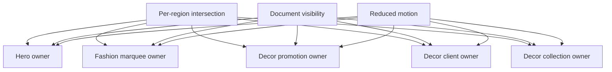
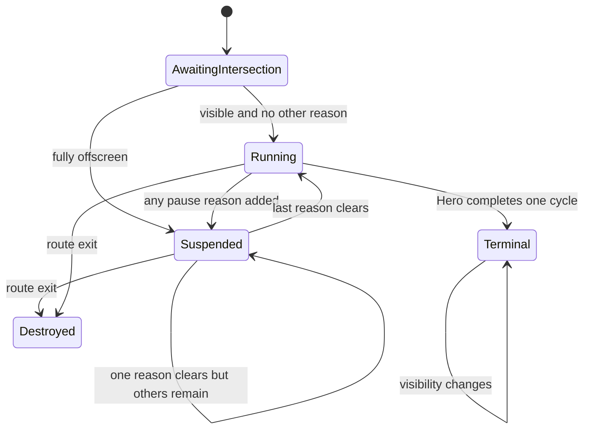
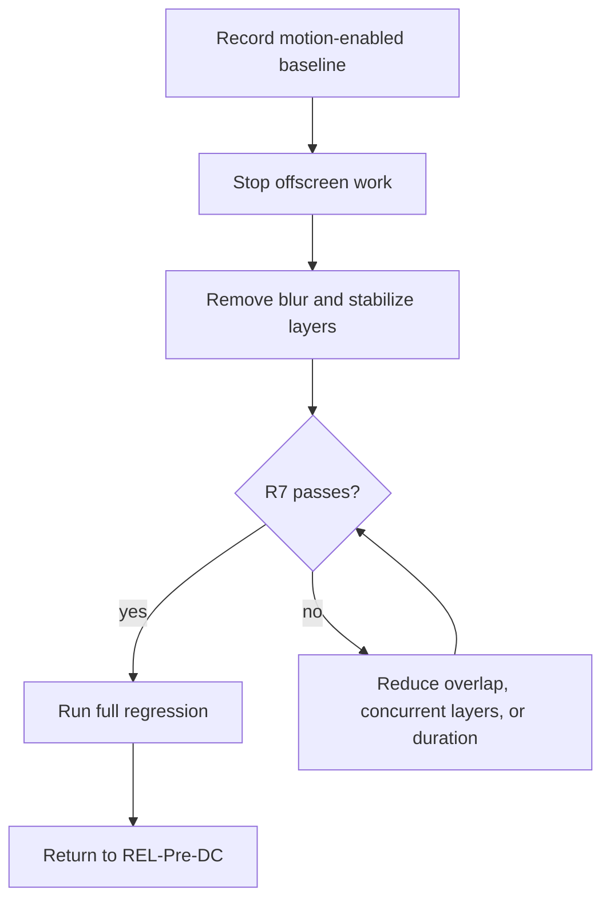

# Fashion Store Home Animation Smoothness - Plan

## Goal Capsule

- **Objective:** Fashion Store shoppers experience smooth Home motion without periodic frame stalls while the page is visible, scrolling, or returning from another page region.
- **Means:** Suspend each automatic animation outside its own viewport, reduce Hero paint and layerization cost, and gate the result with a motion-enabled trace budget (KTD1-KTD4).
- **Authority:** The product master owns product sequencing. Completed FS-R2 owns the inherited Hero behavior, completed FS-F4 owns the combined Home motion and visual baseline, and completed FS-F5 owns the current layout geometry.
- **Execution profile:** Implement test-first in the existing primary checkout. No worktree, PR, Admin configuration, candidate freeze, deployment, DC, or PG work is required.
- **Stop conditions:** Stop if the correction requires changing Home content, business truth, responsive geometry, non-Home behavior, or the reduced-motion final-readable outcome.
- **Tail ownership:** FS-F6 retains completed U1-U4 and focused evidence after its REL handback. REL retains immutable Preview, candidate, DC, deployment, and PG authority.

---

## Authority and Lineage

- **Upstream product authority:** `docs/plans/2026-08-13-001-refactor-shoppp-product-master-plan.md` owns the product map, complete plan register, active pointer, product sequence, and release authority.
- **Inherited Hero baseline:** `docs/plans/2026-09-05-1414-refactor-fashion-store-decor-hero-plan.md` completed FS-R2 and established Swiper ownership, one-cycle autoplay, busy-input rejection, final-readable fallback, reduced motion, document visibility, and remount cleanup.
- **Inherited Home baseline:** `docs/plans/2026-09-08-1204-fix-decor-home-visuals-plan.md` completed FS-F4 and established the combined Home regions, marquee cadence, collection controls, lifecycle ownership, and source-visible motion outcomes.
- **Inherited layout baseline:** `docs/plans/2026-09-10-001-refactor-decor-wide-layout-plan.md` completed FS-F5 and established the current combined and isolated Home geometry.
- **Explicit supersessions:** FS-F6 immediately supersedes FS-R2's requirement that title and price reproduce the source blur effect, and it extends FS-R2/FS-F4 suspension behavior from document visibility to per-owner viewport visibility. Exact FS-R2 delay and duration values remain the first implementation target; FS-F6 conditionally supersedes only the timing fields selected by R6's measured escalation path when the inherited ledger cannot meet R7. Completed FS-R2, FS-F4, and FS-F5 status does not reopen.
- **Parallel plans:** FS-F6 completed after FS-F7 reconciled the merchandising contracts and FS-R4 completed the canonical shared-shell handback. Commerce, IAM, AI, Admin, CI, REL, and other Fashion plans retain their existing authority and state.
- **Tail ownership:** FS-F6 retains completed U1-U4 and focused evidence with no implementation tail. REL-Pre-DC owns the current product action; candidate, immutable Preview, DC, deployment, and PG authority remain unchanged.

## Execution Checkpoint

- **Plan classification:** Completed corrective follow-up; final U4 verification passed and the product pointer returned to REL-Pre-DC on 2026-09-13.
- **Current parent/child stage:** None — `FS-F6-U1` through `FS-F6-U4` are complete.
- **Unit state:** U1-U4 are complete.
- **Blocker:** None. Focused motion, Hero, combined/isolated Home, stable Lighthouse, full Fashion Store, accessibility, build/static, type, lint/format, theme, impact-selection, human review, and diff gates are green under the unchanged budgets.
- **Next concrete action:** None in FS-F6. REL-Pre-DC owns the deferred Home configuration/immutable-Preview successor plus capability and candidate-identity reconciliation; this handback does not freeze a candidate or advance DC, deployment, or PG state.
- **Update rule:** Update this checkpoint and the product-master pointer together whenever FS-F6 activates, changes current or next unit, becomes blocked, completes, or reopens. Evidence under `docs/progress/` must not maintain a second execution queue.

---

## Product Contract

### Summary

Correct the Fashion Store Home's automatic motion as a standalone performance change. The Home keeps its accepted content, layout, controls, and visual rhythm while offscreen work stops and visible Hero transitions stay within a repeatable rendering budget.

### Problem Frame

The Home currently runs automatic motion even when the owning region is outside the viewport. The Hero also animates eight independent layers for about 3.6 seconds after each nine-second autoplay transition, including blur and large image transforms. A controlled trace attributed the perceived stalls to per-frame paint lifecycle and layerization rather than long JavaScript tasks.

The existing Lighthouse suite cannot detect this regression because it emulates reduced motion and disables every animation and transition. Static source-parity screenshots also cannot prove temporal smoothness. The correction therefore needs a separate motion-enabled contract rather than weaker Lighthouse or visual thresholds.

### Requirements

**Motion lifecycle**

- R1. Each Home automatic-motion owner runs only while its own region has positive viewport intersection, the document is visible, and reduced motion does not require a static state.
- R2. Hero, Fashion marquee, Decor promotional marquee, Decor client marquee, and Decor collection carousel maintain independent viewport state so one visible region cannot resume another offscreen region.
- R3. Pause reasons compose as a set; clearing one reason never resumes an owner while another reason remains.
- R4. Offscreen and hidden time never causes catch-up transitions or immediate autoplay bursts after re-entry. Hero and collection autoplay restart a full delay, while a paused Hero layer timeline resumes the same generation and progress.

**Visible behavior and rendering cost**

- R5. Visible Home content, responsive geometry, active indices, controls, destinations, final layer states, and one-cycle Hero stop outcome remain unchanged; title and price blur may be removed.
- R6. Preserve the inherited Hero layer count, layer order, final composition, and approximate cadence. First remove high-cost effects and unstable layer promotion; only if the motion budget still fails may implementation reduce overlap, concurrent layers, or durations. Choose the smallest passing deviation by preserving the total sequence span where possible, then minimizing the number of changed timing-ledger fields, then minimizing their aggregate absolute timing delta. Record the comparison in FS-F6 evidence and stop for new product direction if no passing variant preserves the required layer count, order, and final composition.
- R7. A visible Hero transition must meet the motion trace budget in both fixed Chromium profiles: desktop at 1440x900 and device scale factor 2, and mobile at 390x844 and device scale factor 3, each with 4x CPU throttling. Across at least three warmed 4.2-second runs per profile, the median keeps Paint Lifecycle and Layerize at or below 250ms each and RunTask at or below 1,200ms. Every individual run also keeps the requestAnimationFrame interval p95 at or below 50ms and its maximum interval at or below 100ms so aggregate totals cannot hide a visible stall.
- R8. A fully offscreen Home motion owner must remain within 20% of the equivalent reduced-motion idle trace and must not advance its semantic index, CSS animation time, or Hero timeline progress during the observation window.

**Fallback and regression boundaries**

- R9. Dynamic reduced-motion changes, document hiding, partial visibility, rapid boundary crossing, resize, route exit, and remount preserve one current owner, final-readable content, and stale-callback rejection.
- R10. The stable Lighthouse suite remains motion-disabled and unchanged in purpose; FS-F6 adds a separate Chromium-only motion-performance path with its own fixed environment and reported metrics.
- R11. Non-Home routes, Fashion and Decor content truth, Header and Footer ownership, combined/isolated layout geometry, accessibility semantics, and existing source-parity thresholds do not change.
- R12. FS-F6 completion returns the product pointer to REL-Pre-DC without advancing candidate, immutable Preview, DC, deployment, or PG state.

### Key Decisions

- **Create a standalone FS-F6 correction.** (session-settled: user-directed — chosen over reopening or enlarging completed FS-F4/FS-F5: the performance defect has its own cause, implementation boundary, and verification contract.) Governs R1-R12.
- **Preserve the visible design before changing cadence.** (session-settled: user-approved — chosen over immediately shortening the animation: remove blur and rendering waste first, then make only measured timing reductions if the budget still fails.) Governs R5-R7.

### Acceptance Examples

- AE1. Covers R1-R4. Given any automatic-motion region is fully outside the viewport for longer than its normal autoplay delay or marquee cycle, its index or animation time remains fixed; re-entry waits a full autoplay delay and does not catch up missed work.
- AE2. Covers R3, R4, R9. Given the Hero is offscreen and the document becomes hidden and visible, clearing document-hidden leaves it paused until it re-enters the viewport; the same last-reason rule holds for collection focus, reduced motion, and viewport suspension.
- AE3. Covers R4-R7. Given the Hero leaves the viewport during `layer-busy`, its GSAP progress pauses and later completes the same slide once; no second generation, index reset, or autoplay race appears.
- AE4. Covers R5, R9, R11. Given the Hero or collection is partially visible or reached through an existing manual control path, keyboard, pointer, touch, and programmatic control semantics remain unchanged; viewport suspension affects only automatic clocks and choreography.
- AE5. Covers R7, R8, R10. Given the fixed motion-performance harness, the visible Hero and offscreen-idle trace windows report every run plus their medians and fail when any per-run or aggregate threshold is exceeded.
- AE6. Covers R9, R11. Given dynamic reduced motion, rapid scroll, breakpoint resize, route exit, and remount, final-readable states and responsive geometry remain intact with one observer, listener, Swiper owner, and GSAP generation.

### Success Criteria

- The fixed motion-enabled harness meets R7 and R8 without relying on subjective review.
- Human review at matching desktop and mobile viewports finds no loss of layout, content, control behavior, visual order, or final composition.
- Every automatic Home animation is idle while fully offscreen and resumes only after its own remaining pause reasons clear.
- The existing Fashion Home, source-parity, accessibility, Lighthouse, type, lint, static, and production-build gates remain green.

### Scope Boundaries

**Included**

- Fashion Store Home Hero autoplay and GSAP layer choreography.
- Fashion Home marquee, Decor promotional marquee, Decor client marquee, and Decor collection carousel lifecycle.
- Motion-enabled Chromium trace instrumentation, focused browser behavior coverage, and local evidence.

**Excluded**

- Admin fields, persisted animation preferences, analytics, operational monitoring, and a general animation framework.
- Non-Home carousel or route behavior except regression protection for shared code.
- Content, catalog facts, commerce actions, Header/Footer composition, layout redesign, source-threshold changes, deployment, candidate, DC, or PG work.

### Sources and Research

- `docs/solutions/workflow-issues/html-source-parity-reconstruction-workflow-2026-08-06.md` requires separate static, temporal, interaction, lifecycle, and fallback evidence; freezing animation cannot prove motion correctness.
- `apps/storefront/app/themes/fashion-store/contracts/home-hero.ts` owns the current Hero cadence and layer ledger.
- `apps/storefront/e2e/performance.spec.ts` intentionally removes motion before Lighthouse measurement and therefore remains a stable page-load gate rather than FS-F6's smoothness gate.
- The 2026-09-10 diagnosis trace recorded no long tasks and isolated the dominant cost to paint lifecycle, compositing commit, and layerization during `layer-busy`.

---

## Planning Contract

### Key Technical Decisions

- KTD1. **Observe owners, not the whole page.** Each expensive region receives its own viewport signal. The initial state is suspended until the first observer result, and unsupported observers fail open so content and controls remain usable. Governs R1, R2, R9.
- KTD2. **Reconcile one aggregate pause state per owner.** Existing document-hidden, reduced-motion, focus, readiness, and completed-cycle rules combine with viewport suspension before autoplay or GSAP state changes. Repeated equal observer events are idempotent. Governs R3, R4, R9.
- KTD3. **Keep clocks deterministic.** Swiper autoplay restarts its full delay after suspension and GSAP resumes the paused active generation. When the collection leaves the viewport during a fade, snap once to the visual state for its already-selected semantic index, then stop interpolation and autoplay until re-entry starts a full delay. Governs R1, R4, R9.
- KTD4. **Optimize effects before timing.** (session-settled: user-approved — chosen over immediately changing the accepted choreography: retain layer order and approximate cadence while removing blur and stabilizing compositor ownership, then use R6 only if measured cost still exceeds R7.) Governs R5-R7.
- KTD5. **Keep the new trace separate from Lighthouse.** A dedicated Chromium-only motion test controls viewport, DPR, CPU throttle, warm-up, trigger, window, repetition, and median aggregation; Lighthouse keeps its current reduced-motion policy. Governs R7, R8, R10.
- KTD6. **Avoid a page-global motion controller.** Keep lifecycle state in the current Hero and Home-body owners. Extract a small shared intersection helper only if it removes identical observer and teardown logic without combining independent region state. Governs R1-R3, R9, R11.

### High-Level Technical Design

### Sequencing and Dependencies

U1 establishes the failing numeric and lifecycle contracts before behavior changes. U2 removes offscreen work without changing visible choreography. U3 then isolates visible Hero rendering cost and invokes R6 only if the first optimization pass misses the fixed budget. U4 closes cross-mode regression and governance after the focused gates pass.

### Risks and Mitigations

- **Trace variance:** CI scheduling and browser revisions can move absolute timings. Use a fixed Chromium path, warmed state, three or more repetitions, median aggregation, and a single-worker run; keep raw per-run metrics in the test artifact.
- **Pause-reason races:** Visibility, focus, reduced motion, and intersection callbacks can arrive in any order. Reconcile from a set and test every two-reason clearing order before enabling autoplay.
- **Mid-transition suspension:** Swiper and GSAP have different pause semantics. Keep semantic index ownership with Swiper, preserve one active GSAP generation, and assert one completion after re-entry.
- **Source-parity drift:** Removing blur or changing timing can look different even when the final frame matches. Retain layer order and final-state visual evidence; any R6 escalation records the exact measured deviation without weakening static thresholds.
- **Shared-component spillover:** Extending the generic carousel could alter Shop or About. Prefer Home opt-in or local ownership and run affected shared-carousel regression if a shared seam changes.

---

## Implementation Units

### U1. Freeze the motion performance contract

- **Goal:** Turn the diagnosis into repeatable failing lifecycle and rendering budgets before production behavior changes.
- **Requirements:** R7, R8, R10; AE5.
- **Dependencies:** FS-F6 activation in the product master.
- **Files:** `apps/storefront/e2e/fashion-store-animation-performance.spec.ts`; `apps/storefront/playwright.fashion-store-animation-performance.config.ts`; `apps/storefront/package.json`; `apps/storefront/tests/theme-motion-contract.test.ts`; `docs/progress/fashion-store-home-animation-performance.md`.
- **Approach:**
  1. Add a Chromium-only motion path with the fixed desktop and mobile profiles from R7, CPU throttle, warmed navigation, deterministic Hero trigger, and single-worker execution.
  2. Capture visible Hero and offscreen-idle windows with normalized RunTask, Paint Lifecycle, Layerize, requestAnimationFrame intervals, semantic-index, animation-time, and GSAP-phase evidence.
  3. Aggregate at least three runs by median and retain raw measurements so a threshold failure is explainable.
- **Execution note:** Start by proving that the current Home fails R7 and R8; do not tune thresholds after seeing the proposed implementation.
- **Patterns to follow:** `apps/storefront/e2e/performance.spec.ts` for bounded Chromium ownership and `docs/solutions/workflow-issues/html-source-parity-reconstruction-workflow-2026-08-06.md` for temporal evidence separation.
- **Test scenarios:**
  1. Covers AE5. Three warmed, manually triggered Hero runs per desktop and mobile profile report individual frame pacing plus individual and median trace metrics, and fail against the fixed R7 limits on the diagnosed baseline.
  2. A fully offscreen Hero observation longer than nine seconds reports index and GSAP progress changes on the baseline and fails R8.
  3. Fully offscreen collection and marquee windows report any index or CSS animation-time advance and fail with the owning region named.
  4. Reduced-motion idle measurement records the comparison baseline without replacing the normal-motion trace.
  5. A missing CDP metric, wrong browser, wrong viewport, missing throttle, or incomplete repetition fails closed instead of silently skipping the budget.
- **Verification:** The harness fails on the diagnosed behavior, reports attributable metrics, and leaves the existing Lighthouse suite unchanged.

### U2. Suspend each Home motion owner outside its viewport

- **Goal:** Eliminate offscreen animation work while preserving independent region state and current fallback behavior.
- **Requirements:** R1-R4, R8, R9, R11; AE1-AE4, AE6.
- **Dependencies:** U1.
- **Files:** `apps/storefront/app/themes/fashion-store/components/FashionStoreDecorHero.vue`; `apps/storefront/app/themes/fashion-store/composables/useFashionStoreDecorHeroMotion.ts`; `apps/storefront/app/themes/fashion-store/components/home/FashionStoreDecorHomeBody.vue`; `apps/storefront/app/themes/fashion-store/components/sections/FashionStoreFixtureMarqueeSection.vue`; `apps/storefront/app/themes/fashion-store/components/sections/FashionStoreLiveMarqueeSection.vue`; `apps/storefront/app/themes/fashion-store/components/shared/FashionStoreCarousel.vue` only if a Home opt-in seam is required; `apps/storefront/app/themes/fashion-store/integration.css`; `apps/storefront/tests/theme-motion-contract.test.ts`; `apps/storefront/tests/fashion-store-theme.test.ts`; `apps/storefront/e2e/fashion-store-decor-hero.spec.ts`; `apps/storefront/e2e/fashion-store-live-unified-home.spec.ts`.
- **Approach:**
  1. Add independent intersection state to Hero, Fashion marquee, both Decor marquees, and the Decor collection carousel.
  2. Feed viewport state into the existing pause-reason reconciliation and keep each owner initially suspended until its first observation.
  3. Preserve one active Hero generation across suspension, restart autoplay clocks without catch-up, and ignore stale observer callbacks after teardown.
- **Execution note:** Add characterization coverage for pause-reason composition and clock semantics before changing lifecycle code.
- **Patterns to follow:** Existing document-hidden and reduced-motion reason sets in the Hero, Decor body, and `FashionStoreCarousel`; existing CSS `data-motion-paused` contract for Decor tracks.
- **Test scenarios:**
  1. Covers AE1. Every owner remains unchanged while fully offscreen for longer than its normal delay or cycle, then resumes without catch-up after re-entry.
  2. Covers AE2. Offscreen plus document-hidden and collection focus plus reduced-motion clear in every order and resume only after the final reason clears.
  3. Covers AE3. Leaving during Hero `layer-busy` pauses the same generation and completes it once after return; leaving during a collection fade snaps to the already-selected index without offscreen interpolation while autoplay stays stopped.
  4. Covers AE4. Viewport suspension leaves existing keyboard, pointer, touch, and programmatic control semantics unchanged while automatic clocks and choreography remain paused offscreen.
  5. Covers AE6. Rapid boundary crossing and 991/992 resize remain idempotent with stable indices and no duplicate transition.
  6. Unsupported IntersectionObserver fails open with readable, operable content; initial offscreen mount stays suspended when the observer is available.
  7. Route exit and remount leave old callbacks inert and create one current observer, Swiper instance, listener set, and GSAP generation.
- **Verification:** R8 passes for every offscreen owner and existing visible temporal, interaction, reduced-motion, document-hidden, and remount evidence remains green.

### U3. Reduce visible Hero paint and layerization cost

- **Goal:** Meet the visible-motion budget without changing the Hero's accepted final composition or interaction outcomes.
- **Requirements:** R5-R7, R9, R11; AE3-AE6.
- **Dependencies:** U1, U2.
- **Files:** `apps/storefront/app/themes/fashion-store/composables/useFashionStoreDecorHeroMotion.ts`; `apps/storefront/app/themes/fashion-store/contracts/home-hero.ts`; `apps/storefront/app/themes/fashion-store/components/FashionStoreDecorHero.vue`; `apps/storefront/app/themes/fashion-store/integration.css`; `apps/storefront/tests/fashion-store-theme.test.ts`; `apps/storefront/e2e/fashion-store-decor-hero.spec.ts`; `apps/storefront/e2e/fashion-store-animation-performance.spec.ts`; `docs/progress/fashion-store-home-animation-performance.md`.
- **Approach:**
  1. Remove title and price blur, restrict animated properties to compositor-safe opacity and transforms, and keep promotion state stable only while the timeline is active.
  2. Re-run both fixed trace profiles before changing delay, duration, or overlap.
  3. If R7 still fails, apply one measured R6 change at a time, compare variants using R6's ordered preservation rule, and retain the smallest passing deviation from the inherited ledger.
- **Execution note:** Use one-hypothesis, one-measurement optimization; revert a losing variant before testing the next.
- **Patterns to follow:** `useFashionStoreDecorHeroMotion` generation cleanup, FS-R2's Swiper/GSAP ownership boundary, and the source-parity workflow's separate temporal and final-state evidence.
- **Test scenarios:**
  1. Covers AE3. Automatic, Next, keyboard, and touch transitions keep the same semantic index, busy-input rejection, layer order, one-cycle stop, and final state.
  2. Covers AE4. Canonical desktop, tablet, mobile, and in-place resize states retain geometry, readable copy, controls, and no horizontal overflow.
  3. Enabling reduced motion mid-transition cancels expensive work and exposes the final active-slide state; disabling it does not replay the completed choreography.
  4. GSAP load or timeline failure still falls back atomically to a final-readable slide with no hidden layer or active autoplay.
  5. Covers AE5. Every desktop and mobile run meets the frame-pacing limits, each profile's median trace meets every cumulative R7 threshold, and the harness emits the before/after delta.
  6. If R6 escalation runs, a controlled comparison applies R6's ordered preservation rule, proves the selected timing or concurrency change is the smallest passing variant, and records its effect on visible cadence.
- **Verification:** R7 passes, final-frame and interaction evidence remains within inherited thresholds, and no abandoned optimization or diagnostic style remains.

### U4. Close Home regression and return to REL

- **Goal:** Prove the standalone correction across Home modes and hand execution back without widening release scope.
- **Requirements:** R1-R12; AE1-AE6.
- **Dependencies:** U2, U3.
- **Files:** `apps/storefront/e2e/fashion-store-live-unified-home.spec.ts`; `apps/storefront/e2e/fashion-store-decor-hero.spec.ts`; `apps/storefront/e2e/fashion-store-animation-performance.spec.ts`; `apps/storefront/tests/theme-motion-contract.test.ts`; `apps/storefront/tests/fashion-store-theme.test.ts`; `docs/progress/fashion-store-home-animation-performance.md`; this plan; `docs/plans/2026-08-13-001-refactor-shoppp-product-master-plan.md`.
- **Approach:** Run focused motion and performance evidence first, then combined and isolated Home regression, shared-carousel regression if touched, the full Fashion quality tail, and the production build. Record completion evidence, close the FS-F6 checkpoint, and return the master pointer to REL-Pre-DC in the same change.
- **Patterns to follow:** FS-F4 and FS-F5 local handback, the product-master register, and repository rules that keep progress evidence out of the current-unit queue.
- **Test scenarios:**
  1. Combined and isolated Homes pass desktop, tablet, mobile, reduced-motion, no-JavaScript, navigation, remount, and breakpoint coverage without geometry drift.
  2. Fixture and live renderers apply the same lifecycle rules to every region they own.
  3. Shop and About carousel behavior remains unchanged if the shared carousel seam changed; otherwise focused Home regression is sufficient.
  4. Human review compares matching desktop and mobile viewports after Hero motion and the first visible time-based animation.
  5. The final diff contains no page-global motion state machine, stale observer, debug trace code in production paths, abandoned variant, or weakened Lighthouse/source-parity threshold.
- **Verification:** Focused and full gates pass, evidence records the final numeric budget, and the FS-F6 checkpoint and product master agree on the REL handback without changing candidate or production state.

---

## Verification Contract

| Gate | Command or evidence | Covers |
| --- | --- | --- |
| Motion contracts | `bun test apps/storefront/tests/theme-motion-contract.test.ts apps/storefront/tests/fashion-store-theme.test.ts` | R1-R6, R9-R11 |
| Hero behavior | `playwright test --config apps/storefront/playwright.fashion-store.config.ts apps/storefront/e2e/fashion-store-decor-hero.spec.ts` | R3-R7, R9, R11; AE2-AE4, AE6 |
| Unified Home lifecycle | `playwright test --config apps/storefront/playwright.fashion-store-live-unified-home.config.ts` | R1-R5, R8-R11; AE1-AE4, AE6 |
| Motion performance | `bun run --cwd apps/storefront test:perf:motion` with one worker | R7, R8, R10; AE5 |
| Stable page-load performance | `bun run --cwd apps/storefront test:perf:fashion-store -- --workers=1` | R10, R11 |
| Full Fashion regression | `bun run --cwd apps/storefront test:fashion-store` | R5, R9-R12 |
| Production build | `bun run --cwd apps/storefront build` | R9-R12 |
| Repository quality | `bun run typecheck`, focused lint/format, `bun run verify:themes`, `bun run verify:static`, and `git diff --check` | R9-R12 |
| Human motion review | Matching desktop/mobile recordings or timed captures after Hero and the first visible marquee/collection transition | R5-R7, R11 |

Motion-performance artifacts retain environment identity, Chromium version, desktop/mobile profile, viewport, DPR, CPU rate, warm-up state, per-run frame intervals, per-run cumulative values, median values, thresholds, and before/after deltas. A reduced-motion Lighthouse score, frozen screenshot, or single favorable trace cannot override a failed R7 or R8 result.

---

## Definition of Done

- U1-U4 satisfy their outcomes with no unresolved blocker or implementation tail.
- Every automatic Home animation stops while fully outside its own viewport and resumes only after all remaining reasons clear.
- The visible Hero meets R7 across the fixed repeated trace without changing accepted content, controls, semantic outcomes, or final composition.
- Offscreen owners meet R8 and show no missed-transition catch-up, immediate autoplay burst, stale callback, index reset, or duplicate lifecycle owner.
- Dynamic reduced motion, document hiding, partial visibility, rapid scroll, resize, route exit, remount, and initialization failure retain final-readable and operable states.
- Existing static visual, source-parity, accessibility, Lighthouse, fixture/live, shared-carousel when applicable, type, lint, build, and static-output gates remain green.
- The final diff contains no abandoned experiment, diagnostic override, duplicate observer, page-global motion state machine, relaxed threshold, or unrelated cleanup.
- The FS-F6 checkpoint and product master return execution to REL-Pre-DC in the same completion change without advancing candidate, immutable Preview, DC, deployment, or PG state.
