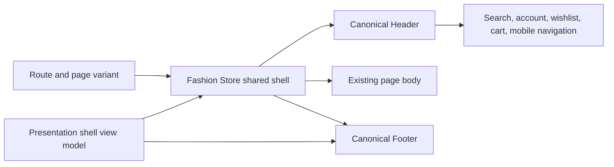
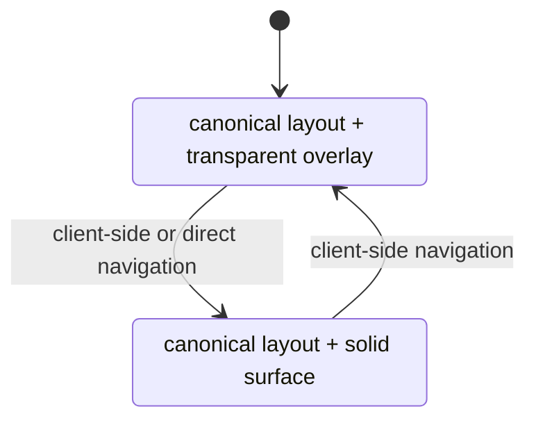
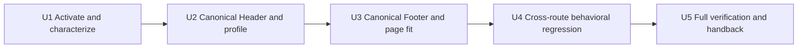

# Fashion Store Shared Shell Consistency - Plan

## Goal Capsule

**Objective:** Shoppers experience one Fashion Store brand shell on every route: the accepted Home Header and Footer presentation remains recognizable on product, collection, cart, checkout, account, and content pages, while each route keeps the surface treatment needed for readable content.

**Means:** Make the current accepted Home shell presentation canonical, reduce Header variation to a route-derived background state, and remove the historical runtime layout axis from the shared shell and its development profile (KTD1, KTD2).

**Authority hierarchy:** The product master plan is product-level authority; this plan owns only the shared-shell consistency successor; completed FS-F7 returned the product pointer after reconciling the preserved merchandising blockers; FS-F6 retains the animation-performance tail; completed FS-R3, FS-F4, and FS-F5 remain historical authority except for the explicit supersessions below.

**Stop conditions:** Stop and update this plan before implementation if the canonical Home Header cannot support an internal route without changing its page-body information architecture, if a second brand identity is requested, or if the change would alter candidate/DC/PG state.

**Execution profile:** Standard, characterization-first refactor in the existing primary checkout. The implementing agent owns implementation, verification, checkpoint updates, and the master-pointer handback.

## Authority and Lineage

- **Upstream product authority:** `docs/plans/2026-08-13-001-refactor-shoppp-product-master-plan.md` declares `fashion-store` the sole selectable/runtime template and treats Decor names as source/audit provenance only.
- **Inherited baseline:** FS-R3 (`docs/plans/2026-09-06-1346-refactor-fashion-decor-unification-plan.md`) already consolidated the product into one Fashion Store package and one shared shell capability family. FS-F4 (`docs/plans/2026-09-08-1204-fix-decor-home-visuals-plan.md`) established the accepted Home visual baseline. FS-F5 (`docs/plans/2026-09-10-001-refactor-decor-wide-layout-plan.md`) established the accepted Home wide-layout baseline.
- **Explicit supersessions:** FS-R4 supersedes FS-F4 R8's two-layout Header requirement; the Header-related portions of FS-F4 R7, R10, and R11; FS-F4 KTD4's Header layout/background profile axes; and FS-F4 KTD6/U6's Header layout matrix. It also supersedes FS-F5 R2/KTD2/U1 only where they make Footer width/layout a Home-composition concern, plus the related Home-only Footer modifier from FS-F4; FS-F5's wide Home body regions and compact-layout constraints remain intact. FS-R4 preserves Home composition, the accepted desktop overlay and compact fallback behavior, accepted Home geometry, and all historical evidence.
- **Parallel plans:** FS-R4 completed U5 on 2026-09-13 after completed FS-F7 (`docs/plans/2026-09-13-1357-fix-fashion-merchandising-contracts-plan.md`) returned a green full Fashion Store gate; FS-F6 is active again at its preserved U4 checkpoint with its animation evidence and completion tail. FS-R4 did not reinterpret FS-F6 R11's exclusion as a permanent product prohibition; it remains a boundary of FS-F6 only.
- **Tail ownership:** Activating FS-R4 requires a same-change master-pointer update that records FS-F6-U4 as the preserved parallel checkpoint. Completing FS-R4 returns the master pointer to FS-F6-U4 unless a later explicit authority changes product-level order. FS-R4 neither closes FS-F6 nor advances REL, DC, or PG.

## Execution Checkpoint

- **Classification:** Completed bounded successor; U1-U5 completed on 2026-09-13.
- **Completed units:** U1-U5 — shared ownership and the former two-layout seam were characterized; the accepted Home Header and Footer presentation is canonical, Header surface is route-derived, the Home profile is composition-only, internal shell fit is centralized at the measured 96px/80px Header boundaries, and cross-route visual/behavioral regression plus the complete Fashion Store gate pass with legacy shell regions explicitly superseded while body and performance thresholds remain unchanged. Evidence is retained in `docs/progress/fashion-store-shared-shell.md`.
- **Current unit:** None; FS-R4 is complete.
- **Next unit:** Outside this plan, `FS-F6-U4` is active at its preserved checkpoint.
- **Blocker:** None. FS-F7 reconciled the six preserved merchandising contracts, and FS-R4-U5's focused, complete Fashion Store, accessibility, motion, production/static, type, impact-selection, absence, and direct shared-shell verification passed without changing the canonical Header/Footer contract, commerce truth, or governed thresholds.
- **Next concrete action:** None within FS-R4. FS-F6-U4 owns the next product action and its REL handback; FS-R4 does not advance REL, candidate, DC, deployment, or PG state.
- **Completion handback:** Completed on 2026-09-13; the product master pointer returned to FS-F6-U4.

## Product Contract

### Summary

Fashion Store will have one shared Header and one shared Footer across the site. The current accepted Home brand layout becomes the canonical presentation; Home keeps a transparent overlay over its hero, while internal routes render the same Header on a solid surface. Historical `fashion`/`decor` Header modes cease to be runtime product choices.

### Problem Frame

All routes already render the same Vue Header component, but the Home development profile selects a `decor` layout while internal routes fall back to `fashion`. The component therefore exposes two materially different brand geometries, logos, typography treatments, cart layouts, and CSS branches. The result is a real cross-route identity change even though component ownership is technically shared.

The product master plan has already retired those identities as separate runtime templates. Keeping them as a Header layout switch conflicts with that product model and leaves the visual result dependent on route-specific defaults and a development-only three-axis profile.

### Requirements

- **R1 — One product identity.** `fashion-store` is the only product-facing and runtime theme identity; `fashion`, `decor`, and `decor-store` may remain only in immutable upstream paths, historical plans, evidence, fixtures, or source-provenance labels.
- **R2 — Canonical Header.** Every Fashion Store route uses the accepted Home Header's logo treatment, typography, navigation geometry, labeled actions, and responsive composition as the single canonical Header layout.
- **R3 — Route-derived Header surface.** Home uses `transparent-overlay` at the accepted desktop breakpoints and retains the accepted compact solid/readability fallback; internal routes use `solid`. Surface state must be derived by the shell from route/variant context, not selected through an environment, Admin, fixture, or component layout switch.
- **R4 — One Header behavior contract.** Navigation, search, account, wishlist, cart count, mini-cart, mobile menu, pointer/keyboard behavior, focus movement and restoration, resize behavior, and route transitions remain functional and consistent across routes.
- **R5 — Canonical Footer.** Every Fashion Store route uses the accepted Home Footer presentation, content hierarchy, logo treatment, responsive gutters, and shared configured content without a Home-only layout mode.
- **R6 — Composition-only Home development control.** The Home `isolated`/`combined` development choice may remain, but it must not select Header layout, Header background, Footer layout, or a historical identity.
- **R7 — Preserve page bodies.** Product, collection, cart, checkout, account, content, and other internal page bodies retain their existing information architecture, commerce behavior, and source-parity expectations except for the intentional Header/Footer region supersession and the spacing needed to meet the canonical shell.
- **R8 — Shared configuration owner.** Header and Footer copy, accessible brand naming, navigation, contact data, feature flags, configured logo overrides, and capability bindings continue to come from the shared presentation-shell view model; routes must not duplicate shell content or create route-owned variants. The canonical fallback assets and names must express Fashion Store, even if their retained source filenames carry historical provenance.
- **R9 — Semantic runtime vocabulary.** New runtime props, classes, selectors, data attributes, and test names describe canonical shell roles or surface states. Historical identity words are not used as active layout semantics.
- **R10 — Responsive and accessible shell.** The canonical shell has no horizontal overflow, clipped controls, unreadable transparent state, or lost keyboard/focus behavior at supported desktop and mobile viewports.
- **R11 — Scoped release evidence.** Verification covers Fashion Store routes and the currently governed candidate matrix. This successor does not make retired `decor-store` runtime coverage a release blocker or claim DC/PG evidence.

### Key Decisions

- **KD1 — Fashion Store is the sole runtime identity** *(session-settled: user-approved — chosen over retaining product-facing Fashion/Decor Header modes: the themes are already merged and the site should read as one brand).* Governs R1, R9, R11.
- **KD2 — The accepted Home Header is the site-wide brand layout** *(session-settled: user-approved — chosen over preserving the centered internal-page Header: the user selected the current Home result as the canonical identity).* Governs R2, R4, R10.
- **KD3 — Route differences are surface treatment, not layout identity** *(session-settled: user-approved — chosen over an Admin/environment layout switch: Home still needs overlay contrast while internal content needs a solid surface).* Governs R3, R6, R8.
- **KD4 — The Footer is also one site-wide presentation** *(session-settled: user-approved — chosen over keeping a Home-only Footer modifier: the whole site should share one Header and Footer).* Governs R5, R7, R10.

### Acceptance Examples

- **AE1 — Home:** At `/`, the canonical Header overlays the hero transparently at accepted desktop breakpoints, retains the accepted compact solid/readability fallback, uses the accepted Home logo/navigation/action geometry, remains readable before and after interaction, and the canonical Footer matches the accepted Home presentation.
- **AE2 — Product:** Navigating directly to and client-side from Home to a product detail route keeps the same brand geometry and capabilities, changes only the Header surface to solid, clears overlay-only spacing, and leaves product content and purchasing interactions intact.
- **AE3 — Commerce route:** Cart and checkout display the same canonical Header/Footer with a solid surface; cart count, mini-cart, search, account links, forms, and validation remain functional without overlap.
- **AE4 — Responsive route transition:** On a supported mobile viewport, Home → collection → product → Home never leaves stale background classes or offsets, never clips Header actions, and restores the route-correct Home surface, including the accepted compact solid/readability fallback, on return.
- **AE5 — Absence:** Runtime output, public runtime config, and active tests contain no selectable `fashion|decor` Header layout combination and no Home-only Footer layout switch; approved upstream/provenance records remain available.

### Success Criteria

- Representative routes expose one canonical Header/Footer structure and geometry; only the Header surface state differs by route context.
- Static, behavioral, responsive, and absence checks all pass without weakening unrelated page-body source-parity thresholds.
- The three-axis Home profile and Header layout matrix are removed or reduced to a clearly named composition-only control.

### Scope Boundaries

**In scope**

- Fashion Store shell, Header, Footer, mini-cart coupling, route surface state, semantic CSS ownership, development profile/configuration, and directly affected source/unit/browser tests.
- Necessary internal-route top-offset and Footer-width reconciliation caused by adopting the canonical shell.
- Governance updates required to activate, progress, complete, and hand back this bounded successor.

**Out of scope**

- Reintroducing or migrating a separate Decor Store runtime template.
- Redesigning Home sections, product merchandising, animation choreography, catalog data, checkout flows, or Admin configuration.
- Replacing shared UI-library accessibility behavior, changing backend/API contracts, or changing the presentation-shell content schema without evidence that the existing shared owner is insufficient.
- Candidate freeze, DC3 cross-template regression, deployment, promotion, or PG state changes.

**Deferred to follow-up work**

- Deliberate migration of legacy code ID `decor`, upstream directory names, asset names, and historical evidence identifiers. These remain provenance unless a separate governed migration is approved.

### Sources

- `docs/plans/2026-08-13-001-refactor-shoppp-product-master-plan.md`
- `docs/plans/2026-09-06-1346-refactor-fashion-decor-unification-plan.md`
- `docs/plans/2026-09-08-1204-fix-decor-home-visuals-plan.md`
- `docs/plans/2026-09-10-001-refactor-decor-wide-layout-plan.md`
- `docs/plans/2026-09-11-0010-perf-home-animation-smoothness-plan.md`
- `docs/solutions/workflow-issues/html-source-parity-reconstruction-workflow-2026-08-06.md`
- Current Fashion Store shell, profile, route, test, and e2e implementation under `apps/storefront`.

## Planning Contract

### Key Technical Decisions

- **KTD1 — Collapse layout ownership into the shared shell.** `FashionStoreShell` owns the canonical Header/Footer composition; route components provide page context only. Header and Footer no longer receive historical layout identities. Covers R2, R5, R8, R9.
- **KTD2 — Keep one explicit Header surface state.** Preserve a narrow semantic surface contract (`transparent-overlay | solid`) derived centrally from `variant`/route context; remove the independent layout/background cross-product and its public runtime profile. Covers R3, R6, R9.
- **KTD3 — Promote accepted Home geometry, then rename it semantically.** Move the accepted Home geometry, responsive rules, labeled actions, logo placement/dimensions, mini-cart alignment, and Footer container/gutters into canonical selectors before deleting Home/Decor modifiers. Retain the Fashion Store/Lifestyle logo as the canonical fallback, keep configured-logo overrides authoritative, and make the accessible brand name match the displayed logo; do not promote the historical Décshop fallback or restyle geometry from memory. Covers R2, R4, R5, R8, R10.
- **KTD4 — Separate shell supersession from body parity.** Existing upstream screenshots may remain body-region authority, but internal-route Header/Footer regions use this plan's canonical shell contract. Adjust masks/crops or regional assertions explicitly; do not relax unrelated similarity or geometry thresholds. Covers R7, R11.
- **KTD5 — Verify outcomes in three layers.** Characterize structure/geometry, test interactions and route transitions, and assert absence of obsolete runtime modes. Component existence alone is insufficient. Covers R4, R9, R10.
- **KTD6 — Reduce the existing Home profile to composition-only.** Keep `STOREFRONT_FASHION_HOME_PROFILE` to avoid unnecessary overlap with FS-F6, but restrict it to `isolated|combined`, reject obsolete multi-axis values, rename `dev:fashion-store:decor-isolated` semantically, and delete the obsolete Header-matrix command. Covers R6.

### High-Level Technical Design

These sketches show ownership and state boundaries, not exact component APIs.

**Shared ownership flow**



The shell is the only layout owner. Routes influence the Header's surface and page-body placement, while the shared view model continues to own visible shell content and capability bindings.

**State reduction**



Home composition (`isolated|combined`) is orthogonal to this state model and cannot change Header/Footer identity or surface. Historical `fashion|decor` layout and free-form background combinations have no transition into the new model.

### Implementation Constraints

- Preserve the user's existing dirty working tree and reconcile against the current file contents; do not overwrite parallel FS-F6 work.
- Use existing shared Vue components and presentation-shell view models. Introduce no second Header/Footer implementation.
- Retain historical filenames and evidence when they are provenance. Removal applies to active runtime decisions, public configuration, semantic selectors, and tests that enforce two layouts.
- Reuse current accessibility primitives and behaviors; add custom focus logic only for a reproduced regression.
- A worktree is not required. Any future worktree proposal requires the repository's separate explicit-confirmation process.

### Sequencing



Each unit updates this plan's checkpoint and the product master pointer when the current/next unit changes. Focused evidence belongs under `docs/progress/`; it must not become a second execution queue.

### Risks and Mitigations

- **Source-parity conflict:** Internal upstream HTML still contains the retired centered Header. Treat the shell region as an explicit supersession while preserving page-body comparisons and thresholds.
- **Geometry drift:** Promoting the Home Header changes internal page top offsets. Measure the canonical Header in supported viewports and centralize the resulting shell spacing rather than scattering route-specific constants.
- **Stale SPA state:** Head/body classes or shell props may persist across client-side navigation. Cover Home ↔ internal transitions and direct loads in both directions.
- **Hidden capability coupling:** Mini-cart and responsive controls currently receive Home-layout state. Inventory all consumers before removing the prop and verify observable behavior after consolidation.
- **Dirty-tree overlap:** Header, shell, tests, package scripts, and plans already contain uncommitted work. Apply focused patches and inspect the diff by file and unit before each checkpoint transition.

## Implementation Units

### U1. Activate FS-R4 and characterize the shared-shell contract

**Goal:** Establish the implementation baseline and prove the current two-layout behavior before changing ownership.

**Requirements:** R1, R2, R3, R4, R5, R7, R8, R10, R11.

**Dependencies:** None; activation documentation must be the first state transition.

**Files:**

- `docs/plans/2026-08-13-001-refactor-shoppp-product-master-plan.md`
- `docs/plans/2026-09-13-1205-refactor-fashion-store-shared-shell-plan.md`
- `docs/progress/fashion-store-shared-shell.md` (new, evidence only)
- `apps/storefront/app/themes/fashion-store/components/shared/FashionStoreShell.vue`
- `apps/storefront/app/themes/fashion-store/components/shared/FashionStoreHeader.vue`
- `apps/storefront/app/themes/fashion-store/components/shared/FashionStoreFooter.vue`
- `apps/storefront/app/themes/fashion-store/components/shared/FashionStoreMiniCart.vue`
- `apps/storefront/app/StorefrontExperience.vue`
- `apps/storefront/app/themes/fashion-store/registry.ts`
- `apps/storefront/tests/fashion-store-home-source.test.ts`
- `apps/storefront/e2e/support/layout-assertions.ts`

**Approach:** Activate FS-R4 in the master pointer while preserving FS-F6-U4. Inventory the Header/Footer structure, configured content, CSS owners, mini-cart coupling, heights/gutters, focus behavior, and direct/client navigation state. Add or refine characterization checks that fail for an unintended capability or page-body regression but describe the accepted Home baseline without canonizing obsolete `decor` vocabulary.

**Execution note:** Characterization-first. Record measurements and behavior before changing selectors or props.

**Test scenarios:**

- Load Home, a template-owned product route, and a platform-shell route such as order completion or policy content at desktop width; record that they share component/content ownership but currently reach the shell through different render paths.
- Open and close search and mini-cart by pointer and keyboard on both routes; verify visible state, focus movement/restoration, cart count, and URL stability.
- Navigate Home → product → Home without reload; verify current shell classes and offsets change deterministically, creating a baseline for the later absence test.
- Load a supported mobile viewport; verify menu, logo, actions, Footer gutters, and horizontal-overflow baseline are captured.

**Verification:** Run the focused source/unit assertions and the smallest existing Home/product browser projects needed to retain the characterization evidence. Do not advance U1 if a shell capability lacks an observable test owner.

### U2. Make the accepted Home Header canonical and reduce the development profile

**Goal:** Remove the historical Header layout axis while preserving one canonical responsive layout and two route-derived surface states.

**Requirements:** R1, R2, R3, R4, R6, R8, R9, R10.

**Dependencies:** U1.

**Files:**

- `apps/storefront/app/themes/fashion-store/successor/home-development-profile.ts`
- `apps/storefront/nuxt.config.ts`
- `apps/storefront/package.json`
- `apps/storefront/scripts/prepare-theme-preview-fixture.ts`
- `apps/storefront/scripts/prepare-fashion-store-live-e2e.ts`
- `apps/storefront/playwright.fashion-store-live-unified-home.config.ts`
- `apps/storefront/playwright.fashion-store-animation-performance.config.ts`
- `apps/storefront/app/themes/fashion-store/components/FashionStoreHomeShell.vue`
- `apps/storefront/app/themes/fashion-store/components/shared/FashionStoreShell.vue`
- `apps/storefront/app/themes/fashion-store/components/shared/FashionStoreHeader.vue`
- `apps/storefront/app/themes/fashion-store/components/shared/FashionStoreMiniCart.vue`
- `apps/storefront/tests/fashion-store-theme.test.ts`
- `apps/storefront/tests/fashion-store-home-source.test.ts`

**Approach:** Per KD1-KD3 and KTD1-KTD3/KTD6, promote the accepted Home Header geometry and logo treatment into the canonical branch, retain the Fashion Store/Lifestyle fallback with configured-logo precedence, derive surface from shell context, remove `headerLayout` and Home-layout coupling, and reduce the existing profile to composition-only configuration. Reject obsolete multi-axis profile values, rename active selectors and package commands semantically, and retain provenance paths untouched.

**Test scenarios:**

- Parse the supported composition inputs (`combined`, `isolated`) and reject obsolete multi-axis values; neither valid input changes Header/Footer output.
- Load Home with each composition input; verify identical canonical Header geometry and transparent surface while Home content composition changes as intended.
- Load product, collection, cart, checkout, a dynamic live route, and a platform-shell route; verify canonical Header geometry with a solid surface, one accessible Fashion Store brand name, configured-logo precedence, and shared configured navigation/actions.
- Exercise search, mini-cart, account/wishlist links, mobile menu, breakpoint resize, and focus restoration on Home and an internal route; verify no behavior depends on a removed layout prop.
- Inspect runtime config and rendered classes; verify no selectable `fashion|decor` Header layout or `center-logo` fallback branch remains active.

**Verification:** From `apps/storefront`, run `bun test tests/fashion-store-theme.test.ts tests/fashion-store-home-source.test.ts`, the relevant typecheck, and focused Home/internal browser checks.

### U3. Make the accepted Home Footer canonical and reconcile page fit

**Goal:** Remove the Home-only Footer presentation and make Header/Footer geometry fit all route bodies without route-specific shell duplication.

**Requirements:** R5, R7, R8, R9, R10.

**Dependencies:** U2.

**Files:**

- `apps/storefront/app/themes/fashion-store/components/shared/FashionStoreShell.vue`
- `apps/storefront/app/themes/fashion-store/components/shared/FashionStoreFooter.vue`
- `apps/storefront/app/themes/fashion-store/integration.css`
- `apps/storefront/tests/fashion-store-home-source.test.ts`
- `apps/storefront/tests/fashion-store-product.test.ts`
- `apps/storefront/e2e/fashion-store-product.spec.ts`
- `apps/storefront/e2e/fashion-store-shop.spec.ts`
- `apps/storefront/e2e/fashion-store-content.spec.ts`
- `apps/storefront/app/StorefrontExperience.vue`

**Approach:** Per KD4 and KTD1/KTD3, promote the accepted Home Footer container width, gutters, logo treatment, and hierarchy to the base Footer on every route; remove `homeLayout`/`fashion-store-footer-home` and centralize canonical shell offsets. Keep only Home body-section `wide` ownership separate from the global Footer.

**Test scenarios:**

- Compare Home, product, collection, content, cart, checkout, and a platform-shell route Footer structure, configured content, fallback/configured logo treatment, gutters, and responsive stacking; expect the same canonical presentation.
- Load short and long internal pages; verify the Footer follows content naturally and does not overlap, float prematurely, or inherit Home hero spacing.
- At desktop and mobile widths, verify the canonical Header plus page body plus Footer creates no horizontal overflow or clipped content.
- Verify product purchasing, cart totals, checkout forms, and content-page links remain operable after shell spacing changes.
- Inspect rendered output; verify no Home-only Footer layout class or prop remains active.

**Verification:** Run focused source/unit tests plus the product, shop, and content browser projects at representative desktop and mobile widths.

### U4. Rebaseline cross-route visual and behavioral regression

**Goal:** Prove the unified shell across the route inventory without weakening unrelated page-body parity.

**Requirements:** R2, R3, R4, R5, R7, R10, R11.

**Dependencies:** U3.

**Files:**

- `apps/storefront/e2e/fashion-store-live-unified-home.spec.ts`
- `apps/storefront/e2e/fashion-store-live-commerce.spec.ts`
- `apps/storefront/e2e/fashion-store-theme.spec.ts`
- `apps/storefront/e2e/fashion-store-product.spec.ts`
- `apps/storefront/e2e/fashion-store-shop.spec.ts`
- `apps/storefront/e2e/fashion-store-content.spec.ts`
- `apps/storefront/e2e/support/layout-assertions.ts`

**Approach:** Per KTD4/KTD5, replace the Header layout matrix with canonical cross-route assertions, explicitly scope legacy source comparisons away from superseded Header/Footer regions, and retain existing body-region thresholds. Cover representative routes from the full route inventory, direct loads, client transitions, interactions, and both responsive tiers. Treat the shared screenshot comparator and theme-impact verifier as read-only verification dependencies; amend this plan before editing them unless U1 records a concrete missing capability.

**Test scenarios:**

- Compare canonical shell geometry across Home, collection, product, cart, checkout, account, dynamic live routes, and platform-shell order/policy pages; expect one layout and the route-correct surface.
- Navigate across Home/internal boundaries repeatedly; expect no stale overlay color, body offset, logo, nav, mini-cart, or Footer state.
- Run screenshot/source comparisons with Header/Footer supersession expressed regionally; expect existing page-body thresholds to remain unchanged and failures outside the shell to remain actionable.
- Test pointer, keyboard, touch-sized controls, scroll, resize, search, mini-cart, mobile navigation, and focus restoration; expect the same observable outcomes on Home and internal routes.
- Run absence checks over source, runtime config, rendered classes, and commands; expect no active two-layout matrix or product-facing Decor mode.

**Verification:** Run the focused Playwright projects for unified Home, theme, product, shop, content, and live commerce. Use `tools/verify-theme-change-impact.ts` to confirm all affected Fashion Store routes/tests are represented; do not expand the release matrix beyond current authority.

### U5. Complete verification, record evidence, and hand authority back

**Goal:** Close FS-R4 only after all structural, behavioral, responsive, absence, and governance gates pass.

**Requirements:** R1-R11.

**Dependencies:** U4.

**Files:**

- `docs/plans/2026-09-13-1205-refactor-fashion-store-shared-shell-plan.md`
- `docs/plans/2026-08-13-001-refactor-shoppp-product-master-plan.md`
- `docs/progress/fashion-store-shared-shell.md`
- All files changed by U1-U4.

**Approach:** Run the verification contract, inspect the complete diff against the dirty-tree baseline, remove obsolete branches and abandoned attempts, retain focused evidence, mark FS-R4 complete, and restore the product master pointer to the preserved FS-F6-U4 state. Do not infer candidate or release progress.

**Test scenarios:**

- Run the full Fashion Store suite from a clean process after focused suites; expect no order dependence or stale generated fixture state.
- Build and serve the preview configuration used by `dev:fashion-store`; directly verify Home and product routes use the canonical shell with route-correct surfaces.
- Search the changed runtime/test surfaces for obsolete layout switches; expect only explicitly approved provenance occurrences.
- Review master/child checkpoints together; expect one active pointer, FS-R4 completion evidence, and FS-F6-U4 preserved exactly.

**Verification:** All commands and manual gates under the Verification Contract pass; the final diff contains no unrelated formatting, lost user changes, second execution queue, or abandoned experimental code.

## Verification Contract

Run focused checks after each owning unit, then the full sequence in U5. Exact script names may be reconciled with `package.json` during U1 if the dirty tree changes them; record any substitution in `docs/progress/fashion-store-shared-shell.md`.

From `apps/storefront`:

```bash
bun test tests/fashion-store-theme.test.ts tests/fashion-store-home-source.test.ts tests/fashion-store-product.test.ts tests/compare-theme-screenshots.test.ts
bun run typecheck
bun run test:fashion-store-home:combined
bunx playwright test --config playwright.config.ts e2e/fashion-store-product.spec.ts e2e/fashion-store-shop.spec.ts e2e/fashion-store-content.spec.ts e2e/fashion-store-live-commerce.spec.ts e2e/fashion-store-theme.spec.ts
bun run test:fashion-store
bun run build
```

From the repository root:

```bash
bun test tools/verify-theme-change-impact.test.ts
```

Quality gates:

- **Structural:** One Header/Footer owner and one canonical layout; shared view-model content remains the source of visible shell data.
- **Behavioral:** Search, navigation, mini-cart, account/wishlist, mobile controls, route transitions, focus, resize, and scroll pass on Home and internal routes.
- **Responsive:** Representative desktop/mobile viewports, including 991/992px and 1199/1200px boundaries, have readable surfaces, stable geometry, no clipping, and no horizontal overflow.
- **Absence:** No active runtime layout selection, Header matrix, Home-only Footer mode, or product-facing historical identity remains outside approved provenance.
- **Visual:** Shell-region baselines reflect the user-approved Home design; unrelated page-body source-parity thresholds are unchanged.
- **Governance:** Child checkpoint and master pointer move in the same changes; completion hands authority back to FS-F6-U4 and does not claim REL/DC/PG progress.

`release:validate` is not required to complete this bounded successor unless the product master or frozen candidate matrix is changed to include it in a release candidate. If run voluntarily, record it as supporting evidence rather than candidate completion authority.

## Definition of Done

- R1-R11 and AE1-AE5 are satisfied with retained structural, behavioral, responsive, visual, and absence evidence.
- U1-U5 each have a completed checkpoint and their focused verification has passed.
- All Fashion Store routes render the same canonical Header/Footer presentation; Home alone has the transparent overlay and internal routes have the solid surface.
- The Home development switch is composition-only, and no Admin/environment/component interface can select a historical Header or Footer layout.
- Shared shell content and capabilities remain centralized; page-body commerce/content behavior and unrelated parity thresholds have not regressed.
- Active runtime vocabulary is semantic, while historical provenance remains intact and discoverable.
- The final diff preserves unrelated user changes and contains no dead branches, unused props, obsolete test matrix, temporary fixtures, debug output, or abandoned implementation attempts.
- FS-R4 is marked complete in this plan, focused evidence is retained under `docs/progress/`, and the product master pointer is restored to the preserved FS-F6-U4 checkpoint with no inferred candidate/DC/PG transition.
