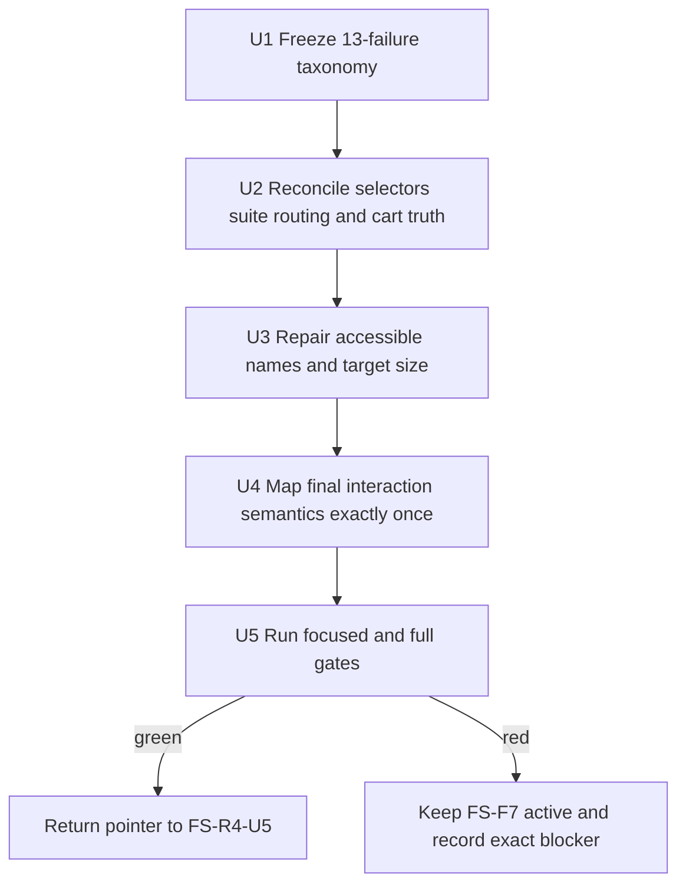
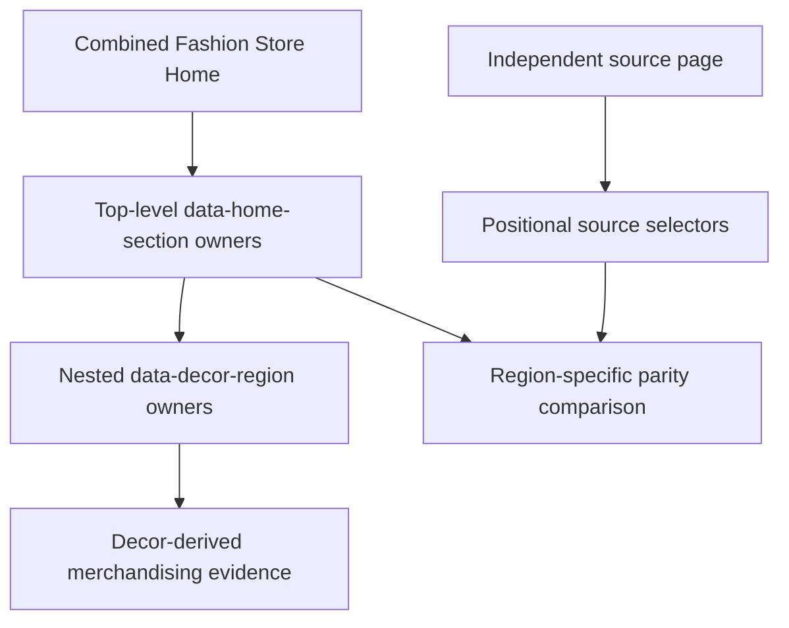

# Fashion Store Merchandising Contract Reconciliation - Plan

## Goal Capsule

**Objective:** Restore a green full Fashion Store gate by reconciling the six product-merchandising contracts that currently block FS-R4-U5 and FS-F6-U4.

**Means:** Repair side-specific source-region ownership, Playwright suite routing, empty-cart fixture assertions, application-owned accessibility semantics, and interaction-ledger coverage without changing the accepted merchandising design or shell.

**Authority hierarchy:** The product master plan is product-level authority. FS-F7 temporarily owns only the six preserved merchandising blockers. FS-R4 retains the canonical Header/Footer contract at U5, and FS-F6 retains the animation-performance tail at U4.

**Stop conditions:** Stop and update this plan if a fix requires a merchandising redesign, changed commerce truth, relaxed source-parity or accessibility thresholds, a second runtime theme identity, or a change to candidate, DC, deployment, or PG state.

**Execution profile:** Standard, characterization-first repair in the existing primary checkout. The implementation sequence must preserve the already-dirty working tree.

---

## Authority and Lineage

- **Upstream product authority:** `docs/plans/2026-08-13-001-refactor-shoppp-product-master-plan.md` owns product sequence, aliases, release state, and the active-plan pointer.
- **Inherited baseline:** FS-F4 supplies the accepted Home visual source baseline; FS-F5 supplies the wide Home body baseline; FS-F6 supplies the dedicated motion budgets and six preserved blockers; FS-R4 supplies the canonical Header/Footer shell.
- **Explicit supersessions:** FS-F7 supersedes only stale test assumptions that treat nested successor regions as legacy siblings, collect the dedicated motion spec through the generic suite, require a populated Home preview cart, count descendant sections as top-level sections, or leave the 28 rendered merchandising controls outside the behavior ledger. It does not supersede any visual, motion, accessibility, commerce, Header, Footer, or page-body threshold.
- **Parallel plans:** FS-R4 was preserved at U5 and FS-F6 remains preserved at U4. FS-F7 has returned the product pointer to FS-R4-U5 without advancing either preserved unit.
- **Tail ownership:** FS-F7 owned U1-U5 and focused evidence and has completed that tail. FS-R4 now owns the active U5 verification and must complete it before it can return the pointer to FS-F6-U4.

## Execution Checkpoint

- **Classification:** Completed bounded successor; U1-U5 completed on 2026-09-13.
- **Completed units:** U1 — FS-F7 is the single active product plan, the thirteen observed failures are frozen under six owned contracts, and the preserved FS-R4-U5 / FS-F6-U4 checkpoints and handback chain are recorded without advancing either plan. U2 — source and implementation region ownership, eleven top-level versus seven nested region structure, generic versus dedicated motion collection, stable marquee observation, and truthful empty-to-populated preview-cart assertions are reconciled with unchanged product behavior and thresholds. U3 — the 20 category, client-logo, and journal image links have meaningful names; redundant Decor product-title links no longer compete with each card's retained image destination; service-description contrast is repaired; and fixture/live focused accessibility, keyboard, responsive target, and overflow evidence passes without new exclusions or threshold changes. U4 — the stabilized 28-candidate merchandising fingerprint is covered exactly once by mutually exclusive tab, cart, wishlist, quick-view, and directional carousel rows; reverse coverage is green and existing product-card navigation ownership is unchanged. U5 — focused unit, static-browser, live-merchandising, accessibility, dedicated-motion, complete Fashion Store, type, lint, production/static, impact-selection, formatting, and diff gates passed; two stale full-gate assertions were reconciled to the already-approved U3 link semantics and canonical Footer shell-width ownership without changing production behavior or thresholds.
- **Current unit:** None; FS-F7 is complete.
- **Next unit:** Outside this completed plan, FS-R4-U5 is the active product unit; FS-F6-U4 remains preserved.
- **Blocker:** None.
- **Next concrete action:** None within FS-F7. Execute FS-R4-U5 under its owning plan and stop before FS-F6-U4 unless FS-R4 completes its own verification and handback.
- **Completion handback:** Completed on 2026-09-13. The product master pointer returned only to FS-R4-U5; REL, candidate, DC, deployment, PG, and FS-F6-U4 state did not advance.

---

## Product Contract

### Summary

FS-F7 repairs the contract boundaries around the current Fashion Store Home merchandising composition. The accepted UI, empty-cart truth, dedicated motion budgets, canonical shell, and one-product identity remain unchanged.

### Problem Frame

The full Fashion Store suite reports thirteen failures across six preserved contract areas. Most failures come from tests applying legacy sibling selectors or generic suite assumptions to a nested successor composition. The accessibility and interaction-ledger failures expose real application-owned gaps and cannot be solved by weakening tests.

Until these contracts are reconciled, FS-R4 cannot close its all-green verification gate and FS-F6 cannot finish its regression handback.

### Requirements

- R1. The implementation and source sides use independent region selectors so nested Decor-derived merchandising content is not attributed to retired legacy Fashion sibling regions.
- R2. Home structure verification asserts the ordered eleven top-level `[data-home-section]` regions and the ordered seven nested `[data-decor-region]` regions as separate contracts.
- R3. The generic Fashion Playwright configuration does not collect the dedicated animation-performance specification, while the dedicated motion command remains required and unchanged.
- R4. Generic marquee behavior targets the stable implementation owner and preserves the independent source selector.
- R5. The Home preview cart starts empty; tests assert empty and populated states according to actions instead of seeding or assuming source demonstration lines.
- R6. Every image-only merchandising link has a meaningful accessible name derived from its visible object or destination.
- R7. Product-card links satisfy the existing WCAG 2.2 target-size gate through narrowly scoped semantic or geometry changes that preserve visual layout.
- R8. The 28 rendered merchandising candidates map exactly once to outcome-specific behavior rows, with no unmatched candidates, duplicate ownership, or stale reverse-coverage rows.
- R9. The existing source-parity, motion, accessibility, screenshot, commerce, and canonical Header/Footer thresholds remain unchanged.
- R10. The complete `test:fashion-store` gate, dedicated motion suite, production build, static verification, typecheck, lint, and impact checks pass before handback.

### Scope Boundaries

#### In Scope

- Side-specific source and implementation selectors for legacy Fashion regions and successor merchandising regions.
- Logical top-level and nested Home section assertions.
- Generic versus dedicated Playwright test collection.
- Empty-to-populated preview-cart test truth.
- Application-owned names and target sizes for merchandising links.
- Outcome-specific behavior-contract rows for tabs, card actions, and collection controls.
- Focused and complete Fashion Store verification plus governance handback.

#### Out of Scope

- New merchandising content, layout direction, animation choreography, product ranking, or navigation destinations.
- Restoring `fashion`, `decor`, or `decor-store` as runtime product or Header modes.
- Changing the canonical Header/Footer implementation established by FS-R4.
- Relaxing screenshot ratios, visible-copy budgets, motion budgets, Axe severity, interaction coverage, or bundle budgets.
- Candidate freeze, DC, deployment, PG, or release promotion.

### Acceptance Examples

- AE1. Given the combined Home, when structure is inspected, then eleven ordered top-level Home sections remain visible and the product-merchandising section contains seven ordered nested Decor-derived regions.
- AE2. Given the generic Fashion suite, when Playwright collects tests, then the performance specification is absent; given the dedicated motion command, both fixed motion profiles still run and pass.
- AE3. Given a fresh Home session, when the mini-cart opens, then it reports an empty cart with no remove controls; after adding a product and navigating internally, the line and its controls remain available.
- AE4. Given fixture and live merchandising content, when Axe runs without new exclusions, then no critical or serious violation is reported for the repaired region.
- AE5. Given the rendered Home interaction inventory, when the ledger is audited, then every one of the 28 previously unmapped candidates resolves to exactly one truthful behavior row.

---

## Planning Contract

### Key Technical Decisions

- KTD1. **Repair contract ownership instead of flattening production markup.** Source pages retain positional selectors; the implementation uses stable `[data-home-section]` and `[data-decor-region]` boundaries. This preserves nested semantic sections and existing source authority. (See `docs/solutions/workflow-issues/html-source-parity-reconstruction-workflow-2026-08-06.md`.)
- KTD2. **Keep motion proof on one dedicated route.** The generic config excludes the performance spec, and `test:perf:motion` remains the only fixed-profile owner. Skipping unsupported projects inside the spec is rejected because it would hide future collection drift.
- KTD3. **Treat the empty Home cart as commerce truth.** Shared shell styling is checked in the empty state and again after a public add-to-cart action creates a line. Seeding source demonstration products is rejected.
- KTD4. **Fix accessibility before fingerprinting interaction candidates.** Accessible names and target geometry stabilize first, then ledger selectors are written against the final semantics.
- KTD5. **Map behavior families, not raw elements.** Existing card-navigation rows remain authoritative. New mutually exclusive region-scoped rows cover the two merchandising tabs, eight cards' cart, wishlist, and quick-view actions, and two collection controls. A blanket Home-button selector is rejected.
- KTD6. **Preserve every existing quality threshold.** Test corrections change ownership and state modeling only; real application defects receive bounded production fixes. (session-settled: user-approved — chosen over treating the failures as FS-R4 exceptions: the full Fashion Store gate must become green before handback.)

### High-Level Technical Design

### Failure Taxonomy

The thirteen observed failures remain grouped under six governed contracts. The nested-region contract owns both the source-inventory bleed and the marquee temporal selector failure.

| Contract                                  |         Observed failures | Governing requirements |
| ----------------------------------------- | ------------------------: | ---------------------- |
| Nested and side-specific region ownership |                         2 | R1, R2, R4             |
| Generic motion-spec collection            |                         4 | R3                     |
| Home mini-cart fixture truth              |                         1 | R5                     |
| Interaction-ledger coverage               | 1 reporting 28 candidates | R8                     |
| Top-level section counting                |                         4 | R2                     |
| Serious accessibility                     |                         1 | R6, R7                 |

### Sequencing

Accessibility precedes ledger reconciliation because names and target structure affect candidate fingerprints. Region ownership, suite routing, and cart-state assertions can be repaired together because they are independent test-contract corrections. Full verification runs only after each focused owner is green.

---

## Implementation Units

### U1. Activate FS-F7 and freeze failure ownership

**Goal:** Make FS-F7 the single active product plan and preserve exact upstream checkpoints and failure ownership.

**Requirements:** R9, R10.

**Dependencies:** None.

**Files:**

- `docs/plans/2026-09-13-1357-fix-fashion-merchandising-contracts-plan.md`
- `docs/plans/2026-08-13-001-refactor-shoppp-product-master-plan.md`
- `docs/plans/2026-09-13-1205-refactor-fashion-store-shared-shell-plan.md`
- `docs/plans/2026-09-11-0010-perf-home-animation-smoothness-plan.md`
- `docs/progress/fashion-store-merchandising-contracts.md`

**Approach:** Record FS-R4-U5 and FS-F6-U4 as preserved parallel checkpoints. Bind all thirteen failures to the six contracts above and state that no failure is an approved exemption.

**Execution note:** Use the existing U5 evidence as characterization; do not spend time rerunning the same full red suite before the first targeted repair.

**Test scenarios:**

- Verify the master names FS-F7-U2 as the next implementation pointer after U1 completes.
- Verify FS-R4-U5 and FS-F6-U4 retain their blockers and handback order.
- Verify progress evidence records the failure taxonomy without creating another current-unit queue.

**Verification:** The new plan, upstream checkpoints, master pointer, and progress evidence agree on one active unit and one handback chain.

### U2. Reconcile region, collection, motion, and cart test contracts

**Goal:** Remove stale test assumptions while retaining every governed source, motion, structure, and cart outcome.

**Requirements:** R1-R5, R9.

**Dependencies:** U1.

**Files:**

- `apps/storefront/app/themes/fashion-store/source-contract.ts`
- `apps/storefront/app/themes/fashion-store/behavior-contract.ts`
- `apps/storefront/playwright.fashion-store.config.ts`
- `apps/storefront/e2e/support/theme-source-inventory.ts`
- `apps/storefront/e2e/fashion-store-acceptance-slice.spec.ts`
- `apps/storefront/e2e/fashion-store-theme.spec.ts`
- `apps/storefront/e2e/theme-behavior-contract.spec.ts`
- `apps/storefront/e2e/fashion-store-collection.spec.ts`
- `apps/storefront/tests/fashion-store-home-source.test.ts`
- `apps/storefront/tests/fashion-store-theme.test.ts`
- `apps/storefront/tests/fashion-store-preview-cart.test.ts`

**Approach:**

1. Separate source positional selectors from implementation stable-region selectors and keep canonical shell content outside retired legacy body-copy authority.
2. Assert eleven ordered top-level Home regions and seven ordered nested merchandising regions.
3. Exclude the performance spec from generic collection while retaining its dedicated owner.
4. Give the marquee behavior row separate source and implementation selectors, and target the implementation track through its stable Home-region marker.
5. Split mini-cart checks into initial-empty truth and a populated state created through the public cart behavior.

**Execution note:** Add or adjust focused characterization assertions before changing the owning selector or configuration.

**Patterns to follow:** `apps/storefront/e2e/fashion-store-live-unified-home.spec.ts` already distinguishes Home and Decor-derived regions. `apps/storefront/tests/fashion-store-preview-cart.test.ts` owns the initial empty-cart invariant.

**Test scenarios:**

- Covers AE1. The combined Home reports eleven ordered `[data-home-section]` owners and seven ordered nested `[data-decor-region]` owners.
- A legacy Fashion source region compares only with its corresponding implementation owner and never absorbs nested successor copy.
- The source and implementation marquee selectors each observe the intended track and the temporal outcome still advances.
- Covers AE2. Generic collection omits the performance spec, while the dedicated config still collects exactly its two fixed profiles.
- Covers AE3. A fresh Home mini-cart is empty with no remove control; after a public add action, populated controls retain their shared styling through internal navigation.

**Verification:** Focused source-inventory, Home structure, marquee behavior, collection shell, preview-cart, and configuration tests pass without changed quality thresholds.

### U3. Repair merchandising accessibility semantics

**Goal:** Remove the real critical/serious Axe findings while preserving copy, destinations, visual geometry, and library-owned interaction behavior.

**Requirements:** R6, R7, R9.

**Dependencies:** U2.

**Files:**

- `apps/storefront/app/themes/fashion-store/components/home/FashionStoreDecorHomeBody.vue`
- `apps/storefront/app/themes/fashion-store/components/shared/FashionStoreProductCard.vue`
- `apps/storefront/app/themes/fashion-store/integration.css`
- `apps/storefront/e2e/fashion-store-theme.spec.ts`
- `apps/storefront/e2e/fashion-store-live-unified-home.spec.ts`
- `apps/storefront/e2e/a11y.spec.ts`

**Approach:** Give category, client-logo, and journal image links meaningful names derived from their visible objects. Resolve the eight product-link target-size findings with the narrowest Decor-merchandising semantic or geometry change. Keep native links and existing primitives; add no global announcer, custom keyboard protocol, Axe exclusion, or rule suppression.

**Execution note:** Capture the exact Axe nodes before changing markup, then prove fixture and live merchandising without a whole-region exclusion.

**Patterns to follow:** Repository accessibility ownership requires visible meaning, icon-only accessible names, native semantics, and local deterministic behavior.

**Test scenarios:**

- Covers AE4. Six category image links, ten client-logo links, and four journal image links expose meaningful unique or context-correct accessible names.
- Eight Decor product cards satisfy the WCAG 2.2 target-size/spacing rule at desktop and compact breakpoints without visible overlap or overflow.
- Keyboard traversal reaches each retained actionable link once and preserves its current destination.
- Fixture and live merchandising regions report no critical or serious Axe violations without new exclusions.

**Verification:** Focused Axe, keyboard, responsive geometry, and no-overflow evidence passes for fixture and live Home states.

### U4. Complete outcome-specific interaction ownership

**Goal:** Map all 28 merchandising candidates exactly once after final accessibility semantics stabilize.

**Requirements:** R8, R9.

**Dependencies:** U3.

**Files:**

- `apps/storefront/app/themes/fashion-store/interaction-contract.ts`
- `apps/storefront/app/themes/fashion-store/behavior-contract.ts`
- `apps/storefront/e2e/fashion-store-interaction-ledger.spec.ts`
- `apps/storefront/e2e/fashion-store-theme.spec.ts`
- `apps/storefront/tests/fashion-store-interaction-contract.test.ts`

**Approach:** Add mutually exclusive, region-scoped rows for the two merchandising tabs, eight cards' cart/wishlist/quick-view actions, and two collection controls. Reuse stable product-card and action attributes. Record truthful local-state, cart-mutation, navigation, and unavailable outcomes instead of inferring behavior from element type.

**Execution note:** Run exact-one and reverse-coverage assertions after every behavior-family addition so an overbroad row cannot hide another family.

**Patterns to follow:** `behavior-contract.ts` requires triggers, outcomes, branches, disposition, fallback, ownership, and acceptance evidence for each row.

**Test scenarios:**

- Covers AE5. Every previously unmapped candidate resolves to exactly one behavior row, and no existing candidate becomes duplicate-owned.
- Selecting each merchandising tab changes the visible local product group and supports pointer and keyboard input.
- Each card cart action changes preview-cart state; wishlist and quick-view expose their truthful configured outcomes.
- Collection previous and next controls move the visible carousel within their responsive branches and retain the reduced-motion fallback.
- Reverse coverage rejects a stale row whose selector matches no rendered candidate.

**Verification:** Interaction-contract unit tests and the rendered ledger pass with zero unmapped, duplicate, or stale candidates across the owned viewport matrix.

### U5. Run full regression and return to FS-R4

**Goal:** Close FS-F7 only after focused owners and the complete Fashion Store gate are green.

**Requirements:** R1-R10.

**Dependencies:** U4.

**Files:**

- All files changed by U1-U4.
- `docs/plans/2026-09-13-1357-fix-fashion-merchandising-contracts-plan.md`
- `docs/plans/2026-08-13-001-refactor-shoppp-product-master-plan.md`
- `docs/progress/fashion-store-merchandising-contracts.md`

**Approach:** Run focused unit and browser owners first, followed by dedicated motion, the complete Fashion Store gate, typecheck, lint, static verification, production build, impact checks, and diff audit. If every requirement passes, record completion and return the pointer to FS-R4-U5. Any remaining failure keeps FS-F7 active with exact evidence.

**Test scenarios:**

- The six governed contracts produce no failure in the complete Fashion Store suite.
- The dedicated two-profile motion suite still runs separately and meets its unchanged budgets.
- Canonical Header/Footer, cart commerce behavior, source parity, accessibility, responsive Home geometry, and live composition remain green.
- Master and child checkpoints hand authority only to FS-R4-U5; FS-F6-U4 and release state remain preserved.

**Verification:** Every command and manual gate in the Verification Contract passes, retained evidence contains no second execution queue, and the final diff contains no threshold relaxation or unrelated cleanup.

---

## Verification Contract

| Gate                   | Scope                                                                                                                     | Done signal                                                                                      |
| ---------------------- | ------------------------------------------------------------------------------------------------------------------------- | ------------------------------------------------------------------------------------------------ |
| Focused unit contracts | Source regions, Playwright routing, preview cart, accessibility semantics, interaction rows                               | All focused Bun tests pass with no changed threshold constants.                                  |
| Focused static browser | Acceptance slice, Theme, behavior contract, Collection, and interaction ledger under `playwright.fashion-store.config.ts` | All owned desktop and responsive cases pass; intentional viewport-owner skips remain documented. |
| Live merchandising     | Unified Home fixture and live data paths                                                                                  | Product content, names, target geometry, cart state, and shell remain correct.                   |
| Accessibility          | Theme serious gate and `test:a11y` against the active Fashion build                                                       | No critical or serious violations and no new rule exclusion or suppression.                      |
| Dedicated motion       | `bun run test:perf:motion` from `apps/storefront`                                                                         | Both fixed profiles run and pass unchanged budgets.                                              |
| Full Fashion Store     | `bun run test:fashion-store` from `apps/storefront`                                                                       | All stages pass with zero failure.                                                               |
| Static and production  | Static verifier and production build                                                                                      | Generated output passes integrity and bundle checks.                                             |
| Type and lint          | Storefront typecheck and changed-file lint                                                                                | Zero error.                                                                                      |
| Impact and diff        | Theme impact verifier plus `git diff --check`                                                                             | Required scope is selected, no whitespace error, and no unrelated user work is lost.             |
| Governance             | FS-F7 checkpoint, product master, and focused progress evidence                                                           | One current pointer; handback stops at FS-R4-U5.                                                 |

---

## Risks and Mitigations

- **Selector overreach:** A shared selector could make one candidate match multiple rows. Use region-scoped stable attributes and keep exact-one plus reverse-coverage tests active.
- **False green by omission:** Excluding the performance spec from the generic suite could drop motion coverage. Keep the dedicated command mandatory in U5 and in the plan Definition of Done.
- **Parity dilution:** Broad copy exclusions could hide real drift. Limit source-side exceptions to the accepted empty-cart divergence and bind every region to its actual authority.
- **Accessibility geometry drift:** Enlarged targets could move product cards. Prefer local hit-area or spacing ownership and rerun responsive screenshot, containment, and overflow checks.
- **Dirty-tree collision:** Target files already contain work from preceding plans. Edit only named contract surfaces, inspect the actual diff per unit, and never discard existing changes.

---

## Sources and Research

- `docs/plans/2026-09-13-1205-refactor-fashion-store-shared-shell-plan.md` establishes the blocked FS-R4-U5 gate and canonical shell boundary.
- `docs/plans/2026-09-11-0010-perf-home-animation-smoothness-plan.md` owns the dedicated motion thresholds and original six-blocker record.
- `docs/progress/fashion-store-shared-shell.md` records the thirteen-failure distribution and passing shell/build/live evidence.
- `docs/solutions/workflow-issues/html-source-parity-reconstruction-workflow-2026-08-06.md` requires separate structural, behavioral, and absence contracts with observable outcome evidence.
- `apps/storefront/app/themes/fashion-store/behavior-contract.ts` and `apps/storefront/e2e/fashion-store-interaction-ledger.spec.ts` are the existing behavior-ledger authorities.

---

## Definition of Done

- U1-U5 satisfy their outcomes with no unresolved implementation tail.
- The Home has eleven ordered top-level regions and seven ordered nested merchandising regions.
- Source and implementation selectors compare only the regions governed by their respective authorities.
- The generic suite does not collect the performance spec, and the dedicated two-profile motion suite remains green.
- The preview cart proves both initial-empty and action-created populated states without fixture seeding.
- Fixture and live merchandising report no critical or serious Axe violation without new exclusions.
- All 28 previously unmapped candidates resolve exactly once, and reverse coverage reports no stale row.
- Existing source-parity, screenshot, motion, accessibility, commerce, canonical shell, and bundle thresholds are unchanged.
- The complete `bun run test:fashion-store` gate, production build, static verification, typecheck, lint, impact checks, and diff audit pass.
- FS-F7 is complete, focused evidence is retained under `docs/progress/`, and the product master pointer is returned only to FS-R4-U5 with FS-F6-U4 and all release state preserved.
