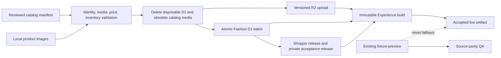
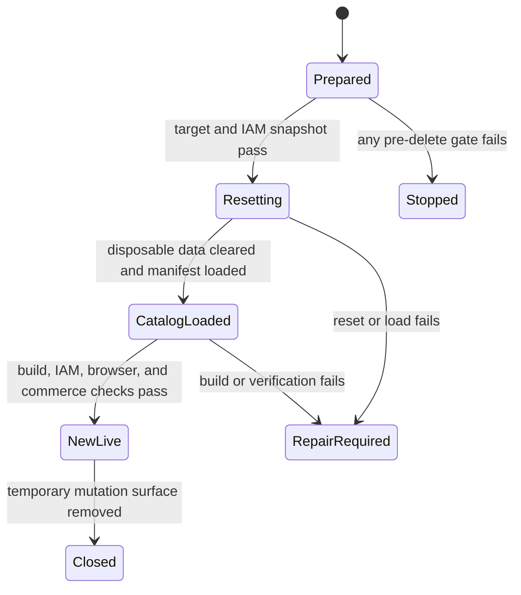

# Fashion Store Development Catalog Reset - Plan

## Goal Capsule

**Objective:** Make the Fashion Store live experience display and sell the realistic products, prices, variants, and imagery already accepted in the current UI while every existing administrator can still authenticate with the same account and active credentials.

**Means:** Use the completed reviewed manifest and catalog contracts to perform one deliberate Fashion development reset: preserve IAM/Auth and configuration, clear disposable commerce/catalog state and obsolete product media, load the 13-product catalog, activate it, verify it, and remove the temporary migration surface (KTD1-KTD9).

**Authority hierarchy:** The product master remains product-level authority. `COM` owns catalog and commerce invariants, `IAM` owns authentication and authorization, and `FS` owns Fashion presentation. This plan supersedes the Fashion staging business dataset and catalog identity. It preserves U12 acceptance behavior plus Experience/release immutability policies, while existing Fashion staging Experience and operator lineage is disposable.

**Stop conditions:** Stop before a remote write if the target is not exactly `shoppp-fashion-staging`, the IAM/Auth preservation set or `AUTH_TOKEN_SECRET` cannot be verified, a Fashion acceptance/operator/build lock is active, media differs from the reviewed manifest, or the complete replacement catalog cannot be written and activated without partial shopper visibility.

**Execution profile:** Development-only destructive reset. The `FS-F7 -> FS-R4 -> FS-F6` handback chain is already complete. `FS-F8` owns U1-U7, may destroy non-IAM Fashion staging business data and obsolete catalog media, and returns the implementation tail to `REL` without advancing candidate, DC, deployment, or PG state.

---

## Product Contract

### Summary

Fashion Store will retain deterministic fixture-preview behavior while live routes use a complete 13-product catalog stored in D1, product media served from R2, and one complete shopper Catalog Release. The one-time development reset preserves administrator identities and authentication but deliberately discards the previous Fashion staging catalog and dependent development commerce state.

### Problem Frame

The polished products now visible in the UI are fixture-owned. Fashion staging instead contains a three-product acceptance catalog with no `product_media`, and the live presentation contract has no compare-at price. Moving the visible content into D1/R2 therefore requires price, inventory, release, Experience, and storefront contracts to change together.

The earlier plan treated the operation like a production migration: preserve old lineage, build reusable rollout tooling, retain rollback artifacts, and compensate stale business state. That is disproportionate for the current development environment. The only historical state the user requires is administrator access. The revised plan therefore uses physical deletion or database reconstruction for disposable business domains, preserves the complete IAM/Auth boundary and stable configuration, imports one trusted catalog, and does not carry old catalog compatibility or rollback obligations forward.

### Key Decisions

- **Use a one-time destructive development reset, not a production migration.** (session-settled: user-directed — chosen over reusable rollout/rollback machinery because old business history and compatibility have no value during development.) Governs R8-R12, R15-R16.
- **The catalog contains 13 independent products.** The 12 Shop cards remain distinct even when names repeat, and Relaxed corduroy shirt is the thirteenth product. Governs R1-R3.
- **Shop product-card prices are authoritative.** Lower-priced arrivals remain fixture presentation data and do not override products sharing a name or image. Governs R2, R6.
- **Unknown physical attributes are not invented.** Image dimensions are exact; absent shipping weight or dimensions remain explicit schema-supported unknown/default values under flat-rate Fashion staging. Governs R3-R5.

### Requirements

#### Catalog identity and pricing

- R1. The live manifest defines exactly 13 stable product IDs and 24 stable SKU IDs: 12 single-SKU Shop products plus 12 color/size SKUs for Relaxed corduroy shirt.
- R2. A USD price may carry an optional compare-at amount strictly greater than its current amount; only current amount participates in cart, checkout, payment, order, reporting, and SEO totals.
- R3. Duplicate names never determine identity; ID, slug, SKU, source asset, and price identify each product and variant.
- R4. Every intended sellable SKU has a Fashion staging warehouse position with positive available quantity before activation.

#### Media and presentation truth

- R5. Product media uses an immutable R2 prefix per catalog version, correct MIME type, source checksum, meaningful alt text, source dimensions, and display order without upscaling.
- R6. Live Shop, collection, search, cards, details, options, prices, and add-to-cart resolve from the same release identities; decorative theme assets, payment marks, avatars, and editorial imagery stay theme-owned.
- R7. `fixture-preview` remains local, deterministic, and network-independent; live mode reads D1/R2/Catalog Release data and never falls back to fixture products.

#### Safety, access, and lifecycle

- R8. The reset preserves IAM/Auth records, assignments, password state, session and service-token validity, reset/throttle state, and the unchanged `AUTH_TOKEN_SECRET`.
- R9. Remote mutation is limited to an immutable allowlist of the Fashion staging Cloudflare account, Worker environment/name, D1 database UUID/name, R2 bucket, and media origin; ordinary staging and production are excluded.
- R10. Fashion staging may be temporarily unavailable during the destructive reset. No partially loaded replacement release is activated; normal public behavior resumes only after the complete new release passes activation checks.
- R11. The reset physically removes disposable Fashion staging business state, including the old catalog and dependent carts, orders, payments, fulfillment, inventory, publishing, Experience, acceptance, audit, and related development records, while leaving the named IAM/Auth and configuration preservation set untouched.
- R12. The reset is a single-purpose operation for the reviewed manifest, not a reusable import framework. It may support safe restart during the same execution, but it creates no ongoing compatibility, rollback, or generalized operator contract.

#### Operational compatibility

- R13. Fashion staging acceptance continues to prove single-SKU, multi-SKU, and unavailable behavior without exposing acceptance-only products or artifacts to shoppers. Single/multi proof uses new shopper identities; unavailable proof uses a dedicated acceptance-only identity in a separate protected release and private Preview artifact.
- R14. Admin shows compare-at, multi-variant, and multi-media truth and cannot submit an edit that silently collapses Relaxed corduroy shirt.
- R15. Reset cannot begin while any Fashion acceptance lock, operator run, release build, or Experience build is non-terminal, and it requires a fresh IAM/Auth preservation snapshot plus an exact-target check immediately before deletion.
- R16. After reset there are no records from the previous business dataset and no obsolete product-media objects under the retired catalog prefixes; the new catalog is the only Fashion staging business baseline.

### Key Flows

- F1. **Prepare:** Validate manifest/media, stop active Fashion work, prove the exact target, snapshot the IAM/Auth preservation set, and record the current secret identity without exporting disposable business history. Covers R1-R5, R8-R9, R12, R15.
- F2. **Reset:** Delete disposable business rows in a dependency-safe operation or rebuild the development D1 schema and restore only the preservation set, and delete only obsolete catalog-media prefixes. Temporary Fashion staging unavailability is acceptable. Covers R8-R12, R15-R16.
- F3. **Load:** Upload the reviewed R2 media, atomically insert the complete catalog/inventory and acceptance identity, and create the shopper and private acceptance releases. Covers R1-R5, R10, R12-R13.
- F4. **Activate and prove:** Activate the complete shopper artifact, verify IAM, storefront, Admin, media, inventory, and commerce behavior, revoke the reset-only credential, then remove or disable the temporary reset route while retaining the shared acceptance credential, ordinary runtime code, and manifest. Covers R2, R6-R10, R13-R16.

### Acceptance Examples

- AE1. Covers R1, R3. Repeated names remain distinct; the release has 13 product IDs and 24 SKU IDs, `/shop` shows 12 cards, and Relaxed exposes all 3-by-4 combinations.
- AE2. Covers R2. Current 18,900 and compare-at 20,000 both display while cart/payment use 18,900; compare-at less than or equal to 18,900 is rejected.
- AE3. Covers R5. Each R2 object returns 200 with expected MIME/checksum, and release dimensions equal decoded source dimensions.
- AE4. Covers R8. Enabled password, active browser session, and enabled service token still authenticate; disabled, expired, and revoked states remain rejected with unchanged permissions.
- AE5. Covers R10. During reset, external access may be unavailable or return the platform's ordinary failure response. After activation, it resolves the complete new release and never renders a 1-to-12-product intermediate catalog.
- AE6. Covers R4, R6. One single-SKU item and one selected Relaxed SKU enter a new cart with authoritative price and positive available inventory.
- AE7. Covers R7. Fixture-preview still renders and passes its contracts with D1/R2 unavailable; live reports failure rather than substituting fixtures.
- AE8. Covers R11-R12. After reset, queries across the declared business-domain tables return only the new baseline; old products, carts, orders, releases, builds, acceptance runs, and audits are absent, while the operation cannot be repurposed with an arbitrary manifest or target.
- AE9. Covers R13, R16. Unavailable acceptance runs only against its protected private artifact, obsolete catalog-media prefixes are absent, the temporary reset route is removed or disabled, the reset-only credential is revoked, and the shared Fashion acceptance credential remains valid.

### Success Criteria

- The activated shopper release has exactly 13 products, 24 variants, all declared media, positive planned inventory, and zero foreign-key violations.
- Old three-product acceptance items are absent from new routes, collections, search, and shopper pages.
- Login, active-session, service-credential, single-SKU cart, multi-SKU cart, price, and R2 probes pass after activation.
- Fixture parity, live Fashion acceptance, type, lint, contracts, Workers, static, accessibility, responsive, and build gates remain green.

### Scope Boundaries

**In scope:** Fashion staging catalog/media, compare-at semantics, a single-purpose reset runner, IAM/Auth preservation, inventory baseline, release/Experience activation, Admin loss prevention, and fixture/live verification.

**Out of scope:** Ordinary staging, production, credential rotation, image enhancement, customer accounts, a general-purpose import product, preservation or compatibility of old development business history, rollback to the old catalog, and Fashion visual redesign.

#### Deferred to Follow-Up Work

- General operator-facing bulk import, reusable inventory-position creation, and a permanent migration API.
- Dynamic filter counts and tag aggregation; current fixture filter copy stays presentation-owned.
- Production-grade rollback, retention pins, historical artifact recovery, and garbage-collection workflows.
- A complete Admin variant editor beyond preventing lossy edits to this published catalog.

---

## Planning Contract

### Key Technical Decisions

- KTD1. Treat Fashion staging business data as disposable. Prefer a schema-aware destructive reset of all non-preserved domains in the existing D1 database; if append-only triggers or foreign keys make that materially less reliable, rebuild the development schema and restore only the IAM/Auth and configuration preservation set. This implements R8-R11 and explicitly supersedes logical retirement/rollback.
- KTD2. Add nullable `compare_at_amount` to `prices` and optional catalog-only `compareAtAmount`/`compareAtPrice` fields. Do not change strict shared `moneySchema`; transaction contracts keep current price only. This implements R2 while optional parsing preserves historical schema-v2 releases.
- KTD3. Make a reviewed JSON catalog manifest the deterministic source for stable IDs, source paths/dimensions/checksums, R2 keys, inventory baselines, release JSON, preflight/verification, and receipts.
- KTD4. Use `catalog/fashion-store/<catalog-version>/<slug>/<position>-<source-name>.<ext>` R2 keys. Equal existing bytes permit restart during this reset; different bytes fail closed. Delete only obsolete product-catalog prefixes after exact-prefix inventory, and leave theme-owned assets untouched. ([R2 consistency](https://developers.cloudflare.com/r2/reference/consistency/), [R2 delete](https://developers.cloudflare.com/r2/objects/delete-objects/))
- KTD5. Apply the complete catalog through one Fashion-only D1 batch and create exactly one shopper release plus one separate private acceptance-only release. Do not loop through product-at-a-time shopper publish, which would build partial catalogs. ([D1 batch](https://developers.cloudflare.com/d1/worker-api/d1-database/#batch), [D1 foreign keys](https://developers.cloudflare.com/d1/sql-api/foreign-keys/))
- KTD6. Treat seed quantities as the initial inventory baseline in the atomic batch with zero reserved/backordered/oversell. Route every later change through the stock ledger.
- KTD7. Preserve `settings`, `admin_permission_definitions`, `admin_roles`, `admin_role_permissions`, `admin_identities`, `admin_invitations`, `admin_password_credentials`, `admin_sessions`, `admin_password_reset_tokens`, `admin_login_throttles`, and `admin_service_credentials`; never rotate `AUTH_TOKEN_SECRET`; compare row counts and security-field digests before and after reset, allowing only documented probe timestamps to change. If schema rebuild is selected, create a restorable encrypted preservation-set export in a permission-restricted ephemeral runner directory, keep its per-run key outside artifacts and the repository, prove restoration order during rehearsal, and delete the export and key on every terminal outcome after authentication verification.
- KTD8. Reuse U5's exact-environment guard, manifest validation, R2 verification, atomic catalog batch, and acceptance probes only as internal scaffolding for this reset. Require a separate short-lived reset credential in addition to the shared Fashion acceptance guard, scope it to the exact resource allowlist and manifest digest, attribute the destructive audit to its authenticated principal, and revoke it on every terminal outcome. Do not add workflow orchestration, retention pins, general manifest parameters, or a supported long-term migration interface; remove or disable the temporary mutation route after success while preserving the shared acceptance credential and service principal.
- KTD9. Define the reset boundary by preservation rather than historical exceptions: every D1 table outside the KTD7 set is disposable unless implementation inspection proves it is infrastructure configuration required to boot or authenticate. Record the final preserved/deleted table inventory in the runbook before execution; do not retain carts, orders, payments, inventory ledgers, releases, builds, audits, or acceptance history merely because they are append-only in normal operation.

### High-Level Technical Design

### Implementation Constraints

- Preserve unrelated dirty-tree work and do not hand-edit generated active-theme, Experience, release, or catalog files.
- Never log credential hashes, raw tokens, or full D1 exports; retain only protected preservation-set digests, counts, and execution receipts.
- Capture the IAM fingerprint before login probes. Afterward only named `last_seen_at`/`last_used_at` changes are allowed.
- Existing acceptance locks remain authoritative before reset. Once the exact destructive boundary is confirmed, old operator/Experience lineage is disposable and must not force compatibility code.

### Sequencing and Plan Relationships

- **Upstream product authority:** `COM`, `IAM`, `THEME`, and completed `FS` in `docs/plans/2026-08-13-001-refactor-shoppp-product-master-plan.md`.
- **Inherited baseline:** Completed Fashion integration, fixture/live split, catalog pipeline, U12 protected workflow, and accepted UI.
- **Explicit supersessions:** Replace the three-product/placeholder-media payload in `tools/prepare-fashion-staging-u12.ts` and its catalog identity variables. Supersede FS-F8's earlier logical-retirement, old-catalog rollback, retention-pin, reusable-workflow, and history-preservation requirements; preserve only acceptance behavior archetypes and IAM/Auth truth.
- **Parallel plans:** `FS-F7`, `FS-R4`, and `FS-F6` are complete. `REL` remains preserved at blocked Pre-DC while FS-F8 executes; neither plan advances candidate, DC, deployment, or PG state.
- **Tail ownership:** `FS-F8` is active at U7 after U6 completed the authorized remote reset. Green U7 returns to `REL` without freezing a candidate.

## Execution Checkpoint

- **Classification:** Active bounded Fashion staging successor.
- **Current unit:** `FS-F8-U7` — prove the migrated live behavior and close the handback.
- **Completed units:** `FS-F8-U1` — the versioned manifest validates 13 products, 24 stable SKUs, 18 exact product-owned JPEGs, Shop-authoritative prices, taxonomy, and positive inventory. Focused test, tools typecheck, deterministic CLI digest `5e3a81859866ffdb1599eb2f2dff23ef0b34a5c77fa6a530d33a050569776766`, and diff checks passed. `FS-F8-U2` — nullable compare-at persistence, contracts, Admin/public catalog reads, and release serialization are complete; invalid values fail in API/D1, historical releases parse, and focused DB/contracts/API/cart/type/lint/diff gates passed with transactional totals unchanged. `FS-F8-U3` — live cards/details now carry compare-at truth, runtime cart inputs strip it, complete ordered product media uses the established gallery/lightbox path, single-media display stays simple, fixture branches remain isolated, and focused type/unit/lint plus 15/15 live browser tests passed. `FS-F8-U4` — Admin now round-trips compare-at for editable single-variant drafts, shows every stored variant, price, and media fact, and disables scalar submission for published, archived, multi-variant, multi-price, or multi-media shapes; focused Admin tests (5/5), typecheck, lint, and diff checks passed. `FS-F8-U5` — the exact-environment protected endpoint now validates credentials before parsing, rejects active work/IAM drift/collisions/digest drift, verifies all 18 R2 objects by MIME, metadata, and bytes, writes the complete catalog, isolated unavailable identity, two approved releases, audit, and idempotent receipt in one rollback-proven D1 batch, and reports counts, inventory, dimensions, release digest, and FK health. Disposable Workers tests (5/5), DB migrations (10/10), tool/U12/readiness tests (18/18), generated-plan probe, types, lint, and diff checks passed without remote mutation. `FS-F8-U6` — the user-authorized remote reset cleared disposable Fashion staging business data, loaded and verified 13 shopper products, 24 sellable variants, and 18 R2 media objects, preserved all four administrator identities and two sessions, deployed the exact shopper release and immutable preview artifact, reported zero foreign-key violations, and removed the temporary reset credential and maintenance enablement after successful repair-forward activation.
- **Remote data state:** The reviewed catalog is loaded and activated. D1 contains 13 shopper products/24 variants plus the isolated unavailable acceptance identity, 18 product-media records, a deployed shopper release, an approved acceptance release, and the deployed preview artifact; IAM/Auth remains at four administrator identities and two sessions.
- **Blocker:** None. The prerequisite `FS-F7 -> FS-R4 -> FS-F6` chain completed and returned to a safe `REL-Pre-DC` checkpoint.
- **Next unit:** None inside U6; `FS-F8-U7` is current.
- **Next concrete action:** Run the focused live Fashion Store browser owners against the deployed catalog, covering product/price/image truth, cart/checkout, existing administrator login, and the private unavailable acceptance identity; retain the evidence and return authority to `REL-Pre-DC` when green.
- **Completion handback:** Green U7 returns the product master pointer to `REL-Pre-DC`; it does not freeze a candidate or advance DC, deployment, or PG state.

---

## Implementation Units

### U1. Freeze the catalog and media manifest

**Goal:** Establish one reviewable source for exact products, variants, prices, taxonomy, inventory, and media.

**Requirements:** R1-R6, R12.

**Dependencies:** Product-master authorization to activate FS-F8.

**Files:**

- `tools/fashion-store-live-catalog.json`
- `tools/prepare-fashion-store-live-catalog.ts`
- `tools/prepare-fashion-store-live-catalog.test.ts`
- `apps/storefront/app/themes/fashion-store/fixtures/home.ts`
- `apps/storefront/app/themes/fashion-store/fixtures/pages/shop.ts`
- `apps/storefront/app/themes/fashion-store/fixtures/pages/product.ts`
- `apps/storefront/app/themes/fashion-store/UPSTREAM.md`

**Approach:** Characterize fixtures first. Create 13 products and 24 SKUs using Shop prices and distinct identities for repeated names. Record product-owned images, decoded dimensions, alt/order, checksum, key, and inventory. Keep arrivals, filter copy, decoration, and fixture runtime outside the database contract.

**Execution note:** Begin with a failing characterization test so duplicate names and conflicting fixture prices cannot be resolved implicitly.

**Patterns to follow:** `tools/storefront-theme-source-manifest.json`, `UPSTREAM.md`, and deterministic helpers in `tools/prepare-fashion-staging-u12.ts`.

**Test scenarios:**

- Covers AE1. Manifest parsing yields 13 products, 24 SKUs, 12 Shop cards, and 12 Relaxed combinations.
- Repeated names with different image or price retain distinct IDs, slugs, and SKUs.
- Every media file decodes and matches width, height, checksum, alt, and the product-media allowlist.
- Duplicate identity/key, invalid option matrix, missing media, or non-positive sellable inventory fails before artifact generation.

**Verification:** One manifest accounts for every live product, SKU, price, media, taxonomy link, and inventory baseline.

### U2. Add compare-at semantics across D1 and catalog APIs

**Goal:** Make sale/original price a validated catalog fact without changing transactional money.

**Requirements:** R2, R6.

**Dependencies:** U1.

**Files:**

- `packages/db/migrations/0024_catalog_compare_at_prices.sql`
- `packages/db/src/schema/index.ts`
- `packages/db/test/migrations.test.ts`
- `packages/contracts/src/catalog.ts`
- `packages/contracts/test/catalog-release.test.ts`
- `packages/contracts/test/contracts.test.ts`
- `apps/api/src/catalog/schemas.ts`
- `apps/api/src/catalog/products.ts`
- `apps/api/src/catalog/public.ts`
- `apps/api/src/publishing/build-manifest.ts`
- `apps/api/test/catalog/catalog.test.ts`
- `apps/api/test/publishing/build-manifest.test.ts`

**Approach:** Implement KTD2 through database/input validation, Admin detail data, release serialization, and public product responses. Preserve historical releases when the field is absent and keep transaction code on current price.

**Execution note:** Add contract and migration failure cases before changing builders or responses.

**Patterns to follow:** `prices`/`price_lists`, strict catalog schemas, canonical release parsing, and `eligiblePriceSql`.

**Test scenarios:**

- Covers AE2. Valid compare-at persists and reaches detail, release, and public data in the same currency.
- Historical schema-v2 releases without compare-at still parse.
- Equal, lower, negative, non-integer, or cross-currency values fail without partial writes.
- Cart, checkout, payment, order, report, and SEO tests continue to use current amount.
- Existing price rows migrate unchanged with null compare-at.

**Verification:** D1, contracts, API, and release agree on compare-at while commerce totals remain current-price-only.

### U3. Carry the complete catalog through live presentation

**Goal:** Render live prices, media, and options correctly without changing fixture output.

**Requirements:** R1-R7, R14.

**Dependencies:** U2.

**Files:**

- `apps/storefront/app/theme-engine/view-models.ts`
- `apps/storefront/app/theme-engine/composer.ts`
- `apps/storefront/app/theme-engine/runtime-commerce.ts`
- `apps/storefront/app/themes/fashion-store/components/shared/FashionStoreProductCard.vue`
- `apps/storefront/app/themes/fashion-store/components/home/FashionStoreDecorHomeBody.vue`
- `apps/storefront/app/themes/fashion-store/components/pages/FashionStoreLiveProductPage.vue`
- `apps/storefront/app/components/blocks/ProductCardBlock.vue`
- `apps/storefront/app/pages/products/[slug].vue`
- `apps/storefront/tests/theme-engine.test.ts`
- `apps/storefront/tests/runtime-commerce.test.ts`
- `apps/storefront/e2e/fashion-store-live-commerce.spec.ts`
- `apps/storefront/e2e/fashion-store-live-unified-home.spec.ts`

**Approach:** Add optional compare-at money/labels to catalog-backed models. Render `<del>` only when valid, revalidate price data for selection, bind cart to current price, and preserve fixture branches. Map all ordered release-owned product media into the established Fashion gallery/lightbox behavior; the first image is the no-JavaScript fallback, while pointer, keyboard, touch, responsive, alt-text, and current-position behavior remain intact.

**Patterns to follow:** `activeVariantsWithDefaultMoney`, `formatCommerceMoney`, runtime revalidation, and current fixture/live card branching.

**Test scenarios:**

- Covers AE2. Live cards and selected Relaxed variants show both prices and refresh them on selection.
- Covers AE6. Single-SKU adds directly; Relaxed requires a valid option pair and adds that SKU at current price.
- No compare-at produces no empty or duplicate `<del>`.
- Every Relaxed gallery image is reachable in manifest order; a single-image product retains the simple presentation.
- Runtime price change updates presentation/cart input without using compare-at as expected price.
- Covers AE7. Fixture snapshots, interactions, responsive cases, and no-network tests are unchanged.

**Verification:** Home, collection, search, detail, and cart share stable identity and truthful pricing on desktop/mobile.

### U4. Prevent lossy Admin edits

**Goal:** Let administrators inspect the imported catalog without collapsing variants, prices, or media.

**Requirements:** R14.

**Dependencies:** U2.

**Files:**

- `apps/admin/src/services/catalog/api.ts`
- `apps/admin/src/pages/catalog/catalog-form-page.tsx`
- `apps/admin/src/pages/catalog/catalog-form-page.test.tsx`
- `apps/admin/src/shared/i18n/translations.ts`

**Approach:** Map complete detail into a truthful published-product summary and disable submission whenever the scalar editor cannot represent the full shape. Preserve single-draft editing and defer a general repeatable editor.

**Patterns to follow:** Permission-aware disabled actions, server published immutability, and visible explanations.

**Test scenarios:**

- Relaxed shows 12 variants and all media with no enabled lossy save path.
- Published single-variant data remains readable and immutable.
- Editable single-draft data still round-trips.
- Read-only users see accurate data without mutation controls.

**Verification:** No Admin interaction can submit a one-variant replacement for the imported multi-variant product.

### U5. Build the atomic Fashion staging apply primitive

**Goal:** Generate and atomically apply the reviewed catalog under an exact Fashion staging guard without a partial release.

**Requirements:** R4-R5, R8-R13, R15.

**Dependencies:** U1, U2.

**Files:**

- `tools/prepare-fashion-store-live-catalog.ts`
- `tools/prepare-fashion-store-live-catalog.test.ts`
- `apps/api/src/testing/fashion-staging-catalog.ts`
- `apps/api/src/http/app.ts`
- `apps/api/test/testing/fashion-staging-catalog.test.ts`
- `tools/verify-fashion-staging-readiness.ts`
- `tools/verify-fashion-staging-readiness.test.ts`
- `tools/prepare-fashion-staging-u12.ts`
- `tools/prepare-fashion-staging-u12.test.ts`

**Approach:** Extend U12 generation with R2 uploads, complete shopper release, atomic D1 payload, preflight/verification, IAM fingerprints, and receipts. Add a Fashion-only handler that calls the existing `requireFashionAcceptanceCredential` guard before parsing or mutation, then rejects wrong environment, active work, collisions, missing media, IAM drift, or digest mismatch before one `DB.batch`. Attribute accepted mutations to the existing audited service principal without returning or logging credentials. Create no product-at-a-time shopper release. Create a dedicated unavailable acceptance identity in a separate protected Catalog Release and private Preview artifact; exclude it from the 13-product shopper manifest and shopper activation. U6 owns the later decision to narrow this completed primitive into a one-time reset surface and remove or disable it after use.

**Execution note:** Prove failure atomicity and retry against disposable D1/R2 before workflow integration.

**Patterns to follow:** U12 seed generation, Fashion testing services, environment guards, and service-principal audits.

**Test scenarios:**

- Covers AE5. One batch creates the shopper catalog and one shopper release whose manifest has exactly 13 products and 24 variants; a separate acceptance-only release carries the unavailable identity.
- A statement failure rolls back all new D1 catalog state.
- Covers AE8. Missing R2, active work, IAM drift, collision, or digest change causes no mutation.
- Missing or invalid Fashion acceptance credentials are rejected before payload parsing or mutation and produce no credential-bearing logs or responses.
- Same-digest retry returns one receipt without duplicates.
- Unavailable acceptance uses only the private acceptance artifact while single/multi acceptance uses new shopper identities.
- Verification reports counts, inventory, dimensions, release digest, and no FK violations without secrets.

**Verification:** Disposable D1 proof establishes atomic catalog application, safe same-digest restart, and unchanged IAM; it is preparation evidence, not proof that the remote catalog was reset.

### U6. Execute the one-time development catalog reset

**Goal:** Replace the Fashion staging business dataset with the reviewed catalog while preserving existing administrator authentication.

**Requirements:** R5, R7-R13, R15-R16.

**Dependencies:** U3-U5.

**Files:**

- `tools/prepare-fashion-store-live-catalog.ts`
- `tools/prepare-fashion-store-live-catalog.test.ts`
- `apps/api/src/testing/fashion-staging-catalog.ts`
- `apps/api/src/http/app.ts`
- `apps/api/test/testing/fashion-staging-catalog.test.ts`
- `tools/run-fashion-staging-catalog-reset.ts`
- `tools/run-fashion-staging-catalog-reset.test.ts`
- `docs/runbooks/fashion-store-live-catalog-reset.md`

**Approach:** First inspect the current schema and produce an explicit table inventory divided into KTD7-preserved tables, disposable business tables, and any boot-critical infrastructure tables that must remain. Extend the U5 exact-environment path with a dedicated reset action that verifies locks, the IAM/Auth snapshot, and immutable Cloudflare account/Worker/D1/R2/media-origin identities immediately before deletion. Require both the existing Fashion acceptance guard and a separate short-lived reset credential bound to that allowlist and the reviewed manifest digest. Clear disposable tables in dependency-safe order or rebuild the schema from the encrypted ephemeral preservation-set export, delete only exact obsolete catalog-media prefixes, upload the 18 reviewed images, and apply the existing complete catalog batch. Temporary storefront unavailability during these destructive steps is acceptable. Build and activate the shopper artifact only after counts, foreign keys, media, inventory, and IAM/Auth checks pass. The runner is hard-coded to the reviewed manifest and exact Fashion staging identity; it is not a parameterized importer. On every terminal outcome revoke the reset-only credential and securely remove any preservation export/key; after success also remove or disable the temporary mutation route while leaving the shared acceptance credential untouched.

**Execution note:** The plan adjustment itself authorizes design and local proof only. Remote deletion and activation begin only when the user explicitly asks to execute U6. Once execution starts, failure after deletion is repaired forward by rerunning the same reviewed reset; restoring old business history is not a requirement.

**Patterns to follow:** U5's credential-first guard, exact-environment checks, deterministic manifest digest, atomic D1 batch, media byte verification, and IAM fingerprinting.

**Test scenarios:**

- Covers AE4. Preserved IAM/Auth/configuration rows and security-field digests match before and after reset; the existing password account, browser session, and service credential retain their valid/invalid behavior. The rebuild branch proves encrypted preservation-set export/restore and terminal cleanup without exposing credential material.
- Covers AE8. Every declared disposable table is empty before seeding and contains only the expected new baseline afterward; append-only triggers and foreign keys cannot silently retain old rows or block a complete reset.
- Covers AE3. Only the exact new catalog prefix remains among product-media prefixes, and all 18 objects pass MIME, length, checksum, dimensions, and public-read checks; theme-owned objects are unchanged.
- Covers AE1, AE6. One complete load creates 13 products, 24 SKUs, positive inventory, the dedicated unavailable identity, and the approved releases with no foreign-key violations.
- Covers AE5. Destructive steps may make Fashion staging unavailable, but no partial replacement release is activated; normal public behavior resumes only after the full load, build, and activation pass.
- Covers AE9. The runner rejects arbitrary manifests and any account/Worker/D1/R2/origin outside the immutable Fashion staging allowlist. Its reset-only credential is revoked on every terminal outcome, the shared acceptance credential remains valid, and the temporary mutation route is absent or unusable after success.

**Verification:** A disposable local/temporary-D1 rehearsal proves preservation, encrypted rebuild/restore, deletion boundaries, allowed temporary unavailability, and terminal cleanup. The separately initiated remote run produces one protected receipt with immutable resource attestation, authenticated reset principal, preserved IAM digest, deleted-domain counts, new catalog counts/digest, media verification, active artifact identity, and temporary-surface cleanup.

### U7. Prove live behavior and close handback

**Goal:** Demonstrate the new catalog end to end and return authority without advancing candidate state.

**Requirements:** R1-R16.

**Dependencies:** U6.

**Files:**

- `apps/storefront/e2e/fashion-store-shop.spec.ts`
- `apps/storefront/e2e/fashion-store-product.spec.ts`
- `apps/storefront/e2e/fashion-store-live-commerce.spec.ts`
- `apps/storefront/e2e/fashion-store-live-unified-home.spec.ts`
- `apps/storefront/tests/fashion-store-shop.test.ts`
- `apps/storefront/tests/fashion-store-product.test.ts`
- `docs/progress/fashion-store-live-catalog.md`
- `docs/plans/2026-09-13-1513-feat-fashion-store-live-catalog-plan.md`
- `docs/plans/2026-08-13-001-refactor-shoppp-product-master-plan.md`

**Approach:** Run focused owners before full Fashion/repository gates. Retain exact release/artifact IDs, digests, reset counts, IAM comparison, credential probes, cart/checkout results, image results, and proof that old business data/media plus the temporary migration surface are gone. Green evidence returns the master pointer to `REL`; failure retains FS-F8 with one repair-forward next action.

**Patterns to follow:** Fashion acceptance receipts, progress evidence without a second queue, and master handback rules.

**Test scenarios:**

- Covers AE1. Shop, search, collection, and all 13 routes resolve intended identities with no old acceptance product.
- Covers AE2, AE6. Prices, Relaxed combinations, cart reconciliation, checkout, and Stripe test amounts are correct.
- Covers AE3. Every release media URL renders without distortion on desktop/mobile.
- Covers AE4. Existing valid credentials work and invalid states remain denied with unchanged permissions.
- Covers AE5, AE8. No partial catalog activated and the database contains only the new business baseline.
- Covers AE9. Acceptance-only unavailable content stays private, obsolete catalog media is gone, and the temporary migration surface cannot be invoked.
- Covers AE7. Fixture output stays unchanged and makes no D1/R2 requests.

**Verification:** All Verification Contract gates pass and handback stops at `REL` Pre-DC.

---

## Verification Contract

| Gate | Scope | Done signal |
| --- | --- | --- |
| Manifest/seed | Catalog, media, deterministic generation, readiness | Stable digest; 13 products, 24 variants, exact media, keys, and receipts. |
| Reset boundary | Preserved tables, disposable tables, boot-critical configuration, obsolete R2 prefixes | Inventory is explicit; preserved rows match; old business rows and obsolete product media are absent. |
| D1/contracts | Reset, release, APIs, builder | Valid compare-at; complete atomic load; no FK violations. |
| IAM/Auth | Fingerprints, optional encrypted preservation export/restore, secret boundary, password/session/service probes | Security state matches baseline except documented probe timestamps; ephemeral sensitive material is removed on every terminal outcome. |
| Admin | Catalog detail and controls | Multi-variant/media truth is visible and no lossy save is possible. |
| R2 | Exact-prefix deletion, upload, metadata, checksum, delivery | New objects match source bytes/MIME, obsolete catalog prefixes are gone, and theme assets remain. |
| Storefront | Theme engine, runtime commerce, live Home/Shop/Product | Prices, media, identity, options, availability, and cart match manifest. |
| Fixture isolation | Source equivalence, screenshots, interactions, no-network | Fixture output is stable and no fallback exists. |
| Repository | `bun run test`, `bun run test:workers`, `bun run test:admin-browser`, `bun run typecheck`, `bun run lint`, `bun run verify:static`, `bun run build` | All applicable commands pass without relaxed gates. |
| Protected acceptance | Immutable resource attestation, dedicated reset authorization, IAM preservation, maintenance, reset, Preview, smoke, cleanup | One complete new artifact activates, old business state is absent, the reset credential is revoked, and the temporary migration route is removed or disabled. |
| Governance | Progress and product master | One current pointer; handback ends at `REL` Pre-DC. |

---

## System-Wide Impact

| Surface | Change | Preserved invariant |
| --- | --- | --- |
| D1 catalog | Optional compare-at and new catalog | Current price remains transaction authority. |
| IAM/Auth | Read-only fingerprint/probes | Accounts, permissions, credentials, sessions, and secret remain valid and materially unchanged except the named probe timestamps. |
| R2 | Replace product-catalog prefixes | Obsolete product media is deleted by exact prefix; theme assets stay local. |
| Publishing | One deterministic complete shopper release | Ordinary single-product publishing remains available. |
| Experience | New release-bound artifact | Old development builds and lineage are disposable; the active artifact is complete. |
| Storefront | Compare-at and real live products | Fixture-preview stays separate. |
| Admin | Read truth and save guard | Single-draft flow remains. |
| Operations | Single-purpose protected reset | No ordinary staging or production mutation and no permanent migration API. |

---

## Risks and Mitigations

- **Partial exposure:** Single-product publish creates intermediate releases. Use KTD5, accept bounded Fashion staging unavailability during destructive work, and activate only the complete replacement.
- **Authentication damage:** A broad reset can delete login state. Define the preservation set before SQL is generated, keep it outside destructive writes, preserve the secret, fingerprint it, and block on drift; if rebuild is selected, use the encrypted ephemeral export/restore lifecycle in KTD7.
- **Incomplete deletion:** Append-only triggers or overlooked foreign keys can retain old business rows. Generate the table inventory from the current schema, rehearse against a disposable D1 copy, and assert zero old identities/table counts before loading.
- **Repair after destructive failure:** There is intentionally no old-catalog rollback. Keep the reviewed manifest, IAM snapshot, and exact reset command available until new activation passes so failures are repaired forward.
- **R2 over-deletion:** Broad prefix deletion could remove theme assets. Inventory keys first and delete only exact catalog prefixes named in the runbook.
- **Fixture contamination:** Database-driven fixture changes dilute parity. Keep the reviewed manifest separate.
- **Admin data loss:** Scalar form can discard variants/media. Land U4 before staging.
- **Acceptance regression:** New payload can drop unavailable proof. Isolate that archetype and update readiness explicitly.
- **Temporary tooling becomes product surface:** A one-off endpoint can become accidental infrastructure. Hard-code target/manifest identity, revoke its reset-only credential on every terminal outcome, and remove or disable the route after the verified run.
- **Misbound destructive target:** Mutable environment names can point at the wrong Cloudflare resources. Attest the account, Worker, D1 UUID/name, R2 bucket, and media origin against the immutable allowlist immediately before deletion.
- **Over-broad reset authorization:** The shared acceptance token is intentionally reusable for acceptance. Require an additional short-lived reset credential, attribute the destructive actor, and revoke only that credential on every terminal outcome.
- **Dirty-tree collision:** Active Fashion work is extensive. Activate only by governed handoff and never discard unrelated changes.

---

## Operational and Rollout Notes

- Generate and review the KTD7 preservation inventory plus disposable-table/R2-prefix inventory and immutable Cloudflare resource allowlist before any remote deletion.
- Rehearse destructive ordering against a disposable D1 copy; if normal delete triggers prevent a reliable reset, choose schema rebuild plus preservation-set restore instead of weakening runtime constraints piecemeal.
- Fingerprint IAM before credential probes and retain sensitive evidence only in protected artifacts.
- Clear old business data, upload the reviewed media, load the complete catalog, then build and activate; use one catalog digest through the receipt.
- Treat post-deletion failure as repair-forward from the same manifest, not restoration of old business history.
- Revoke the reset-only credential and delete any ephemeral preservation export/key on every terminal outcome. After successful live and IAM verification, also remove or disable the temporary mutation route; never revoke the shared Fashion acceptance credential.

---

## Sources and Research

- `tools/prepare-fashion-staging-u12.ts` and `.github/workflows/prepare-fashion-staging-u12.yml` provide deterministic seed, backup, environment, immutable Experience, and receipt patterns.
- `apps/api/src/catalog/products.ts`, `apps/api/src/catalog/public.ts`, and `apps/api/src/publishing/build-manifest.ts` define catalog write/read/release behavior.
- `packages/db/migrations/0001_initial.sql`, `0012_admin_iam.sql`, and `0013_admin_password_auth.sql` define catalog, inventory, IAM, credential, and session relationships.
- `apps/storefront/app/theme-engine/composer.ts` and `FashionStoreProductCard.vue` expose the current live compare-at gap.
- `docs/solutions/workflow-issues/html-source-parity-reconstruction-workflow-2026-08-06.md` requires separate fixture and live outcome testing.
- Cloudflare D1 batch/foreign-key/Time Travel and R2 consistency/delete documentation shape KTD4-KTD5 and KTD8.

---

## Definition of Done

- U1-U7 satisfy R1-R16 with no implementation tail, permanent reset surface, live reset-only credential, ephemeral IAM export/key, or abandoned experimental code; the shared Fashion acceptance credential remains valid.
- The manifest deterministically accounts for 13 products, 24 SKUs, product media, prices, taxonomy, and inventory.
- Compare-at spans D1, Admin/API, release, public API, and live presentation while transactions use current price only.
- The one-time reset exposes no partial catalog, preserves IAM/Auth, and leaves no old business dataset or obsolete product-media prefix.
- All sellable SKUs have positive inventory and pass single/multi cart and checkout probes.
- Media uses the checksummed R2 prefix with correct bytes, MIME, alt/order, and dimensions.
- Existing passwords, active sessions, service credentials, roles, permissions, states, and auth secret remain valid and materially unchanged, except for the explicitly allowed `last_seen_at` and `last_used_at` timestamps produced by probes.
- Old poor catalog and dependent development business state are physically absent after reset; only the reviewed new baseline remains.
- Fixture-preview stays source-equivalent; live stays release-backed without fixture fallback.
- Focused, repository, protected staging reset, governance, cleanup, and diff-cleanliness gates pass.
- FS-F8 evidence is retained and master returns to `REL` Pre-DC without freezing a candidate or advancing DC/PG.
