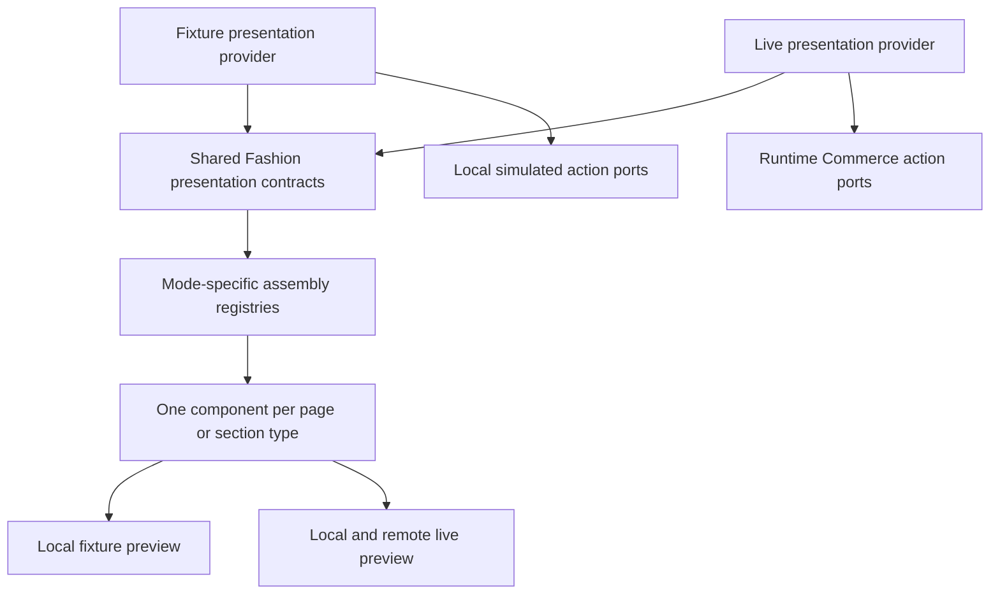
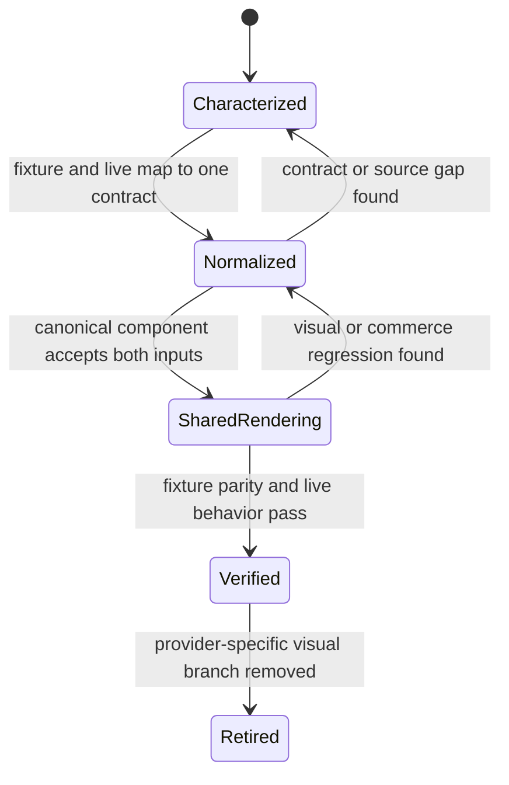
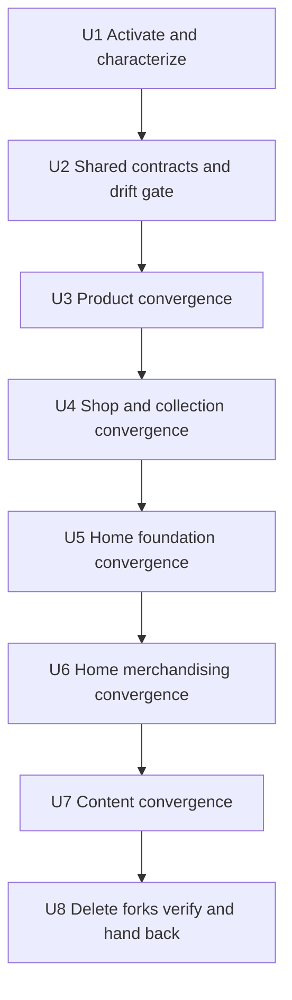

# Fashion Store Fixture and Live Presentation Convergence - Plan

## Goal Capsule

**Objective:** Developers and shoppers see the same Fashion Store page design, responsive layout, and interaction model whether the page is rendered from deterministic fixture data or the live D1/R2 catalog.

**Means:** Keep fixture and live as separate data providers, normalize both into shared Fashion presentation models, render every route and Home section through one canonical component, and retire provider-specific visual components only after parity and live-commerce evidence pass (KTD1-KTD7).

**Authority hierarchy:** The product master plan remains product-level authority. Completed `FS` owns Commerce/Experience/Fashion integration boundaries, completed `FS-R4` owns the canonical shared shell, and `FS-F8` owns the current D1/R2 catalog and live acceptance baseline. This plan owns only fixture/live presentation convergence after `FS-F8-U7` hands back to `REL-Pre-DC`.

**Stop conditions:** Stop and update this plan if convergence would require live business facts to come from fixtures, fixture-preview to call Commerce, source-parity thresholds to be weakened, a supported route to lose its accepted information architecture, or candidate/DC/deployment/PG state to advance.

**Execution profile:** Deep, characterization-first refactor in the existing primary checkout. Work proceeds one presentation surface at a time; each old branch is deleted only after its shared replacement passes fixture and live evidence.

---

## Authority and Lineage

- **Upstream product authority:** `docs/plans/2026-08-13-001-refactor-shoppp-product-master-plan.md` owns the product map, plan register, active pointer, product sequence, and release state.
- **Inherited baseline:** `docs/plans/2026-08-11-001-feat-fashion-store-functional-integration-plan.md` established separate fixture/live providers and their trust boundary. `docs/plans/2026-09-03-1750-refactor-fashion-store-components-dependencies-plan.md` established shared controls and live transaction ownership. `FS-R4` established the canonical Header/Footer. `FS-F8` supplies the 13-product, 24-variant D1/R2 release and live development path.
- **Explicit supersessions:** `FS-R5` supersedes only the use of separate fixture/live page and Home-section components, route wrappers that choose a whole page by ViewModel kind, provider-specific visual naming, and tests that require those visual forks. It does not supersede the two providers, fixture isolation, D1/R2/Catalog Release authority, runtime price and inventory revalidation, Experience ownership, or private-preview authorization.
- **Parallel plans:** `FS-F8-U7` completed and handed back through `REL-Pre-DC` on 2026-09-15. `REL-Pre-DC` remains preserved; no candidate is frozen.
- **Tail ownership:** `FS-R5-U6` is active with the product master pointer updated in the same change. Green `FS-R5-U8` returns authority to `REL-Pre-DC` without advancing candidate, DC, deployment, or PG state.

## Execution Checkpoint

- **Classification:** Active bounded Fashion presentation successor.
- **Current unit:** `FS-R5-U6` — converge Home editorial and merchandising sections while preserving Catalog truth and the accepted fixture layout.
- **Completed units:** `FS-R5-U1` — inventoried four base page registry forks, nine successor Home registry forks, three whole-page switches plus one Collection branch, two Home readers, one merchandising union, provider-specific selector/test debt, field authority, action ownership, route semantics, and behavior states. All forks are assigned to U2-U7, 45 focused unit tests, 44 representative fixture browser cases, and 15 focused live browser cases passed with no unresolved blocker. `FS-R5-U2` — fixture/live Product inputs now normalize to one Catalog-identity-safe Fashion presentation shape, Home merchandising/context outputs are provider-neutral, related cards are bounded and release-backed, the Product action port is mode-neutral, and registry identity/missing-map plus forbidden-boundary gates freeze the migration ledger. Sixty-eight focused tests, the registry gate, typecheck, affected lint, diff checks, and simplification review passed. `FS-R5-U3` — both providers now render the accepted Product information architecture through one registry component and neutral action port; live price, inventory, SKU, option, cart, retry, safe media, no-JavaScript, related-membership, and SPA route-reset truth are retained, fixture actions remain local, synthetic claims are removed, and the two old Product route/live components are deleted. Focused unit, fixture desktop/mobile, live Commerce, build, type, lint, format, boundary, and simplification checks passed. `FS-R5-U4` — fixture and live Shop/collection sources now normalize into one Fashion catalog presentation and render through the accepted Collection landing, Shop grid, and shared ProductCard; live keeps Catalog membership, media, price, purchase routing, and truthful absence of unsupported filters, arrivals, and pagination. Both registries use the canonical Collection page, the two live-only Collection components are deleted, route/history state resets are explicit, and focused unit/browser, type, lint, boundary, format, and simplification checks passed. `FS-R5-U5` — fixture and live successor registries now share Hero, Services, Promotion, Brand Strip, and Marquee components plus one normalized Home foundation/context reader; accepted structure, copy policy, section order, responsive behavior, Hero/marquee lifecycle, visibility pause, and reduced-motion behavior remain green in focused unit, combined/isolated Home, and motion/performance evidence.
- **Next unit:** `FS-R5-U7`, after Home editorial and merchandising sections share canonical components and retain Catalog-backed actions and empty states.
- **Blocker:** None.
- **Next concrete action:** Execute U6.1 by normalizing Categories, Collection Feature, and Editorial inputs into shared components, proving empty and short-array behavior before removing their paired fixture/live implementations.
- **Completion handback:** Green U8 returns to `REL-Pre-DC`. This plan does not freeze or promote a release candidate.

---

## Product Contract

### Summary

Fashion Store will have two trustworthy data providers and one visual implementation. Fixture-preview stays deterministic and network-independent. Live mode stays release-backed and transactional. Both modes render the same route and section components from the same Fashion-owned presentation contracts, with only truthful data and action-state differences.

### Problem Frame

The current renderer already gives fixture and live providers the same `PresentationProvider` interface, but Fashion Store registers different page and Home-section components for each mode. The non-live Product and content pages preserve the accepted source-equivalent structure, while their live counterparts use smaller, separately maintained layouts. Product details, Home sections, collection rendering, copy, empty states, selectors, and responsive behavior can therefore drift even when both modes pass their own tests.

The split has outlived its migration purpose. It protects data authority at the wrong layer: provider isolation is necessary, but duplicated DOM and interaction implementations are not. Continuing to synchronize two page trees by convention or screenshots would leave drift as a recurring maintenance task.

### Requirements

**Visual ownership**

- R1. Every supported Fashion route and Home section has exactly one canonical visual component used by both fixture-preview and live mode.
- R2. The accepted non-live page structure, styling, responsive behavior, and interaction outcomes are the convergence baseline unless a narrower approved adaptation is recorded.
- R3. Header, Footer, product cards, galleries, overlays, controls, spacing, breakpoints, and accessibility semantics retain their existing shared owners rather than being copied into provider-specific components.
- R4. Semantically different routes remain explicit variants within the shared presentation system; `/collections`, `/shop`, and `/collections/:slug` are not flattened into one meaning merely to remove component duplication.

**Data and behavior authority**

- R5. Fixture-preview remains local, deterministic, and network-independent; live mode reads Catalog Release, D1/R2-backed media, and Commerce state without falling back to fixture business facts.
- R6. For the duplicated Product, Shop/collection, Home, and content surfaces owned by U3-U7, both providers resolve into the same Fashion presentation contracts before rendering; those page and section components do not branch on provider mode or legacy fixture/live data shapes. Already-shared Cart and Checkout retain their existing internal normalization under R14 and remain integration-validation surfaces rather than convergence targets.
- R7. Catalog Release and Commerce own product identity, name, description, price, compare-at price, media, SKU, options, variants, availability, and related published products.
- R8. Experience and theme configuration own merchant/editorial copy, decorative assets, page composition, supporting labels, and explicitly configured static information.
- R9. Information with no authoritative live source, including synthetic reviews or unsupported product facts, is never copied from fixtures into live mode. Product review structure remains shared and renders a truthful zero/empty state without synthetic ratings or counts; other optional regions are hidden only when the accepted baseline has no meaningful empty treatment.
- R10. Shared controls depend on one mode-neutral action-port contract: fixture implementations remain simulated/local, while live implementations retain server price, inventory, cart, checkout, and error authority. Converged components do not select an action path from provider mode or raw ViewModel shape.

**Drift prevention and delivery**

- R11. Registries for fixture and live mode resolve every shared Fashion section type to the same component identity; automated checks fail when a new provider-specific visual fork is introduced.
- R12. Tests verify shared structure, behavior, absence, responsive states, and allowed content differences; selector presence or separate screenshot similarity alone cannot certify convergence.
- R13. The final runtime and tests contain no paired `FashionStoreLive*`/`FashionStoreFixture*` page or section implementations and no route wrapper that chooses an entire visual tree by provider-specific ViewModel kind.
- R14. Cart, checkout, authentication, private-preview authorization and `noindex` behavior, publishing, D1/R2 schemas, and release promotion behavior remain unchanged except for presentation-contract fields required to render already-authoritative information.
- R15. Local `dev:fashion-store` and `dev:fashion-store:live` render the same code changes immediately, differing only in data/action source and truthful state.

### Key Decisions

- KD1. **Use the accepted non-live presentation as the canonical visual baseline.** (session-settled: user-approved — chosen over retaining the reduced live design or redesigning both modes: the user identified the non-live pages as the viable current experience.) Governs R1-R4, R12.
- KD2. **Retain two data providers but one visual component tree.** (session-settled: user-approved — chosen over paired fixture/live page components: provider separation protects data truth while duplicated presentation created the observed drift.) Governs R1, R5-R6, R10-R13, R15.
- KD3. **Remove the Private Preview banner from storefront presentation.** (session-settled: user-directed — chosen over displaying preview metadata inside the shopper layout: the banner obstructed local development and does not belong to the storefront design.) Governs R1-R3, R15.

### Acceptance Examples

- AE1. Given equivalent fixture and live product inputs, when a developer opens the same Product route, then both modes use the same page component, region order, controls, gallery, tabs, responsive geometry, and accessibility semantics while displaying their own authoritative content.
- AE2. Given a multi-variant live product, when a shopper selects options and adds it to the cart, then the shared Product controls preserve the non-live design while live price, availability, errors, and cart state still come from Commerce.
- AE3. Given product details with no published reviews or optional specifications, when either provider resolves the route, then the same region policy hides or explains the absence without borrowing fixture-only facts.
- AE4. Given Home in fixture and live mode, when sections render in the approved Experience order, then each section type resolves to the same component and retains its accepted desktop/mobile, interaction, timer, and reduced-motion behavior.
- AE5. Given `/collections`, `/shop`, and `/collections/:slug`, when each route renders, then the landing and product-grid variants remain semantically correct while the product-grid routes share one visual implementation.
- AE6. Given About, FAQ, Magazine, Article, Contact, Account, and Wishlist routes, when Experience content or an authoritative action is present, absent, or unavailable, then each route keeps one page skeleton and applies the same truthful state policy in both modes. Fixture Account/Contact actions may be explicitly local simulations; live renders non-submit/unavailable treatment unless an existing authoritative adapter is present, and never reports false success.
- AE7. Given D1/R2 or Commerce is unavailable, when fixture-preview runs, then it remains complete and makes no live request; when live mode runs, then the shared page shows the governed live error/unavailable state and never substitutes fixture products.
- AE8. Given a direct load, client-side transition, or browser Back/Forward traversal across Home, collection, Product, cart, checkout, and content routes, when viewport and input mode change, then shared components do not retain stale provider-specific state, overflow, focus, animation, or shell classes.

### Success Criteria

- Fixture and live route registries reference one component identity for every shared page and Home-section type.
- Product, collection/shop, Home, and content surfaces pass source-structure, observable-behavior, accessibility, desktop/mobile, and live-commerce gates without reducing existing thresholds.
- No live build imports fixture business data, and fixture-preview remains usable with D1/R2 and Commerce unavailable.
- Provider-specific visual components, route-level kind switches, duplicate Home context readers, and obsolete provider-specific selectors are absent.

### Scope Boundaries

**In scope**

- Fashion Store page and Home-section presentation contracts, normalizers, registries, route wrappers, shared components, directly affected CSS, fixture/live tests, source-parity evidence, and governance handback.
- Product, Shop/collection, Home, and content surfaces that currently select separate visual implementations.
- Neutral renaming of components and selectors whose current `Live`/`Fixture` name incorrectly describes shared ownership.

**Out of scope**

- Merging fixture and live data providers or allowing either provider to cross the other's trust boundary.
- New catalog data, database migrations, R2 uploads, Admin editing features, checkout redesign, payment changes, authentication changes, or release promotion.
- Reintroducing `fashion`, `decor`, or `decor-store` as a separate runtime product or template.
- A new design direction unrelated to the accepted non-live baseline.

### Deferred to Follow-Up Work

- New review, rating, recommendation, personalization, search-ranking, or CMS capabilities needed to populate currently unsupported optional regions.
- Persistent wishlist or account-backed wishlist behavior; convergence preserves the current local/preview semantics.
- General Theme Engine changes for other themes; this plan changes shared engine contracts only when Fashion convergence cannot be expressed through the existing provider/ViewModel boundary.

---

## Planning Contract

### Key Technical Decisions

- KTD1. **Normalize data and actions before rendering.** For U3-U7 surfaces, extend Fashion-owned presentation contracts and normalizers so fixture and live provider outputs reach components in one render shape, and expose existing mode-specific behavior through one mode-neutral action-port interface. A long-lived `Legacy | Live` union or direct fixture/Commerce capability branch inside a converged component is rejected because it hides the same dual implementation behind one filename. Cart and Checkout retain their already-shared internal normalization under R14. Covers R5-R10.
- KTD2. **Keep one registry component identity per section type.** The two registries may retain provider assembly and fixture-resource metadata, but their Fashion page/section mappings must reference the same components. Covers R1, R4-R6, R11, R13.
- KTD3. **Migrate one surface before deleting its branch.** Characterize the fixture baseline, attach live data/actions to the shared component, pass focused fixture/live evidence, and only then remove the old live or fixture wrapper. Batch deletion before evidence is rejected because it makes visual and transactional regressions hard to attribute. Covers R2-R3, R10, R12-R13.
- KTD4. **Converge Product first.** Product is the largest visible gap and exercises the complete contract: gallery, variants, current/compare-at price, inventory refresh, cart actions, optional information, and related products. Its pattern becomes the template for the remaining surfaces. Covers R2, R6-R10, R12.
- KTD5. **Model missing information truthfully.** Use the ownership matrix in R7-R9. Related products come from published collection membership. Accepted fixture editorial copy moves to Experience/theme defaults rather than a live-only hardcode. Product review tabs/regions remain structurally shared and show a truthful zero/empty state when no authority exists; other unsupported facts follow the documented hide/empty policy. Covers R7-R9.
- KTD6. **Preserve route meaning with explicit variants.** Use a shared collection presentation with landing and product-grid variants, and shared content page skeletons selected by route contract. Component convergence must not collapse distinct information architectures. Covers R4, R6, R12.
- KTD7. **Prevent drift by construction and evidence.** Add registry identity and forbidden-fork checks, provider contract tests, shared behavior assertions, and matched fixture/live browser cases. Keep source-parity and live-commerce as separate gates because neither substitutes for the other. Covers R11-R15. See `docs/solutions/workflow-issues/html-source-parity-reconstruction-workflow-2026-08-06.md`.

### High-Level Technical Design

**Ownership topology**

The registries remain assembly boundaries, not visual ownership boundaries. Provider-specific differences terminate in presentation contracts and action ports before the shared component renders.

**Per-surface migration lifecycle**

**Delivery sequence**

### Content Authority Matrix

| Content family | Authoritative source | Fixture-preview treatment | Live treatment |
| --- | --- | --- | --- |
| Product identity, copy, price, compare-at, media, SKU, options | Catalog Release backed by D1/R2 | Deterministic equivalent in fixture adapter | Release values; mutable availability revalidated through Commerce |
| Related products | Published collection membership | Deterministic collection cards | Release-owned collection members |
| Page composition and merchant editorial copy | Experience Snapshot | Approved fixture Experience | Resolved live Experience |
| Decorative theme assets and fixed design labels | Fashion Store theme | Same shared asset resolver | Same shared asset resolver |
| Reviews, unsupported specifications, unsupported promises | No current live authority | Legacy values may remain only as characterization evidence; the shared normalizer excludes synthetic ratings/counts and uses the R9 zero/empty policy | Same R9 zero/empty or hide policy; never fixture fallback |
| Cart and checkout outcomes | Mode-specific action port | Local simulated state | Server-authoritative Commerce state |

### Implementation Constraints

- Preserve current `PresentationProvider` selection and live fail-closed behavior unless a focused failing contract proves the interface insufficient.
- Preserve the 13-product/24-variant `FS-F8` release identity and current-price transaction authority.
- Preserve the accepted non-live DOM and visible-copy budget by characterization before editing each surface.
- Reuse existing shared `FashionStoreShell`, `FashionStoreProductCard`, `FashionStoreProductGallery`, quantity, lightbox, search, mini-cart, cart, and checkout components.
- Keep accessibility ownership with existing primitives; add only application-owned labels, descriptions, errors, and truthful status semantics.
- Do not hand-edit generated active Experience, theme, route, catalog, or release files.
- Preserve unrelated dirty-tree work and use focused file patches and path-limited verification.
- Use no permanent worktree. Any temporary worktree proposal requires separate explicit user confirmation under `AGENTS.md`.

### Risks and Mitigations

- **False equality:** Fixture and live cannot always show identical words because their authoritative content differs. Require the same component, region policy, and interaction implementation while enumerating allowed data differences.
- **Hidden dual implementation:** A single `.vue` file can still contain two large provider branches. Normalize at the boundary and reject provider-mode conditionals that select whole layouts.
- **Fixture leakage:** Reusing a visually complete fixture object could populate live reviews, promises, or prices. Keep the ownership matrix executable in contract and import-boundary tests.
- **Commerce regression:** Shared controls could accidentally use fixture-local success in live mode. Preserve injected live action ports and server revalidation tests through Product, cart, and checkout.
- **Home array mismatch:** Fixture Home data assumes fixed arrays while live sections may be empty or shorter. Normalize bounded collections and give the shared section one empty-state policy before replacing components.
- **Route flattening:** Removing `LiveCollectionPage` could conflate collection landing and product-grid routes. Preserve route variants and canonical destinations explicitly.
- **Test false positives:** DOM selectors and frozen screenshots may pass while motion, focus, scrolling, or controls fail. Retain static, temporal, interaction, fixed/scroll, and fallback evidence modes.
- **Premature cleanup:** Deleting every fork in one batch would erase a useful comparison point. Retire files only after the owning surface passes its focused gates.
- **Plan collision:** `FS-F8-U7` is still active. Keep this plan queued until its handback and update both checkpoints together when activating U1.

---

## Implementation Units

### U1. Activate FS-R5 and characterize every presentation fork

**Goal:** Establish one governed inventory of provider-specific page/section implementations, visible-content authority, behavior ownership, and baseline evidence before changing rendering.

**Requirements:** R1-R5, R7-R10, R12-R14.

**Dependencies:** `FS-F8-U7` completion and `REL-Pre-DC` handback.

**Files:**

- `docs/plans/2026-09-15-1350-refactor-fashion-store-presentation-convergence-plan.md`
- `docs/plans/2026-08-13-001-refactor-shoppp-product-master-plan.md`
- `docs/progress/fashion-store-presentation-convergence.md` (new, evidence only)
- `apps/storefront/app/themes/fashion-store/registry.ts`
- `apps/storefront/app/themes/fashion-store/fixture-registry.ts`
- `apps/storefront/app/themes/fashion-store/successor/registry.ts`
- `apps/storefront/app/themes/fashion-store/successor/fixture-registry.ts`
- `apps/storefront/tests/fashion-store-theme.test.ts`
- `apps/storefront/tests/fashion-store-home-source.test.ts`
- `apps/storefront/tests/fashion-store-live-commerce.test.ts`
- `apps/storefront/e2e/support/theme-source-inventory.ts`

**Approach:** Activate U1 in the plan and master together. Inventory each page/section pair, ViewModel kind, data source, action owner, visible regions, responsive states, and test owner. Record the R7-R9 content authority decision for every field that exists only in fixture or live mode.

**Execution note:** Characterization-first. Capture current fixture structure and observable behavior before changing contracts or component selection.

**Test scenarios:**

- Enumerate every provider-specific Fashion page, Home section, route wrapper, context reader, registry mapping, selector, and source-reading test; an unowned fork blocks U1.
- Render fixture Product, Shop, collection landing, Home, and representative content routes at desktop/mobile widths and retain their accepted region order and visible-copy baseline.
- Render the same live route families and record the current permitted data differences and transactional owners without treating the reduced live layout as the target.
- Classify load, hover, focus, click, keyboard, touch, resize, scroll, timer, reduced-motion, no-JS, direct/client navigation, browser Back/Forward restoration, empty, unavailable, and error outcomes for every affected capability.

**Verification:** The inventory maps every current fork to an owning later U-ID and contains no unresolved field-authority or route-semantic blocker.

### U2. Establish shared presentation contracts and drift gates

**Goal:** Make fixture and live resolve equivalent Fashion-owned render models before any page or section component receives data.

**Requirements:** R5-R13, R15.

**Dependencies:** U1.

**Files:**

- `apps/storefront/app/theme-engine/view-models.ts`
- `apps/storefront/app/theme-engine/composer.ts`
- `apps/storefront/app/theme-engine/providers/fixture-preview.ts`
- `apps/storefront/app/themes/fashion-store/contracts/home-presentation.ts`
- `apps/storefront/app/themes/fashion-store/contracts/home-merchandising.ts`
- `apps/storefront/app/themes/fashion-store/contracts/product-card.ts`
- `apps/storefront/app/themes/fashion-store/components/sections/home-section-context.ts`
- `apps/storefront/app/themes/fashion-store/components/sections/fixture-home-section-context.ts`
- `apps/storefront/app/themes/fashion-store/components/sections/live-home-section-context.ts`
- `apps/storefront/tests/theme-engine.test.ts`
- `apps/storefront/tests/fixture-contract.test.ts`
- `apps/storefront/tests/fashion-store-package-registry.test.ts`
- `apps/storefront/tests/fashion-store-live-commerce.test.ts`

**Approach:** Extend the existing presentation schemas and Fashion contracts only where U1 proves missing authoritative fields. Move fixture normalization into adapters/context resolvers, produce bounded collections and explicit optional/empty states, add a registry contract that requires shared component identity, and adapt existing fixture/live behaviors to the mode-neutral action-port boundary in R10. Keep runtime action ports outside serializable render data.

**Execution note:** Add failing provider/registry contract tests before changing production mappings. Preserve live fail-closed and fixture no-network behavior throughout the unit.

**Test scenarios:**

- Equivalent fixture and live Product inputs normalize to the same render-model shape while preserving their own IDs, content, and action-state sources.
- Missing optional content produces the declared empty/hidden state; malformed required catalog or Experience references fail with the existing diagnostics.
- Fixture provider resolution performs no Commerce/D1/R2 request; live provider failure never falls back to fixture data.
- The fixture and live registries fail tests when the same Fashion section type points to different visual components.
- A U3-U7 component or Home context reader that branches on provider mode, consumes raw fixture/live unions, or directly selects fixture-cart versus runtime-Commerce behavior is rejected by the boundary audit; the already-shared Cart/Checkout normalization is explicitly outside this audit.

**Verification:** Provider, schema, composer, fixture-isolation, registry-identity, boundary, type, and lint checks pass before Product migration begins.

### U3. Converge Product on the accepted non-live page

**Goal:** Render fixture and live Product through the accepted non-live information architecture with live gallery, option, availability, price, and cart truth intact.

**Requirements:** R1-R3, R5-R10, R12-R15.

**Dependencies:** U2.

**Files:**

- `apps/storefront/app/themes/fashion-store/components/pages/FashionStoreProductPage.vue`
- `apps/storefront/app/themes/fashion-store/components/pages/FashionStoreProductRoute.vue`
- `apps/storefront/app/themes/fashion-store/components/pages/FashionStoreLiveProductPage.vue`
- `apps/storefront/app/themes/fashion-store/components/shared/FashionStoreProductGallery.vue`
- `apps/storefront/app/themes/fashion-store/components/shared/FashionStoreProductCard.vue`
- `apps/storefront/app/themes/fashion-store/contracts/product-card.ts`
- `apps/storefront/app/themes/fashion-store/registry.ts`
- `apps/storefront/app/themes/fashion-store/fixture-registry.ts`
- `apps/storefront/tests/fashion-store-product.test.ts`
- `apps/storefront/tests/fashion-store-live-commerce.test.ts`
- `apps/storefront/e2e/fashion-store-product.spec.ts`
- `apps/storefront/e2e/fashion-store-live-commerce.spec.ts`

**Approach:** Convert the existing non-live Product page to the shared Product presentation contract. Inject the existing mode-appropriate action and runtime-commerce ports into its current controls. Resolve related cards from published collection membership, apply the R9 absence policy to unsupported tabs/facts, then point both registries directly at the shared page and remove the route-level whole-page switch and live page.

**Execution note:** Preserve the fixture DOM baseline first, then make the same component pass live single-variant, multi-variant, unavailable, stale-price, and failure cases before deleting the old live page.

**Test scenarios:**

- Covers AE1. Fixture and live Product use one component and retain the accepted breadcrumb, gallery, details, tabs policy, related region, and responsive layout.
- Covers AE2. A selected Relaxed variant revalidates price/inventory, adds exactly the selected SKU, updates the shared cart, and reports a server failure without false success.
- Covers AE3. Missing reviews, specifications, shipping copy, brand, or related products follows the shared absence policy without fixture leakage.
- Multiple ordered R2 images retain source dimensions, gallery navigation, lightbox focus behavior, touch controls, and single-image fallback.
- Direct load, client navigation, browser Back/Forward traversal, no-JS output, keyboard-only option selection, mobile layout, and unavailable product states remain truthful; product/variant/gallery state does not leak between restored routes.

**Verification:** Product source-parity, contract, accessibility, desktop/mobile, live-commerce, no-JS, type, lint, and absence checks pass; the old live Product component and route kind switch are gone.

### U4. Converge Shop and collection presentation

**Goal:** Use one shared product-grid implementation for Shop and published collection routes while retaining the distinct collection landing page.

**Requirements:** R1-R6, R10-R15.

**Dependencies:** U3.

**Files:**

- `apps/storefront/app/themes/fashion-store/components/pages/FashionStoreShopPage.vue`
- `apps/storefront/app/themes/fashion-store/components/pages/FashionStoreCollectionPage.vue`
- `apps/storefront/app/themes/fashion-store/components/pages/FashionStoreLiveCollectionPage.vue`
- `apps/storefront/app/themes/fashion-store/components/shared/FashionStoreLiveCatalog.vue`
- `apps/storefront/app/themes/fashion-store/registry.ts`
- `apps/storefront/app/themes/fashion-store/fixture-registry.ts`
- `apps/storefront/tests/fashion-store-shop.test.ts`
- `apps/storefront/tests/fashion-store-collection.test.ts`
- `apps/storefront/tests/fashion-store-live-commerce.test.ts`
- `apps/storefront/e2e/fashion-store-shop.spec.ts`
- `apps/storefront/e2e/fashion-store-collection.spec.ts`
- `apps/storefront/e2e/fashion-store-live-commerce.spec.ts`

**Approach:** Give the shared collection page explicit landing and product-grid variants. Reuse the accepted Shop grid, filters, cards, empty states, and responsive behavior for published collection products. Rename the already-shared live catalog helper neutrally or absorb it into the canonical page, then remove the live collection wrapper.

**Execution note:** Characterize `/collections`, `/shop` variants, and `/collections/:slug` separately so component convergence does not erase route meaning.

**Test scenarios:**

- Covers AE5. `/collections` keeps its category landing cards while `/shop`, filtered Shop routes, and `/collections/:slug` use the shared product-grid presentation.
- Fixture and live grids use the shared ProductCard and preserve canonical product destinations, compare-at display, option-routing behavior, and truthful empty states.
- Invalid collection, empty published collection, unavailable Commerce, direct/client navigation, and browser Back/Forward restoration do not fall back to fixture products or retain stale filters/grid state.
- Desktop/mobile grid columns, filters, pagination or bounded-result behavior, keyboard traversal, touch targets, and horizontal overflow retain existing contracts.

**Verification:** Shop/collection source, routing, registry, responsive, accessibility, live catalog, and no-fixture-fallback checks pass; provider-specific collection page/catalog naming is absent.

### U5. Converge foundational Home sections

**Goal:** Replace paired non-merchandising Home sections with shared components without changing approved Home composition or motion.

**Requirements:** R1-R3, R5-R6, R8-R9, R11-R13, R15.

**Dependencies:** U4.

**Files:**

- `apps/storefront/app/themes/fashion-store/components/FashionStoreHomeRoute.vue`
- `apps/storefront/app/themes/fashion-store/components/FashionStoreHome.vue`
- `apps/storefront/app/themes/fashion-store/components/FashionStoreLiveHomePage.vue`
- `apps/storefront/app/themes/fashion-store/components/sections/FashionStoreFixtureHeroSection.vue`
- `apps/storefront/app/themes/fashion-store/components/sections/FashionStoreLiveHeroSection.vue`
- `apps/storefront/app/themes/fashion-store/components/sections/FashionStoreFixtureServicesSection.vue`
- `apps/storefront/app/themes/fashion-store/components/sections/FashionStoreLiveServicesSection.vue`
- `apps/storefront/app/themes/fashion-store/components/sections/FashionStoreFixturePromotionSection.vue`
- `apps/storefront/app/themes/fashion-store/components/sections/FashionStoreLivePromotionSection.vue`
- `apps/storefront/app/themes/fashion-store/components/sections/FashionStoreFixtureBrandStripSection.vue`
- `apps/storefront/app/themes/fashion-store/components/sections/FashionStoreLiveBrandStripSection.vue`
- `apps/storefront/app/themes/fashion-store/components/sections/FashionStoreFixtureMarqueeSection.vue`
- `apps/storefront/app/themes/fashion-store/components/sections/FashionStoreLiveMarqueeSection.vue`
- `apps/storefront/app/themes/fashion-store/components/sections/home-section-context.ts`
- `apps/storefront/app/themes/fashion-store/successor/registry.ts`
- `apps/storefront/app/themes/fashion-store/successor/fixture-registry.ts`
- `apps/storefront/tests/fashion-store-home-source.test.ts`
- `apps/storefront/tests/fashion-store-theme.test.ts`
- `apps/storefront/e2e/fashion-store-theme.spec.ts`
- `apps/storefront/e2e/fashion-store-live-unified-home.spec.ts`

**Approach:** Consolidate the Home context readers, then migrate Hero, Services, Promotion, Brand Strip, and Marquee to neutral shared components. Preserve `FashionStoreHomeShell`, the approved section order, fixed visible-copy budget, animation timing, reduced-motion behavior, and the combined/isolated composition profile.

**Execution note:** Migrate and verify one behavior family at a time. Static screenshots cannot substitute for marquee timing, Hero motion, focus, scroll, or reduced-motion evidence.

**Execution stages:** U5.1 consolidates the Home context contract and static Services/Promotion/Brand Strip family; U5.2 converges the motion-heavy Hero/Marquee family; U5.3 runs the parent-unit fixture/live, motion, responsive, and composition verification before U6 begins.

**Test scenarios:**

- Covers AE4. Fixture and live registries resolve each migrated section type to the same component with the same region order and accepted visual classes.
- Home with complete, missing optional, and empty bounded section data renders without index errors or invented content.
- Hero initialization, marquee movement, reduced motion, remount, resize, visibility changes, and route transitions retain their observable outcomes.
- Desktop/mobile screenshots and computed geometry retain the accepted non-live baseline without adding provider-specific copy or selectors.

**Verification:** Focused Home source, registry, motion, responsive, accessibility, combined/isolated, and live Home checks pass before merchandising sections move.

### U6. Converge Home editorial and merchandising sections

**Goal:** Complete Home convergence for categories, collection feature, editorial content, and product merchandising while preserving catalog truth and source-equivalent layout.

**Requirements:** R1-R3, R5-R13, R15.

**Dependencies:** U5.

**Files:**

- `apps/storefront/app/themes/fashion-store/components/sections/FashionStoreFixtureCategoriesSection.vue`
- `apps/storefront/app/themes/fashion-store/components/sections/FashionStoreLiveCategoriesSection.vue`
- `apps/storefront/app/themes/fashion-store/components/sections/FashionStoreFixtureCollectionFeatureSection.vue`
- `apps/storefront/app/themes/fashion-store/components/sections/FashionStoreLiveCollectionFeatureSection.vue`
- `apps/storefront/app/themes/fashion-store/components/sections/FashionStoreFixtureEditorialSection.vue`
- `apps/storefront/app/themes/fashion-store/components/sections/FashionStoreLiveEditorialSection.vue`
- `apps/storefront/app/themes/fashion-store/components/sections/FashionStoreFixtureBestSellersSection.vue`
- `apps/storefront/app/themes/fashion-store/components/sections/FashionStoreLiveBestSellersSection.vue`
- `apps/storefront/app/themes/fashion-store/components/sections/FashionStoreFixtureFeaturedProductsSection.vue`
- `apps/storefront/app/themes/fashion-store/components/sections/FashionStoreLiveFeaturedProductsSection.vue`
- `apps/storefront/app/themes/fashion-store/components/sections/FashionStoreFixtureProductsSection.vue`
- `apps/storefront/app/themes/fashion-store/components/sections/FashionStoreLiveProductsSection.vue`
- `apps/storefront/app/themes/fashion-store/components/sections/FashionStoreProductMerchandisingSection.vue`
- `apps/storefront/app/themes/fashion-store/components/sections/home-content.ts`
- `apps/storefront/app/themes/fashion-store/contracts/home-merchandising.ts`
- `apps/storefront/app/themes/fashion-store/successor/registry.ts`
- `apps/storefront/app/themes/fashion-store/successor/fixture-registry.ts`
- `apps/storefront/tests/fashion-store-home-source.test.ts`
- `apps/storefront/tests/fashion-store-interaction-contract.test.ts`
- `apps/storefront/e2e/fashion-store-live-unified-home.spec.ts`
- `apps/storefront/e2e/fashion-store-live-home-empty.spec.ts`

**Approach:** Normalize theme/editorial content independently from Catalog Release product collections. Reuse the shared ProductCard and existing merchandising contract, preserve product ordering and section variants, and remove duplicate hard-coded Home content once its Experience/theme owner is explicit.

**Execution note:** Prove empty and short-array cases before replacing fixture-indexed sections; then verify real live products and actions before retiring each paired component.

**Execution stages:** U6.1 converges Categories, Collection Feature, and Editorial; U6.2 converges Best Sellers, Featured Products, and Products through the shared merchandising/action contracts; U6.3 runs the parent-unit absence, commerce, interaction, and responsive verification before U7 begins.

**Test scenarios:**

- Covers AE4. Categories, collection feature, editorial, best sellers, featured products, and product merchandising use the same components in both registries.
- Empty, one-item, and maximum bounded product/editorial collections preserve valid structure, section visibility policy, and responsive layout.
- Live product cards retain stable D1/Catalog identities, R2 media, current/compare-at prices, option routing, and cart behavior without fixture fallback.
- Editorial links and decorative images use Experience/theme authority; absent content does not borrow fixture copy or create active no-op controls.
- Carousel, tab, wishlist, quick-view, pointer, keyboard, touch, timer, resize, and reduced-motion outcomes remain covered by the behavior ledger.

**Verification:** Home merchandising contracts, source parity, interaction ledger, accessibility, motion, empty-state, live commerce, and desktop/mobile evidence pass; paired Home section components are removed.

### U7. Converge content and recovery routes

**Goal:** Render each content, account, and wishlist route through one route-specific page skeleton with Experience-backed content and truthful shared fallback states.

**Requirements:** R1-R3, R5-R6, R8-R13, R15.

**Dependencies:** U6.

**Files:**

- `apps/storefront/app/themes/fashion-store/components/pages/FashionStoreContentRoute.vue`
- `apps/storefront/app/themes/fashion-store/components/pages/FashionStoreLiveContentPage.vue`
- `apps/storefront/app/themes/fashion-store/components/pages/FashionStoreContentPage.vue`
- `apps/storefront/app/themes/fashion-store/components/pages/FashionStoreAboutPage.vue`
- `apps/storefront/app/themes/fashion-store/components/pages/FashionStoreFaqPage.vue`
- `apps/storefront/app/themes/fashion-store/components/pages/FashionStoreMagazinePage.vue`
- `apps/storefront/app/themes/fashion-store/components/pages/FashionStoreArticlePage.vue`
- `apps/storefront/app/themes/fashion-store/components/pages/FashionStoreContactPage.vue`
- `apps/storefront/app/themes/fashion-store/components/pages/FashionStoreAccountPage.vue`
- `apps/storefront/app/themes/fashion-store/components/pages/FashionStoreWishlistPage.vue`
- `apps/storefront/app/themes/fashion-store/registry.ts`
- `apps/storefront/app/themes/fashion-store/fixture-registry.ts`
- `apps/storefront/tests/fashion-store-content.test.ts`
- `apps/storefront/tests/fashion-store-information-pages.test.ts`
- `apps/storefront/tests/fashion-store-magazine.test.ts`
- `apps/storefront/e2e/fashion-store-content.spec.ts`
- `apps/storefront/e2e/fashion-store-information-pages.spec.ts`
- `apps/storefront/e2e/fashion-store-magazine.spec.ts`
- `apps/storefront/e2e/fashion-store-live-commerce.spec.ts`

**Approach:** Keep route selection in page contracts and use each accepted route-specific skeleton for both modes. Map available Experience content into shared regions and apply the R9 absence policy locally. Add route-specific action availability: fixture Account/Contact may expose clearly local simulated submissions, while live Account uses an unavailable treatment and live Contact uses a non-submit fallback unless an existing authoritative adapter is present. Preserve Wishlist recovery products through the shared product-grid contract, then remove the generic live content page and whole-page kind switch.

**Execution note:** Characterize each route separately; shared rendering does not authorize one generic empty page to replace distinct information architectures.

**Execution stages:** U7.1 converges About, FAQ, Magazine, and Article; U7.2 converges Contact, Account, Wishlist, and their action/recovery states; U7.3 runs the parent-unit direct/history navigation, accessibility, no-JS, and live-unavailable verification before U8 begins.

**Test scenarios:**

- Covers AE6. Each named content/account/wishlist route uses one page component across modes and preserves its accepted headings, navigation, region order, truthful action availability, and responsive layout; live Account/Contact cannot present an actionable form that reports simulated success.
- Available Experience media and actions render through the correct route skeleton with validated destinations and meaningful accessible names.
- Missing, unpublished, malformed, and unavailable content uses the same route skeleton and truthful state without fixture content leakage.
- Wishlist recovery uses shared ProductCards with live published identities and fixture-local behavior as appropriate.
- Direct load, client navigation, browser Back/Forward traversal, keyboard, focus restoration, mobile, no-JS, and route-remount states remain deterministic without stale form, wishlist, or content state.

**Verification:** Content route, information-page, magazine/article, wishlist, source-parity, accessibility, live recovery, type, and lint gates pass; the live content catch-all and provider-kind route switch are gone.

### U8. Remove remaining forks and complete the governed handback

**Goal:** Prove one visual implementation across all Fashion surfaces, remove obsolete compatibility code, and return authority to `REL-Pre-DC`.

**Requirements:** R1-R15.

**Dependencies:** U3-U7.

**Files:**

- `apps/storefront/app/themes/fashion-store/registry.ts`
- `apps/storefront/app/themes/fashion-store/fixture-registry.ts`
- `apps/storefront/app/themes/fashion-store/successor/registry.ts`
- `apps/storefront/app/themes/fashion-store/successor/fixture-registry.ts`
- `apps/storefront/app/themes/fashion-store/components/`
- `apps/storefront/app/themes/fashion-store/contracts/`
- `apps/storefront/tests/`
- `apps/storefront/e2e/`
- `apps/storefront/package.json`
- `docs/progress/fashion-store-presentation-convergence.md`
- `docs/plans/2026-09-15-1350-refactor-fashion-store-presentation-convergence-plan.md`
- `docs/plans/2026-08-13-001-refactor-shoppp-product-master-plan.md`

**Approach:** Remove retired `Live`/`Fixture` page and section files, duplicate context readers, provider-specific visual selectors, stale imports, and tests that encode two component trees. Keep provider and action-port names where they still describe genuine data/runtime ownership. Run the complete fixture, live, source-parity, accessibility, motion, responsive, performance, production/static, and repository gates before updating both checkpoints to the REL handback.

**Execution note:** Cleanup follows verified replacement. Do not delete provider-specific files merely by name; retain files whose responsibility is genuinely data acquisition, normalization, action dispatch, or test-mode orchestration.

**Test scenarios:**

- Static audits find no paired provider-specific page/section implementation, no whole-page ViewModel-kind switch, and no registry component-identity divergence.
- Covers AE7. Fixture-preview succeeds with live services unavailable; live failures remain explicit and never import fixture business facts.
- Covers AE8. Direct, client, and browser Back/Forward navigation across representative routes passes desktop/mobile, keyboard/touch, reduced-motion, no-JS, remount, and error-state checks without stale state.
- Product price/media/options, cart/checkout, Home composition, collection membership, content routing, search, wishlist recovery, Header/Footer, and accessibility outcomes remain green against the `FS-F8` catalog.
- Production and static outputs contain no fixture payloads, obsolete preview banner, retired visual selectors, or abandoned compatibility branches.

**Verification:** Every Verification Contract gate passes, the progress artifact contains retained evidence without a second execution queue, this plan is complete, and the master pointer returns to `REL-Pre-DC` without changing candidate/DC/deployment/PG state.

---

## Verification Contract

| Gate | Scope | Done signal |
| --- | --- | --- |
| Presentation contracts | ViewModels, normalizers, providers, Composer | Both providers produce the shared shapes; invalid references fail clearly; fixture remains no-network; live never falls back. |
| Registry identity | Base and successor fixture/live registries | Every common section type resolves to the same component identity; forbidden provider-specific visual forks fail statically. |
| Product | Fixture source parity and live commerce | One Product component passes structure, gallery, options, availability, compare-at, related products, cart, no-JS, accessibility, and desktop/mobile cases. |
| Shop and collection | Landing and product-grid variants | Route meaning, filters, grids, cards, empty/error states, canonical destinations, and responsive behavior pass in both modes. |
| Home | Shell, sections, merchandising, motion | One component per section passes structure, visible-copy, animation, interaction, empty-data, combined/isolated, desktop/mobile, and reduced-motion evidence. |
| Content | Information, magazine/article, contact, account, wishlist | Route-specific skeletons render Experience content, truthful action availability, and fallback states in both modes without false submission success. |
| Source equivalence | Structural, behavioral, and absence contracts | Existing thresholds stay unchanged; observable outcomes, not selector presence alone, pass. |
| Live acceptance | Local live and protected staging | Exact Catalog Release identities, D1/R2 media, Commerce revalidation, cart/checkout, and unavailable handling pass without fixture interception. |
| Accessibility | Shared primitives and critical shopper paths | Application-owned names, labels, errors, focus, keyboard, touch, and non-color states pass without duplicating library behavior. |
| Runtime quality | Motion, performance, remount, teardown | Timers, observers, overlays, scroll controls, resize, route changes, and reduced-motion leave no stale state or material regression. |
| Repository | Storefront tests, full Fashion suite, typecheck, lint, static verification, production build, impact selection | All applicable existing gates pass without exclusions, threshold reductions, or generated-file hand edits. |
| Governance | FS-R5 plan, retained progress evidence, product master | One current pointer; activation follows FS-F8; completion returns to REL Pre-DC without candidate/DC/deployment/PG movement. |

---

## System-Wide Impact

| Surface | Planned change | Preserved invariant |
| --- | --- | --- |
| Theme Engine | Shared presentation schemas may gain fields proven necessary by Fashion | Provider interface, diagnostics, and theme neutrality remain intact. |
| Fashion registries | Fixture/live mappings converge on component identity | Provider assembly and fixture-resource metadata may remain separate. |
| Fashion components | One page/section tree replaces paired visual implementations | Accepted non-live information architecture and shared shell remain canonical. |
| Catalog/Commerce | Existing release facts feed richer shared presentation | D1/R2 and server price/inventory remain authoritative. |
| Experience/theme | Editorial/static content receives explicit ownership | No fixture business fact enters live mode. |
| Developer workflow | Both dev commands render the same code immediately | Fixture stays offline; live uses authenticated staging reads. |
| Release process | New verification precedes REL handback | Candidate, DC, deployment, and PG state do not advance. |

---

## Sources and Research

- `apps/storefront/app/theme-engine/providers/types.ts`, `fixture-preview.ts`, and `live.ts` establish one provider interface and separate data resolution.
- `apps/storefront/app/theme-engine/renderer.vue` already renders provider results through registry-selected components.
- `apps/storefront/app/themes/fashion-store/registry.ts`, `fixture-registry.ts`, `successor/registry.ts`, and `successor/fixture-registry.ts` expose the current visual split.
- `FashionStoreProductRoute.vue`, `FashionStoreHomeRoute.vue`, and `FashionStoreContentRoute.vue` show whole-page ViewModel-kind switching.
- `FashionStoreProductMerchandisingSection.vue`, `FashionStoreProductCard.vue`, `FashionStoreCartPage.vue`, and `FashionStoreCheckoutPage.vue` prove shared rendering with mode-specific data/actions is already viable.
- `docs/solutions/workflow-issues/html-source-parity-reconstruction-workflow-2026-08-06.md` requires separate structural, behavioral, and absence contracts plus observable multi-mode browser evidence.
- `docs/plans/2026-08-11-001-feat-fashion-store-functional-integration-plan.md` retains fixture/live provider separation and forbids live fixture fallback.
- `docs/plans/2026-09-13-1513-feat-fashion-store-live-catalog-plan.md` owns the current D1/R2 release and must hand back before this successor activates.

---

## Definition of Done

- U1-U8 satisfy R1-R15 with no remaining implementation tail or unowned presentation fork.
- Every supported Fashion route and Home section has one canonical visual component shared by fixture and live registries.
- Fixture and live remain separate providers with no cross-mode business-data fallback.
- The accepted non-live layout, responsive design, visible-copy policy, interaction behavior, and accessibility semantics remain the visual authority.
- Product, collection/shop, Home, and content routes display authoritative live data through the shared presentation and preserve fixture determinism.
- Unsupported live facts use the documented shared absence policy rather than fixture content or invented values.
- Provider-specific page/section components, whole-page kind-switch wrappers, duplicate Home contexts, stale tests, and abandoned migration code are removed.
- Structural, behavioral, absence, accessibility, motion, desktop/mobile, no-JS, live-commerce, source-parity, type, lint, static, build, and repository gates pass without relaxed thresholds.
- Retained evidence records the exact fixture and live inputs used and remains subordinate to the plan checkpoint.
- The product master returns to `REL-Pre-DC` without freezing a candidate or advancing DC, deployment, or PG state.
