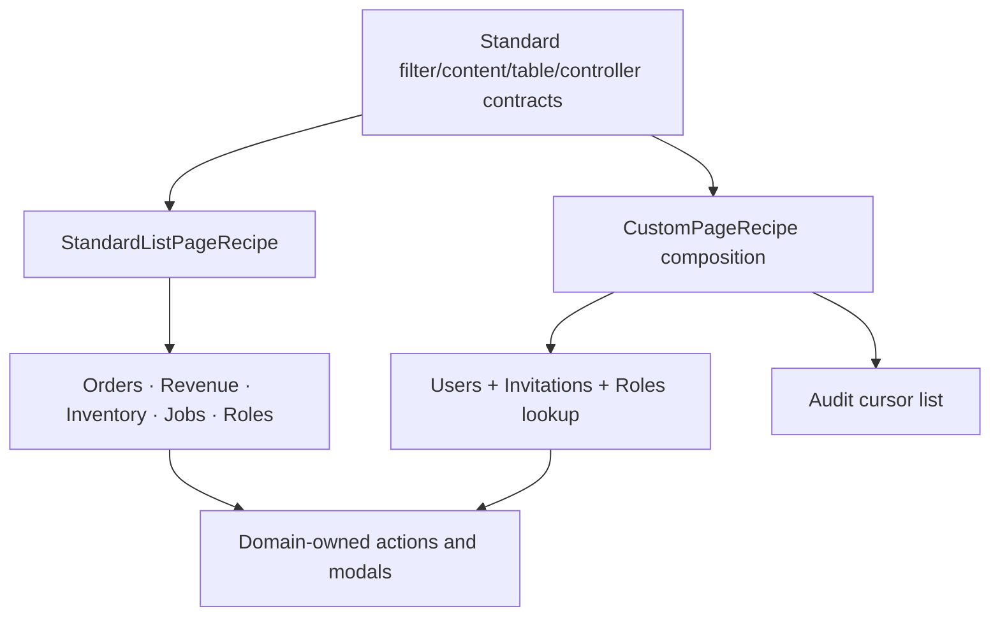
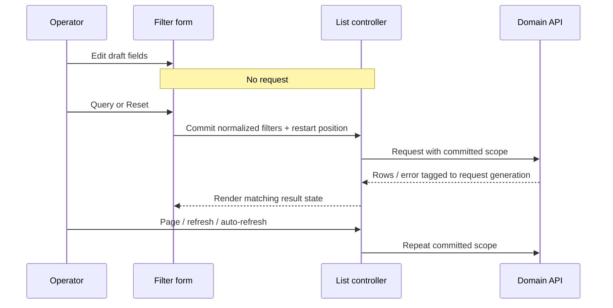

# Admin Query List Convergence - Plan

## Goal Capsule

**Objective:** Make Admin's query-oriented list pages behave and read as one product: the same filter card, explicit Query/Reset flow, table state, pagination, refresh controls, and error treatment, while preserving each page's real business actions and API semantics.

**Means:** Strengthen the existing standard-list contracts only where several pages need the same capability, migrate five offset-paginated pages to `StandardListPageRecipe`, compose the existing lower-level primitives for the Users/Invitations and Audit exceptions, and freeze observable behavior before each migration.

**Authority:** The product master plan remains product-level authority. The completed Commerce, IAM, Admin i18n, and approved Standard List Page capability-adaptation baselines remain authoritative for domain behavior. This plan owns only Admin query-list convergence and its verification tail.

**Stop conditions:** Stop and update this plan if implementation would fabricate totals for a cursor API, merge independently paginated resources, change report date/currency semantics, weaken authorization, make field edits issue requests, or advance candidate, deployment, or production state.

**Execution profile:** Deep, characterization-first refactor in the existing primary checkout. No worktree or pull request is required unless separately authorized.

## Authority and Lineage

- **Upstream product authority:** `docs/plans/2026-08-13-001-refactor-shoppp-product-master-plan.md` owns the plan register, active pointer, product-level sequence, and supersession history.
- **Inherited baseline:** Commerce owns order, revenue, inventory, export, and adjustment facts. IAM owns users, invitations, roles, audit, and authorization. Admin i18n owns visible copy. The Standard List Page capability-adaptation plan and the current Catalog/query-template implementations own the accepted query-page primitives and recipe behavior.
- **Explicit supersessions:** None until a unit lands. Completed units supersede only the corresponding page-local filter/list orchestration named in that unit; domain clients, routes, permissions, modals, and writes remain under their existing authorities.
- **Parallel plans:** `FS-R5-U6` is paused as the recorded return pointer while `ADM-LIST` owns the active implementation tail.
- **Tail ownership:** `ADM-LIST` owns U1-U8 and focused local verification. Green U8 restores `FS-R5-U6` unless a later explicit product-sequence decision names a replacement. Handback does not change `REL`, candidate, deployment, or PG state.

## Execution Checkpoint

- **Classification:** Active bounded Admin query-list successor.
- **Current unit:** `ADM-LIST-U2` — converge Orders and Roles on the Standard List Page recipe while preserving navigation and role creation.
- **Completed units:** `ADM-LIST-U1` — recorded the seven-page preserve/converge/remove behavior matrix; made form navigation optional; separated visible form defaults from request defaults; exposed committed filters to extension renderers; distinguished blocking replacement-query failures from partial same-scope refresh failures; and passed 35 focused shared/consumer tests, Admin typecheck, affected lint, and diff checks.
- **Next unit:** `ADM-LIST-U3`, after Orders and Roles preserve their accepted actions and pass focused evidence.
- **Blocker:** None.
- **Execution order:** U1 → U2 → U3 → U4 → U5 → U6 → U7 → U8.
- **Next concrete action:** Add failing Orders and Roles page tests for explicit Query/Reset, pagination, detail navigation, and role creation before migrating their orchestration.

## Product Contract

### Requirements

- **R1.** Orders, Order Revenue Report, Inventory, Notification Jobs, and Roles use the existing `StandardListPageRecipe` for their query/list shell.
- **R2.** Users/Invitations and Audit use the same standard filter, content, toolbar, status, and table primitives without pretending their transport shapes fit the offset-paginated recipe.
- **R3.** Editing a filter is draft-only. Query commits the draft once and resets every affected page/cursor controller. Reset restores the page's documented entry baseline and commits once, producing one list request per affected independent resource.
- **R4.** Pagination, manual refresh, and user-enabled auto-refresh repeat the latest committed query; they never commit unsubmitted draft edits.
- **R5.** Loading, empty, first-load error, refresh error, stale-result, retry, and pagination states have consistent visible treatment. A failed replacement query hides rows from the previous criteria and shows a blocking query error whose Retry repeats the attempted committed criteria. A failed same-scope refresh retains the still-matching rows under a partial error notice whose Retry repeats the current committed query.
- **R6.** URL-derived report currency, start date, end date, and timezone are both visibly initialized and sent in the first request. Date-only values remain `YYYY-MM-DD` and are not shifted through UTC conversion.
- **R7.** Report export retains its reason modal, authorization/error behavior, and current committed filter scope.
- **R8.** Inventory History/Adjust, Notification Replay, Role creation, and their permissions remain available in their accepted locations.
- **R9.** After a successful write or replay, the page reloads authoritative server data with the latest committed filters. It does not rely on a local row patch as the final truth.
- **R10.** Orders keep the exact detail route `/orders/:reference`, with the route parameter value set to the order's `publicReference`, and retain the current server-side filter/pagination contract.
- **R11.** Audit preserves forward-only cursor traversal, invalid-cursor recovery, and truthful absence of an exact total. No offset or synthetic total is introduced.
- **R12.** Users and Invitations retain independent pagination, loading, error, retry, and empty states. A Roles lookup failure remains local to controls that need role options.
- **R13.** Existing permission checks, accessible names, field labels, dialog semantics, localization, responsive behavior, and table preferences remain intact.
- **R14.** Every migrated surface has a unique table identity; locale/theme/table-preference changes do not cause data refetch unless a committed query input changed.
- **R15.** Dashboard, Settings, editors, detail pages, and form-heavy workflows are not included merely because they contain a table or filters.

### Functional Shape

- **F1 — Direct recipe pages:** Orders, Order Revenue Report, Inventory, Notification Jobs, and Roles share one offset-pagination orchestration path.
- **F2 — Cursor exception:** Audit composes standard primitives around its real cursor state.
- **F3 — Multi-resource exception:** Users/Invitations composes standard primitives around two independent lists and the auxiliary Roles request.
- **F4 — Business action ports:** Export, Adjust, History, Replay, New Role, and Order Detail remain page/domain-owned extensions.
- **F5 — Verification:** Contract tests cover shared behavior; page tests cover domain differences; representative browser/E2E flows cover the highest-risk report, IAM, notification, and inventory paths.

### Acceptance Examples

- **AE1.** Given draft filters on any target page, when a field changes, then no list request is made; when Query is pressed, the draft is committed once, every affected position restarts, and exactly one list request is issued per affected independent controller/resource.
- **AE2.** Given a submitted query and later unsubmitted edits, when auto-refresh fires, then the request repeats the submitted query rather than the visible draft.
- **AE3.** Given a later query fails after rows were previously loaded, then the UI identifies the refresh/query failure and does not present old rows as successful results for the new criteria.
- **AE4.** Given a report deep link with currency, dates, and timezone, then the controls and first request agree, Reset returns to that entry baseline, and export uses the currently committed values.
- **AE5.** Given an inventory adjustment or notification replay succeeds, then the success state is followed by a latest-request-wins authoritative reload using committed filters.
- **AE6.** Given Orders results, selecting a row action navigates to `/orders/:reference`, where `reference` contains that order's `publicReference`, without changing query semantics.
- **AE7.** Given Audit has a `nextCursor`, Next uses it; given no cursor, Next is unavailable; no exact page count or total is displayed.
- **AE8.** Given Users succeeds and Invitations fails, then Users remains usable while Invitations shows its own retry state; the inverse also holds.
- **AE9.** Given a role-options request fails, then Users/Invitations list results remain visible and only role-dependent controls expose that failure.

### Scope Boundaries

**In scope:** Shared standard-list contracts/controller/filter/content helpers; the seven named Admin surfaces; focused unit, component, browser, E2E, localization, and accessibility regression coverage; plan/checkpoint maintenance.

**Out of scope:** Domain API redesign, new report metrics, new inventory workflows, a generic cursor recipe, a generic tabbed/multi-resource recipe, dashboard/settings/forms/details, visual redesign beyond standard convergence, candidate freeze, deployment, or production promotion.

## Planning Contract

### Key Technical Decisions

- **KTD1. Direct recipe plus two truthful exceptions.** (session-settled: user-approved) Use `StandardListPageRecipe` for the five offset-paginated pages, and standard lower-level primitives for Users/Invitations and Audit. This is chosen over migrating only Report/Inventory or forcing all tables into one transport abstraction. Covers R1-R2, R11-R12.
- **KTD2. Explicit commit semantics.** (session-settled: user-approved) Filter edits remain draft-only; Query and Reset commit; auto-refresh repeats committed scope. Covers R3-R4.
- **KTD3. Make only recurring recipe capabilities shared.** Add optional navigation/form-route behavior, separate visible initial values from request defaults, and expose committed filters to toolbar/content extension renderers. Do not add page-specific export or modal logic to the recipe. Covers R6-R10.
- **KTD4. Preserve entry baseline for reports.** Parse and validate inbound report query parameters once, use the same normalized values for visible controls and the first request, and make Reset return to that baseline. Covers R3, R6-R7.
- **KTD5. Bind rows to query outcome.** Extend the controller/view contract so request generation, request kind, and the filters represented by visible rows are explicit. A failed replacement query clears mismatched rows and blocks on retry for the attempted criteria; a failed same-scope refresh keeps matching rows with a partial error notice. Latest request wins across query, pagination, refresh, and action-triggered reload races. Covers R5.
- **KTD6. Reload after writes.** Successful Adjust, Replay, and Role creation close/update their local UI and then fetch authoritative data using committed filters. Covers R8-R9.
- **KTD7. Keep exceptions local until repeated.** Users/Invitations and Audit compose stable primitives without introducing singleton `TabbedListPageRecipe` or `CursorListPageRecipe` abstractions. Covers R2, R11-R12.
- **KTD8. Characterize and disposition behavior before migration.** Record each page's current and target request shape, initial/reset state, permissions, actions, empty/error/loading behavior, pagination model, table identity, route effects, and visible query-page arrangement. Every observation receives a `preserve`, `converge`, or `remove` disposition, a governing R/AE identifier, and an owning migration unit; current behavior is not acceptance authority unless marked `preserve`. Covers R1-R15.

### Target Topology

### Query-Page Presentation Matrix

All seven surfaces use the same observable sequence: page heading, standard filter card, Query/Reset actions, optional page/business toolbar, status or alert region, table content, and pagination. They use the standard spacing and responsive filter collapse supplied by the shared primitives. Audit may replace numeric pagination with truthful cursor controls, and Users/Invitations may place independent list states inside their existing tabs; every other visible deviation must be recorded in the U1 behavior matrix with its transport or business reason. U6-U8 retain representative browser assertions or visual evidence for this arrangement.

### Compatibility and Risk Controls

- Keep each page's existing client request/response adapter; normalize at the page boundary instead of changing domain APIs.
- Default page sizes stay unchanged: Report, Orders, and Jobs 20; Roles 25; Inventory 20 unless its characterization proves a different current value. Do not use the 99,999 all-data option.
- Preserve Admin library primitives for roles, keyboard behavior, modal focus, and trigger restoration; add only application-owned labels and error associations.
- Keep unique table-preference keys and test that presentation-only state changes do not refetch.
- Treat authorization/export, inventory writes, user data, and audit trails as high-risk: add negative permission/error cases and avoid logging sensitive payloads.

## Implementation Units

### ADM-LIST-U1 — Freeze Behavior and Strengthen Shared Contracts

**Goal:** Create a behavior matrix and the minimum reusable contract needed by multiple target pages.

**Primary files:**

- `apps/admin/src/shared/template-kit/specs/standard-list-page-spec.ts`
- `apps/admin/src/shared/template-kit/list/use-template-list-controller.ts`
- `apps/admin/src/shared/template-kit/recipes/standard-list-page-recipe.tsx`
- Adjacent standard filter/content/controller/recipe tests under `apps/admin/src/shared/template-kit/`
- A focused evidence file under `docs/progress/`

**Work:** Build the KTD8 disposition matrix, including the query-page presentation arrangement; make CRUD navigation optional; separate form-visible initial values from request initial filters; expose applied/committed filters to extension renderers; implement the KTD5 replacement-query versus same-scope-refresh error contract; preserve existing Catalog/template consumers. On activation, record the exact return plan/unit in this checkpoint and the master pointer.

**Exit evidence:** Shared contract/controller/recipe tests pass, existing standard-list consumers are unchanged, and the behavior matrix assigns every current action/state to U2-U7.

### ADM-LIST-U2 — Converge Orders and Roles

**Primary files:** `apps/admin/src/pages/orders/order-list-page.tsx`, `apps/admin/src/pages/iam/roles-page.tsx`, and adjacent tests.

**Work:** Migrate two straightforward offset lists first; preserve Orders detail navigation and Roles creation modal/permission rules; reload Roles authoritatively after create.

**Exit evidence:** Query/Reset, pagination, errors, empty states, route action, role creation, and regression tests pass.

### ADM-LIST-U3 — Converge Inventory

**Primary files:** `apps/admin/src/pages/inventory/inventory-page.tsx` and adjacent tests.

**Work:** Move filters/list/pagination to the recipe; keep History and Adjust as row actions; after adjustment, reload with committed filters and protect against query/action races.

**Exit evidence:** Read and write permissions, adjustment success/failure, history, filter commit, pagination, and authoritative reload tests pass.

### ADM-LIST-U4 — Converge Order Revenue Report

**Primary files:** `apps/admin/src/pages/reports/order-report-page.tsx` and adjacent component/browser/E2E tests.

**Work:** Normalize inbound currency/date/timezone once; align visible and request defaults; place export/reason modal in recipe extension slots; ensure headings, table, totals, and export read committed filters.

**Exit evidence:** Deep-link, Reset-to-entry-baseline, date-only/timezone, export authorization/reason/error, stale-result, and browser regression cases pass.

### ADM-LIST-U5 — Converge Notification Jobs

**Primary files:** `apps/admin/src/pages/operations/jobs/notification-jobs-page.tsx` and adjacent tests/E2E.

**Work:** Migrate list orchestration; preserve Replay permission/modal/error behavior; reload authoritative job status after replay and make the latest request win.

**Exit evidence:** Query, pagination, replay success/failure/authorization, concurrent refresh, and localized state tests pass.

### ADM-LIST-U6 — Standardize Users and Invitations Without Merging State

**Primary files:** IAM Users/Invitations page components and adjacent tests.

**Work:** Use `CustomPageRecipe` and standard primitives; keep the existing Users/Invitations tabs plus independent list controllers and pagination. Show shared Search and the active tab's status filter in the standard filter area, with separate draft and committed status per tab. Query commits shared Search to both controllers and only the active status: a Search change resets/reloads both resources, while a status-only change resets/reloads only the active resource. Reset restores the same visible scopes without committing the hidden tab's draft. Isolate Roles lookup state and role-dependent controls. Preserve Inspect, Invite, Resend, and Revoke, including the compound invitation permission gate, assignable-role authority subset, create/resend idempotency keys, expected-version handling for resend/revoke, and negative authorization/error behavior.

**Exit evidence:** Independent success/failure/retry/empty/pagination combinations, tab-specific draft/commit/reset behavior, shared-search request fan-out, role lookup failure, Inspect/Invite/Resend/Revoke safeguards, negative authorization/error responses, and IAM browser/presentation evidence pass.

### ADM-LIST-U7 — Standardize Audit Without Faking Offset Pagination

**Primary files:** IAM Audit page components and new adjacent tests.

**Work:** Use `CustomPageRecipe` and standard primitives around the existing cursor chain; preserve next-cursor truth, back/restart behavior, filter reset, invalid-cursor recovery, and no-total presentation.

**Exit evidence:** First/next/back/restart, exhausted cursor, invalid cursor, request failure, retry, permissions, and empty/loading state tests pass.

### ADM-LIST-U8 — Cross-Page Verification and Handback

**Work:** Run focused and complete Admin checks; verify unique table IDs, localization, theme/responsive behavior, permissions, accessibility-owned semantics, no forbidden one-off recipe abstractions, and no request-on-edit regressions. Update this checkpoint and the master pointer in the same change that completes/returns the plan.

**Exit evidence:** Every applicable Verification Contract row passes and retained evidence records the result; E2E cases remain conditional only where the named harness lacks support. Review findings are resolved, and the exact return pointer recorded at activation is restored unless an explicit later product-sequence decision replaces it, without changing candidate/deployment/PG state.

## Verification Contract

| Layer | Required evidence |
| --- | --- |
| Shared contracts | Spec, controller, filter-card, content, recipe, latest-request, stale-result, Query/Reset, auto-refresh, and existing-consumer tests |
| Direct pages | Orders, Roles, Inventory, Report, and Notification Jobs component tests covering their preserved actions and permissions |
| Exceptions | New Audit cursor tests; Users/Invitations independent-resource and Roles-lookup tests; Inspect/Invite/Resend/Revoke permission, delegation, idempotency, expected-version, and failure tests |
| Browser | Report deep-link/export and IAM Users/Roles/Audit representative flows at Admin's L3 bar |
| E2E | Reporting export/authorization, notification replay, and inventory adjustment critical paths where existing harnesses support them |
| Quality | Admin typecheck, affected lint/format, production build, accessibility assertions at application-owned boundaries, and a final diff/code review |
| Governance | Active-plan checkpoint and master pointer updated together only when activation, unit status, order, blocker, next action, or handback changes |

## Definition of Done

- R1-R15 and AE1-AE9 are satisfied with retained evidence.
- The five direct pages use `StandardListPageRecipe`; Users/Invitations and Audit visibly share the standard language without false abstractions.
- No target page requests on filter-field edit; all refresh paths use committed filters.
- Domain actions, routes, permissions, date/currency/timezone semantics, cursor truth, and independent resource states are preserved.
- Existing Catalog and query-template behavior remains green.
- U8 review and verification pass, documentation is current, and authority is handed back without an unauthorized release-state change.

## Sources and Research

- Current Admin page, client, route, and test implementations under `apps/admin/src/` and `apps/admin/e2e/`.
- `docs/plans/2026-09-02-1310-refactor-admin-approved-capability-adaptation-plan.md` and current Standard List Page implementation.
- `docs/solutions/workflow-issues/html-source-parity-reconstruction-workflow-2026-08-06.md`: freeze observable behavior before migrating structure.
- Repository research confirmed five numeric offset APIs, one cursor API, and one dual-resource page; external research was unnecessary because the governing contracts and implementation patterns are repository-local.
