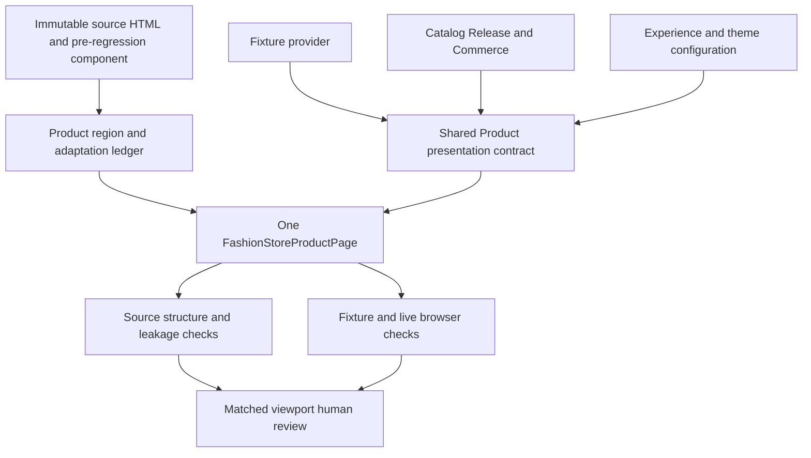
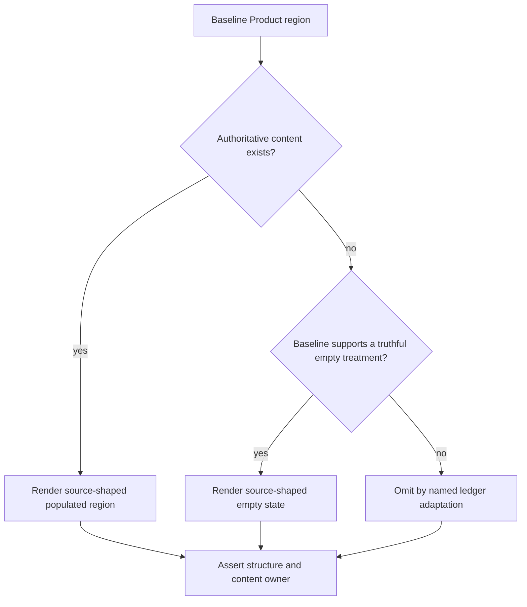

# Fashion Store Product Visual Regression Correction - Plan

## Goal Capsule

- **Objective:** A developer opening the Fashion Store Product route in fixture-preview or live mode sees the accepted pre-convergence Product layout and styling, while live product facts and actions remain truthful and release-backed.
- **Means:** Restore the accepted Product DOM and class composition mechanically inside the current shared page, with a documented authority/adaptation ledger and stronger drift gates (KTD1-KTD5).
- **Execution profile:** Standard corrective implementation in the existing primary checkout; no worktree, database migration, catalog reset, deployment, candidate freeze, or production promotion belongs to this plan.
- **Upstream product authority:** `docs/plans/2026-08-13-001-refactor-shoppp-product-master-plan.md` owns product order and the active pointer. `docs/plans/2026-09-15-1350-refactor-fashion-store-presentation-convergence-plan.md` owns the completed one-component/provider-boundary baseline.
- **Inherited baseline:** FS-R5 R1-R15, KD1-KD3, and its Product action/data contracts remain in force. The immutable visual references are `apps/storefront/app/themes/fashion-store/upstream/demo-fashion-store-single-product.html` and the Product component immediately before commit `159fec57`.
- **Explicit supersession:** This plan supersedes only FS-R5's Product visual-acceptance and U3 completion claim where the implementation diverged from the accepted non-live baseline. It does not supersede the shared component identity, two-provider boundary, Catalog/Commerce authority, truthful-absence policy, or completed non-Product convergence work.
- **Parallel plans:** `REL-Pre-DC` remains the release-readiness authority and is paused as the preserved return pointer while FS-F9 is active. Completed Admin plans and unrelated Admin working-tree changes are outside this plan.
- **Tail ownership:** Green FS-F9-U4 returns authority to `REL-Pre-DC`. Candidate selection, DC evidence, deployment, and PG state remain with REL.

### Execution Checkpoint

- **Classification:** Active bounded Fashion Product visual correction.
- **Current unit:** `FS-F9-U4` — run the complete automated matrix and matched-viewport human review before returning authority to REL.
- **Completed units:** `FS-F9-U1` through `FS-F9-U3` — immutable contract/red characterization, provider-neutral state reconciliation, and shared renderer restoration evidence are retained in [`docs/progress/fashion-store-product-visual-regression.md`](../progress/fashion-store-product-visual-regression.md).
- **Next unit:** `FS-F9-U4`.
- **Blocker:** None.
- **Next concrete action:** Run the complete Fashion Store, repository, build/static, source-equivalence, impact-selection, HMR, and matched fixture/live viewport gates; present desktop/mobile comparisons for human approval before handback.
- **Completion handback:** `FS-F9-U4` returns to `REL-Pre-DC` without freezing or promoting a release candidate.

---

## Product Contract

### Summary

Restore the Fashion Store Product page to the accepted non-live visual baseline without reintroducing separate fixture and live components. The correction keeps current live Catalog/Commerce behavior and replaces permissive presence checks with region-level structure, geometry, behavior, and truthful-absence gates.

### Problem Frame

FS-R5 correctly removed the duplicated live Product page, but commit `159fec57` also simplified the canonical Product page while performing that convergence. Breadcrumb wrappers, product-information rows, assurance content, tab-panel composition, and lower-page layout were removed or collapsed. The result satisfies the current broad tests yet looks materially different from the accepted non-live page, especially on the Product detail route.

The defect is not caused by using one shared component. It is caused by treating component convergence as permission to rewrite presentation and by tests that prove region presence rather than the accepted relationships inside each region.

### Requirements

**Visual baseline**

- R1. The canonical Product page preserves the accepted pre-`159fec57` non-live DOM hierarchy, class composition, region order, spacing, typography, responsive geometry, and interaction presentation unless the adaptation ledger names a narrower truthful exception.
- R2. Fixture-preview and live mode continue to resolve the same `FashionStoreProductPage` component and the same presentation structure; no provider-specific Product page, tab tree, or visual mode branch is introduced.
- R3. Breadcrumb, gallery, Product information, purchase controls, tab navigation/panels, and related-products presentation are restored as distinct source-shaped regions rather than reduced to generic containers or paragraphs.

**Truth and behavior**

- R4. Live identity, name, description, price, compare-at price, media, SKU, options, variants, availability, related products, inventory revalidation, and cart outcomes remain owned by Catalog Release and Commerce.
- R5. Editorial or assurance content appears in live mode only when Experience/theme configuration or another existing authoritative contract supplies it; fixture-only business facts never become live defaults.
- R6. Unsupported reviews, specifications, shipping promises, payments, brand, category, or tags follow one explicit per-region empty/hidden adaptation. A retained empty state must use the accepted surrounding composition and truthful copy without fabricated ratings, counts, guarantees, or product facts.
- R7. Gallery navigation, touch and keyboard input, reduced-motion behavior, lightbox focus, option selection, quantity controls, stale-price/inventory handling, add-to-cart outcomes, related-product routing, direct navigation, SPA navigation, Back/Forward restoration, and no-JavaScript behavior do not regress.
- R8. `dev:fashion-store` and `dev:fashion-store:live` both hot-reload the same Product component changes; their differences are limited to governed data, action, and availability states.

**Drift prevention and delivery**

- R9. The Product source contract inventories the baseline's meaningful subregions, required relationships, source classes, and allowed omissions instead of only counting top-level regions.
- R10. Automated fixture/live browser coverage compares matched Product states at desktop and mobile widths and fails on structural, geometry, tab-composition, or forbidden-content drift even when headings and counts still exist.
- R11. Completion requires a human side-by-side review of the corrected fixture and live Product pages against the accepted baseline at matching viewports; approval does not replace automated gates.
- R12. This correction changes no D1/R2 schema or content, release manifest, authentication/private-preview policy, checkout/payment behavior, candidate identity, deployment state, or non-Product page design.

### Key Decisions

- KD1. **Use the pre-convergence non-live Product page as the visual authority.** This inherits FS-R5 KD1 and governs R1-R3, R9-R11.
- KD2. **Keep one Product component for fixture and live.** This inherits FS-R5 KD2 and governs R2, R4-R8.
- KD3. **Create FS-F9 instead of reopening completed FS-R5.** (session-settled: user-approved — chosen over rewriting the completed FS-R5 record: the corrective scope and prior completion history both remain explicit.) Governs R1-R12.

### Acceptance Examples

- AE1. **Covers R1-R3, R9-R10.** Given the immutable non-live baseline and a fixture Product, when the desktop and mobile routes render, then every required region and source relationship matches the ledger and every exception is named rather than silently simplified.
- AE2. **Covers R2, R4, R7-R8.** Given the equivalent live multi-variant Product, when a shopper changes an option and adds to cart, then the same restored controls revalidate and submit the selected authoritative variant without changing the visual tree.
- AE3. **Covers R5-R6.** Given a live Product with no published reviews, specifications, or governed assurance content, when each tab or optional region renders, then it keeps the declared source-shaped empty treatment or is omitted by ledger rule and displays no fixture-only facts.
- AE4. **Covers R7, R10-R11.** Given direct load, SPA transition, and Back/Forward restoration at matched viewports, when fixture and live pages are compared with the baseline, then gallery, controls, tabs, related products, focus, and layout remain stable while only authoritative content differs.

### Success Criteria

- The Product page is recognizably the accepted pre-convergence non-live design in both local commands, not a reduced live redesign.
- Structural, behavior, absence, responsive, and matched-state visual gates fail when a meaningful baseline subregion or relationship is removed.
- Live Commerce tests still prove authoritative price, availability, selected variant, cart, recovery, and failure behavior.
- Human review approves the desktop and mobile side-by-side result before handback.

### Scope Boundaries

**In scope**

- The shared Fashion Product presentation contract, normalizers, Product page, directly affected integration CSS, source contract, behavior contract, fixture/live Product tests, fidelity capture, and governance handback.
- Narrow Experience/theme presentation fields only when an existing owner already supplies the content needed by the accepted Product composition.

**Out of scope**

- A second live Product component, provider-specific visual branches, a new Product design, or a general storefront redesign.
- Fabricating or seeding reviews, ratings, specifications, delivery estimates, guarantees, payments, brand, category, or tags to reproduce the source screenshot.
- D1/R2 data changes, Admin product-editor changes, checkout/payment changes, authentication changes, or release promotion.
- Visual changes to Home, Shop/collection, content, account, cart, or checkout routes unless a shared primitive fix is strictly required and regression-proven.

### Deferred to Follow-Up Work

- New Catalog, Experience, review, CMS, shipping, or payment capabilities that would make currently unsupported Product regions authoritative.
- A broader visual-regression platform or pixel-diff policy for every Fashion Store route; FS-F9 adds only the Product coverage needed to prevent this regression class.

---

## Planning Contract

### Key Technical Decisions

- KTD1. **Restore mechanically from immutable references.** Reconstruct the shared Product page from the pre-`159fec57` component and source HTML, then thread the current presentation/action contracts through that structure. Redesigning from the current reduced page is rejected because it cannot prove R1-R3.
- KTD2. **Make a region/adaptation ledger the source contract.** Each baseline region records required parent-child relationships, meaningful classes, geometry anchors, data owner, and its single allowed present/empty/hidden treatment. This implements KD1 without turning fixture copy into live truth.
- KTD3. **Characterize before changing the renderer.** U1 must produce failing assertions for the observed breadcrumb, information-row, tab-panel, and lower-page regressions before U2 or U3 changes production presentation. This follows `docs/solutions/workflow-issues/html-source-parity-reconstruction-workflow-2026-08-06.md`.
- KTD4. **Extend contracts only for authoritative composition.** Presentation fields added in U2 must be provider-neutral and traceable to Catalog/Commerce or Experience/theme ownership. A field whose only producer is the rich fixture object is not eligible for the live contract.
- KTD5. **Use layered drift gates.** Static source-contract checks protect required structure and forbidden leakage; browser tests protect behavior, responsive geometry, tabs, and matched fixture/live outcomes; human review settles final visual fidelity. No single layer certifies completion alone.

### High-Level Technical Design

**Shared rendering and evidence flow**

**Optional-region decision flow**

### Implementation Constraints

- Preserve `FashionStoreProductPage.vue`, `normalizeFashionStoreProductPresentation`, and `useFashionStoreProductActionPort` as the shared ownership boundaries unless implementation evidence proves a narrower helper extraction is needed.
- Treat `apps/storefront/app/themes/fashion-store/upstream/demo-fashion-store-single-product.html` and commit `159fec57^` as immutable evidence, not runtime dependencies.
- Use existing upstream CSS utilities and `integration.css` overrides before adding new Product-only styling.
- Keep accessibility behavior with native elements and existing shared primitives. Add custom focus handling only for a reproducible gap.
- Do not touch unrelated dirty Admin files or infer completion from a commit, screenshot, or broad passing suite alone.

### Risks and Mitigations

| Risk | Consequence | Mitigation |
| --- | --- | --- |
| Visual restoration reintroduces fixture facts | Live page makes false claims | KTD2 and KTD4 require owner and adaptation entries before content renders. |
| Exact source markup breaks current Commerce behavior | Variant, inventory, or cart state regresses | Preserve the current action port and add live failure/revalidation scenarios before handback. |
| Tests overfit one product or viewport | Drift passes elsewhere | Use matched single/multi-variant and missing-content states at desktop and mobile widths. |
| Presence assertions pass a simplified layout again | The same regression recurs | Assert parent-child relationships, meaningful classes, geometry, tab composition, and forbidden content. |
| Shared CSS changes affect other routes | Correction leaks beyond Product | Scope selectors under the Product root and run the complete Fashion Store impact matrix. |

---

## Implementation Units

### U1. Freeze the Product visual contract and reproduce the regression

**Goal:** Convert the accepted pre-convergence Product page into a region/adaptation ledger and failing characterization coverage for the current regression.

**Requirements:** R1-R3, R5-R6, R9-R10; AE1, AE3.

**Dependencies:** None.

**Files:**

- `apps/storefront/app/themes/fashion-store/contracts/pages/product.ts`
- `apps/storefront/tests/fashion-store-product.test.ts`
- `apps/storefront/tests/theme-source-contract.test.ts`
- `apps/storefront/e2e/fashion-store-product.spec.ts`
- `apps/storefront/e2e/support/theme-fidelity-matrix.ts`
- `apps/storefront/tests/theme-fidelity-matrix.test.ts`

**Approach:**

1. Inventory breadcrumb wrappers, gallery/product-info composition, metadata and assurance rows, tab navigation/panels, rich description composition, truthful optional regions, related-products heading/grid, responsive classes, and geometry anchors from both immutable references.
2. Record each region's data owner and allowed populated, empty, or hidden treatment under KTD2.
3. Strengthen static and browser checks so the current simplified implementation fails for the observed missing relationships without demanding unsupported source copy.

**Execution note:** Add and demonstrate the failing characterization assertions before modifying `FashionStoreProductPage.vue` or `integration.css`.

**Test scenarios:**

- Covers AE1. A fixture Product at the desktop reference width fails when breadcrumb row/column wrappers, required Product-info subregions, tab-panel composition, or related heading relationships are removed.
- Covers AE1. The mobile reference width fails when the accepted region order, stacking, spacing classes, or control geometry crosses the ledger tolerances.
- Covers AE3. The source contract accepts only the declared empty/hidden adaptations and rejects fixture review counts, guarantees, or unsupported facts in a live-shaped presentation.
- A source SHA or required-region inventory mismatch reports the exact drifted region rather than a top-level count failure.

**Verification:** The ledger is traceable to both immutable references, existing truthful adaptations are explicit, and the new assertions fail against the current reduced page for the intended reasons.

### U2. Reconcile Product presentation data with the restored composition

**Goal:** Give the shared Product renderer every authoritative field and explicit absence state needed by the accepted composition without widening the provider trust boundary.

**Requirements:** R2, R4-R8, R12; AE2-AE3.

**Dependencies:** U1.

**Files:**

- `apps/storefront/app/themes/fashion-store/contracts/product-card.ts`
- `apps/storefront/app/themes/fashion-store/fixtures/pages/product.ts`
- `apps/storefront/app/themes/fashion-store/composables/useFashionStoreProductActionPort.ts`
- `apps/storefront/tests/fixture-contract.test.ts`
- `apps/storefront/tests/fashion-store-product.test.ts`
- `apps/storefront/tests/fashion-store-live-commerce.test.ts`

**Approach:** Add only provider-neutral presentation fields justified by ledger owners, normalize fixture and live inputs into the same shape, and encode optional-region policy explicitly. Keep Commerce revalidation and cart mutation inside the existing action port; do not make the page inspect provider kind or raw fixture/live unions.

**Test scenarios:**

- Covers AE2. Fixture and live multi-variant inputs normalize to the same structural contract while price, inventory, selected SKU, and cart outcomes stay mode-authoritative.
- Covers AE3. Missing reviews, specifications, assurance, taxonomy, or delivery content produces the ledger's exact empty/hidden state without defaulting from the rich fixture object.
- A malformed required Catalog field keeps the existing diagnostic/error behavior, and a live Commerce failure cannot fall back to fixture values.
- Existing fixture-preview remains network-independent and its local action simulation does not call the live action port.

**Verification:** Contract, fixture-isolation, live-commerce, type, and boundary tests prove one render shape with no fixture-to-live fact leakage.

### U3. Restore the shared Product presentation without breaking commerce

**Goal:** Rebuild the current shared Product page on the accepted DOM/class baseline and bind the reconciled contract and action port into it.

**Requirements:** R1-R8, R12; AE1-AE4.

**Dependencies:** U1, U2.

**Files:**

- `apps/storefront/app/themes/fashion-store/components/pages/FashionStoreProductPage.vue`
- `apps/storefront/app/themes/fashion-store/components/shared/FashionStoreProductGallery.vue`
- `apps/storefront/app/themes/fashion-store/integration.css`
- `apps/storefront/tests/fashion-store-interaction-contract.test.ts`
- `apps/storefront/tests/fashion-store-product.test.ts`
- `apps/storefront/tests/fashion-store-live-commerce.test.ts`
- `apps/storefront/e2e/fashion-store-product.spec.ts`
- `apps/storefront/e2e/fashion-store-live-commerce.spec.ts`

**Approach:** Restore the pre-regression region hierarchy and meaningful utility classes mechanically, then replace fixture expressions with the shared presentation and action contracts. Preserve existing gallery/lightbox, tab keyboard behavior, selection, revalidation, add-to-cart, retry, and route-reset logic. Apply ledger adaptations locally so missing content does not collapse unrelated layout.

**Execution note:** Make the U1 characterization suite pass region by region while keeping the focused live Commerce suite green after each Product interaction region is restored.

**Test scenarios:**

- Covers AE1. Fixture and live desktop/mobile pages share the restored breadcrumb, 7/5 Product layout, Product-info hierarchy, tab navigation/panels, and related-products composition.
- Covers AE2. Single-variant and multi-variant Products preserve option, quantity, stale-price, unavailable inventory, add-to-cart success, and server-failure outcomes inside the restored controls.
- Covers AE3. Reviews show a truthful zero/empty treatment, other unsupported regions follow the ledger, and no fake rating, guarantee, shipping promise, or taxonomy appears.
- Covers AE4. Direct load, SPA transition, Back/Forward, no-JavaScript, keyboard tab navigation, mobile touch gallery/lightbox use, reduced motion, and mobile stacking retain correct state and focus.
- Missing or failed Product media uses the existing safe fallback without changing gallery dimensions or blocking the rest of the page.

**Verification:** The focused source, component, interaction, accessibility, responsive, live-commerce, no-JavaScript, type, lint, and boundary gates pass with one Product component and no provider-specific visual branch.

### U4. Prove visual parity and hand authority back to REL

**Goal:** Close the correction with matched fixture/live evidence, regression coverage strong enough to prevent recurrence, and synchronized plan governance.

**Requirements:** R1-R12; AE1-AE4.

**Dependencies:** U3.

**Files:**

- `apps/storefront/e2e/fashion-store-product.spec.ts`
- `apps/storefront/e2e/fashion-store-live-commerce.spec.ts`
- `apps/storefront/e2e/support/theme-fidelity-matrix.ts`
- `apps/storefront/tests/theme-fidelity-matrix.test.ts`
- `docs/progress/fashion-store-product-visual-regression.md`
- `docs/plans/2026-09-15-2053-fix-fashion-store-product-visual-regression-plan.md`
- `docs/plans/2026-08-13-001-refactor-shoppp-product-master-plan.md`

**Approach:** Capture matched fixture/live Product states at the governed desktop and mobile widths, compare them to the accepted baseline and adaptation ledger, run the complete impacted Fashion Store matrix, retain focused evidence, and update both checkpoints only after automated and human gates are green.

**Execution note:** Present the matching viewport comparisons for human approval before marking U4 complete; record disagreement as a reopened region requirement, not as an informal screenshot exception.

**Test scenarios:**

- Covers AE4. Fixture and live captures for equivalent available multi-variant Products keep the same geometry and composition while allowing only ledger-approved content differences. The retained evidence records the fixture identity, exact existing Catalog Release ID, Product ID/slug, selected variant state, route, viewport, and capture timestamp; a changed or unavailable identity invalidates that comparison.
- Covers AE3. Live missing-content captures prove truthful empty/hidden regions and the absence of fixture-only business facts.
- Desktop and mobile captures cover default, alternate tab, option-selected, unavailable/error, restored-navigation, touch gallery/lightbox, and reduced-motion states without stale UI.
- The complete Fashion Store suite detects no Product-root CSS leakage into Home, Shop/collection, content, cart, checkout, account, or wishlist routes.

**Verification:** Focused and complete gates pass, the human review approves both viewports, retained evidence names the immutable baseline and allowed adaptations, abandoned experimental code is absent, and the master pointer returns to `REL-Pre-DC` without advancing release state.

---

## Verification Contract

| Gate | Applies to | Done signal |
| --- | --- | --- |
| Recorded characterization failures against the reduced page | U1 | Each new structural or browser assertion fails for its named missing baseline relationship before Product presentation code changes; the retained evidence distinguishes expected regression failures from harness failures. |
| `bun test apps/storefront/tests/fixture-contract.test.ts apps/storefront/tests/fashion-store-live-commerce.test.ts` | U2-U4 | Product normalization, provider truth, and fixture-isolation assertions pass. |
| `bun test apps/storefront/tests/fashion-store-product.test.ts apps/storefront/tests/fixture-contract.test.ts apps/storefront/tests/fashion-store-interaction-contract.test.ts apps/storefront/tests/fashion-store-live-commerce.test.ts apps/storefront/tests/theme-source-contract.test.ts apps/storefront/tests/theme-fidelity-matrix.test.ts` | U3-U4 | Product contract, source structure, interaction, provider truth, and fidelity assertions pass after restoration. |
| `bun run --cwd apps/storefront test:fashion-store-live` | U2-U4 | Live Product pricing, availability, media, variants, cart, recovery, and route behavior pass. |
| `PLAYWRIGHT_FORCE_ASYNC_LOADER=1 bun run --cwd apps/storefront test:e2e -- --config playwright.fashion-store.config.ts e2e/fashion-store-product.spec.ts` | U3-U4 | Fixture desktop/mobile, tabs, focus, touch, reduced-motion, navigation, no-JavaScript, and geometry checks pass after restoration. |
| `bun run --cwd apps/storefront test:fashion-store` | U4 | The complete Fashion Store unit/browser/behavior matrix passes. |
| `bun run verify:source-equivalence && bun run check:theme-impact` | U1, U4 | Source-equivalence and impacted-surface selection remain green. |
| `bun run typecheck && bun run lint && bun run format:check && bun run check:boundaries` | U2-U4 | Repository type, lint, formatting, and ownership boundaries pass. |
| `bun run --cwd apps/storefront build && bun run verify:static` | U4 | Production/static output retains the corrected Product presentation and existing safety checks. |
| Local HMR smoke with `dev:fashion-store` and `dev:fashion-store:live` | U4 | A reversible visible Product marker change and its reversal appear in each running page without restarting either development server. |
| Human matched-viewport review | U4 | Desktop and mobile fixture/live pages are approved against the accepted pre-regression baseline with only ledger-listed differences. |

`release:validate` does not apply because FS-F9 neither freezes a candidate nor changes release identity. REL owns that gate after handback.

---

## Definition of Done

- U1-U4 are complete in dependency order and their evidence is retained without a second current-unit queue.
- The current shared Product page matches the accepted pre-`159fec57` non-live composition at desktop and mobile widths.
- Fixture-preview and live mode use the same Product component, presentation contract, and DOM structure while retaining separate data/action authority.
- Unsupported live content is truthful and every baseline omission is named in the region/adaptation ledger.
- Automated checks fail for the regression class that prompted FS-F9, including structural simplification that preserves only top-level counts.
- Live Commerce, accessibility, responsive, navigation, no-JavaScript, source-equivalence, complete Fashion Store, build/static, type, lint, format, boundary, and impact-selection gates are green.
- Human matched-viewport review is approved and recorded.
- Dead-end helpers, temporary snapshots, compatibility branches, debug output, and abandoned styling attempts are removed from the final diff.
- The FS-F9 checkpoint and product master pointer return authority to `REL-Pre-DC`; candidate, DC, deployment, and PG state remain unchanged.

---

## Appendix

### Sources and Research

- `docs/plans/2026-09-15-1350-refactor-fashion-store-presentation-convergence-plan.md` — inherited visual baseline, provider boundary, truth policy, and Product U3 intent.
- `apps/storefront/app/themes/fashion-store/upstream/demo-fashion-store-single-product.html` — immutable Product source structure.
- `apps/storefront/app/themes/fashion-store/contracts/pages/product.ts` — current source SHA and top-level source-region contract.
- `apps/storefront/app/themes/fashion-store/components/pages/FashionStoreProductPage.vue` — current shared renderer and observed simplified tab/lower-page composition.
- `apps/storefront/app/themes/fashion-store/contracts/product-card.ts` — current shared Product presentation and normalization boundary.
- `apps/storefront/app/themes/fashion-store/fixtures/pages/product.ts` — rich fixture fields that are evidence for the old presentation but not live authority.
- `apps/storefront/e2e/fashion-store-product.spec.ts` — current broad geometry and presence coverage that did not prevent the regression.
- `docs/solutions/workflow-issues/html-source-parity-reconstruction-workflow-2026-08-06.md` — structural, behavioral, absence-parity, and characterization-first guidance.
- Git commit `159fec57` and its first parent — the convergence change and immediately preceding non-live Product component.
