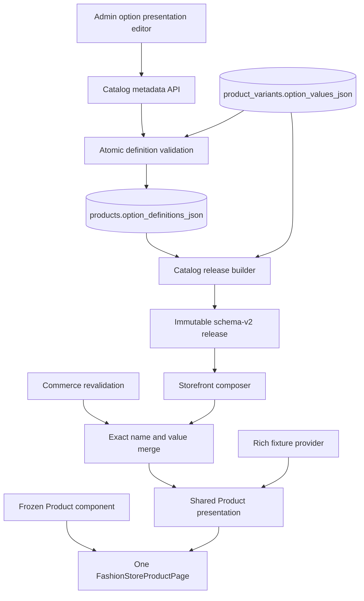
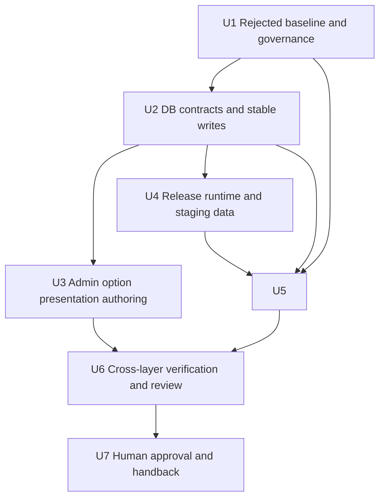

# Fashion Store Product Fidelity and Option Swatch Authority - Plan

## Goal Capsule

- **Objective:** Shoppers see a complete, source-faithful Fashion Store Product page, and operators choose each option's visible color in Admin so the released storefront renders that exact swatch without guessing from its label.
- **Means:** Recover Product regions mechanically from the frozen pre-regression component, add product-scoped option presentation metadata to Catalog, carry it through immutable releases and Commerce, and replace permissive visual checks with content, behavior, and swatch gates (KTD1-KTD8).
- **Execution profile:** Deep, test-first implementation in the existing primary checkout. No worktree is needed.
- **Upstream product authority:** `docs/plans/2026-08-13-001-refactor-shoppp-product-master-plan.md` owns product order. `docs/plans/2026-09-15-1350-refactor-fashion-store-presentation-convergence-plan.md` owns the one-component fixture/live baseline. `docs/plans/2026-09-13-1513-feat-fashion-store-live-catalog-plan.md` owns the current Fashion staging catalog baseline.
- **Inherited baseline:** FS-R5's shared `FashionStoreProductPage`, fixture/live provider boundary, and Commerce action port remain in force. FS-F9's frozen HTML and Git snapshot identities remain the visual evidence source.
- **Explicit supersession:** FS-F10 supersedes FS-F9 R12's prohibition on Catalog/Admin changes, the approved text-only color-chip adaptation, the hard-coded fixture absence policy, and FS-F9-U4's pending completion claim. It does not invalidate FS-F9's automated evidence or completed work outside the rejected human visual result.
- **Parallel plans:** `REL-Pre-DC` stays paused as the preserved return pointer. No candidate, DC, deployment, or PG state advances under FS-F10.
- **Tail ownership:** FS-F10 retains its completed implementation and rejected evidence as history. `FS-F11` owns the corrective Product tail and any future handback to `REL-Pre-DC`.

### Execution Checkpoint

- **Classification:** Superseded incomplete after FS-F10-U7 human visual rejection; `FS-F11` is the active successor.
- **Current unit:** `FS-F10-U7` — terminal rejected review state retained for audit; no further FS-F10 execution is authorized.
- **Completed units:** `FS-F10-U1` approved the rejected-result contract and target; `FS-F10-U2` added validated option-definition persistence and a variant-preserving PATCH; `FS-F10-U3` added Admin presentation controls and focused unit/browser proof; `FS-F10-U4` propagated definitions through release/runtime data and generated a stable-ID local release; `FS-F10-U5` restored the shared Product's rich fixture/right-rail/detail composition, truthful live branches, disabled unavailable actions, and authoritative labeled swatches while retaining Commerce, gallery, route-reset, and failure behavior; `FS-F10-U6` closed focused, aggregate, build, accessibility, source-equivalence, theme-impact, and independent-review gates with generated outputs restored.
- **Next unit:** None in FS-F10; execution continues at `FS-F11-U1`.
- **Blocker:** The FS-F10 evidence set was explicitly rejected by the user because source, deterministic preview, live preview, and production still diverge. Remote staging mutation, release activation, deployment, candidate freeze, and production promotion remain unauthorized.
- **Next concrete action:** Follow [FS-F11](2026-09-16-1337-refactor-fashion-store-live-product-plan.md) to characterize the three Product paths and replace them with one release-backed model and the restored donor component.
- **Completion handback:** Withdrawn. FS-F10 cannot return authority to `REL-Pre-DC`; only human-approved `FS-F11-U7` evidence may do so.

---

## Product Contract

### Summary

Restore the Product page from the existing frozen implementation rather than rebuilding it from the template or reverting the entire component. Add an authoritative product option-definition model so Admin stores each color label and its selected swatch, Catalog Release publishes it, and the Storefront renders it through an exact option/value association.

### Problem Frame

FS-F9 passed its automated gates but failed human review. The right-hand Product area and lower detail area remained substantially thinner than the accepted page. The Color selector rendered text chips because the presentation normalizer discarded fixture swatches and the live Catalog contract had no swatch field.

The missing fixture content already exists in `apps/storefront/app/themes/fashion-store/fixtures/pages/product.ts`, and the accepted DOM already exists in the Product component immediately before `159fec57`. The defect is therefore not a lack of reference material. It is a contract and normalization failure that tests encoded as acceptable.

### Key Decisions

- KD1. **Catalog data entered in Admin is the color authority.** (session-settled: user-directed — chosen over a Storefront label-to-color mapping: a mapping can be incomplete and makes presentation depend on inference.) Governs R5-R11.
- KD2. **Create FS-F10 as a successor instead of rewriting FS-F9.** (session-settled: user-approved — chosen over changing the historical FS-F9 contract: the rejected result and the expanded corrective scope remain auditable.) Governs R1-R16.

### Requirements

**Source-faithful Product composition**

- R1. The shared Product page recovers the frozen pre-`159fec57` region hierarchy, classes, content density, responsive geometry, and interaction presentation through selective mechanical transplantation rather than a fresh interpretation of the upstream template.
- R2. Fixture and live modes keep one `FashionStoreProductPage` and one provider-neutral presentation contract; provider differences are data and capability states, not separate DOM implementations.
- R3. Fixture mode preserves the existing authoritative brand, rating, payment, assurance, taxonomy, rich description, specification, shipping, review, and swatch fixture data instead of normalizing those fields away.
- R4. Live mode gives every accepted Product region one declared populated, source-shaped-empty, or hidden treatment tied to an authoritative owner; it never copies fixture ratings, reviews, delivery dates, payment guarantees, or other unsupported claims.

**Option and swatch authority**

- R5. A product owns ordered option definitions, and each definition owns ordered values with an exact label and presentation kind; a color-presented value stores an operator-selected opaque hexadecimal swatch.
- R6. Option names and values are case-sensitive exact identifiers within a product. Definitions, values, variant references, and variant combinations are unique and atomically validated.
- R7. Admin supports editing ordered presentation metadata for the option names and values already present in a product's variants; it does not create, delete, rename, or recombine multi-option variants in this plan.
- R8. A presentation-kind, swatch, or option-order save preserves product identity and leaves every existing variant ID, option value, SKU, price, media key/order, and inventory reference unchanged. Edits that would invalidate an existing variant reference are rejected.
- R9. Only opaque canonical `#rrggbb` values are accepted for the first swatch version. Arbitrary CSS, named colors, gradients, URLs, and alpha values are rejected before reaching Storefront inline styles.
- R10. Published or archived products remain read-only. Draft and scheduled products cannot publish while definitions fail to cover every existing variant option or contain names or values absent from those variants.
- R11. The Storefront renders the released swatch with a visible and accessible label, selected and disabled states, and a contrast boundary. Color is never the only status cue.

**Release, runtime, and compatibility**

- R12. New Catalog releases carry ordered product option definitions. Existing schema-v2 releases without the additive field remain readable and render a labeled neutral swatch without guessing a color.
- R13. Commerce revalidation may update price, availability, inventory, media, and selected-variant outcomes, but it cannot replace immutable release-owned labels, order, or swatches.
- R14. The Fashion staging catalog gains operator-reviewed product-scoped swatches through the same Catalog schema and validation used by Admin, then produces a new immutable local release while retaining stable product and variant identities. This one-time local bootstrap does not replace Admin as the ordinary authoring surface, and historical release bytes are never rewritten.

**Actions, verification, and governance**

- R15. Restored secondary actions expose only truthful capabilities: question navigation and share behavior may be active when implemented; unavailable compare or wishlist controls cannot claim success or masquerade as working actions.
- R16. Completion requires cross-layer automated proof and human desktop/mobile review of fixture and live Product states. Remote mutation, activation, deployment, candidate freeze, DC, and PG remain outside this plan.

### Content and Capability Authority Matrix

| Product region | Fixture owner and state | Live owner and state | Forbidden behavior |
| --- | --- | --- | --- |
| Identity, price, compare-at price, SKU | Product fixture; populated | Catalog Release plus Commerce revalidation; populated | Replacing release identity with fixture values |
| Gallery and description media | Product fixture; populated | Catalog Release; populated or existing media fallback | Inventing images or blocking the page on media error |
| Color and size options | Product fixture definitions; populated | Catalog option definitions plus variants; populated | Label-to-color inference or arbitrary CSS |
| Brand | Product fixture; populated | Hidden until a published owner exists | Copying fixture brand into live |
| Rating summary | Product fixture; populated | Source-shaped zero-review state | Copying fixture rating or counts into live |
| Assurance, delivery, and payment rows | Product fixture; populated | Published policy/config only; otherwise hidden | Fabricated guarantees, dates, cards, or returns |
| Compare and wishlist | Fixture interaction contract; simulated where declared | Visible disabled controls with unavailable labels until capabilities exist | Accepting clicks or reporting success |
| Question and share | Fixture interaction contract; active | Active only when contact navigation and browser share/clipboard outcomes are implemented | Clickable controls without verified outcomes |
| Taxonomy | Product fixture; populated | Released collections or other published taxonomy; otherwise hidden | Guessing category/tag labels |
| Rich description | Product fixture; full eyebrow, heading, bullets, and image | Released description/media; source-shaped truthful composition | Reducing fixture to one generic paragraph |
| Specifications | Product fixture; populated | Released SKU/weight when available; otherwise a labeled source-shaped empty state | Displaying dimensions not present in release data |
| Shipping and returns | Product fixture; populated | Published policy content when available; otherwise a labeled source-shaped empty state | Inventing estimates, rates, or return promises |
| Reviews | Product fixture; populated | Source-shaped zero-review state until a review authority exists | Fixture reviews or ratings in live |
| Related products | Product fixture or released related-products result; populated when available | Catalog Release/composer; otherwise a labeled source-shaped empty state | Placeholder products presented as live facts |

### Key Flows

- F1. **Admin authors option presentation.** An operator opens a draft with existing Color and Size variant values, marks Color as color-presented, selects an opaque swatch for each existing Color value, saves, reloads, and sees the exact labels, order, swatches, IDs, prices, and media preserved. Covers R5-R10.
- F2. **A release carries presentation metadata.** Publication validates the draft atomically, writes ordered definitions into a new immutable release, and leaves earlier releases unchanged. Covers R12-R14.
- F3. **A shopper selects a variant.** The Product page joins released definitions to exact variant values, keeps labels and swatches through Commerce revalidation, and submits the authoritative variant to cart. Covers R11-R13.
- F4. **An old release has no swatches.** The page preserves option labels and selection behavior, renders a labeled neutral fallback, and never derives a color from the label. Covers R12.
- F5. **A Product region lacks live authority.** The region ledger selects its declared empty or hidden treatment while fixture mode retains its full source content. Covers R3-R4, R15.

### Acceptance Examples

- AE1. **Covers R1-R4.** Given the frozen Product snapshot and current rich fixture, when the page renders at desktop and mobile widths, then the right rail and four detail panels contain the accepted source-shaped regions and fixture content rather than the FS-F9 reduced composition.
- AE2. **Covers R5-R10.** Given a draft with existing Color and Size variants, when an operator selects swatches and saves presentation metadata, then reload returns the exact definitions while every variant row remains unchanged; malformed swatches and definition/value mismatches return field-addressable errors without partial writes.
- AE3. **Covers R11-R13.** Given a new release with swatches, when a shopper selects an unavailable combination, triggers price/inventory revalidation, retries after a stale response, and navigates Back/Forward, then the correct labels and swatches remain visible and the cart receives the resolved variant.
- AE4. **Covers R12.** Given an unchanged historical schema-v2 release without option definitions, when its Product page renders, then options remain usable and each unknown swatch is neutral and labeled rather than inferred.
- AE5. **Covers R14, R16.** Given the reviewed Fashion staging manifest, when a local successor release is built, then stable Product/Variant IDs remain unchanged, the release digest changes only for governed additions, and no remote release is activated.
- AE6. **Covers R15.** Given fixture and live capability states, when the secondary-action row renders, then active actions have verified outcomes and unavailable actions are represented exactly as the ledger declares without false success feedback.

### Success Criteria

- Human review no longer identifies the right rail or detail panels as materially incomplete at the retained desktop and mobile viewports.
- Every rendered live color comes from product-scoped Catalog metadata or the labeled neutral historical fallback; no Storefront color-name map exists.
- The initially rejected FS-F9 result fails the new content-density, capability, and swatch assertions.
- Admin save/reload and release/runtime tests prove that swatch changes do not churn variant identities or disappear after Commerce revalidation.

### Scope Boundaries

**In scope**

- Fashion Store Product composition, presentation contracts, action capability truth, Product tests, and matched visual evidence.
- Product-scoped option definitions, solid color swatches for existing variant values, a presentation-only Admin editor, API validation, D1 storage, release/public contracts, and runtime merging.
- A reviewed local Fashion staging manifest update and immutable successor-release build evidence.

**Deferred to follow-up work**

- A global reusable color palette, patterns, gradients, images, alpha colors, or merchant-wide option libraries.
- Complete multi-variant creation, deletion, renaming, combination generation, and lifecycle management beyond the existing scalar product flow.
- Review ingestion, ratings aggregation, comparison storage, wishlist storage, payment-brand configuration, delivery-estimate calculation, or a general Product CMS.
- Remote Fashion staging mutation/activation, deployment, candidate freeze, DC evidence, and PG changes.

**Outside this product correction**

- Rebuilding the Product page from screenshots, maintaining a Storefront color mapping, reverting the entire current Product component, or splitting fixture/live into separate pages.
- Unrelated Admin settings changes already present in the working tree.

---

## Planning Contract

### Key Technical Decisions

- KTD1. **Use the frozen Git component as the implementation donor.** Transplant the pre-`159fec57` template regions and classes into the current component, then bind current presentation and action contracts. The upstream HTML verifies parity but is not reimplemented from scratch. Implements R1-R4.
- KTD2. **Store option definitions as product-level structured JSON.** Add `products.option_definitions_json` with a valid empty-array default; variants retain their existing exact option-value JSON. For migrated products whose definitions are empty, readers derive ordered text-presented definitions from exact stored variant keys and values without inferring colors; a new or Admin-edited product must persist explicit definitions. This follows the repository's product-local JSON and immutable manifest patterns and avoids repeating swatches per variant. Implements KD1 and R5-R10, R12.
- KTD3. **Use a presentation-only write boundary.** Existing draft option names and values are derived from current variants and remain immutable in this editor. A dedicated metadata write updates only `option_definitions_json`; product variants and their dependent rows are never rewritten. The existing scalar create flow may submit its one variant and matching definition atomically. Implements R7-R8.
- KTD4. **Treat presentation kind as explicit metadata.** A definition marks itself as `color`; group names do not trigger color behavior. Color values require canonical opaque hex, while non-color values carry no swatch in this version. Implements R5, R9, R11.
- KTD5. **Extend schema v2 additively.** `optionDefinitions` is optional when reading historical releases and always emitted by the new builder. When migrated Catalog rows lack definitions, the builder emits deterministic text-presented definitions derived from exact current variant data; only reviewed Catalog metadata may promote a group to color presentation. Consumer/parser support lands before producer output. Implements R12.
- KTD6. **Merge immutable presentation with mutable Commerce state.** Release definitions own labels, order, and swatches; runtime Commerce owns price, inventory, availability, media, and resolved variant state. Exact case-sensitive name/value joins prevent drift. Implements R6, R11-R13.
- KTD7. **Use a reviewed one-time bootstrap for existing Fashion data.** Existing fixture/source swatches are proposals that an operator reviews against exact variant values before they enter the versioned Fashion manifest. The bootstrap passes the same Catalog schema and validation as Admin, records the approved product-scoped aggregate, leaves historical artifacts unchanged, and implies no remote authorization. Ordinary draft changes remain Admin-authored. Implements KD1 and R14.
- KTD8. **Make human-rejected omissions executable failures.** Characterization starts from the rejected FS-F9 captures and asserts region relationships, actual content branches, action outcomes, computed swatch colors, responsive geometry, and historical fallback. This follows `docs/solutions/workflow-issues/html-source-parity-reconstruction-workflow-2026-08-06.md`. Implements R1-R4, R11-R16.

### High-Level Technical Design

### Data Contract

The product-level definition is ordered and product-scoped. Each definition has an exact name, a presentation kind, and ordered values. Each value has an exact label and, only for `color`, a canonical solid swatch. Variants continue to refer to exact option name/value strings and retain stable IDs.

The API validates the presentation aggregate against the current variant set in one transaction. It rejects duplicate definition names, duplicate values, definitions or values absent from variants, uncovered variant keys or values, malformed swatches, and missing color swatches. The presentation-only write cannot mutate variants. Draft UI state may be incomplete before submission, but persisted state cannot be internally inconsistent.

### Sequencing

### System-Wide Impact

- **Data lifecycle:** Draft Product presentation writes and immutable Catalog Release reads gain additive option metadata. Variant rows remain untouched, protecting inventory, carts, orders, and release references.
- **API compatibility:** Old clients and historical releases may omit definitions. New writers validate and emit the field; new readers provide an explicit neutral fallback.
- **Security:** Swatches reach inline styles only after opaque-hex validation. Free-form CSS never enters the presentation contract.
- **Operations:** The D1 migration is additive and backfills `[]`. Existing remote data is not mutated by plan creation or local execution.
- **Accessibility:** Labels remain visible and programmatic, and selection/availability never depends on color alone.

### Alternatives Considered

| Alternative | Decision | Reason |
| --- | --- | --- |
| Storefront label-to-color map | Rejected | It can miss values, duplicates business data, and contradicts KD1. |
| Hex stored on every variant | Rejected | It repeats one option-value fact across variants and permits conflicting values. |
| Separate option and option-value tables | Deferred | It gives stronger relational normalization but adds joins, IDs, and migration surface that current product-local JSON patterns do not need. |
| Product-level option-definition JSON | Selected | It is fetched and published with one product aggregate, matches existing Catalog patterns, and keeps validation at the owning API boundary. |
| Full multi-variant lifecycle editor | Deferred | It adds variant creation, deletion, identity, and dependent-reference work that is not required to author swatches for existing values. |
| Presentation-only Admin editor | Selected | It makes Admin authoritative for swatches on existing variant values while leaving the previously deferred variant lifecycle unchanged. |
| Whole-file Git revert | Rejected | It would discard current Commerce, routing, failure, gallery, and accessibility behavior along with the visual regression. |

### Risks and Mitigations

| Risk | Consequence | Mitigation |
| --- | --- | --- |
| Presentation saves recreate variants | Inventory, cart, or release references break | KTD3 uses a metadata-only write and byte-for-byte variant-row checks gate U2 and U3. |
| Definitions and variants drift | Wrong swatch or impossible selection | Atomic aggregate validation and exact case-sensitive joins reject the write. |
| Runtime Commerce overwrites swatches | Correct initial render degrades after interaction | KTD6 and browser tests cover revalidation, stale responses, navigation, and unavailable combinations. |
| Rich fixture data leaks into live | Storefront makes false claims | The authority matrix and fixture/live branch tests govern every restored region. |
| Old releases stop parsing | Rollback and historical preview break | Additive schema-v2 parsing is tested against an unchanged old artifact before producer rollout. |
| A color payload injects CSS | Styling or security boundary is bypassed | Only canonical opaque hex survives API validation and release parsing. |
| Backfill becomes an implicit remote reset | Historical data or active release changes without approval | U4 creates reviewed local artifacts only; remote execution is a separate authorized tail. |
| Visual tests certify another incomplete page | Human rejection repeats | U1 starts from rejected evidence; U6 checks content, outcomes, geometry, and computed colors instead of counts alone. |

### Stop Conditions

Stop the active unit and retain its evidence if any of these occurs:

- A swatch value would need to be guessed rather than selected in Admin or copied from an already reviewed fixture/source value.
- A presentation update attempts to mutate a variant row or dependent reference.
- A historical schema-v2 release becomes unreadable or its stored bytes must be changed.
- Remote target, backup, current release, or activation identity cannot be proven before a separately authorized remote operation.
- The work overlaps the unrelated dirty Admin settings files.

---

## Implementation Units

### U1. Freeze the rejected result and correct the Product contract

**Goal:** Turn the human rejection into failing, region-specific contracts before changing production behavior.

**Requirements:** R1-R4, R11, R15-R16; AE1, AE6.

**Dependencies:** None.

**Files:**

- `apps/storefront/app/themes/fashion-store/contracts/pages/product.ts`
- `apps/storefront/tests/fixture-contract.test.ts`
- `apps/storefront/tests/fashion-store-product.test.ts`
- `apps/storefront/tests/theme-source-contract.test.ts`
- `apps/storefront/e2e/support/fashion-store-product-composition.ts`
- `apps/storefront/e2e/fashion-store-product.spec.ts`
- `apps/storefront/e2e/fashion-store-live-commerce.spec.ts`
- `docs/progress/fashion-store-product-fidelity.md`

**Approach:**

1. Replace the text-chip and fixture-absence approvals with the authority matrix in this plan.
2. Inventory every frozen right-rail action/assurance/taxonomy row and every detail-panel subregion from the pre-`159fec57` component.
3. Add failing assertions that distinguish fixture-populated, live-populated, live-empty, and live-hidden states.
4. Pin the rejected desktop/mobile captures as the red baseline and preserve exact source, product, release, route, and viewport identities.
5. Present the frozen source, full fixture target, and annotated proposed live populated/empty/hidden composition at both retained viewports for explicit human approval before U2 begins.

**Execution note:** Demonstrate the intended failures before touching the Catalog model, normalizer, page template, or CSS.

**Test scenarios:**

- Covers AE1. The rejected FS-F9 page fails because rich fixture regions and right-rail content are absent, not because the route or harness failed.
- Covers AE1. Removing a required region, relationship, or populated fixture branch fails even when top-level headings and counts remain.
- Covers AE6. A secondary action passes only when its declared active or unavailable outcome matches the capability ledger.
- A text-only Color control fails the source contract and browser contract.
- Human review approves the exact live region-state target and secondary-action treatment before Catalog implementation begins.

**Verification:** The red evidence maps each failure to one frozen region and one R-ID, unrelated Product behavior stays green, and the approved live composition target is retained for U5 and U7 comparison.

### U2. Add option definitions and presentation-only Catalog writes

**Goal:** Establish the authoritative product aggregate and safe persistence path for option presentation metadata.

**Requirements:** R5-R10, R12; AE2, AE4.

**Dependencies:** U1.

**Files:**

- `packages/db/migrations/0027_product_option_definitions.sql`
- `packages/db/src/schema/index.ts`
- `packages/db/test/migrations.test.ts`
- `packages/contracts/src/catalog.ts`
- `packages/contracts/test/catalog-release.test.ts`
- `apps/api/src/catalog/schemas.ts`
- `apps/api/src/catalog/products.ts`
- `apps/api/test/catalog/catalog.test.ts`
- `apps/admin/src/services/catalog/api.ts`

**Approach:**

1. Add valid product-level option-definition JSON with an empty-array migration default and leave variant option-value storage unchanged.
2. Extend shared draft/detail/release types with ordered definitions and canonical solid swatches.
3. Validate definitions against the current variant set with field-addressable errors before opening the write transaction.
4. Add a metadata-only write path that updates the Product definition field and never invokes the existing destructive variant rewrite; reject mutations to published or archived products.
5. Derive text-presented definitions from exact variant data when a migrated row still contains `[]`; require explicit persisted definitions on every new or Admin-edited product.

**Execution note:** Start with migration, validation, and byte-for-byte variant-row preservation failures. Do not build the Admin editor on the current destructive PUT behavior.

**Test scenarios:**

- Covers AE2. Saving valid Color and Size presentation metadata round-trips exact case, order, presentation kind, and swatches.
- Covers AE2. Swatch-only and reorder-only updates leave all variant, SKU, price, media, inventory, cart, and order rows unchanged.
- Duplicate definitions, duplicate values, absent or uncovered variant names/values, invalid CSS, alpha colors, and missing color swatches fail atomically with field paths.
- Existing database rows migrate to `[]`; existing products and variants remain unchanged; invalid JSON is rejected.
- A migrated product with variant options and `[]` definitions reads and publishes deterministic text-presented definitions without color inference.
- Covers AE4. An unchanged old schema-v2 release still parses without option definitions.

**Verification:** Database, contracts, and API tests prove additive migration, atomic validation, immutable published state, and a presentation write with zero variant-row mutations.

### U3. Build the Admin option-presentation and swatch editor

**Goal:** Make Admin the ordinary authoring surface for presentation kinds and swatches on existing option values.

**Requirements:** R5-R10; AE2.

**Dependencies:** U2.

**Files:**

- `apps/admin/src/pages/catalog/catalog-form-page.tsx`
- `apps/admin/src/pages/catalog/catalog-form-page.test.tsx`
- `apps/admin/src/services/catalog/api.ts`
- `apps/admin/src/i18n/locales/en.ts`
- `apps/admin/src/i18n/locales/zh-CN.ts`
- `apps/admin/e2e/catalog.spec.ts`

**Approach:**

1. Replace the scalar `optionColor` field with ordered option groups derived from existing variants, read-only value labels, and presentation-kind controls.
2. Use the installed Ant Design ColorPicker with alpha disabled, while keeping an editable canonical hex field next to each visible read-only option value.
3. Keep variant rows and combinations outside this editor; route saves through the U2 metadata-only API.
4. Require confirmation before changing `color` to a non-color presentation and dropping swatches; block save when changing to `color` until every retained value has a valid swatch.
5. Keep published and archived products read-only and show API validation errors at the owning definition or value field.

**Patterns to follow:** Existing Ant Design Form patterns and localized validation conventions in the Admin catalog form.

**Test scenarios:**

- Covers AE2. An operator opens existing Color and Size values, marks Color as color-presented, picks swatches, saves, reloads, and sees the same order while variant rows remain unchanged.
- Manual hex entry and picker selection normalize to lowercase `#rrggbb`; duplicate hex on different labels is allowed.
- Option names and value labels cannot be renamed or removed in this editor.
- Presentation-kind changes cannot silently discard swatches or persist partially specified color values.
- Published and archived products expose the definitions read-only and send no mutation.
- API field-path errors focus or annotate the correct form control without a duplicate global accessibility protocol.

**Verification:** Focused Admin unit and browser coverage demonstrates usable keyboard/pointer swatch authoring, exact round-trip state, zero variant mutations, localized errors, and read-only lifecycle rules.

### U4. Propagate swatches through releases, Commerce, and reviewed Fashion data

**Goal:** Carry the authoritative definitions from Catalog storage to both initial Storefront composition and runtime Commerce state.

**Requirements:** R11-R14; AE3-AE5.

**Dependencies:** U2.

**Files:**

- `apps/api/src/publishing/build-manifest.ts`
- `apps/api/src/catalog/public.ts`
- `apps/api/src/testing/fashion-staging-catalog.ts`
- `apps/api/test/publishing/build-manifest.test.ts`
- `apps/api/test/catalog/public.test.ts`
- `apps/api/test/testing/fashion-staging-catalog.test.ts`
- `packages/contracts/src/catalog.ts`
- `packages/contracts/test/catalog-release.test.ts`
- `apps/storefront/app/theme-engine/view-models.ts`
- `apps/storefront/app/theme-engine/composer.ts`
- `apps/storefront/app/theme-engine/runtime-commerce.ts`
- `apps/storefront/tests/catalog-release-source.test.ts`
- `apps/storefront/tests/fashion-store-live-commerce.test.ts`
- `tools/fashion-store-live-catalog.json`
- `tools/prepare-fashion-store-live-catalog.ts`
- `tools/prepare-fashion-store-live-catalog.test.ts`

**Approach:**

1. Make new builders emit explicit definitions, or deterministic text-presented definitions for migrated Catalog rows, while old releases remain valid and unchanged.
2. Publish the same metadata through the live Product contract and merge runtime values by exact option name/value without replacing release presentation.
3. Prefill the existing Fashion definitions from reviewed source/fixture values, obtain explicit operator confirmation of every product-scoped label/hex pair, and retain that approval evidence.
4. Validate the confirmed aggregate through the same Catalog schema used by Admin, then export it into the versioned Fashion manifest while preserving exact variant values and stable IDs.
5. Generate and verify a new local immutable release artifact; retain remote application as an unauthorized follow-up tail.

**Execution note:** Land and verify readers before enabling new producer output.

**Test scenarios:**

- Covers AE3. Initial release composition and post-revalidation Commerce state expose identical labels, order, and swatches.
- Covers AE3. Stale-price retry, unavailable combination, and Back/Forward restore do not erase swatches or change selected variant identity.
- Covers AE4. A byte-for-byte historical release parses and renders labeled neutral swatches without a color-name lookup.
- A migrated product with no persisted definitions produces stable text-presented definitions from exact current variant keys/values and never promotes a group to color presentation.
- Covers AE5. The reviewed Fashion manifest builds deterministically, keeps stable Product/Variant IDs, and never mutates an old release artifact.
- The Fashion manifest swatches match the retained operator-confirmed, Catalog-validated aggregate; fixture values alone cannot satisfy the backfill gate.
- Malformed option metadata fails build/public parsing before reaching Storefront.

**Verification:** Contract, API, builder, tool, and Storefront tests prove old/new compatibility, deterministic release output, stable identities, and immutable presentation across runtime refreshes.

### U5. Recover the complete shared Product presentation

**Goal:** Restore the accepted right rail and detail composition while preserving current Commerce, gallery, routing, failure, and accessibility behavior.

**Requirements:** R1-R4, R11, R13, R15; AE1, AE3, AE6.

**Dependencies:** U1, U2, U4.

**Files:**

- `apps/storefront/app/themes/fashion-store/contracts/product-card.ts`
- `apps/storefront/app/themes/fashion-store/components/pages/FashionStoreProductPage.vue`
- `apps/storefront/app/themes/fashion-store/composables/useFashionStoreProductActionPort.ts`
- `apps/storefront/app/themes/fashion-store/interaction-contract.ts`
- `apps/storefront/app/themes/fashion-store/capability-matrix.ts`
- `apps/storefront/app/themes/fashion-store/assets/css/integration.css`
- `apps/storefront/tests/fixture-contract.test.ts`
- `apps/storefront/tests/fashion-store-product.test.ts`
- `apps/storefront/tests/fashion-store-live-commerce.test.ts`

**Approach:**

1. Expand the provider-neutral presentation contract so fixture normalization retains rich fixture fields and live normalization assigns the authority matrix's exact states.
2. Transplant frozen template regions and classes into the current component without replacing its script, action port, route reset, revalidation, gallery, lightbox, or failure logic.
3. Render actual swatches from definitions with labels, contrast boundaries, selection marks, and disabled states; use the neutral fallback only for historical metadata absence.
4. Restore secondary-action geometry while activating only behaviors with real owners and marking or omitting unavailable capabilities according to the ledger.

**Execution note:** Work region by region from the frozen snapshot. A region is complete only after both fixture and live branches have evidence.

**Test scenarios:**

- Covers AE1. Fixture mode renders all existing rich content and the accepted right-rail/detail structure at desktop and mobile widths.
- Covers AE1. Live mode renders authoritative fields and the exact empty/hidden treatment for every unsupported region without fixture leakage.
- Covers AE3. Swatches show the released computed RGB values and retain visible/accessibility labels through selection and revalidation.
- Covers AE6. Question and share produce their declared outcomes; unavailable compare/wishlist never report success.
- Gallery/lightbox, quantity, cart, direct/SPA/Back navigation, media fallback/recovery, keyboard tabs, reduced motion, and no-JavaScript behavior remain green.

**Verification:** The shared component matches the frozen composition in fixture mode, remains truthful in live mode, and preserves all current Product behavior contracts.

### U6. Run cross-layer gates and independent review

**Goal:** Prove the complete Admin-to-Storefront path and close implementation defects before asking for human visual approval.

**Requirements:** R1-R16; AE1-AE6.

**Dependencies:** U3, U5.

**Files:**

- `apps/admin/src/pages/catalog/catalog-form-page.test.tsx`
- `apps/api/test/catalog/catalog.test.ts`
- `apps/api/test/publishing/build-manifest.test.ts`
- `packages/contracts/test/catalog-release.test.ts`
- `packages/db/test/migrations.test.ts`
- `apps/storefront/e2e/fashion-store-product.spec.ts`
- `apps/storefront/e2e/fashion-store-live-commerce.spec.ts`
- `apps/storefront/e2e/support/fashion-store-product-composition.ts`
- `apps/storefront/tests/theme-source-contract.test.ts`
- `docs/progress/fashion-store-product-fidelity.md`

**Approach:**

1. Run focused tests first, then the complete Admin, API worker, contracts, database, Fashion Store, source-equivalence, accessibility, build/static, type, lint, formatting, and boundary gates.
2. Exercise fixture and pinned live Products at matched desktop/mobile widths across default, alternate-tab, selected, unavailable, revalidation, and failure states.
3. Run a full code review against FS-F10, apply confirmed findings, and rerun the affected and aggregate gates.
4. Retain evidence identities and outcomes without moving the master pointer or release state.

**Test scenarios:**

- The full save-to-release-to-render flow preserves exact swatches and stable variant IDs.
- The old-release neutral fallback and new-release authoritative swatch both pass accessible selection tests.
- Content-density and geometry checks fail on deleted populated subregions, empty selector results, text-only colors, and clickable dead actions.
- Complete repository gates do not alter unrelated Admin settings files or generated artifacts outside their declared outputs.

**Verification:** All applicable gates and review findings are green, evidence is retained, and only human matched-viewport approval remains.

### U7. Obtain human approval and hand back to release readiness

**Goal:** Replace the rejected FS-F9 evidence with an approved, identity-pinned fixture/live comparison and close the successor tail conservatively.

**Requirements:** R16; AE1, AE3, AE5-AE6.

**Dependencies:** U6.

**Files:**

- `docs/plans/2026-09-16-0936-feat-fashion-store-product-fidelity-plan.md`
- `docs/plans/2026-08-13-001-refactor-shoppp-product-master-plan.md`
- `docs/progress/fashion-store-product-fidelity.md`

**Approach:**

1. Capture source, fixture, and live comparisons at the retained desktop/mobile viewports, including default, alternate detail tab, selected option, unavailable option, and failure/recovery states.
2. Ask for explicit human approval of completeness, swatch fidelity, action truth, and responsive composition.
3. If review rejects any region, record it, add a failing assertion, and return to the owning unit.
4. Only after approval, update this checkpoint and the master pointer in the same change to return authority to `REL-Pre-DC`.

**Test expectation:** No new automated behavior belongs solely to this governance unit; U6 must already be green, and U7 adds human approval evidence plus synchronized authority records.

**Verification:** Human approval names the reviewed evidence set, the plan and master agree on handback, and no remote release, candidate, DC, deployment, or PG state changed.

---

## Verification Contract

| Gate | Applies to | Done signal |
| --- | --- | --- |
| Focused DB/contracts/API tests | U2, U4 | Migration, aggregate validation, stable variant identity, old/new release compatibility, and builder/public round trips pass. |
| Focused Admin tests and browser flow | U3 | Multi-option authoring, ColorPicker/manual hex, error paths, read-only lifecycle, and save/reload pass. |
| Focused Storefront unit tests | U1, U4, U5 | Fixture richness, live authority states, runtime merge, historical fallback, and action capability contracts pass. |
| Product fixture/live Playwright | U1, U5, U6 | Matched desktop/mobile composition, computed swatches, tabs, actions, Commerce, navigation, failure, and accessibility states pass. |
| `bun run verify:source-equivalence` and `bun run check:theme-impact` | U5, U6 | Source contract is green and the impact selector runs the required Fashion Store surface. |
| Workspace tests, worker tests, and builds | U6 | Admin, API, contracts, DB, Storefront, static output, and dry-run worker builds pass. |
| `bun run typecheck`, `bun run lint`, `bun run format:check` | U2-U6 | Repository type, lint, boundary, and formatting gates pass without unrelated edits. |
| Independent code review | U6 | Confirmed findings are applied or explicitly rejected with evidence, then affected gates rerun. |
| Human matched-viewport review | U7 | Fixture and live Product pages are explicitly approved against the frozen source at both retained viewports. |

`bun run release:validate` applies only if implementation changes release-validation inputs or candidate-facing artifacts. It cannot advance the candidate; it is evidence that the additive release contract remains valid.

---

## Definition of Done

- U1-U7 meet their stated verification outcomes, and no unit is inferred complete from a commit or broad green suite alone.
- The Product page restores the accepted right rail and rich detail composition in fixture mode and the declared truthful composition in live mode.
- Admin is the ordinary authority for product-scoped swatches on existing option values, and save/reload leaves variant and dependent identities unchanged.
- New releases carry swatches, historical releases remain readable, and Commerce revalidation cannot erase presentation metadata.
- The Fashion manifest and local successor release are deterministic and reviewed; historical release artifacts remain unchanged.
- Automated gates fail for the original rejected omissions, text-only color regression, vacuous selectors, dead actions, and fixture-to-live leakage.
- Human desktop/mobile review explicitly approves the corrected evidence set.
- The plan/master checkpoint handback is synchronized, abandoned experiments are removed, generated artifacts are either retained intentionally or restored, and the unrelated Admin settings changes remain untouched.
- No remote mutation, activation, deployment, candidate freeze, DC, or PG change is claimed.

---

## Appendix

### Sources and Research

- `docs/solutions/workflow-issues/html-source-parity-reconstruction-workflow-2026-08-06.md` establishes separate structural, behavioral, and absence parity plus a source ledger and human-rejection-first red test.
- `apps/storefront/app/themes/fashion-store/contracts/pages/product.ts` pins the immutable HTML and pre-regression component identities used by KTD1 and KTD8.
- `apps/storefront/app/themes/fashion-store/fixtures/pages/product.ts` retains the rich Product content and exact fixture swatches currently discarded by normalization.
- `apps/admin/src/pages/catalog/catalog-form-page.tsx`, `apps/api/src/catalog/products.ts`, and `packages/db/src/schema/index.ts` establish the current scalar editor, destructive variant rewrite, and missing option-definition storage addressed by U2-U3.
- [Cloudflare D1 migrations](https://developers.cloudflare.com/d1/reference/migrations/) informs the additive, ordered migration and rollback evidence in U2.
- [Ant Design ColorPicker](https://ant.design/components/color-picker) confirms the installed component family supports the bounded solid-color Admin control in U3.

### Deferred Implementation Notes

- Exact helper and component names for the Admin option/variant editor may change after U2 exposes the final typed aggregate.
- The precise live shipping copy depends on the policy fields already present in the selected release; U5 must not widen the contract merely to fill space.
- Remote staging correction requires a separate exact-target, backup, release-identity, activation, and rollback procedure plus explicit authorization.
