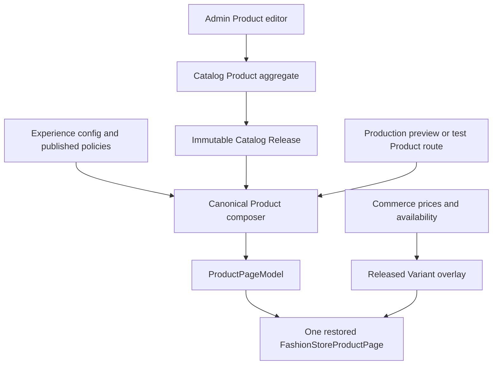
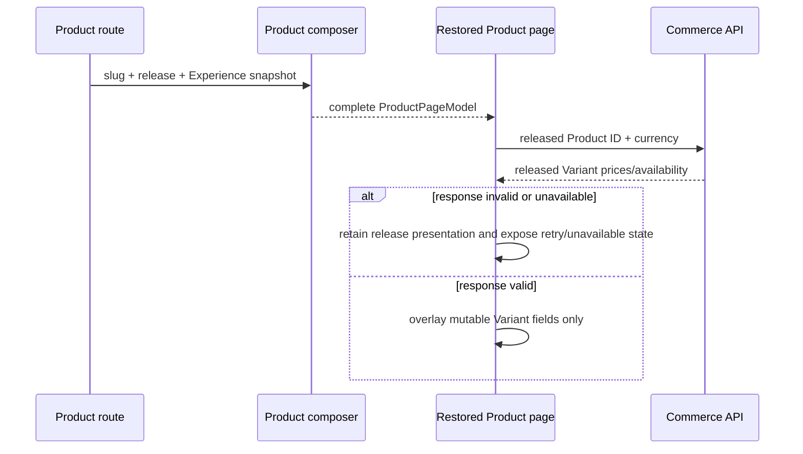
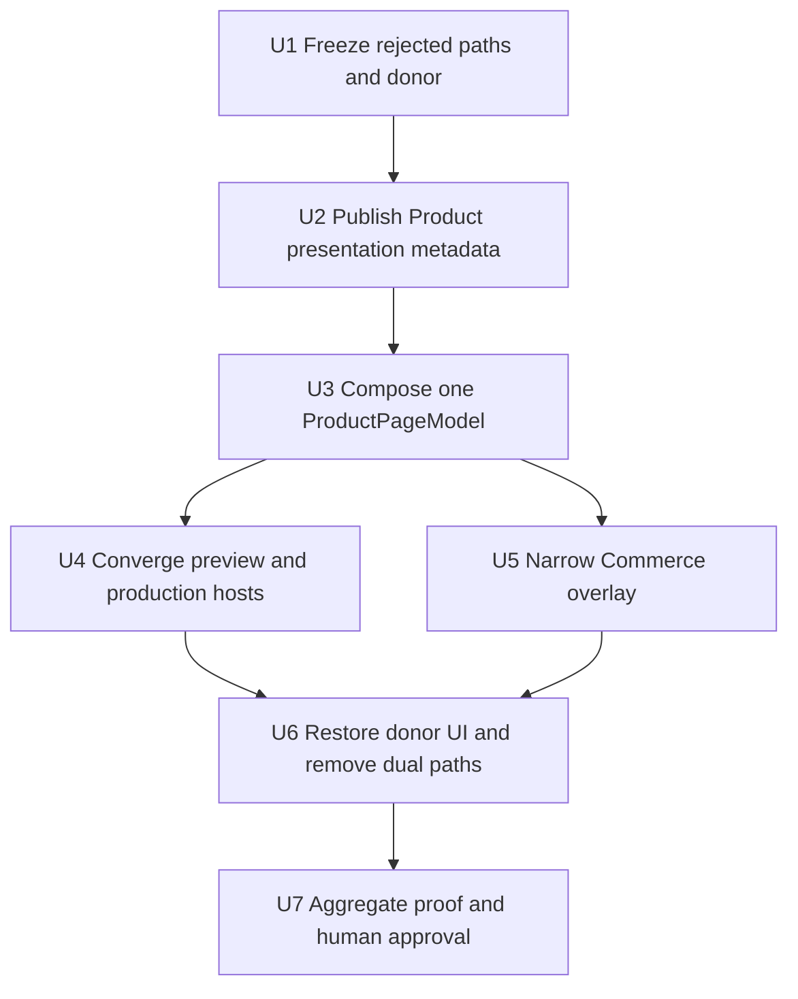

# Fashion Store Single Live Product Path - Plan

## Goal Capsule

- **Objective:** Shoppers see the accepted Fashion Store Product design on the real Product route, with released Catalog facts and current Commerce price, compare-at price, and availability, instead of a sparse or mode-dependent substitute.
- **Means:** Restore the pre-`159fec57` Product implementation as the sole visual owner and feed every Product entry point through one release-backed `ProductPageModel` (KTD1-KTD4).
- **Upstream product authority:** `docs/plans/2026-08-13-001-refactor-shoppp-product-master-plan.md` owns product order. `docs/plans/2026-09-15-1350-refactor-fashion-store-presentation-convergence-plan.md` owns the shared-theme baseline. `docs/plans/2026-09-16-0936-feat-fashion-store-product-fidelity-plan.md` retains the rejected FS-F10 work and evidence.
- **Inherited baseline:** FS-F10's validated option definitions, stable Product and Variant identities, Catalog release propagation, Commerce/cart behavior, accessibility repairs, and local v2 release remain inputs. Their human visual completion claim does not carry forward.
- **Explicit supersession:** FS-F11 supersedes FS-F10's pending U7 approval tail, Product fixture/live normalizer split, live region-treatment policy, and acceptance of the current U7 screenshots. It also supersedes the independent sparse production Product markup in `apps/storefront/app/pages/products/[slug].vue`.
- **Parallel plans:** `REL-Pre-DC` remains paused. Other Fashion routes keep their current presentation paths unless this plan names a shared-shell compatibility change.
- **Tail ownership:** FS-F11 owns Product data convergence, source restoration, local verification, matched human review, and handback. No remote Catalog mutation, release activation, deployment, candidate freeze, DC, or PG action is authorized.
- **Execution profile:** Deep, characterization-first work in the existing primary checkout. No worktree or PR is required.
- **Stop conditions:** Stop before a change would discard unrelated dirty work, invent a live product claim, rewrite historical release bytes, activate a remote release, or change a non-Product route without focused compatibility evidence.

### Execution Checkpoint

- **Classification:** Completed successor; U1-U7, including U7.1-U7.3, closed on 2026-09-17.
- **Current unit:** None; FS-F11 is complete.
- **Completed units:** U1-U5 established the approved target, data pipeline, single model, single host, and Commerce overlay. U6 and U7.1-U7.3 restored the Product regions, resolved R21-R23, passed the uninterrupted aggregate, and retained hash-verified, unmasked Vue donor evidence and the user's final visual acceptance.
- **Current checkpoint:** The shared `#6b6b6b` compare-at gray, portrait-free Reviews, policy-backed Shipping and return, eight-width responsive layout, and single release-backed Product path are implemented. The uninterrupted `check:theme-impact` rerun exited `0`; Storefront/E2E typecheck, formatting, diff checks, and independent final review pass. The unmasked frozen-Vue difference report records the superseded one-percent pixel limit as unmet; R18's explicit exception, named geometry/state checks, and the user's accepted final appearance govern closure.
- **Blocker:** None within FS-F11. Remote release and promotion work remain outside this plan.
- **Next concrete action:** None within FS-F11. FS-F12 owns the active Product content/review successor.
- **Completion handback:** Completed on 2026-09-17 to FS-F12-U1 for Product-specific content, imagery, and real reviews. `REL-Pre-DC` remains the return pointer after FS-F12; no candidate, DC, deployment, or PG state advanced.

---

## Product Contract

### Summary

The Product page will use one visual implementation and one release-backed data pipeline. The accepted component immediately before `159fec57` supplies the DOM hierarchy, classes, responsive geometry, and interaction presentation. Catalog Release and Experience configuration supply immutable display facts. Commerce overlays only released Variant current price, compare-at price, and availability. Local fixtures remain deterministic input data, not an alternate Product renderer.

### Problem Frame

FS-F10 repaired many missing regions but preserved separate fixture and live normalization. Production still has a third Product implementation in `apps/storefront/app/pages/products/[slug].vue`. Tests can therefore pass while preview, live preview, and production render different pages. Commerce also projects media and option groups into component state, which lets an empty response erase six released images.

The repository already contains the accepted Product component at commit `f3be48b38cd265ae16a65394431901e1f4b1cd5b`, the frozen upstream HTML, Catalog Release composition, and Commerce/cart ports. The correction is an ownership change, not a fresh redesign.

### Key Decisions

- KD1. **One Product renderer and one Product model.** (session-settled: user-directed — chosen over maintaining fixture and live Product paths: the separate paths caused visual drift and made a data-binding change behave like a redesign.) Governs R1-R6, R14-R16.
- KD2. **The accepted historical Product implementation is the visual authority.** (session-settled: user-directed — chosen over continuing selective reconstruction from the reduced component: the complete working code already exists and only needs authoritative data bindings.) Governs R1, R2, R14-R16.
- KD3. **Every Product entry point is release-backed.** (session-settled: user-directed — chosen over a fixture-specific Product mode: preview and tests must prove the same path shoppers use.) Governs R3-R6, R13, R16.
- KD4. **Product-only scope.** The plan converges Product routes and their required shared-shell behavior. Other Fashion page renderers are compatibility surfaces, not migration targets. Governs R17-R19.

### Requirements

**Visual ownership**

- R1. `FashionStoreProductPage.vue` is the only Product page presentation and retains the pre-`159fec57` shell, breadcrumb, gallery, right rail, tabs, rich detail, related grid, footer relationship, classes, breakpoints, and visual state hierarchy.
- R2. The restoration is mechanical: current routing, revalidation, cart, error recovery, gallery/lightbox, route reset, and application-owned accessibility behavior bind into the donor structure without redesigning it.
- R3. Production navigation, live preview, deterministic preview, and browser tests render the same component from the same `ProductPageModel`; no Product route owns independent page markup.
- R4. Product fixture content is expressed as a canonical Catalog Release, Experience configuration, and optional Commerce response. It never reaches the Product component as a `theme-section` or fixture-only shape.
- R5. Product rendering does not branch on fixture versus live mode. Truthful data differences change field values and states, not the page hierarchy.
- R6. The sparse Product article in `apps/storefront/app/pages/products/[slug].vue` becomes a thin route host for the canonical composer/component path and owns only route, SEO, and host integration concerns.

**Data authority**

- R7. Catalog Product and Catalog Release own product identity, name, description, gallery order, option definitions, Variant identity, SKU, base price, collection membership, and Product presentation metadata.
- R8. Product presentation metadata is an additive validated aggregate for brand, rich-detail copy and bullets, detail media selection, ordered specifications, explicit default Variant ID, and an optional published review-display snapshot. Related Products come from ordered released collection membership rather than a second ordering mechanism.
- R9. Experience/site configuration owns public shell copy, payment-brand presentation, and links to published site policies. Payment secrets and unsupported guarantees never enter the Product model. If no enabled public payment-brand configuration exists, the historical payment-logo slot uses an explicit unavailable state rather than copied logos.
- R10. Published collection/category membership owns taxonomy. Published policy documents own shipping and return copy. The composer does not copy demo claims into live output.
- R11. Review count, rating summary, and displayed review entries come from an explicit API-backed published Product review-display snapshot with provenance and updated-at metadata. The development catalog may seed the historical Vue demonstration values through that same write/release path; production without a published snapshot renders the historical zero-review state. The component may not hardcode `0`, `165`, `3`, a rating, or review bodies.
- R12. New presentation fields are optional in schema-v2 releases. Historical release bytes remain readable and receive deterministic truthful defaults. A color option renders a color swatch only when its released value has an explicit swatch; missing swatch metadata falls back to a source-sized text option, never a fabricated neutral color circle.
- R13. Admin/API writes validate presentation metadata against current media, Product, and Variant identities, use the existing Product version boundary, preserve Variant rows, and remain immutable after publication.

**Commerce ownership and behavior**

- R14. Commerce may update current price, compare-at price, and availability only for stable Variant IDs already present in the release.
- R15. Commerce cannot replace release-owned identity, copy, option definitions/order, SKU, gallery, presentation metadata, taxonomy, policies, collection-derived related order, or default Variant. Missing released Variants become unavailable; unknown Commerce Variants are ignored or rejected.
- R16. A failed, stale, wrong-identity, wrong-currency, or malformed Commerce response leaves the released Product visible. Retry and add-to-cart use the current stable Product, Variant, currency, quantity, and release identity.

**Scope and acceptance**

- R17. Shared Header, Shell, Footer, and CSS changes are limited to restoring the historical Vue Product contract; Home, Collection, Cart, Checkout, and information routes must retain their existing verified behavior.
- R18. Donor parity is measured at `1440x1000` and `390x844` against one U1-frozen historical Vue profile: exact donor-owned static copy and asset-slot inventories, region hierarchy, content-slot count and order, responsive geometry, classes, and media placement; numeric per-region geometry bounds; and an unmasked screenshot-difference report. The frozen upstream HTML is a secondary design reference, not the acceptance target. Released names, descriptions, media identities, prices, policies, and review values follow R7-R16 and the approved exception ledger instead of copying donor claims. U6 and U7 cannot recalibrate the frozen profile. Selector counts alone are insufficient. The original one-percent pixel threshold remains recorded but is superseded as an automatic acceptance gate for the current Product by the user-directed R21-R23 visual changes and release-owned content; named geometry, state, and human visual gates remain binding. This explicit exception does not authorize masks or moving the Vue reference.
- R19. Human approval is required after fresh source, preview, production-shaped, and Commerce-state evidence. Previous FS-F10 screenshots and automated results cannot authorize handback.
- R20. FS-F11 performs no remote Catalog mutation, release activation, deployment, candidate freeze, DC, or PG work.
- R21. The compare-at price uses a light-gray secondary treatment on the Product detail and all Fashion Store Product cards, while current price retains primary emphasis. This named user correction takes precedence over historical styling where they differ.
- R22. Shipping and return uses the Crafto module's two desktop columns, heading hierarchy, and mobile stack with policy-backed facts; the existing Reviews tab uses its summary/list hierarchy and spacing, with author labels and dates but no reviewer portraits. Rating distribution, Show more, and working Add a review belong to planned FS-F12 because they need new data and submission authority. Template shipping dates and PHP action are never copied.
- R23. The top rating stars remain one intact group at every responsive width; a long SKU moves to another line first. Review the full Product layout at 320, 390, 768, 992, 1024, 1100, and 1440 CSS pixels, including long-content states, with no horizontal overflow or stranded controls.

### Field Authority Matrix

| Field or region | Initial owner | Mutable owner | Missing-data behavior |
| --- | --- | --- | --- |
| Product identity, name, slug, description | Catalog Release | None | Product route fails closed when identity is absent |
| Gallery and detail media | Catalog Release | None | Preserve released media; never replace it with an empty Commerce response |
| Option labels, order, swatches, default Variant | Catalog Release | None | Text option when swatch metadata is absent; deterministic first released sellable Variant |
| Current price, compare-at price, availability | Catalog Release | Commerce on released Variant IDs | Retain release prices with explicit verification failure; unavailable when released ID is absent from Commerce |
| Brand, rich detail, specifications | Catalog Product presentation metadata | New release only | Follow the optional-region state table; never copy donor claims |
| Related Products | Ordered released collection membership | New release only | Keep the related region and render a truthful empty state when no eligible released Product exists |
| Taxonomy | Published collection/category membership | New release only | Omit absent taxonomy |
| Shipping and returns | Published policies | New release/config only | Link or summarize only published policy content |
| Payment presentation | Public Experience/site configuration | New snapshot/config only | Omit absent brands; never expose credentials |
| Rating summary and displayed reviews | Published Product review-display snapshot | New published snapshot | Historical zero-review state with no fabricated rating or body |

### Optional-Region State Contract

The Product main region and its four detail tabs remain structurally present for current and historical releases. Data absence changes content, not the Product information architecture.

| Region | Populated state | Missing-data state |
| --- | --- | --- |
| Brand and taxonomy slots | Released brand and collection/category facts | Keep their donor-owned slots; omit the unavailable value and control without inserting demo text |
| Rich description tab | Released description plus authored detail copy, bullets, and detail media | Keep the tab and released description; omit only unavailable supplemental bullets/media |
| Specifications tab | Authored specifications plus released SKU/weight facts when present | Keep the tab with a localized “not available” state when no released specification exists |
| Shipping and returns tab | Published policy summary or link | Keep the tab with a localized unavailable state; never invent rates, dates, or promises |
| Reviews tab and summary | Published API-backed review-display snapshot | Keep the historical tab and summary geometry in a zero-review state |
| Payment presentation | Public Experience/site brands and links | Keep the assigned layout slot but render no brand or guarantee claim |
| Related Products | Bounded Products from ordered released collection membership | Keep the section with a localized empty state |

### Key Flows

- F1. **Direct Product render.** Route resolution finds a released Product by slug, composes one `ProductPageModel`, renders the donor-owned component, and produces matching SEO from the same release facts. Covers R1-R8.
- F2. **Preview and test render.** A deterministic release and Experience snapshot enter the same route resolver and composer. Only the Commerce transport may be stubbed. Covers R3-R5, R18.
- F3. **Commerce revalidation.** Hydration requests current Product state, intersects the response with released Variant IDs, overlays current price, compare-at price, and availability, and leaves all release-owned presentation unchanged. Covers R14-R16.
- F4. **Variant and cart flow.** The shopper selects released options, the page resolves one released Variant, Commerce verifies it, and the cart receives the stable release and Variant identities. Covers R13-R16.
- F5. **Product navigation.** Product-to-Product and Back/Forward navigation reset selection, quantity, tab, gallery, error, and stale-request state before composing the new Product. Covers R2, R16.
- F6. **Historical release render.** A schema-v2 release without new presentation or review-display metadata uses deterministic truthful defaults without changing its stored bytes. Covers R11-R13.

### Acceptance Examples

- AE1. **Covers R1-R6, R18.** Given the same rich canonical release, when Product renders through deterministic preview and the production-shaped route at both retained viewports, then both use the same donor-owned hierarchy, static-copy and asset-slot order, geometry, classes, media placement, and component while dynamic values match their published authorities.
- AE2. **Covers R7-R13.** Given Admin-authored presentation metadata, when a release is built and re-read, then brand, detail, specifications, and default Variant survive exactly while Product and Variant identities remain unchanged; related order remains derived from released collection membership.
- AE3. **Covers R14-R16.** Given six released images and a Commerce response with no media, when revalidation succeeds, then all six released images remain and only released Variant current price, compare-at price, and availability change.
- AE4. **Covers R14-R16.** Given Commerce omits a released Variant and adds an unknown Variant, when the response is applied, then the released Variant becomes unavailable, the unknown Variant is not rendered, and no option label or order changes.
- AE5. **Covers R2, R16.** Given an in-flight revalidation for Product A, when navigation selects Product B and the older response arrives, then Product B keeps its own release model and reset interaction state.
- AE6. **Covers R11-R13.** Given an unchanged historical release without presentation or review-display metadata, when Product renders, then it remains usable, contains no copied demo claims, uses the source-shaped zero-review state, and renders any swatchless option as text rather than a fabricated color.
- AE8. **Covers R1, R7-R12, R18.** Given the development catalog is seeded through the public API/release path with the historical Product's color values and review-display snapshot, when the release-backed route renders, then the option controls, selected color, star summary, review count, review tab count, and review entries match the frozen historical Vue target without component literals or fixture-only branches.
- AE7. **Covers R17-R23.** Given the Product work is locally green, when non-Product compatibility and human screenshot review run across the named responsive widths and corrected modules, then no handback or remote state advances until the user explicitly approves the fresh evidence.

### Success Criteria

- Preview, production-shaped, and Commerce-backed Product captures are recognizably the accepted Fashion Store Product page rather than sparse substitutes.
- One Product model and one Product component account for every visible Product route.
- Commerce revalidation cannot remove or reorder release-owned content.
- A reviewer can trace every visible live claim to Catalog Release, Experience configuration, published policies, or an explicit zero/empty state.
- Human review accepts both retained viewports before FS-F11 returns to release readiness.

### Scope Boundaries

**In scope**

- Product Catalog presentation metadata, Admin/API authoring, release propagation, canonical Product composition, Product preview/test inputs, production Product route hosting, Commerce overlay narrowing, donor restoration, and Product verification.
- Focused shared Shell/Header/Footer/CSS changes required by the historical Vue Product contract, with non-Product compatibility proof.

**Deferred to follow-up work**

- Shopper review submission, moderation, and aggregation. FS-F11 adds only the minimal published read snapshot required to avoid hardcoded Product review display data.
- Variant-specific live galleries. A new immutable Catalog release remains the media update mechanism in FS-F11.
- Converging non-Product fixture/live presentation paths.

**Outside this plan's authority**

- Remote staging data changes, activation, deployment, candidate selection, DC, and PG.
- A second Product component, a Product-only fixture renderer, or Storefront fallback to `fixtures/pages/product.ts`.

---

## Planning Contract

### Key Technical Decisions

- KTD1. **Use the frozen donor as the component base.** (session-settled: user-directed — chosen over continuing to reconstruct the reduced component: the donor already contains the accepted hierarchy and responsive behavior.) Restore commit `f3be48b38cd265ae16a65394431901e1f4b1cd5b` mechanically, then bind current contracts into it. Implements KD2 and R1-R2.
- KTD2. **Introduce one theme-engine-owned `ProductPageModel`.** (session-settled: user-directed — chosen over fixture and live normalizers: all Product callers must cross the same typed boundary.) The model is composed from release, Experience configuration, and published policy/taxonomy facts before it reaches Fashion presentation code. Implements KD1, KD3 and R3-R12.
- KTD3. **Make production a Product-scoped host of the canonical path.** `apps/storefront/app/pages/products/[slug].vue` keeps route/SEO hosting but receives a public release-backed Product input, calls the same Product composer, renders the same component, and loads only the approved Fashion Product assets and bounded styles. It receives the same Commerce, cart, and action ports without importing fixture or private-preview material. Non-Product production fallback routes keep their current theme-free behavior. Implements R3, R6, R17.
- KTD4. **Use Catalog Release fixtures, not Product presentation fixtures.** Deterministic preview adds an immutable release to its generated input and routes Product through `composeExperienceRoute`; unrelated page fixtures remain unchanged. Implements KD3 and R3-R5.
- KTD5. **Publish one additive Product presentation aggregate.** Follow the existing validated `optionDefinitions` JSON pattern with a separate versioned Product presentation field rather than normalized tables for page-only merchandising. Its optional review-display snapshot carries count, rating summary, displayed entries, provenance, and update time through the existing Product CAS/API/release path; it is not a review-submission system. References inside the aggregate use stable Variant and media identities; existing released collection membership remains the sole related-Product ordering source. Implements R7-R13.
- KTD6. **Treat the release as the complete visual base.** Commerce overlay contains only released Variant current price, compare-at price, and availability. It does not project media, option groups, copy, or SKU into presentation state. Implements R14-R16.
- KTD7. **Keep donor parity and data truth as separate gates.** Historical Vue comparison proves DOM/CSS/geometry; authority tests prove that live claims originate from published data. No acceptance mask may cover layout, controls, text containers, option controls, review summary, right rail, tabs, related cards, or footer position. Image masks may cover only the decoded image pixels inside measured image boxes. The upstream HTML remains diagnostic evidence only, and one green gate cannot substitute for the other. Implements R18-R20 and follows `docs/solutions/workflow-issues/html-source-parity-reconstruction-workflow-2026-08-06.md`.
- KTD8. **Restore first, bind second.** Do not edit the reduced current template toward the donor. Replace its Product markup with the historical Vue template mechanically, verify the static skeleton, then substitute current model/action bindings slot by slot. This prevents another selective reconstruction from preserving the same omissions. Implements R1-R2, R18.
- KTD9. **No fabricated visual data.** Color, review, delivery, payment, and related content must each name a release/config/API owner. Development demonstration values enter through those owners; absent production values use source-shaped empty states. Implements R7-R12.

### High-Level Technical Design

### Data Contract

The Product presentation aggregate is optional and additive in schema v2. It carries only page-specific immutable merchandising: optional brand; optional detail eyebrow, heading, body, bullets, and an existing media reference; ordered specifications; and an optional released default Variant ID. Publication rejects a default Variant outside the Product or a detail-media reference outside the Product gallery. Related Products remain a bounded projection of existing ordered released collection membership.

The composer combines that aggregate with existing release fields, collection/category membership, public Experience configuration, and published policies. The resulting `ProductPageModel` is complete for initial render. Commerce never fills missing merchandising fields.

### System-Wide Impact

- **Shopper surface:** Product desktop/mobile visuals return to the accepted Fashion design while data and cart actions remain live.
- **Catalog lifecycle:** Draft Product writes and immutable releases gain one optional presentation aggregate. Historical releases remain readable.
- **Preview/build:** Fixture preview gains release input for Product composition. Other fixture pages remain on their existing providers.
- **Production routing:** The Product route stops maintaining independent markup but retains SEO and structured-data ownership from the same release.
- **Commerce:** Runtime projection narrows to mutable released Variant fields, reducing the chance that freshness data corrupts presentation.
- **Operations:** Local release artifacts and generated inputs change. Remote activation and deployment remain separate work.

### Alternatives Considered

| Alternative | Decision | Reason |
| --- | --- | --- |
| Continue patching current fixture/live normalizers | Rejected | It preserves two Product models and cannot eliminate drift. |
| Full historical file revert | Rejected | It would discard current routing, Commerce, cart, error, and accessibility behavior instead of rebinding them. |
| Separate production Product page | Rejected | It is the existing third path and already produces a visibly different page. |
| Normalize merchandising into multiple new tables | Rejected | Page-only ordered metadata follows the existing Product-local validated JSON pattern and does not need independent lifecycle identities. |
| Let Commerce replace gallery and options | Rejected | Price/availability freshness does not authorize presentation replacement; new media requires a new release. |

### Risks and Mitigations

| Risk | Consequence | Mitigation |
| --- | --- | --- |
| Donor restoration reintroduces fixture imports or fake claims | The page looks correct but violates live truth | Characterize donor structure separately, then bind only `ProductPageModel` fields and delete runtime fixture dependencies. |
| Preview gains a release but still selects the global fixture provider | Product remains on the old path | Add Product-specific provider selection tests and require composer/model identity at the component boundary. |
| Production retains sparse markup behind build mode | Human preview passes while shoppers see another page | Make `[slug].vue` a thin canonical host and capture a production-shaped build in U7. |
| Product presentation references drift | Release build emits invalid default/media/related links | Validate inside the Product aggregate and again while building the immutable release. |
| Commerce removes or reorders presentation | Gallery/options change after hydration | Exclude media/options/copy/SKU from the runtime overlay schema and add hydration regression tests. |
| Shared shell correction changes other routes | Product parity causes a new Home or Checkout regression | Scope selectors/props to Product where possible and run focused non-Product shell/browser compatibility checks. |
| Dirty checkout or generated output masks ownership | Unrelated work is overwritten or evidence is invalid | Preserve known unrelated files, serialize mode-sensitive builds, and restore only generated outputs produced by the active check. |

### Deferred Implementation Notes

- Exact helper and schema names may change during implementation, but the one-model and field-authority boundaries cannot.
- If the existing Theme Editor cannot author public payment presentation without exposing provider configuration, omit payment logos in live output and retain the source layout without claims.
- If Product categories cannot be published additively without widening the Catalog release contract beyond this plan, use published collections for Product taxonomy and defer distinct category labels.

---

## Implementation Units

### U1. Freeze the rejected result and single-path contract

- **Goal:** Freeze an approved, falsifiable historical Vue visual target and turn the latest human rejection and three current Product paths into failing, donor-specific contracts.
- **Requirements:** R1-R6, R18-R20; AE1, AE7.
- **Dependencies:** None.
- **Files:**
  - `apps/storefront/app/themes/fashion-store/contracts/pages/product.ts`
  - `apps/storefront/tests/fashion-store-product.test.ts`
  - `apps/storefront/tests/fixture-contract.test.ts`
  - `apps/storefront/tests/theme-engine.test.ts`
  - `apps/storefront/e2e/support/fashion-store-product-composition.ts`
  - `apps/storefront/e2e/fashion-store-product.spec.ts`
  - `docs/progress/fashion-store-single-live-product.md`
- **Approach:** Record the donor commit/hash, secondary frozen HTML reference, current preview/live/production route owners, and region-level screenshot defects. Render the pinned historical Vue donor at both retained viewports and freeze the R18 parity profile plus a field-authority exception ledger for every intentional donor-to-live text or image deviation. Replace the FS-F10 fixture/live acceptance split with red assertions that every Product mode reaches one model/component and that the production route contains no independent Product presentation.
- **Execution note:** Obtain explicit human approval of the rendered donor, parity profile, and exception ledger before U2. Then add characterization and failing contract coverage before touching providers or component markup.
- **Patterns to follow:** Frozen source intake and capability-ledger discipline in `docs/solutions/workflow-issues/html-source-parity-reconstruction-workflow-2026-08-06.md`.
- **Test scenarios:**
  - Covers AE1. The donor contract identifies the historical Vue shell, six gallery items, right rail, four tabs, rich detail, four related products, and footer relationship at desktop and mobile.
  - The frozen profile records exact static copy/assets, content-slot order, per-region geometry bounds, screenshot-difference limit, dynamic masks, and data-authority exceptions at both retained viewports.
  - Preview, live preview, and production-shaped route inspection fail while any Product path resolves a fixture `theme-section`, a second normalizer, or independent page markup.
  - The rejected FS-F10 captures remain evidence only and cannot satisfy the new human gate.
- **Verification:** The user approves the rendered target and its exception ledger; the baseline then fails for the intended ownership and visual differences, with exact source, profile, and route identities retained.

### U2. Publish authoritative Product presentation metadata

- **Goal:** Make the live Catalog/Experience pipeline capable of supplying the source-visible Product facts without fixture fallback.
- **Requirements:** R7-R13; AE2, AE6.
- **Dependencies:** U1.
- **Files:**
  - `packages/contracts/src/catalog.ts`
  - `packages/contracts/test/catalog-release.test.ts`
  - `packages/db/migrations/0028_product_presentation.sql`
  - `packages/db/src/schema/index.ts`
  - `packages/db/test/migrations.test.ts`
  - `apps/api/src/catalog/schemas.ts`
  - `apps/api/src/catalog/products.ts`
  - `apps/api/src/publishing/build-manifest.ts`
  - `apps/api/test/catalog/catalog.test.ts`
  - `apps/api/test/publishing/build-manifest.test.ts`
  - `apps/admin/src/services/catalog/api.ts`
  - `apps/admin/src/pages/catalog/catalog-form-page.tsx`
  - `apps/admin/src/pages/catalog/catalog-form-page.test.tsx`
  - `apps/admin/e2e/catalog.spec.ts`
  - `tools/fashion-store-live-catalog.json`
- **Approach:** Implement KTD5 as an optional validated aggregate. Add a Presentation section to the existing Product form rather than create a separate merchandising screen: select detail media from the current gallery, select the default from current Variants, and edit ordered specification label/value rows with keyboard-accessible reorder and removal. Keep inline field errors, existing unsaved-change behavior, and one atomic submission through the Product version boundary. Carry the exact aggregate through public reads and immutable release generation while preserving Product version checks and all Variant rows.
- **Execution note:** Start with release round-trip and stale-version tests; then add API/Admin authoring.
- **Patterns to follow:** FS-F10 option-definition validation, Product version/CAS writes, and immutable release tests.
- **Test scenarios:**
  - Covers AE2. Saving valid brand, detail, specification order, default Variant, and media reference survives reload and release generation exactly; related Product order continues to come from released collection membership.
  - A stale expected Product version rejects the entire presentation write without partial data or Variant mutation.
  - A default Variant from another Product, missing media reference, duplicate specification label, or malformed display field returns field-addressable errors.
  - Published and archived Products remain immutable.
  - Covers AE6. An unchanged historical schema-v2 release without the aggregate parses byte-for-byte and receives no fabricated claims.
- **Verification:** Contract, migration, API, release, Admin unit, and focused Admin browser proof agree on one aggregate and stable identities.

### U3. Compose one canonical ProductPageModel

- **Goal:** Give every Product renderer one complete release-backed presentation boundary.
- **Requirements:** R3-R12, R15; AE1, AE2, AE6.
- **Dependencies:** U2.
- **Files:**
  - `apps/storefront/app/theme-engine/view-models.ts`
  - `apps/storefront/app/theme-engine/composer.ts`
  - `apps/storefront/app/themes/fashion-store/contracts/product-card.ts`
  - `apps/storefront/app/themes/fashion-store/page-contracts.ts`
  - `apps/storefront/app/theme-engine/routes.ts`
  - `apps/storefront/tests/theme-engine.test.ts`
  - `apps/storefront/tests/fixture-contract.test.ts`
- **Approach:** Implement KTD2. Compose `ProductPageModel` directly from Catalog Release, Experience configuration, taxonomy/policy authorities, and deterministic defaults. Remove Product `theme-section` acceptance from the Fashion Product boundary. Keep the model presentation-complete before Commerce runs.
- **Execution note:** Prove the pure release-to-model function before changing provider wiring.
- **Patterns to follow:** Existing `productViewModel`, stable route resolution, explicit option order, and strict Zod presentation schemas.
- **Test scenarios:**
  - Covers AE2. A rich release produces exact brand, media order, options, default Variant, detail, specifications, taxonomy, policies, and collection-derived related order.
  - Covers AE6. A historical release produces text controls for swatchless options, deterministic default selection, zero reviews, and truthful absent optional content.
  - Missing/unpublished Product, no active priced Variant, invalid collection membership, and mismatched route identity fail at the existing route/composer boundary.
  - No Fashion Product model imports `fixtures/pages/product.ts` or accepts `kind: "theme-section"`.
- **Verification:** Unit tests construct one model from both current and historical releases with no fixture/live branch.

### U4. Converge preview and production Product hosts

- **Goal:** Route deterministic preview and the real production Product URL through the same composer/model/component path.
- **Requirements:** R3-R6, R17; AE1, AE7.
- **Dependencies:** U3.
- **Files:**
  - `apps/storefront/app/theme-engine/providers/types.ts`
  - `apps/storefront/app/theme-engine/providers/fixture-preview.ts`
  - `apps/storefront/app/StorefrontExperience.vue`
  - `apps/storefront/nuxt.config.ts`
  - `apps/storefront/scripts/prepare-experience.ts`
  - `apps/storefront/scripts/prepare-theme-preview-fixture.ts`
  - `apps/storefront/app/pages/products/[slug].vue`
  - `apps/storefront/app/utils/catalog-loader.server.ts`
  - `apps/storefront/fixtures/release.json`
  - `apps/storefront/tests/fashion-store-live-development.test.ts`
  - `apps/storefront/tests/theme-engine.test.ts`
  - `apps/storefront/tests/fashion-store-routing.test.ts`
  - `apps/storefront/tests/fashion-store-theme.test.ts`
- **Approach:** Implement KTD3-KTD4. Add release identity to deterministic Product preview and generate a public release-backed Product input for production. Select the composer for Product while unrelated fixture and production fallback pages retain current providers. Reduce `[slug].vue` to route/SEO/host responsibilities around the same Product component, load the bounded Fashion Product assets/styles, and provide the established Commerce, cart, and action ports without fixture or private-preview imports. Do not create a Product-specific adapter.
- **Execution note:** Change generated inputs serially because preview/live builds share tracked generated outputs.
- **Patterns to follow:** Existing live input identity validation and `composeExperienceRoute` stable-ID routing.
- **Test scenarios:**
  - Covers AE1. The same release Product ID and slug produce the same model/component in deterministic preview and production-shaped hosting.
  - Product preview refuses a missing release, release/snapshot identity mismatch, or Product absent from the release.
  - Production 404, canonical URL, Product JSON-LD, and breadcrumb JSON-LD remain sourced from the same release Product.
  - The production Product bundle contains its approved component/assets/styles and public release input, while production inputs and bundles for non-Product fallback routes contain no Fashion registry, fixture, or private-preview material.
  - Home, Collection, Cart, Checkout, policy, and information route provider selection remains unchanged.
- **Verification:** Generated-input, route, SSR/SEO, and browser boundary tests prove one Product host path without broad theme activation.

### U5. Restrict Commerce to a released-Variant overlay

- **Goal:** Preserve live prices, availability, and cart correctness without letting Commerce replace presentation.
- **Requirements:** R14-R16; AE3-AE5.
- **Dependencies:** U3.
- **Files:**
  - `apps/storefront/app/theme-engine/runtime-commerce.ts`
  - `apps/storefront/app/themes/fashion-store/composables/useFashionStoreProductActionPort.ts`
  - `apps/storefront/app/themes/fashion-store/contracts/product-card.ts`
  - `apps/storefront/tests/runtime-commerce.test.ts`
  - `apps/storefront/tests/fashion-store-live-commerce.test.ts`
  - `apps/storefront/e2e/fashion-store-live-commerce.spec.ts`
- **Approach:** Implement KTD6. Replace the runtime Product projection with an identity-checked map of released Variant current price, compare-at price, and availability. Treat release Variant IDs as the universe, mark missing IDs unavailable, reject wrong Product/currency responses, and preserve the complete initial model on failure.
- **Execution note:** Add the empty-media and unknown/missing-Variant regressions before narrowing the runtime type.
- **Patterns to follow:** Existing stale-response version guard and `verifyProductCartAdd` final verification.
- **Test scenarios:**
  - Covers AE3. A Commerce response with `media: []` leaves all released gallery and detail media unchanged.
  - Covers AE4. Missing released Variants become unavailable; unknown Commerce Variant IDs never appear.
  - Current price, compare-at price, and availability update only the matching released Variant; option labels/order, SKU, copy, swatches, default selection, and related products remain unchanged.
  - Wrong Product ID, wrong currency, malformed response, timeout, and 5xx retain the release model and expose retry.
  - Covers AE5. A stale Product A response cannot modify Product B after navigation.
  - Add-to-cart revalidates the selected released Variant and submits current price, quantity, currency, release ID, and Variant ID.
- **Verification:** Unit and live browser tests prove the mutable-field allowlist and failure behavior.

### U6. Restore the accepted Product component and remove dual paths

- **Goal:** Bind the canonical model and action port into the complete donor UI, then delete obsolete Product presentation branches.
- **Requirements:** R1-R6, R11, R16-R18; AE1, AE5-AE7.
- **Dependencies:** U4, U5.
- **Files:**
  - `apps/storefront/app/themes/fashion-store/components/pages/FashionStoreProductPage.vue`
  - `apps/storefront/app/themes/fashion-store/components/shared/FashionStoreShell.vue`
  - `apps/storefront/app/themes/fashion-store/components/shared/FashionStoreHeader.vue`
  - `apps/storefront/app/themes/fashion-store/components/shared/FashionStoreProductGallery.vue`
  - `apps/storefront/app/themes/fashion-store/components/shared/FashionStoreProductLightbox.vue`
  - `apps/storefront/app/themes/fashion-store/integration.css`
  - `apps/storefront/app/themes/fashion-store/contracts/product-card.ts`
  - `apps/storefront/app/themes/fashion-store/fixtures/pages/product.ts`
  - `apps/storefront/app/themes/fashion-store/fixture-registry.ts`
  - `apps/storefront/app/themes/fashion-store/successor/fixture-registry.ts`
  - `apps/storefront/tests/fashion-store-product.test.ts`
  - `apps/storefront/e2e/fashion-store-product.spec.ts`
  - `apps/storefront/e2e/a11y.spec.ts`
- **Approach:** Implement KTD1 and KTD7. Restore donor template/class regions mechanically, bind model fields and current behavior, correct the source Product shell at retained viewports, and remove fixture Product normalizers/bindings once release-backed coverage is green. Preserve shared-library focus and keyboard behavior unless a reproducible gap requires a local correction.
- **Execution note:** Restore donor regions before styling; use overlay evidence to correct only measured differences.
- **Patterns to follow:** Donor commit `f3be48b38cd265ae16a65394431901e1f4b1cd5b`, frozen upstream HTML, and the source-parity learning cited by KTD7.
- **Test scenarios:**
  - Covers AE1. Desktop/mobile default Product captures match the immutable U1 parity profile for the historical Vue shell, gallery, right rail, tabs, rich detail, related grid, and footer geometry.
  - Released content-stress cases cover short/long titles, one/six gallery items, sparse/dense options, long specification labels/values, and zero/full related sets at desktop and mobile without clipping, broken hierarchy, unusable controls, undersized touch targets, or horizontal overflow. The rich canonical release remains the visual-parity oracle.
  - Gallery thumbnails, keyboard/touch selection, lightbox, pause/resume, media failure, and Product navigation preserve source presentation and current behavior.
  - Reviews show zero without authority; rich release data shows its exact authored content; no demo fixture claim appears as fallback.
  - Header/menu/search/cart, focus restoration, option labels, field errors, retry, and add-to-cart remain accessible at the nearest stable interaction boundary.
  - Non-Product shell smoke coverage shows no Home, Collection, Cart, Checkout, or content-route regression.
- **Verification:** Source overlay, computed geometry, interaction, accessibility, and focused non-Product compatibility evidence pass from the one component.

### U7. Run aggregate proof and obtain human approval

- **Goal:** Prove the single Product path across contracts, builds, browsers, and fresh matched visual evidence before handback.
- **Requirements:** R17-R20; AE7.
- **Dependencies:** U2-U6.
- **Files:**
  - `apps/storefront/tests/fashion-store-product.test.ts`
  - `apps/storefront/tests/fixture-contract.test.ts`
  - `apps/storefront/tests/theme-engine.test.ts`
  - `apps/storefront/tests/runtime-commerce.test.ts`
  - `apps/storefront/e2e/fashion-store-product.spec.ts`
  - `apps/storefront/e2e/fashion-store-live-commerce.spec.ts`
  - `docs/progress/fashion-store-single-live-product.md`
  - `docs/plans/2026-09-16-1337-refactor-fashion-store-live-product-plan.md`
  - `docs/plans/2026-08-13-001-refactor-shoppp-product-master-plan.md`
- **Approach:** Run focused cross-layer tests first, then serialized fixture/live/production-shaped builds, full Fashion theme-impact gates, accessibility, type/lint/format/build, and independent review. Capture source, deterministic release, production-shaped, live revalidation, failure/retry, alternate tab, and selected/unavailable states separately at both retained viewports. Record hashes and compare against the immutable U1 parity profile and approved authority-exception ledger before requesting approval.
- **Execution note:** Automated gates must pass before fresh screenshots; human approval remains a separate final decision.
- **Patterns to follow:** Existing FS-F10 release identity pinning, but not its visual inspection conclusions.
- **Test scenarios:**
  - Covers AE7. Focused and aggregate gates use the same committed release/model path and restore generated outputs after each mode.
  - Source, deterministic release, and production-shaped default captures are compared region by region with no mixed interaction states or visible test-focus artifacts.
  - Commerce success, missing Variant, failure, retry, and cart success each receive an isolated capture and data-authority record.
  - Human rejection returns to the owning unit with a failing assertion; it cannot be recorded as automated success.
- **Verification:** All local gates pass, evidence identities are pinned, unrelated dirty files are unchanged, and the user explicitly approves the new evidence before any handback.

#### U7.1 Reconcile the rejected implementation

- **Goal:** Produce a falsifiable inventory of every donor region, current owner, missing data field, and visible mismatch before changing code again.
- **Requirements:** R1-R12, R18-R20; AE1, AE6-AE8.
- **Dependencies:** U1-U6 implementation evidence; the first U7 capture set is negative evidence only.
- **Files:**
  - `apps/storefront/app/themes/fashion-store/components/pages/FashionStoreProductPage.vue`
  - `apps/storefront/app/themes/fashion-store/contracts/product-card.ts`
  - `apps/storefront/app/theme-engine/view-models.ts`
  - `apps/storefront/app/theme-engine/composer.ts`
  - `apps/storefront/app/themes/fashion-store/contracts/pages/product.ts`
  - `apps/storefront/app/themes/fashion-store/integration.css`
  - `apps/storefront/scripts/verify-fashion-store-product-parity.ts`
  - `docs/progress/fashion-store-single-live-product.md`
- **Approach:** Compare the historical Vue template and current component by named region: product summary, color/options, action controls, assurance/right rail, taxonomy, tabs, review summary and entries, related cards, and footer transition. For every donor literal, classify it as static design copy, API/release/config data, or intentionally absent. Record current implementation differences and the exact acceptance assertion that would have caught each rejected defect. Delete no code and generate no replacement screenshots during this child stage.
- **Test scenarios:**
  - The inventory proves why the current hardcoded zero review, absent assurance object, related collection order, and swatch fallback cannot reproduce the historical target.
  - Every current broad mask and height floor is classified as invalid evidence rather than an accepted exception.
  - Every historical literal that becomes development seed data names its write, release, and read path; production absence names a truthful visual state.
- **Verification:** The plan and progress record contain no unresolved ownership question for any visible Product region and no existing green result is treated as proof of visual completion.

#### U7.2 Rebuild the visible Product from the historical Vue template

- **Goal:** Correct the visible page once by restoring the known-good template and binding live values, rather than continuing to patch the reduced reconstruction.
- **Requirements:** R1-R18; AE1-AE6, AE8.
- **2026-09-17 feedback requirements:** R21-R23. These named user corrections override only their specified styling/geometry in the frozen historical visual profile.
- **Dependencies:** U7.1.
- **Files:**
  - `packages/contracts/src/catalog.ts`
  - `apps/api/src/catalog/schemas.ts`
  - `apps/api/src/catalog/products.ts`
  - `apps/api/src/publishing/build-manifest.ts`
  - `apps/admin/src/services/catalog/api.ts`
  - `apps/admin/src/pages/catalog/catalog-form-page.tsx`
  - `apps/storefront/app/themes/fashion-store/manifest.ts`
  - `apps/storefront/app/themes/fashion-store/migrations.ts`
  - `apps/storefront/app/theme-engine/view-models.ts`
  - `apps/storefront/app/theme-engine/composer.ts`
  - `apps/storefront/app/themes/fashion-store/contracts/product-card.ts`
  - `apps/storefront/app/themes/fashion-store/components/pages/FashionStoreProductPage.vue`
  - `apps/storefront/app/themes/fashion-store/integration.css`
  - `tools/fashion-store-live-catalog.json`
  - `apps/storefront/fixtures/release.json`
  - focused contract, API, release, storefront, and browser tests adjacent to those owners
- **Approach:**
  1. Restore the historical Vue Product DOM, class names, wrappers, and responsive order mechanically; preserve current behavior only through explicit binding adapters and action handlers.
  2. Bind color controls directly to released option definitions. Preserve the historical input/label/swatch markup and selected-state classes; render text controls when a swatch is absent.
  3. Replace the literal-zero review model with an optional published review-display snapshot. Seed the development Product's accepted demonstration review data through the same API/release path and render a source-shaped zero state when no snapshot exists.
  4. Add public Experience fields for delivery-summary, shipping/return-summary, and enabled payment-brand presentation through the versioned Fashion configuration schema. Populate the historical right-rail slots from those values and published policy links; populate related cards from released collection membership. Use an explicit unavailable state where the named owner has no value.
  5. Remove the Product `min-height` compensation, reduced-template compatibility CSS, and any control introduced only to fill missing donor regions.
- **Execution note:** Stop after the desktop product-summary/right-rail/options/review slice and obtain a direct visual check before proceeding to tabs, related products, and mobile. This checkpoint is evidence against repeating a whole-page wrong direction, not completion authority.
- **Test scenarios:**
  - Covers AE8. The development release reproduces the historical color controls and review values through published data, with no component literal or fixture-only branch.
  - A Product without a review snapshot shows zero consistently in the summary and tab and renders no review body.
  - A color option with complete swatches shows the historical circular controls and selected ring; a swatchless value becomes a labeled text option.
  - Published policy and payment configuration values populate the historical right-rail slots; absent values preserve layout without inventing a delivery date, free-shipping promise, or payment brand.
  - The related grid uses released membership order and the historical card markup; empty membership shows the source-shaped empty state.
  - Runtime Commerce success, failure, and stale responses cannot alter any restored structure or release-owned data.
- The current price stays visually primary and the compare-at price is light gray; Shipping and return and Reviews tab structure are compared with the named Crafto modules without copying PHP form behavior or unsupported policy claims.
- At 320, 390, 768, 992, 1024, 1100, and 1440 CSS pixels, a long SKU wraps before the star group, and Product regions retain readable order without overflow or isolated controls.
- **Verification:** Static donor markup comparison, focused data-owner tests, and direct desktop/mobile inspection agree before aggregate capture work resumes.

#### U7.3 Replace false-green proof and rerun acceptance

- **Goal:** Make the verification fail on the exact defects the user identified, then present only fresh evidence from the corrected single live path.
- **Requirements:** R18-R23; AE1, AE7-AE8.
- **Dependencies:** U7.2.
- **Files:**
  - `apps/storefront/app/themes/fashion-store/contracts/pages/product.ts`
  - `apps/storefront/scripts/verify-fashion-store-product-parity.ts`
  - `apps/storefront/tests/fashion-store-product.test.ts`
  - `apps/storefront/e2e/fashion-store-product.spec.ts`
  - `apps/storefront/e2e/fashion-store-live-commerce.spec.ts`
  - `docs/progress/fashion-store-single-live-product.md`
  - `docs/plans/2026-09-16-1337-refactor-fashion-store-live-product-plan.md`
  - `docs/plans/2026-08-13-001-refactor-shoppp-product-master-plan.md`
- **Approach:** Remove region-sized screenshot masks and artificial height floors. Assert donor region presence, order, computed geometry, option type/selection, review summary/tab agreement, right-rail slot occupancy/state, related-card count/order, and footer offset before pixel comparison. Limit pixel masking to image pixels whose source is intentionally dynamic. Capture the same release identity through deterministic preview, production-shaped hosting, and Commerce revalidation at both retained viewports.
- **Test scenarios:**
  - Deleting the right rail, changing released color swatches to text, forcing a Product with a published nonzero review snapshot to zero, changing related order, or adding a height floor causes a named assertion to fail.
  - No screenshot mask intersects Product text, controls, containers, tabs, related cards, or the footer boundary.
  - Deterministic and production-shaped captures expose the same component/model/release identity; Commerce-state captures differ only in allowed Variant fields.
  - Human rejection keeps U7 open and records the mismatched region; automated green alone cannot advance the master pointer.
- Named computed-style and responsive assertions fail if compare-at regains primary emphasis, the star group splits, the SKU crowds it, or the named tab regions revert to the rejected layout.
- **Verification:** Aggregate gates, the hash-verified historical Vue donor and unmasked matched-viewport report, named geometry/state checks, independent review, and explicit user approval all pass before handback. The report states the original one-percent pixel threshold is unmet under the R18 exception rather than claiming strict pixel parity.

---

## Verification Contract

| Gate | Units | Required outcome |
| --- | --- | --- |
| Contract, DB, API, release, and Admin focused tests | U2 | Presentation metadata validates, round-trips, publishes immutably, and preserves Variant identity/version behavior. |
| Product composer and route tests | U3-U4 | Current, historical, preview, and production-shaped inputs produce one `ProductPageModel` and component. |
| Runtime Commerce unit/integration tests | U5 | Only released Variant current price, compare-at price, and availability change; presentation remains release-owned on success and failure. |
| Source contract and Product browser tests | U1, U6, U7.1-U7.3 | The approved parity profile, donor regions, responsive geometry, exact option presentation, review consistency, right rail, related order, footer position, content-stress cases, gallery/lightbox, tabs, navigation, and truthful data states pass at retained viewports. |
| Accessibility checks | U6 | Product-owned names, labels, errors, focus exceptions, and non-color status cues pass without duplicating library behavior. |
| Theme-impact, type, lint, format, and build gates | U7 | Product changes introduce no Fashion or shared-shell regression; generated outputs are restored. |
| Independent code review | U7 | No unresolved correctness, data-authority, maintainability, accessibility, or test-coverage finding remains. |
| Evidence-integrity check | U7.3 | No artificial height floor or region-sized mask can hide a missing Product block; intentional masks are limited to dynamic image pixels. |
| Human matched review | U7.2-U7.3 | The user first checks the corrected desktop core slice, then explicitly accepts fresh source, deterministic release, production-shaped, and live Product evidence at desktop and mobile. |

`release:validate`, remote staging proof, activation, deployment, DC, and PG do not apply until a separately authorized release phase.

---

## Definition of Done

- Every R1-R23 requirement is implemented and verified; any retained blocker keeps FS-F11 incomplete and prevents handback.
- U1-U7 and U7.1-U7.3 each satisfy their verification outcome and retain focused evidence without creating a second status queue.
- Product production, preview, and tests render one `ProductPageModel` through one restored `FashionStoreProductPage`.
- No Product `theme-section` fixture normalizer, fixture-only Product binding, or independent production Product presentation remains.
- Catalog/Experience/API fields account for every visible live claim; review values are published data or the explicit zero state, never component literals.
- Commerce changes only released Variant current price, compare-at price, and availability and cannot erase release presentation.
- Source parity, interaction, accessibility, non-Product compatibility, aggregate repository, and independent-review gates pass.
- Fresh desktop/mobile evidence is explicitly approved by the user.
- Remote release and promotion state remains unchanged.
- Abandoned adapters, temporary capture code, obsolete fixtures, experimental CSS, and generated verification outputs are removed or restored before completion.

---

## Appendix

### Sources and Research

- `apps/storefront/app/themes/fashion-store/upstream/demo-fashion-store-single-product.html` — frozen source layout and content reference.
- Commit `f3be48b38cd265ae16a65394431901e1f4b1cd5b` — accepted Product component immediately before convergence commit `159fec57`.
- `apps/storefront/app/themes/fashion-store/components/pages/FashionStoreProductPage.vue` — current shared component and runtime state.
- `apps/storefront/app/themes/fashion-store/contracts/product-card.ts` — current fixture/live Product normalization split.
- `apps/storefront/app/theme-engine/composer.ts` — current release-backed Product composition.
- `apps/storefront/app/pages/products/[slug].vue` — current independent sparse production Product page.
- `apps/storefront/app/StorefrontExperience.vue` and `apps/storefront/scripts/prepare-experience.ts` — provider/build split that currently withholds Catalog Release from fixture preview and production fallback.
- `docs/solutions/workflow-issues/html-source-parity-reconstruction-workflow-2026-08-06.md` — source-parity, capability-owner, and evidence sequencing guidance.

### Product Contract Preservation

This is a new successor contract. It inherits FS-F10's stable option-definition, Product/Variant identity, release compatibility, Commerce/cart, and accessibility behavior, and explicitly supersedes FS-F10's Product presentation-path and visual-acceptance decisions.
