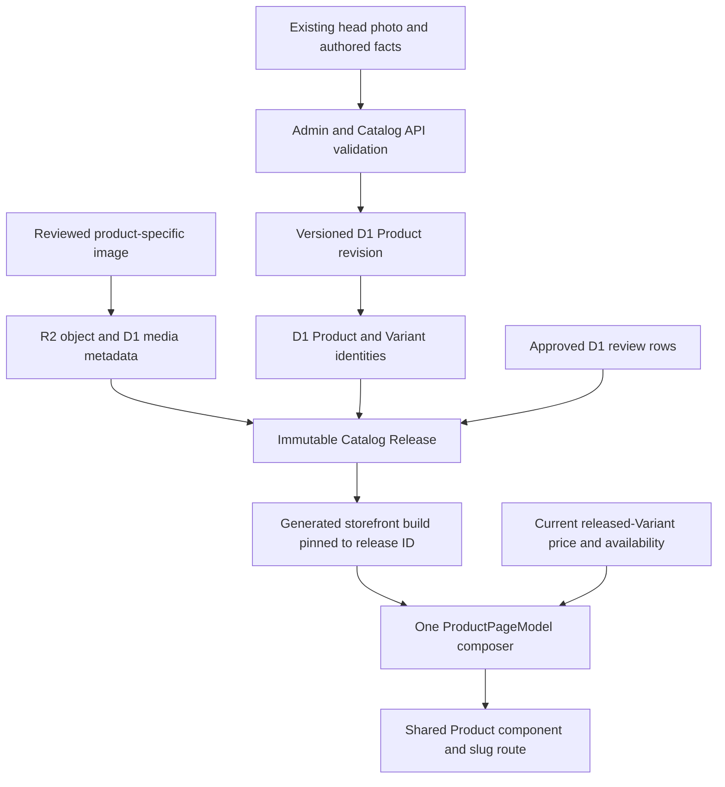
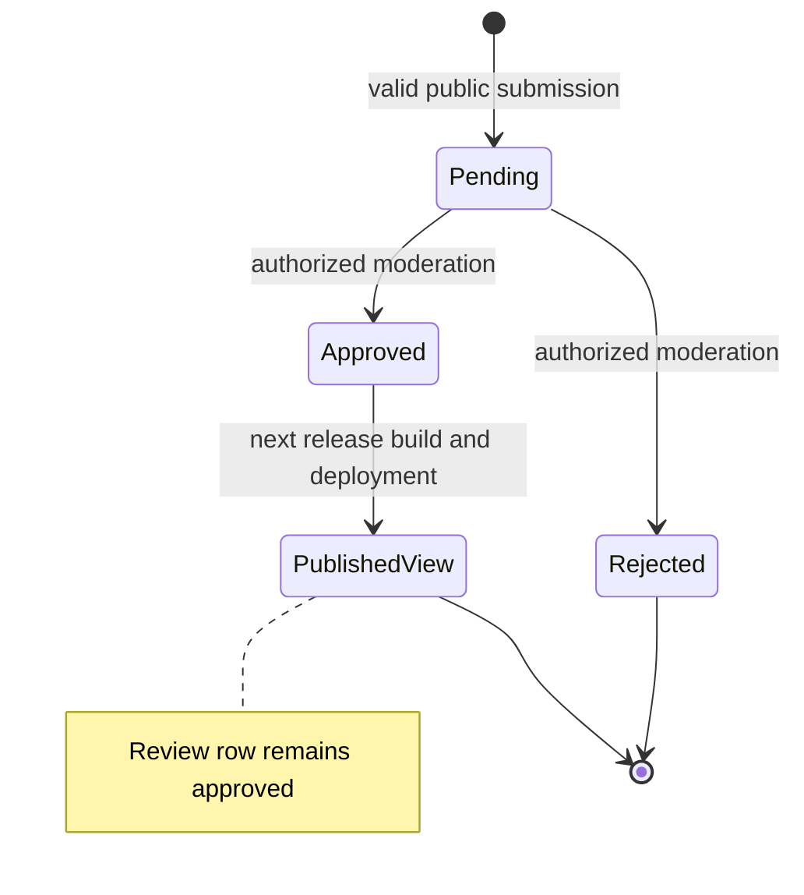
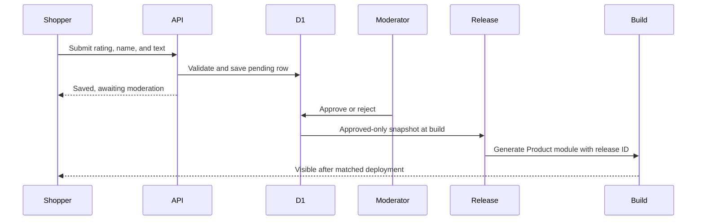

# Fashion Store Product Content and Reviews - Plan

## Goal Capsule

- **Objective:** A shopper opening any published Fashion Store product sees that product's own useful information, matching imagery, specifications, and honest reviews, and can submit a review that follows a clear publication process.
- **Means:** Enrich the existing Catalog Product and media records, introduce persisted review submissions with moderation, and publish approved review displays through the same release-backed Product model (KTD1-KTD5).
- **Upstream product authority:** `docs/plans/2026-08-13-001-refactor-shoppp-product-master-plan.md` owns Shoppp sequence and the return to `REL-Pre-DC`. `docs/plans/2026-09-16-1337-refactor-fashion-store-live-product-plan.md` (FS-F11) owns the current single Product route, template restoration, visual corrections, and human approval.
- **Inherited baseline:** FS-F8's 13-product, 24-variant D1 catalog and R2 media; FS-F11's one release-backed `ProductPageModel`, Commerce price overlay, Product route, and optional published `reviewDisplay` snapshot. These remain valid inputs; FS-F11's current visual checkpoint is not approved by this plan.
- **Explicit supersession:** After FS-F11 closes, FS-F12 extends FS-F11 R11's display-only review scope with individual ratings, moderation, approved-only aggregation, and submission. It supersedes the U7.2 absence of submission and FS-F11's direct return-to-`REL-Pre-DC` tail. The truthful zero-review behavior remains for products without approved reviews; FS-F12 does not reopen FS-F11's visual approval or Commerce authority.
- **Parallel plans:** `REL-Pre-DC` stays paused until both the human-approved FS-F11 Product correction and this successor's local acceptance close. Admin/Commerce/IAM and other storefront routes remain compatibility surfaces.
- **Tail ownership:** FS-F11 completes price, Shipping and return, tabs, top-rating layout, and responsive visual correction. FS-F12 owns per-product content/media, individual review data, review submission and moderation, approved aggregate publication, and cross-product verification. [Storefront Control Plane](2026-09-22-0043-feat-storefront-control-plane-plan.md) (FS-F14) supersedes this plan's direct `REL-Pre-DC` handback; after FS-F12 completes, FS-F14 owns the remaining control-plane tail before REL resumes.
- **Execution profile:** Deep, sequential implementation in the primary checkout. The plan authorizes no new worktree or PR. No code is implemented as part of this planning artifact.
- **Stop conditions:** Stop before importing assets with unclear reuse rights, publishing invented product claims or fabricated customer reviews, exposing pending reviews, mutating remote Catalog/R2/release state, deploying, or advancing candidate/DC/PG without their separate authority.

### Execution Checkpoint

- **Classification:** Completed product successor. The user explicitly accepted the fresh U7 Product and Reviews evidence on 2026-09-22.
- **Entry condition:** Met: the user accepted the final compare-at and portrait-free Reviews appearance; the uninterrupted FS-F11 aggregate and hash-verified frozen-Vue evidence were recorded before activation.
- **Completed units:** U1 inventoried the 13 Product identities, 24 SKUs, 18 media records, local release coverage, review states, source-rights gap, and publication invariants. U8 added versioned published-Product staging, preview, media ownership, review-only release initiation, Admin controls, and old-release immutability tests. U2/U3 now provide and verify the reconciled 13-Product/28-active-Variant/30-media local successor, Product-specific reviewed media, exact historical identity guards, intended USD/warehouse authorities, and an atomic D1 batch application boundary without changing remote state. U4 added pending review submission, Admin-only moderation, audit, origin/rate/idempotency controls, and permission tests. U5 derives approved-only immutable review displays with exact rating bands and individual ratings, preserves historical snapshots, and supplies clearly labeled, opt-in local demonstration data for all 13 sample Product slugs. U6 added the working Add a review flow and source-shaped, portrait-free populated/zero/legacy Reviews presentation, including the seven-width responsive sweep and direct donor-region visual check. Evidence is in `docs/progress/fashion-store-product-content-reviews.md`.
- **Acceptance evidence:** U1-U8 and the Definition of Done are complete. U7's final Product and Reviews captures at `/Users/studio/.codex/visualizations/2026/09/21/01a0c3a5-e335-7ac2-a4bf-776202bd9919/fs-f12-u7-final/` received explicit human acceptance.
- **Current unit:** None; this plan is closed and retained as historical product evidence.
- **Next unit:** None in FS-F12. FS-F14-U1.1 owns the active product work.
- **Next concrete action:** Follow FS-F14's active checkpoint; do not append new execution status to this completed plan unless the same governed FS-F12 work is explicitly reopened.
- **Blocker:** None. Remote Catalog/R2 mutation remains separately gated and was not performed by FS-F12.
- **Completion handback:** Completed on 2026-09-22. Product control passed to FS-F14 at U1.1; no candidate, deployment, DC, or PG state advanced.

---

## Product Contract

### Summary

Each published product keeps its own stable slug and historically published Product/Variant identities and renders its own gallery, name, description, relevant details, specifications, review summary, and reviews from the released data path. Sellable Products show Commerce-authoritative price and options. The lead Product's local successor shows four demonstration colors with corresponding photos and S/M/L/XL sizes; the historical Gold/Blue/Green SKU identities are retained, and Charcoal adds four local demonstration SKUs. A later Catalog migration must add those Charcoal Variants and publish the matching Product media before authoritative checkout can use the successor. Supplemental images are based on that product's actual head image, reviewed for consistency, and attached only to that product. A shopper can submit a rated text review; it is stored as pending, moderated, and shown only after approval and a new Catalog release. The Reviews tab follows the provided Crafto structure while retaining Shoppp's truthful data and existing accessibility primitives.

### Problem Frame

The storefront has a shared Product page component, which is appropriate, but most current catalog records are sparse. The lead development product has multiple images and a three-entry review display; the other products generally have one image and no specifications or reviews. The existing review display is an authored snapshot rather than individual review records. Its entries have no individual rating field; the Vue view currently hardcodes five stars per entry, uses entry count in one place and snapshot count in another, and has no working Add a review flow. The upstream form posts to a PHP demo endpoint, so copying its markup alone would not make review submission functional.

### Key Decisions

- KD1. **One page implementation, product-specific records.** (session-settled: user-directed — one shared page component is acceptable when every opened product supplies its own data.) Governs R1-R4.
- KD2. **Product-specific supplementary images.** (session-settled: user-directed — imagery should follow each product's head image rather than a common placeholder.) Governs R5-R7.
- KD3. **Persist content and reviews through existing owners.** (session-settled: user-directed — the user asked whether each product's data will live in the database.) Governs R3, R8-R13.
- KD4. **Real review submission.** The Add a review UI must save a submission and expose its publication state honestly; the donor PHP endpoint is a visual reference only. Governs R10-R15.
- KD5. **Text-first review entries.** (session-settled: user-directed — reviewer avatars are unnecessary.) Show author labels, ratings, dates, and review text without avatar images or initials placeholders. Governs R8-R10, R20.
- KD6. **Verified lead presentation.** (session-settled: user-directed — on 2026-09-17 the user accepted the recommendation to present only the verified charcoal shirt.) Remove the unrelated pale-yellow photos and unsupported copy from the successor release; retain historical SKU records but suppress unverified choices and purchasing until a valid assortment is established. Governs R2-R4, R6-R7, R16-R17.
- KD7. **Demonstration charcoal assortment.** (session-settled: user-directed — on 2026-09-17 the user requested generated demonstration SKUs and a default purchasable specification.) Supersedes KD6's temporary purchase hold in the local successor. Use one visible charcoal color with S/M/L/XL sample sizes and M as default, while preserving older release bytes and old SKU history. Do not present the new SKUs as authoritative Commerce inventory until the matching D1 records exist. Governs R3-R4, R17-R19.
- KD8. **Four-color demonstration assortment.** (session-settled: user-directed — on 2026-09-17 the user requested multiple fabricated color values and corresponding product images.) Supersedes KD7's one-color scope. Retain Gold/Blue/Green SKU identities, add the four Charcoal sample SKUs, supply explicit color swatches and Product-owned galleries, and change the gallery with the selected color. Keep historical releases immutable and require the matching D1/R2 Catalog release before claiming authoritative checkout. Governs R3-R7, R17-R19.

### Requirements

**Product identity and content**

- R1. Every published Product slug resolves to its own Product ID; navigation to another product changes all product-owned visible facts and resets stale UI and requests.
- R2. Each published product has an accurate name, description, details, and relevant specifications; a missing fact is omitted or shown as unavailable rather than invented.
- R3. Product content and ordered media metadata persist in D1, image objects in R2, and storefront reads a validated Catalog Release; Admin/API stage revisions for already published Products without mutating historical releases or changing stable Product/Variant IDs.
- R4. For sellable Products, base price, compare-at price, selected Variant, SKU, and availability continue to follow FS-F11's release/Commerce authority split and cannot be replaced by editorial content. The local successor's lead Product has four colors with S/M/L/XL each and defaults to Charcoal/M. Authoritative checkout requires matching D1 Variant options and inventory records, including the four new Charcoal SKUs; Gold/Blue/Green historical SKU identities remain active in the successor. An explicitly unverified future assortment retains the purchase hold.

**Media and source provenance**

- R5. For each Product that needs more views, use that Product's head photo as the reference for generated supplemental images; use verified real images when generation is unsuitable. Every accepted image belongs to one Product, with no shared placeholder.
- R6. Before publication, each image is checked for product color, material, shape, hardware, branding, variant relationship, crop, resolution, and alt text. Unverifiable angles or claims are excluded.
- R7. The media inventory records source, permission/provenance, generated-or-original status, Product/Variant mapping, hash, role, order, dimensions, and R2 key; missing or rejected images remain visibly sparse rather than borrowed.

**Reviews and presentation**

- R8. Newly built review displays derive their summary, five-band distribution, count, and entries consistently from approved individual records; each entry has a stable ID, rating, author label, date, and body. Historical releases retain their stored snapshot.
- R9. A newly built release with no approved reviews shows an honest zero state and an Add a review invitation; historical schema-v2 snapshots remain readable without fabricating individual ratings or histogram bands.
- R10. The Product Reviews layout follows the provided Crafto module's hierarchy for rating overview, distribution, entries, and form at desktop and mobile, with Shoppp content and accessibility semantics.
- R11. Add a review accepts a selected 1–5 rating, public display name, and review text; it validates input, shows field errors, and confirms that a successfully saved review is awaiting moderation.
- R12. A submitted review is a separate D1 row tied to one Product, with explicit pending, approved, or rejected status and audit timestamps; submission never edits the published snapshot directly.
- R13. A dedicated review-moderation permission gates pending-review list/detail and approve/reject actions; only approved rows can enter the release's public aggregate and entries. Rejection does not expose the review or change published counts.
- R14. The public submit endpoint has bounded payloads, input normalization, rate controls and retry idempotency, and request-origin protection appropriate to its authentication model; rendered user text is escaped.
- R15. Approving a review updates the next release's summary, five bands, and entries deterministically; the generated live page changes only after that release's build and deployment are verified against its release ID, with no claim of immediate publication.

**Quality and scope**

- R16. Layout remains usable without horizontal overflow across at least 320, 390, 768, 992, 1024, 1100, and 1440 CSS pixels; long names/SKUs/specifications and zero/many reviews do not wrap the star group or break controls.
- R17. Home, Collection, Cart, Checkout, and historical schema-v2 Product releases retain their existing behavior; the Product route and component are shared across preview and production-shaped paths.
- R18. Open source sample data may inform field coverage and test fixtures, but no third-party product copy, images, prices, or reviews are imported into the published catalog without product match, provenance, and verified reuse rights.
- R19. Already published Products gain a versioned revision/republication path that preserves Product IDs, unchanged Variant IDs, and historical release bytes; a deliberate replacement assortment retains old Variant identity in history and disables old sellable rows before new Variants become authoritative. Review-only changes can build a new release without altering Product content.
- R20. Local development fixtures include clearly marked, product-specific demonstration reviews for every sample Product, with varied ratings; production never presents these as customer submissions.
- R21. During review submission the form prevents duplicate clicks and shows progress; success replaces the form with the pending confirmation, while a recoverable error preserves values and allows retry.
- R22. The initial review list shows three available published entries, and a working Show more reviews control reveals further available entries in groups of three; historical snapshots never imply access to entries they do not contain.

### Key Flows

- F1. **Product-to-product navigation:** A shopper selects Product B from Product A; the route composes B's released record, discards A's stale gallery/variant/review state, then Commerce revalidates only B's released Variants. Covers R1-R4.
- F2. **Content and media publication:** An operator stages a versioned revision for a published Product under its stable Product/Variant IDs, uploads reviewed media to R2, builds a new release from the revision, and verifies preview without changing old releases. Covers R2-R7, R17-R18.
- F3. **Review submission:** A shopper selects a rating and enters a name and text; validation and abuse controls run, a pending D1 row is saved, and the page confirms moderation is pending. Covers R11-R14.
- F4. **Review publication:** An authorized operator moderates rows, builds the approved-only aggregate in a new release even when Product content is unchanged, checks preview, and uses the governed storefront build/deployment path; the deployed Product must report the intended release ID. Covers R8-R9, R12-R15.

### Acceptance Examples

- AE1. **Covers R1-R4, R17.** Given two products with different media, names, prices, details, specifications, and reviews, opening each slug and navigating between them renders its matching facts; a late response for the previous product changes nothing.
- AE2. **Covers R5-R7.** Given a generated image whose garment details differ from the head image, publication rejects it; an accepted image retains its own Product mapping, hash, alt, and role through D1/R2/release/preview.
- AE3. **Covers R8-R10.** Given approved 5-, 4-, and 2-star reviews plus one pending review, public count is three, histogram totals three, average uses only the approved rows, and the pending name/text is absent.
- AE4. **Covers R9, R11-R14.** Given a product with zero approved reviews, the tab shows no invented review or rating; a valid submission creates one pending row and a moderation message, while invalid rating/body or repeated abusive requests create no extra public entry.
- AE5. **Covers R12-R15.** Given an approved review after the currently deployed release, the live page keeps its current count until a new release is built and deployed; after the deployed release ID matches, summary, histogram, tab count, and entries update together.
- AE6. **Covers R16-R18, R21-R22.** Given long product content and review text, all listed widths retain readable hierarchy, intact star groups and form controls, no horizontal overflow, and no changes to non-Product routes or old releases; form states and Show more remain usable.
- AE7. **Covers R19-R20.** Given a published Product, an authorized staged revision changes its content and media in a new release under the same Product/Variant IDs while the old release remains byte-identical; a review-only release needs no Product content change. Local demo previews show each Product's clearly marked sample reviews, while production with no real approved rows shows zero.

### Scope Boundaries

- FS-F11 owns the current price color, Shipping and return content/style, top SKU/star wrapping, baseline Reviews tab spacing, and broad responsive audit. This successor consumes its approved visual baseline and adds data-driven review parts.
- Review submissions are guest text reviews by default; no purchase verification, reviewer account, email collection, photo upload, reply threads, or notifications are included. The UI must not imply a verified purchase.
- Existing development demo review snapshots stay labeled as demonstration data until replaced; U1/U5 expand them into product-specific local fixtures with real contract shape and varied review states. They are never migrated into purported customer review rows or production releases.
- Remote Catalog mutation, image upload, release activation, and deployment remain subject to the existing environment/release authority. Planning and local implementation do not grant those actions.

### Sources

- Local design: `templates/Crafto - The Multipurpose HTML5 Template/html/demo-fashion-store-single-product.html` and `apps/storefront/app/themes/fashion-store/upstream/demo-fashion-store-single-product.html`. Use the source as a design reference; its PHP submit target and dated shipping claims are not operational data.
- Current contracts and path: `packages/contracts/src/catalog.ts`, `packages/db/src/schema/index.ts`, `apps/api/src/catalog/products.ts`, `apps/api/src/publishing/build-manifest.ts`, `apps/storefront/app/theme-engine/composer.ts`, `apps/storefront/app/themes/fashion-store/components/pages/FashionStoreProductPage.vue`.
- Existing catalog/media: `tools/fashion-store-live-catalog.json`, `tools/prepare-fashion-store-live-catalog.ts`, `apps/storefront/fixtures/release.json`.
- [DummyJSON products](https://dummyjson.com/docs/products) are sample API data; suitability of any external copy/image still requires product match and rights review under R18.
- [OWASP input validation](https://cheatsheetseries.owasp.org/cheatsheets/Input_Validation_Cheat_Sheet.html), [OWASP CSRF guidance](https://cheatsheetseries.owasp.org/cheatsheets/Cross-Site_Request_Forgery_Prevention_Cheat_Sheet.html), and [Cloudflare rate limiting](https://developers.cloudflare.com/waf/rate-limiting-rules/) inform the public review write boundary.

---

## Planning Contract

### Key Technical Decisions

- KTD1. **Retain one route/component and enrich records.** Product-specific slug resolution and release composition already exist; add data and regression coverage rather than duplicating page files. Implements KD1 and R1-R4.
- KTD2. **Use first-party catalog curation as the canonical source.** Inventory and author the existing 13 products, then pass through versioned Admin/API revisions, D1, R2, and release. Sample APIs are fixture references only until rights and exact product correspondence are proven. Implements KD2 and R2-R7, R18.
- KTD3. **Persist reviews separately from the published snapshot.** Add a review table and moderation API; derive the public display from approved rows at release build. Keep legacy snapshot reads for old releases without treating their aggregate as individual reviews. Implements KD3-KD4 and R8-R15.
- KTD4. **Keep release immutability and generated-page identity.** Submission and approval are operational writes; approval alone never mutates an active release or deployed Product module. Show shoppers a pending confirmation and publish through a new release plus its matched storefront build/deployment. Implements R11-R15.
- KTD5. **Extend the published review entry contract minimally.** Use stable entry IDs, individual ratings, and a five-band aggregate; new releases include all approved displayable entries for this catalog so Show more can reveal them. Keep absent individual ratings in legacy data honest. The Product model receives one normalized review view so summary, tab, and entries cannot diverge. Implements R8-R10, R17, R22.
- KTD6. **Stage revisions for published Products.** Existing Catalog writes and `publishProduct` reject `published` Products. Add authorized versioned Product presentation and ordered-media revision records keyed to the same Product/Variant identities, with optimistic conflict checks; release building can also run for approved-review changes when Product fields are unchanged. Published Product rows and old release manifests remain immutable. Implements R2-R4, R7, R12-R15, R19.
- KTD7. **Separate demo reviews from submissions.** Product-specific review fixture data is marked as demonstration provenance and stays in local seed/release evidence; only approved customer rows feed production releases. Implements R9, R18, R20.
- KTD8. **Restrict the pending-review queue.** Add `reviews.moderate` to IAM and grant it to the existing Admin role by migration/bootstrap; other roles receive it only through deliberate role management. The same permission gates pending list/detail and decisions. Implements R13.

### High-Level Technical Design

The following sketches describe ownership and state. They do not prescribe framework code or exact API names.

### Sequencing and data rules

1. Finish and obtain human approval of FS-F11 first. Its visual changes are the base for this plan; avoid parallel edits to the same Product component.
2. U1 freezes a per-Product matrix: slug/ID, lead image, media provenance, content facts, specifications, existing review state, expected gallery roles, and missing fields. Confirm the 13/24/18 preparer invariants and mark any intentional new counts before editing those checks.
3. U8 supplies the missing published-Product revision/republication path before U2/U3 enrich content and media. Generated imagery is accepted only after per-product visual comparison; a product can ship with fewer images if safe generation fails.
4. U4/U5 build review persistence, moderation, aggregate, review-only release, and old-release compatibility before U6 exposes a working form or richer review display.
5. U7 verifies old and new releases, every published Product route, abuse/error cases, responsive states, and matched generated builds, then prepares human review and handback.

### System-Wide Impact

- **Storefront:** Product model/contracts, shared Product component, route navigation, responsive Reviews content, and Product-specific browser coverage.
- **API/DB/Admin:** Review migration and authorized moderation UI/API; Product presentation/media writes retain Product version and media ownership validation.
- **Publishing:** Versioned Product revisions, approved review derivation, review-only release trigger, schema compatibility, catalog asset manifest/invariants, and generated-build identity checks.
- **Operations:** An approved review appears only after a governed release and matched storefront deployment. Product media upload, release activation, and deployment are separate remote actions and are excluded from the planning turn.

---

## Implementation Units

U8 was added after the review exposed the existing published-Product write barrier; its stable ID is placed before U2 because U2 depends on it.

### U1. Inventory Product content and freeze publication rules

- **Goal:** Produce an actionable 13-product data/media/review matrix and ownership ledger.
- **Requirements:** R1-R7, R18-R20; AE1-AE2, AE7.
- **Files:** `tools/fashion-store-live-catalog.json`, `apps/storefront/fixtures/release.json`, `docs/progress/fashion-store-product-content-reviews.md`.
- **Approach:** Compare every Product slug and SKU with the current D1 seed manifest, R2 object list, release fixture, and lead image; record fields to author, source permissions, generated-media candidates, and honest review state. Record reference template region inventory and external-data decision. Do not claim customer reviews from the current demo snapshot.
- **Test scenarios:** Every published slug maps to one Product ID and ordered media; duplicate/cross-product media keys or unknown source rights are flagged before enrichment; sparse products remain explicitly sparse in the baseline.
- **Verification:** A reviewable matrix covers all 13 Products and names exact changes to the preparer/importer count and hash invariants.

### U8. Add versioned edits and republication for published Products

- **Goal:** Allow the 13 already published Products to receive content/media revisions and review-only releases without weakening published immutability.
- **Requirements:** R2-R4, R7, R12-R15, R19; AE5, AE7; KTD6.
- **Dependencies:** U1.
- **Files:** new DB migration and schema, `apps/api/src/catalog/products.ts`, `apps/api/src/publishing/releases.ts`, `apps/api/src/publishing/build-manifest.ts`, `apps/admin/src/pages/catalog/catalog-form-page.tsx`, focused Catalog/release tests.
- **Approach:** Stage mutable presentation and ordered media membership in versioned revision records for an existing published Product; retain stable Product/Variant IDs and immutable source rows. Add authorized prepare, preview, conflict-check, and publish transitions. Permit a new release when approved reviews change but Product content does not. Pin each generated manifest to the selected revision/review boundary and leave older manifest bytes untouched.
- **Test scenarios:** A published Product's direct legacy update still fails; its staged revision can be previewed and released under the same IDs; stale version and cross-Product media fail; Product A's revision cannot change Product B; review-only release updates review display with unchanged Product fields; a failed build leaves prior release and Product route intact.
- **Verification:** API worker, migration, manifest, preview, and generated-build tests prove old-release immutability and both content and review-only publication paths.

### U2. Enrich Product details and specifications through Catalog

- **Goal:** Make every Product's authored information useful and distinct without changing price or Variant ownership.
- **Requirements:** R1-R4, R17-R19; AE1, AE6-AE7.
- **Dependencies:** U1, U8.
- **Files:** `tools/fashion-store-live-catalog.json`, `packages/contracts/src/catalog.ts`, `apps/api/src/catalog/products.ts`, `apps/admin/src/pages/catalog/catalog-form-page.tsx`, `apps/api/src/publishing/build-manifest.ts`, focused Catalog tests.
- **Approach:** Author product-specific detail and specification fields from verified product evidence through U8's staged revision path; extend editing only where the existing presentation form cannot represent them; preserve stable Product and Variant IDs. Rebuild deterministic local release/fixture through the same pipeline.
- **Test scenarios:** Two products retain different text/specifications after Admin write and release rebuild; a long value fits the contract; invalid Product/media/Variant references fail; an absent fact stays unavailable; Commerce price remains authoritative.
- **Verification:** Contract, API, release, and Product model tests prove identity and content separation for all inventoried products.

### U3. Add reviewed, product-specific supplemental media

- **Goal:** Give eligible products coherent gallery/detail images tied to their lead images.
- **Requirements:** R5-R7, R17-R19; AE2, AE7.
- **Dependencies:** U1-U2, U8.
- **Files:** `tools/fashion-store-live-catalog.json`, `tools/prepare-fashion-store-live-catalog.ts`, `apps/api/src/testing/fashion-staging-catalog.ts`, `apps/api/src/media/uploads.ts`, `apps/api/src/publishing/build-manifest.ts`, media assets/manifest, focused media tests.
- **Approach:** For each Product, inspect its lead image and use that exact image as the generation reference; use verified real supplementary photos when generation cannot preserve the item. Reject mismatches and retain source/generated status and hashes. Use existing ordered `product_media` and `detailMediaId` semantics unless U1 proves a missing role; stage new media membership through U8's revision path. Adjust fixed 13/24/18 importer assertions only for the accepted manifest and use the validated upload path.
- **Test scenarios:** Same-product gallery order and role survive upload and release; a media ID from another Product or a missing R2 object is rejected; a rejected image never appears; old release media still renders; one-image products remain valid.
- **Verification:** Per-product contact sheets and mapping records are reviewed, and R2/D1/release round-trip tests pass for every accepted asset.

### U4. Persist and moderate individual reviews

- **Goal:** Establish a trustworthy review write and decision lifecycle.
- **Requirements:** R8-R9, R11-R14, R21; AE3-AE4, AE6.
- **Dependencies:** U1.
- **Files:** `packages/db/src/schema/index.ts`, new DB/IAM migrations, `packages/contracts/src/catalog.ts`, API review route/service and Admin moderation surface, focused worker/contract tests.
- **Approach:** Add review rows keyed by Product, with rating, display name, body, status, timestamps, and moderation audit data. Add `reviews.moderate` for pending list/detail and decisions, assigned to Admin only by default through the existing IAM role/bootstrap path. Add public submit and authorized moderation API paths with validation, origin/CSRF, rate, and idempotency controls appropriate to current auth, plus deterministic error responses. Use ordinary existing UI primitives for form and Admin focus/keyboard behavior.
- **Test scenarios:** Valid guest submission creates pending only; invalid rating, empty/oversized text, unknown Product, duplicate/repeated abuse, cross-origin write, unauthorized pending-list/detail read, and unauthorized moderation fail; approval/rejection changes only the targeted row; user text is safely rendered.
- **Verification:** Migration and API worker tests cover state transition, authorization, and abuse boundaries; no submitted row is public before release.

### U5. Derive approved review display in Catalog Release

- **Goal:** Make public review counts, average, five bands, and entries agree.
- **Requirements:** R8-R9, R12-R15, R17, R19-R20; AE3, AE5, AE7.
- **Dependencies:** U4, U8.
- **Files:** `packages/contracts/src/catalog.ts`, `apps/api/src/publishing/build-manifest.ts`, `apps/storefront/app/theme-engine/view-models.ts`, `apps/storefront/app/theme-engine/composer.ts`, release and composer tests.
- **Approach:** Define deterministic approved-only aggregate and entry ordering, stable IDs, per-entry ratings, and published timestamps. Include all approved displayable entries for this bounded catalog, keeping count and Show more access aligned. Keep schema-v2 snapshot reads valid; do not infer a five-band breakdown or individual ratings from historical aggregate-only data. Seed clearly marked product-specific local demo records into development fixtures without letting them become production customer rows.
- **Test scenarios:** Mixed approved/pending/rejected rows yield approved-only count and a five-band total equal to that count; zero reviews produce zero state; old release displays its stored snapshot without invented fields; approval after release build does not change active output; a review-only release updates reviews without changing Product content; every local sample Product has matching demo review data absent from production output.
- **Verification:** Contract, manifest, migration compatibility, and composer tests pass with exact release identity and immutable old bytes.

### U6. Render source-shaped Reviews and working Add a review

- **Goal:** Complete the Reviews tab's data display and submission interaction.
- **Requirements:** R8-R11, R14, R16-R17, R20-R22; AE3-AE4, AE6-AE7.
- **Dependencies:** U4-U5 and FS-F11 visual acceptance.
- **Files:** `apps/storefront/app/themes/fashion-store/components/pages/FashionStoreProductPage.vue`, `apps/storefront/app/themes/fashion-store/integration.css`, Product contracts/model, focused component and browser tests.
- **Approach:** Fit histogram, count, entry ratings, working Show more, and form into the named Crafto hierarchy without carrying over the demo PHP action or its reviewer portraits. Normalize the Product review view once, use stable entry keys, connect submission to API, prevent repeat clicks while saving, replace a successful form with pending confirmation, and preserve values on recoverable error. Initially show three available entries and reveal the rest in groups of three; retain honest zero/legacy states.
- **Test scenarios:** All five bands and entries match approved data; no avatar or initials placeholder is displayed; a legacy entry has no fabricated star score or unreachable Show more promise; submission loading prevents double click, success shows pending confirmation, and an error preserves input and allows retry; Show more stops when all published entries are visible; keyboard, touch, and narrow widths remain usable.
- **Verification:** Component and real-browser interaction tests pass at desktop/mobile, with an unmasked source comparison for the review regions.

### U7. Verify every Product and hand back

- **Goal:** Prove the full catalog, release, and responsive flow before returning product control.
- **Requirements:** R1-R22; AE1-AE7.
- **Dependencies:** U2-U6, U8.
- **Files:** `apps/storefront/e2e/fashion-store-product.spec.ts`, Product parity and release tests, `docs/progress/fashion-store-product-content-reviews.md`, this plan and the product master checkpoint.
- **Approach:** Traverse all 13 Product slugs and at least one cross-product navigation chain; compare per-product data against the inventory and confirm each local fixture's distinct demo reviews; test zero, legacy, rich, pending, rejected, and approved-next-build reviews. Capture 320/390/768/992/1024/1100/1440 widths with long-content cases and source-shaped review regions. Verify a generated Product module's release ID matches the selected release; run affected non-Product smoke gates and obtain human review of content/media and the final page before checkpoint handback.
- **Test scenarios:** A wrong-image, wrong-detail, or wrong-review Product causes a named failure; star group never splits; no layout overflows; preview and production-shaped routes agree at one release ID; old release still works; a pending review never appears in a public capture; a release not yet built/deployed leaves the prior generated page intact; rejected human evidence keeps U7 open.
- **Verification:** Focused and aggregate gates, release identity, per-product evidence, and explicit human acceptance pass; update this plan and master together only then.

---

## Verification Contract

| Gate | When and proof |
| --- | --- |
| `bun test packages/contracts/test/catalog-release.test.ts` | U2/U5/U8: presentation, revision and review-release contract, old schema compatibility. |
| `bun run --cwd apps/api test:workers` | U2-U5/U8: staged Product writes, R2 reference validation, review submit/moderation and IAM reads, review-only manifest derivation. |
| `bun test tools/prepare-fashion-store-live-catalog.test.ts` | U1/U3: source hashes, Product/SKU/media counts, per-product mapping. |
| `bun test apps/storefront/tests/fashion-store-product.test.ts` | U2/U5/U6: one Product model, entry counts, zero/legacy/rich states, navigation reset. |
| `bun run --cwd apps/storefront typecheck` and repository lint/format gates | After cross-layer changes: types and project style. |
| `bun run --cwd apps/storefront report:product-parity` | U6/U7: hash-verified frozen Vue diagnostic under FS-F11's explicit R18 pixel-limit exception, alongside named Reviews geometry/state assertions. |
| `PLAYWRIGHT_FORCE_ASYNC_LOADER=1 bun run --cwd apps/storefront test:fashion-store:browser` | U6/U7: all Product routes, interaction, responsive, compatibility smoke. |
| Fresh local release/build/preview and production-shaped captures | U7/U8: exact Product/release identity, review-only build, and human inspectable 320–1440px evidence. |

Testing follows `docs/solutions/workflow-issues/html-source-parity-reconstruction-workflow-2026-08-06.md`: assert structure, behavior, and absence separately. A static selector match, hardcoded aggregate, or broad screenshot mask is insufficient. Local verification is not candidate/DC/PG proof; those remain with `REL`.

---

## Definition of Done

- U1 has an evidence-backed, complete 13-product gap and provenance matrix.
- U8 proves a published Product can stage and publish a content/media revision or a review-only release without changing stable IDs, published source rows, or earlier release bytes.
- U2/U3 publish distinct, accurate Product content and accepted imagery through the authorized Catalog path, with no shared placeholder or invented fact.
- U4/U5 persist individual submissions, restrict pending-review access, moderate them safely, derive approved-only immutable public review displays with legacy compatibility, and keep each Product's local demo reviews out of production.
- U6 has a functional Add a review flow and source-shaped, accessible Reviews layout across its populated, zero, loading, success, error, expanded-list, and legacy states.
- U7 proves every Product route, generated release ID, and the listed widths, retains non-Product behavior, and has fresh human approval of content/media and visual evidence.
- Abandoned experiments, unused review paths, demo PHP actions, temporary generated assets, and stale assertions are removed. Plan/master checkpoint and focused evidence are updated together on handback; `REL-Pre-DC` alone decides any later candidate work.
