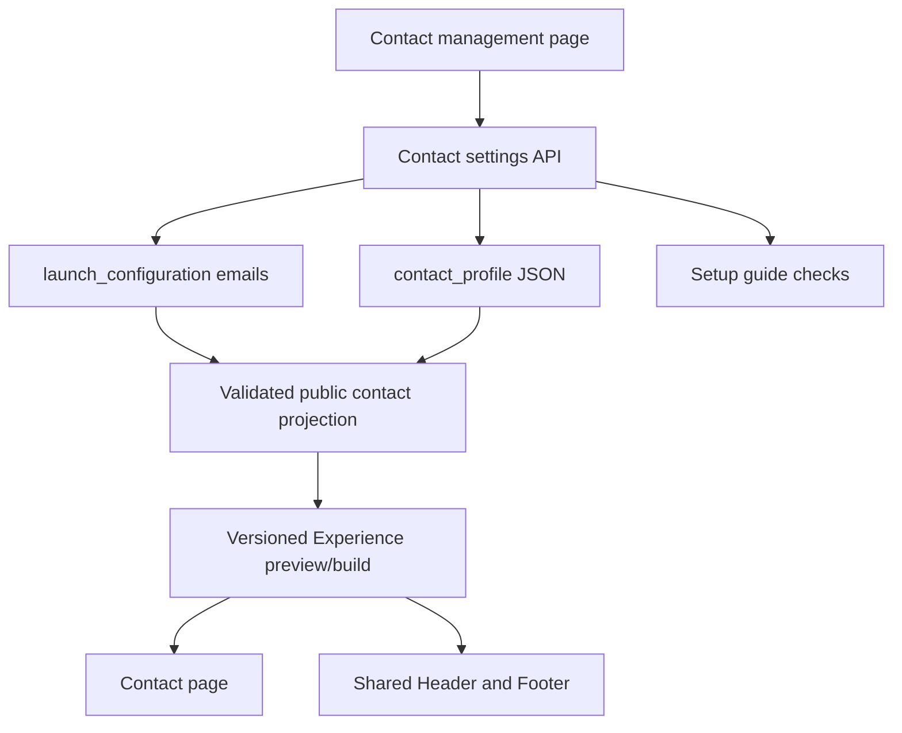

# Contact Management and Fashion Store Contact Page - Plan

## Goal Capsule

- **Objective:** An operator maintains truthful public contact details and social destinations in one Admin page, and shoppers see the corresponding information on Fashion Store Contact, Header, and Footer surfaces.
- **Means:** Keep the two existing launch-configuration emails authoritative; add a versioned singleton public-contact profile for the remaining structured fields; compose a public contact view from both sources and bind it to the existing Fashion Store presentation path.
- **Upstream product authority:** `docs/plans/2026-08-13-001-refactor-shoppp-product-master-plan.md` owns sequence. `docs/plans/2026-09-03-1445-feat-admin-store-setup-guide-plan.md` owns the current two-email guide baseline. `docs/plans/2026-09-15-1350-refactor-fashion-store-presentation-convergence-plan.md` owns fixture/live content behavior, and `docs/plans/2026-09-13-1205-refactor-fashion-store-shared-shell-plan.md` owns shared Header/Footer presentation.
- **Inherited baseline:** `settings.launch_configuration` persists `supportEmail` and `privacyContactEmail`; the Admin commercial settings page edits them. The Fashion Store fixture Contact page shows two illustrative locations, fixed map markers, and a local-only form. The live content path shows a truthful state instead of those fixture details. Header/Footer theme settings support free-text contact copy and one social link each; live Footer hides the demo phone and email.
- **Explicit supersession:** This plan supersedes the setup guide's first-version decision to treat two valid emails as the complete contact configuration and its commercial-settings contact anchor as the sole editing destination. It supersedes fixture-only Contact details for the new live public-contact presentation. It preserves the existing launch email fields and historical theme/release snapshots.
- **Parallel plans:** FS-F12 Product Content and Reviews was parked at U2 while this user-prioritized Contact/Admin plan executed. FS-F13 did not change FS-F12's Product facts, evidence, or remote Catalog/R2 authority and returned the pointer to U2 on completion. REL-Pre-DC remains the eventual candidate owner after both implementation tails close.
- **Tail ownership:** FS-F13 owns Contact configuration, Admin editing, public contact composition, Fashion Store Contact/Header/Footer integration, and their local verification. FS-F12 owns Product content/reviews. REL owns Pre-DC, DC, and PG.
- **Execution profile:** Implement in the primary checkout as the current bounded interlude, then return to FS-F12-U2. No worktree, PR, deployment, remote data mutation, or candidate advancement is implied by this plan.

### Execution Checkpoint

- **Classification:** Completed contact-management implementation; U1-U5 completed on 2026-09-22 and the product pointer returned to FS-F12-U2.
- **Completed units:** U1-U5 — structured contact storage, Admin editing, immutable Experience projection, Contact/Header/Footer rendering, setup guidance, responsive Preview evidence, and focused cross-surface regression coverage are complete.
- **Current unit:** None; FS-F13 is complete.
- **Development acceptance:** The user confirmed on 2026-09-22 that real merchant details are not required during development. The versioned synthetic Preview `snapshot-preview-contact-u5-synthetic-20260922` and its recorded `contact.version` satisfy U5 development verification. Actual merchant values and destination approval remain a later candidate/publication operation and do not reopen FS-F13.
- **Blocker:** None inside FS-F13. Three current-worktree Fashion Store live failures concern Collection content, Product composition, and an existing URL predicate; they are recorded as unrelated to the focused contact path and remain with the resumed product tail.
- **Handback:** FS-F12 resumes at U2. This completion does not advance Candidate, DC, deployment, or PG state.

---

## Product Contract

### Summary

The operator sees one “联系方式” management page for the shop's public support channels, optional physical locations, and ordered social links. The two existing support/privacy emails appear there and retain their current storage authority. A shopper sees only completed, approved public facts; empty optional fields and sample social destinations never appear as real contact claims. Fashion Store's Contact route can show real location cards and an honest map alternative without fixed London/New York markers. Header and Footer reuse the same contact view. The local-only message form is not presented as a working delivery channel in live mode.

### Problem Frame

Admin currently offers only two email fields, while the fixture Contact page shows location names, cities, addresses, phones, emails, a static map, lead copy, and a message form. Footer and other shell surfaces also contain demo destinations or independent theme contact copy. These values do not form an operator-owned, validated public-contact record. Expanding the commercial-settings form alone would keep public facts fragmented across launch settings, theme settings, and fixture code.

### Requirements

**Management and data**

- R1. One permission-controlled Admin page shows and edits the canonical support/privacy emails, explicit public-display choices for those channels, optional public phone and service hours/time zone, an ordered list of optional locations, and an ordered list of optional social destinations. Default email values are private until an operator confirms publication; read-only users cannot save.
- R2. Each location has a stable ID, display name, city, postal address, and optional public phone, email, and verified map destination. A location cannot be published with a partial or fabricated address; zero locations is valid for an online-only shop.
- R3. Social destinations have a platform/label, HTTPS URL, visibility, and order. Empty or invalid links remain unpublished; social platforms are not required merely because the theme has an icon for them.
- R4. Support and privacy email have one authoritative stored value each in `launch_configuration`; the new page reads and updates those values without maintaining a second copy. Existing commerce/runtime consumers and the old launch API remain compatible. Contact-specific fields live in a separately validated singleton profile under `settings`.
- R5. Writes require `settings.write`, a change reason, validation, and audit evidence. A stale Admin form must not silently overwrite newer contact or launch-email changes.

**Storefront and publication**

- R6. Fashion Store Contact, Header, and Footer use a shared, validated public contact view. Contact has an explicit social-links region when links exist; Header/Footer may use the same ordered links in their available layouts. Fixture presentation retains its source comparison role; live presentation never reads fixture addresses, phone numbers, social homepages, or fixed London/New York markers as merchant facts.
- R7. Contact page introduction, section heading, and imagery continue through the theme/Experience presentation owner. Structured contact facts come from the contact view. Page copy must adapt when there are zero physical locations rather than claiming shops exist.
- R8. A real location may expose a verified external map link. The fixed map image and hard-coded markers are removed or replaced in live mode; no map marker is asserted for an address without coordinates or a real map source.
- R9. A Contact route with no approved public details shows a truthful unavailable/recovery state and no fabricated location or social link. Existing support email can be used as a `mailto:` target only when it passes validation and its public-display choice is confirmed.
- R10. The current Contact message form remains fixture-only/local-only. Live mode provides a truthful contact action and does not display an apparently sendable form until a submission and handling service exists.
- R11. Contact, Header, and Footer stay responsive and accessible: text links have meaningful names, phone/email actions use valid `tel:`/`mailto:` targets, icon-only social links have names, and absent sections do not leave empty headings.

**Guide and release**

- R12. The setup guide links to the new page and distinguishes “configured public contact channel” from optional physical locations/socials. Defaults supplied by environment do not count as operator confirmation; the guide does not claim that a valid email proves the Contact page is complete.
- R13. Preview and live rendering use a frozen, validated contact snapshot or an explicit version identity so editing the Admin form cannot mutate an already approved historical presentation. Publication follows the existing theme/Experience release path and candidate gates.

### Key Flows

- F1. **Edit contacts:** Authorized operator opens the contact page, sees current emails plus public profile, changes fields, supplies a reason, saves, and sees the read-back version. An outdated form receives a conflict and can reload without losing the authoritative newer values. Covers R1-R5.
- F2. **Preview then publish:** Operator previews the Contact/Header/Footer result with a particular contact version; a later published version uses only validated fields while an older snapshot remains unchanged. Covers R6-R9, R11, R13.
- F3. **Shopper contact:** Shopper opens Contact or Footer, sees only published channels/locations/social links, and can use a real email, phone, or external destination. When none is approved, the page gives an honest recovery message. Covers R6-R11.

### Acceptance Examples

- AE1. An online-only shop saves one support email and no locations/socials. Live Contact contains an email action, no “visit us” claim, no map markers, and no empty social heading. Covers R1-R3, R6-R9.
- AE2. Two valid locations with distinct names, addresses, phones, emails, and map URLs appear in the saved order; their links use each location's own values. An invalid map URL prevents publication. Covers R2, R8, R11.
- AE3. Only Instagram and Facebook are configured. Contact, Header, and Footer render those two destinations in order where their layouts show social links, and never render demo Dribbble/Twitter URLs or platform homepages. Covers R3, R6, R11.
- AE4. A read-only operator cannot submit; a writer's stale version is rejected; a successful write records the reason and leaves both emails consistent with the launch API. Covers R1, R4-R5.
- AE5. Editing contacts after a frozen preview does not change that preview or an earlier published snapshot; a new approved build displays the new version. Covers R6, R13.
- AE6. In live mode, the Contact page exposes no local-only “Send message” success claim or network submission. The fixture comparison still retains its explicit local simulation. Covers R10.

### Scope Boundaries

- Merchant legal identity, registered address, tax information, and policy body approval are separate legal/policy authorities. A public location address does not automatically become a registered merchant address.
- The message inbox, email delivery, anti-abuse controls, customer submissions, and operator reply workflow are deferred. The current form's visitor name/email/phone/subject/message are submission fields, not merchant settings.
- Hours and time zone are optional public service information, not an SLA. The first version need not calculate real-time open/closed status.
- The first version uses verified outbound map links instead of adding a remote map provider or geocoding service. Contact imagery remains theme-owned.
- Historical releases and fixture source-fidelity evidence remain immutable; compatibility tests assert their behavior rather than rewriting them.

---

## Planning Contract

### Key Technical Decisions

- KTD1. **Keep email authority in launch configuration.** Read both emails from `launch_configuration`; store only additional contact fields in a versioned `contact_profile` settings JSON. A new service composes the Admin and public views. This avoids duplicating values used by Commerce while permitting a focused new page. Governs R1, R4-R5.
- KTD2. **Use one contact write boundary with optimistic concurrency.** The contact endpoint checks both source versions and applies email/profile changes together, then audits the result. The legacy launch endpoint remains compatible, so its later email edits are reflected at the new page's next read. Governs R4-R5.
- KTD3. **Separate public facts from presentation copy.** The API validates the public contact projection; the theme composer supplies placement and editorial copy. Existing Header/Footer free-text and single-social settings require a bounded migration/deprecation path so new live outputs never contradict the shared contact view, while historical snapshots retain their original bytes. Governs R6-R7, R13.
- KTD4. **Publish a versioned contact snapshot.** Bind contact data into the existing Experience/preview composition at build time and record its identity in output evidence. Do not fetch mutable Admin settings directly from a live page at render time. Governs R6, R9, R13.
- KTD5. **Preserve truthful Contact behavior.** Keep source-shaped fixture layout for comparison, add a live Contact presentation using real locations and contact actions, and replace the fixed map with optional verified map links. Live mode omits the message form pending a real delivery service. Governs R7-R11.
- KTD6. **Guide checks public readiness separately.** Retain the existing saved-configuration and valid-email checks, add a saved-profile check requiring at least one operator-confirmed public channel, and route the guide to the new page. Optional locations/socials do not block an online-only shop. Governs R12.

### High-Level Technical Design

### Assumptions and sequencing

- The user asked for a development plan after discussing a dedicated contact page, Contact content, and social media links. This plan assumes those public-information surfaces are in scope and a working contact-message inbox is a separate feature.
- FS-F12 remained incomplete and parked at U2 while FS-F13 held the execution slot from 2026-09-18 through 2026-09-22. FS-F12 resumed before REL-Pre-DC candidate selection, so no candidate freezes illustrative merchant contact facts or an incomplete Product tail.
- No new database table is required for a singleton profile because the existing `settings` table stores validated JSON. Reassess only if implementation reveals a genuine query or lifecycle need for normalized rows.

---

## Implementation Units

### U1. Define and persist the contact profile

- **Goal:** Establish validated, versioned contact data with a composed Admin/public read model and compatible canonical emails.
- **Requirements:** R1-R5, R9; F1; AE1, AE2, AE4.
- **Dependencies:** None.
- **Files:** `packages/contracts/src/platform.ts` or a focused sibling contract; `packages/contracts/test/platform.test.ts` (new); `apps/api/src/settings/contact-profile.ts` (new); `apps/api/src/http/app.ts`; `apps/api/test/operations/contact-profile.test.ts` (new); `packages/db/migrations/0001_initial.sql` (read-only pattern reference; no migration expected).
- **Approach:** Validate explicit channel-display choices, optional phone, hours/time zone, location rows, map URLs, and ordered social links. Read emails from the existing launch record. Save profile and any changed emails through a coherent service boundary, with version checks, authorization, reason, and audit. Preserve behavior of the existing launch API.
- **Patterns to follow:** `apps/api/src/settings/launch-configuration.ts`, `apps/api/src/settings/setup-guide.ts`, and existing `settings.read`/`settings.write` routes.
- **Test scenarios:**
  - Covers AE1. Save zero locations/socials and a valid support email; read-back has no invented public fields.
  - Covers AE2. Save two ordered locations; invalid email, phone target, or non-HTTPS map URL is rejected before persistence.
  - Covers AE4. Read-only write returns denial, stale source version returns conflict, and successful write records the reason and updates launch-email read-back.
  - An existing launch-only update changes the new page's next email read without altering profile-owned fields.
- **Verification:** Contract and Worker API tests prove validation, persistence, compatibility, and audit behavior.

### U2. Add the Admin management page and guide entry

- **Goal:** Give operators one usable contact editor and make the setup guide's contact status truthful.
- **Requirements:** R1-R5, R12; F1; AE1, AE4.
- **Dependencies:** U1.
- **Files:** `apps/admin/src/pages/settings/contact-settings-page.tsx` (new); `apps/admin/src/pages/settings/contact-settings-page.test.tsx` (new); `apps/admin/src/pages/settings/launch-settings-page.tsx`; `apps/admin/src/pages/home/welcome-page.tsx`; `apps/admin/src/routes/routes.config.ts`; `apps/admin/src/services/platform/api.ts`; `apps/admin/src/shared/i18n/translations.ts`; `apps/api/src/settings/setup-guide.ts`; `apps/api/test/operations/setup-guide.test.ts`; `apps/admin/e2e/setup-guide.spec.ts`.
- **Approach:** Show global channels, location rows, social links, public visibility, and change reason. Replace commercial-settings contact inputs with a clear link to the new page while preserving the legacy API. Make save errors and stale-version recovery visible. Retain the guide's default-is-not-confirmed behavior and update its destination/check wording.
- **Patterns to follow:** `apps/admin/src/pages/settings/launch-settings-page.tsx`, shared form recipes, route permission guards, and existing guide return navigation.
- **Test scenarios:**
  - Covers AE4. Writer edits and saves emails/profile with a reason; read-only user sees values but no successful submit path.
  - Empty and multiple location/social rows can be added, reordered, and removed without losing unsaved values.
  - A stale save shows conflict, preserves local edits for comparison, and offers reload.
  - Guide opens the new contact page; environment defaults alone remain pending and optional locations/socials do not block the check.
- **Verification:** Admin component and guide browser tests pass in English and Chinese, at desktop and narrow widths.

### U3. Compose immutable public contact data

- **Goal:** Feed validated public details into the existing preview/live presentation pipeline without mutable runtime reads.
- **Requirements:** R3-R4, R6, R9, R13; F2; AE3, AE5.
- **Dependencies:** U1.
- **Files:** `apps/api/src/storefront-experience/build.ts`; `apps/api/src/publishing/build-manifest.ts` or its owning release composer; `apps/storefront/app/theme-engine/view-models.ts`; `apps/storefront/app/theme-engine/composer.ts`; `apps/storefront/tests/theme-engine.test.ts`; `apps/api/test/storefront-experience/contact-publication.test.ts` (new).
- **Approach:** Identify the owning Experience build path, snapshot the public projection with version identity, and expose it to Contact and shared shell view models. Keep existing theme setting values readable for historical releases while avoiding duplicate live contact/social authority. A missing/invalid public projection fails safely to an explicit unavailable presentation.
- **Patterns to follow:** Versioned Experience snapshots, `shellViewModel`, and published release validation.
- **Test scenarios:**
  - Covers AE5. A frozen preview remains byte-identical after Admin edits; only a new build gains the new contact version.
  - Covers AE3. Two configured socials appear in order; theme demo social targets and platform homepages do not enter live output.
  - Invalid or absent profile data yields no fabricated public phone, location, or social link.
- **Verification:** Snapshot identity and public projection tests establish immutable output and safe fallback.

### U4. Render the live Contact and shared-shell surfaces

- **Goal:** Show truthful contact channels and social links throughout Fashion Store while retaining source comparison behavior.
- **Requirements:** R6-R11; F2-F3; AE1-AE3, AE6.
- **Dependencies:** U3.
- **Files:** `apps/storefront/app/themes/fashion-store/components/pages/FashionStoreContentPage.vue`; `apps/storefront/app/themes/fashion-store/components/pages/FashionStoreContactPage.vue`; `apps/storefront/app/themes/fashion-store/components/shared/FashionStoreHeader.vue`; `apps/storefront/app/themes/fashion-store/components/shared/FashionStoreFooter.vue`; `apps/storefront/app/themes/fashion-store/contracts/content-presentation.ts`; `apps/storefront/app/themes/fashion-store/manifest.ts`; `apps/storefront/tests/fashion-store-content.test.ts`; `apps/storefront/e2e/fashion-store-information-pages.spec.ts`; `apps/storefront/e2e/fashion-store-live-commerce.spec.ts`.
- **Approach:** Use one shared public contact view for Contact/Header/Footer. Add theme-owned introduction/heading settings while deriving location-dependent wording from data. Render an online-only layout for zero locations and location cards plus optional map links for real addresses; remove fixed markers from live mode. Render only configured social links, including an explicit Contact section. Live Contact offers approved email/phone actions and hides the simulated message form. Keep fixture-only source behavior and source comparison tests explicit.
- **Patterns to follow:** Existing fixture/live content presentation split and shared shell view-model ownership.
- **Test scenarios:**
  - Covers AE1. Online-only live mode shows support email, no physical-store claim or map marker, and no empty social region.
  - Covers AE2. Two locations use their own name/address/phone/email/map URL and preserve order at mobile and desktop widths.
  - Covers AE3. Only configured socials appear with accessible names and valid external destinations on Contact and applicable Header/Footer placements.
  - Covers AE6. Live Contact has no sendable local-only form or success claim; fixture Contact still performs local validation without network submission.
- **Verification:** Unit and browser coverage confirm content, responsive layout, keyboard reachability, and absence of sample destinations in live mode.

### U5. Complete release, documentation, and regression proof

- **Goal:** Verify the cross-surface behavior and record the new contact authority before candidate selection.
- **Requirements:** R1-R13; F1-F3; AE1-AE6.
- **Dependencies:** U1-U4.
- **Files:** `docs/runbooks/admin-store-setup-guide.md`; `docs/plans/2026-08-13-001-refactor-shoppp-product-master-plan.md`; `docs/progress/` (focused evidence file); `apps/admin/e2e/setup-guide.spec.ts`; `apps/storefront/e2e/fashion-store-information-pages.spec.ts`; `apps/storefront/e2e/fashion-store-live-commerce.spec.ts`.
- **Approach:** Run focused contract/API/Admin/storefront/browser coverage, inspect Contact at representative phone/tablet/desktop widths, and verify old snapshots and the launch API. Record the tested development contact version, preview identity, synthetic-data boundary, and limitations. Update owning checkpoints and the master pointer together only when execution status or product order changes.
- **Patterns to follow:** Existing Contact-page browser evidence, setup-guide runbook, and plan checkpoint rules.
- **Test scenarios:**
  - End-to-end Admin save followed by new Preview shows the exact profile version; an earlier Preview remains unchanged.
  - Public Contact, Header, Footer, and contact policy surface contain no demo address/phone/social homepage in live mode.
  - Existing cart/checkout configuration, historical Experience snapshots, and fixture Contact tests retain their expected behavior.
- **Verification:** Targeted suites and the applicable governed aggregate pass; evidence and human review identify the version approved for candidate consideration. No DC/PG status is inferred from these tests.

---

## Verification Contract

| Evidence | Covers | Required outcome |
| --- | --- | --- |
| Contracts and API Worker tests under `packages/contracts/test/` and `apps/api/test/operations/` | U1-U3 | Validation, permissions, version conflict, audit, and launch-email compatibility pass. |
| Admin component and setup-guide browser tests | U2 | Both locales, read-only/write roles, add/remove/reorder, default-not-confirmed, save/reload paths pass. |
| Storefront unit and browser tests | U3-U4 | Zero/two locations, social filtering/order, immutable version, live fallback, fixture isolation, input-mode accessibility, and responsive widths pass. |
| Existing Fashion Store and Commerce regression selection | U5 | Contact changes do not alter Product, cart, checkout, historical snapshots, or template boundaries. |
| Human Preview review | U5 | During development, the operator or product owner may review a clearly labeled versioned synthetic Preview to confirm optional-location layout, map-link behavior, and Header/Footer placement. Actual merchant facts and external destinations are confirmed separately before candidate publication. |

---

## Definition of Done

- The new Admin page owns editing of public contact information and links from the setup guide; the two emails remain canonical in launch configuration without duplicate persisted values.
- A saved profile has validation, permissions, optimistic concurrency, read-back identity, change reason, and audit evidence.
- Live Contact, Header, and Footer use one versioned public projection and never show fixture addresses, phones, map markers, or social homepages as merchant facts.
- Live Contact does not imply that the local-only message form sends mail. Fixture comparison retains its declared local behavior.
- Existing commerce settings/API, historical snapshots, and the shared shell remain compatible; focused and governed regression evidence is retained.
- The owning execution checkpoint and product master pointer are synchronized when FS-F13 becomes active or closes. Candidate, DC, deployment, and PG state remain under their existing authorities.
