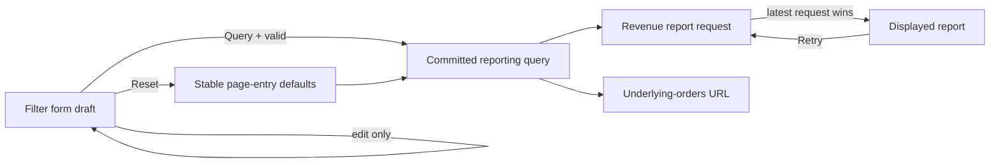
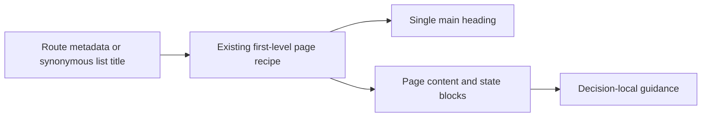

# Admin Page and Query Consistency - Plan

## Goal Capsule

- **Objective:** Admin operators see one predictable first-level page heading pattern and can adjust Commerce Dashboard filters without changing report data until they explicitly click Query.
- **Means:** Converge first-level menu-entry pages onto the existing page recipes, remove generic title-adjacent descriptions, move necessary guidance next to the decision it explains, and replace the Dashboard's hand-written controls with the existing list-filter template and submit-gated filter hook.
- **Authority boundary:** This is an independent Admin repair plan. It owns only the heading, subtitle-placement, and Dashboard query defects described here; it does not participate in or change the product master execution sequence. `docs/plans/2026-09-02-1310-refactor-admin-approved-capability-adaptation-plan.md` and `docs/plans/2026-09-15-1723-refactor-admin-query-list-convergence-plan.md` are implementation baselines, not execution authorities for this fix.
- **Inherited baseline:** `CustomPageRecipe` and `StandardListPageRecipe` already share the first-level title presentation. `TemplateListFilterForm`, `buildSearchGridProps`, and `useTemplateListFilters` already support select/date-range fields, Reset, Query, and `autoApplyOnValuesChange: false`. Audit and Users are the direct custom-page composition precedents.
- **Explicit supersession:** This plan supersedes the Dashboard's immediate-request-on-filter-change behavior and the tests that require it. It supersedes hand-written first-level page headings and generic prose directly under first-level titles. It does not supersede report metrics, reporting APIs, route permissions, list behavior completed by ADM-LIST, contact data behavior, or deeper form/detail page contracts.
- **Parallel plans:** Product plans continue independently. This fix does not park, resume, or reorder them. If an overlapping Admin file has active changes when implementation starts, reconcile that file locally without transferring plan authority.
- **Tail ownership:** ADM-UX owns only this bounded Admin repair and its local verification. Contact data, APIs, publication, storefront behavior, candidate state, and deployment remain outside it.
- **Execution profile:** Execute independently in the primary checkout. No worktree, pull request, deployment, remote data mutation, product-pointer change, or candidate advancement is implied.

---

## Product Contract

### Summary

The Admin should feel like one product. Every first-level menu-entry route, whether standalone or grouped, should present its main title through an existing recipe with the same visual hierarchy and spacing. A generic sentence that merely repeats the page purpose should not sit beneath the title. Guidance that changes an operator's decision should remain, but next to the relevant filter, status, card, or action.

The Commerce Dashboard should use the shared filter template already used elsewhere in Admin. Operators may edit currency, time zone, and date range as draft values. The displayed report and its drill-down link remain tied to the last submitted values until Query is clicked. Reset restores the page-entry defaults and performs one fresh query.

### Problem Frame

Several first-level menu pages still render a raw `h1` or a different Ant Design title level, while other pages use `CustomPageRecipe` or `StandardListPageRecipe`. Some recipe-based pages also insert generic explanatory prose immediately beneath the title. This makes equivalent pages look unrelated even though the repository already defines a first-level heading contract.

Commerce Dashboard separately hand-builds select and date controls. Its single `query` state is both the visible draft and the applied request scope, so every control change clears the report and starts a request. That differs from the established Admin query contract and makes multi-field filtering noisy and difficult to review before submission.

### Requirements

**First-level page presentation**

- R1. Every `inMenu: true` first-level route, whether `standalone` or grouped under a menu section, must have exactly one visible main heading rendered by an existing first-level page recipe. Standard query lists use `StandardListPageRecipe`; business overrides and top-level forms use `CustomPageRecipe`. Detail and child forms retain `PageHeaderWithBack`.
- R2. First-level headings must share the recipe-owned Ant Design level, margin, outer spacing, and action alignment. Loading, error, empty, and permission states must not silently lose the page heading when the route itself remains available.
- R3. Route metadata is the default title source for custom pages. Standard-list and explicit business titles may keep wording that is semantically equivalent to the route label; this plan does not rename navigation merely to make strings byte-identical.
- R4. Generic purpose descriptions immediately below first-level titles must be removed. Decision-relevant guidance must appear once beside the card, status, filter, or action it explains. Metric definitions, field help, error/empty descriptions, table facts, and accessibility descriptions are not title subtitles and remain in place.

**Commerce Dashboard filters**

- R5. Dashboard must use the existing `TemplateListFilterForm`, `buildSearchGridProps`, and `useTemplateListFilters` capabilities. No Dashboard-specific filter framework or new generic filter abstraction may be introduced.
- R6. Currency, time zone, and date range are editable draft values. Changing a draft value must not start a report request, clear the committed report, or change the drill-down URL.
- R7. Clicking Query validates and commits the complete draft, resets request scope as needed, and starts exactly one report request using all committed values. An empty or incomplete date range remains draft-invalid and starts no request.
- R8. Reset restores the stable defaults captured when the page was entered and starts exactly one request for those defaults, even when the visible draft or last committed values already match them.
- R9. Retry repeats the last committed query. The latest started committed request instance wins if responses overlap, even when two requests have identical parameters. The underlying-orders link must always use the query snapshot associated with the displayed report.
- R10. Existing metric calculations, definitions, currency formatting, error and empty states, reporting endpoints, permissions, localization, and responsive table behavior must remain unchanged except where their tests currently encode immediate querying or stale presentation copy.

**Verification and ownership**

- R11. The `inMenu: true` route inventory is the audit boundary for heading convergence, including standalone and grouped menu entries. Deeper detail, editor, and child routes continue to use `PageHeaderWithBack` and are outside this plan.
- R12. Verification must prove behavior, not just the presence of shared components: request count and parameters, draft-versus-committed display, Query, Reset, retry, race handling, drill-down scope, loading/error states, and desktop/narrow layout must be observed.
- R13. The contact settings 404 and local-versus-test environment routing are explicitly out of scope. Contact settings may receive only heading/subtitle placement changes after any overlapping local edits are reconciled; its loading, saving, API, and publication contracts remain outside this repair.

### Key Flows

- F1. **Open a first-level page:** An operator navigates from the menu and sees one consistently styled main heading, then the page's controls or content without a generic subtitle between them. Covers R1-R4, R11.
- F2. **Prepare and submit a dashboard query:** The operator changes any combination of currency, time zone, and date range; the prior report remains visible and no request occurs. Clicking Query sends one request with the complete draft and replaces the report only through that committed request. Covers R5-R7, R9-R10.
- F3. **Reset and recover:** Reset restores page-entry defaults and sends one request. A failed request shows the existing recovery state; Retry repeats the committed scope. A slower older response cannot replace newer committed data. Covers R8-R10.

### Acceptance Examples

- AE1. Fulfillment and Orders each show a single first-level title with the same recipe-owned size and spacing, even though one is a custom page and the other is a standard list. Neither shows a generic explanatory sentence directly beneath the title. Covers R1-R4.
- AE2. On Dashboard, selecting EUR and Europe/London and changing the date range sends no additional request and leaves the current metrics and underlying-orders URL unchanged. Clicking Query sends exactly one request containing all three new values. Covers R6-R7, R9.
- AE3. Clearing or partially entering the date range and clicking Query shows field validation, keeps the last committed report visible, and sends no request. Covers R6-R7.
- AE4. After submitting non-default filters, clicking Reset restores the initial CNY/browser-time-zone/last-30-days values and sends exactly one request. Covers R8.
- AE5. If an earlier committed request resolves after a later one, the later report remains visible. Retry after failure uses the failed committed scope, and the drill-down link matches the report that is shown. Covers R9-R10.
- AE6. Storefront Themes retains its first-level title and top-right creation action during the normal state, while loading/error states preserve truthful route context. Its production-theme caveat appears next to the draft/package controls rather than as a title subtitle. Covers R1-R4.

### Scope Boundaries

- Do not fix or investigate Contact Settings 404 behavior, API base URLs, local/test environment selection, or proxies.
- Do not create a new page-title component, Dashboard filter abstraction, replacement list recipe, or one-consumer shared recipe mode. Commercial Settings remains a page-level business override composed from existing page, form, and state primitives.
- Do not change reporting formulas, API schemas, default reporting values, permissions, metric tooltips, export behavior, or order-report filters.
- Do not normalize every route label and page title to identical text. Semantic equivalence is sufficient; navigation wording changes require a separate product-language decision.
- Do not migrate detail pages, form children, Theme Editor, Order detail, User detail, or Role detail away from their back-header contract.

#### Deferred to Follow-Up Work

- A working contact environment error is deferred because local and test development are now intentionally separated.
- Any broader copy-editing pass beyond title-adjacent generic descriptions is deferred.
- A universal route-to-heading static analyzer is deferred unless implementation proves focused route and page tests cannot guard the contract economically.

---

## Planning Contract

### Key Technical Decisions

- KTD1. **Reuse the existing page recipes.** `CustomPageRecipe` and `StandardListPageRecipe` remain the first-level heading owners. Manual first-level headers migrate into those recipes; no new `PageTitle` layer is introduced. Governs R1-R4, R11.
- KTD2. **Keep Commercial Settings adaptation local.** Recompose `LaunchSettingsPage` as a top-level business override using `CustomPageRecipe` outside the existing form state and content primitives. State blocks render as subordinate content beneath the route heading. Do not add a one-consumer mode to `BasicCrudFormRecipe`; existing child/detail consumers keep `PageHeaderWithBack`. Governs R1-R3, R11.
- KTD3. **Move useful guidance; delete generic restatements.** Review-release timing, contact publication rules, and theme-production caveats stay near the controls or status they affect. Descriptions that only restate the title are removed. Governs R4.
- KTD4. **Reuse the existing filter template without promotion.** *(session-settled: user-directed — chosen over a new generic filter panel because the project already provides the shared filter template.)* Dashboard remains a business override inside `CustomPageRecipe` and composes the current filter form, grid helper, and filter hook as Audit and Users do. It does not become a standard list page. Governs R5, R10.
- KTD5. **Separate draft form values from committed reporting scope.** *(session-settled: user-directed — chosen over immediate requests on value changes so the operator submits the complete draft with Query.)* The form owns editable values; `useTemplateListFilters` owns the committed filter object and request version with automatic apply disabled. A valid Query or Reset clears the old report synchronously before committing the next request; an accepted response stores its query snapshot with the report, and retry uses that committed scope. Governs R6-R9.
- KTD6. **Capture defaults once per page entry.** The initial reporting query and its form representation remain stable for the component lifetime so Reset is deterministic. Hook `requestVersion` remains the explicit trigger when identical committed values must query again. Governs R7-R9.
- KTD7. **Validate the complete filter before commit.** Currency and time zone are required and not clearable; the date range is required and complete. Invalid draft values do not replace committed values or the truthful prior report. Governs R6-R7, R10.
- KTD8. **Verify observable behavior across layers.** Component tests own request timing and state boundaries; browser coverage owns real control interaction, drill-down scope, action layout, and narrow-width behavior. Component presence alone is insufficient migration evidence. Governs R12.

### High-Level Technical Design

The first-level heading path is single-owned: route metadata or a semantically equivalent list title enters an existing page recipe, and that recipe renders the only main heading. Page-specific content and state blocks begin after the recipe heading; useful guidance is placed at its decision boundary.

### System-Wide Impact

- **Operators:** See consistent page entry points and can review a complete Dashboard filter set before querying.
- **Admin maintainers:** Continue using the established recipes and filter toolkit; this plan reduces hand-written page chrome and does not add another shared abstraction.
- **Reporting behavior:** Request timing changes only on Dashboard. APIs, metrics, exports, and the Order Revenue Report remain unchanged.
- **Concurrent file work:** Reconcile any active Contact page edits before its presentation-only cleanup to avoid overwriting unrelated work.

### Risks and Mitigations

- **Duplicate or missing Dashboard requests:** Unstable initial objects or effect dependencies could make Query/Reset send more than one request. Capture defaults once and assert exact request counts for initial load, Query, Reset, and Retry.
- **Draft values leaking into truthful output:** Reading form values in metric or drill-down rendering would make the UI internally inconsistent. Build request and drill-down state only from committed filters and test both before and after submission.
- **Useful guidance lost during subtitle removal:** Classify each sentence before deletion. Move decision-relevant rules to the owning control/card and remove only generic restatements.
- **Heading disappears in early states:** Pages that return early for loading, error, empty, or permission states must keep route context through the recipe or a recipe-compatible state composition.
- **Local form recomposition:** Commercial Settings must preserve its form-state, save/reset, width, permission, and health behavior while moving to a page-local top-level composition. Existing shared detail-form consumers remain untouched.
- **Stale end-to-end evidence:** Reconcile the reporting E2E's obsolete summary assertions before accepting it as proof of the new query flow.

### Dependencies and Execution Boundary

- Reconcile any active edits to `apps/admin/src/pages/settings/contact-settings-page.tsx` before the presentation-only adjustment in U3; do not overwrite unrelated contact work.
- Existing shared filter changes in the checkout must be reconciled before Dashboard edits; implementation must not overwrite unrelated user work.

---

## Implementation Units

### U1. Freeze the first-level heading and subtitle disposition

**Goal:** Turn the current `inMenu: true` route inventory into an explicit migration boundary and protect the existing first-level heading contract before changing pages.

**Requirements:** R1-R4, R11-R13; F1; AE1, AE6.

**Dependencies:** No code unit dependency.

**Files:** `apps/admin/src/routes/routes.config.ts` (read-only inventory unless a semantic mismatch is found); `apps/admin/src/routes/index.test.tsx`; `apps/admin/src/shared/template-kit/recipes/custom-page-recipe.test.tsx`; `apps/admin/src/shared/template-kit/recipes/standard-list-page-recipe.test.tsx`; `apps/admin/docs/ai/page-guardrail-recipes.md`; `apps/admin/docs/ai/ai-rules.md`.

**Approach:**

1. Inventory every `inMenu: true` route, including grouped IAM entries, and classify it as standard list, custom/business override, or top-level form without changing route language or breadcrumb behavior.
2. Freeze the rule that first-level states retain one recipe-owned title and no detail-style back control.
3. Record an explicit copy disposition before page edits: remove generic summaries on Orders, Inventory, Notification Jobs, Users, Fulfillment, and Shipping; move Privacy verification/retention guidance beside its operation controls, Revenue Report scope beside its filters/results, Roles authority beside permission content, Audit redaction/permission guidance beside results, Review release timing beside moderation, Theme production caveats beside draft/package controls, and Contact publication guidance into Global Contact Channels. Preserve field help, metric definitions, state descriptions, and other task-specific facts.

**Patterns to follow:** `CustomPageRecipe`, `StandardListPageRecipe`, `PageHeaderWithBack`, route page metadata context, and `page-guardrail-recipes.md` §5.5.

**Test scenarios:**

- Covers AE1. A custom page and a standard list each expose one level-4 main heading with recipe spacing.
- A grouped IAM menu page follows the same first-level heading contract while keeping its AppShell breadcrumb behavior.
- Route title defaults remain available to a custom page in loading, error, and normal compositions.
- Semantically equivalent explicit titles remain allowed without forcing navigation-label rewrites.

**Verification:** The route inventory has an explicit owner for every first-level heading, the copy disposition names remove-versus-relocate outcomes, and the written guardrail matches the existing recipe ownership model.

### U2. Migrate manual first-level page headers

**Goal:** Replace remaining hand-written first-level headings with the established custom-page recipe while preserving actions and state behavior.

**Requirements:** R1-R4, R11; F1; AE1, AE6.

**Dependencies:** U1.

**Files:** `apps/admin/src/pages/fulfillment/fulfillment-page.tsx`; `apps/admin/src/pages/fulfillment/fulfillment-page.test.tsx` (new); `apps/admin/src/pages/privacy/privacy-page.tsx`; `apps/admin/src/pages/privacy/privacy-page.test.tsx` (new); `apps/admin/src/pages/catalog/review-moderation-page.tsx`; `apps/admin/src/pages/catalog/review-moderation-page.test.tsx`; `apps/admin/src/pages/settings/shipping-settings-page.tsx`; `apps/admin/src/pages/settings/shipping-settings-page.test.tsx`; `apps/admin/src/pages/storefront/themes-page.tsx`; `apps/admin/src/pages/storefront/themes-page.test.tsx` (new); `apps/admin/src/pages/settings/launch-settings-page.tsx`; `apps/admin/src/pages/settings/launch-settings-page.test.tsx`; `apps/admin/src/shared/template-kit/form/template-form-state-gate.tsx` (reuse, no shared-contract change expected); `apps/admin/src/shared/components/form-submit-toolbar.tsx` (reuse); affected translation entries in `apps/admin/src/shared/i18n/translations.ts`.

**Approach:**

1. Wrap Fulfillment, Privacy Requests, Review Moderation, Shipping Settings, and Storefront Themes in `CustomPageRecipe`; pass existing top-right actions through `extra`.
2. Recompose Commercial Settings locally with `CustomPageRecipe` outside its form state gate, then reuse the current gate, form toolbar, content-width constants, and section cards without changing save, reset, permissions, or operational-health behavior.
3. Preserve the Storefront Themes title across loading/error/empty states instead of returning a titleless state block.
4. Remove generic title descriptions. Move the review release-delay rule beside moderation status/actions and the storefront production-theme caveat beside draft/package controls.

**Patterns to follow:** `CustomPageRecipe` action composition, existing query state blocks, and the content-local guidance rule in Admin AI docs.

**Test scenarios:**

- Covers AE1. Fulfillment uses one recipe-owned heading and keeps all existing fulfillment actions and requests.
- Privacy and Shipping retain permission, loading, error, and save behavior while showing one first-level heading.
- Review Moderation keeps its approval/release guidance visible at the moderation decision and does not duplicate it below the title.
- Covers AE6. Storefront Themes preserves title, creation action, and truthful state messaging in normal, loading, error, and empty cases.
- Commercial Settings keeps one route heading above permission, loading, error, and normal content; its save/reset and health recovery behaviors remain unchanged, and no shared recipe mode is added.

**Verification:** Each migrated page has one accessible main heading, no generic title subtitle, unchanged domain actions, and focused state coverage.

### U3. Clean recipe-based title subtitles at their content boundary

**Goal:** Remove the remaining generic descriptions beneath already-conforming first-level headings and relocate only operationally useful guidance.

**Requirements:** R3-R4, R11, R13; F1.

**Dependencies:** U1; reconcile any active Contact page edits before its small presentation-only change.

**Files:** `apps/admin/src/pages/orders/order-list-page.tsx`; `apps/admin/src/pages/orders/order-list-page.test.tsx`; `apps/admin/src/pages/reports/order-report-page.tsx`; `apps/admin/src/pages/reports/order-report-page.test.tsx`; `apps/admin/src/pages/inventory/inventory-page.tsx`; `apps/admin/src/pages/inventory/inventory.test.tsx`; `apps/admin/src/pages/operations/jobs/notification-jobs-page.tsx`; `apps/admin/src/pages/operations/jobs/notification-jobs-page.test.tsx`; `apps/admin/src/pages/iam/roles-page.tsx`; relevant IAM page tests; `apps/admin/src/pages/iam/users-page.tsx`; relevant Users page tests; `apps/admin/src/pages/audit/audit-page.tsx`; `apps/admin/src/pages/audit/audit-page.test.tsx`; `apps/admin/src/pages/settings/contact-settings-page.tsx`; `apps/admin/src/pages/settings/contact-settings-page.test.tsx`.

**Approach:** Apply U1's per-string disposition instead of deleting every `renderBeforeFilter` block uniformly. Remove pure purpose restatements; relocate Revenue Report scope, Roles authority, and Audit redaction/permission facts to their owning filter, permission, or results region. After overlapping Contact edits are reconciled, wrap its permission/loading/load-error/normal content in `CustomPageRecipe` and move publication guidance into Global Contact Channels without changing its request or retry behavior.

**Patterns to follow:** Existing content-card descriptions, form-item help, state-block descriptions, and decision-local Alerts.

**Test scenarios:**

- Each affected page, including grouped IAM entries, renders its title once and no longer renders a generic subtitle.
- Existing filters, requests, toolbar actions, pagination, error states, and empty states remain unchanged.
- Revenue, Roles, and Audit guidance remains visible at the decision boundary named in U1.
- Contact publication guidance remains visible in the channels section, and its permission/loading/load-error states retain the route heading without any API, save, or retry change.
- Translation tests or locale rendering confirm removed/moved copy does not leave missing-key output.

**Verification:** Focused page tests demonstrate presentation-only movement while existing business behavior remains green; no Contact contract or environment behavior changes.

### U4. Migrate Dashboard to the shared submit-gated filter template

**Goal:** Replace the Dashboard's hand-written immediate filters with the existing shared template and a clear draft-to-committed request boundary.

**Requirements:** R5-R10, R12; F2-F3; AE2-AE5.

**Dependencies:** U1. U2 and U4 may proceed independently after U1. U3's non-Contact changes may also proceed after U1, but its Contact change waits until overlapping local edits are reconciled. All three units complete before aggregate verification.

**Files:** `apps/admin/src/pages/dashboard/dashboard-page.tsx`; `apps/admin/src/pages/dashboard/dashboard.test.tsx`; affected translation entries in `apps/admin/src/shared/i18n/translations.ts`. Shared list-filter files are pattern references and should change only if a focused test exposes a real missing capability.

**Approach:**

1. Represent currency, time zone, and date range as template filter fields and use the shared grid layout and current compact-layout preference.
2. Capture the initial reporting query once, map it to stable form defaults, and map a valid submitted date range back to the existing `ReportingQuery` shape. Make currency and time zone required and non-clearable.
3. Configure `useTemplateListFilters` with automatic apply disabled. Drive the report effect with committed filters plus its explicit request version and retry trigger.
4. Keep the previous committed report visible while only the draft changes. On valid Query or Reset, synchronously clear the report and show the existing skeleton; keep fields and Reset available, use submit loading to prevent duplicate Query, and allow Reset to supersede an in-flight request with one default request.
5. Store the query snapshot with each accepted report and build the underlying-orders URL from that snapshot. Preserve searchable currency/time-zone behavior, existing failure recovery, and all metric/table presentation.

**Execution note:** Start with characterization assertions for initial request count, draft edits, the current committed drill-down, and overlapping requests; then replace the obsolete immediate-query expectations.

**Patterns to follow:** `apps/admin/src/pages/audit/audit-page.tsx`, `apps/admin/src/pages/iam/users-page.tsx`, `TemplateListFilterForm`, and `useTemplateListFilters` with `autoApplyOnValuesChange: false`.

**Test scenarios:**

- Covers AE2. Initial load sends one default request; editing all three fields sends none and leaves the current report visible; Query sends one request with the complete draft.
- Covers AE3. A cleared or incomplete date range fails validation, preserves the committed report, and sends no request.
- Clearing currency or time zone is unavailable; if an empty value reaches validation, Query sends no request.
- Covers AE4. Reset restores the stable page-entry defaults and sends exactly one request, including when the hook needs an explicit request-version trigger for equal values.
- Covers AE5. Retry repeats the failed committed query; a slower previous request instance, including one with identical parameters, cannot overwrite the latest started request.
- The underlying-orders URL stays on the displayed report's old scope before Query, is absent while the new report is loading, and uses the accepted report snapshot afterward.
- Search finds additional currency codes without requesting until Query.
- Keyboard submission uses the form's native submit path when no picker/select popup owns the key; Reset never submits, and invalid feedback remains associated through Ant Design Form semantics.
- Existing metric copy, tooltip definitions, zero/negative formatting, empty data, and request-failure recovery remain correct.

**Verification:** Focused Dashboard tests prove exact request counts and payloads for every trigger, truthful draft/committed output, stale-response protection, and preserved reporting presentation.

### U5. Close cross-page and browser verification

**Goal:** Prove the heading and Dashboard behavior as one Admin contract across routes, locales, and responsive layouts, and retain execution evidence without creating a second queue.

**Requirements:** R1-R13; F1-F3; AE1-AE6.

**Dependencies:** U2, U3, U4.

**Files:** `apps/admin/e2e/reporting.spec.ts`; `apps/admin/src/pages/dashboard/dashboard.browser.test.tsx` (new if the E2E cannot economically cover responsive layout); `apps/admin/src/pages/reports/order-report-page.browser.test.tsx`; `apps/admin/src/pages/audit/audit-page.browser.test.tsx`; `apps/admin/src/routes/index.test.tsx`; `apps/admin/docs/testing-standards.md` (only if the established verification wording needs clarification); a focused evidence file under `docs/progress/` if retained evidence is useful.

**Approach:**

1. Reconcile obsolete Dashboard summary assertions in the reporting E2E before using it as evidence.
2. Exercise a real draft-edit, Query, loading, report update, Reset-while-pending, and drill-down sequence. Assert the drill-down receives the accepted report snapshot.
3. Check programmatic labels, keyboard submit, invalid-field semantics, Reset/Query action order, wrapping, and table overflow at desktop and narrow widths in English and Chinese. Rely on Ant Design's ordinary focus and error association unless a reproducible composed-control gap requires a local correction.
4. Run consumer closure for recipe, route, and affected page tests, then the Admin type, lint/format, and production build gates required by the repository's L3 standard.
5. Keep execution evidence with this independent repair or under `docs/progress/`; do not change the product master pointer or product-plan checkpoints.

**Patterns to follow:** `apps/admin/docs/testing-standards.md`, existing browser tests for Audit and Order Report, and progress evidence that records results without maintaining a competing current-unit list.

**Test scenarios:**

- Covers AE2 and AE5. Browser interaction proves no request on draft edits, one request on Query, and committed parameters carried into the Order Report route.
- Covers AE4. Reset produces one default-scope request and resets visible controls.
- Covers AE1 and AE6. Representative standard-list, custom, top-level form, and stateful theme pages show one consistent first-level heading.
- English and Chinese layouts keep labels and Reset/Query controls readable without horizontal page overflow at narrow width.
- Permission, error, loading, empty, and retry states remain reachable and truthful on affected pages.

**Verification:** The L3 affected-consumer set, real-browser flow, typecheck, lint/format, and Admin production build pass. Any skipped environment-only evidence is named rather than treated as a pass.

---

## Verification Contract

### Level and rationale

This is an L3 cross-page change. It reuses shared recipes and filter infrastructure across multiple first-level consumers and changes Dashboard request timing, so isolated component snapshots are not enough.

### Required gates

1. **Characterization and focused component tests:** Dashboard request count/payload, draft/commit/reset/retry/race/drill-down behavior; migrated page headings, actions, and state paths; subtitle removal or guidance relocation.
2. **Shared-consumer closure:** Existing recipe tests plus affected Orders, Reports, Inventory, Operations, IAM, Audit, Settings, Fulfillment, Privacy, Reviews, Themes, and Dashboard suites.
3. **Browser verification:** Reporting draft-to-Query-to-drill-down flow; representative heading recipes; desktop and narrow layout; English and Chinese action wrapping.
4. **Repository quality:** Admin typecheck, changed-scope lint/format, and Admin production build.
5. **Documentation consistency:** AI guardrails, this plan, master register, and any retained progress evidence agree on title ownership, request triggers, active plan, and tail owner.

### Evidence rules

- Record exact request counts and search parameters for initial load, draft edits, Query, Reset, and Retry.
- Do not use the page title alone as proof that a page loaded; assert a decision-relevant control, state, or data result as well.
- Do not accept “shared component renders” as proof of migration. The operator-visible behavior must match the acceptance examples.
- Contact environment behavior is neither tested nor claimed by this plan.

---

## Definition of Done

- Every first-level Admin menu-entry route, standalone or grouped, has one documented and tested heading owner using the existing recipe system.
- The identified manual first-level pages no longer render raw competing headings, and equivalent pages share title level, spacing, and action alignment.
- Generic title subtitles are removed; necessary guidance is visible once at the relevant decision boundary.
- Commerce Dashboard uses the existing shared filter template with no new filter abstraction.
- Dashboard filter edits make no request until Query; Query, Reset, Retry, race handling, and drill-down use the verified committed scope.
- Reporting calculations, APIs, permissions, localization, and non-title state descriptions remain unchanged.
- L3 focused, consumer, browser, type, lint/format, and production-build gates pass or any unavailable evidence is explicitly recorded.
- Completion of this repair is recorded in its own plan/evidence only; product-plan execution authority remains unchanged.

---

## Research and References

### Repository evidence

- `apps/admin/src/shared/template-kit/recipes/custom-page-recipe.tsx` and `standard-list-page-recipe.tsx` establish the shared first-level title presentation.
- `apps/admin/docs/ai/page-guardrail-recipes.md` §5.5 and `apps/admin/docs/ai/ai-rules.md` define title ownership and explicit query submission.
- `apps/admin/src/shared/template-kit/list/template-list-filter-form.tsx`, `use-template-list-filters.ts`, and `build-search-grid-props.ts` already supply the required Dashboard controls and request trigger model.
- `apps/admin/src/pages/audit/audit-page.tsx` and `apps/admin/src/pages/iam/users-page.tsx` are direct custom-page filter-template precedents.
- `apps/admin/src/pages/dashboard/dashboard-page.tsx` and `dashboard.test.tsx` expose the current combined draft/committed state and immediate-query contract that this plan supersedes.
- `apps/admin/e2e/reporting.spec.ts` contains stale summary assertions and must be reconciled before it can serve as acceptance evidence.

### Institutional learning applied

- `docs/solutions/workflow-issues/html-source-parity-reconstruction-workflow-2026-08-06.md` reinforces that a template migration must characterize and verify observable behavior, not merely prove that the shared component appears. This plan therefore makes request timing, payloads, Reset, race handling, desktop/narrow layout, and title-state behavior explicit acceptance evidence.

### External research

No external research is required. The repository contains direct shared components, documented contracts, and multiple adjacent implementations for both parts of the change.
