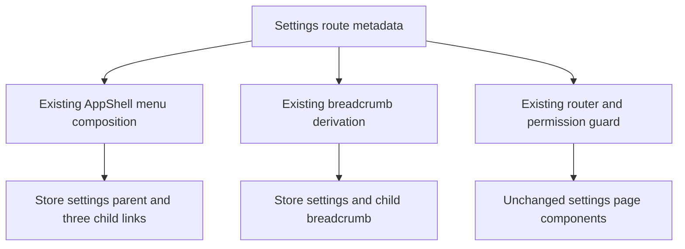

# Store Settings Navigation Group - Plan

## Goal Capsule

- **Objective:** Admin operators can find the store-wide configuration pages as one coherent area while retaining direct access to each task-specific page.
- **Means:** Reclassify the three existing settings routes under one non-navigating sidebar group named `Store settings`, with Chinese copy `店铺配置`, using the existing grouped-menu contract (KTD1).
- **Authority:** This independent bounded refactor owns only Admin navigation classification, its visible hierarchy, and supporting tests and documentation. It does not change the active product plan, product sequence, or master-plan pointer.
- **Inherited baseline:** Preserve the existing `AppShell` grouping behavior, the IAM grouped-menu precedent, and the page-heading contract established by `docs/plans/2026-09-20-1438-fix-admin-page-query-consistency-plan.md`.
- **Supersession boundary:** Replace only the current standalone classification of Commercial, Contact, and Shipping settings and the related assumption that IAM is the only production menu group.
- **Execution profile:** Implement in the primary checkout without a new worktree or pull request. This plan owns local verification and has no deployment tail.
- **Stop conditions:** Stop if implementation requires changing a settings page's data contract, permission model, form behavior, or setup-guide provenance instead of only its navigation presentation.

---

## Product Contract

### Summary

The Admin sidebar will present Commercial settings, Contact settings, and Shipping settings as children of one expandable `Store settings` group. The parent is an organizational label rather than a destination, so each existing child route remains the place where operators complete its configuration task.

### Problem Frame

The three pages already perform related store-configuration work and share the `/settings` route family, but the sidebar presents them as unrelated top-level destinations. Moving every page that happens to contain a setting would make the category meaningless, while creating a settings landing page or tab container would add a second navigation model without solving a current workflow problem.

### Key Decisions

- **Use a sidebar group instead of a configuration-center landing page or route-level tabs.** This keeps direct task access and uses the navigation model already established in Admin. (session-settled: user-directed — chosen over a settings landing page and top tabs: the user selected visual option A.) Governs R1, R2, R5, R6.
- **Name the category `Store settings` / `店铺配置` instead of generic `Settings` / `设置`.** The narrower label communicates that the children configure store operations rather than themes, access, operations, or personal preferences. (session-settled: user-directed — chosen over the generic settings label: the user explicitly selected `店铺配置`.) Governs R1, R4, R9.

### Requirements

**Navigation hierarchy**

- R1. The sidebar must render one expandable, non-navigating `Store settings` group at the current settings-route position.
- R2. The group must contain `Commercial settings`, `Contact settings`, and `Shipping settings` in that exact order, with each child navigating to its existing route.
- R3. The group and its children must follow the existing `settings.read` visibility rule, while direct-route authorization remains owned by the existing permission guard.
- R4. Storefront themes, IAM, operations, and personal preferences must remain outside the group.

**Route and page continuity**

- R5. `/settings/launch`, `/settings/contact`, and `/settings/shipping` must retain their existing components, permissions, page headings, service calls, form behavior, and save behavior.
- R6. Direct navigation, refresh, and the `/admin` basename must select the matching child and initially open its parent group when the sidebar is expanded; a collapsed sidebar must use the existing Ant Design popup interaction.
- R7. A settings child must display the non-clicking breadcrumb `Store settings > <child title>` without adding a duplicate page heading.
- R8. Operators with `settings.read` but without `settings.write` must retain the current read-only page behavior.

**Compatibility and presentation**

- R9. Chinese locale must display the parent as `店铺配置`; existing child translations remain unchanged.
- R10. Existing sidebar collapse, `lg` breakpoint behavior, keyboard semantics, and manual group closing must remain delegated to the current Ant Design menu composition.
- R11. Setup-guide links, `from=setup-guide` provenance, Commercial section hashes, browser history, and the current Contact return-link asymmetry must remain unchanged.
- R12. Clicking a sidebar child must continue to navigate to the clean route path, leaving query and hash restoration to browser Back as it does today.

### Acceptance Examples

- AE1. **Covers R1, R2, R6, R7, R9.** Given an authorized Chinese-locale operator opens `/admin/settings/launch` with the sidebar expanded, the sidebar shows `店铺配置` open, selects `商业设置`, preserves the child page heading, and shows `店铺配置 > 商业设置`.
- AE2. **Covers R2, R11, R12.** Given the operator arrives at `/settings/launch?from=setup-guide#payment`, the payment section behavior remains intact; choosing another sidebar child uses its clean path, and browser Back restores the prior query and hash.
- AE3. **Covers R3, R8.** Given a user has `settings.read` but not `settings.write`, the group is visible and its pages remain read-only; given the user lacks `settings.read`, the group is absent and direct-route denial remains enforced.
- AE4. **Covers R1, R2, R10.** Given the sidebar is collapsed or the viewport is below the existing breakpoint, the operator can still reveal the submenu and activate each child using the library-provided interaction model.

### Scope Boundaries

- No `/settings` landing route, dashboard, or summary page.
- No route-level tab bar or shared settings-page wrapper.
- No new navigation component, controlled submenu state machine, mobile drawer, or custom keyboard handling.
- No changes to settings APIs, persistence, forms, validation, save permissions, setup-guide destinations, or `SetupGuideReturn` eligibility.
- No regrouping of themes, IAM, operations, account preferences, or pages outside the three named settings routes.
- No active product-plan, candidate, deployment, or release-sequence update.

---

## Planning Contract

### Key Technical Decisions

- KTD1. **Express the hierarchy entirely through existing route metadata.** Remove the standalone classification from the three routes, assign the common `menuGroup` value `Store settings`, align their breadcrumb parent, and order the route entries Commercial → Contact → Shipping. No production change to `AppShell` or the router is expected. (session-settled: user-directed — chosen over a new settings shell or tab router: it implements the sidebar-group decision governed by R1, R2, R5, and R6.)
- KTD2. **Use one translation key for the parent group and breadcrumb parent.** Add `Store settings: 店铺配置` and keep the existing child title keys unchanged, satisfying R7 and R9 without duplicating labels.
- KTD3. **Preserve the existing uncontrolled submenu behavior.** Continue deriving `selectedKey`, `activeGroupKey`, and `defaultOpenKeys` from route metadata, and let Ant Design own collapse, popup, focus, and keyboard behavior per R6 and R10.
- KTD4. **Prove the changed navigation behavior at three boundaries.** Route inventory tests own metadata order and breadcrumb contracts, `AppShell` tests own permission and selected/open presentation, and one Playwright journey owns real grouped-menu navigation. Existing page, setup-guide, hash, history, read-only, and return-link suites remain inherited coverage for untouched behavior.
- KTD5. **Treat the prior Admin UX plan as a frozen page-level baseline.** Update its affected inventory documentation and assertions only where the standalone/grouped navigation classification is superseded; do not reopen heading, query-state, or page-content work.

### High-Level Technical Design

This sketch is directional: existing route metadata remains the single input to the current router and shell rather than becoming a new settings subsystem.

### Sequencing and Constraints

1. Establish the route and translation contract before updating interaction tests so all later assertions target the final metadata shape.
2. Characterize grouping, permission filtering, active-route presentation, locale, collapse, and basename behavior without changing shared shell mechanics unless a reproducible contract gap appears.
3. Add one focused browser journey after unit contracts pass; retain existing settings-page and setup-guide coverage rather than duplicating it.
4. If a shell change becomes necessary, reassess consumers and verification scope under Admin testing level `L3` before implementation continues.

### Risks and Dependencies

- Route-array order determines both sidebar placement and group icon ownership; placing Commercial first intentionally preserves the chosen child order and uses its settings icon for the parent.
- Removing `menuMode: 'standalone'` makes the existing two-item breadcrumb visible. A mismatched `menuGroup` and breadcrumb parent would create contradictory hierarchy, so both use `Store settings`.
- Menu visibility is not authorization. Tests must keep presentation filtering separate from the router's existing `PermissionGuard` responsibility.
- Collapsed submenu rendering is owned by Ant Design and may use a popup portal, so tests should assert user-visible behavior instead of DOM structure.

### Sources and Research

- `apps/admin/src/shared/layout/app-shell.tsx` provides the current grouped-menu, selected-route, default-open, breadcrumb, permission-filtering, and collapse behavior.
- `apps/admin/src/routes/routes.config.ts` is the authority for route order, paths, titles, permissions, grouping, breadcrumbs, and page components.
- `apps/admin/src/routes/index.test.tsx` and `apps/admin/src/shared/layout/app-shell.test.tsx` are the nearest stable contracts; the IAM group is the direct precedent.
- `apps/admin/docs/testing-standards.md` classifies route and permission infrastructure changes as `L3` and requires consumer mapping, focused tests, browser-risk coverage, changed-file checks, and a final typecheck or containing build.
- `docs/plans/2026-09-20-1438-fix-admin-page-query-consistency-plan.md` supplies the frozen page-heading and Admin UX baseline that this plan preserves.

---

## Implementation Units

### U1. Reclassify the settings route contract

- **Goal:** Make route metadata and locale data describe the final `Store settings` hierarchy.
- **Requirements:** R1-R9.
- **Files:** `apps/admin/src/routes/routes.config.ts`, `apps/admin/src/shared/i18n/translations.ts`, `apps/admin/src/routes/index.test.tsx`.
- **Dependencies:** None.
- **Approach:** Apply KTD1 and KTD2; move the three entries into the accepted order, remove their standalone mode, add the shared group, align breadcrumb parents and Shipping's child title, and expand the route inventory assertion beyond the IAM-only assumption.
- **Test scenarios:** Assert the grouped route sequence is Commercial, Contact, Shipping; assert each preserved key, path, permission, group, and breadcrumb; assert IAM remains its own unchanged group; assert unrelated routes remain standalone or separately grouped.
- **Verification:** Run the focused route-contract suite and inspect the diff to confirm the three route-to-page mappings and settings services did not change.

### U2. Lock the shell interaction and documentation contract

- **Goal:** Demonstrate that the existing shell presents the new hierarchy correctly across authorization, direct entry, locale, basename, and collapse states.
- **Requirements:** R1-R10, R12.
- **Files:** `apps/admin/src/shared/layout/app-shell.test.tsx`, `apps/admin/docs/ai/page-guardrail-recipes.md`.
- **Dependencies:** U1.
- **Approach:** Apply KTD3-KTD5 using the production route metadata where practical. Replace the obsolete standalone-settings expectation with grouped-menu assertions and update the guardrail inventory from standalone to `Store settings` while preserving each page's heading owner.
- **Test scenarios:** Expand the parent and activate each child in order; verify parent visibility with `settings.read` and absence without it; verify a direct child route is selected and its group initially opens when the sidebar is expanded; verify English and Chinese labels and breadcrumbs; verify `/admin` basename behavior; verify collapsed popup access and re-expansion without asserting Ant Design internals; verify clicking the parent itself does not navigate.
- **Verification:** Run the focused `AppShell` suite and check the documentation inventory against `templateRoutes`.

### U3. Verify grouped navigation in a real browser

- **Goal:** Prove the new parent-child navigation works in the browser modes the existing shell exposes.
- **Requirements:** R1, R2, R6, R7, R10.
- **Files:** `apps/admin/e2e/setup-guide.spec.ts`.
- **Dependencies:** U1, U2.
- **Approach:** Reuse the existing Admin session and settings fixtures for one focused store-settings navigation scenario rather than adding a parallel E2E fixture or repeating page-level coverage.
- **Test scenarios:** Expand `Store settings`, verify the accepted child order, and navigate to a child; enter a child route directly and verify its selection with the group open in the expanded sidebar; repeat one child activation through the existing collapsed or narrow-viewport popup. Do not repeat setup-guide provenance, hash, browser-history, read-only, save, or return-link scenarios already covered by unchanged suites.
- **Verification:** Build the Admin test candidate, run only the named store-settings navigation scenario, and inspect Playwright artifacts only if it fails.

---

## Verification Contract

This is an Admin `L3` change because route metadata feeds shared navigation, breadcrumbs, and permission-filtered presentation across multiple pages.

| Gate | Command | Proves |
| --- | --- | --- |
| Consumer inventory | `rg -n "menuGroup|menuMode|settings/(launch|contact|shipping)|Store settings" apps/admin/src apps/admin/e2e apps/admin/docs` | The affected route, shell, test, E2E, and documentation consumers are bounded before edits. |
| Focused unit tests | `bun run --cwd apps/admin test -- src/routes/index.test.tsx src/shared/layout/app-shell.test.tsx` | Route metadata, order, permission visibility, group interaction, breadcrumb, locale, basename, and collapse contracts. |
| Changed-file lint | `bunx eslint apps/admin/src/routes/routes.config.ts apps/admin/src/shared/i18n/translations.ts apps/admin/src/routes/index.test.tsx apps/admin/src/shared/layout/app-shell.test.tsx apps/admin/e2e/setup-guide.spec.ts` | Changed TypeScript and TSX files satisfy repository lint rules. |
| Changed-file format | `bunx prettier --check docs/plans/2026-09-21-1059-refactor-store-settings-navigation-plan.md apps/admin/src/routes/routes.config.ts apps/admin/src/shared/i18n/translations.ts apps/admin/src/routes/index.test.tsx apps/admin/src/shared/layout/app-shell.test.tsx apps/admin/docs/ai/page-guardrail-recipes.md apps/admin/e2e/setup-guide.spec.ts` | The plan and changed source, test, and documentation files satisfy formatting rules. |
| Test candidate build | `bun run --cwd apps/admin build:test` | TypeScript project checks and the browser candidate build pass; this replaces a separate `typecheck` run. |
| Focused browser journey | `bun run --cwd apps/admin test:e2e -- e2e/setup-guide.spec.ts --grep "store settings navigation"` | Real-browser parent/child navigation, direct-entry selection, and collapsed or narrow-viewport activation. |

Do not run full Admin or monorepo test suites unless consumer inventory reveals unbounded impact or a focused failure cannot be isolated. Record any pre-existing failure with its exact command and isolation evidence instead of repeatedly rerunning it.

---

## Definition of Done

- U1-U3 are complete in dependency order; the changed navigation contract is covered by focused assertions and the named browser journey, while untouched settings and setup-guide behavior remains covered by its existing suites.
- The sidebar contains one `Store settings` / `店铺配置` parent with Commercial, Contact, and Shipping children in the accepted order, while all other navigation categories remain unchanged.
- Existing settings URLs, permission guards, read-only behavior, page headings, APIs, forms, save behavior, setup-guide query/hash links, history behavior, and Contact return-link asymmetry remain intact.
- The `L3` verification gates pass on the final code state, with `build:test` serving as the final typecheck-containing gate.
- `apps/admin/docs/ai/page-guardrail-recipes.md` matches the implemented grouping and retains the three established heading owners.
- The active product plan and `docs/plans/2026-08-13-001-refactor-shoppp-product-master-plan.md` are not changed by this independent refactor.
- No abandoned settings landing page, tab shell, custom submenu state, duplicate navigation primitive, or other experimental code remains in the diff.
