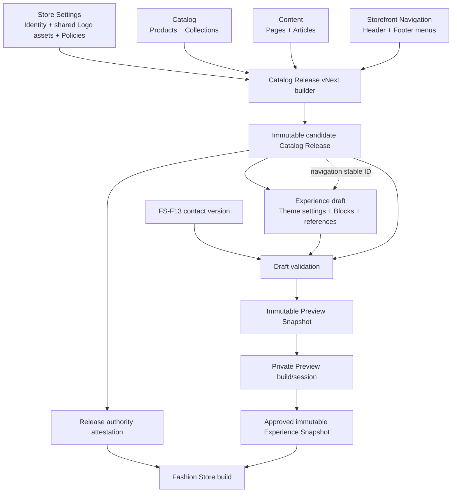
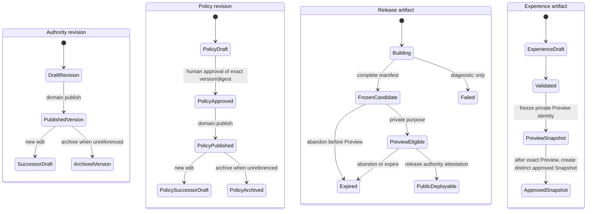
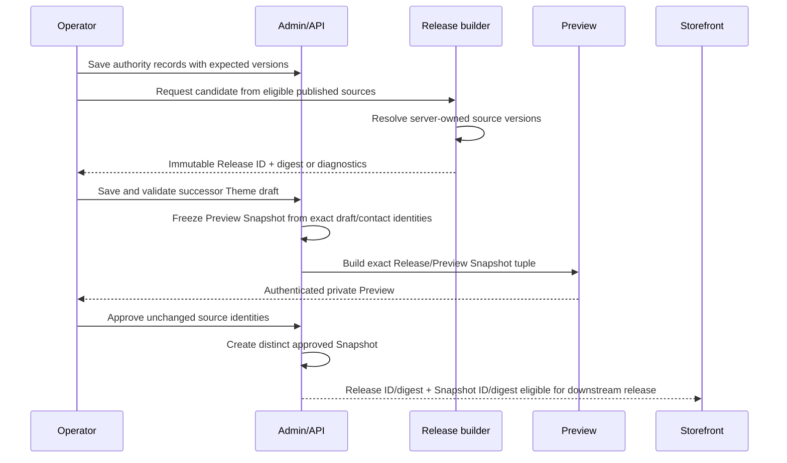

# Storefront Control Plane - Plan

## Goal Capsule

- **Objective:** An operator can control every merchant-owned fact and presentation choice shown on the Fashion Store PC storefront through the correct Admin domain, preview the exact unpublished combination, and publish it without hidden fixture or code-owned business content.
- **Means:** Add typed Store Identity, Policy, Navigation, Collection, and Content authorities; complete bounded Theme Block authoring; freeze them through Catalog Release and Experience Snapshot lifecycles; and migrate duplicate Theme claims to their canonical owners (KTD1-KTD11).
- **Upstream product authority:** `docs/plans/2026-08-13-001-refactor-shoppp-product-master-plan.md` owns Shoppp sequence and the active pointer. `docs/plans/2026-08-11-001-feat-fashion-store-functional-integration-plan.md` owns the Fashion integration baseline. `docs/plans/2026-07-30-002-feat-versioned-storefront-theme-platform-plan.md` owns manifest, draft, migration, Preview, and immutable Snapshot contracts.
- **Inherited baseline:** FS-F13 supplies the canonical public-contact snapshot after its U5 closure. FS-F12 supplies product content, media, reviews, and Catalog publication after its remaining tail closes. Existing Catalog Release and Experience Snapshot identities, historical theme packages, and approved artifacts remain immutable.
- **Explicit supersession:** FS-F14 supersedes FS-F12's direct handback to `REL-Pre-DC`; the product sequence becomes `FS-F13 → FS-F12 → FS-F14 → REL-Pre-DC`. It also supersedes the closed three-page inventory in `docs/plans/2026-09-21-1059-refactor-store-settings-navigation-plan.md` by adding Store Identity and Policies while preserving its expandable group and direct-route navigation model. It supersedes Fashion theme fields and code defaults only where this plan assigns a canonical Store, Catalog, Content, Navigation, or Commerce owner.
- **Parallel plans:** None execute in parallel in the primary checkout. `REL-Pre-DC` remains downstream. Decor Store remains a non-target compatibility surface unless a future frozen Candidate Template Matrix includes it.
- **Tail ownership:** FS-F14 owns the authoritative Admin control path, compatible migrations, Fashion storefront consumption, private preview-candidate Release freeze, private Preview proof, and handback to `REL-Pre-DC`. It does not own bulk merchant data completion, the REL-owned product candidate or Candidate Template Matrix freeze, DC, deployment, PG, or production promotion.
- **Execution profile:** Deep, dependency-ordered work in the long-lived primary checkout. Each product unit is a bounded landing stage; use decimal child stages only when reconciliation, implementation, and verification need separate checkpoints. This plan authorizes no worktree or PR.
- **Stop conditions:** Stop before mutable Admin settings reach live rendering directly; before an unpublished, archived, stale, or cross-environment reference enters an approved artifact; before legal, shipping, payment, contact, or catalog facts are copied into Theme-owned free text; before historical Releases or Snapshots are rewritten; or before candidate/DC/PG state advances without its named authority.

### Execution Checkpoint

- **Classification:** Active product successor after FS-F12 completed U7 human acceptance on 2026-09-22.
- **Current product pointer:** `FS-F14-U1.1` — reconcile every screenshot-audited Fashion PC surface with its current runtime source and final authority.
- **Activation condition:** Met. FS-F13 and FS-F12 are complete and FS-F12 handed execution to FS-F14.
- **Completed units:** None.
- **Current unit:** U1, child stage U1.1 reconciliation.
- **Next concrete action:** Reinspect every Surface Control Matrix row against current code and the visual audit directory, record its observed source, source anchor, final owner, and ownership reason in `docs/progress/storefront-control-plane-verification.md`, and resolve Logo and Navigation ownership before freezing contracts or IAM.
- **Blocker:** None for read-only reconciliation. Remote mutation, deployment, and candidate/DC/PG advancement remain outside this stage.
- **Handback:** After U1-U9 and the Definition of Done pass, return to `REL-Pre-DC`. No candidate is frozen automatically.

---

## Product Contract

### Summary

Shoppp will expose merchant-owned storefront data through five clear Admin areas: Store Settings for store-wide operational identity and legal approval, Catalog for Products and Collections, Content for Pages and Articles, Storefront Navigation for reusable menus, and Storefront Themes for presentation and bounded repeatable Blocks. These are navigation/editing areas, not five interchangeable control planes: Store Settings, Catalog, Content, and Theme remain the four audit-level categories, while Navigation is a dedicated reusable authority and Admin entry separated from Store Settings because its records survive theme switching. Each editor persists versioned authority data. Private Preview binds an immutable candidate Catalog Release to an immutable Preview Snapshot frozen from the exact Experience draft and Contact identities. Public Fashion rendering consumes only approved immutable inputs and shows truthful empty or unavailable states when optional data is absent.

### Problem Frame

The current Admin can edit Commercial, Contact, Shipping, Products, Reviews, and scalar Theme settings, but several PC storefront regions still obtain content from Vue constants, fixture records, hardcoded destinations, or broad settings JSON without a dedicated editor. Header and Footer menus, Home services/categories/brands/marquee/editorial, the three-slide Hero, policy bodies, Article content, Collection presentation, and global storefront identity are not governed consistently.

Some existing controls also duplicate business truth. Theme-owned delivery and return summaries, payment-brand toggles, and legacy Header/Footer contact or social fields can disagree with Shipping, provider capability, published policies, and the FS-F13 contact snapshot. Filling local data cannot resolve these ownership defects and can conceal missing empty-state behavior.

### Actors

- A1. **Store operator:** Maintains identity, policy, navigation, catalog, content, and theme presentation using the permissions assigned to the account.
- A2. **Approver:** Publishes or approves domain content after its domain validation and approval gate; an explicitly authorized store owner may perform multiple Policy transitions, with a separate permission check and audit event at each gate. A2 approves a Theme Experience only after validation and private Preview of the exact immutable tuple.
- A3. **Shopper:** Receives the deployed immutable combination and never sees fixture, draft, archived, unsupported, or contradictory content.
- A4. **Release automation:** Validates source versions, stable references, route uniqueness, environment identity, artifact digests, and compatibility before a Release or Snapshot can be selected.

### Key Decisions

- KD1. **One complete queued successor.** (session-settled: user-directed — chosen over a P0-only plan: the user selected the complete successor so all identified control gaps share one ordered authority and handback.) Governs R1-R20.
- KD2. **Control capability before data completion.** (session-settled: user-approved — chosen over bulk local data completion first: the confirmed scope separates control-path proof from later merchant content work.) Governs R2, R15-R18.
- KD3. **Fashion Store is the formal target.** (session-settled: user-approved — chosen over adding Decor Store to the delivery matrix: shared compatibility is observed without expanding the current candidate scope.) Governs R17-R18.
- KD4. **Brand assets are shared; themes own presentation only.** (session-settled: user-directed — chosen over Theme-owned logo uploads: Logo media and stable asset references must survive theme switching, while each Theme may control sizing, placement, spacing, responsive behavior, and selection among named shared variants.) Governs R7, R14-R15.

### Requirements

**Authority and publication**

- R1. Every shopper-visible merchant fact has one canonical owner: Store Settings, Catalog, Content, Navigation, Commerce, or Theme presentation; no new mutable duplicate may be introduced.
- R2. Saving authority data changes no deployed storefront by itself. Public rendering reads only an immutable Catalog Release, an approved Experience Snapshot, and the exact FS-F13 contact version recorded by that combination.
- R3. Every editable authority record has a stable ID, positive version, audited reason, and optimistic `expectedVersion` write contract. A conflict preserves the operator's unsaved input and does not partially write related records.
- R4. A Catalog Release records each source ID, version, and digest, validates them again before commit, and fails atomically when any source drifts or any stable reference is invalid.
- R5. Private Preview can bind an immutable preview-candidate Catalog Release that is not publicly deployable. Approval binds the same Release ID and digest; later mutable edits require a new Release and Preview.
- R6. Previously published entities are archived rather than hard-deleted. Archive or unpublish is rejected with backlinks while a current draft, menu, or pending approval references the entity; historical Releases remain renderable.

**Store-wide and legal control**

- R7. Store Identity controls public storefront name, tagline, favicon, default social-share media, global SEO defaults, and the approved shared Logo asset set with stable IDs. Deployment origin stays environment-owned, default currency stays Commercial/Commerce-owned, and contact stays FS-F13-owned. Theme may select a named shared Logo variant and control only presentation such as size, placement, spacing, visibility, and responsive behavior; it cannot upload or own a competing Logo asset.
- R8. Policies have versioned draft, approved, published, and archived content with title, slug, effective date, bounded structured sections, and exact-version approval evidence. An explicitly authorized store owner may edit, approve, and publish with separate permission checks, confirmations, and audit events. New Release schemas have no code-authored legal default, and missing required approved policies block release construction.
- R9. Shipping promises, return summaries, and payment-brand visibility are derived from Shipping, published Policies, and enabled provider capability. Theme controls only whether and how the derived facts are presented.

**Catalog, content, and navigation**

- R10. Collection management owns Collection identity, slug, description, cover media, SEO, status, and ordered Product membership. Product editing displays existing Collection memberships and uses a guarded handoff to filtered Collection management that preserves unsaved-change protection and a return target; it cannot create, rename, reorder, or delete membership implicitly.
- R11. Pages and Articles have separate typed records with stable ID, slug, title, summary/body, approved media, SEO, status, version, and publication timestamps. The first version supports only the bounded content sections required by the audited Fashion PC surfaces, rejects arbitrary executable HTML, and does not include scheduled publication or a general-purpose rich-text CMS.
- R12. Navigation owns reusable Header and Footer menus independently of a Theme version. The first version supports one Header menu, one Footer menu, stable item IDs, at most two levels, explicit order, HTTPS credential-free external links, and typed internal references. Authoring provides visible move-up, move-down, indent, and outdent controls with deterministic keyboard focus; drag-and-drop is optional and never the only editing method.
- R13. Enabled Navigation, Theme, and Content references resolve to published, non-archived, same-environment targets of the declared kind. Slug changes preserve stable identity and either create an explicit redirect or are rejected when safe redirection cannot be guaranteed.

**Theme presentation and storefront behavior**

- R14. Theme Editor can add, edit, duplicate, show/hide, remove, and reorder only manifest-allowed Blocks. Block IDs stay stable; min/max count, required blocks, allowed locations, setting schemas, and resource-reference rules are validated with the whole draft version.
- R15. Fashion Home and shell areas currently backed by constants or fixed routes move to typed resources or bounded Theme Blocks. A block type is not enabled until its manifest, Admin editor, composer/ViewModel, Vue renderer, empty state, and tests all exist.
- R16. Optional absent data hides the optional region or shows an explicit unavailable state. Required identity, policies, or enabled references fail validation; no live path falls back to fixture, demo, historical hardcoding, or a different authority.

**Compatibility and completion**

- R17. Historical Catalog Release, Experience Snapshot, and theme schema versions remain readable. New behavior ships through versioned contracts and dry-run successor migration; old bytes are never rewritten and rollback reselects a prior approved tuple.
- R18. Fashion Store receives full Admin, contract, Preview, responsive, accessibility, static, and route acceptance. Shared contract parsing and a basic Decor smoke must remain green, but Decor content migration, visual parity, and candidate proof are outside FS-F14.
- R19. Create, edit, approve, publish, archive, build, preview, and deploy use separate strict request contracts and explicit permissions. Clients cannot assign IDs, versions, actors, digests, environments, approval evidence, publication timestamps, or lifecycle states.
- R20. Structured content uses a bounded, safely rendered section contract with normalized typed links and no raw HTML, script, style, SVG, embed, event attribute, credential-bearing URL, or unsafe opener behavior. Diagnostics and audit reasons are permission-filtered, normalized, and redacted.

### Key Flows

- F1. **Edit an authority record**
  - **Trigger:** A1 opens an authorized Identity, Policy, Collection, Content, or Navigation editor.
  - **Steps:** Admin loads the record and version; A1 edits and supplies a reason; the API validates permissions, shape, uniqueness, references, and `expectedVersion`; the write is audited.
  - **Outcome:** A new mutable authority version exists while deployed Release and Snapshot identities remain unchanged.
  - **Covered by:** R1-R3, R6-R13.
- F2. **Build a preview-candidate Release**
  - **Trigger:** A2 requests an immutable candidate from the current eligible published authorities.
  - **Steps:** The server resolves the eligible source versions, validates routes and references, records source versions/digests, rechecks for drift, and commits the complete artifact or no artifact.
  - **Outcome:** A private-preview-eligible Release exists without becoming the public Release.
  - **Covered by:** R2-R5, R8, R10-R13.
- F3. **Compose and approve presentation**
  - **Trigger:** A1 selects the candidate Release in a successor Theme draft.
  - **Steps:** Migration dry-run reports conflicts; A1 resolves them, edits permitted Blocks, saves, validates, builds Preview, and A2 approves the unchanged Release/draft/contact tuple.
  - **Outcome:** An immutable Experience Snapshot is eligible for the downstream release process.
  - **Covered by:** R5, R9, R13-R17.
- F4. **Render or roll back**
  - **Trigger:** Public build selects an approved Release/Snapshot tuple, or operations reselects a prior approved tuple.
  - **Steps:** Storefront resolves only frozen inputs, renders optional absence honestly, and rejects invalid or mismatched tuples before deployment.
  - **Outcome:** A3 sees one reproducible configuration; rollback does not reverse-mutate current authority data.
  - **Covered by:** R2, R4-R5, R16-R18.

### Acceptance Examples

- AE1. **Saved is not live.** Covers R2-R5. Given an operator changes the store name, when the record saves but no new Release and Snapshot are approved, then the public Header and metadata retain the old value while private Preview can show the candidate value.
- AE2. **Required policy blocks release.** Covers R8, R16. Given the required Returns policy is missing or unapproved, when an operator builds a new-schema Release, then the build fails with a policy-specific diagnostic and does not use code default text.
- AE3. **Concurrent Collection edits do not overwrite.** Covers R3, R10. Given two sessions load the same Collection version, when the first reorders Products and the second submits an older version, then the second receives a conflict and the first order remains intact.
- AE4. **Referenced resources cannot disappear.** Covers R6, R13. Given a Footer item and Home Block reference an Article, when an operator archives it, then the API rejects the action with both backlinks until the references are removed or changed.
- AE5. **Theme Blocks render the saved order.** Covers R14-R15. Given three valid Hero slides are reordered in a saved draft, when Preview builds from that exact version, then the PC storefront renders the same three stable Block IDs in that order and no fixed slide remains.
- AE6. **Unsupported payment is never claimed.** Covers R9, R16. Given a Theme historically enabled a payment logo but the provider capability is disabled, when a successor Snapshot is built, then the logo and claim are absent and migration reports the legacy field disposition.
- AE7. **Empty optional content stays truthful.** Covers R11, R15-R16. Given there are no published Articles, when the Home editorial section is optional, then validation allows it only when hidden or unbound and the storefront does not display the fixed sample Article.
- AE8. **Historical tuple remains reproducible.** Covers R17. Given an old approved Release/Snapshot used legacy fields, when it is rendered or reselected for rollback, then its historical output remains readable without altering current authority records.
- AE9. **Decor observation stays bounded.** Covers R18. Given shared contracts change for FS-F14, when verification runs, then current Decor schema parsing and basic build smoke pass, while Decor content setup and pixel parity are not required.

### Success Criteria

- Every annotated PC surface has a documented canonical owner and either an Admin editing path or an explicit derived/system-owned disposition.
- Before contracts are frozen, every PC surface records its freshly observed current source as API, Store Setting, Theme Setting, Catalog, fixture, fallback, or code constant and explains any ownership change; the prior Codex visual audit is optional provenance rather than an execution dependency.
- A minimal record in each new authority can complete save, immutable candidate build, private Preview, approval, and Fashion rendering without bulk seed data.
- New-schema builds contain no code-authored policy body, fixed Article destination, fixed navigation tree, or live Theme-owned contact/shipping/payment fact.
- The final evidence names exact Catalog Release, Experience Snapshot, Theme/schema, Contact version, environment, and commit identities.

### Scope Boundaries

#### In scope

- Contracts, migrations, IAM, APIs, Admin routes and forms, release serialization, resource discovery, Theme schema/editor changes, Fashion rendering, compatible migrations, and verification for R1-R20.
- Minimal deterministic fixtures required to prove empty, one-record, multi-record, stale-reference, and conflict behavior.

#### Deferred to Follow-Up Work

- Bulk completion of Product, Collection, Article, Policy, Navigation, or marketing data after the control path is proven.
- Scheduled Content publication, localization, arbitrary custom page types, deeper-than-two-level menus, generic imports, and third-party CMS or newsletter-provider integration.
- A reusable cross-theme marketing-content library if later themes need the same Blocks independently of Fashion.
- General-purpose rich-text/CMS capabilities beyond the bounded sections required by current Fashion PC surfaces.
- Generic cross-domain resource-graph infrastructure beyond the concrete backlink diagnostics needed by the first Collection, Content, and Navigation flows.
- Configurable multi-person Policy separation-of-duties until a concrete governance requirement names its operators and configuration owner.
- A general machine-principal candidate-construction endpoint; FS-F14's Admin candidate build remains human-authorized and REL may add non-delegable automation when its issuer contract is defined.
- Physical deletion after governed tuple retirement; REL/operations owns retirement, destructive cleanup, and its recovery procedure.

#### Outside this product plan's authority

- Commerce price, inventory, tax, checkout, payment secrets, provider enablement, and shipping eligibility logic.
- Contact ownership already governed by FS-F13, except removal of superseded Theme fallback fields.
- REL-owned product candidate and Candidate Template Matrix freeze, DC, remote deployment, PG, and production promotion. FS-F14 still owns the private preview-candidate Release freeze defined in KTD3.

### Fashion PC Surface Control Matrix

This matrix is the completion authority for the “every merchant-owned fact” claim. U1 preserves it as a checked inventory, each owning unit updates its implementation evidence, and U9 fails handback when any row is unowned, still reads a live fixture or constant, or cannot be traced to the exact Release/Snapshot tuple.

| Fashion PC surface | Canonical owner and Admin location | Immutable input and storefront consumer | Migration / verification owner |
| --- | --- | --- | --- |
| Browser title, store name, tagline, favicon, social-share image, global SEO defaults | Store Identity — Store Settings / Identity | Catalog Release site metadata → document shell and shared Header metadata | Remove code defaults for new schema; U3, AE1 |
| Header/Footer Logo media and shared variants | Store Identity — Store Settings / Identity; Theme controls presentation only | Catalog Release shared Logo asset IDs plus Snapshot variant/style reference → shared shell | Remove Theme-owned uploads; U3/U7-U8, KD4 |
| Header navigation and Mega Menu labels, order, targets | Navigation — Storefront / Navigation | Catalog Release menu plus Experience navigation reference → Header | Replace fixed tree; U6, AE4 |
| Footer navigation columns, labels, order, targets | Navigation — Storefront / Navigation | Catalog Release menu plus Experience navigation reference → Footer | Replace fixed tree; U6, AE4 |
| Header/Footer contact and social facts | Contact — Store Settings / Contact | Exact FS-F13 Contact version → shared shell | Remove Theme fallback; U8, AE1 |
| Home Hero slides | Theme Blocks — Storefront / Themes | Approved Experience Snapshot blocks and approved media → Hero section | Replace fixed three-slide array; U7, AE5 |
| Home promotion, marquee, and visual campaign strips | Theme Blocks — Storefront / Themes | Approved Experience Snapshot blocks → Home sections | Replace fixed arrays; U7 |
| Home service assurances | Shipping, Policies, and Commerce facts; Theme controls presentation only | Catalog Release derived claims plus Snapshot visibility/style → assurance section | Reject contradictory free text; U8, AE6 |
| Home category and Collection cards | Collections — Catalog / Collections; Theme chooses referenced placement | Catalog Release Collection records plus Snapshot stable references → Home and Collection cards | Replace slug/constants and preserve empty state; U4/U7 |
| Home brand presentation | Theme Blocks — Storefront / Themes | Approved Experience Snapshot bounded brand blocks/media → Home brand section | Replace fixed brand array; U7 |
| Home editorial cards and Article destinations | Articles — Content; Theme chooses referenced placement | Catalog Release Article records plus Snapshot stable references → editorial section | Remove sample Article and fixed destination; U5/U7, AE7 |
| Product list/detail facts, media, related items | Products and Collections — Catalog | Catalog Release Product/Collection records → listing and product routes | Inherit FS-F12, extend Collection ownership in U4 |
| Product review content and aggregates | Reviews — Catalog | Published review data in Catalog Release → product route | Inherit FS-F12; compatibility verified in U9 |
| About, FAQ, Magazine, Article, and other merchant pages | Pages and Articles — Content | Catalog Release content and route manifest → typed page renderers | Keep route-specific templates, replace merchant copy; U5 |
| Returns, privacy, terms, shipping-policy bodies and effective dates | Policies — Store Settings / Policies | Approved published Policy versions in Catalog Release → policy routes and derived summaries | Remove new-schema code legal defaults; U3, AE2 |
| Contact page merchant facts | Contact — Store Settings / Contact | Exact FS-F13 Contact version → Contact route | FS-F13 authority; U8 removes duplicate Theme fields |
| Payment marks and claims | Commerce provider capability; Theme controls presentation only | Provider capability in released inputs plus Snapshot visibility/style → Footer/Product assurance | Ignore legacy unsupported toggles; U8, AE6 |
| Shipping and returns summaries | Shipping and published Policies; Theme controls presentation only | Released canonical facts plus Snapshot presentation → Footer/Product assurance | Migrate or flag conflicting Theme copy; U8 |
| Required account, cart, checkout, and accessibility utility destinations | System-owned route capability | Versioned route capability → Header/Footer controls | Not merchant content; U6 verifies availability and semantics |

---

## Planning Contract

### Product Contract preservation

Product Contract changed with user approval: R7 now separates globally shared Logo assets from Theme-owned presentation; R8 adopts solo-compatible Policy governance; R10-R12 clarify guarded cross-route editing, bounded content authoring, and keyboard-operable Navigation. Scope now defers configurable multi-person governance, machine-principal candidate construction, generic CMS/resource-graph expansion, and destructive tuple-retirement cleanup.

### Key Technical Decisions

- KTD1. **Use one immutable FS-F14 storefront aggregate, not one mutable write authority.** Catalog Release schema v3 freezes Store Identity, Policies, Navigation, Collections, Pages, Articles, and Product catalog references while each domain retains its own writer. Existing architecture language that calls Policy content “Catalog-owned” refers to its immutable release destination and legal publication boundary; the authoring UI remains Store Settings / Policies. The Release records a `sourceVersionVector`, manifest digest, route uniqueness, and the closed cross-domain reference graph. Experience Snapshot owns Theme presentation, Block instances, and stable references into that Release; the FS-F13 contact version remains an explicit second immutable input. Implements R1-R5, R10-R13.
- KTD2. **Use typed domain records, not a generic settings blob, universal CMS table, or resource-graph platform.** Identity remains a singleton Settings contract; Policy, Page, Article, Navigation, and Collection each expose constrained schemas and lifecycle rules. Start with domain-owned reference queries and concrete backlink diagnostics; extract shared helpers only after at least two flows prove the same contract. Persistent expansion precedes verified backfill and writer cutover; destructive down migration is not the recovery mechanism. Implements R3, R6-R13, R17, R19-R20.
- KTD3. **Add a purpose-bound candidate to the existing Release lifecycle.** The same Release persistence, manifest builder, digest, and callback protocol serve `private-preview` and `public` purposes. Candidate freeze is read-only over server-resolved eligible source versions and has no Product/Collection publication side effect. A purpose/environment claim is enforced at every build entry; only the downstream release authority can make the same Release ID/digest publicly deployable, and `themes.approve` never performs that elevation. Release-authority evidence stays retained for the rollback lifetime of every tuple that depends on it. Implements R4-R5, R17, R19.
- KTD4. **Cut Collection membership authority over before candidate construction.** Collection mutations own a new versioned membership table and use stable Product IDs with differential updates. U1 expands, backfills, verifies, and switches new readers/writers before U2 may freeze Collection membership. Product forms then show memberships and use the guarded Collection-management handoff. After cutover, the last supported old binary may save independently safe Product fields but must fail closed with an explicit maintenance diagnostic for membership mutations; rollback uses immutable tuple reselection plus forward repair, never a writable legacy membership authority. No runtime dual-writes the two stores. Implements R3, R6, R10, R13.
- KTD5. **Separate reusable Navigation data from Theme layout.** Navigation records survive theme switching and are frozen in the Catalog Release. Experience stores only a `navigation-reference` to a menu stable ID plus placement/variant; it never copies menu items. Builder validation closes every same-Release target and enforces menu depth, count, ordering, and cycle rules. The Admin may reuse a repeatable-item editor component, but menu items are not persisted as Theme Blocks. Implements R12-R15.
- KTD6. **Extend the existing Block contract end to end.** Do not add an array/repeater setting kind. Add mutation UI for existing typed Block definitions and enable only Fashion block types whose renderer and composer land in the same unit. Implements R14-R15.
- KTD7. **Migrate selected Theme drafts through a versioned successor and keep readers versioned.** Bump the Fashion package/configuration schema and dry-run only drafts an operator chooses to continue. Create a successor only after explicit conflict review; unselected drafts and approved Snapshots keep their bytes. Release v2 and legacy Snapshot tuples remain read-only through their compatible readers; new Navigation/Content bindings require Release v3, and new Snapshots derive contact, shipping, return, and payment facts from canonical owners. Implements R1, R9, R16-R17.
- KTD8. **Prove control with sparse deterministic data.** Test zero, one, and multiple records plus stale and invalid references. Do not add a bulk backfill/import path or populate a complete merchant catalog as part of FS-F14. Implements R2, R15-R18 and KD2.
- KTD9. **Preserve current product execution while changing the tail.** The master and FS-F12 handback name FS-F14 now, but `current_plan`, `current_unit`, and FS-F12's parked unit remain unchanged until their owning checkpoints move. Implements R18 and KD1.
- KTD10. **Make security transitions server-owned without making solo operation impossible.** (session-settled: user-approved — chosen over mandatory second-human Policy approval: the current product must remain operable by one explicitly authorized store owner while retaining separate permissions, exact-version evidence, and complete audit events.) Policy transitions check `policies.write`, `policies.approve`, and `policies.publish` independently but may record the same authorized human across transitions. FS-F14 adds no machine-principal candidate endpoint: the Admin build requires `catalog.publish` plus read permission for every included source domain, the server resolves the eligible published inputs, and the client cannot choose unchecked source IDs. Structured content and links use one bounded closed renderer; audit reasons pass through one normalized and redacted server boundary. Implements R8, R11-R13, R19-R20.
- KTD11. **Store Identity owns shared brand media; Theme owns only presentation.** (session-settled: user-directed — chosen over per-Theme Logo links and uploads: the Logo image source must be shared across themes while Theme-specific sizing and placement remain configurable.) Identity publishes stable primary/light/dark/compact Logo asset IDs in the Catalog Release. Experience Snapshot may reference a named variant and presentation settings but cannot introduce an unapproved Logo asset. Implements R7, R14-R15 and KD4.

The storage and ownership choices did not require a Bake-off. Existing Shoppp Release, Experience, settings, Catalog, and IAM lifecycles already constrain the viable design; a generic CMS/settings alternative would discard typed validation and create a second publication system rather than develop a credible competing mechanism.

### High-Level Technical Design

#### Authority and data flow

#### Separate record and artifact lifecycles

#### Preview and approval protocol

### Permissions and ownership matrix

| Domain | Admin location | Write authority | Publish/approve gate | Immutable destination |
| --- | --- | --- | --- | --- |
| Store Identity | Store Settings / Identity | `identity.write` | `catalog.publish` at Release build | Catalog Release site metadata |
| Policies | Store Settings / Policies | `policies.write` | `policies.approve`, then `policies.publish`; the same explicitly authorized owner may hold each permission; `catalog.publish` only builds the Release | Catalog Release policies |
| Collections | Catalog / Collections | `catalog.write` | `catalog.publish` | Catalog Release collections |
| Pages and Articles | Content | `content.write` | `content.publish` and Release build | Catalog Release content |
| Navigation | Storefront / Navigation | `navigation.write` | `navigation.publish` and Release build | Catalog Release navigation |
| Theme Blocks | Storefront / Themes | `themes.write` | `themes.preview` / `themes.approve` | Experience Snapshot |

The new `identity.read/write`, `policies.read/write/approve/publish`, `content.read/write/publish`, and `navigation.read/write/publish` permissions are first-class IAM keys. `policies.approve` governs exact-version approval; `policies.publish` governs approved-to-published, unpublish, and archive transitions. The same explicitly authorized human may pass multiple gates while recording a distinct confirmation, reason, and audit event for each transition. `catalog.publish` only constructs a Release from eligible published inputs. Existing `settings.*` permissions retain their current authorities and grant none of these keys automatically. API and UI enforce the same matrix. Admin candidate construction requires `catalog.publish` plus read permission for every included source domain; Store Identity therefore requires `identity.read`, not a nonexistent `identity.publish`. The server selects eligible published source versions, and clients cannot supply unchecked cross-domain IDs. Preview and approval also require read access to the bound Catalog Release. Public build and deployment require a separate release-authority attestation and never inherit authority from `themes.approve`.

### Editor lifecycle display contract

Each direct editor shows only states that exist for its authority. Every state comes from the server, distinguishes saved authority from candidate and live inclusion, explains why it is stale, and hides or disables actions the current principal cannot perform.

| Editor | Visible authority states | Candidate/live distinction and stale causes | Next action owner |
| --- | --- | --- | --- |
| Store Identity | Unsaved, saved version | Whether that version is in the selected candidate and deployed Release; stale after a newer save or Logo dependency change | Save, repair Logo backlinks, or build candidate; U3 |
| Policies | Unsaved, draft, approved, published, archived | Whether the published version is in the selected candidate/live Release; stale after content, effective-date, or approval-evidence drift | Save, approve, publish, or build candidate according to permission; U3 |
| Collections | Unsaved, saved version, archived | Whether the version and ordered membership digest are in candidate/live Release; stale after membership, Product, slug, or media change | Save, repair dependency, or build candidate; U4 |
| Pages and Articles | Unsaved, draft, published, archived | Whether the published version is in candidate/live Release; stale after content, route, link, or media change | Save, publish, repair, or build candidate; U5 |
| Navigation | Unsaved, draft, published | Whether the published menu version is in candidate/live Release; stale after order, label, target, or referenced-resource change | Save, publish, repair, or build candidate; U6 |
| Theme | Unsaved, draft, validated, Previewed, approved Snapshot | Exact candidate Release/Contact identities bound to Preview and approval; stale after any draft, candidate, Contact, environment, or shared Logo change | Save, validate, Preview, or approve; U7-U9 |

### Sequencing

1. Reconcile every screenshot-audited surface with its current runtime source and final authority before freezing contracts or IAM.
2. Establish versioned contracts, persistence, permissions, and concrete reference diagnostics before any Admin page can save new entities.
3. Expand, backfill, verify, and cut Collection membership readers/writers to the new sole authority before U2 may freeze Collection data.
4. Add the candidate Release and resource-discovery path before Theme or Navigation can bind unpublished content safely.
5. Land each authority editor before the Theme Blocks that reference it.
6. Migrate duplicate Theme facts only after the canonical source is present.
7. Finish with one exact tuple through Admin save, candidate Release, private Preview, approval, Fashion acceptance, and product handback.

### System-Wide Impact

- **Data lifecycle:** Adds persistent versioned authorities, concrete domain reference diagnostics, and Catalog Release schema v3 while retaining v2/legacy readers. Candidate freeze uses a D1-compatible two-phase optimistic protocol: one session reads the source vector, then one atomic conditional batch writes the candidate and ledger only if every captured version/digest still matches. Freeze copies verified R2 bytes into a Release-owned SHA-256 namespace that ordinary upload credentials cannot write or delete; manifests reference only those immutable keys.
- **Authorization:** Adds Identity, Policy, Content, and Navigation permission families and protected routes; existing roles require an explicit reviewed grant rather than an automatic privilege expansion.
- **Routing and SEO:** New Page/Article/Policy/Collection slugs enter one route manifest with collision checks and explicit redirects.
- **Theme compatibility:** Fashion package/configuration versions advance; old packages and Snapshots remain addressable. Decor must continue parsing shared contracts.
- **Operations:** Candidate Release and Preview tuples add diagnostics and source-digest evidence but do not alter the downstream candidate/DC/PG process.
- **Retention:** R2 objects, Theme packages, generated artifacts, and release-authority attestations reachable from an approved or rollback-eligible tuple stay pinned. FS-F14 fails closed when reachability is uncertain; REL/operations owns governed tuple retirement and physical deletion.

### Risks and Mitigations

| Risk | Consequence | Mitigation |
| --- | --- | --- |
| Legacy rows violate new invariants or migration leaves partially backfilled D1 state | Activation loops on the same conflict, new readers observe incomplete authority, or roles gain unintended permissions | Run a read-only production-shaped preflight with stable conflict codes and no coercion; expand first, backfill and verify counts/IDs/order/reference anti-joins, cut over writers last, and restore from the exact pre-migration database if validation fails |
| Old and new Collection writers appear to coexist during binary rollback | An acknowledged legacy edit disappears after roll-forward or resurrects stale membership | Put authoritative ordered membership in a new versioned table; after cutover, old-binary membership writes fail closed while independently safe Product fields remain writable; rollback uses immutable tuple reselection plus forward repair |
| Cross-domain backlink abstraction is introduced before concrete flows agree | Extra platform work delays control proof or encodes the wrong resource model | Start with domain-owned queries and consistent diagnostic fields; extract shared storage/UI only after two implemented flows prove the same contract |
| Source changes during candidate freeze | Mixed-version Release or stale R2 media | Read the version vector through one D1 session, build outside the database, then use one conditional atomic batch for candidate/manifest/ledger insertion; copy verified media to Release-owned digest keys before commit and treat any source or digest drift as failure |
| Candidate approval is replayed, partially committed, or sent to a public entry point | Duplicate/orphan Snapshot or preview-only content becomes public | Purpose/environment claims, compare-and-set transitions, tuple-digest uniqueness, idempotency keys, atomic Snapshot+audit writes, and one shared assertion on every build/deploy entry |
| A new editor saves data the storefront ignores | False control surface | R15 requires schema, editor, composer, renderer, and tests in one unit |
| Candidate content must be public before it can be previewed | Unsafe workflow inversion | KTD3 introduces private candidate Releases |
| Existing hardcoded copy survives as a hidden fallback | Contradictory shopper claims | New schema rejects fallback use; absence tests inspect rendered output |
| Policy or route migration breaks historical artifacts | Rollback displays current data through an old tuple | Freeze a Release/Experience/package compatibility matrix and golden outputs; old readers consume only frozen bytes and rollback rehearses old → new → old → new without mutable reverse writes |
| New permissions accidentally broaden roles | Unauthorized publication | Explicit IAM migration, subset checks, UI/API parity, no automatic custom-role grants |
| Cross-domain builder leaks unpublished content | A caller uses Release diagnostics as a confused deputy | Require `catalog.publish` plus read permission for every included source domain; let the server resolve eligible published inputs; accept no client-selected source IDs; permission-filter resources, backlinks, and errors |
| Stored content or links execute in Admin Preview or storefront | Persistent XSS against operators and shoppers | Bounded structured sections, one safe renderer, normalized schemes, no raw HTML/SVG/embed/event attributes, and opener isolation across save, Preview, SSR, static output, and hydration |
| Structured content exhausts validation or rendering resources | Stored denial of service affects Admin Preview, release construction, SSR/static output, or shoppers | Enforce document-byte, tree-depth, node-count, child-count, text-byte, link, and media ceilings at the shared contract and renderer boundary |
| Approved rollback tuple loses an external object or attestation | Historical rollback is readable in D1 but no longer renderable | Pin every reachable R2 object, Theme package, generated artifact, and attestation; defer governed tuple retirement and physical deletion to REL/operations |
| Scope becomes a bulk content project | Control-plane work stalls | KTD8 limits data to deterministic proof records |

### Sources and Research

- `/Users/studio/.codex/visualizations/2026/09/21/01a0c3a5-e335-7ac2-a4bf-776202bd9919/shoppp-control-audit/README.md` — user-approved local Codex visual-audit evidence for annotated Fashion PC screenshots and original Settings/Theme/Catalog/Content classifications. This path is traceability evidence only and is not a project build, test, or runtime dependency.
- `docs/architecture/storefront-theme-platform.md` — current Catalog, Experience, Commerce, and Theme authority boundary.
- `docs/plans/2026-07-30-002-feat-versioned-storefront-theme-platform-plan.md` — manifest, Block, migration, Preview, and Snapshot lifecycle.
- `docs/plans/2026-09-18-1128-feat-contact-management-plan.md` — canonical public-contact ownership and frozen contact input.
- `docs/solutions/workflow-issues/html-source-parity-reconstruction-workflow-2026-08-06.md` — visible behavior and absence require evidence beyond saved configuration.
- `docs/solutions/workflow-issues/github-first-release-resilience-for-solo-maintainers-2026-08-28.md` — local Preview is development evidence; candidate and release proof stay exact and fail closed.
- Shopify theme structure and menus: <https://help.shopify.com/en/manual/online-store/themes/theme-structure>, <https://help.shopify.com/en/manual/online-store/menus-and-links> — shared content resources remain separate from theme-version presentation.
- Adobe Commerce content and design: <https://experienceleague.adobe.com/en/docs/commerce-admin/content-design/guide-overview> — content/design and operational configuration use separate lifecycles.

---

## Implementation Units

### U1. Versioned authorities, persistence, and IAM foundation

- **Goal:** Reconcile the visual audit with current runtime sources, then define the new typed authority records, Collection cutover, audits, and permissions without exposing incomplete Admin routes.
- **Requirements:** R1, R3, R6-R8, R10-R13, R17, R19-R20.
- **Dependencies:** FS-F13 and FS-F12 completion; none within FS-F14.
- **Files:** `packages/contracts/src/admin.ts`; `packages/contracts/src/catalog.ts`; new `packages/contracts/src/storefront-content.ts`; `packages/contracts/src/index.ts`; `packages/contracts/test/contracts.test.ts`; `packages/contracts/test/catalog-release.test.ts`; new `packages/contracts/test/storefront-content.test.ts`; `packages/db/migrations/0031_storefront_control_authorities.sql`; `packages/db/migrations/meta/_journal.json`; `packages/db/src/schema/index.ts`; `packages/db/test/migrations.test.ts`; `apps/api/src/catalog/products.ts`; `apps/api/src/publishing/releases.ts`; `apps/api/src/testing/fashion-staging-catalog.ts`; `apps/api/test/catalog/catalog.test.ts`; `apps/api/src/iam/admin-roles.ts`; new `apps/api/src/security/audit-reason.ts`; `apps/api/test/iam/admin-roles.test.ts`; new `apps/api/test/security/audit-reason.test.ts`; new `docs/progress/storefront-control-plane-verification.md`.
- **Approach:**
  1. **U1.1 reconciliation:** Reinspect current Fashion PC pages and code for every Surface Control Matrix row. Record the observed source category (`api`, `store-setting`, `theme-setting`, `catalog`, `fixture`, `fallback`, or `constant`), exact current source anchor, final authority, and reason for any ownership change in `docs/progress/storefront-control-plane-verification.md`. Consult the linked Codex visual audit as optional historical provenance when available; if it is unavailable, fresh capture and code inspection remain sufficient. Resolve Logo and Navigation explicitly before contracts or IAM are frozen.
  2. **U1.2 persistence and cutover:** Add explicit schemas for Store Identity, shared Logo asset IDs, Policy, bounded Page/Article sections, Navigation menu/item, and versioned Collection presentation/membership. Expand, backfill, and verify the new ordered Collection membership table, then switch Product APIs, publication readers, and Fashion staging reset/seed behavior before U2 may consume Collection data. After cutover, reject old-binary membership mutations with an explicit maintenance response while preserving independently safe Product-field writes. Keep `collection_products` read-only for historical diagnosis only and never dual-write it from new code.
  3. **U1.3 permissions and evidence:** Add stable IDs, positive versions, lifecycle fields, source digests, timestamps, first-class Identity/Policy/Content/Navigation permissions, and domain-owned backlink queries that return a common diagnostic shape. Do not make a generic reference-index platform a prerequisite. Expand Release lifecycle persistence without rewriting historical manifests. Route mutations through one normalized audit-reason boundary. Use an expand-first migration, verified backfill, writer cutover, and exact pre-migration restore point.
- **Execution note:** Before migration, run a read-only preflight against a production-shaped export. Emit stable conflict codes for every new uniqueness, ordering, lifecycle, and reference invariant; do not coerce conflicting rows. Resolve or explicitly map all blocking conflicts before writer cutover. Implement domain and migration tests before API handlers; prove reapply, old-row mapping, and rollback behavior before adding writers.
- **Patterns to follow:** Versioned Admin role writes in `apps/api/src/iam/admin-roles.ts`; migration coverage in `packages/db/test/migrations.test.ts`; Zod cross-field validation in `packages/contracts/src/storefront-experience.ts`.
- **Test scenarios:**
  1. A fresh database creates every authority table, required index, foreign key, domain reference relation, and permission key once; reapplying the migration is safe under the repository migration contract.
  2. An existing database with settings, Collections, Releases, Snapshots, roles, and assignments migrates without rewriting historical rows or auto-granting new permissions; row counts, stable IDs, membership order digests, permission differences, and orphan anti-joins match the captured baseline.
  3. Duplicate stable IDs, slugs, sibling navigation order, invalid content state transitions, and non-HTTPS credential-bearing links are rejected by contracts.
  4. A role cannot grant `content.*` or `policies.approve` permissions its caller does not hold, and removal takes effect through the existing request-time permission resolution.
  5. Reference creation and archive race inside one transaction; the winner leaves source data and domain-owned backlink results consistent, with no generic reference-index prerequisite.
  6. An injected backfill or index-validation failure restores the exact old database and the old application can still read it.
  7. Production-shaped preflight reports deterministic blocking conflicts without writing; a corrected or explicitly mapped rerun passes the same checks before migration begins.
  8. Existing Catalog Release rows map to the expanded lifecycle without manifest rewrites, while purpose/environment/attestation constraints apply to new rows.
  9. Direct API audit reasons reject newline, control, and bidirectional injection and redact credential-shaped or sensitive values in stored evidence and returned diagnostics.
  10. Every visual-audit row records one observed current source and one final owner; Logo media resolves to Store Identity while Theme retains only presentation controls, and unresolved rows block U1 completion.
  11. A Product membership write after backfill reaches only the new authoritative table; Product publication and Fashion staging reset/seed read and maintain that authority, and U2 cannot build until the membership digest and reader/writer cutover checks pass.
- **Verification:** Contract, DB migration, and IAM tests prove the new records and permissions while all historical schemas remain readable.

### U2. Catalog Release vNext and private candidate lifecycle

- **Goal:** Freeze every new authority into one immutable candidate Release that private Preview can consume before public deployment.
- **Requirements:** R2, R4-R5, R8, R10-R13, R16-R19.
- **Dependencies:** U1.
- **Files:** `packages/contracts/src/catalog.ts`; `packages/contracts/src/storefront-experience.ts`; `packages/contracts/test/catalog-release.test.ts`; `apps/api/src/http/app.ts`; `apps/api/src/publishing/build-manifest.ts`; `apps/api/src/publishing/releases.ts`; `apps/api/src/storefront-experience/catalog-resources.ts`; `apps/api/src/storefront-experience/input-identity.ts`; `apps/api/src/storefront-experience/preview.ts`; `apps/api/src/storefront-experience/service.ts`; `apps/api/test/catalog/catalog.test.ts`; `apps/api/test/catalog/build-trigger.test.ts`; `apps/api/test/storefront-experience/experience-api.test.ts`; `apps/admin/src/services/catalog/api.ts`; `apps/admin/src/pages/catalog/catalog-list-page.tsx`; new `apps/admin/src/pages/catalog/catalog-preview-candidate-panel.tsx`; new `apps/admin/src/pages/catalog/catalog-preview-candidate-panel.test.tsx`; `apps/admin/src/pages/storefront/theme-editor-page.tsx`; `apps/storefront/scripts/prepare-release.ts`; `apps/storefront/tests/catalog-release-source.test.ts`.
- **Approach:** Add Release schema v3 with a purpose/environment claim, source-version vector, typed content/navigation records, route output, and normalized source ledger. Implement a D1-compatible two-phase optimistic freeze: read all D1 source versions through one session, construct and hash the manifest, copy each verified media object into a Release-owned SHA-256 key that ordinary upload credentials cannot mutate, then execute one atomic batch whose candidate and ledger inserts are conditional on every captured version/digest still matching. Reject an existing digest key whose bytes differ, and never expose failed copies to cleanup selection. Candidate transitions use compare-and-set, tuple-digest uniqueness, and idempotency. Register the human candidate-build, manifest-read, build-status, Preview, and public-build routes through `apps/api/src/http/app.ts`, and make every entry call one shared lifecycle assertion. The Admin endpoint requires `catalog.publish` plus read permission for every included source domain; the server selects eligible published inputs and accepts no client-authored source IDs. FS-F14 adds no machine-principal candidate route. Public deployment requires a retained release-authority attestation for the same ID/digest. Add a permission-aware “Build preview candidate” panel to the Catalog release UI: show the server-resolved source summary and private-purpose label, pending/succeeded/failed states, actionable diagnostics and retry, then hand the completed candidate into the Theme Editor without presenting it as a public Release.
- **Execution note:** Start with failing Release-builder tests for source drift, unpublished references, route collisions, and candidate/public separation.
- **Patterns to follow:** Existing Catalog build correlation and rollback in `apps/api/src/publishing/releases.ts`; Preview input identity in `apps/api/src/storefront-experience/input-identity.ts`.
- **Test scenarios:**
  1. Matching source versions build one immutable candidate whose manifest records every source ID/version/digest.
  2. A source version changes between read and commit; the builder creates no selectable Release and returns the drifting source.
  3. A candidate Release is visible to authorized private Preview but cannot be made public through candidate, Snapshot, build hook, prepare-release, service-principal, or Preview endpoints.
  4. An unpublished, archived, wrong-kind, cross-environment, or missing target rejects the Release with a stable backlink diagnostic.
  5. Duplicate routes or unsafe redirects reject the entire build while the prior deployed Release remains current.
  6. Concurrent source or R2 digest changes at each freeze boundary produce no selectable candidate and leave the old deployed Release unchanged.
  7. Repeated, out-of-order, expired, abandoned, cross-environment, or crash-interrupted build/approval requests create no orphan/current side effect; an identical idempotent retry returns the same artifact.
  8. A caller missing any required source-domain permission cannot build or inspect the candidate and receives no unauthorized manifest or backlink detail.
  9. An old-schema Release still parses and renders through its existing path.
  10. The Admin candidate flow preserves the operator's context through failure, explains which server-selected inputs were frozen, and binds the completed private-purpose Release to the Theme draft without accepting a client-authored Release identity.
  11. A source media key is overwritten after freeze; the candidate continues resolving the immutable Release-owned digest key and the changed source requires a new candidate.
  12. An under-permissioned Admin caller cannot build or inspect a candidate; ordinary HTTP exposes no machine-principal candidate route, and every request with client-selected source IDs is rejected.
- **Verification:** API integration tests prove immutable candidate creation, fail-closed source checks, private selection, old-version compatibility, and no deployment side effect.

### U3. Store Identity and Policy management

- **Goal:** Give operators a truthful Store Settings surface for global identity and approved legal content.
- **Requirements:** R1-R9, R16-R17, R19-R20.
- **Dependencies:** U1, U2.
- **Files:** `packages/contracts/src/platform.ts`; `packages/contracts/src/storefront-content.ts`; new `apps/api/src/settings/store-identity.ts`; new `apps/api/src/content/policies.ts`; `apps/api/src/http/app.ts`; `apps/api/src/publishing/build-manifest.ts`; `apps/api/test/operations/platform-operations.test.ts`; new `apps/api/test/operations/store-identity.test.ts`; new `apps/api/test/content/policies.test.ts`; `apps/admin/src/services/platform/api.ts`; new `apps/admin/src/shared/content/structured-content-editor.tsx`; new `apps/admin/src/shared/content/structured-content-editor.test.tsx`; new `apps/admin/src/pages/settings/store-identity-page.tsx`; new `apps/admin/src/pages/settings/store-identity-page.test.tsx`; new `apps/admin/src/pages/settings/policies-page.tsx`; new `apps/admin/src/pages/settings/policies-page.test.tsx`; `apps/admin/src/routes/routes.config.ts`; `apps/admin/src/shared/i18n/translations.ts`.
- **Approach:** Add direct Store Settings routes, not a settings-center landing page. Identity edits R7 fields and owns the approved primary/light/dark/compact Logo asset IDs shared by every Theme. Removing or replacing a Logo slot resolves mutable Theme-draft backlinks, blocks while a draft still selects that slot, preserves the attempted Identity edit, and provides permission-aware deep links; historical frozen tuples remain informational and non-blocking. Policy edit, approval, publish, and archive remain separate permission-checked transitions; approval binds exact version/digest/effective date. The same explicitly authorized store owner may perform multiple transitions with a separate confirmation, reason, and audit event at each gate. Give approval a read-only review mode that shows the exact version, digest, effective date, draft-versus-current changes, and rendered output, handles stale invalidation in place, and ends in an explicit approved-but-not-yet-released state. Build-manifest stops using code policy bodies for new Releases; default currency and origin are joined from their existing authorities rather than copied into Identity.
- **Patterns to follow:** Contact Settings optimistic save and audit in `apps/api/src/settings/contact-profile.ts` and `apps/admin/src/pages/settings/contact-settings-page.tsx`; published revision boundaries in `apps/api/src/catalog/published-revisions.ts`.
- **Test scenarios:**
  1. Identity and Policy routes require their own read permissions; viewing either domain grants no mutation, and existing `settings.*` roles gain no access until the new domain keys are explicitly assigned.
  2. A valid Identity save increments version and records reason while preserving Commercial currency, environment origin, and Contact data.
  3. An invalid favicon/share asset, duplicate Policy slug, missing effective date, or stale version is rejected without partial writes.
  4. Draft Policy edits do not change the deployed Release; only approved published versions are eligible for a new Release.
  5. A new-schema Release without every required approved Policy fails and never inserts the code default.
  6. Old Releases that contain historical default Policy bytes remain readable.
  7. Non-human approval, stale/reused approval evidence, content drift after approval, and cross-environment approval are rejected and audited without leaking Policy content; one human may pass multiple gates only when holding each specific permission and recording distinct audit events.
  8. Direct API attempts to assign version, status, environment, approver, timestamps, or digests are rejected by strict mutation contracts.
  9. One authorized owner can review the exact rendered Policy and diff, record reasons for each transition, see stale content invalidate approval, and distinguish approved content from content already included in a Release.
  10. The shared structured-content editor exposes only the v1 section set, keeps keyboard and plain-text paste output within contract limits, and preserves the Policy draft after inline or server validation failure.
  11. A principal lacking the specific transition permission cannot perform it, a combined-permission owner can pass each independently audited gate, and Catalog publishers cannot change Policy lifecycle state through either UI or direct API.
  12. Switching Themes retains the same Store Identity Logo asset IDs; each Theme can change variant, size, placement, spacing, visibility, and responsive behavior without uploading or changing the shared Logo source.
  13. Removing a Logo slot used by a mutable Theme draft is blocked with a deep link; after each draft selects another approved slot, removal succeeds without changing historical frozen tuples.
  14. Identity and Policy pages render only their domain states from the lifecycle display contract, distinguish saved/published from candidate/live inclusion, explain stale causes, and expose only permitted next actions.
- **Verification:** Admin component tests and API integration tests prove permission, conflict, approval, no-default, and Release inclusion behavior.

### U4. Collection authority and ordered membership

- **Goal:** Replace implicit slug-based Collection creation with an independent, versioned Catalog editor and single membership writer.
- **Requirements:** R3-R6, R10, R13, R16-R18.
- **Dependencies:** U1, U2.
- **Files:** `packages/contracts/src/catalog.ts`; `packages/db/src/schema/index.ts`; `apps/api/src/catalog/products.ts`; new `apps/api/src/catalog/collections.ts`; `apps/api/src/http/app.ts`; `apps/api/test/catalog/catalog.test.ts`; new `apps/api/test/catalog/collections.test.ts`; `apps/admin/src/services/catalog/api.ts`; new `apps/admin/src/pages/catalog/collection-blocked-dependencies.tsx`; new `apps/admin/src/pages/catalog/collection-blocked-dependencies.test.tsx`; new `apps/admin/src/pages/catalog/collection-list-page.tsx`; new `apps/admin/src/pages/catalog/collection-list-page.test.tsx`; new `apps/admin/src/pages/catalog/collection-form-page.tsx`; new `apps/admin/src/pages/catalog/collection-form-page.test.tsx`; `apps/admin/src/pages/catalog/catalog-form-page.tsx`; `apps/admin/src/pages/catalog/catalog-form-page.test.tsx`; `apps/admin/src/routes/routes.config.ts`; `apps/storefront/tests/fashion-store-collection.test.ts`; `apps/storefront/e2e/fashion-store-collection.spec.ts`.
- **Approach:** Expose Collection list/detail editing for identity, presentation, SEO, status, cover media, and ordered memberships on the authority already cut over in U1. Replace the Product UI's comma-separated slug input with read-only membership summaries and a guarded handoff that runs existing unsaved-change protection, opens Collection management filtered to the Product, retains a return target, and refreshes the Product summary after return. Use stable Product/Collection IDs and differential atomic updates under Collection `expectedVersion`; enforce unique membership and sibling order, archive published Collections, and validate redirects for slug changes. Keep the first dependency UI local to Collection: domain-owned backlink results name the blocking resource/version/field path and provide a permission-aware deep link while preserving attempted form state and refresh after repair. Generic dependency-panel extraction remains deferred.
- **Execution note:** Characterize current Product-save membership effects before removing the implicit create/delete-reinsert behavior.
- **Patterns to follow:** Product list/form and published revision editor; Catalog media picker; optimistic version responses used by other Admin resources.
- **Test scenarios:**
  1. Creating a Collection with ordered valid Products persists the order and appears in a candidate Release with stable IDs.
  2. Two editors reorder one Collection; the stale submit conflicts and cannot overwrite the accepted order.
  3. Product save does not create a Collection from a new slug or change Collection membership.
  4. Removing, archiving, or changing the slug of a referenced Collection returns backlinks or creates the validated redirect selected by the operator.
  5. Missing cover media remains optional and renders the declared empty presentation; an invalid or cross-environment asset is rejected.
  6. Existing Collections and historical Releases migrate without membership loss.
  7. A legacy Product membership save racing a Collection reorder fails closed with an explicit maintenance diagnostic; authoritative membership and its ordered digest remain unchanged.
  8. The last supported pre-cutover API binary can save independently safe Product fields against the migrated database, while membership mutation is rejected rather than acknowledged and discarded.
  9. A Product with unsaved edits warns before handoff; after confirmation, Collection management opens filtered to that Product, membership changes occur only there, and returning refreshes the read-only Product summary without losing saved Product fields.
  10. Collection pages show saved/archive state, candidate/live membership-digest inclusion, stale causes, and permission-appropriate next actions without using Policy or Theme lifecycle labels.
- **Verification:** Catalog API/Admin tests prove single-writer semantics and conflict safety; Fashion Collection tests prove release-backed presentation and truthful absence.

### U5. Content Pages and Articles

- **Goal:** Replace fixed page contracts and the one hardcoded Article destination with versioned, publishable Content records.
- **Requirements:** R3-R6, R11, R13, R15-R20.
- **Dependencies:** U1, U2.
- **Files:** `packages/contracts/src/storefront-content.ts`; new `apps/api/src/content/pages.ts`; new `apps/api/src/content/articles.ts`; `apps/api/src/http/app.ts`; new `apps/api/test/content/pages.test.ts`; new `apps/api/test/content/articles.test.ts`; new `apps/admin/src/services/content/api.ts`; new `apps/admin/src/pages/content/content-list-page.tsx`; new `apps/admin/src/pages/content/content-list-page.test.tsx`; new `apps/admin/src/pages/content/page-editor-page.tsx`; new `apps/admin/src/pages/content/article-editor-page.tsx`; new `apps/admin/src/pages/content/content-editor.test.tsx`; `apps/admin/src/routes/routes.config.ts`; `apps/admin/src/shared/i18n/translations.ts`; `apps/storefront/app/themes/fashion-store/editor-destinations.ts`; `apps/storefront/tests/fashion-store-content.test.ts`; `apps/storefront/e2e/fashion-store-content.spec.ts`.
- **Approach:** Add separate Page and Article contracts with a closed set of typed content sections required by the audited Fashion surfaces: title/lead text, paragraph groups, approved media, and typed internal or safe external links. Reuse those bounded sections for Policies where their semantics match; do not build a general-purpose nested rich-text editor, list model, or arbitrary block tree in v1. Define plain-text paste, insertion/removal, inline validation, empty-document behavior, unsaved-content preservation, and maximum document/text/link/media limits at the shared contract and renderer boundary. Create Content navigation guarded by `content.*`. Candidate Releases generate typed destinations from published records; fixed About/FAQ/Contact route skeletons may remain presentation templates, but their merchant content and Article destinations come from the Release. Admin Preview and storefront use the same escaping renderer and normalized typed-link contract.
- **Patterns to follow:** Product staged revision/publish flow; typed link/resource pickers; Fashion content presentation contracts and explicit unavailable states.
- **Test scenarios:**
  1. Authorized editors can create and revise draft Pages and Articles; read-only users cannot write and writers without `content.publish` cannot publish through UI or API.
  2. Structured text rejects scripts, arbitrary executable HTML, invalid media, duplicate slugs, and stale versions.
  3. Publishing a successor preserves the prior published version for old Releases and adds the new version only to a new candidate.
  4. With zero published Articles, candidate resources contain no sample Article and optional editorial presentation stays hidden or unavailable.
  5. An Article slug change follows the route/redirect rule without changing stable identity.
  6. About, FAQ, Contact, Magazine, and Article routes retain their route-specific semantics and accessibility structure.
  7. Raw HTML, event attributes, SVG/embed/style nodes, encoded unsafe schemes, control characters, bidirectional overrides, URL userinfo, and target-blank opener attacks remain non-executable or rejected across save, Preview, SSR/static output, and hydration.
  8. Authoring interactions create only the audited v1 section set for Policies, Pages, and Articles; plain-text paste and keyboard controls preserve unsaved input when validation fails, and unsupported nested/list structures are rejected rather than silently coerced.
  9. Boundary-sized documents render successfully, while over-limit document bytes, section count, text, links, or media are rejected consistently at save, Preview, Release build, SSR/static output, and hydration.
  10. Page and Article editors show draft/published/archive state, candidate/live inclusion, route/link/media stale causes, and permission-appropriate next actions.
- **Verification:** Content permission/API/Admin coverage passes; Fashion content unit and browser tests prove released records, route distinctions, and zero-content behavior.

### U6. Reusable Navigation and shared shell consumption

- **Goal:** Replace hardcoded Header/Mega Menu/Footer link trees with validated reusable Header and Footer menus.
- **Requirements:** R3-R6, R12-R16, R18-R20.
- **Dependencies:** U2, U3, U4, U5.
- **Files:** `packages/contracts/src/storefront-content.ts`; new `apps/api/src/storefront/navigation.ts`; `apps/api/src/http/app.ts`; `apps/api/src/publishing/build-manifest.ts`; new `apps/api/test/storefront/navigation.test.ts`; new `apps/admin/src/services/storefront/navigation-api.ts`; new `apps/admin/src/pages/storefront/navigation-page.tsx`; new `apps/admin/src/pages/storefront/navigation-page.test.tsx`; `apps/admin/src/pages/storefront/storefront-resource-picker.tsx`; `apps/admin/src/routes/routes.config.ts`; `apps/storefront/app/theme-engine/view-models.ts`; `apps/storefront/app/theme-engine/composer.ts`; `apps/storefront/app/themes/fashion-store/components/shared/FashionStoreHeader.vue`; `apps/storefront/app/themes/fashion-store/components/shared/FashionStoreFooter.vue`; `apps/storefront/tests/theme-engine.test.ts`; new `apps/storefront/tests/fashion-store-navigation.test.ts`; `apps/storefront/e2e/navigation-scroll.spec.ts`.
- **Approach:** Provide one Header and one Footer menu editor with two levels, stable item IDs, explicit order, typed resource or safe external targets, and backlinks. Authoring includes visible move-up, move-down, indent, and outdent controls with accessible names, disabled boundary states, and deterministic focus retention after movement or removal; drag-and-drop is optional. Freeze resolved menu records and targets in the Release. Theme shell configuration chooses placement/style but cannot copy labels or targets into a theme-local menu. Navigation uses the same diagnostic field vocabulary proven by U4 but keeps its repair UI local; generic dependency-panel extraction remains deferred.
- **Execution note:** Add structural and keyboard characterization for the current Header/Mega Menu/Footer before replacing their data source.
- **Patterns to follow:** Existing typed storefront link editor, resource picker, shell ViewModels, and shared Header/Footer ownership.
- **Test scenarios:**
  1. An operator creates, reorders, and nests valid menu items and the candidate Release preserves stable IDs and order.
  2. A third level, cycle, duplicate sibling order, empty label, credential-bearing URL, or invalid typed target is rejected.
  3. Archiving a referenced resource is rejected with Header/Footer backlinks; an old Release continues rendering the frozen destination.
  4. Header and Footer render candidate menus at PC and narrow widths with existing keyboard, focus, and responsive behavior.
  5. Empty optional Footer columns disappear without disabled placeholders; required utility routes remain available through their system-owned capability.
  6. A keyboard-only operator moves, indents, outdents, and removes items at both supported levels; unavailable moves are disabled and focus remains on the deterministic neighboring control.
  7. Navigation shows draft/published state, candidate/live menu-version inclusion, target/order stale causes, and permission-appropriate next actions.
- **Verification:** Admin/API tests prove editing and reference safety; shell unit/browser tests prove exact released order, responsive navigation, and removal of fixed trees.

### U7. Theme Block authoring and Fashion marketing sections

- **Goal:** Complete end-to-end Block editing and migrate fixed Hero, promotion, services, category, brand, marquee, and editorial items to bounded Fashion Blocks or stable references.
- **Requirements:** R3-R5, R13-R20.
- **Dependencies:** U2, U4-U6.
- **Files:** `packages/contracts/src/storefront-experience.ts`; `packages/domain/src/storefront-experience.ts`; `packages/contracts/test/storefront-experience.test.ts`; `packages/domain/test/storefront-experience.test.ts`; `apps/api/src/storefront-experience/service.ts`; `apps/api/test/storefront-experience/experience-api.test.ts`; `apps/admin/src/pages/storefront/theme-editor-page.tsx`; `apps/admin/src/pages/storefront/theme-editor-page.test.tsx`; `apps/admin/src/pages/storefront/theme-editor-page.browser.test.tsx`; `apps/admin/src/pages/storefront/catalog-media-picker.tsx`; `apps/admin/src/pages/storefront/storefront-resource-picker.tsx`; `apps/storefront/app/themes/fashion-store/manifest.ts`; `apps/storefront/app/themes/fashion-store/successor/manifest.ts`; `apps/storefront/app/themes/fashion-store/registry.ts`; `apps/storefront/app/themes/fashion-store/components/sections/home-content.ts`; `apps/storefront/app/themes/fashion-store/components/sections/home-section-context.ts`; `apps/storefront/app/themes/fashion-store/components/sections/FashionStoreHeroSection.vue`; `apps/storefront/app/theme-engine/composer.ts`; `apps/storefront/tests/fashion-store-theme.test.ts`; `apps/storefront/tests/theme-engine.test.ts`; `apps/storefront/e2e/theme-preview.spec.ts`; `apps/admin/e2e/storefront-theme-preview.spec.ts`.
- **Approach:** Add strict server-side Block commands for add, duplicate, remove, reorder, visibility, and setting changes. The server generates IDs for add/duplicate, applies one command to the current draft under `expectedVersion` compare-and-set, validates the complete resulting draft, and returns the incremented version; clients never assign Block IDs or submit an unchecked replacement array. Introduce only the block types required by current Fashion sections, with bounded counts and typed settings/references. Remove each hardcoded array only when its replacement renders in fixture and live composition. Theme may reference a named Store Identity Logo variant and control its size, placement, spacing, visibility, and responsive behavior, but cannot upload or persist a competing Logo source. Marketing media remains Theme-owned; Catalog/Content resources remain stable references.
- **Execution note:** Implement each Block type test-first across contract, Admin, composer, and renderer; never land a saveable type with no visible consumer.
- **Patterns to follow:** Section visibility/reorder/reset in Theme Editor; core Block registry/renderer; draft optimistic version, validate, Preview, and successor migration APIs.
- **Test scenarios:**
  1. Add, duplicate, edit, hide, reorder, and remove valid Blocks; the draft version increments and stable IDs survive reordering.
  2. A stale Block command under `expectedVersion`, unknown type, disallowed section, duplicate ID, invalid setting, and min/max violation fail without changing the saved draft.
  3. Hero Preview renders one-to-five configured slides in saved order and contains none of the fixed Corby/Verona/Lewis data when the new schema is active.
  4. Promotion/category/editorial Blocks resolve only resources in the exact candidate Release and report missing or unpublished references.
  5. Empty optional services, brands, marquee, or editorial Blocks hide their region without importing fixed arrays.
  6. Keyboard and accessible-name behavior for Block controls uses existing Admin primitives; Fashion PC/mobile/no-JS output retains required structure.
  7. Switching Fashion Theme versions changes Logo presentation without changing the Store Identity Logo asset IDs or creating a Theme-owned upload.
  8. Theme Editor shows draft/validated/Previewed/approved state, exact bound candidate and Contact identities, every stale cause, and only the next actions permitted to the current principal.
- **Verification:** Contract/domain/Admin/API/Storefront tests prove full Block lifecycle, exact Preview rendering, empty states, and removal of fixed Fashion marketing data.

### U8. Canonical claim migration and compatibility

- **Goal:** Remove new-schema dependence on legacy Theme contact, policy, shipping, return, and payment claims while preserving historical artifacts.
- **Requirements:** R1-R3, R7-R9, R13, R16-R19.
- **Dependencies:** U2, U3, U6-U7; FS-F13 frozen contact path.
- **Files:** `apps/storefront/app/themes/fashion-store/manifest.ts`; `apps/storefront/app/themes/fashion-store/successor/manifest.ts`; `apps/storefront/app/theme-engine/composer.ts`; `apps/storefront/app/theme-engine/view-models.ts`; `apps/api/src/storefront-experience/service.ts`; `apps/api/src/storefront-experience/catalog-resources.ts`; `apps/api/test/storefront-experience/experience-api.test.ts`; `apps/storefront/app/themes/fashion-store/components/shared/FashionStoreHeader.vue`; `apps/storefront/app/themes/fashion-store/components/shared/FashionStoreFooter.vue`; `apps/storefront/tests/theme-engine.test.ts`; `apps/storefront/tests/fashion-store-live-contact.test.ts`; `apps/storefront/tests/fashion-store-product-content.test.ts`; `apps/storefront/e2e/fashion-store-live-commerce.spec.ts`.
- **Approach:** Publish a new Fashion package/configuration schema and direct migration boundary. Freeze the supported Release schema × Experience schema × Fashion package reader matrix before composer changes. Map safe presentation choices automatically for operator-selected drafts; report conflicts where legacy free text or booleans cannot be proven from Contact, Shipping, Policies, or provider capability. Migrate legacy Theme Logo links/uploads to stable Store Identity asset IDs plus Theme presentation settings; unresolved or conflicting sources require operator review. New ViewModels derive truthful summaries and payment visibility from canonical sources. Legacy readers consume only frozen historical bytes, never current authority data; new readers never fall back to legacy fields. Build a reachability set from approved and rollback-eligible tuples and pin every referenced R2 object, Theme package, generated artifact, and release-authority attestation. FS-F14 performs no tuple-retirement deletion.
- **Execution note:** Characterize old Snapshot rendering first, then add migration conflict fixtures before changing the composer.
- **Patterns to follow:** Existing storefront configuration migration dry-run/approval and successor draft flow; FS-F13 public-contact precedence and version capture.
- **Test scenarios:**
  1. A legacy draft with matching canonical facts migrates to presentation-only controls and stable resource references without changing its source draft.
  2. Contradictory delivery/return copy, payment toggles, or contact fields produce reviewable migration conflicts and no successor Snapshot.
  3. New-schema Header/Footer use FS-F13 contact/social data and Navigation menus only; absence never falls back to legacy theme copy.
  4. Payment logos appear only for enabled provider capability; shipping/return summaries agree with configured methods and published Policy content.
  5. Old approved Snapshots render byte-compatible historical behavior, and rollback reselects them without rewriting current sources.
  6. Current Decor shared schema parsing and basic build smoke remain green; no Decor data migration is required.
  7. A golden old tuple produces the same logical route output before and after migration; old → new → old → new selection changes no mutable authority row.
  8. Reachability pinning protects every object, package, generated artifact, and attestation used by an approved or rollback-eligible tuple; candidate expiry alone never authorizes deletion, and physical retirement remains outside FS-F14.
- **Verification:** Migration, composer, live-contact, Product, and compatibility tests prove one owner per claim and old-artifact readability.

### U9. Integrated Fashion Preview, acceptance, and product handback

- **Goal:** Prove the complete control plane on one exact sparse dataset and hand execution to `REL-Pre-DC` without asserting candidate completion.
- **Requirements:** R1-R20.
- **Dependencies:** U1-U8.
- **Files:** `apps/api/src/settings/setup-guide.ts`; `apps/api/test/operations/setup-guide.test.ts`; `apps/admin/src/pages/home/welcome-page.tsx`; `apps/admin/src/pages/home/welcome-page.test.tsx`; `apps/admin/e2e/storefront-theme-preview.spec.ts`; `apps/storefront/e2e/theme-preview.spec.ts`; `apps/storefront/e2e/fashion-store-content.spec.ts`; `apps/storefront/e2e/fashion-store-collection.spec.ts`; `apps/storefront/e2e/fashion-store-information-pages.spec.ts`; `apps/storefront/e2e/fashion-store-live-commerce.spec.ts`; `apps/storefront/tests/theme-acceptance-readiness.test.ts`; `tools/run-fashion-store-acceptance.ts`; `tools/verify-theme-change-impact.ts`; `tools/release-validate.ts`; `docs/progress/storefront-control-plane-verification.md`; `docs/plans/2026-08-13-001-refactor-shoppp-product-master-plan.md`.
- **Approach:** Use deterministic zero/one/multiple records rather than bulk seed data. Exercise each editor through candidate Release, successor Theme draft, private Preview, approval, and generated Fashion output. Reconcile every row in the Fashion PC Surface Control Matrix against its U1.1 current-source record and capture exact tuple identities and visible PC evidence for Header, Footer, Home, Collection, Product, Article/Page, Contact, and Policy surfaces. Keep the Store setup guide as a permission-aware deep-link index rather than a settings hub or cross-domain readiness dashboard. Each independent editor owns its local unsaved/saved-draft/approved-or-published status, inclusion in the selected candidate, stale state, and next permitted action. Run shared compatibility and release gates, then update the active checkpoint and master pointer together only after all prior units pass.
- **Patterns to follow:** Existing Fashion acceptance runner, named-state capture, immutable Preview identity checks, and progress evidence conventions.
- **Test scenarios:**
  1. AE1-AE9 pass against one exact candidate Release, Experience draft/Snapshot, Theme/schema, Contact version, environment, and commit.
  2. Zero optional records render honest absence; one record renders correctly; multiple records preserve configured order across Admin, manifest, Preview, and generated output.
  3. A changed authority version, candidate Release, Theme draft, Contact version, or environment invalidates approval eligibility and requires a new Preview.
  4. Preview build failure retains the draft and candidate diagnostics; approval failure retains the valid Preview and creates no current Snapshot.
  5. Duplicate, reordered, expired, abandoned, cross-environment, or crash-injected candidate/approval calls obey compare-and-set and idempotency rules and leave no orphan/current side effect.
  6. Every public build/deploy entry rejects a private-purpose Release even when paired with an approved Snapshot or service credential; only an explicit release-authority attestation makes the same digest deployable.
  7. Fashion desktop and responsive checks cover navigation, content, blocks, policies, derived claims, keyboard/focus, no-JS/static output, and route transitions.
  8. Shared contract/old-schema/Decor smoke is green without running Decor content or visual parity acceptance.
  9. Final release validation treats local evidence as development proof only and does not freeze a candidate or advance DC/PG.
  10. Every control-matrix row resolves to one observed source, one final owner, Admin or derived/system disposition, immutable field, storefront consumer, and passing evidence; the setup guide only deep-links to the correct editor, while that editor shows its own saved/live/candidate/stale state and next permitted action.
- **Verification:** The retained progress record names exact inputs and outcomes; the FS-F14 checkpoint and master pointer hand back to `REL-Pre-DC` only after the complete Verification Contract passes.

---

## Verification Contract

| Layer | Commands or suites | Proves |
| --- | --- | --- |
| Contracts and migrations | `bun test packages/contracts/test packages/db/test` | New schemas, release lifecycle persistence, preflight conflicts, reference rules, permissions, migration/reapply/rollback, and old-version parsing |
| API workers | `bun run test:workers` with focused Catalog, Content, Settings, Navigation, IAM, Release, and Experience suites | Auth, concurrency, audit, publication, candidate Preview, failure recovery, and immutable artifacts |
| Admin components | `bun run --cwd apps/admin test` | Forms, domain permissions, structured authoring, approval review, dependency repair, candidate diagnostics, resource pickers, Block editing, and navigation |
| Admin browser | `bun run test:admin-browser` and focused Admin Playwright Preview flow | Browser interaction, unsaved/conflict recovery, exact candidate selection, and Preview handoff |
| Fashion unit/browser | `bun run --cwd apps/storefront test:fashion-store:unit` and `bun run --cwd apps/storefront test:fashion-store:browser` | Composer/ViewModels, shell, pages, Blocks, empty states, responsive behavior, and live truth sources |
| Static and accessibility | `bun run verify:static` and `bun run test:a11y` | Generated route completeness, no fixture leakage, semantic structure, keyboard/focus, and no-JS content |
| Theme compatibility | `bun run check:theme-impact`, `bun run verify:themes`, and bounded Decor smoke | Fashion impact declaration, historical/shared contract compatibility, and non-target Decor regression observation |
| Integrated acceptance | `bun run --cwd apps/storefront test:fashion-store:acceptance` plus U9 exact-tuple scenarios | End-to-end Admin → candidate Release → Preview → approval → Fashion output |
| Release gate | `bun run release:validate` | Repository release invariants without claiming candidate/DC/PG completion |

Every feature-bearing unit retains its focused test evidence before the next dependent unit starts. A screenshot, saved row, or passing component test alone is not publication proof. U9 must exercise visible outcomes and absence behavior through the same immutable tuple.

---

## Definition of Done

- U1-U9 satisfy their stated Verification outcomes with no unresolved blocking question or migration conflict.
- Every PC storefront region inventoried by the preceding control audit has one canonical owner and a tested disposition: editable, derived, system-owned, optional absence, or required release gate.
- Store Identity, Policies, Collections, Pages/Articles, Navigation, and Theme Blocks have permission-aware Admin paths with optimistic concurrency and audited writes.
- Lifecycle transitions reject mass assignment, unauthorized cross-domain builds, non-human legal approval, unsafe structured content, and permission-leaking diagnostics through direct API calls as well as the Admin UI.
- A private preview-candidate Release cannot be activated through Preview, Theme approval, ordinary build hooks, or service credentials; only the downstream release authority outside FS-F14 can attest the same ID/digest as publicly deployable.
- New Fashion schemas contain no live fallback to code policy defaults, fixed Article destinations, hardcoded navigation trees, fixed Home marketing arrays, or Theme-owned contact/shipping/payment truth.
- Historical Releases, Snapshots, theme packages, and Decor shared parsing remain compatible; old bytes are not rewritten.
- Every artifact and attestation reachable from an approved or rollback-eligible tuple remains pinned and resolves during rollback rehearsal.
- The exact Fashion acceptance tuple and visible PC evidence are retained under `docs/progress/`.
- No bulk merchant-data completion, remote mutation, REL-owned product candidate or Candidate Template Matrix freeze, DC, deployment, PG, or production promotion is claimed by FS-F14.
- Dead-end schemas, abandoned handlers, duplicate fields, unused compatibility code outside historical readers, generated test artifacts, and experimental UI paths are removed before handback.
- The FS-F14 checkpoint and the product master move together from the final completed unit to `REL-Pre-DC`; earlier unit completion does not change the product pointer.
