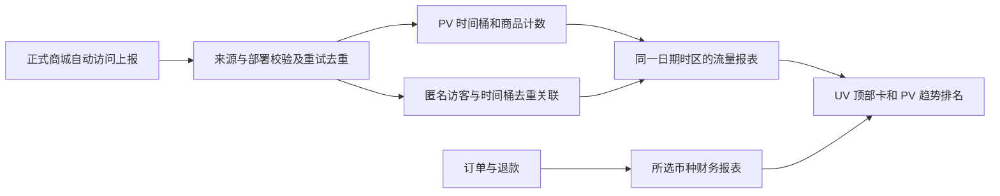

# 商业仪表盘与访问统计 - Plan

## Goal Capsule

将正式仪表盘改为参考 `/template/dashboard/analysis` 的商业分析页面：四张指标卡、销售额／访问量（PV）趋势和商品排名。顶部独立访客卡显示所选范围内去重后的 UV。货币选择放在第一张总销售额卡内；dashboard 默认跟随浏览器时区，不增加头像全局设置或时区选择器。

用户已于本对话授权开始实施。正式开发在当前 checkout 进行；不创建 worktree，不自动创建 PR，不部署或调整候选范围。本文的 R/F/AE/KTD/U 标识仅属于 CDA，其他计划的同名标识不受影响。

### 产品 authority 与继承边界

- 上游产品导航：`docs/plans/2026-08-13-001-refactor-shoppp-product-master-plan.md`；当前 active product plan 是 `docs/plans/2026-08-12-003-refactor-development-candidate-readiness-plan.md`（REL），执行 checkpoint 为 REL-Pre-DC。
- 本计划是独立的有界功能，不成为 active product plan，不更改 master pointer、REL 当前单元、Candidate Template Matrix、DC 或 PG。是否纳入候选由 REL 单独裁定。
- 继承 COM 的既有成交／退款／原币财务定义、报表权限、环境隔离和 R39 对敏感数据的保护；复用真实报表能力及共享 UI primitives。
- 定向替代：正式 dashboard 的独立筛选栏、退款卡片、平均订单额卡片和逐日罗列表格；其他列表页继续遵循 `docs/plans/2026-09-20-1438-fix-admin-page-query-consistency-plan.md` 的手动查询规则。
- 定向替代：`docs/plans/2026-09-21-1427-fix-dashboard-date-range-layout-plan.md` 的 dashboard 日期区域位置，保留成对日期边界；继续遵循 `docs/plans/2026-09-03-1553-fix-admin-i18n-completion-plan.md` 的浏览器时区默认及纯日期／UTC 语义，不迁移全后台时间消费者。
- 新增自动 UV／PV 统计边界，保留 `docs/architecture/trust-boundaries.md` 中现有 identifier-free aggregate analytics 原样。本计划不新增统计同意、拒绝、撤回流程，不把旧 Cookie 通知作为统计开关；实施时如更新相关说明，必须真实描述行为。预览访问的 Cookie 隔离不变。
- 并行 authority：REL 和既有独立修复计划各自拥有其范围。本计划的实现、验证和关闭尾项由 CDA U1–U8 拥有；实施时若与并行修改相撞，只协调文件和接口，不转移产品完成权。

## Product Contract

### Summary / Problem Frame

当前正式页面主要罗列财务数字和日表，模板已有合适的布局和图表，但模板数据是固定示例。现有财务接口足以支持销售额、支付笔数和净销售额；没有可直接支持本需求的精确 UV 去重和商品 PV 报表。

期望结果是用户在同一页面看清规模、变化和具体商品表现，并且切换日期、货币时看到一致的真实数据。模板提供布局参考，正式数据、状态和财务含义由本计划定义。

### Requirements

| ID | 需求 | 验收依据 |
| --- | --- | --- |
| R1 | 第一张总销售额卡内提供币种选择，控制全部财务指标；dashboard 默认使用浏览器时区，无头像全局设置或时区选择器 | AE1、AE2 |
| R2 | 顶部依次为总销售额、独立访客（全期 UV）、支付笔数、净销售额；提供同口径真实迷你趋势和可计算的上期比较 | AE3、AE4 |
| R3 | 主分析卡包含销售额／访问量 Tabs；右上角日期预设和日期范围控制全页 | AE5 |
| R4 | 销售额 Tab 显示逐日总销售额趋势及商品销售额排名，不扣退款 | AE6 |
| R5 | 访问量 Tab 显示逐日页面访问次数（PV）及商品页面 PV 排名；同一访客多次真实访问累计计数，规格合并到稳定 productId | AE7 |
| R6 | 排名保留历史商品名称；有当前公开商城页面时可点击，否则显示纯文本 | AE8 |
| R7 | Retired：热门搜索及全部搜索统计已取消，标识不复用 | AE9（Retired） |
| R8 | 正式商城默认自动采集，不增加统计同意流程；预览和明确测试流量排除 | AE10 |
| R9 | 财务与访问数据按同一查询时区归日；全期 UV 跨日去重；PV 汇总长期保存，不设固定 90 天删除；查询成功无记录显示 0，查询失败显示重试 | AE4、AE7、AE11 |
| R10 | 保留权限、竞态保护、主题、国际化、加载／错误／空状态和订单报表入口；不展示渠道占比或热门搜索 | AE5、AE11、AE12 |

### Key Decisions

- **D1 — 货币和时区位置（已修订）。** `session-settled: user-directed`；Governs R1。后续决定替代原头像全局设置：币种位于第一张总销售额卡，影响财务查询而非业务定价；dashboard 默认浏览器时区，无全局偏好 Provider 或新时区选择器。
- **D2 — UV 与 PV 分开（已修订）。** `session-settled: user-directed`；Governs R2、R5、R9。顶部卡是所选范围内独立访客 UV；主卡访问量趋势及商品访问排名是 PV。替代原“主卡也用 UV”的解释。
- **D3 — 销售额排名。** `session-settled: user-directed`；Governs R4。商品按销售金额排名、不扣退款；净销售额仍扣退款。
- **D4 — 页面构成。** `session-settled: user-directed`；Governs R2、R3、R6、R10。四张顶部卡及主卡 Tabs／日期／趋势／商品排名，不设独立筛选栏；访问指标遵循修订 D2，搜索部分由 D5 取消。
- **D5 — 删除热门搜索。** `session-settled: user-directed`；Governs R7（退役）、R10。删除卡片及采集／存储／报表／验收，不新增替补卡。
- **D6 — 自动统计与零值。** `session-settled: user-directed`；Governs R8、R9。默认统计，不增加同意交互；正常查询没有记录显示 0。不建设暂停管理或停采覆盖区间系统；接口失败仍是错误，不能伪装成 0。
- **D7 — 汇总优先、取消固定 90 天。** `session-settled: user-directed`；Governs R9。PV 长期保存汇总，不长期存每次访问明细；顶部跨日 UV 保留必要匿名去重依据，不能只存每日人数再相加。取消旧的固定 90 天删除与相关不可用状态。

### 实现假设与建议默认值

1. 币种是交易币种筛选，不是汇率换算。默认沿用 CNY；记住上次选择时复用现有本地模式并按身份／环境隔离，不影响商品、运费、订单或编辑草稿的币种。
2. dashboard 进入时读取有效浏览器 IANA 时区，失败回退 UTC。查询期间时区随已提交快照固定，不因浏览器状态变化悄悄重解释结果。订单报表保留现有查询能力；从 dashboard 进入时使用显式传入的日期、币种和时区。
3. 默认最近 30 个本地日期，含今天；预设今天、最近 7 天、最近 30 天、本周、本月、本年及自定义，单次窗口继续遵循现有财务上限。单次查询上限不等于历史保存期限。
4. PV 汇总与必要 UV 去重记录首版不设按 90 天自动删除。取消无用访问明细；匿名标识有效期、短期重试去重期限、汇总粒度和读写上限由 U1 依据查询能力确定，不把浏览器身份寿命等同于数据保留期。任何后续删除策略必须说明对历史查询的影响。
5. 仅表示成功接收的匿名浏览器访问，不承诺自然人识别或完整捕获所有网络失败流量。采集开始前不回填历史；成功无记录按用户决定显示 0，可用简短“自某日开始记录”说明，不引入 coverage 状态系统。

### 指标定义

| 指标 | 明确口径 |
| --- | --- |
| 总销售额／销售趋势 | 沿用 grossSales：paid、partially_refunded、refunded 非测试订单，按订单 createdAt 归期，使用 grand total 和所选交易币种 |
| 支付笔数 | 沿用 orderCount：符合上述条件的已支付订单每张一笔，不是支付尝试数；已退款订单仍计入 |
| 净销售额 | grossSales 减窗口内成功退款，可为负，也可包含以前订单的退款 |
| 商品销售额 | 按 productId 汇总不可变订单行 line_total_amount，合并规格、不扣退款；不分摊订单级运费／税／折扣，合计不要求等于总销售额 |
| 全期 UV | 所选窗口内匿名浏览器标识去重，同一访客跨日仍只计 1；不等于每日 UV 之和 |
| 每日 UV | 仅供顶部 UV 卡迷你趋势，每日各自去重；主卡不使用此序列 |
| 全站 PV | 每次有效页面进入计 1；真实刷新、离开后重新进入计新访问。重复上报／重试不增加 PV；组件重渲染、仅切规格不自动成为新访问 |
| 商品 PV | 商品详情页面的有效访问次数，按 productId 汇总规格；商品页面一次访问同时增加全站 PV 和该商品 PV 各 1，不能把两个事件重复计入全站 |
| 上期比较 | 同长度紧邻之前的本地日期窗口；UV 对上期独立去重。零或负基线显示绝对变化／无法计算比例；今天未结束明确说明。跨采集起点不声称有完整历史比较 |

### User Flows

- **F1 币种：** 在第一张总销售额卡切换币种 → 金额、支付笔数、销售趋势及商品销售排名同步重查 → UV／PV 不因币种变化而变化。
- **F2 趋势：** 打开 dashboard → 四卡 → 主卡选择日期或销售额／访问量 Tab → 同范围趋势和排名 → 点击当前公开商品。
- **F3 追查销售：** 进入订单报表，携带已提交的 currency、timeZone、startDate、endDate；目标页保留这个显式范围。
- **F4 自动采集：** 正式页面进入 → 建立或复用匿名统计身份 → 自动上报一次访问；不出现统计同意弹窗，失败不阻塞购物。
- **F5 无记录／失败：** 成功查询无记录 → 0 和空排行；请求失败 → 相应模块重试；财务成功时可继续显示，不能混用不同日期的数据。

### Acceptance Examples

- **AE1：** 币种选择位于第一张销售卡；头像无新增全局设置，dashboard 无时区选择器；浏览器时区用于默认日期和查询边界，失败回退 UTC，drilldown 携带实际时区。
- **AE2：** 切币种只改变财务范围，UV／PV 不变；JPY／KWD 精度正确，不重标原币、不改变业务定价或编辑草稿；纯日期不跨日转换。
- **AE3：** 支付、部分／全额退款、旧订单当期退款、测试订单固定事实集验证三张财务卡；UV 用独立访问事实验证；负净销售额正常，无退款／平均订单额独立卡。
- **AE4：** 财务迷你图用每日财务 series，UV 卡迷你图用每日 UV，主卡访问量图用每日 PV；不得互换，今日未结束和不可计算比较明确说明。
- **AE5：** 完整有效日期或预设一次提交全页；非法／未完成范围不请求；旧响应不能覆盖新范围，Tab 不改日期，标签对应已提交快照。
- **AE6：** 商品规格合并、金额相同按 productId 稳定排序，已退款订单金额保留；运费不混入商品排名。
- **AE7：** 同一访客访问 A 三次、B 两次，UV=1、全站 PV=5、商品 A=3／B=2；次日再访问 A 一次，全期 UV 仍 1、两日 PV=6、每日 UV 各 1。网络重试同一次访问不多计，第二访客增加 UV；跨午夜／DST／半小时及 45 分钟偏移按查询时区归日。
- **AE8：** 有 PV、从未成交、后下架的商品仍保留历史名称，链接为 null；当前成功公开页面才可点击，不泄漏 preview token 或拼任意外链。
- **AE9 — Retired：** 搜索验收取消，标识不复用。
- **AE10：** 无任何同意操作即可自动采集；不依赖旧 dismissed 状态；首次初始化、已有身份、多标签、真实刷新、SPA 页面进入、失败重试分别按定义计数；preview／明确测试流量不写入。
- **AE11：** 查询成功无记录显示 0、空排行；接口失败显示重试，不展示假零；超过 90 天的已有 PV 和 UV 记录仍能查，按单次窗口上限查询；开始记录前无历史回填、不提供误导性比较。
- **AE12：** reporting.read 拒绝时不能读财务或流量；明暗／system 主题、中英文、图表 resize、键盘和商品链接正常，不重复实现库焦点协议。

### Scope / Non-goals

- 范围：dashboard、必要的订单报表衔接；Fashion Store 正式商城自动 UV／PV；现有 reporting 权限下的查询。
- 不纳入：头像全局偏好 Provider、全后台消费者迁移、新时区设置、统计同意／撤回流程、暂停管理／覆盖区间系统、热门搜索、渠道占比、外部统计平台、跨设备识别、指纹、归因、汇率换算、历史回填、生产部署。
- Template 仍为演示；Decor Store 不扩大为本计划正式回归对象，跨模板回归归 DC3 冻结矩阵。

## Planning Contract

### Key Technical Decisions

| ID | 方案、依据与边界 |
| --- | --- |
| KTD1 | 币种选择为 dashboard 局部控件，复用现有查询状态和本地保存模式；不创建 DisplayPreferences Provider，不迁移全后台消费者 |
| KTD2 | 复用 format-currency.ts 精度和现有浏览器时区解析／报表 UTC 窗口转换；不改变其他页面的时间字段语义 |
| KTD3 | 复用 ReactECharts／ECharts、Ant Design tokens 和模板布局；不引用 mock、不新增图表框架 |
| KTD4 | 保留既有 identifier-free AE；新增独立访问契约／入口及现有环境 D1 表，不把采样事件当精确 UV／PV 来源 |
| KTD5 | 自动初始化随机第一方统计身份；复用服务端签发 HttpOnly／Secure／SameSite=Lax Cookie 模式，存环境隔离 HMAC 摘要，不用购物车／账号／支付／preview token 识别访客。身份生命周期与数据保留分开；密钥轮换不能悄悄拆分同一有效身份 |
| KTD6 | 服务端收取时间归期，事件随机 ID 支持有限重试；同一访问只增全站 PV 一次，商品维度同时更新。短期幂等键与计数原子提交；重试去重记录到期后，过期重试必须拒绝，不能重新增量。具体协议 U1 固定，不长期保存逐访问日志 |
| KTD7 | PV 保存按时间桶／商品的计数汇总；UV 保存匿名摘要与必要时间桶的去重关联，同桶重复访问不重复存 UV。全期 UV 做 DISTINCT，不相加日人数。不存每次访问完整明细，不设置固定 90 天删除。时间桶必须能正确切分支持的浏览器时区日期边界，不能只存 UTC 每日整数后声称可任意时区重分组；U1 用最小可行粒度验证（分钟桶作为候选），再冻结表和索引 |
| KTD8 | 名称与链接分开：链接只认当前成功公开部署路由及受控 origin；名称可取已验证公开的历史 manifest／订单行快照，无名称时明确“已下架商品（短 ID）”。PV 汇总保留解析名称所需的最小 release 引用，不建独立名称版本系统 |
| KTD9 | 扩展现有 committed snapshot／请求序号保护；财务与流量按同一日期／时区分别加载，旧结果更新时隐藏或标更新，不造通用状态引擎。币种仅属于财务查询 key |
| KTD10 | 显式 URL 范围优先于页面默认，drilldown 固定实际查询币种／日期／时区；订单报表保留手动查询语义，不增加全局偏好触发的自动重查 |

### 数据流与边界

- traffic contract 返回 window、asOf、全期 UV、每日 UV（仅迷你图）、每日 PV、商品 PV 前 10 和比较结果。可附简单 collectionStartedAt；不引入 coverage 状态机。查询成功无记录为 0，错误和读量超限明确报错。
- 公共入口与 `/platform/events` 分离，使用 exact storefront Origin、body cap、严格 schema、no-store 和专用限流。初始化和上报均受可信边缘来源配额约束，上报增加访客摘要配额；不能用未经验证 Authorization 换限流键。非 development 缺少必需 limiter binding 时停止新写入。
- 只接收受控 route-class、productId、releaseId 等维度；不存原 URL、IP、原 Cookie、邮箱、自由文本。来源键只用于临时限流，不进事实／普通日志。reporting 读端仍需 reporting.read。
- 正式部署来源和产品维度需服务端验证；preview 客户端与服务端双重排除，不信任自报 testMode。测试闭环使用隔离的正式形态本地配置，不污染正式流量。
- 无同意状态机、设置弹窗、撤回端点或新增页脚入口。身份初始化失败不阻塞购物；无有效身份不伪造 UV。相关 Cookie／统计说明必须与自动采集一致，不声称用户已同意。
- 短期幂等记录清理由现有 maintenance 有界批次完成；长期 PV 汇总和必要 UV 关联不随之删除。长期保存并非无限单次扫描：服务端限制查询成本，超限返回明确错误，不截断为看似精确的结果。

### System-wide Impact / Risks

- 取消全局显示偏好改造，代码影响收敛到报表及访问统计边界；订单／商品原币和其他后台时间显示沿用原规则。
- 精确跨日 UV 必须保留去重信息，数量会随访客与时间桶增加，不能把“PV 只存汇总”解释成 UV 也只存一个数字。U1 先验证浏览器时区归日、存储规模和 DISTINCT 查询，U6 再做完整验证；不预先增加队列、缓存、近似算法或长期压测平台。
- Cookie 清除／过期、多设备、机器人和请求丢失会影响统计，UV 是可识别匿名浏览器数；不宣称自然人或完整流量。自动采集是产品决定，不构成对任意部署地区和标识方式的法律结论。
- 采集开始前没有历史数据，不回填；正常空结果显示 0，保留简单开始记录说明；不建设停采区间管理。
- 公开链接与历史名称复用既有 publishing manifest；不得以 DB published 代替成功公开部署证据。

### Open Questions

无待用户选择的产品范围问题。U1 仍需通过有界技术验证固定时间桶、身份有效期、短期重试协议和读写上限；不得借机恢复已取消的全局设置、同意流程或 90 天删除策略。

## Implementation Units

### U1 — 契约、统计存储验证和部署 authority 核对

- **依赖：** 无；当前下一步。**对应：** R1–R6、R8–R10、KTD1–KTD10。
- **实施：** 重读 REL checkpoint；核对公开路由／历史名称依据。以代表性合成数据验证 PV 汇总、跨日 UV、时区／DST／非整小时偏移窗口与查询成本，再固定时间桶、索引、身份生命周期、短期幂等协议和容量上限。编写 reporting／独立 analytics contract。
- **文件：** packages/contracts/src/reporting.ts、新 analytics contract、apps/api/src/publishing/ 相关来源；存储验证证据在 docs/progress/，不建立第二状态队列。
- **验证：** schema 拒绝非法窗口／维度；UV 与 PV 明确区分；同一访问的原子幂等；能解析无订单历史商品名；验证时间桶能够支持承诺的日期精度。
- **完成：** 后续可按确定契约实施，不把关键查询验证拖到采集上线后。

### U2 — 销售卡币种与浏览器时区查询

- **依赖：** U1。**对应：** R1、F1、AE1、AE2、KTD1、KTD2、KTD10。
- **实施：** 第一张总销售额卡币种选择、局部记忆／有效默认、浏览器时区默认日期及固定查询快照；订单报表显式范围衔接。
- **文件：** apps/admin/src/pages/dashboard/dashboard-page.tsx、必要的局部组件／查询 helper、pages/reports/order-report-page.tsx（仅衔接）、messages 和专项 tests。
- **验证：** 切币种只更新财务；原币精度正确；浏览器跨午夜／DST／UTC 回退，drilldown 使用已提交参数，其他业务草稿不受影响。
- **完成：** 不引入全局 Provider、头像设置、新时区选择或全后台消费者迁移。

### U3 — 商品销售额排行与公开链接

- **依赖：** U1。**对应：** R4、R6、F3、AE3、AE6、AE8、KTD8。
- **实施：** `apps/api/src/reporting/product-ranking.ts`（新）复用既有窗口／支付状态／currency／environment／test_mode；按商品汇总订单行、稳定排序、返回前 10 名及公开名称／路径。公开 link resolver 同时供 U6 商品 PV 排名使用。
- **文件：** reporting contract／service、`apps/api/src/reporting/order-metrics.ts` 共享条件、reporting routes、public deployment resolver 与对应 Worker tests。
- **验证：** 多规格、退款、运费／税／折扣差异、历史名称、同额排序、非目标币种／环境／测试订单、未部署／下架 null link、reporting 权限；现有 revenue fixtures 仍满足财务定义。
- **完成：** 金额与不可变订单行一致，排名与总销售额差异有说明，链接有成功公开部署证据。

### U4 — 汇总存储、匿名身份与受控入口

- **依赖：** U1。**对应：** R8、R9、AE7、AE10、AE11、KTD4–KTD7。
- **实施：** D1 PV 汇总、UV 去重关联、短期幂等表及索引；自动身份初始化；原子去重／汇总写入、公开来源／环境／维度校验、可信限流、短期记录有界清理和日志保护。
- **文件：** packages/db/migrations/、schema；apps/api/src/analytics/（新）、HTTP routes／context／配置及 maintenance；trust-boundaries 文档。
- **验证：** migration、原子性、相同事件并发重试、过期重试拒绝、无／过期／伪造身份、密钥轮换、环境隔离、preview 排除、限流键绕过与 binding 缺失；清理不删除长期汇总／UV；敏感串不进日志。
- **完成：** 不长期存逐访问明细，统计失败不影响交易，旧 AE 和 preview 边界保持。

### U5 — 商城自动 UV／PV 埋点

- **依赖：** U4。**对应：** R5、R8、F4、AE7、AE10。
- **实施：** 正式页面自动初始化／复用身份，页面进入上报一次；商品维度从公开构建上下文取得；真实刷新／重新进入与重试区分，避免 hydration 和路由钩子重复计数。无新增同意交互。
- **文件：** apps/storefront/app/plugins/funnel.client.ts／独立访问插件、公开商品上下文、interaction contract 与专项 tests；现有 Shell 如需改动仅为事实一致的说明。
- **验证：** 首访、已有身份、并发标签首次初始化、路由切换、刷新、规格切换、重复发送、身份／网络失败、preview 不写入；无需点击同意即统计。
- **完成：** 一次有效页面访问对全站只计一次，商品访问同时更新该商品；既有运维事件不重复计入。

### U6 — UV 卡与 PV 趋势／商品排名报表

- **依赖：** U3、U4、U5。**对应：** R2、R5、R9、F5、AE4、AE7、AE11、KTD7–KTD9。
- **实施：** traffic reporting／Admin service；全期和每日 UV 独立去重，PV 时间桶按查询日期汇总，商品 PV 前 10；比较期独立计算，计数同额按 productId 稳定排序。
- **验证：** AE7 数字例子、DST／非整小时偏移、重试不增 PV、正常空结果=0、读失败报错、超过 90 天记录仍可查、权限与代表规模查询；不把明细拉到 Admin。
- **完成：** 主卡和排名为 PV，顶部为 UV，不以日 UV 相加替代范围 UV，不加入商品 UV 功能。

### U7 — 参照模板组装正式商业仪表盘

- **依赖：** U7.1 依赖 U2、U3；U7.2 依赖 U7.1、U6。**对应：** R2–R6、R10、F2、F3、F5、AE3–AE8、AE10–AE12、KTD3、KTD9。
- **U7.1 财务与布局：** 四卡及主卡 Tabs／日期／销售图／销售榜，第一张卡含币种选择；可提前检查布局。尚未接入的 UV／PV 明确为开发中未接入，不用假零冒充已实现。
- **U7.2 接入访问统计：** 顶部 UV 总数与每日 UV 迷你图，访问量 Tab 的每日 PV 和商品 PV 排名；完成分模块加载／失败／空结果／竞态保护。
- **文件：** apps/admin/src/pages/dashboard/dashboard-page.tsx、必要局部组件、services/reporting/api.ts、messages、dashboard.test.tsx 和 BrowserMode tests。
- **验证：** 0／负值／部分失败、完整日期提交、旧响应后到、币种不影响流量、Tab 不改范围、真实链接、窄屏／主题／语言／键盘，无 template mock。
- **完成：** 两个子阶段均完成才可签收 U7；移除独立筛选栏、退款／平均订单额卡和长日表，不新增搜索或渠道卡，保留订单报表入口。

### U8 — 集成验证、证据与关闭

- **依赖：** U1–U7。**对应：** 全部有效 R/F/AE，排除 R7、AE9。
- **实施：** 自动访问→UV/PV 写入→Admin 报表→公开商品链接真实闭环；focused progress evidence、interaction／安全文档与无遗留 mock 检查。
- **完成：** DoD 全满足，更新本计划 checkpoint 并冻结；不推导 REL/DC/PG 状态。

## Verification Contract

### 当前计划交付（L0）

仅检查文档结构、路径／authority 引用和 whitespace；不运行应用测试／构建，不修改应用代码。

### 实施验证（L3，按已修改边界有序执行）

| 边界 | 命令／证据与场景 |
| --- | --- |
| Contracts／DB | 各 workspace typecheck；`bun run --cwd packages/db test:workers test/migrations.test.ts` 及新统计仓储 tests；contracts 专项 schema tests（实施时核对现有 runner） |
| API Worker | `bun run --cwd apps/api test:workers test/reporting/revenue.test.ts test/reporting/reporting-api.test.ts test/security/public-boundaries.test.ts test/security/redaction.test.ts`，加 U3/U4/U6 专项测试；不能用普通 bun test 代替 Worker 环境 |
| Admin | `bun run --cwd apps/admin test src/pages/dashboard/dashboard.test.tsx`，加币种选择／日期默认／drilldown 专项测试；对应 BrowserMode tests 验证真实 Intl、时区、图表 resize／范围竞态，实施时核对 test:browser 的筛选参数 |
| Storefront | `bun test apps/storefront/tests/analytics.test.ts apps/storefront/tests/preview-access.test.ts tools/environment-gateway.test.ts`，加自动 UV／PV 采集和 interaction contract tests |
| 类型与格式 | 修改到的 admin／api／contracts／db／storefront workspace 分别执行 typecheck；lint 与 build 按实际影响面，不重复全仓验收 |
| 真实闭环 | 只在仓库规定的本地构建 preview／显式候选环境使用隔离的正式形态统计测试配置和数据；验证 AE10 自动采集及 AE7 的 UV 去重／PV 累计可被后台读取、AE8 跳到公开商品。private preview 本身必须继续禁采，不用其成功上报当验收；不生成或输出凭据 |

每项测试记录输入／动作／可观察结果，针对上面的 AE，不镜像内部实现。已有回归入口不足时在最近稳定交互边界补测试，不引入页面级 focus／announce 状态机。扩大测试只为解决具体剩余风险；正式跨模板回归仍归 DC3。

## Definition of Done

- 有效 R1–R6、R8–R10、F1–F5、AE1–AE8、AE10–AE12 均有可复核实现与验证证据，无未解释的范围偏差；退役 R7、AE9 不计入完成条件。
- 币种选择位于总销售额卡，仅影响财务查询；dashboard 默认浏览器时区，drilldown 固定实际范围，原币／草稿不受影响。
- 财务口径保持，商品金额排名不扣退款，安全公开链接可解析；四卡、趋势和排名都来自真实接口，页面不包含热门搜索或渠道占比卡。
- 默认自动采集；顶部 UV 跨日去重，主卡／商品排名为 PV；PV 汇总及必要 UV 关联不按固定 90 天删除，短期重试记录有界清理；成功空结果为 0、错误可重试，旧 AE／preview 边界保持。
- 局部测试、报表与采集边界 L3 验证、真实闭环与必要类型／构建 gates 通过；无保留阻断缺陷，统计部分失败状态可用。
- 本计划 checkpoint 和 focused `docs/progress/` 证据与实现一致；master／REL 未因本独立计划被误改。
- 落地策略：按仓库单开发者规则做本地验证和受治理的 branch/main 流程；提交／合入遵循当时用户授权，不自动开 PR、部署或创建 worktree。

## Execution Checkpoint

**用户已授权实施，U1 已完成，U2／U3／U4 在互不重叠的文件范围内执行。** 这是 CDA 唯一的当前单元／状态／下一步 authority；实施时按仓库规则在状态、顺序或下一步变化的同一变更中更新。progress 证据不另建 current-unit 队列。

| 单元 | 状态 | 依赖 |
| --- | --- | --- |
| U1 契约与存储验证 | Complete | 无 |
| U2 卡内币种与查询时区 | In progress | U1 |
| U3 商品销售额与公开链接 | In progress | U1 |
| U4 统计存储与端点 | In progress | U1 |
| U5 商城自动采集 | Not started | U4 |
| U6 统计报表 | Not started | U3、U4、U5 |
| U7 仪表盘 UI（U7.1／U7.2） | Not started | U7.1：U2、U3；U7.2：U7.1、U6 |
| U8 集成验证与关闭 | Not started | U1–U7 |

- 当前单元：U2；U3／U4 同层并行实现，共享 checkout 文件所有权分离。
- 阻断：无已证实的范围或技术阻断；此前 Q1 已由 D5 删除热门搜索解决。实施已获授权；本地验证不推导候选或部署授权。
- 下一具体动作：接入销售卡币种、商品销售排行和汇总采集入口；U1 证据见 `docs/progress/2026-09-29-cda-u1-evidence.md`。
- 实现顺序：U1 →（U2／U3／U4 文件分离并行）→ U7.1／U5 → U6 → U7.2 → U8。接口已固定后并行独立单元，主执行者统一集成及验证；不创建 worktree，子阶段不替代 U7 完成权。
- Tail owner：CDA；REL 只拥有候选纳入和后续 DC/PG authority。

## Sources

- 用户原对话及本次修订：销售卡内币种、浏览器时区默认、UV 卡／PV 趋势与排名区分、自动统计、正常空结果为 0、取消固定 90 天保存；保留不扣退款排名、删除渠道／搜索、仅更新计划的边界。
- 上述 master／REL、Admin `AGENTS.md`、`apps/admin/docs/ai/` recipes／rules／catalog、`apps/admin/docs/testing-standards.md` 与既有独立修复计划。
- 正式 `apps/admin/src/pages/dashboard/dashboard-page.tsx`、参考 `pages/templates/dashboard/analysis-page.tsx`、reporting contracts／`apps/api/src/reporting/`、不可变 order_lines schema／订单创建链。
- `apps/admin/src/shared/i18n/format-currency.ts`、`shared/utils/time-zones.ts` 和既有报表查询状态。
- `apps/storefront/app/utils/analytics.ts`、`plugins/funnel.client.ts`、Fashion Store Shell、`apps/api/src/security/public-analytics.ts`、observability logger、`docs/architecture/trust-boundaries.md` 与 publishing manifest／release 链。
- 既有计划选型参考：[Cloudflare sampling](https://developers.cloudflare.com/analytics/analytics-engine/sampling/)、[D1 indexes](https://developers.cloudflare.com/d1/best-practices/use-indexes/)。U1 需用本项目数据验证方案，引用不代表容量已验证。
