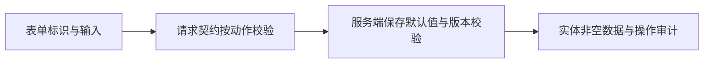

# Shoppp Form Input Necessity - Plan

## Goal Capsule

- **Objective:** 商家能创建和验证草稿而不必解释普通操作，能复用已有信息与素材，购物者看到的必填要求与实际结账契约一致。
- **Means:** 采用现有表单输入必要性规范，按 U1 → U2 → U3 → U4 → U5 实施界面、API 与审计联动调整（KTD1-KTD3）。
- **Authority:** 独立的小型改进计划，只拥有本计划的 U 与证据；产品 master 仍指向 `REL-Pre-DC`，不改变产品顺序、候选范围或 tail owner。
- **Baseline:** 继承 `docs/plans/2026-09-22-0043-feat-storefront-control-plane-plan.md`（FS-F14）的已完成控制面与版本审计行为；仅有限调整其 R3 的手填原因适用范围，保留稳定 ID、版本、审计和乐观锁。历史计划不重开。
- **Execution:** 当前 checkout 内执行，不建工作树、不创建 PR、不提交；最终由当前执行者完成本计划验收并更新此 checkpoint。审批、公开发布、资金、库存、隐私与导出边界不得顺带放宽。

### Execution Checkpoint

- **Classification:** Independent bounded refactor；不成为 active product plan。
- **Current unit:** 无；U1–U5 已完成，执行体冻结。
- **Next concrete action:** 无；本计划范围已完成。
- **Blocker:** 无。
- **Completion evidence:** 2026-10-01；[验证与审查修正证据](../progress/form-input-necessity-verification.md)。

| Unit | Status | Evidence / next boundary |
| --- | --- | --- |
| U1 | Complete | 输入必要性规范与本计划已建立；文档 L0 静态检查 |
| U2 | Complete | 备注选填与严格 transition 已联动；非法备注在写入前拒绝 |
| U3 | Complete | 默认 SEO、英文新建 Slug、同域素材选择及权限已验证 |
| U4 | Complete | 原生无手机号校验、live 浏览器提交及 Workers 支付链路通过 |
| U5 | Complete | 六项确认的 review finding 全部修复；最终集成、浏览器、类型及静态检查通过，完成证据已保存 |

---

## Product Contract

### Summary

在现有表单规范中建立输入必要性原则，先取消普通草稿和私有预览的手填原因门槛，再减少重复输入与素材 ID 复制，最后统一手机号选填要求。每个变更共同覆盖输入界面、API 接受范围与实际审计/持久化结果。

### Problem Frame

现有普通草稿、校验和预览复用必填原因，SEO 标题重复业务标题，部分素材要求复制 ID。Fashion Store 结账手机号的界面必填也与 API 的 optional 契约不一致。

### Key Decisions

- KD1. **普通草稿保留自动审计、备注选填。** (session-settled: user-approved — chosen over requiring reasons on every write: 普通草稿不会直接改变线上店面，系统已有操作事实。) Governs R1-R3.
- KD2. **独立分批改进现有表单。** (session-settled: user-approved — chosen over a global form rewrite: 复用现有规范与组件，并联动界面、API 和审计。) Governs R4-R7.

### Requirements

- R1. 表单必要性规则集中在 `apps/admin/docs/ai/ai-rules.md` §4.2，迁移规则只引用，保持现有必填标识、布局和组件行为。
- R2. Theme draft create/update、block 写入、validate、preview、preview grant/revoke、migration dry-run 和私有 candidate build/abandon，以及 Content、Collection draft、Navigation、Store Identity 和 Policy draft 保存接受省略/空白 `reason`；选填备注可为 1-2 字符，保留 max 500 与安全校验、清洗和脱敏。
- R3. 无手填备注时审计 `reason` 为 `null`，动作、actor、时间、目标与版本仍自动记录；Theme Snapshot approval、migration approve、Content/Navigation/Policy transitions 和涉及 published/archived Collection 的写入继续要求有效原因。
- R4. Content、Collection、Store Identity 的 SEO title 空白时，在保存边界采用真实业务标题/名称，返回与保存的数据仍非空，显式 SEO title 保持原值，不回填历史数据。
- R5. 新建 Content/Collection 可从英文标题/名称预填 Slug，用户可修改；既有、已修改或无法可靠生成的 Slug 不自动覆盖，空白仍不能保存。
- R6. Store Identity 的品牌素材和 Collection cover 使用已有素材选择器；选择与回填保持原稳定 ID，素材读取保持 `identity.read` / `catalog.read`，原 Content 入口仍要求 `content.read`。
- R7. Fashion Store 手机号标为选填，移除原生 `required`，遵守现有 API optional/max 40 契约；保留地址、支付、反滥用与权限行为。

### Scope Boundaries

本计划不改审批、公开发布、退款、库存、隐私/导出原因规则，不新增通用表单框架，不改变素材批准标准，不生成中文拼音，不自动改历史 Slug 或 SEO，不推进 Candidate/DC/PG。

---

## Planning Contract

- KTD1. **沿现有 action 边界区分输入。** 实施 R2-R3，保留 `reason` 请求键及旧客户端有值行为；Snapshot approve 从 validate schema 派生时显式覆盖严格 reason，migration approve 保留现有确认与原因，不把 optional 扩散到所有写接口。
- KTD2. **默认值在保存边界保证数据有效。** 实施 R4-R5，UI 说明默认 SEO 来源，服务端以同一业务名称补足保存值；Slug 仅新建表单预填，不隐藏冲突或格式错误。
- KTD3. **复用 selector 并保留业务域权限。** 实施 R6，`ContentMediaSelect` 增加小型 source 参数；同域只读入口复用 `listCatalogMedia`，不放宽 `/admin/content/media` 的权限。

### High-Level Technical Design

---

## Implementation Units

### U1. 建立原则与独立计划

**Goal / Requirements:** 完成 R1；无前置依赖。
**Files:** `apps/admin/docs/ai/ai-rules.md`、`apps/admin/docs/ai/form-migration-rules.md`、本计划。
**Approach:** 集中规则并引用；保留已完成 FS-F14 与 active REL 的各自 authority。
**Test expectation:** none — 文档 L0；检查 diff、链接、范围与 checkpoint 一致。
**Verification:** 无 competing 规则、产品指针或历史状态改写。

### U2. 放宽普通草稿与预览备注

**Goal / Requirements / Dependencies:** 实施 R2-R3 与 KTD1；依赖 U1。
**Files:** `packages/contracts/src/{admin,catalog,storefront-content}.ts`；`apps/api/src/{http/app.ts,security/audit-reason.ts,storefront-experience/service.ts,content/resources.ts,content/policies.ts,catalog/collections.ts,publishing/candidate-releases.ts,storefront/navigation.ts,settings/store-identity.ts}`；对应 Admin `themes-page`、`theme-editor-page`、`content-editor-page`、`collection-form-page`、`navigation-page`、`store-identity-page`、`policies-page`、`catalog-preview-candidate-panel` 及所属 API services。
**Approach:** 用既有写入链路接受无备注并保存审计事实；集合以当前/目标 published 或 archived 状态保持原因门槛，Policy 草稿保存与 transition 分开。
**Test files:** `packages/contracts/test/{storefront-experience,storefront-content,catalog-release}.test.ts`；`apps/api/test/{security/audit-reason,storefront-experience/experience-api,content/pages,content/articles,content/policies,catalog/catalog,catalog/candidate-release,storefront/navigation,operations/store-identity}.test.ts`；上述 Admin 页面已有 `.test.tsx` 与 Theme/Content `.browser.test.tsx`。
**Test scenarios:**
1. 无备注/空白普通动作成功，审计 reason 为 null 且 actor/action/对象/版本存在；短备注保留，有值仍清洗、脱敏并兼容旧请求。
2. 空白或过短危险 transition 被拒绝且无部分写入；published/archived Collection 写入仍严格。
3. UI 不阻断无备注校验/预览/保存；权限拒绝与版本冲突保留输入，实际请求 payload 符合动作契约。
**Verification:** 所有具名 consumers 的 focused suites 与 Workers API 实际边界通过。

### U3. 减少重复输入与 ID 复制

**Goal / Requirements / Dependencies:** 实施 R4-R6 与 KTD2-KTD3；依赖 U2。
**Files:** U2 的 Content/Collection/Store Identity schema、API 与页面；`apps/api/src/{http/app.ts,media/library.ts}`、`apps/admin/src/shared/content/content-media-select.tsx`、`apps/admin/src/shared/content/suggest-english-slug.ts`、`apps/admin/src/services/content/api.ts`；对应 U2 tests 与 `apps/admin/src/shared/content/content-media-select.test.tsx`、`apps/admin/src/pages/settings/store-identity-page.browser.test.tsx`。
**Approach:** 保留实体非空合同，放宽输入并由保存边界补足 SEO；新建表单预填 Slug；复用已批准素材查询与 selector 的加载、错误、重试和 readonly 行为。
**Test scenarios:**
1. 空白 SEO 保存/返回业务名称，显式 SEO 不变，既有实体不被批量改写。
2. 英文新建名称预填有效 Slug；自填/既有 Slug 不覆盖，中文与空白不能臆造有效地址。
3. 搜索、选择、回填、清空可选素材后提交稳定 ID；仅有 identity/catalog 读权限可加载，缺对应权限拒绝，content 权限不放宽。
**Verification:** 表单/API/持久化一致，素材 selector 完成一次真实交互。

### U4. 统一结账手机号选填

**Goal / Requirements / Dependencies:** 实施 R7；依赖 U3。
**Files:** `apps/storefront/app/themes/fashion-store/components/pages/FashionStoreCheckoutPage.vue`；`packages/contracts/src/checkout.ts`（保持 optional）；`apps/storefront/tests/{fashion-store-checkout,checkout}.test.ts`、`apps/storefront/e2e/fashion-store-{checkout,live-commerce}.spec.ts`、`apps/api/test/payments/checkout.test.ts`。
**Approach:** 沿既有 billing/shipping 地址组装和结账请求，统一可见文案与原生校验，不新增支付逻辑。
**Test scenarios:**
1. 不填手机号可以通过表单并提交现有地址契约；填手机号原值保留，超长仍被现有边界拒绝。
2. 其他必填地址与既有支付/结账失败恢复行为继续通过，原生浏览器确认 phone 不触发 required 阻断。
**Verification:** 功能与 API focused tests 通过；尽可能运行真实结账浏览器验证并明确限制。

### U5. 集中验证、review 与完成证据

**Goal / Requirements / Dependencies:** 验证 R1-R7；依赖 U2-U4。
**Files:** 本计划；`docs/progress/form-input-necessity-verification.md`（新增），以及验证发现必须修正的本计划 owned files。
**Approach:** 留存具名消费者、focused suites、实际结果与 browser 限度，review 修正实际回归；完成时冻结执行体并更新本计划 checkpoint。
**Test expectation:** 复用前面各 U 的实际行为验证，不新增镜像实现测试。
**Verification:** 按以下合同完成，证据不维护第二条 current-unit queue。

---

## Verification Contract

Admin 为 L3：以 import/reference 和 workspace dependency metadata 列出实际消费者并映射 U2/U3 的具名 suites。使用现有 Admin Rstest focused 命令、contracts 的 `bun test` 与 API Workers focused 命令；不以 jsdom 冒充实际持久化。U4 使用现有 Storefront 功能测试和 Playwright 结账套件，浏览器覆盖素材选择、普通预览与手机号原生校验。所有代码稳定后，每个受影响 workspace 的 typecheck 仅运行一次；changed-file lint/格式检查按所属脚本执行。此独立改进不运行 candidate `release:validate` 或全量发布门禁。U1 为 L0，不跑测试/typecheck/build。

## Definition of Done

R1-R7 有对应实现和 focused 证据，危险动作原因、权限、版本与实体保存约束保持有效；真实浏览器结果或实际不可用原因明确。无遗留试验代码，既有 dirty 工作被保留，U1-U5 在此 checkpoint 完成且 master/REL 未改。

## Sources

规范：`apps/admin/docs/ai/ai-rules.md` §4.2、`apps/admin/docs/testing-standards.md`；继承 FS-F14 R2-R3/R8/KTD10。源码依据为 U2-U4 所列当前文件，素材复用以现有 `ContentMediaSelect` 与 `listCatalogMedia` 为准。[GOV.UK Question pages](https://design-system.service.gov.uk/patterns/question-pages/) 只提供输入必要性与信息复用依据，组件布局遵守项目规范。
