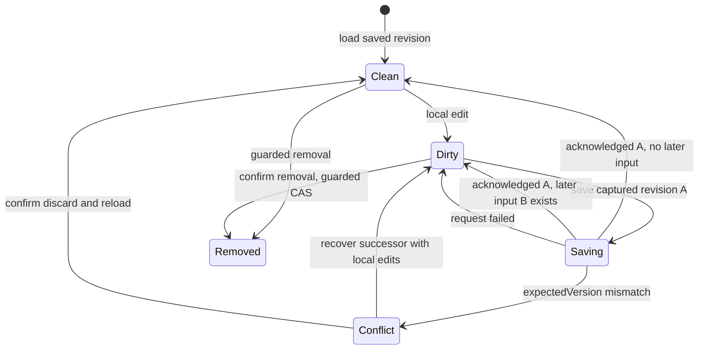
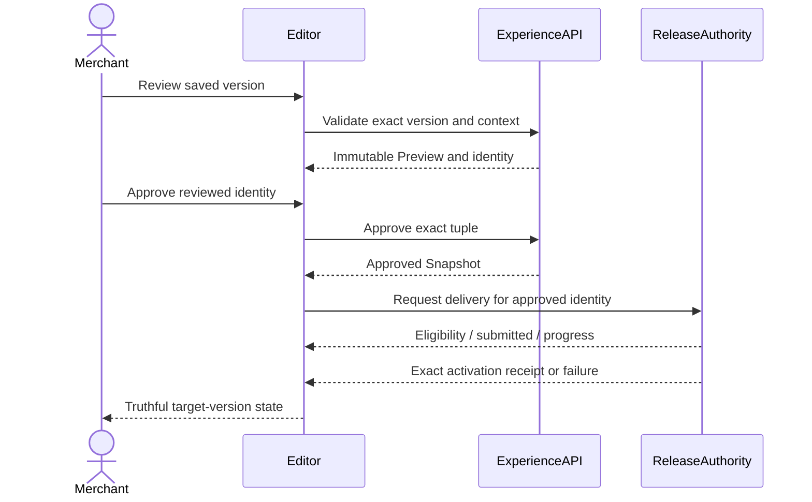
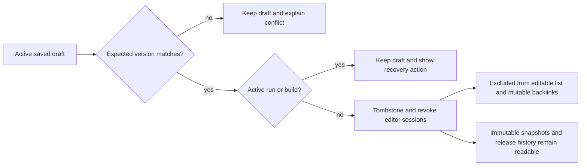
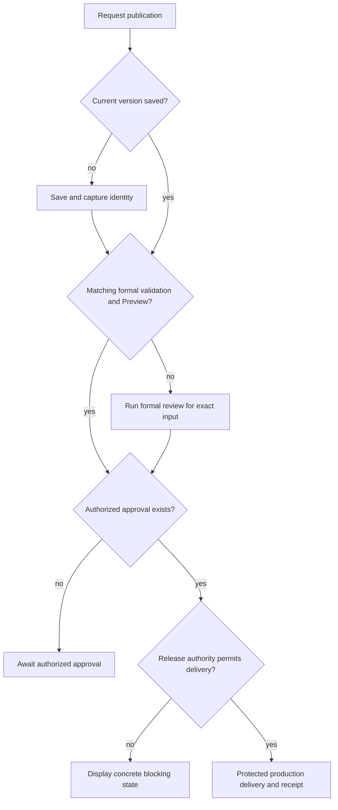
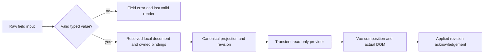
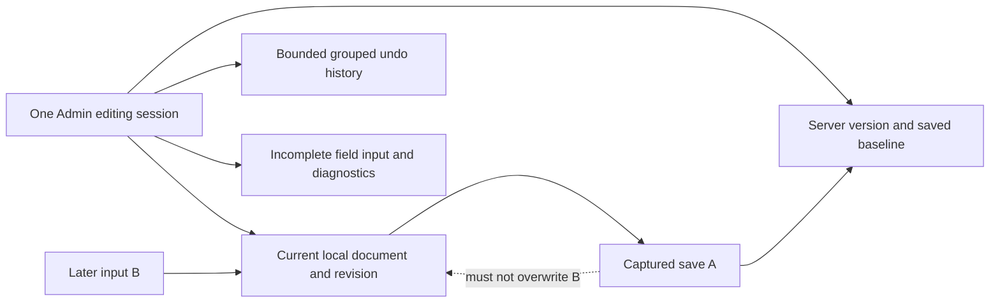

# Shopify-style Storefront Editor Reconstruction - Plan

## Goal Capsule

**Objective:** 商家能直接在店面画面中找到要修改的内容，看到修改结果，安全保存、管理装修草稿，并清楚知道一个版本是否已经上线。

**Means:** 采用 Shopify 式结构化装修编辑器，复用 Shoppp 的真实店面渲染器和业务数据边界（KTD1–KTD3）。

本次交付为完整实施提案与可交互草图，尚未进入产品实施。用户已指定 Shopify 参考方向；本计划中的具体界面、范围与顺序是供评审的建议。草图使用示例内容，点击保存、删除、提交审核不会操作真实商店。

### Authority and Inheritance

| Authority | Inherited baseline / ownership |
| --- | --- |
| [Product master](2026-08-13-001-refactor-shoppp-product-master-plan.md) | 当前指针为 REL-Pre-DC；未冻结 Candidate，DC/PG 与生产激活未开始。本次计划交付不改变该指针。 |
| [FS-F14](2026-09-22-0043-feat-storefront-control-plane-plan.md) | 已完成 U1–U9。继承 Store、Policy、Navigation、Collection、Content 的 canonical ownership，以及冻结 Catalog Release、Experience Snapshot、私有 Preview 的身份边界。 |
| [THEME](2026-07-30-002-feat-versioned-storefront-theme-platform-plan.md) | 继承版本化 package、schema、preset、校验、迁移、不可变快照与历史读取；拟替代其 U8 的“树表单 + 分离预览”编辑交互。 |
| [REL readiness](2026-08-12-003-refactor-development-candidate-readiness-plan.md) | 继续单独拥有 Pre-DC eligibility、Candidate 身份、DC/PG 与上线授权。装修预览和编辑器验收不能替代这些证据。 |

拟议产品后继别名为 THEME-E1。激活时，替代 FS-F14/THEME 中主题 authoring 的交互、草稿管理与可编辑 presentation 合同，并承接原先未实现的生产 Experience 消费合同；保留现有 REL/DC/PG 上线门槛。不重开已完成正文，不重编号仍存续的 R/F/AE/KTD/U。本文新增 ID 仅在 THEME-E1 内有效，上游 ID 按别名引用。

建议产品顺序：评审本提案（包含 U7 的生产合同归属）→ 激活 THEME-E1 的 U1 → U7.1 完成生产输入/产物合同，U7.2 对接请求与回执 → U8 完成后回到 REL 的 capability/deferral reconciliation。激活时须在同一变更更新 master pointer、本文 checkpoint 与 REL 的交接边界；REL 并行保留 readiness 权威，不维护第二个装修实施队列。其他 bounded plans 保留各自范围，不能由本计划推定完成。

**Tail owner:** 激活后的 THEME-E1 负责合同、Admin、即时预览、草稿生命周期、生产 Experience 输入/产物接入、发布请求/状态、迁移与本地验收；REL 和现有受保护 release 工作流负责候选资格、DC/PG 与实际生产交付。生产合同实施由 U7 拥有，不让 U8 等待一个排在 U8 之后的 REL 实施任务。单开发者在当前 checkout 开发，不要求 PR 或新 worktree。

**Stop conditions:** 本次止于可评审计划和草图。后续实施遇到身份/授权契约不能成立时停止对应 U；不通过修改正式 Preview 安全策略或伪造“已上线”状态绕过阻塞。

### Execution Checkpoint

本表按仓库 delivery-document 规则保留，优先于 ce-plan 的通用无生命周期建议；它尚不是活动产品队列。

| Item | Proposed checkpoint |
| --- | --- |
| Activation | 未激活；等待用户评审本次具体提案 |
| Current unit | 无正在执行的 U |
| Next concrete action | 方向获准后，激活 U1.1：核对 authoring capability matrix 与即时预览部署拓扑 |
| Units | U1–U8 均未开始 |
| Blocker | 无计划/草图交付阻塞；生产构建当前不消费 Snapshot，U7.1 必须补齐这个合同，U7.2 不能只做状态适配 |
| Completion authority | 激活后仅本文记录其 U 状态；证据写入 `docs/progress/`，不另建 current-unit queue |

## Product Contract

### Summary and Problem Frame

当前页面让商家编辑工程配置，然后保存、校验、构建，再打开另一个预览页面。文字、分区与 Block 的修改还采用不同保存时机，商家无法在一个画面内建立“选中、修改、确认结果”的连续操作。

草稿删除也不是按钮遗漏这么简单：目前无删除 API，历史校验和快照保留 draft 外键。应补齐可删除的业务生命周期，同时保留已经批准或发布的历史。

### Actors

- **A1 商家编辑者：** 拥有 `themes.write`，装修与管理草稿；相关媒体、商品、集合、内容权限由各业务域判断。
- **A2 查看者：** 拥有 `themes.read`，查看授权范围内的版本；不可因进入新编辑器获得写权限。
- **A3 审核/发布操作者：** 使用现有 `themes.preview`、`themes.approve` 及 release 权限；编辑权不自动赋予批准和上线权。

### Requirements

| ID | Requirement |
| --- | --- |
| R1 | 主题库区分当前线上版本、装修草稿、历史版本。草稿支持创建、命名、重命名、复制、删除；复制明确取一个已保存版本，不转移任何 operator run。删除只移除可编辑草稿，保留历史快照和线上版本。 |
| R2 | 编辑器以左侧结构、中央真实店面预览、右侧属性为主要布局；页面上下文、设备切换、撤销/重做、保存、发布审核位于固定的工作区工具栏。窄屏保留完整操作能力，面板按空间重排。 |
| R3 | 所有 presentation 修改进入同一个本地编辑会话：文字、图片、引用、分区/Block 操作、页眉页脚和全局样式均可撤销/重做，并由一个显式保存动作持久化。保存失败或版本冲突不得丢失尚未保存的输入；保存期间继续输入仍保持 dirty。 |
| R4 | 修改后在当前画面立即反馈，无需为每次输入保存或触发正式构建。预览必须使用同一套 Vue 组件、样式与组合逻辑；不完整输入显示定位到字段/分区的错误，画面明确保留最后有效结果。预览失败或重新授权不丢失编辑会话。 |
| R5 | 结构树和画面双向定位 Section/Block。分区与 Block 仅允许主题声明的增删、复制、显示/隐藏、重排和数量；必需区域保留约束。拖动之外提供上移/下移操作。检查模式选中元素；浏览模式仅执行允许的只读导航与选择，不修改真实购物车或订单。 |
| R6 | 在主题声明范围内编辑全局颜色、内置字体、间距、按钮和共享页眉/页脚 presentation；这些设置实际作用于桌面/手机和支持的页面，默认值保持已验收模板输出。共享设置有独立所有者，不依赖 Hero 的存在或位置。 |
| R7 | 支持当前 Fashion Store package 已登记的页面类型及适用预览资源。商品、库存、价格、正文、政策、导航与集合成员继续在原业务域管理；编辑器只配置样式、显示项与稳定引用，并提供保留编辑状态的业务页入口。系统关键区域不可任意删除。 |
| R8 | 发布审核必须对应确切的已保存版本、Catalog Release、校验结果和正式私有 Preview。任何相关身份变更使旧审核失效。批准不等于上线；界面按权威回执显示“已提交、已批准、上线中、已上线、上线失败”，无回执不能显示成功。 |
| R9 | 即时编辑预览仅向有权限的操作者开放；不放宽现有正式 Preview 的禁止嵌入策略。角色权限、过期会话、草稿删除、撤销权限与跨环境资源检查在新入口继续成立。 |
| R10 | 旧 package/schema、已保存草稿、旧编辑链接、Snapshot/Release 的历史读取可继续使用。升级生成可审查的后继草稿，不重写历史 package 或已发布快照；新体验稳定后移除旧编辑页面主体。 |

### Page Capability Boundary

以下是首版完整工作流的范围，不宣称现有每个页面已经拥有任意 Section authoring。U1.1 产出 manifest 实际矩阵；新增能力必须同时有 renderer 与验证支持。

| Page / group | Authoring and preview | Canonical owner / locked area |
| --- | --- | --- |
| 首页 | 声明可添加的 Section/Block、资源引用、排序、可见性与属性 | 必需能力与数量由 manifest 限制 |
| 页眉 / 页脚 | 全局 presentation、显示项、菜单/内容引用 | 店名/Logo、菜单和政策正文仍由各 owner 管理 |
| 商品 / 集合 / Shop / Search | 登记的显示设置、共享样式、选择实际预览商品/集合/查询 | 商品商业数据、集合成员、索引不在装修文档复制 |
| 内容页 / 文章 / Magazine | 登记的页面 presentation、共享样式与实际内容预览 | 正文由 Page/Article 管理；不新增第二套富文本存储 |
| Cart / Checkout / Order 与其他系统模板 | 现有安全可配置 presentation、共享样式、受控预览状态 | 价格、交易、隐私同意、支付、必需表单及订单事实不开放任意删改 |

### Flows

- **F1 草稿管理：** 主题库 → 创建/打开/重命名/复制/删除。脏草稿的复制先明确“保存后复制”或“复制已保存版本”；删除展示具体名称与后果，活动 run/build 阻塞时给出可执行恢复动作。
- **F2 基本装修：** 选择页面和预览资源 → 点击画面或结构项 → 修改文字/图片 → 当前画面更新 → 撤销/重做 → 保存 → 重开仍为保存结果。
- **F3 结构装修：** 选择插入位置 → 从允许的分区/Block 中添加 → 配置引用 → 重排/隐藏/复制 → 保存；不允许的操作在最近的控制处解释原因。
- **F4 全局样式：** 样式入口 → 修改一个全局 token → 切换页面与设备核对 → 撤销或保存。页眉/页脚编辑共享 presentation，不连带修改 Hero。
- **F5 异常恢复：** 字段不完整、资源失效、预览过期、保存失败、CAS 冲突、权限丢失 → 局部提示与下一动作；冲突允许读取服务端新版本或创建既有语义的恢复后继草稿，丢弃本地修改需明确确认。
- **F6 正式审核：** 保存当前修改 → 正式校验 → 冻结/构建私有 Preview → 查看 → 绑定确切身份批准/提交。异步操作期间的新输入保持 dirty，不能冒充已经审核的版本。
- **F7 上线与回退：** 已批准版本 → 请求受保护 release 交付 → 查看权威状态；回退选择历史版本后发起新的受治理交付，绝不改写历史或仅切换本地标签。

### Acceptance Examples

| ID | Observable acceptance |
| --- | --- |
| AE1 | 点击首页 Hero 标题后属性面板打开；改为“秋日新衣”立即显示，撤销恢复；保存重开仍正确。 |
| AE2 | 图片、更换集合、重排、添加 Block 都与文字一样留在本地，单次保存全部提交；未保存文字不会阻塞 Block 操作。 |
| AE3 | 复制商品分区后两者独立配置，具有唯一 ID 与各自引用；刷新后不丢失，renderer 不因非固定 ID 抛错。 |
| AE4 | 隐藏或移动 Hero 不改变页眉/页脚；重复或超出数量的必需能力按声明限制。 |
| AE5 | 品牌色和间距确实作用于首页、商品页和手机视图；默认 preset 与未开放属性继续符合原模板保真合同。 |
| AE6 | 保存 A 后继续输入 B，A 的延迟响应只确认 A 已保存，B 留在画面且保持未保存；保存失败/冲突保留本地文档。 |
| AE7 | 删除无活动操作的草稿后不再出现在库中，旧 URL 不可继续写；其历史 Snapshot 可读。仅由已删除草稿占用的 Page/Menu/Logo 不再被该草稿阻止清理。 |
| AE8 | 活动 operator run 或 pending/building Preview 阻止草稿删除并给出原因；删除与保存/批准竞态只允许一个一致结果。 |
| AE9 | 即时预览拒绝错误来源、其他 iframe、旧会话/旧修订消息；会话过期恢复后本地修改仍在；检查模式不会执行“加入购物车”。 |
| AE10 | 更新草稿、切换 Catalog Release 或改变冻结的联系信息后，旧审核不能批准；正式 Preview 与其 exact tuple 对齐。 |
| AE11 | 只有批准回执时显示“已批准”；缺少生产资格时显示可操作的阻塞；只有目标版本的真实交付回执可显示“已上线”。 |
| AE12 | 只读者无写/审核能力；旧 schema 可查看并按声明生成后继；键盘可完成选区、字段修改、排序、保存与错误恢复。 |

### Success Criteria and Boundaries

完成 AE1–AE12 后才称为完整重构。高频装修任务不要求理解 schema、digest、snapshot 或 build ID；这些信息留在需要排障的版本详情中。界面不重复解释按钮已有的含义，醒目提示只用于真实阻塞、异常或重要后果。

首版不增加任意 HTML/CSS/脚本、自由绝对定位画布、插件市场、AI 装修、多人协作、CRDT、离线编辑或自动保存。不增加新模板产品，不把 Decor Store 纳入 Fashion Store-only Candidate 的完成条件。首版“像 Shopify”指结构化可视装修工作流，不是移植 Shopify Liquid 或复制其全部平台能力。

部署资格是 F7 的外部依赖，但发布请求/状态接入属于本计划范围；不能以“界面已做完”为由从 Definition of Done 隐去它。实际生产运行仍需原有 release 授权，不由本次计划评审推定。

### Decisions and Questions

- **Settled direction:** Shopify 式装修体验是用户指定方向；无需重新比较自由画布与结构化编辑器。
- **Review decision:** 本计划及草图的具体 scope、产品顺序与 UI 尚待用户评审，不自动激活。
- **Implementation questions:** U1.1 验证即时预览同源部署及具体 session 合同；U6/U7 核对发布 request 如何映射现有冻结身份。这些是有指定解决阶段的工程问题，不要求用户现在选择技术方案。

### Sources

Shopify 官方 [editor overview](https://help.shopify.com/en/manual/online-store/themes/customizing-themes/theme-editor/features-overview)、[preview inspector](https://help.shopify.com/en/manual/online-store/themes/customizing-themes/theme-editor/preview-inspector)、[sections](https://help.shopify.com/en/manual/online-store/themes/customizing-themes/theme-editor/customizing-sections) 提供结构树、属性、实时预览、共享区域和会话撤销的参考。其大屏双侧栏不是对 Shoppp 断点的硬性要求。

## Planning Contract

### Current Evidence

| Fact | Evidence | Consequence |
| --- | --- | --- |
| 无草稿删除入口与 API；历史外键限制硬删除 | `apps/admin/src/pages/storefront/themes-page.tsx`；`apps/api/src/http/app.ts`；`packages/db/migrations/0016_storefront_experiences.sql` | U5 增加软删除及整条生命周期保护 |
| 标量编辑本地，Block 操作直接保存且要求 clean | `apps/admin/src/pages/storefront/theme-editor-page.tsx` 的 `applyBlockCommand` / `save` | U2 统一会话，替代两套保存时机 |
| 无 Section add/remove 与全局 style override 合同 | `packages/contracts/src/storefront-experience.ts` 的 `sectionDefinitionSchema` / `overrides` | U1 + U4 是合同与 runtime 重构，不是换组件皮肤 |
| 商品 variant 绑定两个固定 instance ID，shell 从 Hero 取输入 | `apps/storefront/app/themes/fashion-store/successor/composition.ts`；`apps/storefront/app/theme-engine/composer.ts` | U4 消除新实例限制、独立共享 shell，并兼容历史 readers |
| `designTokens` 尚无实际 storefront 消费 | manifest、contracts、generator 的仓库引用 | U4 必须把允许的 token 接入真实 CSS/组件 |
| 现有 Vue renderer 使用 reactive 输入 | `apps/storefront/app/theme-engine/renderer.vue` | U2 复用 renderer，不复制一份 React 店面 |
| 正式 Preview 使用 CSP `frame-ancestors 'none'` 与 XFO DENY | `apps/storefront/worker/preview-access.ts` | U1.1/U2 建立独立 editor 入口 |
| approve 冻结 Snapshot，build 只生成 Preview | `apps/api/src/storefront-experience/service.ts`；`.github/workflows/deploy.yml` | U7 连接真正 release authority，不伪装即时上线 |
| 生产输入只接受 environment，拒绝 Snapshot 并生成 null fallback | `apps/storefront/scripts/experience-build-input.ts`；`apps/storefront/scripts/prepare-experience.ts`；`apps/storefront/tests/theme-engine.test.ts`、`fashion-store-theme.test.ts` | U7.1 显式增加已批准 Experience 的生产消费与身份验证，不能只加请求按钮 |

### Key Technical Decisions

- **KTD1 — Structured visual authoring.** `session-settled: user-directed`。采用可点击的实际页面、Section/Block 树、主题属性表单和共享设置；不选择自由画布。这样可以在已存在的模板能力内提供直观编辑，保留交易和内容所有权。
- **KTD2 — One editor session.** Admin 持有一个已解析文档、服务端 baseline/version、本地 revision、字段输入与有界 undo history。保存继续使用现有 whole-document bindings/overrides + `expectedVersion` CAS；只增加缺失的 authoring 字段，不引入第二种持久化文档、event store 或 command framework。持续输入合并为一次合理撤销项；成功保存清空已保存历史，后续输入保留。
- **KTD3 — One storefront renderer.** 引入 transient editor input/adaptor，复用 registry、Composer 与 Vue theme components。它不是假造的 approved Snapshot。预览更新作用于当前运行中的 Vue，结构改变只重建需要的节点/provider；业务和动作适配器只读。React 只实现编辑器 chrome 与属性控制。
- **KTD4 — Private editor entry.** 优先选 Admin 同源的专用路径，由现有认证 gateway 保护并提供单独的 Vue editor bundle；U1.1 必须验证本地、staging、production 拓扑和资源加载。只有专用 editor entry 允许精确 Admin origin 嵌入，正式 Preview 保持原策略。若同源路由在现有部署无法成立，先提交一个具体可验证的受限跨源方案，再进入 U2，不同时维护多套拓扑。
- **KTD5 — Additive schema and package successor.** 当前 authored successor 是 theme `1.2.0` / config schema `3`；U1 选择新的明确版本并保留旧 registry/digest。新增 Section authoring 元数据、Section 操作、typed style overrides 和 shell presentation ownership；新旧合同都使用同一套纯解析/校验入口。
- **KTD6 — Remove editable drafts, retain history.** 新增 draft name 与 removed lifecycle metadata；删除使用 expectedVersion，CAS 与状态 guard 原子成立。阻止 active operator run、pending/building Preview 删除；不增加未经授权的取消机制。历史 validations/Snapshots/Releases 不物理删除。关联资源 reader 只把 active drafts 当作 mutable backlinks，仍保留正式 Release 的历史引用规则。
- **KTD7 — Governed production experience.** 当前生产构建没有 approved Snapshot 输入，先新增一条受治理的生产消费合同，再接 request/status。合同贯通 approved Snapshot、精确 package/schema、Catalog Release、生产输入、构建 digest、staging proof 与目标激活回执；复用现有 protected release 验证和授权链。无选择的生产 fallback 保留兼容路径，有正式目标的构建不能静默回退。status 绑定请求与目标身份，只由权威回执生成。Admin 不能自由部署、重用通用密钥或建设另一套发布器；重复请求幂等、失败可重试，其他版本成功不能改变当前状态。
- **KTD8 — Native project primitives.** 编辑工作区是用户明确要求的复杂布局，使用 Ant Design 与现有 AppShell/页面路由规范；资源选择复用现有 pickers，排序复用 dnd-kit 与移动按钮。标准 focus/modal/keyboard 由共享 primitives 负责，应用只负责名称、字段关联、真实状态与有依据的组合缺口。

### Editor Layout and Sketch Contract

| Area | Content and behavior |
| --- | --- |
| 顶部 | 返回主题库、友好草稿名、未保存状态、撤销/重做、保存、发布审核 |
| 上下文工具栏 | 模板/实际资源、设备、检查/浏览模式 |
| 左侧 | 结构/样式入口；页眉、页面分区与子 Block、页脚；允许的插入操作 |
| 中央 | 同一 Vue 店面；hover/选中轮廓只存在于编辑模式；点击与树同步定位 |
| 右侧 | 当前 Section/Block 属性，按业务含义分组；媒体与资源选择；数量/必需限制在操作附近 |
| 发布审核 | 当前保存版本、正式检查结果、预览与上线资格；清楚区分提交和上线 |
| 主题库 | 当前线上版本、可管理草稿和版本历史；删除确认保留重要后果 |

交互草图展示主题库、首页/商品/集合上下文、桌面/手机、文字图片修改、结构移动/隐藏/复制、全局配色、撤销/保存及审核。图片为构图示意；草图不是第二套 renderer，也不是实际能力已经存在的证明。完整 Block 表单、业务资源与正式发布依上述合同验收。

### High-Level Technical Design

下列图示表达所有权、状态和接口关系，实施时沿现有边界实现，不按图中的节点数量创建新服务。

**Architecture:**

```mermaid
flowchart LR
  Store[Canonical Store / Catalog / Content] --> Context[Pinned preview context]
  Admin[React editor session] -->|validated doc + revision| Bridge[Private editor bridge]
  Context --> Adapter[Transient composition adapter]
  Bridge --> Adapter
  Adapter --> Vue[Existing Vue renderer and components]
  Vue -->|selection / route / applied revision| Admin
  Admin -->|explicit save + CAS| Draft[Mutable active draft]
  Draft --> Check[Formal validation and immutable Preview]
  Check --> Approved[Approved Snapshot]
  Approved --> Request[Release request / status adapter]
  Request --> Production[Approved production input and artifact]
  Production --> Release[Protected release authority]
```

桥接消息使用显式 schema、精确 `targetOrigin`，校验 `event.origin`、iframe `source`、session nonce、document revision 与可支持协议版本；拒绝旧/错来源消息。只传渲染所需 projection 与允许的稳定引用，不传 Admin token 或 credential，不把它们放 URL/storage/log。iframe 重启需重新握手；`appliedRevision` 过旧时显示“预览未更新”，不能以旧画面确认当前修改。参照 [MDN postMessage](https://developer.mozilla.org/en-US/docs/Web/API/Window/postMessage) 的来源校验要求。

同源 entry 并不免除授权。资源和 context 在服务端核对当前角色、环境和 pinned Catalog Release；消息不能扩大可读取集合。preview rendering 的已验证 projection 与授权资源用受控 entry/adaptor 提供，浏览模式仍禁止真实 Commerce 写入。

**Editing state:**

正式审核始终另有 frozen identity，不由 Clean/Dirty 本身推定。

**Review protocol:**

**Draft lifecycle:**

**Publish decisions:**

**Local-to-rendered data flow:**

**Session ownership:**

**Mode and interface contracts:**

| Mode | Source / permitted actions | Boundary |
| --- | --- | --- |
| 编辑检查 | 当前 local projection；选区、改字段、结构操作 | overlay 与选择拦截，不触发 shopper 写操作 |
| 编辑浏览 | 同一 projection；允许路由/变体选择 | 无选择 overlay，Commerce adapter 仍只读 |
| 正式私有 Preview | exact immutable input；既有验证动作 | 独立 grant/session，保持禁止 iframe 嵌入 |
| 已批准生产输入 | approved exact tuple；真实 shopper 行为 | 现有 protected delivery，不携带 editor/Preview credential |

| Interface shape | Owner and constraint |
| --- | --- |
| Authoring definitions | package manifest 声明 label/group/defaults、page eligibility、数量和允许的 typed fields |
| Presentation document | 现有 bindings/overrides 增补 Section/style/shell 字段，不存另一份商品或正文 |
| Editor projection | transient schema + protocol version + session + revision + authorized pinned context |
| Save/removal/copy | active draft + expectedVersion；copy 生成 fresh identity；不转移 run |
| Formal review | 保存版本、校验、Catalog、package/schema、联系信息与 Preview 的现有冻结 tuple |
| Production delivery | approved tuple + source/artifact identity + staging proof + target receipt；错身份拒绝 |

### Compatibility and Delivery Constraints

- 默认 preset 保持 source parity；商家主动修改的值/排序按 authoring 合同验收。编辑轮廓、提示、空占位只在 editor runtime，不泄露到 shopper output。
- migration 以明确的新 package/schema 为目标，记录 Section/Block/bindings remap，保持旧快照 readers。升级有差异预览与失败恢复，不自动批量重写所有草稿。
- draft tombstone guard 覆盖 get/edit、save、旧 Block command、validate、preview、approve、successor、migration 和新 editor session。历史 preview backlink 回到历史/库页并说明草稿已删除。
- 复制草稿不调用会转移 operator run 的 `createStorefrontExperienceSuccessor`；使用 fresh identity copy API。冲突恢复与迁移继续使用既有 successor lineage 语义。
- 资源 backlinks 的 active predicate 覆盖 `storefront-control/backlinks.ts`、`storefront/navigation.ts`、`settings/store-identity.ts` 中所有 draft 查询，避免删除后仍阻止清理。
- 普通字段变化不新增依赖或框架；只有实际合同、存储、安全或可复现行为需要的新机制进入实施。重构不顺带升级 UI 系统或改变其他后台页面。

## Implementation Units

以下为建议顺序，先完成一条真实编辑闭环再扩展能力。每个 U 的下一级可细分为十进制执行阶段，父 U 仍是唯一完成单位。

### U1. Establish Successor Contracts and Preview Topology

**Goal / Requirements:** 明确可编辑边界和安全入口，为 R4–R7、R9–R10 提供可运行基础。

**Files:** `packages/contracts/src/storefront-experience.ts`；`packages/domain/src/storefront-experience.ts`；`apps/storefront/app/themes/fashion-store/successor/manifest.ts`（读取，旧 payload 不原位修改）；`apps/storefront/app/themes/fashion-store/package-registry.ts`；新 successor manifest/schema/迁移；Admin/API/worker 部署入口配置。

**Approach:** U1.1 核对已登记 route matrix、每类 Section 的可添加/复制/数量/适用页/默认实例/可编辑字段及共享 shell ownership，同时证明 KTD4 一个拓扑。U1.2 定义缺失的 additive operations/styles/shell 和 transient editor projection；新增 successor package，保留 historical readers。只开放实际 runtime 能消费的字段。

**Test scenarios / Verification:** 非法页面插入、数量与 required capability、ID/bindings 唯一性、未知 token、旧 package exact lookup；浏览器证明认证 entry 可嵌入、错误 origin 拒绝、正式 Preview 仍拒绝。合同/domain focused suites + 最小部署拓扑证据。**Dependencies:** 无；U2 前必须给出可运行拓扑，不以“以后解决”跨过。

### U2. Prove One Editing and Preview Loop

**Goal / Requirements:** 完成 AE1、AE2 基本路径与 AE6、AE9，覆盖 R3–R4、R9。

**Files:** 新 `apps/admin/src/pages/storefront/theme-editor/editor-session.ts`；新 editor preview bridge；`apps/admin/src/services/storefront/api.ts`；`apps/storefront/app/theme-engine/renderer.vue`、`composer.ts`、`providers/live.ts`、`actions.ts`；新 Vue editor entry；API session/context routes；worker entry authorization。

**Approach:** 从 Hero 文字/图片/Block/reorder 出发，把修改合入一个本地 session；提取现有纯解析与 override normalization，处理新增 Section 时不得跳过 preset 中不存在的实例。保存捕获本地 revision A 与 baseline，响应仅确认 A，保留后续 B。Vue adapter 接收 valid projection、重建相应 provider；输入不合法时保留表单输入和最后有效画面。加入只读 action adapter、精确消息握手与过期恢复。

**Test scenarios / Verification:** 修改→立即显示→撤销/重做→保存→重开；save A / edit B 的延迟响应、网络失败、409、预览重启/旧消息/权限过期；真实 Commerce API 不被调用。session 单测、API auth tests、Vue projection tests、单条 Admin browser/E2E 闭环。**Dependencies:** U1。

### U3. Build the Editor Workspace and Inspector

**Goal / Requirements:** R2、R5、R7、R9；AE1、AE9、AE12 的主要交互。

**Files:** `apps/admin/src/pages/storefront/theme-editor-page.tsx` 变为薄 route；新 `theme-editor/` workspace、structure panel、inspector、preview pane、page-context components；既有 media/resource/link pickers；Admin i18n 与现有 AppShell route 配置。

**Approach:** 三栏工作区、template/resource/device 工具栏、画面↔树选择、检查/浏览模式。Canvas overlays 由 editor ownership 控制，通过可定位标记与真实 Vue 元素关联；不拷贝 shopper DOM。表单使用 typed authoring metadata 和共享 primitives；不足宽度时切换/重排面板，保持字段与预览关系。dirty route 离开确认、跳业务 owner 页恢复会话遵循现有路由行为。

**Test scenarios / Verification:** 点击内层标题/图片/按钮定位正确 Section/Block；检查模式不触发 shopper action，浏览模式可导航；键盘树选择、移动、表单标签、error association、320/768/1440 widths；角色 controls；只测应用拥有的语义。Admin focused unit/browser，模板页面影响检查。**Dependencies:** U2。

### U4. Complete Bounded Authoring and Global Styles

**Goal / Requirements:** R5–R7、R10；AE3–AE5。

**Files:** U1 successor 的 manifest/composition/components；`packages/domain/src/storefront-experience.ts` operation resolver；Admin Section/Block commands 与 settings controls；`apps/storefront/app/themes/fashion-store/components/sections/FashionStoreProductsSection.vue`；theme shell 与 token CSS 接线；shared Composer。

**Approach:** U4.1 Section/Block add/remove/duplicate/order/hide，分配新 IDs 并 remap owned bindings；required 能力校验基于完整解析文档。商品 variant 改为 declared settings/bindings，新 instances 无固定 ID 限制；历史 package 保留旧映射。U4.2 shell 脱离 Hero，独立 presentation 输入；首页分区不再共用一个 Hero binding source。U4.3 typed 全局 styles 真正驱动 CSS/组件，仅选内置字体；覆盖 U1 确认的现有 route matrix。各子阶段共同完成父 U4。

**Test scenarios / Verification:** new/duplicate 商品分区刷新仍存在；绑定不串；删除/撤销恢复同一实例与引用；Hero 移动/隐藏不影响 shell；全局 token 覆盖多页面/手机，未知值拒绝；默认 preset 保真与动画/交互生命周期。contract/domain/storefront focused suites + authoring browser flows，不把结构存在当作行为通过。**Dependencies:** U1–U3。

### U5. Complete Draft Library and Removal Lifecycle

**Goal / Requirements:** R1、R3、R9–R10；AE7–AE8、AE12。

**Files:** `apps/admin/src/pages/storefront/themes-page.tsx`；Admin API client；新 db migration（草稿名称、removed metadata）；`apps/api/src/storefront-experience/service.ts`、`preview.ts`、`http/app.ts`；`storefront-control/backlinks.ts`、`storefront/navigation.ts`、`settings/store-identity.ts`。

**Approach:** 列表使用友好名称；fresh identity copy 精确版本并保留源草稿、不给 copy 迁移 run；创建与所有 successor/migration insertion 写入合理 lifecycle defaults。删除确认→active-operation/CAS guard→tombstone+audit→撤销编辑会话；mutation shared guard 拒绝已删除草稿。过滤所有 mutable backlinks。历史快照与公开版本不删除，历史链接转到可读版本页。

**Test scenarios / Verification:** 创建/重命名/复制/删除各权限；脏版本 copy 选择；source operator run 未转移；active run/build 拦截；删除与 save/approve 同时竞争；direct URL、新 session、旧 preview backlink；deleted drafts 不再阻止 Page/Article/Menu/Logo 清理，正式 Release 引用仍守约。API DB/contract tests、backlinks/navigation/store identity tests、library browser。**Dependencies:** U1、U2；可在 U4 后独立验收，不改变产品候选范围。

### U6. Bind Formal Preview and Review to Saved Identity

**Goal / Requirements:** R8–R10；AE10–AE12；完成 F6。

**Files:** 新 Admin version/review panel；既有 `theme-editor-page.tsx` formal preview/upgrade flows 拆分；`apps/api/src/storefront-experience/service.ts`、`preview.ts`；Admin preview E2E 与 API experience tests。

**Approach:** 复用既有 validate→immutable Preview→approve；把工程详情移入版本详情，商家界面用定位到字段/资源的结果。review session 绑定 saved draftVersion、Catalog Release、package/schema 与现有 frozen contact/preview tuple；编辑、资源上下文或权威数据变更使审核失效。只读/编辑/preview/approve 权限分别显示；不可把本地 canvas 当正式 Preview。

**Test scenarios / Verification:** 运行中继续编辑不会丢失输入或批准新值；过期校验、错误 Catalog identity、contact change、未 deployed Preview、grant replay、401/403、旧 schema 升级恢复；正式 Preview 保持禁止嵌入和原有安全条件。既有 focused API/security suites + formal-preview E2E。**Dependencies:** U2–U5。

### U7. Connect Approved Themes to Governed Production Delivery

**Goal / Requirements:** R8、R9；AE11；完成 F7，而非仅完成“批准按钮”。

**Files:** `apps/storefront/scripts/experience-build-input.ts`、`prepare-experience.ts` 及其生成的 module 消费入口；`apps/storefront/app/theme-engine/` production provider/composition；`apps/storefront/tests/theme-engine.test.ts`、`fashion-store-theme.test.ts`；现有发布控制面 `apps/api/src/publishing/` 与最小 request/status adapter；Admin version/history panel；`.github/workflows/deploy.yml`、`tools/release-validate.ts` 和相关环境/产物校验；immutable identity contracts 与 tests；REL 引用边界文档。

**Approach:** U7.1 先把 approved Snapshot 接入 production build input、allowlisted package/schema、Catalog Release 和生成的 active theme/experience module，完成真实生产 provider/composition 消费。新增明确输入分支，不把 Preview grant/session/检查器打进生产；保留未激活目标的 fallback 兼容测试，新增已激活目标的生产测试。受保护工作流验证同一 tuple 和产物 digest，staging proof 与 production promotion 不得更换输入；历史回退重新交付同一冻结版本。REL 继续拥有资格及 DC/PG，U7.1 拥有合同实施。

U7.2 在 U7.1 成立后接 request/status。使用一个持久请求记录或复用等价记录，防重复点击、浏览器断开和异步回执丢失；不引入新队列/服务。未具备 DC/PG 条件时给出明确阻塞，不能放宽 gate。已批准 Snapshot 请求现有工作流，通过其状态/receipt 显示上线进展；禁止 approve 或 preview build 直接改写线上状态。

**Test scenarios / Verification:** approved target 构建实际呈现保存的文案/结构/styles；未批准、错环境、错 package/catalog/digest 拒绝；带目标的失败不回退成默认店面；无目标仍保持既有 fallback；产物无 Preview credential/bridge；staging 与 promotion 对齐。再测双击幂等、断开/延迟、旧成功回执、权限差异、资格不足、失败重试和历史回退。以 production-shaped local/staging fixtures 和 protected workflow receipt 合同验收，不为普通本地验证执行远程生产部署。**Dependencies:** U6；U7.2 严格依赖 U7.1；REL 拥有实际交付资格，无资格可验证真实阻塞和交付合同，不能伪造成功。

### U8. Migrate, Verify, and Retire the Old Editor

**Goal / Requirements:** 全部 R、AE1–AE12；完成用户可用工作流与历史兼容。

**Files:** versioned migration / registry；旧 route compatibility；新编辑器受影响 tests；storefront source-contract 与 theme impact 声明；`docs/progress/` 验收证据；本文 checkpoint/master pointer（仅状态或产品顺序实际改变时）。

**Approach:** 用旧真实 fixture 生成后继并核对差异；先保留旧历史 readers 与恢复入口，稳定后移除旧巨型页面主体和被替代逻辑。按风险完成浏览器/键盘/响应式、消息安全、竞态、token runtime、默认保真、动画与真实业务行为的正式 Preview 验收。记录性能基线；warm preview 的文字/颜色本地修改目标 p95 ≤300ms，资源下载与首次加载单独记录。无法达标先定位重新组合/remount 开销，不盲目新增性能框架。

**Test scenarios / Verification:** 旧 URL/旧 draft/旧 Snapshot，新 schema 增删、样式、保存冲突、删除、审核/请求状态；代表性实际路由与源保真 fixtures；编辑 overlay 不出现在正式 output；单开发者交付无强制 PR。汇总受影响 consumer suites 与必要 build/L4，记录精确 SHA/环境/证据，候选 formal cross-template 回归仍归 DC3。**Dependencies:** U1–U7。

## Verification Contract

### Risk and Commands

本次仅新增计划与草图，属于文档 L0：检查合同、路径、图示、引用与草图可用性；不以运行应用测试来伪装实施已完成。

未来实施跨 contracts/domain/API/Admin/storefront，按 Admin testing standards 采用 L3 affected-consumer 证据；release/build 收尾使用需要的 L4。每个 U 运行其实际变化所需 checks，不在每个阶段重复整个 monorepo。

| Boundary | Existing command / suites |
| --- | --- |
| Contracts/domain | `bun test packages/contracts/test/storefront-experience.test.ts packages/domain/test/storefront-experience.test.ts` |
| Experience API | `bun test apps/api/test/storefront-experience/experience-api.test.ts`；新 session/removal/request 的邻近 suites |
| Resource lifecycle | `bun test apps/api/test/security/storefront-backlinks.test.ts apps/api/test/storefront/navigation.test.ts apps/api/test/operations/store-identity.test.ts` |
| Admin | 受影响 theme library/editor 的 unit suites；`bun run test:admin-browser` 的受影响 browser suites；`apps/admin/e2e/storefront-theme-preview.spec.ts` 对应 workspace script |
| Vue/runtime/security | `apps/storefront/tests/theme-engine.test.ts`、`fashion-store-package-registry.test.ts`、`fashion-store-theme.test.ts`、`preview-access.test.ts` 与新增 projection/style tests，按该 workspace test runner 执行 |
| Cross-consumer impact | `bun run check:theme-impact`；受影响 workspace typecheck；必要时 `bun run verify:themes` / `verify:source-equivalence` 与已声明的 Fashion source/behavior probes |
| Closeout | 按 `apps/admin/docs/testing-standards.md` 选择需要的 build/L4；模式敏感生成/build 顺序执行，不和其他 writer 竞争 |

执行时以 package scripts 和测试 manifest 为准选择精确 runner，不把上述文件清单解释为全仓无差别重跑。截图保存在 `/.artifacts/screenshots/<date-task>/`，确认 `/.artifacts/` 被忽略；只提交必要文档与产品资产，不提交临时截图。

### Evidence Rules

- 每个 U 保存能证明其行为的 focused evidence；测试通过不自动证明角色、部署拓扑或生产上线。
- source-equivalent 默认输出、商家有意修改后的输出、editor chrome 三者使用各自验收 oracle；结构/静态截图不能替代动画和操作行为。
- performance 记录设备、页面、已加载资源、样本数与 p95；不把 warm edit 与首次 build 比成同一指标。
- route matrix 使用 U1 的实际支持范围。非目标模板观察不扩大 frozen Candidate Template Matrix。

## Definition of Done

- [ ] AE1–AE12 均有实际运行证据；R1–R10 能追溯到完成的 U。
- [ ] 同一编辑会话覆盖标量、结构、引用、shell 和 style；保存/冲突/撤销/异步响应不丢输入。
- [ ] 同一 Vue runtime 实时渲染，授权/消息/只读 action/过期恢复成立；正式 Preview 安全策略保留。
- [ ] 增删复制真正保存与渲染；shell 不依赖 Hero；全局 token 在支持页面实际生效。
- [ ] 草稿生命周期、活动操作拦截和所有 mutable backlinks 一起完成；历史版本可读。
- [ ] 正式审核绑定 exact identity；已批准配置能由生产输入/产物合同实际消费，request/status 接入权威交付；缺少资格时真实阻塞，成功只由目标 receipt 确认。
- [ ] 新旧 schema、migration、链接兼容可恢复；旧编辑主体退役；默认 source parity 和代表性行为无回归。
- [ ] 必要 focused tests/typechecks/build 与评审完成；本文 checkpoint 和 master 仅按真实状态更新，REL 接回下一 concrete action。

## Appendix

### Repository Learning

[Source parity learning](../solutions/workflow-issues/html-source-parity-reconstruction-workflow-2026-08-06.md) 要求区分结构、行为和 absence parity，支持复用真实 renderer 与生命周期验证。[Release resilience learning](../solutions/workflow-issues/github-first-release-resilience-for-solo-maintainers-2026-08-28.md) 要求 exact-SHA、同 run 证据与保护 gate；不会由此推定每次商家装修都需重新做一个 GitHub 产品 release。

### Plan Review Record

计划交付前复核过度设计、目标一致性、实施依赖与可验证性。复核结论与实际修正保存在同日期 `docs/progress/` 的 editor-plan-review 文件；未完成实施与发布不以规划审查替代。
