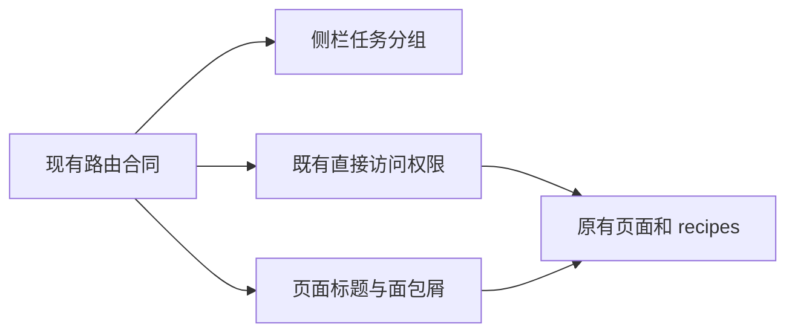
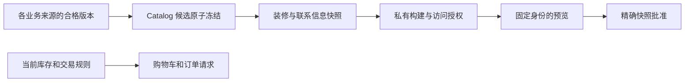
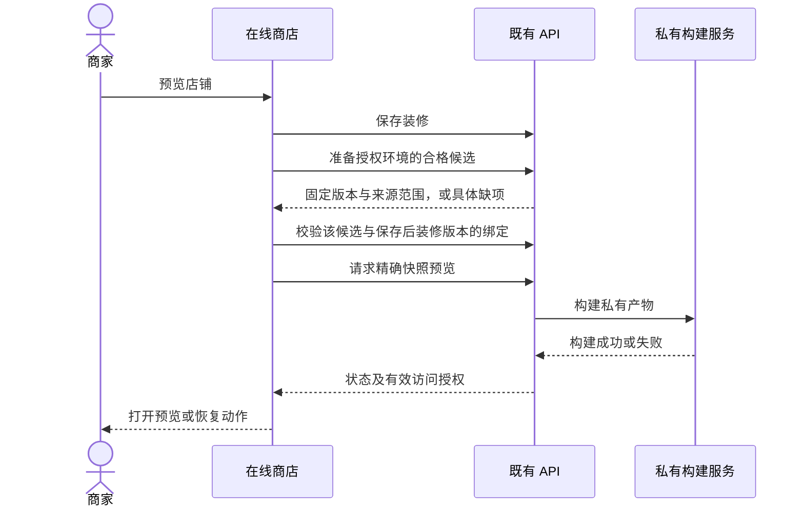
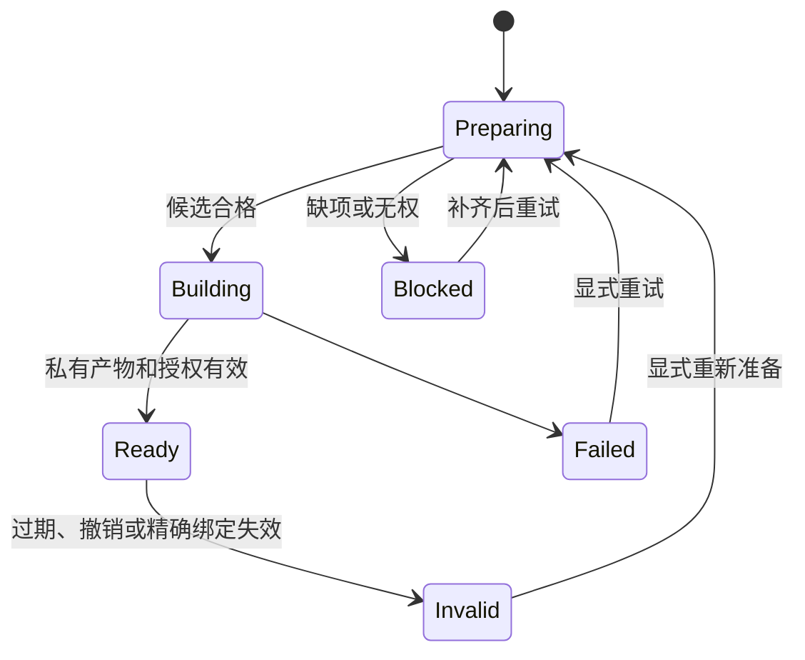
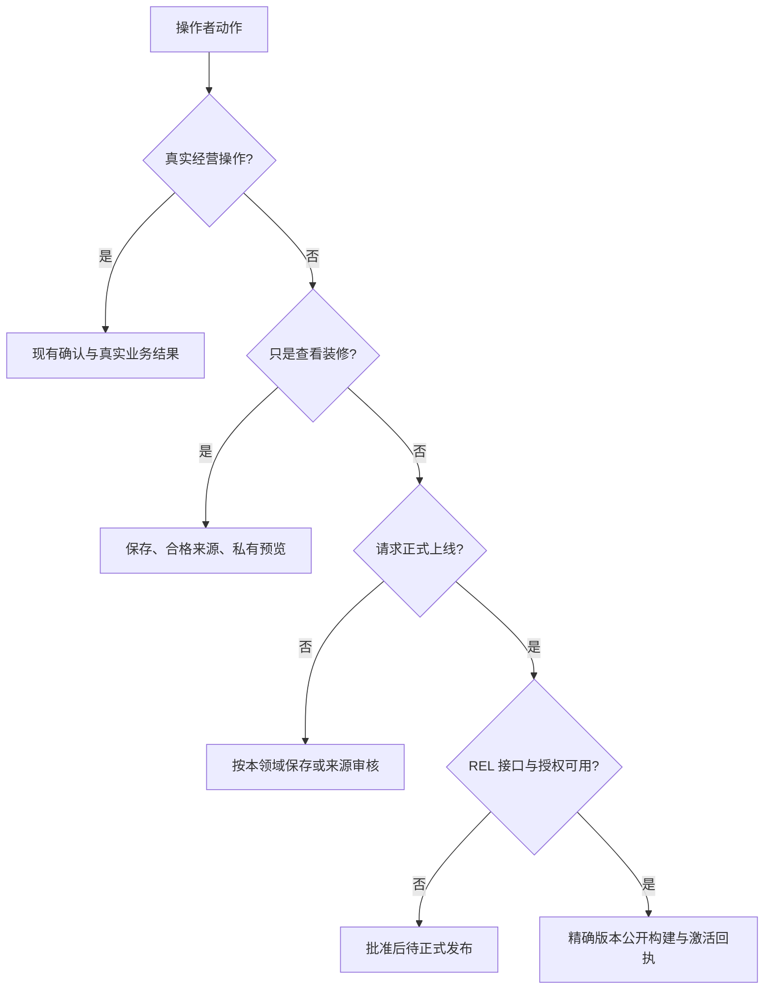
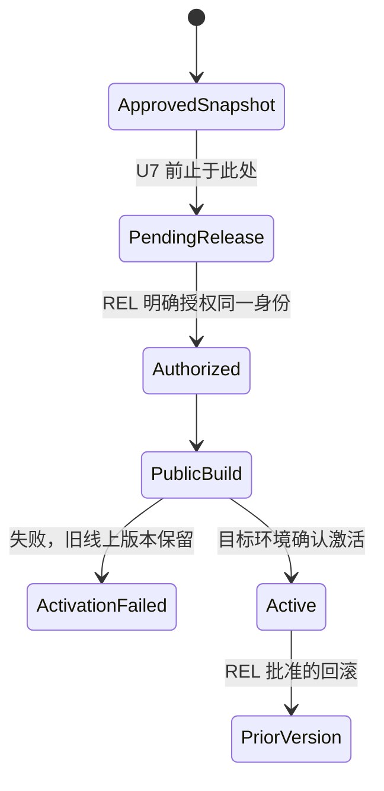

# Shoppp 管理后台商家任务与发布流程重构

## Goal Capsule

**Objective:** 商家能按经营任务找到已有功能，并在操作前判断修改何时影响顾客、预览包含什么、上线还差哪一步。

**Means:** 沿用现有页面与业务服务，重组菜单、整理动作和状态、收拢店铺预览入口，最后对接有真实部署证据的发布流程（KTD1–KTD6）。

**Authority:** 用户本次约束 → 本计划 Product Contract → 现行产品 master / REL 发布权限 → 已完成功能计划及代码事实。用户已指示开始执行；本文件现为 active product plan，拥有管理后台 U1–U7。REL 的候选与生产权限保持独立。

**Execution profile:** 实施使用当前 checkout，按 U1–U6 交付管理后台核心；U7 受 REL 接口与发布条件约束。单开发者本地验证与现有分支流程，无默认 PR、worktree、生产部署或候选冻结。

**Stop conditions:** 涉及 R2 两个受保护页面内部变化，先单独申请；U7 的授权、接口或环境证据不成立时停在明确的待发布状态。不能以预览或审批成功代替线上生效。

**Tail owner:** 本计划拥有管理后台实施、回归与文档收尾；REL 拥有公开版本授权、真实环境激活、DC/PG 与生产发布证据。U7 只消费 REL 合同，不接管这些权限。

---

## Product Contract

### Summary

以七个商家任务分组组织现有后台；区分真实经营操作与店铺展示版本；将技术性“私有预览候选版本”收拢到在线商店中的预览流程。保留底层版本、权限、审核和环境隔离。

### Problem Frame

当前入口混合经营任务、展示资源和维护工具；“保存”“发布”“批准”“deployed”对应不同业务结果，技术版本细节又出现在商品列表和装修主流程。功能存在，但商家需要自行拼出流程。

### Key Decisions

- **按商家任务组织后台，复用现有能力。**（session-settled: user-approved — chosen over 仅解释私有预览或孤立调整该勾选项: 用户明确要求沿已讨论方向梳理整体框架。）Governs R1, R3–R12。
- **参考 Shopify 的任务组织，适配 Shoppp 的版本边界。** 不引入其缺少对应服务的功能。Governs R1, R5, R8。

### Requirements

| ID | 要求 |
| --- | --- |
| R1 | 现有功能各有一个主要菜单归属；七组结构见下表，不创建占位业务模块。 |
| R2 | `/welcome` 开店指南与 `/dashboard` 商业仪表盘只允许移动侧栏位置；保留页面名称、标题、面包屑、内容、布局、指标、动作、状态、数据和逻辑，含共享组件的间接影响。任何内部改动必须另获用户批准。 |
| R3 | 保留 route key、URL、权限键、直接访问授权、登录落点、query/hash、浏览器返回与开店指南回程；隐藏表单/详情仍归属其主要任务。 |
| R4 | 保存反馈按实际服务结果表达；不能将即时配置写入称为草稿，也不能将来源 published 或任意历史部署记录称为顾客当前看到的版本。 |
| R5 | 库存、交易配置、订单/退款/履约、权限、隐私操作和任务重试继续按现有业务规则执行；不受装修发布控制，也不被宣传为可撤销的预览彩排。 |
| R6 | 店铺预览入口位于在线商店，默认自动准备允许使用的来源并保留精确版本绑定；普通用户无需手填或选择技术版本 ID。 |
| R7 | 预览说明实际包含范围；未保存装修、内容草稿、新商品草稿及尚不支持的修改不能静默丢失、自动发布或假装已进入完整店铺预览。 |
| R8 | 私有预览、审核批准、公开构建与线上激活各有真实结果；只有目标环境的实际激活证据允许显示“已上线”。 |
| R9 | 设置按实际任务排列和划分表单区块，保留现有唯一写入者、原子提交、版本冲突与审批要求，不新增重复配置来源。 |
| R10 | 常用操作在决策处显示一次必要后果；版本 ID、digest、build attempt 等进入可展开详情，保留错误恢复和必要审计信息。 |
| R11 | 保留现有 UI recipes、列表查询、库组件交互与无障碍所有权；不为本次改造新建全局状态、导航或焦点框架。 |
| R12 | 分阶段交付；管理后台核心改善可先完成，正式发布接入受具名前置条件约束，不能因界面改名推定发布能力已完成。 |

### Feature Ownership and Menu Structure

一级分组只展开，不进入新聚合首页。以下中文为规划标签；英文与中文资源同步，受保护页面标签保持原有对应名称。设置子项直接列出，不新增第三级菜单。

| 一级组 / 顺序 | 子项 / 当前路由 | 现有功能归属与边界 |
| --- | --- | --- |
| 首页 | 商业仪表盘 `/dashboard`；开店指南 `/welcome` | 原页面完整保留；`/` 仍跳 `/welcome`，无新的首页组合或指标卡。 |
| 订单 | 订单 `/orders`；发货与履约 `/fulfillment` | 取消、退款和订单时间线仍在订单详情；不新建退款子系统。 |
| 商品 | 商品 `/catalog/products`；商品系列 `/catalog/collections`；库存 `/inventory`；评价 `/catalog/reviews` | 将已有系列入口从隐藏变为稳定子项；商品字段和系列成员仍由 Catalog 管理。 |
| 内容 | 页面 `/content/pages`；文章 `/content/articles`；导航菜单 `/storefront/navigation` | 导航作为可复用内容资源，装修选择菜单并控制展示；不复制其写入能力。 |
| 在线商店 | 店铺装修 `/storefront/themes` | 主题列表、装修编辑、资源选择、校验、店铺预览、审核与发布状态归于此任务；预览先用页内动作，无新版本中心。 |
| 数据分析 | 收入报表 `/reports/orders` | 报表筛选与明细保留；商业仪表盘只在首页出现。 |
| 设置 | 店铺资料 `/settings/identity`；联系信息 `/settings/contact`；经营设置 `/settings/launch`；配送设置 `/settings/shipping`；政策 `/settings/policies` | 前五项按日常配置排序；保留既有配置与政策独立审核。 |
| 设置（续） | 用户与邀请 `/access/users`；角色与权限 `/access/roles`；隐私请求 `/privacy`；审计记录 `/audit`；自动任务恢复 `/operations/jobs` | 同一设置分组下的直接子项；保留各自读写权限和关键确认。 |

隐藏路由继续存在：`/catalog/products/form`、`/catalog/collections/form`、`/content/pages/form`、`/content/articles/form`、`/storefront/themes/:draftId`、`/orders/:reference`、`/access/users/:id`、`/access/roles/:id`。登录、找回密码、重置、激活和 404 不进入商家菜单。

共享资源库继续作为各业务页面的资源选择器。经营健康检查仍属于经营设置；通知失败恢复属于自动任务恢复；不增加空的客户、营销、折扣、支付管理或媒体中心。

### Save, Preview and Publish Contract

表中“来源可供发布使用”不等于已上线；“即时”指当前所连接环境的真实数据更新。依赖外部支付、任务或构建的结果继续异步反馈。

| 功能 | 保存/操作的实际结果 | 可查看或预览范围 | 面向顾客的生效边界 |
| --- | --- | --- | --- |
| 新商品 | 保存 draft/scheduled 商品与其允许字段 | 后台检查；旧商品预览 token 的前台消费尚未证实，U3 核验 | 现有 Publish 会创建 public Catalog Release 并触发公开构建；不得作为隐式预览准备。 |
| 已发布商品修订 | 保存 name/description/media/options/presentation/SEO 修订草稿 | 现有后台修订预览；不是完整装修预览 | 显式发布修订触发 public 构建；实际部署后才确认展示变化。price/SKU/重量/尺寸不在该修订能力内。 |
| 商品系列 | 创建选定状态的新版本，draft 保留前一 published 版本 | 私有候选只选 published 版本 | 来源发布仅使其可被后续版本使用。 |
| 页面、文章、导航 | 保存草稿；发布/归档是独立来源动作 | 已 published 且引用有效的版本进入店铺预览 | 单独发布来源不自动激活店铺。 |
| 店铺资料 | 保存立即创建 published 资料版本，归档旧来源版本 | 新版本可进入下一次店铺预览 | 不改动已冻结的店铺展示；不能提示“已保存草稿”。 |
| 政策 | draft → approved → published → archived | 候选要求相应环境批准且 published 的政策 | 保留政策审核与发布权限；来源发布不等于店铺部署。 |
| 联系信息 | 保存当前 profile 与版本 | 联系信息在 Experience Snapshot 中冻结 | 后续保存不改旧快照；新预览/批准需重新检查联系版本。 |
| 店铺装修 | 保存装修草稿，校验精确版本 | 装修草稿 + 合格来源 + 冻结联系信息的私有完整渲染 | Approve 冻结 approved Snapshot；没有激活生产的含义。 |
| 评价审核 | 立即保存审核决定 | approved 评价按 catalog manifest 进入展示版本 | 审核不自动重建当前店铺。 |
| 库存 | 调整真实库存账本 | 无库存草稿彩排 | 后续库存、购物车和购买读取当前经营数据。 |
| 配送、经营设置 | 保存真实区域/运费/币种/销售地区/支付模式等配置 | 展示快照仅冻结部分声明，不能模拟全部交易规则 | 新请求按运行时规则读取配置；已有购物车/订单按现有约束处理。 |
| 订单、退款、履约 | 执行真实业务操作 | 无候选彩排 | 按业务结果及异步支付/任务状态反馈。 |
| 用户、角色、隐私、任务重试 | 执行真实权限/数据/任务操作 | 无候选彩排 | 保留授权、后果确认和可恢复失败。 |
| 仪表盘、指南、收入报表、审计 | 查询或跳转已有任务 | 不需要统一保存/发布 | 指南与仪表盘受 R2 保护；不改内部功能。 |

动作文案以此合同为准：通常用“保存”“预览店铺”；来源发布使用说明实际结果的动作名称或就近一句后果；装修批准在 U7 完成前只表示“已批准，待正式发布”。正式“发布到店铺”只在接通真实发布合同后出现，不放一个无效按钮。

只显示可证明的业务状态：编辑状态、此次预览范围/结果、批准状态、正式发布状态。没有 active tuple 证据时不显示“当前线上版本”或逐资源“线上已更新”；也不建立全局未发布更改计数。

### Actors and Key Flows

- **A1 商家/授权操作者：** 配置、内容、装修和实际经营操作；允许同一人持有多项权限，不强加多人审批。
- **A2 受限操作者：** 只看其有权任务；仅有装修权限不获得读取所有内容或创建候选的权限。
- **A3 构建与发布服务：** 返回真实异步结果；公开激活仍受 REL 环境与版本授权约束。

- **F1 找功能：** 侧栏任务 → 原有页面 → 表单/详情 → 原列表或指南回程；直接链接同样受权限控制。
- **F2 即时经营操作：** 修改库存/经营配置或执行退款 → 必要后果确认 → 服务结果/异步状态；不经过装修发布。
- **F3 预览已有店铺：** 在线商店 → 保存装修（已有 Save and Preview 流程）→ 确定合格候选身份 → 校验该候选与保存后装修版本的绑定 → 构建/授权 → 打开预览。重新准备需显式刷新并重新校验，不能替换已打开预览的身份。
- **F4 空店铺/来源未就绪：** 告知缺少资料、至少一个 published 商品或必要政策；跳到对应现有任务。不得自动发布商品以满足预览。来源草稿只能按已有局部能力检查。
- **F5 审核与上线：** 审核精确快照 → U7 前停在待正式发布；U7 后经授权公开构建/激活 → 核对目标环境回执 → 显示成功或失败。批准后有变更，原批准不能自动授权新版本。

### Acceptance Examples

| ID | 场景与应观察到的结果 |
| --- | --- |
| AE1 | 商品系列有可见菜单入口；商品表单深链、返回和原权限照常；无授权用户不能靠输入 URL 进入。 |
| AE2 | 两个受保护页面移入首页分组后，标题、面包屑、内容和功能与原页面相同；无报表权限仍可使用开店指南。 |
| AE3 | 调整库存后服务读取新库存；保存装修后顾客继续看到旧展示，预览能看到本次合格版本。 |
| AE4 | 已 published 页面又有新草稿时，店铺预览使用 published 版本，并准确说明未包含草稿；不改变草稿状态。 |
| AE5 | 空店铺点预览得到具体缺项；没有商品公开发布或构建的隐式副作用。 |
| AE6 | 私有候选 expired/abandoned、来源过期或构建失败时无法继续批准；提供恢复入口，旧预览不会静默切到新版本。 |
| AE7 | 只有 themes.preview/catalog.read 而缺少候选创建权限的用户不能创建新候选；已有合格版本的预览按原服务授权处理。 |
| AE8 | 保存政策来源或批准装修后，不出现“店铺已上线”；U7 只有实际激活回执成功才显示上线成功。 |
| AE9 | 商家保存经营设置时明确这是实际配置修改；联系信息由其独立页面维护，旧经营表单不能覆盖较新的联系信息。 |

### Scope Boundaries

本次已授权：完成并复核这份计划；没有代码、配置、部署、候选/DC/PG 状态或受保护页面改动授权。

未来 U1–U6 的核心实施范围：现有功能归属、导航、局部表单/动作/状态整理、既有预览编排和回归。U7 是具名依赖的正式发布接入阶段，仍需未来实施授权及 REL 合同。

**Non-goals:** 复制 Shopify 界面、重写业务后端、新增客户/营销等业务、全店状态引擎、通用 CMS、全局更改队列、新设置聚合页、第三层菜单、另建发布证据账本、绕过权限/审批、把所有实际业务变成沙盒。

#### Deferred to Follow-Up Work

- 全部未发布商品/内容/政策的整店草稿预览：现有候选仅选 published 来源；需要单独定义隔离与生命周期，当前不制造“全店改好再统一上线”的承诺。
- 已发布商品 price/SKU/物流属性编辑：现有修订覆盖不足；先保留真实限制，不在 UI 重构中扩张 Catalog 合同。
- 将经营设置拆成多页独立保存：现有原子 PUT 不支持安全的多写入者；先整理同页区块。
- 受保护页面内部优化：只可另行建议并申请，不能以本计划授权实施。

### Success Criteria

回归或人工验收使用 F1–F5：操作者能说明每次修改影响的是当前经营数据、下一次预览还是待正式上线版本；能指出未进入预览的内容和受阻后的下一步。不靠记忆版本 ID 完成正常装修预览。

---

## Planning Contract

### Product Authority and Inherited Baseline

- **Upstream product authority:** [产品 master](2026-08-13-001-refactor-shoppp-product-master-plan.md) 与 [REL](2026-08-12-003-refactor-development-candidate-readiness-plan.md)。规划时 active 仍是 REL-Pre-DC；候选未冻结，DC/PG 未开始。
- **Inherited baseline:** [FS-F14](2026-09-22-0043-feat-storefront-control-plane-plan.md) U1–U9 完成后的 typed source authorities、不可变 Catalog/Experience/Contact 绑定与私有预览；保留其 R1/R2/R4/R5/R17/R19 等仍有效合同及 KTD3 公开授权边界。引用均由原计划限定，不能混同本计划同号 ID。
- **Explicit supersessions:** 实施 U2 后替换 [原设置导航计划](2026-09-21-1059-refactor-store-settings-navigation-plan.md) 的分组名称/成员和旧侧栏排列；保留直接子路由、无 hub、权限与 AntD 行为。U5 替换 FS-F14 的候选入口位置与普通操作者手选版本交互；不替换其冻结、审计或批准证据。
- **Parallel/retained plans:** [输入必要性](2026-09-30-refactor-form-input-necessity.md)、[提示整理](2026-10-10-fix-ui-notice-presentation.md)、[列表收敛](2026-09-15-1723-refactor-admin-query-list-convergence-plan.md)、[共享能力](2026-09-16-1505-refactor-admin-shared-capability-backflow-plan.md)、[联系信息](2026-09-18-1128-feat-contact-management-plan.md) 的完成基线继续有效；不重新打开它们的执行体。[Shopify 式装修编辑器提案](2026-10-10-1950-refactor-shopify-style-storefront-editor-plan.md) 尚未激活，其 authoring/即时渲染/生产消费合同不在本次授权中；本计划仅复用现有编辑器。若另有并行写入，启动各 U 时核对实际差异。
- **Activation rule:** 用户于 2026-10-10 指示开始实施，同一变更更新 master 的 active plan/当前 U/下一步/产品顺序与 tail owner，保留 REL 的发布尾部。

### Key Technical Decisions

- **KTD1 — 复用 route metadata 和 AntD Menu。** 实现 R1/R3/R11；保留二级直接入口。只在菜单归属与页面元数据确实耦合时增加最小 menu-only 字段，不新建导航框架。
- **KTD2 — 保护页面元数据与共享布局。** 实现 R2；菜单分组独立于页面标题/面包屑。保留现有侧栏尺寸、页面容器与 recipe；不通过改 `/welcome` 或 `/dashboard` 页面适配新结构。
- **KTD3 — 使用各业务服务真实状态，避免统一虚假生命周期。** 实现 R4/R5/R9/R10；UI 只组合已有结果。`inclusion.live` 目前是历史部署命中，不能作为 active production 状态；U7 前使用来源状态/已知预览事实。
- **KTD4 — 在线商店编排既有候选与装修预览。** 实现 R6/R7/R11；候选准备沿用 server freeze，自动选择限定在已有授权和当前环境。精确候选仍需重取与验证；普通详情折叠，诊断保持可达。不自动发布来源、不变更候选 purpose。
- **KTD5 — 先整理经营设置单页，保留单次原子写入。** 实现 R9；经营、支付与政策链接区块仍属 `/settings/launch`。政策内容由政策页面，联系信息由联系页面，配送实体由配送页面维护；链接到唯一写入者，不复制编辑表单。
- **KTD6 — 正式发布接口依赖 REL，先交付诚实的交接。** 实现 R8/R12；private candidate 当前明确禁止 deploy/public-build，无 elevation endpoint。U7 对接同一 Release ID/digest 的受权公开化及批准 Snapshot 精确绑定；接口缺失时不能用新 public release 冒充已审核的同一候选。

### High-Level Technical Design

以下图示表达所有权与必须成立的边界，不规定具体组件拆分或函数签名。

**组件关系：菜单归属和页面信息分别消费。**

**数据流：来源版本保持唯一权威。**

**预览协议：不自动改变来源状态。**

**状态机：UI 可用不等于生产 deployed。**

**决策树：根据动作选择生效路径。**

**正式发布生命周期：U7 的依赖合同。**

### Risks, Dependencies and Assumptions

| 项目 | 事实、处理与实施影响 |
| --- | --- |
| 首次开店预览 | 候选至少需 published identity、一个 published 商品及批准并 published 的 privacy/returns/shipping/terms。U5 显示真实缺项；完整未发布空店预览不在当前合同。 |
| 商品局部预览 | Admin 旧动作打开 `/preview?token=…`，当前 storefront 未找到对应消费；U3 核验实际运行路径，无法证实则去掉可用整店预览的承诺并说明可用后台检查。新增前台 token 渲染另列范围。 |
| 创建候选权限 | API 要求 catalog.publish/catalog.read/identity.read/policies.read/content.read/navigation.read/settings.read；现列表 gate 漏 settings.read。U5 对齐完整权限；装修编辑/预览/批准再按各 endpoint 权限，不因菜单移动扩大授权。 |
| 预览可写业务数据 | Preview worker 可桥接 cart/checkout/orders API；候选不是通用只读沙盒。验证仅在已隔离的非生产环境，用真实测试配置，不能宣传交易也已冻结彩排。 |
| 当前线上状态缺口 | inclusion.live 可匹配历史/staging；U3 不虚报 active。U7 的目标环境 active Release+Snapshot 回执是当前状态前置条件。 |
| 审核后修改 | 继续使用既有 optimistic version、来源 digest、联系信息与环境检查；新版本需要新预览/批准，不引入自动跟随。 |
| 设置写入冲突 | LaunchConfiguration 为 whole-object 原子 PUT；U4 不拆 writer，保留 preserveContactEmails 和并发冲突恢复。 |
| 范围扩张 | 不创建 settings hub、全店 draft overlay、新发布平台/权限系统或全局 announcer；当前需要的是已有流程可理解且结果真实。 |
| U7 prerequisite | REL 需提供受权 elevation/公开构建/激活/失败/回滚和 active tuple 查询合同及测试证据。当前不存在；U7 阻塞，不影响 U1–U6。 |

Shopify 官方资料用于任务组织参考，不作为 Shoppp 生命周期依据。Shopify 的主题预览与主题外资源分离，商品保存语义也不同；本计划保留 Shoppp 不可变版本事实，不直接照搬“保存即全店更新”。

### Execution Checkpoint

本节按仓库规则仅维护本计划自身执行状态。状态以实际代码与验证证据为准，REL 当前队列不在这里复制。

- **Plan:** 已激活，实施中。
- **Current unit:** U4 — 整理设置任务和同页保存边界。
- **Next concrete action:** 整理唯一配置入口、保存影响与未保存表单的局部离开确认。
- **Order:** U1 → U2 → U3 → U4 → U5 → U6；U7 在 U6 和 REL 合同具备后开始。
- **Blocker:** U1–U6 无规划级实施前置缺口；U7 缺 REL 正式发布接口及 active tuple 证据。
- **Unit status:** U1–U3 已完成；U4 进行中；U5–U6 未开始；U7 前置阻塞。
- **Update rule:** U 状态、当前/下一步、顺序或 tail 改变时，同一变更更新本节；只有产品级指针变化才同步 master。集中验证证据放 `docs/progress/`，不建立第二执行队列。

---

## Implementation Units

### U1. 固定功能归属与操作结果基线

**Goal:** 将本计划映射到实施开始时的实际代码，避免沿历史术语执行错误行为。

**Requirements:** R1–R5, R8–R12；F1–F5。**Dependencies:** 实施指示；现行 active checkpoint。

**Files:** 本计划；`apps/admin/src/routes/routes.config.ts`、`apps/admin/src/routes/router.tsx`、`apps/admin/src/shared/layout/app-shell.tsx`；`apps/api/src/http/app.ts`、`apps/api/src/publishing/{candidate-releases,releases}.ts`、`apps/api/src/storefront-experience/service.ts`。

**Approach:** 复核菜单/URL/权限、各域实际写入和公开边界，按 KTD1/KTD3/KTD6 修正证据。冻结 R2 的当前页面文件、标题/面包屑与代表状态基线；发现与合同冲突先解决事实，不启动后端重写。

**Test scenarios:** Test expectation: none — 本 U 只产出实现前事实与受保护页面基线；不为文档运行测试。后续 U 使用这些基线做行为对照。

**Verification:** 无未归属 route/action；预览、批准、公开构建和线上激活各有真实 owner；U7 缺口具名。U1 不改变业务代码或 protected 内容。

### U2. 重组侧栏，保留原页面和链接

**Goal:** 商家从七组菜单直接进入现有任务。

**Requirements:** R1–R3, R11；F1；AE1/AE2。**Dependencies:** U1。

**Files:** `apps/admin/src/routes/routes.config.ts`、`apps/admin/src/shared/layout/app-shell.tsx`、`apps/admin/src/shared/i18n/translations.ts`；现有 `routes/{index,auth-route-guards,authorized-home}.test.tsx`、`shared/layout/app-shell.test.tsx`、`shared/navigation/setup-guide-return.test.tsx`、`test/form-route-contract.test.ts`；必要时新增局部 shell browser test。

**Approach:** KTD1/KTD2。改 route 分组、排序与菜单标签；系列增加可见入口。只做最小菜单/页头解耦，R2 页面本体不改。权限过滤后才组装分组，空组不显示；保持 AntD 默认交互。

**Test scenarios:**

- 全权限用户见七组与所有指定子项；无隐藏 form/detail 菜单项或重复入口。
- 只有 guide 权限、仅订单读权限和仅 IAM 权限分别得到正确可见菜单；直接访问无权子路由仍被拦截。
- 深链进入 product/content form、theme draft、order detail 和 IAM detail，正确选中所属子项；query/hash、Back 与 `from=setup-guide` 保留。
- 首页分组展开/折叠及键盘选择正常；两受保护页逐状态对照无新增标题、面包屑或容器变化；`/` 仍到 guide。

**Verification:** L3 路由/共享消费者验证通过，受保护页基线未改变，原 URL 无迁移要求。

### U3. 统一动作表达与真实状态

**Goal:** 内容、商品和装修动作的名称与反馈匹配其实际结果。

**Requirements:** R4/R5/R7/R8/R10/R11；F2/F4/F5；AE3/AE4/AE8。**Dependencies:** U2。

**Files:** `apps/admin/src/pages/catalog/{catalog-list-page,catalog-form-page,published-product-revision-editor,collection-list-page,collection-form-page,review-moderation-page}.tsx`；`pages/content/{content-list-page,content-editor-page,page-editor-page,article-editor-page}.tsx`；`pages/storefront/{navigation-page,themes-page,theme-editor-page}.tsx`；对应现有 test；`apps/admin/src/services/catalog/api.ts`；`apps/admin/src/shared/i18n/translations.ts`。共享 content-editor 是页面实际消费者；无消费的 Admin token adapter 随入口移除。API 源码仅作为状态事实，新增后端合同不属本 U。

**Approach:** KTD3/KTD6；整理按钮、保存结果、来源发布确认与必要失败恢复。核验商品 token 预览缺口，保留已证实的局部检查与真实 public publish。历史 inclusion 保留在详情或改为准确表述，不重新标为当前线上；没有可证明状态就省略该状态。

**Test scenarios:**

- 来源发布成功只表明该版本可供后续店铺版本使用；政策/装修批准不触发或声称店铺上线。
- 修订保存后旧顾客页面不变；发布修订进入构建中，失败仍显示失败且不误报已更新。
- 原 source draft、审核、归档、revision 和评价审核保留各自权限；没有审批需求的普通保存不要求动机填写。
- 新商品局部预览路径若无 consumer，不显示可用的完整店铺预览；不自动触发 public Publish。
- 库存/订单操作保留真实经营后果与反馈；本 U 不重写这些业务流程或给它们加候选状态。

**Verification:** 决策所需信息在对应操作附近出现一次，无常规介绍 Alert、默认技术 ID 或未知“当前线上”断言；focused 页面测试通过。

### U4. 整理设置任务和同页保存边界

**Goal:** 商家清楚配置在哪里维护、保存影响哪些实际经营规则。

**Requirements:** R4/R5/R9–R11；F2；AE9。**Dependencies:** U3。

**Files:** `apps/admin/src/pages/settings/{launch-settings-page,contact-settings-page,shipping-settings-page,store-identity-page,policies-page}.tsx`；对应现有 test；`apps/admin/src/services/platform/api.ts`；`apps/api/test/operations/{contact-profile,shipping-settings,store-identity}.test.ts` 与 `test/content/policies.test.ts` 仅在实际服务合同受影响时验证。

**Approach:** KTD3/KTD5。按经营、支付、政策链接的现有区块整理 `/settings/launch`；配送实体、联系信息、政策内容跳转到唯一 owner。同页保持原子保存，必要生效说明靠近保存动作；不拆多页接口、不重复表单、不修改 protected 指南链接内容。

**Test scenarios:**

- 保存经营设置读回正确字段；提示实际经营影响，合法校验失败留在原表单并指向可恢复字段。
- 先打开经营表单、再在 contact 页面修改邮箱、最后保存旧经营表单，较新联系信息仍保留。
- 店铺资料保存呈现真实新来源版本，不称草稿；政策 approve/publish/archive 仍有精确版本与权限确认。
- 未保存表单跳到配置 owner 时沿用现有离开保护；后退不丢 query/provenance，不复制 writer。

**Verification:** 单页原子提交与 source authority 保持；按实际跨层变化选 L2/L3 验证，无新设置 hub 或额外审批机制。

### U5. 将私有候选融入在线商店预览

**Goal:** 普通装修预览不再要求在商品列表理解、创建和手选技术候选。

**Requirements:** R6/R7/R10–R12；F3/F4；AE4–AE7。**Dependencies:** U3/U4。

**Files:** `apps/admin/src/pages/catalog/{catalog-list-page,catalog-preview-candidate-panel}.tsx`；`pages/storefront/{themes-page,theme-editor-page}.tsx`；`services/{catalog,storefront}/api.ts`；对应 candidate/theme tests 与 `theme-editor-page.browser.test.tsx`。复用 API `publishing/candidate-releases.ts` / `storefront-experience/service.ts`；回归 `apps/api/test/catalog/candidate-release.test.ts`、`test/storefront-experience/experience-api.test.ts`、`test/security/public-boundaries.test.ts`。

**Approach:** KTD4。商品列表移除候选准备面板；在线商店有一个明确的预览入口，顺序为保存装修→准备或重取合格候选并验证身份→校验该候选与保存后装修版本的绑定→snapshot/build/grant。已有合格 deployed release 的预览同样先确定身份再校验；与创建 fresh private candidate 分别按权限处理，不得无权 fallback 读取其它来源。使用现有 session binding 与 re-fetch，精确旧预览保持稳定；新预览显式准备，来源状态不自动改变。范围展示在预览动作附近，技术信息进入详情。

**Test scenarios:**

- 全权限用户从装修保存并预览，自动得到固定候选，不手输 ID；校验绑定精确候选与装修版本，源向量和 frozenContact 与渲染一致。候选变化后旧校验不可复用，需重新校验再生成快照。
- 有 published 页面并有新草稿时，预览使用 published 版本；新商品 draft/政策未就绪给具体缺项且无 public 构建副作用。
- 缺 settings.read/catalog.publish 等任一候选权限不能创建；仅装修读/预览授权不能越过 source gate；仍可按既有权限使用合格部署版本。
- 未保存装修遵循原 Save and Preview 保存边界；版本冲突、来源/联系变化、构建失败提供局部恢复，不自动替换候选。
- expired/abandoned/revoked preview 清理失效选择，旧预览和 stale approve 不能继续；重载恢复精确身份，重试防重复提交。
- private candidate 仍不能经 deploy/public-build/public-manifest-read 公开；无默认公开分享或跨环境访问。

**Verification:** L3 跨页面/API 消费者与原生浏览器预览场景通过；普通流程不展示技术选版本步骤，原安全和冻结证据完整。

### U6. 验收后台核心与批准后的交接

**Goal:** U1–U5 组成可理解、可恢复的完整商家路径，正式发布缺口不会被包装成完成。

**Requirements:** R1–R12；F1–F5；AE1–AE9。**Dependencies:** U2–U5；不依赖 U7。

**Files:** 本计划 checkpoint；必要的 `docs/progress/<实施日期>-admin-merchant-workflows-verification.md`；现有 Admin browser/E2E fixtures；实际受变更的规范 `apps/admin/docs/ai/ai-rules.md`、`apps/admin/docs/ai/page-recipes.yaml`、`apps/admin/docs/ai/component-catalog.yaml`、`apps/admin/docs/ai/page-guardrail-recipes.md`。

**Approach:** KTD1–KTD6。跑真实任务回归，批准成功停在明确待正式发布状态；不提供尚不可用的“发布到店铺”按钮。复核 API/菜单权限、商家文字与保护页面差异；只更新实际变更的 UI 规范和证据，不建立第二执行队列。移除废弃候选 UI、未使用翻译及试验代码。

**Test scenarios:**

- 原生浏览器覆盖 F1–F5，包括正常预览、空店阻塞、限制权限、版本冲突、失败恢复和批准待发布。
- 库存或配置实际写入不会被预览/批准延迟；主题 Save/Approve 不能执行生产激活。
- 两受保护页面的常见加载/空/错误/权限状态与 U1 基线一致；仅菜单变化可见。
- 商家验收能说明本次预览未含草稿、哪些修改立即影响交易、何时才算上线；若理解失败，修正其最近决策点，不添加全页解释。

**Verification:** 管理后台核心完成并具 focused/browser 证据；U7 仍明确受阻，不能宣称整体正式发布能力或 DC/PG 完成。

### U7. 对接 REL 的正式发布与当前线上回执

**Goal:** 在具备真实发布合同后，商家能够发布所批准的精确版本并看到目标环境结果。

**Requirements:** R8/R12；F5；AE8。**Dependencies:** U6；REL 提供并验证 elevation/激活/查询/失败/回滚合同。**当前前置阻塞，不能直接实现按钮或推定接口形状。**

**Files:** 先补充本 U 的 REL 合同链接及确切接口/test 路径；接入目标为 `apps/admin/src/pages/storefront/{themes-page,theme-editor-page}.tsx` 与 `services/storefront/api.ts`；相关 contract/API adapter 以 REL 批准接口为准；保留 `apps/api/test/catalog/candidate-release.test.ts`、`test/security/public-boundaries.test.ts`、`tools/{release-validate,deploy-workflow}.test.ts` 的边界。不在本计划另建 workflow、密钥或发布 ledger。

**Approach:** KTD6。REL owning plan 先定义并验证 same Release ID/digest 的公开授权和 exact approved Snapshot/Contact/Theme 绑定；本 U 增补接口合同后复核。接入授权动作、异步状态、成功/失败与 active tuple 读取；无需从商品 Publish 曲线触发装修上线。回滚由 REL 授权选择旧不可变 tuple，Admin 仅按接口呈现。

**Test scenarios:**

- 无发布权限、错误环境、已失效批准或 tuple 不一致拒绝且旧线上版本不动；themes.approve 自身仍无激活权。
- 重复发布按服务幂等处理；queued/building 不显示成功；失败可恢复，实际 active receipt 成功才显示“已上线”。
- 批准后再改来源/联系/装修不能复用旧批准发布新 bytes；公共端点无法读取尚未受权私有候选。
- 回执返回目标环境当前 active tuple；历史部署 inclusion 不影响线上标签；授权回滚结果由实际激活确认。

**Verification:** REL 前置合同与本 U focused/integration 证据均成立；真实受保护环境操作另依发布授权，不能通过本计划测试获得生产许可。完成后本计划回交 REL，不自行设置 DC/PG。

---

## Verification Contract

**本次规划 L0：** 只检查新文档结构、引用、ID/依赖和 diff；不跑测试、typecheck、build、应用或部署。

未来实施先读 `apps/admin/AGENTS.md` 及其指定 README、ai-rules、page-recipes、component-catalog、`docs/testing-standards.md`。先确定消费者闭包，再选最小有效集合：U2/U5/U6 为 L3；U3/U4 按实际变化 L2 或 L3；U7 根据真实接口选择跨层/发布验证，不提前扩大运行范围。

| 验证层 | 可用命令模式 / 完成条件 |
| --- | --- |
| Admin focused | `bun run --cwd apps/admin test <具体 test 文件>`；使用各 U 已列的既有测试，新增仅覆盖缺失行为，不测试重命名实现细节。 |
| Native browser | `bun run --cwd apps/admin test:browser <具体 browser test>`；菜单、离开保护、预览状态/恢复和 R2 页面按消费者边界验证。 |
| API focused | `bun run --cwd apps/api test:workers <具体 test 文件>`；只在 API 依赖/行为受影响时跑候选、来源、联系、公开边界和业务消费者相关集合。 |
| 类型与质量 | Admin `bun run --cwd apps/admin typecheck` 一次；若必要的 build 已含 tsc 不再重复。按变更文件做 lint，遵循原仓库工具。 |
| 核心收尾 | U6 完成 scoped consumer/browser 回归，不自动跑全仓库/全模板/生产测试；只有实际达到 L4 或 REL 关闭条件时才执行其完整 checks。 |
| 发布收尾 | `bun run release:validate` 与 hosted/environment 证据按 REL 规则；本计划本地成功不替代 exact-SHA、candidate、DC/PG 或生产结果。 |

避免重复已有 primitive 无障碍测试；测应用负责的可见标签、图标名称、表单错误关联和有意偏离。截图保存到 `/.artifacts/screenshots/<YYYY-MM-DD-任务>/`，先确保 `/.artifacts/` 递归忽略；测试材料不提交。验证证据记录范围、结果及未验证限制，只有本计划 checkpoint 维护 U 状态。

---

## Definition of Done

- **管理后台核心完成：** U1–U6 有对应行为证据，七组归属和原链接/权限成立，AE1–AE9 在当前能力边界内成立；受保护页面没有内部变化。
- **正式发布接入完成：** U7 的 REL 合同与 actual activation receipt 可验证；queued、private artifact ready、source published、approved 都不代替上线。
- **全计划完成：** 所有 U 完成；不能把 U1–U6 核心完成误写为 U7 或生产发布完成。若决定取消 U7，需显式调整产品目标和 authority，不能静默删去尾部。
- **交付完整：** checkpoint 与必要 master 指针同变更一致；完成历史计划保持冻结；发布 tail 回交 REL；删除废弃、试验和无人消费代码，保留必要验收文档。

---

## Sources and References

仓库主要事实：`apps/admin/src/routes/routes.config.ts`、`shared/layout/app-shell.tsx`、`pages/catalog/catalog-preview-candidate-panel.tsx`、`pages/storefront/theme-editor-page.tsx`；API `http/app.ts`、`publishing/candidate-releases.ts`、`publishing/releases.ts`、`storefront-experience/service.ts`、`settings/store-identity.ts`、`settings/contact-profile.ts`、`settings/launch-configuration.ts`、`catalog/published-revisions.ts`；`apps/storefront/worker/preview-access.ts`。引用按实施时实际版本复核。

历史方法依据：[单维护者发布韧性](../solutions/workflow-issues/github-first-release-resilience-for-solo-maintainers-2026-08-28.md)：后台交接复用当前发布权威，不新增备用凭证或证据平面。`docs/runbooks/storefront-theme-promotion.md` 的 retired 主题实验不作为重启授权。

外部参考（2026-10-10 会话查阅）：[Shopify 主题添加/预览](https://help.shopify.com/en/manual/online-store/themes/adding-themes)、[商品添加与更新](https://help.shopify.com/en/manual/products/add-update-products)、[导航菜单](https://help.shopify.com/en/manual/online-store/menus-and-links)。使用任务组织及主题与内容分工；没有声称 Shoppp 与 Shopify 保存/上线语义相同。

---

## Optional Suggestions Requiring Separate Approval

本计划没有发现必须修改开店指南或商业仪表盘内容才能完成重构的需求。先验收菜单与任务回程；若后续观察到具体断点，再提出两页内部的最小修改及理由，取得用户单独批准。本段不产生 U、验收义务或实施授权。
