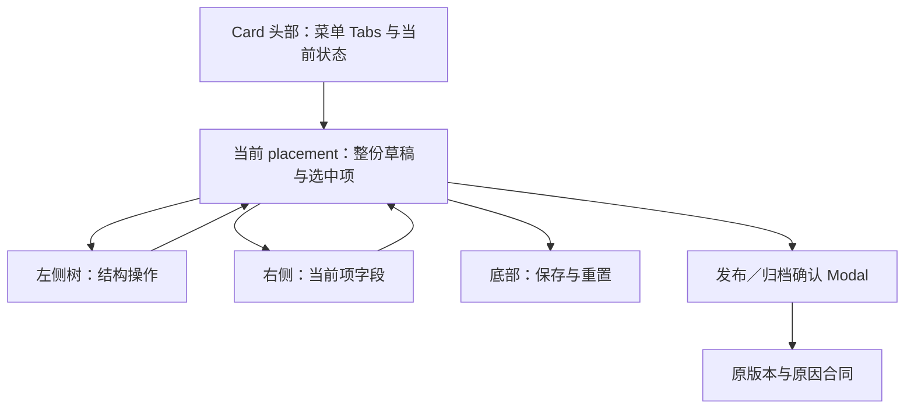
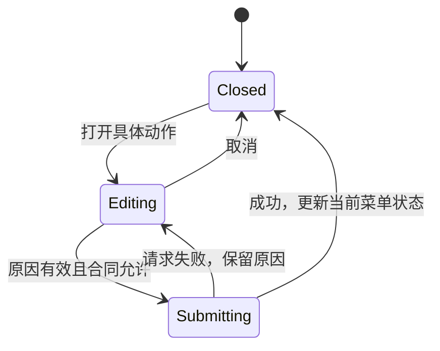

# Admin 导航树交互与确认流程优化 - Plan

## Goal Capsule

- **Objective:** 操作者在导航结构所在区域完成结构调整，在当前菜单项区域编辑内容，并在执行发布或归档时填写原因；角色查看能简洁表达只读限制。
- **Means:** Card 头部 Tabs、左侧树操作、动作确认 Modal 及局部只读说明，见 KTD1–KTD4。
- **Authority:** 用户于 2026-10-20 确认本轮方案，并在后续消息授权按计划开发、先截图再修改及交付前后对比。
- **Execution profile:** 独立有界改造；本次计划检查为 L0，后续实现按 Admin L2 验证并增加目标 Browser Mode。不改变主产品计划、候选、DC / PG 或产品执行序列。
- **Stop condition:** 前置合并修复未完成、无法取得可信修改前截图，或实施必须变更权限／后端合同，均先报告具体依赖，不以历史截图或推测结果代替。
- **Tail owner:** 本计划负责后续交互实现、验证及修改前后截图交付；冲突整合由其独立计划负责。没有提交、推送、PR 或部署要求。

---

## Product Contract

### Summary

导航保留单卡片双列，页头／页脚 Tabs 成为 Card 头部，新增、删除、排序和层级调整统一放在左侧树。发布、归档原因移至各自动作的确认弹窗。导航与角色权限树的展开／收起使用图标按钮，Admin 只读说明改为简短业务文字。

### Problem Frame

当前菜单切换位于 Card 外，结构操作分散在 Card 头部和右侧字段区。发布／归档原因长期占据编辑空间；Admin 说明使用“完整权限目录”等技术措辞。这些呈现让操作者在调整同一导航结构时频繁寻找入口。

### Requirements

**布局与草稿，继承上一轮同号约束并按本轮选择调整呈现**

- R1. 保留导航页主标题、单 Card 左树右表单、主题分隔线和既有响应式规则；Tabs 移到 Card 头部，移除“菜单编辑”重复标题，头部保留当前菜单状态。
- R2. Header / Footer 的完整草稿、选择及展开状态彼此独立；切换节点、Tab、容器宽度不丢失修改，服务端重写新项 ID 后仍正确选择。
- R3. 保持完整菜单保存、资源选择、权限、同步写锁、版本校验、dirty 状态阻断和错误恢复合同；当前最多两级，不改 contracts 或后台。
- R4. 重置恢复当前菜单全部未保存项及相关界面状态，不修改另一菜单或服务器数据；角色已有保存、削减确认、重置、关闭及刷新合同不变。

**左侧交互与原因**

- R5. 新增顶级项、添加子项、删除、移动及拖拽均在左侧完成；右侧移除删除和层级排序按钮，保留当前项字段及原选填备注。
- R6. 节点操作在 hover、选中或键盘聚焦时可见，触屏通过选中访问；移动菜单作为拖拽替代入口，带子项父节点移动时保留整个子树。
- R7. 发布／归档入口先打开对应确认弹窗，弹窗内填写原因并确认；保留 trim 后 3–500 字符、原权限、版本和请求字段要求，取消不请求。
- R8. 导航树和角色权限树的全部展开／收起改为两个图标按钮，保留 Tooltip、可访问名称和只读浏览能力，不改变权限全选与半选行为。

**只读与交付**

- R9. Admin 权限区只显示一次“只读”状态与“Admin 拥有全部权限，此角色不可编辑。”说明；资料及授权仍不可修改，搜索与展开可用。
- R10. 开发开始前采集真实浏览器基线，完成后以相同数据、权限、视口和展示状态采集对应截图，交付并排对比及原图；缺少对比不得宣称完成。

### Key Decisions

- **结构操作集中到树。** Governs R5、R6。(session-settled: user-approved — chosen over 分散在 Card 头部和右侧: 操作入口跟随结构对象)
- **原因在动作发生时收集。** Governs R7。(session-settled: user-approved — chosen over 常驻原因输入或全项目删除: 减少编辑负担并保留具体追溯用途)
- **状态与说明简洁呈现。** Governs R1、R8、R9。(session-settled: user-approved — chosen over 重复标题和长说明: 沿用 templates 的信息层级)

### Scope and Authority

- 上游基线为已完成的 `docs/plans/2026-10-11-refactor-admin-navigation-split-layout-plan.md`、`docs/plans/2026-10-11-refactor-admin-role-permission-tree-plan.md` 和 `docs/plans/2026-10-11-docs-admin-single-split-layout-plan.md`，历史正文保持冻结。
- R1–R4 保留其仍存在的布局、完整草稿、授权／版本及重置含义。本轮仅取代旧导航计划的 Card 外 Tabs、无拖拽、右侧结构按钮及页内原因加 Popconfirm 呈现；原因要求不被取代。
- `docs/plans/2026-10-20-fix-admin-layout-merge-conflicts-plan.md` 当前拥有合并整合和基线恢复，不由本计划吸收。角色 Drawer 720px、兼容详情 URL 及生命周期以当前整合结果和 `apps/admin/docs/ai/ai-rules.md` §3.1 为准。
- 并行 Alert 清理仍由 `docs/plans/2026-10-11-1511-refactor-admin-alert-guidance-plan.md` 管理；本轮只调整 R9 指定说明，避免两边重复修改。
- 不开展全项目原因字段清理，不改变普通备注的选填性质，不新增自动保存、跨菜单拖拽、多选、三级导航、权限编辑拖拽或通用树编辑框架。
- 不复制 templates 示例到业务目录。保留现有 recipe、Card、主题、间距、完整菜单提交和领域反馈，具体依据 `apps/admin/docs/ai/ai-rules.md` §3.1、§4.2–§4.4。

---

## Planning Contract

### Prerequisites and Current Evidence

2026-10-20 规划时，导航页、角色详情、`apps/admin/docs/ai/ai-rules.md` 和 `apps/admin/docs/ai/page-guardrail-recipes.md` 仍在 Git index 中处于 unmerged 状态。文件内容可能正由独立整合任务更新，不能把这一中间态当作截图基线。

实施前须确认上述修复完成并停止重叠写入；记录新的 HEAD、相关未提交 diff 身份和运行入口。然后采集 R10 基线，不能直接复用 2026-10-11 的历史截图。该依赖阻止进入本轮代码实施，不阻止完成本计划。

已核对的当前行为：`MenuEditor` 自持整个 placement 的 items 和同步 mutation lock；保存发送完整 items，状态变更使用已加载版本。角色字段被 Drawer 与兼容页共用；`PermissionTree` 属于 IAM 局部组件。既有导航和 IAM Browser Mode 文件可承接本次真实 DOM 验证。

### Key Technical Decisions

- KTD1. **Card 拥有 Tabs，菜单编辑状态继续按 placement 分开持有。** 使用 Ant Design 原生 Card / Tabs，不因切换重建编辑器或引入业务对象级缓存；关闭的菜单视图不得遗留可见固定工具条。Implements R1、R2。
- KTD2. **复用 Ant Design Tree 拖拽，排序逻辑留在 storefront 局部。** 节点上／下移动与拖拽归一到同一份 items，按 R3 拒绝三级、自身和后代落点；父节点带子项整组重排。原 `sort-action-group` 能承载的排序／删除片段按现有 API 复用，不修改共享组件来容纳树专用交互。Implements R3、R5、R6。
- KTD3. **页面级 Modal + Form 承载动作原因。** 这是轻量单目标确认，不新增 Drawer 或通用表单 recipe。打开时绑定 placement、action、expectedVersion；移除“原因为空则打不开入口”的旧门槛，确认时才校验。Implements R7。
- KTD4. **保留领域错误与同步锁。** 请求中显示 loading 并阻止重复提交、关闭或切换上下文；失败时保留弹窗原因及具体错误。版本冲突不自动换新版本重试；成功、取消或重新打开其他动作时清理前次原因及错误。Implements R3、R7。
- KTD5. **角色只改共享字段中的说明与 IAM 局部工具按钮。** Drawer 继续使用现有 720px 容器，兼容独立页继续既有布局，不按上一轮截图重建旧页面生命周期。Implements R4、R8、R9。
- KTD6. **截图使用真实组件和真实浏览器。** 优先从可运行页面采集；缺少合适菜单状态时，复用现有 `installBrowserApi` / `renderI18nBrowser` 为实际页面提供固定测试数据，并明确标注 fixture。不得用生产菜单写入、图像生成或合成图冒充实际页面对比。Implements R10。

### Interaction Ownership

确认生命周期按 KTD3、KTD4：

### Screenshot Contract

所有前后配对固定为同一语言、主题、权限、数据版本、浏览器缩放、视口、选中项、展开态和可比较的滚动位置。默认中文浅色；桌面 1440 × 1050，导航窄屏 390 × 844。Drawer 只按项目要求验证不小于 720px 的桌面窗口。

| Pair | Before / After subject              | Required proof                                                                   |
| ---- | ----------------------------------- | -------------------------------------------------------------------------------- |
| S1   | 页头菜单桌面，同一选中子项          | Tabs 收入 Card、移除重复标题、结构动作从右侧移到左侧；补节点 hover／选中状态近景 |
| S2   | 页脚菜单桌面                        | 切换后的对象与状态正确，两份草稿互不覆盖                                         |
| S3   | 页头菜单窄屏                        | 上下布局、横分隔、图标和节点操作可触达，无横向溢出                               |
| S4   | 发布确认桌面                        | Before 的页内原因及确认入口，与 After 的原因 Modal；注明呈现方式不同             |
| S5   | 归档确认桌面                        | 同 S4，并展示归档动作的具体后果                                                  |
| S6   | Admin Drawer 及兼容详情页，分别配对 | 精简说明与图标工具，保持只读；Drawer 保持 720px                                  |

每组保存 before / after PNG 原图，交付记录中按“修改前｜修改后”并排展示并附局部变化说明。长页面使用相同区域的附加截图，不靠缩小整页文字凑成一张图。使用稳定图片排版或对比文档组合原图，禁止重绘界面。

截图清单记录 Pair、文件路径、实际页面／fixture、数据与权限、视口、主题、locale、基线身份及采集时间。图片保存在任务 artifact 目录或既有忽略路径；`docs/progress/` 的记录引用产物，不提交测试运行缓存。

---

## Implementation Units

### U1. Restore baseline dependency and capture before images

**Goal / Requirements:** 在本轮改动前取得可信基线，满足 R10。

**Dependencies:** 冲突修复计划完成本次所依赖的整合；另行取得代码实施授权。

**Files:** 后续新增 `docs/progress/2026-10-20-admin-navigation-tree-interactions-verification.md`；读取下列 U2–U4 的源码和测试，不修改它们来伪造基线。

**Approach:** 按 KTD6 确定可重复数据、页面和权限，完成 S1–S6 的 before 原图及身份清单，再开始其他单元。

**Test expectation:** 无新增业务测试；用真实浏览器确认基线可运行、目标对象和状态符合清单。无法复现 S4 / S5 时使用明确标注的固定 fixture，而不是略过。

**Verification:** 全部 before 图片及元数据已留存，重叠冲突修复不再写入本轮目标。

### U2. Integrate Card tabs and left tree operations

**Goal / Requirements:** 完成 R1、R2、R5、R6 及导航部分 R8，保留 R3、R4。

**Dependencies:** U1。

**Files:** 修改 `apps/admin/src/pages/storefront/navigation-page.tsx`、`apps/admin/src/pages/storefront/navigation-page.css`、`apps/admin/src/pages/storefront/navigation-page.test.tsx`、`apps/admin/src/pages/storefront/navigation-page.browser.test.tsx`，更新 `apps/admin/src/shared/i18n/translations.ts`。如需分离节点渲染和拖拽转换，只新增 storefront 局部 `apps/admin/src/pages/storefront/navigation-tree.tsx` 与对应 `apps/admin/src/pages/storefront/navigation-tree.test.tsx`，不迁移到 shared。

**Approach:** 按 KTD1、KTD2 重排容器与入口。顶级新增位于左侧工具栏；父节点的添加子项和更多动作位于 label 右侧。先补完整草稿与两级移动的特征测试，再接真实拖拽。

**Test scenarios:**

- Header 改名与 Footer 改名后往返切换，两份未保存值和各自选择仍在，只有当前菜单工具条可见。
- 新增顶级项／子项后选中新项，当前表单跟随；已有未显示项在保存 payload 中完整保留。
- 同级前后拖动、叶子改父级和提升到根级结果正确，位置连续；父节点移动不丢子项，非法三级或循环落点不改草稿。
- 以菜单移动替代拖拽得到等价结果；删除当前项回到有效邻项，删除最后一项回到左侧新增入口。
- 无 write 权限没有结构写入口或可执行拖拽；busy 时不能结构修改，资源选择权限不变。
- hover、键盘聚焦和触屏选中均能访问节点操作；点击动作不误触树选择／拖拽，长 label 不遮挡入口。

**Verification:** focused suite 证明精确完整 payload，Browser Mode 验证工具入口和布局。拖拽须在真实浏览器完成，使用现有浏览器输入能力记录起点、落点和重排结果；若自动化 runner 没有原生拖拽入口，以真实指针操作 smoke 补齐，不能用合成 drop handler 代替。

### U3. Move publish and archive reasons into confirmation dialogs

**Goal / Requirements:** 完成 R7，保留 R3。

**Dependencies:** U2。

**Files:** `apps/admin/src/pages/storefront/navigation-page.tsx`、`apps/admin/src/pages/storefront/navigation-page.test.tsx`、`apps/admin/src/pages/storefront/navigation-page.browser.test.tsx`、`apps/admin/src/shared/i18n/translations.ts`。

**Approach:** 按 KTD3、KTD4 用一个动作明确的 Modal 取代对应 Popconfirm 和常驻状态原因字段；保存草稿仍使用原选填备注。

**Test scenarios:**

- 已保存且有 publish 权限时，无预填原因也能打开发布 Modal；空白、短于 3 字符或超长原因不能发送请求。
- 有效发布／归档分别只发送一次原 POST，严格断言 `confirm: true`、`expectedVersion`、`reason` 和 placement。
- 取消、重新打开或从发布改为归档不残留上个动作的原因／错误；取消没有写请求。
- dirty、无权限及不允许的菜单状态仍阻断对应动作；仅 publish 权限不获得导航编辑能力。
- API 失败保留原因和恢复上下文；409 不自动重放，双击确认只请求一次，busy 期间不关闭。
- 真实浏览器验证字段标签、校验、焦点、Esc、loading、错误及成功关闭，沿用库的弹层行为。

**Verification:** 页面不再常驻显示状态原因，Modal 的输入及确认合同通过 focused 和 Browser Mode 检查。

### U4. Simplify protected role text and tree utility buttons

**Goal / Requirements:** 完成 R9 和角色部分 R8，保留 R4。

**Dependencies:** U1；可与 U2 / U3 逻辑独立，但在同一 checkout 顺序实施。

**Files:** `apps/admin/src/pages/iam/role-detail-page.tsx`、`apps/admin/src/pages/iam/permission-tree.tsx`、`apps/admin/src/pages/iam/iam-pages.test.tsx`、`apps/admin/src/pages/iam/iam-form-drawers.browser.test.tsx` 和 `apps/admin/src/shared/i18n/translations.ts`；如需验证兼容页 locale，复用 `apps/admin/src/pages/iam/iam-pages.browser.test.tsx`。

**Approach:** 按 KTD5 就近呈现只读说明，复用 Tooltip 与图标 Button；只读 Tree 的搜索、全选／半选投影和 checkbox 禁用规则保持原实现。

**Test scenarios:**

- Admin Drawer 与兼容页只显示一次 R9 说明，不能保存、归档或修改授权；搜索和两个图标按钮可用。
- 普通角色父项全选、半选与叶子 payload 不变，重置恢复原选择、搜索和展开态。
- 本人角色、无 write 及越权角色继续显示各自原因，不被错误替换成 Admin 文案。
- Drawer 720px、关闭、削减确认、保存与父页刷新行为未改变；图标按钮用可访问名称定位，Tooltip 支持当前语言。

**Verification:** 原 IAM focused suite 和对应 Browser Mode 通过，截图 S6 能直接辨认说明变化及只读状态。

### U5. Verify, review and deliver screenshot comparisons

**Goal / Requirements:** 完成 R10 并核对 R1–R9。

**Dependencies:** U2、U3、U4。

**Files:** U1 的验证记录；必要时小幅补充 `apps/admin/docs/ai/ai-rules.md` 的树操作／原因呈现规范，不改已冻结历史计划或重写共享表单生命周期规则。

**Approach:** 完成下方 L2 与目标真实浏览器检查，做局部简化和代码复核，再按 Screenshot Contract 采集 after 原图并配对。新增失败只在有新证据时扩展检查范围。

**Verification:** 截图、对比说明、测试结果及覆盖限制齐全；没有遗留演示草稿或测试数据写入真实菜单。

---

## Verification Contract

本次计划编写为 L0：只检查计划格式、引用及内部一致性，不运行测试、typecheck 或 build。后续实现选择 L2，因为修改局限于两个业务区域及 IAM 局部 Tree；不修改共享 recipe、权限基础设施或 contracts。

后续在 `apps/admin` 运行：

- `bun run test src/pages/storefront/navigation-page.test.tsx src/pages/iam/iam-pages.test.tsx`；若新增局部 Tree 测试，同次加入该文件。
- `bun run test:browser src/pages/storefront/navigation-page.browser.test.tsx src/pages/iam/iam-form-drawers.browser.test.tsx`；仅在兼容页 locale 确有受影响行为时加入 `apps/admin/src/pages/iam/iam-pages.browser.test.tsx`。
- 目标真实浏览器检查必须完成实际拖拽，按 U2 的验证方式取证；窄屏仅针对导航，Drawer 依当前桌面合同。
- 稳定代码仅运行一次 `bun run typecheck`；运行 changed-file ESLint / Prettier、翻译检查及 scoped diff 检查。
- 按 `tools/check-admin-i18n.ts` 检查新增文案，运行根目录 `bun test tools/check-admin-i18n.test.ts`；动态动作名与图标可访问名称不得漏出检查。
- 补真实页面 smoke 和 S1–S6。默认不运行 app-wide suite、全量 build 或 E2E；只有共享边界扩大、后端合同改变或局部证据无法界定风险时重新选级。

---

## Execution Checkpoint

本节按仓库 AGENTS 保存本独立计划的唯一执行状态，不修改产品 master 指针。

U1–U5 complete，计划完成并冻结。独立冲突修复已完成，Git 无 unmerged 路径；本轮 Card 头部 Tabs、左树全部结构操作与两级拖拽、动作原因 Modal、图标工具按钮和 Admin 简洁只读说明均已实现。83 项 focused、4 项 Browser Mode、8 项翻译工具测试通过，局部简化后导航 32 项复验通过；类型、changed-file lint／format、词条检查及真实指针拖拽已验证。七组同条件前后截图、manifest 与对比页已交付，before 原图未变，原 index 保持。完整证据见 `docs/progress/2026-10-20-admin-navigation-tree-interactions-verification.md`。没有剩余单元或下一开发动作；不改变产品主计划、候选或 DC / PG 状态，不提交、推送、创建 PR 或部署。

---

## Definition of Done

- R1–R10 均有对应实现或验证证据，尤其不能遗漏两份菜单的完整草稿、两级结构和精确请求合同。
- U1 的 before 与 U5 的 after 按清单配对，最终回复直接展示关键前后对比并提供原图入口。
- 测试与本地复核通过，记录真实失败、既有问题或覆盖限制，不把模拟事件当作真实拖拽成功。
- 无权限放宽、后端合同变更或角色 Drawer 生命周期回退；没有无用临时代码和过期说明。
- 清理未保存演示操作，更新本计划检查点并冻结完成正文；保留其他任务的 WIP，不自行提交、推送、创建 PR 或部署。

---

## Sources

- `apps/admin/docs/ai/ai-rules.md` §3.1、§4.2–§4.4；`apps/admin/docs/testing-standards.md`。
- `apps/admin/src/pages/storefront/navigation-page.tsx`、其 focused / Browser Mode suites、`apps/admin/src/services/storefront/navigation-api.ts`。
- `apps/admin/src/pages/iam/role-detail-page.tsx`、`apps/admin/src/pages/iam/permission-tree.tsx`、IAM focused 与 Drawer Browser Mode suites。
- `packages/contracts/src/storefront-content.ts` 中导航两级结构、完整写入及状态变更 schema；`apps/api/src/storefront/navigation.ts` 中现有版本与审计写入。
- Scope and Authority 中列出的历史计划与当前冲突修复计划。
