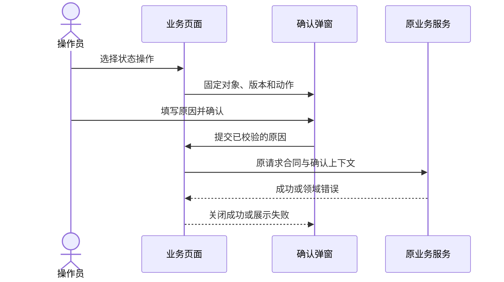
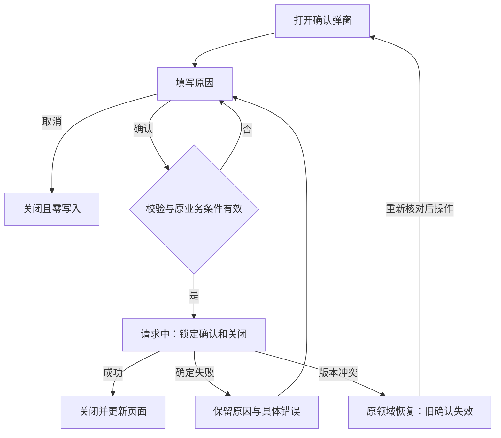

# Admin 表单展示一致性修复 - Plan

> 2026-10-31：本计划的未完成工作已由 [Admin 表单样式统一与逐页验收](2026-10-31-0307-fix-admin-form-style-unification-plan.md) 承接，本文保留为历史来源，不再作为执行队列。R1–R9、AE1–AE4、KTD1–KTD5、U1–U6 的原意与编号保留在新计划中；被承接不表示工作已完成。商品系列重置先核验当前 Drawer 修改中的已有实现，再补实际缺口。

## Goal Capsule

- **Objective:** 操作员在新增角色、内容和政策状态操作、商品系列编辑时，获得一致的选择、确认与重置体验。
- **Means:** 沿用现有权限树与标准表单容器，调整局部输入位置、宽度和临时状态生命周期（KTD1–KTD4）。
- **Authority:** 本会话已接受的四项修复及联系页小清理是范围依据；展示规范由 `apps/admin/docs/ai/ai-rules.md` 和 `apps/admin/docs/ai/drawer-form-layout-rules.md` 约束，业务合同以对应页面、服务及 `packages/contracts/src/storefront-content.ts` 为准。
- **Execution profile:** 当前主 checkout 同线程完成本地实现、验证、截图与收尾审查；本次仅编写计划，后续获得实施指令后执行。
- **Stop conditions:** 存在未解决合并冲突，或无法保留 R1 的业务合同且需要产品取舍时，先记录阻塞再推进依赖工作。
- **Delivery owner:** 本计划拥有本次本地修改及验证尾部；不包含提交、推送、PR、部署或真实业务发布。

---

## Product Contract

### Summary

统一新增角色的权限选择、内容与政策的状态操作确认，以及政策日期控件宽度，补全商品系列重置并清理联系信息页的空反馈容器。

### Problem Frame

新增角色仍使用旧分组复选框，而编辑角色已使用权限树。
内容与政策把一次操作所需的原因常驻在编辑区，填写和确认被拆开。
政策日期框右边缘未与表单列对齐，商品系列重置遗漏了页面持有的搜索条件。
联系页的空反馈容器仅形成页尾细线，适合作为本批小清理。

### Requirements

**Existing contracts**

- R1. 保留现有路由、容器、权限、只读、安全恢复、API 与完整 payload 合同；已有角色 Drawer 继续为 720px，Admin 保持只读。

**Permission selection**

- R2. 新增角色使用现有权限树，支持父级全选子项、半选反馈、搜索高亮和展开／收起，选择范围限于操作者可授予的权限。

**Transition confirmation**

- R3. 内容页面／文章的发布和归档、政策的审批／发布／归档在对应确认弹窗内填写原因，主编辑区移除常驻的状态变更原因输入。
- R4. 状态操作只确认用户看到的对象、版本和动作，沿用对应权限、状态及冲突恢复规则；按既有服务合同校验去首尾空格后 3–500 字的原因。
- R5. 弹窗取消不写入，确定失败保留原因与可操作错误，请求中阻止重复提交和关闭；冲突后必须重新核对版本，不自动重试写操作。

**Width, reset and feedback**

- R6. 政策生效日期填满现有表单内容列，保留当前内容宽度、对齐偏好与固定保存／重置栏。
- R7. 商品系列确认重置后恢复原字段与成员基线，同时清空商品搜索条件和临时候选结果；旧搜索响应不得在重置后回填。
- R8. 联系信息页没有错误、版本对比或只读说明时不渲染空反馈容器，保留这些反馈分支的现有能力。

**Delivery evidence**

- R9. 修改前保存新基线截图，完成后提供同视口、语言、主题、数据和滚动位置的真实前后对比；测试情景与真实业务页面分别标注。

### Key Decisions

- **复用权限树并保留 Drawer。** Governs R1, R2. (session-settled: user-approved — chosen over the old grouped checklist: 新建与编辑使用同一套权限选择方式。)
- **原因随具体操作确认。** Governs R3–R5. (session-settled: user-approved — chosen over permanent reason fields: 填写与确认在同一上下文内完成。)
- **商品系列只修重置行为。** Governs R7. (session-settled: user-approved — chosen over a page redesign: 现有布局无需更换。)

### Scope Boundaries

本计划独立有界，继承 `docs/plans/2026-10-28-refactor-admin-template-style-fixes-plan.md` 的完成基线和当前 templates 规范。
它只修复本节 Requirements 指定的残余差异，不重开七页修复、角色详情、导航或店铺资料的已完成计划。
产品上游仍由 `docs/plans/2026-08-13-001-refactor-shoppp-product-master-plan.md` 指向的 REL 计划拥有；不改变 REL-Pre-DC、候选、DC/PG、产品顺序或主计划指针。

不做全项目原因字段删除，不修改审批／发布状态机，不新增审批层级或通用状态操作引擎。
不改 `PermissionTree` 的既有搜索语义，不为了截图在实际环境创建或发布记录。
无需新增依赖、修改后端或 contracts，也不扩大为整项目表单迁移。

### Acceptance Examples

- AE1. Covers R2. 操作者只有某组两项可授予权限，勾选该父节点后只提交这两项叶子权限，不提交分类键或不可授予权限。
- AE2. Covers R3–R5. 打开某版本发布弹窗后取消，不发状态写请求；确认时准确提交该对象、动作、版本、原因和原确认字段。
- AE3. Covers R5. 状态写请求被拒绝时，原因仍在弹窗内；版本冲突遵守原领域恢复并要求重新确认，不把失败操作改投到另一记录。
- AE4. Covers R7. 搜索 Linen 并产生延迟请求后确认重置，恢复基线成员；延迟请求返回时不能恢复旧候选列表。

---

## Planning Contract

### Key Technical Decisions

- KTD1. **接入已有领域组件，不重做容器。** 新增角色在现有 Form.Item 中使用 `apps/admin/src/pages/iam/permission-tree.tsx`，复用现有 Drawer 生命周期；不为本次工作改变共享 recipe。落实 R1, R2。
- KTD2. **状态弹窗由各业务页面持有。** 沿用 `apps/admin/src/pages/storefront/navigation-page.tsx` 的 Ant Design Modal + Form 形式，但内容和政策分别持有动作上下文与请求恢复，不提取跨领域状态引擎。原服务请求组装仍由原页面处理。落实 R3–R5。
- KTD3. **状态操作绑定确认上下文。** 打开时固定对象标识、版本与动作；政策使用已审阅版本。切换对象、路由或冲突恢复使旧确认失效，提交前复核当前权限与原可用条件；确定失败继续编辑原原因，版本冲突按原恢复流程结束旧确认。落实 R4, R5。
- KTD4. **重置在现有查询状态边界处理。** 清除搜索状态和非成员临时候选，保留基线成员的可用名称缓存及原商品入口带入规则；取消待触发搜索并忽略属于旧查询的迟到结果。落实 R7。
- KTD5. **展示小修使用现有能力。** 日期框沿用表单列宽；联系页仅按实际反馈内容控制容器是否出现，不替换反馈组件或引入新层级。落实 R6, R8。

### High-Level Technical Design

确认上下文与请求的关系由 KTD2、KTD3 约束：

弹窗生命周期落实 R5，冲突恢复继续由各业务页面持有：

### Risks and Dependencies

内容编辑器由 page 和 article 两个入口共同使用，必须验证两种请求路径以及仅有发布权限、没有编辑权限时的独立状态操作。
政策审批针对已审阅版本，不能把弹窗迁移实现成“提交时读取最新任意版本”。
商品系列搜索为异步并保留已选成员缓存，直接清空所有候选会丢失已有成员名称；U5 必须覆盖选中成员和迟到响应两种情况。

当前实际环境的内容和政策记录为空。
该限制不阻止实现：相关现有测试已经具备版本、审阅和冲突数据，U1 与 U6 使用隔离测试情景补齐对应画面，不伪称真实业务记录截图。

### Sources

- `apps/admin/docs/ai/ai-rules.md` §3.1、§4、§4.4。
- `apps/admin/docs/ai/drawer-form-layout-rules.md`。
- `apps/admin/src/pages/iam/roles-page.tsx` 与 `apps/admin/src/pages/iam/role-detail-page.tsx`。
- `apps/admin/src/pages/storefront/navigation-page.tsx` 的原因确认弹窗。
- `apps/admin/src/services/content/api.ts`、`apps/admin/src/services/platform/api.ts` 与 `packages/contracts/src/storefront-content.ts` 的原请求合同。
- `apps/admin/src/test/i18n-browser-fixture.tsx` 的隔离浏览器数据能力。

---

## Implementation Units

### U1. Freeze baseline and capture before states

**Goal:** 确保针对实际当前代码实施，并在任何页面修改前保留可比基线。

**Requirements:** R1, R9。

**Dependencies:** 无。

**Files:** 各 U 所列页面、测试及原请求合同只读检查；实施证据归入 `docs/progress/2026-10-29-admin-form-consistency-verification.md`。

**Approach:**

1. 确认 index 和工作区没有未合并条目，记录 HEAD、原有 WIP 与本次相关文件基线。
2. 冻结各动作的权限、状态、disabled 条件、对象和版本来源，以及完整请求字段集合。
3. 保存新增角色、政策日期、商品系列、联系页尾的当前原图；内容与政策状态操作缺少真实记录时，从现有隔离测试情景保存当前实现的图并标注测试数据。

**Test expectation:** 无新增测试；本单元形成行为对照清单与截图清单。

**Verification:** 原图及情景标签齐全，原请求字段和只读分支可供后续逐项核对。

### U2. Unify new-role permissions

**Goal:** 新增角色复用现有权限树。

**Requirements:** R1, R2；Covers AE1。

**Dependencies:** U1。

**Files:** `apps/admin/src/pages/iam/roles-page.tsx`、`apps/admin/src/pages/iam/iam-pages.test.tsx`、`apps/admin/src/pages/iam/iam-form-drawers.browser.test.tsx`。

**Approach:** 按 KTD1 替换字段内部选择器，保留 create payload 排序、trim/null 映射、成功关闭和列表刷新合同；修改旧新增入口测试以通过树完成选择。

**Test scenarios:**

1. 父级全选和取消只影响可授予子项，payload 只包含叶子权限。
2. 部分勾选呈半选，重置恢复字段、勾选、搜索和展开基线。
3. 创建失败保留输入，成功只发送一次创建并刷新列表一次。
4. 现有 Admin／受保护角色仍只读，没有普通保存入口；Drawer footer 可达且 body 无横向溢出。

**Verification:** 相关 IAM 单元与 Drawer Browser Mode 通过，新建与编辑使用同一权限选择方式。

### U3. Move content and policy reasons into confirmation dialogs

**Goal:** 把状态原因与该次操作的确认合并。

**Requirements:** R1, R3–R5；Covers AE2, AE3。

**Dependencies:** U1。

**Files:** `apps/admin/src/pages/content/content-editor-page.tsx`、`apps/admin/src/pages/settings/policies-page.tsx`、`apps/admin/src/pages/content/content-editor.test.tsx`、`apps/admin/src/pages/settings/policies-page.test.tsx`、`apps/admin/src/pages/content/content-editor.browser.test.tsx`、拟新增 `apps/admin/src/pages/settings/policies-page.browser.test.tsx`；必要词条写入 `apps/admin/src/shared/i18n/translations.ts`。

**Approach:** 按 KTD2、KTD3 把常驻原因与 Popconfirm 改为页面级 Modal + Form，保留各自错误和版本恢复 owner；内容未保存阻断、政策审批／发布权限分离仍按原页面执行。

**Execution note:** 先更新已有状态操作测试来固定原对象、版本和完整请求合同，再调整交互入口。

**Test scenarios:**

1. page、article 的发布／归档以及政策的审批／发布／归档各自打开正确标题和对象版本，打开与取消零写入。
2. 空白、去空格后不足 3 字及超过 500 字的原因在弹窗内阻断；有效输入按原服务合同提交完整 payload。
3. 内容保留 confirm、expectedVersion 及 redirectFromOldSlug 的原动作映射；政策保留已审阅版本和 confirm。
4. 请求进行时连续确认只写一次，Esc、遮罩和关闭入口不能提前退出；成功关闭且清理原因。
5. 确定失败保留原因并在弹窗可见位置显示错误；policy_conflict 沿用权威版本重读，旧确认不能再次提交。
6. 切换记录或路由后，旧弹窗和迟到回调不作用于新对象。
7. 无对应动作权限时不可执行；有发布权限但无普通编辑权限的内容查看模式仍保留合法状态动作。
8. Browser Mode 验证弹窗键盘输入、校验反馈和取消后返回上下文；切换语言保留原因与错误，不增加业务读写。

**Verification:** 状态原因不再常驻编辑区；完整请求、权限分支及冲突测试保持通过。

### U4. Align the policy date and remove empty feedback chrome

**Goal:** 完成两个低成本展示修正。

**Requirements:** R1, R6, R8。

**Dependencies:** U1；政策最终截图在 U3 之后收口。

**Files:** `apps/admin/src/pages/settings/policies-page.tsx`、`apps/admin/src/pages/settings/contact-settings-page.tsx`；既有覆盖位于 `apps/admin/src/pages/settings/contact-settings-page.test.tsx` 和 `apps/admin/src/test/admin-template-style.browser.test.tsx`。

**Approach:** 按 KTD5 对齐日期控件并移除无内容的反馈外壳；只读说明、保存错误和版本对比出现时继续保留原反馈区。

**Test expectation:** 不新增仅断言 CSS class 或 Card 数量的样式测试；复跑既有失败、冲突和只读反馈用例，并检查真实页面。

**Verification:** 日期框与同列字段右边缘对齐；正常联系页无残留细线，错误和版本对比仍可见。

### U5. Complete Collection reset and query cleanup

**Goal:** 重置后商品选择区回到当前编辑基线。

**Requirements:** R1, R7；Covers AE4。

**Dependencies:** U1。

**Files:** `apps/admin/src/pages/catalog/collection-form-page.tsx`、`apps/admin/src/pages/catalog/collection-form-page.test.tsx`；拟新增 `apps/admin/src/pages/catalog/collection-form-page.browser.test.tsx`。

**Approach:** 按 KTD4 补齐重置和查询响应归属，保持当前表单、成员排序和商品入口带入逻辑；不改远程搜索接口或候选分页规模。

**Execution note:** 先增加“旧搜索请求在重置后返回”的失败用例，避免只验证搜索框外观为空。

**Test scenarios:**

1. 搜索并修改字段与成员后取消重置，草稿和搜索保持；确认重置则恢复原字段与成员顺序。
2. 确认后搜索条件为空，随后读取使用空查询；旧查询特有的临时候选不保留。
3. 较早发出的搜索请求晚于重置后的请求返回，不覆盖新候选。
4. 基线成员及从商品入口带入的成员仍保留名称和原有保存合同。
5. 重置过程不触发保存／状态写请求；Browser Mode 验证可见搜索文字与实际候选条件一致。

**Verification:** 用请求断言和延迟响应测试证明查询状态已重置，布局保持现状。

### U6. Verify and deliver actual comparisons

**Goal:** 交付可追溯的本地验证和真实前后对比。

**Requirements:** R1–R9。

**Dependencies:** U2–U5。

**Files:** 本计划、`docs/progress/2026-10-29-admin-form-consistency-verification.md`，以及以上受影响测试；审查复用原页面文件。

**Approach:** 执行 Verification Contract，核对行为对照清单，完成同线程简化及收尾审查，修复本次引入的问题后导出对比材料。

**Test expectation:** 不另建“所有修复均完成”的重复聚合测试；按受影响 suites 验证。

**Verification:** 验证证据、截图标签、实际变更清单和已知限制齐全，项目内无遗留试验代码。

---

## Verification Contract

本轮计划文档使用 **L0**：检查新增文档的 diff、格式与引用，不运行应用测试、typecheck 或 build。
未来实施按 **L3** 收口，原因是共享内容编辑器覆盖 page／article 且本批同时调整多个页面的状态操作行为。
影响边界限于 Admin；根 workspaces 与 Admin manifest 表明 contracts 是现有依赖，本计划只读取而不修改其合同。
实施前记录 import/reference 的反向消费者与 suite 映射；若实际修改共享 recipe 或 contracts，先重新界定范围。

| Gate | Scope and evidence |
| --- | --- |
| Focused unit | 使用 Admin 既有 `bun run test <files>`，覆盖 U2–U5 指定的 IAM、内容、政策、商品系列、联系页 suites；对 payload 使用完整等值断言 |
| Browser Mode | 使用 `bun run test:browser <files>`，覆盖 U2 的既有 Drawer suite、U3 的内容与政策 Modal suites、U5 的查询／重置 suite，以及既有模板样式 suite 的相关政策场景 |
| Changed-file quality | 仅对实际变更文件运行 ESLint 与 Prettier；核对新增或修改词条的双语覆盖 |
| Types | 代码稳定后一次 `bun run typecheck`；本计划不默认执行 build 或全量 Admin／monorepo 测试 |
| Visual acceptance | 同条件桌面前后图；非 Drawer 页面补窄屏可用性检查，Drawer 仅按规范验证不小于 720px 桌面；核对浅／深色及既有对齐偏好 |
| Evidence | 记录实际命令、结果、截图清单、异常与隔离依据；与本次无关的既有失败单独记录，不反复重跑 |

状态截图至少包含：新增角色树、内容发布确认、政策审批或发布确认及日期宽度、商品系列重置前后、联系页尾。
当前真实环境无记录的状态，可用同一隔离测试数据分别运行修改前和修改后代码截图，明确标注“测试情景”；真实页面截图不使用数据注入或业务写入造景。
完成图使用实际实现截图，之前的生成示意图仅作为设计参考。
无需 E2E 或 release:validate；若实际触及认证／跨页权限基础设施、外部部署或发布门禁，再按 `apps/admin/docs/testing-standards.md` 升级。

---

## Definition of Done

- R1–R9 通过各 U 的行为与展示验收。
- 选定 focused tests、质量检查、类型检查和 Browser Mode 通过，或无关失败已有明确隔离证据。
- 交付修改清单、实际前后截图，以及真实数据与测试情景的区别。
- 清除弃用方案和试验代码，不留下无消费者抽象或无效文案。
- 在本计划的执行检查点和对应 progress 中记录完成；不更新产品主计划指针。

---

## Execution Checkpoint

- 历史：2026-10-29 形成计划，当时未实施应用修改。
- 2026-10-31 起由 `docs/plans/2026-10-31-0307-fix-admin-form-style-unification-plan.md` 唯一持有该范围的当前单元、顺序、阻塞和本地实施尾部。
- 本计划停止执行与进度维护，保留需求和原实施设计供来源核对；不宣称原单元完成，也不接管 REL 或既有完成计划。
