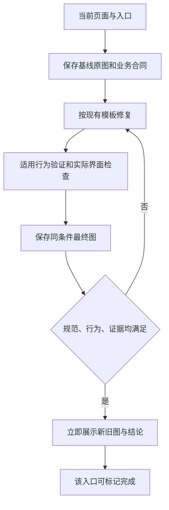

# Admin 表单样式统一与逐页验收 - Plan

## Goal Capsule

- **Objective:** 管理后台操作员在各业务入口获得符合现有规范的表单体验，项目维护者能逐页检查实际修复结果及新旧截图。
- **Means:** 先修当前四个 Drawer，再完成旧计划剩余任务，随后覆盖后台业务入口排查并按有界批次修复（KTD6–KTD9）。
- **Authority:** 本会话已确认的四点方案，以及下文继承的旧计划需求；展示以 `apps/admin/docs/ai/` 当前规则为准，业务以当前页面、服务和 contracts 为准。
- **Execution profile:** 现有主 checkout 内顺序实施，逐页验证与交付；本次只编写计划。后续实施不默认创建 worktree、提交、推送、PR 或部署。
- **Stop conditions:** 无法保留 R1、缺失当前页修改前证据，或发现必须改变业务合同的取舍时，记录具体阻塞，不将受影响页面标为完成。
- **Delivery owner:** 本计划拥有已知修复、全后台排查、后续批次承接及整体验收；U9 的有界子计划各自拥有其实现与验证尾部。本计划不拥有 REL、候选、DC 或 PG。

---

## Product Contract

### Summary

修复颜色／选项设置、商品展示的字段与分区样式，并重新验收实体地点、商品集合两个 Drawer。
承接旧计划中角色权限树、内容与政策原因确认、政策日期、联系页反馈、商品集合重置的剩余工作。
随后按实际入口排查管理后台，以有界计划完成确认的问题；所有修改页面均逐页交付可比的新旧截图。

### Problem Frame

当前 Drawer 迁移统一了容器与部分交互，内部仍保留手写分组、非标准字段间距和固定样式颜色。
此前的功能测试与无横向溢出检查没有证明字段、分区、主题和国际化符合规范。
旧计划尚有待实施任务，商品集合重置又已被当前修改部分覆盖；同时执行原清单会产生重复工作。
其他后台组件中也存在相似写法，需要通过实际界面核验，而不能将源码命中直接当作缺陷。

### Authority and Preservation

本计划是独立的 Admin 修复计划，不是产品 successor。
产品上游仍为 `docs/plans/2026-08-13-001-refactor-shoppp-product-master-plan.md` 指向的 REL 计划；REL-Pre-DC、候选、产品顺序及发布尾部均不变，master 无需更新。

| 来源 | 继承基线与承接边界 |
| --- | --- |
| `docs/plans/2026-10-29-0018-refactor-admin-form-consistency-plan.md` | 由本计划替代其未完成工作的执行与验收权威；原文保留历史，停止维护旧队列。R1–R9、AE1–AE4、KTD1–KTD5、U1–U6 保留编号和原意；扩展范围使用新编号。 |
| `docs/plans/2026-10-31-refactor-admin-local-form-drawers-plan.md` | 继承当前四处 Drawer 的代码与行为基线，不重新执行容器迁移。该完成计划继续冻结；本计划不沿用其证据作为全面样式合规结论。 |
| `docs/progress/2026-10-31-admin-local-form-drawers-verification.md` | 作为已有测试和实现线索；U1 核对实际工作区，不能将历史通过结果当作本轮验证结果。 |
| `docs/plans/2026-10-28-refactor-admin-template-style-fixes-plan.md` | 继承完成基线，不整体重开已完成工作；U8 发现的新问题使用本计划或 U9 有界子计划承接。 |

**Product Contract preservation:** R1–R9 和 AE1–AE4 原意不变；R9 的本轮证据细则由 Visual Evidence Protocol 展开。新增 R10–R16 覆盖本会话增加的四处复核、后台排查、后续修复和逐页完成门槛。

旧计划的 U5 不直接认定完成：当前代码已有搜索清空和迟到响应隔离，先核验覆盖，再只补实际缺口。
并行的产品／发布计划保持原权威；本轮不启动其他独立计划，也不将其未完成项静默纳入范围。

### Requirements

**Inherited business and interaction contracts**

- R1. 保留现有路由、容器、权限、只读、安全恢复、API 与完整 payload 合同；已有角色 Drawer 继续为 720px，Admin 保持只读。
- R2. 新增角色使用现有权限树，支持父级全选子项、半选反馈、搜索高亮和展开／收起，选择范围限于操作者可授予的权限。
- R3. 内容页面／文章的发布和归档、政策的审批／发布／归档在对应确认弹窗内填写原因，主编辑区移除常驻的状态变更原因输入。
- R4. 状态操作只确认用户看到的对象、版本和动作，沿用对应权限、状态及冲突恢复规则；按既有服务合同校验去首尾空格后 3–500 字的原因。
- R5. 弹窗取消不写入，确定失败保留原因与可操作错误，请求中阻止重复提交和关闭；冲突后必须重新核对版本，不自动重试写操作。
- R6. 政策生效日期填满现有表单内容列，保留当前内容宽度、对齐偏好与固定保存／重置栏。
- R7. 商品系列确认重置后恢复原字段与成员基线，同时清空商品搜索条件和临时候选结果；旧搜索响应不得在重置后回填。
- R8. 联系信息页没有错误、版本对比或只读说明时不渲染空反馈容器，保留这些反馈分支的现有能力。

**Visual evidence**

- R9. 修改前保存新基线截图，完成后提供同视口、语言、主题、数据和对应业务区域的真实前后对比；测试情景与真实业务页面分别标注，执行下文 Visual Evidence Protocol。

**Current four forms**

- R10. 颜色／选项设置按现有标准表单组织业务分区、标签、展示类型和字段错误；名称、色块、HEX 继续作为同一值的关联组合，不以全宽规则拆散对应关系。
- R11. 商品展示统一字段和规格分区，补齐应用拥有的中文标签；多行文本与动态规格使用足够的内容空间，操作仍归属对应记录。
- R12. 四个当前入口分别复核编辑、适用只读、代表性内容、校验与主题；地点只回填联系设置草稿，商品集合 Drawer 与兼容独立入口继续保持原业务合同。

**Audit, follow-up and completion**

- R13. 排查覆盖 Admin 实际业务路由及其 Drawer、Modal、动态子表单和运行时复用组件，按“页面＋入口”建立完整覆盖清单。
- R14. 每个确认问题具备规则依据、当前界面证据、修复 owner、受影响入口和有界修复批次；不能以建立报告或计划替代修复。
- R15. 本计划及具名有界子计划分别拥有自己的执行检查点；证据文件只保存检查与验证事实，不维护第二套当前任务队列。
- R16. 页面完成必须同时满足适用规范、行为验证、截图交付和问题关闭；标准字段、分区、主题优先复用现有模板与 primitives，不以测试通过或类名存在替代视觉验收。

### Key Decisions

- **复用权限树并保留 Drawer。** Governs R1, R2. (session-settled: user-approved — chosen over the old grouped checklist: 新增与编辑使用同一权限选择方式。)
- **原因随具体操作确认。** Governs R3–R5. (session-settled: user-approved — chosen over permanent reason fields: 原因填写和状态确认处于同一上下文。)
- **商品系列保留现有维护结构。** Governs R1, R7, R12. (session-settled: user-approved — chosen over another page redesign: 核验并补齐重置，不重复已完成的 Drawer 迁移。)
- **先修已知问题，再覆盖后台并分批修复。** Governs R10–R16. (session-settled: user-approved — chosen over four isolated patches with no follow-up: 新计划包含本会话提出的四点，并承接旧计划剩余工作。)

### Scope Boundaries

目标是 `apps/admin` 的业务表单及关联分区、局部反馈和操作区；后台中名为 storefront 的编辑页面也属于排查范围。
模板示例和共享 primitives 是参考权威与必要的反向消费者检查对象，不作为待迁移业务页面。
不涉及 shopper storefront、后端、contracts、依赖升级、审批状态机或全项目原因字段删除。
普通编辑备注和原业务必需原因继续保留，R3 只调整具名状态操作的原因位置。

四处已知问题优先局部复用现有能力，不重构表单状态源或新增设计系统、通用状态操作引擎、全局反馈、焦点、草稿或布局配置机制。
共享能力只有出现可复现缺口且局部组合无法解决时才进入 U9 具名批次，并按影响闭包验证。
截图不通过真实环境创建、发布、删除业务记录造景；数据不足使用明确标注的隔离情景。

### Acceptance Examples

- AE1. Covers R2. 操作者只有某组两项可授予权限，勾选父节点后只提交两项叶子权限，不包含分类键或不可授予项。
- AE2. Covers R3–R5. 打开某版本发布弹窗后取消，零状态写入；确认时提交原对象、动作、版本、原因和完整确认字段。
- AE3. Covers R5. 确定写失败保留原因；版本冲突使旧确认失效，重新核对后才能继续，不将旧动作提交给新记录。
- AE4. Covers R7. 搜索 Linen 并产生延迟请求后确认重置，恢复基线成员；延迟响应不能恢复旧候选。
- AE5. Covers R10, R12. HEX 输入非法值时就地显示关联错误且零写入；改正后保留原色样提交和独立保存合同。
- AE6. Covers R10–R12. 较长选项名、完整 SKU／媒体键、规格和地址能辨认，错误不挤压邻项，footer 可达，body 不横向溢出。
- AE7. Covers R9, R16. 某入口测试通过但缺少修改前图，或深色主题仍有已确认问题，该入口保持未完成。
- AE8. Covers R13, R14. 搜索命中商品业务色值或合法紧凑组合时，依据内容判断记录合理例外，不机械替换成主题色或全宽输入。

---

## Planning Contract

### Key Technical Decisions

- KTD1. **新增角色接入已有 PermissionTree。** 在原 Form.Item 中替换权限选择器，保留现有 Drawer 与 payload 映射；不改树的搜索语义或共享 recipe。落实 R1, R2。
- KTD2. **状态弹窗由各页面持有。** 参考 `apps/admin/src/pages/storefront/navigation-page.tsx` 的 Modal + Form，内容和政策分别保留动作上下文、请求组装及恢复 owner，不抽取跨领域状态引擎。落实 R3–R5。
- KTD3. **确认绑定打开时的上下文。** 固定对象、版本、动作，政策使用已审阅版本；路由／记录变化或冲突令旧确认失效。提交前复核原权限和业务条件。落实 R4, R5。
- KTD4. **查询重置沿原状态边界核验。** 复用当前搜索代次隔离、基线成员缓存与 handoff 规则；只有证据显示缺口才修改。落实 R7。
- KTD5. **日期与反馈修正使用现有能力。** 日期沿用表单列宽；联系页按实际反馈内容决定是否渲染反馈 Card，保留原错误、版本对比和只读分支。落实 R6, R8。
- KTD6. **字段层也完成标准接入。** 当前商品子表单使用标准分区和 Form.Item 的标签／错误样式，继续由原业务状态持有值、dirty 和提交。移除本次发现的固定样式颜色，不新增另一套 Form 状态或校验引擎。落实 R10–R12, R16。
- KTD7. **区分样式 token 与业务内容。** UI 边界和反馈沿用 Ant Design token 或语义变量；色样值、SKU、资源名称按原业务数据呈现。字段布局逐项按 `drawer-form-layout-rules.md` 判断。落实 R10–R13。
- KTD8. **按入口核验，再按共同修复边界分批。** 从路由和运行时调用关系建立清单，源码搜索仅提供线索；页面局部问题按业务分组，共用组件问题先列反向消费者。落实 R13, R14。
- KTD9. **截图是每页交付物。** 采用下文 R9 协议，接受的图片进入持久证据目录，每页交付一次原图对比与结论，U6 只汇总已有材料。落实 R9, R16。

### Sequencing and ownership

保留旧 U1–U6 含义，新增 U7–U9，执行顺序为：

**U1 → U7 → U2 → U3 → U4 → U5 → U8 → U9 → U6。**

U7 内顺序为颜色设置、商品展示、实体地点、商品集合。
U8 形成新发现的清单与批次边界；U9 的具名小计划分别拥有详细单元和证据，本计划仅持有 U9 整体承接与最终完成判断，不复制子计划进度表。
没有新增确认问题时，未来获得实施指令后按该顺序推进，不因每页截图重复要求实施授权。

### Page acceptance flow

### Risks and deferred implementation details

当前相关实现包含未提交的工作区修改，HEAD 不能单独标识截图基线；U1 必须记录相关 WIP 文件及内容标识。
颜色表单改用标准字段容器时容易引入重复状态或丢失原错误关联，KTD6 保持原状态 owner。
page、article 共用内容编辑器，政策操作依赖已审阅版本，U3 不能只验证其中一个入口或任意最新版本。
商品集合已有测试和搜索隔离，U5 以实际覆盖为准，不为补齐旧计划文件列表而新建重复测试。

全后台问题数量与 U9 的具体文件清单在 U8 界面排查后确定；当前只能列候选，不能预先宣称缺陷或合规。
历史对话提到实际环境缺少内容／政策记录，执行时重新确认；缺少数据不授权真实业务写入造景。
现有模板与本地合同足以支撑本计划，不引入外部视觉规范或依赖。

### Sources

- 展示权威：`apps/admin/docs/ai/ai-rules.md`、`apps/admin/docs/ai/drawer-form-layout-rules.md`、`apps/admin/docs/ai/page-recipes.yaml`、`apps/admin/docs/ai/component-catalog.yaml`。
- 现有组合：`apps/admin/src/shared/template-kit/recipes/crud-form-drawer-recipe.tsx`、`apps/admin/src/shared/template-kit/recipes/basic-crud-form-recipe.tsx`、`apps/admin/src/shared/components/sort-action-group.tsx`。
- 业务合同：各 U 的页面与原服务，内容／政策另核对 `packages/contracts/src/storefront-content.ts`；不从示例模板推导请求或权限。
- 验证权威：`apps/admin/docs/testing-standards.md`、`apps/admin/package.json`、`tools/check-admin-i18n.test.ts`。

---

## Implementation Units

### U1. Reconcile authority and capture baseline

**Goal:** 建立准确的本轮基线和承接清单。

**Requirements:** R1, R9, R15。

**Dependencies:** 无；应用实施须有后续实施指令。

**Files:** 本计划、来源两份计划和现有 WIP 只读核验；拟新增 `docs/progress/2026-10-31-admin-form-style-unification-verification.md`。

**Approach:**

1. 核对冲突、HEAD、既有 WIP 及相关文件内容标识，区分旧实现与本轮变更。
2. 核对旧任务与当前代码、测试的对应关系，特别记录 U5 已有覆盖和待验证分支。
3. 为即将修改的各入口冻结请求合同、权限与状态条件，按 R9 保存当前基线；每个后续页面开始前补齐自身基线。

**Test expectation:** 无新增应用测试；本单元只形成合同、截图和来源对照。

**Verification:** 当前四个入口的基线可复现，旧计划不再保留有效执行队列，WIP 与新修复可区分。

### U7. Standardize the current four forms

**Goal:** 完成四处字段层样式整改或复核，形成逐页验收样例。

**Requirements:** R1, R9–R12, R16；Covers AE5–AE7。

**Dependencies:** U1。

**Files:** `apps/admin/src/pages/catalog/catalog-form-page.tsx`、`apps/admin/src/pages/settings/contact-location-drawer.tsx`、`apps/admin/src/pages/catalog/collection-form-page.tsx`、`apps/admin/src/shared/i18n/translations.ts`；必要时修改原父页及列表入口。复用 `apps/admin/src/pages/catalog/catalog-form-page.test.tsx`、`apps/admin/src/pages/settings/contact-settings-page.test.tsx`、`apps/admin/src/pages/catalog/collection-form-page.test.tsx`、`apps/admin/src/pages/catalog/collection-list-page.test.tsx`、`apps/admin/src/test/admin-local-form-drawers.browser.test.tsx`。

**Approach:** 按 KTD6、KTD7 顺序处理下表；每个入口按 KTD9 交付后再推进。

| 子阶段 | 入口 | 本地工作 |
| --- | --- | --- |
| U7.1 | 颜色／选项设置 | 保留 Color、Size 等业务分区，以标准标题、字段和间距替换当前 fieldset/legend 呈现；展示类型填满所属字段区域；统一色样错误与主题样式；保留紧凑颜色组合。 |
| U7.2 | 商品展示 | 整理品牌、款式、媒体、详情文案的标签与间距；规格采用标准分区，保留名称、内容和排序／删除归属；补齐 Detail eyebrow、Detail body 中文词条。 |
| U7.3 | 实体地点 | 核验标准字段、长地址、错误、只读与主题；修实际缺口，保留隐藏 ID、null、排序、公开状态和草稿回填边界。 |
| U7.4 | 商品集合 | 核验标识、成员、SEO 分区与长内容；复核 Drawer 和兼容独立入口，发现的查询重置缺口统一交给 U5，不另做一份实现。 |

**Execution note:** 先保留实际组件截图和提交合同，再调整字段组合；不为纯颜色或间距增加只断言 class 的测试。

**Test scenarios:**

1. Covers AE5. 非法 HEX 显示原字段错误且不写入；有效值沿原选项接口提交完整参数。
2. 商品两个子保存保留共享版本和写锁，失败留值，成功只通知一次刷新，不覆盖主体草稿。
3. 地点取消不回填，确认仅改变父草稿；联系设置最终 payload 保留 ID、null 和公开状态。
4. 集合两个容器保持完整字段、顺序成员、权限与原恢复行为，查看模式硬阻断普通写。
5. Covers AE6. 代表性长值、规格记录操作及字段错误可读；实际 Portal、滚动和 footer 符合 Drawer 规范。
6. 切换语言或主题保留当前草稿和错误，不额外业务读写；中文标签完整，业务名称按原值显示。

**Verification:** 四个入口均具备基线与最终图；无须改代码的入口注明两次检查间无样式代码变更，不能宣称修复了不存在的问题。

### U2. Unify new-role permissions

**Goal:** 新增角色与编辑角色使用同一权限选择方式。

**Requirements:** R1, R2, R9；Covers AE1。

**Dependencies:** U1、U7。

**Files:** `apps/admin/src/pages/iam/roles-page.tsx`、`apps/admin/src/pages/iam/iam-pages.test.tsx`、`apps/admin/src/pages/iam/iam-form-drawers.browser.test.tsx`；复用 `apps/admin/src/pages/iam/permission-tree.tsx`。

**Approach:** 按 KTD1 替换选择器，保留 create payload 的排序、trim/null、成功关闭和一次刷新。

**Test scenarios:**

1. Covers AE1. 父级全选／取消只影响可授予叶子权限，部分选择显示半选。
2. 搜索、展开／收起可用，确认重置恢复字段、选择与原树状态。
3. 创建失败保留输入；成功只写一次且父列表只刷新一次。
4. Admin 和其他受保护角色继续只读，不能通过表单提交修改。

**Verification:** 相关 IAM 验证通过，新增入口按 R9 当页交付，受保护角色复核留有证据。

### U3. Move transition reasons into confirmation dialogs

**Goal:** 在内容与政策状态确认时填写本次原因。

**Requirements:** R1, R3–R5, R9；Covers AE2, AE3。

**Dependencies:** U2。

**Files:** `apps/admin/src/pages/content/content-editor-page.tsx`、`apps/admin/src/pages/settings/policies-page.tsx`、`apps/admin/src/shared/i18n/translations.ts`；`apps/admin/src/pages/content/content-editor.test.tsx`、`apps/admin/src/pages/settings/policies-page.test.tsx`、`apps/admin/src/pages/content/content-editor.browser.test.tsx`，必要时新增 `apps/admin/src/pages/settings/policies-page.browser.test.tsx`。

**Approach:** 按 KTD2、KTD3 将具名状态操作迁至页面级 Modal + Form，普通编辑备注与业务原因字段保持原归属。

**Execution note:** 先核对完整请求和原状态条件，再改变原因输入位置。

**Test scenarios:**

1. Covers AE2. page／article 发布和归档、政策审批／发布／归档各自确认正确上下文；打开和取消零写入。
2. 原因去空格后为空、少于 3 字、超过 500 字时就地阻断；有效值保留完整 confirm、版本和原动作字段映射。
3. 请求中连续确认只写一次，Esc、遮罩、关闭不能提前退出；成功清理原因。
4. Covers AE3. 确定失败留值；版本冲突沿原领域恢复，旧确认失效；迟到回调不作用于新对象。
5. 无对应权限不可操作；只有发布权限而没有普通编辑权限时，合法状态动作继续可用。
6. Modal 内键盘输入、错误和取消返回上下文正常；切换语言不清空原因、不增加读写。

**Verification:** page 和 article 分别有证据；政策各状态分支有覆盖。政策整页最终对比与 U4 一并收口，不把中间截图当作整页完成。

### U4. Align the policy date and contact feedback

**Goal:** 完成政策日期与联系页反馈区域的具名残余修正。

**Requirements:** R1, R6, R8, R9。

**Dependencies:** U3。

**Files:** `apps/admin/src/pages/settings/policies-page.tsx`、`apps/admin/src/pages/settings/contact-settings-page.tsx`；复用 `apps/admin/src/pages/settings/policies-page.test.tsx`、`apps/admin/src/pages/settings/contact-settings-page.test.tsx`、`apps/admin/src/test/admin-template-style.browser.test.tsx` 的相关覆盖。

**Approach:** 按 KTD5 处理日期宽度与空反馈容器，记录相对 U1 基线的最终整页结果。

**Test expectation:** 不新增 CSS class／Card 数量测试；复用失败、冲突、只读反馈覆盖，实际检查日期弹层和页面布局。

**Verification:** 日期与同列字段对齐，正常联系页没有空反馈边界；错误、版本对比和必要只读说明保留，分别交付新旧图。

### U5. Reconcile Collection reset and query cleanup

**Goal:** 核验并补齐 R7，避免重复修改已有实现。

**Requirements:** R1, R7, R9；Covers AE4。

**Dependencies:** U4；继承 U7.4 的观察与 U1 的已有覆盖对照。

**Files:** `apps/admin/src/pages/catalog/collection-form-page.tsx`、`apps/admin/src/pages/catalog/collection-form-page.test.tsx`、`apps/admin/src/pages/catalog/collection-list-page.test.tsx`、`apps/admin/src/test/admin-local-form-drawers.browser.test.tsx`；仅当现有浏览器边界不足时补充具名用例。

**Approach:** 按 KTD4 对照以下情景；已满足的部分只记录现有实现与本轮验证，缺口才进入修改。

**Test scenarios:**

1. 取消重置保持字段、成员和搜索；确认重置恢复字段与成员顺序、清除可见搜索和非基线候选。
2. Covers AE4. 重置前旧查询迟到返回，不能覆盖重置后的候选或恢复旧查询文字。
3. 已选成员、成员名称及 handoffProductId 带入保持原合同，重置不触发保存或状态写入。
4. Drawer 与兼容独立入口均使用正确基线，浏览器可见状态与实际请求条件一致。

**Verification:** R7 有实际请求／延迟响应和界面证据；不因旧计划拟新增测试文件而重复建 suite。商品集合最终完成需合并 U7.4 与本单元结论。

### U8. Audit Admin routes and embedded forms

**Goal:** 确定后台剩余样式差异及其有界修复范围。

**Requirements:** R9, R13–R16；Covers AE8。

**Dependencies:** U5。

**Files:** 只读遍历 `apps/admin/src/routes/routes.config.ts`、`apps/admin/src/pages/` 与运行时相关共享组件；拟新增 `docs/progress/2026-10-31-admin-form-style-audit.md`。

**Approach:**

1. 从路由延伸到实际新增／编辑／查看入口、Modal／Drawer、动态列表和复用组件，冻结排查清单；后续新增入口补入清单。
2. 按业务模块检查字段、分区、布局、主题、提示与操作区。优先观察已发布商品修订、资源／媒体选择器、链接编辑器等已有源码线索，随后覆盖其余模块。
3. 对每项记录规则依据、实际截图、数据与场景限制，区分确认问题、合理例外和待核验项；无法访问的入口具名记录阻塞，不记为通过。
4. 将确认问题按共同修复边界分批，交给 U9；排查报告仅保存证据和 owner 链接，不维护执行队列。

**Test expectation:** 无应用改动，不新增应用测试；搜索命中不能代替实际界面检查。

**Verification:** 每个清单入口都有审查结论或明确阻塞，每个确认问题都有修复归属，未访问或缺数据状态没有被记为合规。

### U9. Execute bounded follow-up batches

**Goal:** 修复 U8 确认的同类问题并逐页完成交付。

**Requirements:** R1, R9, R13–R16。

**Dependencies:** U8；批次间按实际组件依赖排序。

**Files:** 在 `docs/plans/` 为每个有界批次建立具名小计划，列出实际页面、组件、必要测试和对应 progress 证据；具体应用文件由 U8 证据确定，本轮不虚构清单。

**Approach:**

1. 每份小计划注明本计划、发现项、规则依据、精确文件／入口、修复方式、验证等级、截图状态和完成条件。
2. 共享组件批次先展开反向消费者与 suites；页面局部批次沿现有业务结构修正，不重设计业务流程。
3. 逐页按 R9、R16 实施和交付；跨子计划同一文件顺序修改，避免并发覆盖。
4. 本计划检查点只指向当前有界 owner；各小计划保有自身详细进度，证据报告不成为第二队列。

**Test scenarios:** 由每份小计划在动代码前按实际改动列出。纯样式不添加镜像实现的测试；涉及校验、payload、重置、权限或共享能力时，具名覆盖对应行为与失败分支。

**Verification:** 没有确认问题时记录空集合及依据；存在确认问题时，U9 只有在所需小计划的修复与逐页验收完成后才能完成，不能以“已建计划”替代。

### U6. Close verification and deliver comparisons

**Goal:** 汇总完整的实际修复、覆盖与逐页证据。

**Requirements:** R1–R16；Covers AE7。

**Dependencies:** U2–U5、U7–U9。

**Files:** 本计划、对应具名小计划、`docs/progress/2026-10-31-admin-form-style-unification-verification.md`、`docs/progress/2026-10-31-admin-form-style-audit.md` 和接受的截图资产。

**Approach:** 对照各 U 及子计划的已交付材料，完成同线程代码简化与收尾审查；修复发现的问题后，仅补受影响验证与截图。

**Test expectation:** 不新增“全部完成”的聚合测试，不默认重跑所有已通过检查。

**Verification:** 视觉结论与功能结果分开呈现，所有必需入口、问题、截图和验证均可追溯，没有仍在等待补图的完成项。

---

## Visual Evidence Protocol

本节是 R9 的本轮执行细则；同样适用于 U9 每份有界计划。

| 项目 | 要求 |
| --- | --- |
| 交付粒度 | 以“页面＋表单入口”记录。商品展示与颜色设置分别交付；page 与 article 分别交付。 |
| 基线 | 每页动代码前保存当前实际实现；四个目标的旧图是当前 Drawer，不用更早的独立页代替。记录 HEAD 与相关 WIP 内容标识。 |
| 可比条件 | 默认桌面视口 1280×900、100% 缩放、中文，相同数据、权限、模式、主题和对应业务区域。前后保持一致；特殊视口有明确原因并成对记录。 |
| 主题 | 当前四个入口及后续每个修改页面均提供浅色、深色前后图；system 跟随现有主题上下文进行必要 smoke，不另造主题开关。 |
| 内容 | 使用代表性长值和完整标识。长页面按业务分区／滚动锚点成对截图，保留标题及必要操作上下文。 |
| 状态 | 常规填写态必有；涉及校验、只读、动态记录、搜索重置、确认弹窗的问题补对应状态，不穷举无关组合。 |
| 数据来源 | 实际页面与隔离测试情景明确标注。同组对比使用同一 fixture；未知数据分支写明未覆盖。 |
| 图片来源 | 实际运行组件截图；保存后打开检查。生成图、示意图、静态 mock 和仅类名断言不作为完成证据。 |
| 保存 | 临时原图可在忽略目录工作；接受的原图持久保存到 `docs/progress/assets/admin-form-style-unification/`，按入口、before／after、主题和状态命名。 |
| 记录 | 对应 progress 中保存入口、数据、权限／模式、视口／缩放、主题、语言、业务区域、源码基线、原图链接和检查结论；不保存敏感业务样本。 |
| 当页交付 | 页面完成时在对话中直接并排或相邻展示新旧图，附变更和验证结论，不能只给目录或等全批结束再补。 |
| 特殊情况 | 当前四个入口即使复核无需代码变化，也保存本轮基线与最终图并注明未改；其他已合规排查入口保存当前证据，不伪称做过修复。 |
| 连续修改 | 同页跨多个 U 时保留中间状态，最终再给初始基线到最终实现的对比；整页未收齐相关 U 时只报告已完成入口／局部。 |
| 缺图处理 | 没有可靠修改前图时不能标记完成。仅能从已保留的精确基线恢复只读预览补图，不凭记忆或更早版本伪造。 |

现有历史截图仅作定位参考，不能直接视为满足上述同条件协议。
任一接受的图缺失、显示错误入口、仍在加载或与声明条件不符，应重拍后再交付。

---

## Verification Contract

本轮文档使用 **L0**：仅核对文档 diff、格式、引用、承接关系和已有应用 WIP 未被修改；不运行应用测试、typecheck 或 build。
后续验证以 `apps/admin/docs/testing-standards.md` 为唯一分级依据，视觉验收独立于测试通过。

| 工作 | 等级与检查 |
| --- | --- |
| 纯间距、颜色、宽度修正 | L1：changed-file 质量检查及目标页面实际 smoke、R9 截图；不新增只断言样式实现的测试。 |
| Form.Item 组合改变校验／重置边界 | 至少 L2：复用该页 focused tests，批次代码稳定后一次 Admin typecheck，实际字段与错误检查。 |
| U2–U5 已知行为批次 | 按 L3 处理跨入口影响：列出 consumers 和 suites，验证 IAM、content page／article、policy、collection、contact 的实际受影响用例，按真实风险使用已有 Browser Mode 边界。 |
| U9 共用组件批次 | 按 L3 列 import／reference、barrel 与 workspace 反向消费者，映射 suites；无法界定范围时才依政策升级。 |
| 类型与格式 | 仅检查实际变更文件；同一稳定代码状态不重复等价检查，包含 typecheck 的 build 不再追加 standalone typecheck。 |
| 国际化 | 变更词条按现有翻译检查验证双语及占位符；动态词条显式覆盖，实际中文界面另行检查。 |
| 视觉 | 依 R9 协议检查标签、分区、字段、主题、错误、代表性内容和操作区；不以“720px 且无溢出”概括合规。 |

使用 Admin 既有 focused unit、Browser Mode、changed-file lint／format、typecheck 和仓库翻译检查入口，不新建平行验证框架。
页面级验证复用各 U 指定 suite；不为每张截图重复运行同一套门禁。
不默认全量 Admin／monorepo 测试、build、E2E 或 release:validate；出现标准规定的升级条件时记录原因再扩大。
无关失败单独保存隔离证据；影响本轮判断的失败不能当作无关跳过。

---

## Definition of Done

- 当前四个入口分别满足 R10–R12、R16，并按 R9 当页交付新旧图。
- 旧 R1–R8 全部经本轮核验；已有实现按证据继承，实际缺口修复，没有以旧计划状态或旧测试结果冒充完成。
- U8 清单完成必要的实际入口核验；无法访问或仍待核验的必需入口使整体计划保持未完成，合理不适用项需有具体业务依据。
- U8 确认的问题均完成 U9 的有界修复与验收；未修复或未解决的必需项存在时，整体计划不得完成。
- 每页有规则核对、实际变更说明、适用行为验证、原图和样本限制；功能通过与视觉通过各自有证据。
- 选定等级的检查满足标准，弃用或试验代码、临时依赖与无消费者抽象已清理。
- 唯一有效执行检查点及子计划边界清楚；完成后冻结本计划与已完成子计划，不更新产品 master、候选或发布状态。

---

## Execution Checkpoint

- **当前：** 2026-10-31 本地实施及验收已完成，执行体冻结；未提交、推送或部署。
- **当前单元：** 无；U1–U9 全部完成。
- **已执行顺序：** U1 → U7 → U2 → U3 → U4 → U5 → U8 → U9 → U6。
- **下一具体动作：** 无。本轮确认的问题、收尾重置与冲突缺口、适用验证及逐页截图均已交付。
- **阻塞：** 无；U8 的 A01–A09 已全部修复并验收。
- **尾部 owner：** 本计划和四份 U9 子计划均已完成；无剩余实施、补图、审查或发布尾部。产品 master、REL、候选、DC、PG 均未改变。
- **完成证据：** [逐页新旧截图](../progress/2026-10-31-admin-form-style-comparisons.md)、[全后台审计及问题关闭](../progress/2026-10-31-admin-form-style-audit.md)、[验证与需求追溯](../progress/2026-10-31-admin-form-style-unification-verification.md)。同线程简化及最终审查结束，未留下确认问题；没有独立或外部模型复核结论。
