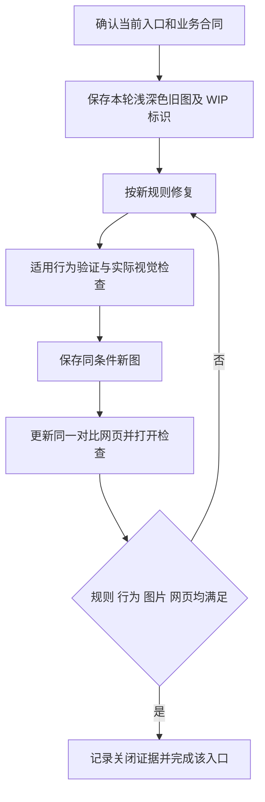

# Admin 表单分区、单列与逐页网页验收 - Plan

## Goal Capsule

- **Objective:** 操作员能按清晰的单列顺序阅读和维护后台表单，维护者能在同一对比网页逐页检查真实修复结果。
- **Means:** 更新现有样式规则，修复三个已确认模式，排查并完成项目内同类问题；每页验收直接进入现有截图网页（KTD10–KTD14）。
- **Authority:** 本会话用户确认的三点及选定示意图；业务、权限和请求以当前项目源码为准。
- **Execution profile:** 本轮只编写计划、保存选定示意图，不修改应用代码或实际样式规则，不运行应用验证。后续实施在当前主 checkout 串行完成；不默认提交、推送、创建 PR、worktree 或部署。
- **Stop conditions:** 缺少可靠修改前证据、无法核对当前运行入口，或必须改变原业务合同时，受影响项保持未完成并记录具体原因。
- **Delivery owner:** 本计划拥有规则更新、同类排查、修复、逐页网页交付和整体验收；新增有界子计划只拥有具名批次。本计划不拥有产品、候选或发布尾部。

---

## Product Contract

### Summary

选项展示参照报名审核 Drawer 的轻分区，Color、Size 不套 Card。
内容页采用用户选定的“状态与发布”示意：状态和已保存版本是与 SEO 同列宽、同对齐的单列只读字段。
普通编辑字段区纵向排列，资源、媒体和链接分组去掉标题切开边框的外观。
同步更新规则、检查所有实际表单入口，并在每页完成时将新旧截图展示到已有对比网页。

### Problem Frame

上一轮完成了容器、字段及主题接入，仍有分区边界弱、状态信息散落在卡片外、普通字段强行双列和标题压住边框的问题。
模板能力接入及测试通过未覆盖这些视觉组织缺口。
现有截图网页只表达上一轮证据，不能覆盖本轮新基线，也不能继续等整个批次结束才交付页面对比。

### Authority and Preservation

这是独立的 Admin 视觉修复后继计划，不是产品 successor。
`docs/plans/2026-08-13-001-refactor-shoppp-product-master-plan.md` 当前指向店铺可视化编辑器计划；本轮不改变其产品顺序、单元、候选或发布权威，因此不更新 master。

| 来源                                                               | 本轮承接边界                                                                                                                                                                  |
| ------------------------------------------------------------------ | ----------------------------------------------------------------------------------------------------------------------------------------------------------------------------- |
| `2026-10-31-0307-fix-admin-form-style-unification-plan.md`         | 保留已完成业务与代码基线；沿用下述稳定 R、AE、KTD 编号。新增视觉要求由本计划拥有，不重开旧执行队列，不以旧完成状态证明新规则合规。                                            |
| 四份 `2026-10-31-fix-admin-form-style-*-plan.md`                   | 保留完成后的实现和证据，不回写新任务；本轮问题按当前实际入口重新确认。                                                                                                        |
| `2026-10-31-fix-admin-form-comparison-gallery-plan.md`             | 保留已完成查看器及历史证据；新增本轮证据展示能力由本计划 U3 拥有。                                                                                                            |
| `2026-10-10-1950-refactor-shopify-style-storefront-editor-plan.md` | 并行拥有编辑器架构、会话、预览、生命周期和迁移。当前新增 `theme-editor/settings-inspector.tsx` 已引用共享选择器，实际挂载由 U1 核对；本轮先核对入口及文件归属，不覆盖其实现。 |
| `gmxgy-admin-new` 的 `/page/hxz/enroll-review-list`                | 只参考其列表打开的审核 Drawer 内“审核记录／基础信息”的轻分区；不借用其业务接口、权限、数据或独立页 Card 结构。                                                                |

**Product Contract preservation:** R1、R4、R5、R9、R13–R16 保留原意；R10 细化为用户确认的无 Card 轻分区。其余旧需求作为已完成行为基线保留，不重复实施。新增 R17–R23；AE2、AE3、AE5–AE8 沿用原含义，新增 AE9–AE13。U 编号仅在本计划内生效，不替换旧 U。

### Requirements

**Existing contracts**

- R1. 保留路由、容器、720px 右 Drawer、权限、只读、完整 payload、校验、dirty、重置、并发写锁及安全恢复合同。
- R4. 发布等状态操作继续确认打开时的对象、版本和动作，保留原因 trim 后 3–500 字及原权限、状态条件。
- R5. 取消零写入，失败保留输入，请求中阻止重复提交；冲突必须成功重读后重新确认，不能被重置绕过。

**Visual structure**

- R10. 选项展示采用普通标题、留白及组间细分割线组织 Color、Size，不使用 Card 包裹；名称、色块和 HEX 保持直接关联。
- R17. 普通编辑字段组默认单列、控件填满所属内容列；专用目录／预览等工作区分栏及关联组合按现有业务依据判断，不能因页面宽或字段短强行双列。
- R18. 内容 page／article 的“状态与发布”采用选定第三张示意：外层 Card 全宽，内容状态、已保存版本是与 SEO 同列宽、同对齐的纵向只读表单项，版本引用详情折叠，发布／归档位于该 Card 标题行操作区。
- R19. 普通表单和共享字段组不以标题切开外边框；独立页分区沿用标准 Card，内部轻分组使用普通标题与分割线，保留控件名称、分组语义和错误关联。
- R20. 上述规则进入现有权威文档及其模板、目录、检查清单投影，不能只写进本次计划或依赖临时记忆。

**Audit and delivery**

- R13. 以当前 Admin 路由和生产消费者建立“页面＋入口”覆盖清单，包含 Drawer、Modal、只读详情、状态操作和动态字段；不直接复用旧排查结论。
- R14. 每项确认缺陷必须有规则、实际证据、入口、修复 owner 和关闭证据；同类问题须完成修复，另建报告或子计划不代表完成。
- R15. 本计划及具名子计划分别拥有自己的执行检查点，审计和截图网页只展示证据，不维护第二份当前任务队列。
- R9. 每个修改入口提供中文、相同数据／权限／模式／业务区域、1280×900、100% 缩放的浅色和深色真实新旧原图；适用异常态另行成对记录。
- R21. 每页完成前，新旧原图必须已经在现有对比网页可见，并实际检查选页、主题／区域切换及放大；不能等批次结束补交。
- R22. 本轮使用独立证据轮次，修改前图来自当前实际 WIP；上一轮 226 张历史原图及其轮次保持可访问，不覆盖、不混配。
- R16. 规范、适用行为验证、实际视觉检查、网页交付和缺陷关闭同时满足后，入口才可标记完成。
- R23. 并行编辑器修改涉及的入口先核对当前消费者与归属；已退役组件不重新接回，仍需修复的入口不能因并行修改而静默漏掉。

### Key Decisions

- **轻分区替代选项双 Card。** Governs R10. (session-settled: user-directed — chosen over two peer Card wrappers: 用户指定报名审核 Drawer 的标题和留白方式。)
- **普通编辑字段采用单列。** Governs R17. (session-settled: user-directed — chosen over the two-column mock: 用户认为双列混乱，要求顺序阅读。)
- **状态与发布选用对齐后的第三张图。** Governs R18. (session-settled: user-directed — chosen over side-by-side descriptions and full-width readonly fields: 两个只读字段与 SEO 内容列对齐，保留原表单风格。)
- **完成一页即在网页交付。** Governs R21–R22. (session-settled: user-directed — chosen over end-of-batch image delivery: 用户要求每页完成后立即看到新旧截图。)

### Selected Visual References

以下为 AI 静态建议图，只约束结构，不是验收截图；业务字段、文案、颜色 token、宽度与对齐偏好仍以项目权威为准。
“状态与发布第三张”固定为生成文件 `exec-63cd8d85-7af5-452d-acbb-f1d3ea8f8812.png`，不采用较早的双列版本或未对齐版本。

| 用途       | 固定参考                                                                                        | 采用内容                                       |
| ---------- | ----------------------------------------------------------------------------------------------- | ---------------------------------------------- |
| 选项展示   | [轻分区](assets/admin-form-visual-structure-2026-10-31/options-light-sections.png)              | Color／Size 同级标题、无 Card、组间细线        |
| 状态与发布 | [选定第三张](assets/admin-form-visual-structure-2026-10-31/content-status-readonly-aligned.png) | 全宽外层 Card、同 SEO 内容列、单列只读字段     |
| 编辑字段区 | [单列](assets/admin-form-visual-structure-2026-10-31/editor-single-column.png)                  | 普通字段组纵向、无断边标题；不照图新增重复标题 |

来源与 SHA-256 记录在同目录 `selection.json`。正式网页验收区不混入这些示意图。

### Scope Boundaries

排查覆盖 `apps/admin` 实际表单、附加状态区和生产共享字段组件；普通列表筛选、媒体结果网格、目录树＋预览、业务表格不因列数自动判错。
模板示例作为规则对照及必要消费者检查对象，不充当业务页完成证据。

不改变 API、contracts、认证、审批状态机、店铺 renderer 或编辑器消息协议；不新增布局配置引擎、通用状态操作引擎或全局焦点／播报机制。
无真实业务写入造景；外观变化不足以授权新增折叠功能、隐藏字段或改变操作可见性。
新增状态只读项不注册到编辑字段 store、不进入保存 payload、不产生 dirty，也不通过禁用整个分区阻断发布权限。

---

## Planning Contract

### Key Technical Decisions

- KTD2. 内容和政策仍由原页面持有状态确认与恢复，沿用上游局部 owner，落实 R1、R4、R5。
- KTD6. 字段组合继续由原业务状态持有值和提交，不添加第二套 Form 状态；普通状态展示使用无编辑字段注册的标准表单项，落实 R18。
- KTD7. 分割线、文字和背景采用现有语义 token；商品色样保持业务色值，落实 R10、R19。
- KTD8. 从 import、barrel、别名、workspace 依赖和实际挂载追踪消费者，再映射验证范围，落实 R13、R23。
- KTD9. 逐页验收沿用上游实际截图原则，交付目标升级为 R21 的网页，不以文件存在替代可见验收。
- KTD10. **沿现有组合调整分区。** 优先使用当前 Drawer sections 与标准 Divider，不为了选项分区修改所有 Drawer 默认外观；只有确认共享 recipe 存在普遍缺口时才最小扩展并核验消费者。落实 R10、R19。
- KTD11. **状态只读内容复用宽度与对齐能力。** 沿 SEO 的 compact 内容列和共享对齐类呈现 R18，不照示意图硬编码居中，也不把宽度限制加到多个 Card 外层。
- KTD12. **共享字段组件与字段区分别处理。** 三个 picker／link 组件负责轻分组；生产编辑字段容器负责 R17。媒体结果的图片网格不等于普通字段双列，工作台外壳不在本轮拆列。
- KTD13. **扩展现有网页的证据轮次。** 在同一查看器增加本轮选择，证据由轮次、入口、区域、主题、状态共同标识；旧深链无轮次参数时仍打开历史轮次。生成器按轮次计算实际数量，不固定为 226。
- KTD14. **基线先覆盖共享影响面。** 修改共享组件前保存所有受影响实际入口的旧图；修改后逐入口验证与交付，防止后检查的消费者只剩修改后图。落实 R22、R23。

### Rule Updates

下表是未来 U2 的拟修改内容，本次不实际修改这些规则。

| 现有权威／投影                                                                                     | 更新内容                                                                                            |
| -------------------------------------------------------------------------------------------------- | --------------------------------------------------------------------------------------------------- |
| `apps/admin/docs/ai/ai-rules.md` §3.1、§4.4                                                        | 明确 R10、R17–R19 的适用边界：Drawer 轻分区、普通字段单列、元信息只读字段、独立业务动作及无断边标题 |
| `apps/admin/docs/ai/drawer-form-layout-rules.md`                                                   | 补充轻分区与标题层级；保留 720px、合法关联组合、代表性长值和错误验收，不将单列误解为拆散色块／HEX   |
| `apps/admin/docs/ai/page-guardrail-recipes.md`                                                     | 统一 Card 与内部轻分组边界，补充同列宽只读信息和操作区；保留专用工作区分栏与表单对齐偏好            |
| `apps/admin/docs/ai/page-recipes.yaml`                                                             | 在 Drawer、独立页 recipe 引用上述规则，补充适用的状态区组合指引，不复制另一套规则正文               |
| `apps/admin/docs/ai/component-catalog.yaml`                                                        | 描述现有分区、只读项、共享 picker 的责任和消费者边界，避免按组件名误判完成                          |
| `apps/admin/docs/ai/legacy-page-migration-checklist.md`、`legacy-page-migration-error-patterns.md` | 增加本轮四种错误模式与 R21 检查项：强行双列、散落元信息、Card 过度包裹、标题切边                    |
| `apps/admin/docs/ai/form-standard-adoption.md`                                                     | 实施后记录实际采用与消费者验证；不把更新规则或模板等同于业务入口验收完成                            |

规则冲突在各自权威原文内改正，消费文档引用原文；不只在末尾追加一段相反口径。
现有参考模板已能表达规则时不改模板；存在实际不一致才最小更新原示例，不新增一套设计系统。

### Initial Entry Map

这是源码确认的入口与候选范围，不是完整缺陷报告，也不是当前任务队列；U1 按当时的运行界面更新。

| 入口                                                 | 当前落点与本轮工作                                                                                                               |
| ---------------------------------------------------- | -------------------------------------------------------------------------------------------------------------------------------- |
| 商品详情 → 选项展示 Drawer                           | `catalog-form-page.tsx`；R10 已确认，复核同页商品展示分区是否存在同类问题                                                        |
| 内容页面／文章编辑与只读入口                         | `content-editor-page.tsx` 及两个 wrapper；R18 已确认，分别保存证据                                                               |
| 主题编辑现有与新入口                                 | `theme-editor-page.tsx`、`theme-editor/settings-inspector.tsx`；核对真实挂载，排查普通字段布局、重复标签和断边标题               |
| 导航 header／footer                                  | `navigation-page.tsx` 消费 `StorefrontResourcePicker`；同一共享组件的两个实际入口均核验                                          |
| 资源、媒体、链接字段                                 | `storefront-resource-picker.tsx`、`catalog-media-picker.tsx`、`storefront-link-editor.tsx`；保留搜索、翻页、选择、重置与缺失恢复 |
| 已发布商品修订、结构化内容、政策、其他 Drawer／Modal | 同类问题候选；基于实际界面判定，不默认删除合法 Card、结果网格或状态确认                                                          |
| `PermissionChecklist` 等源码残留                     | 当前搜索未见生产引用；仅源码／测试命中不制造页面修复任务，也不借此删除历史测试                                                   |

### Sequencing and Page Gate

执行顺序：**U1 → U2 → U3 → U4 → U5 → U6 → U7 → U8**。
U3 必须在第一个业务页面可标记完成前可用；U4–U7 的每个实际入口都独立执行下图。

### Current Workspace and Deferred Details

工作区已包含上轮 WIP 和并行编辑器改动。U1 必须重新记录 HEAD、相关文件哈希及实际挂载，不能直接使用旧 fixture／旧 manifest 宣称当前可复现。
不重置、stash、覆盖这些改动。若同一文件有已知 writer，先对齐源边界；可先推进不冲突页面，但必需入口未验收时整体不得完成。
U7 的问题数量和精确文件在实际排查后确定；这是实施阶段发现，不是预先认定所有命中都有缺陷。

---

## Implementation Units

### U1. Reconcile current entries and freeze evidence

**Goal / Requirements:** 建立当前源码、运行入口和本轮证据基线；R1、R9、R13、R22、R23。

**Dependencies:** 无；未来收到实施指令后开始。

**Files:** Admin `routes/routes.config.ts`、`routes/router.tsx`、当前页面及消费者只读核对；拟新增 `docs/progress/2026-10-31-admin-form-visual-structure-audit.md`、`docs/progress/2026-10-31-admin-form-visual-structure-verification.md`、`docs/progress/assets/admin-form-visual-structure/`。

**Approach:**

1. 读取本计划和并行编辑器检查点，记录相关 WIP、路由、消费者及对应 suites；以当前实际入口校正上轮清单。
2. 按 R13 检查业务表单、只读区、附加动作和动态组件；将列表筛选、退役代码、合法工作区等明确标注为例外或不适用。
3. 按 KTD14 保存已确认目标的完整消费者旧图；后续每个新发现都在动代码前补自身基线。

**Test expectation:** 无新增应用测试；不以本单元的源码调查冒充新一轮界面通过。

**Verification:** 每项确认缺陷有规则、入口、原图、owner 和承接 U；不存在必需入口来源不明却被标完成的记录。

### U2. Update authoritative style rules

**Goal / Requirements:** 将已确认视觉取舍固化到现有规范；R10、R17–R20。

**Dependencies:** U1。

**Files:** Rule Updates 表中现有文档；必要时修改 `src/pages/templates/form/basic-form-page.tsx` 等当前参考示例与其原测试，均位于 `apps/admin/`。

**Approach:** 按 Rule Updates 更新原文与引用，核对模板、组件目录和检查清单一致性；依 KTD10 避免只为局部样式改共享生命周期能力。

**Test expectation:** 文档为 L0；纯参考样式使用实际 smoke，不写仅断言 class 或“用了 Card”的测试。修改可执行组合时复用对应 focused suite。

**Verification:** 三种结构的适用范围可直接判断，现有合法组合、720px、locale、只读动作和对齐偏好没有矛盾口径。

### U3. Add the new comparison round to the existing webpage

**Goal / Requirements:** 在修页面前准备好逐页交付能力；R9、R15、R21、R22。

**Dependencies:** U1、U2。

**Files:** `docs/progress/admin-form-style-gallery/index.html`、`gallery.js`、`gallery.css`、`generate.py`、`gallery-data.js`、`README.md`，本轮证据目录及对应索引；不新建另一套查看器。

**Approach:** 按 KTD13 扩展轮次选择和生成目录；页面状态只表达“基线／对比证据是否齐备”。历史与本轮不共享可覆盖的 before／after 路径。

**Test scenarios — actual browser / resource checks:**

1. 选择历史轮次，原 226 张图和旧深链仍正确；选择本轮同名入口，显示已保存的本轮基线及证据是否齐备。
2. 只有旧图或缺少任一必需主题／区域时，明确显示证据未齐，不能伪造完成对比或悄悄丢掉入口。
3. 首个新完成页面加入后（随 U4 验收），搜索、区域、主题、滑动／并排、原图放大和刷新定位均正确，资源不存在时检查能指出缺项。

**Verification:** 历史轮次与本轮基线可正常读取，缺图明确提示，交付机制就绪。首个真实修复后的成对加载由 U4 当页验收，不用示意图占位。

### U4. Fix option-presentation sections

**Goal / Requirements:** 完成 Color、Size 的轻分区；R1、R10、R17、R19、R21；Covers AE5、AE6、AE9。

**Dependencies:** U1–U3。

**Files:** `apps/admin/src/pages/catalog/catalog-form-page.tsx`、`apps/admin/src/pages/catalog/catalog-form-page.test.tsx`、`apps/admin/src/test/admin-local-form-drawers.browser.test.tsx`；词条仅在需要时修改 `apps/admin/src/shared/i18n/translations.ts`。

**Approach:** 依 KTD6、KTD10 调整业务说明、平级标题和组间细线；不改变商品选项状态与请求 owner。同页商品展示作为反向兼容检查，额外缺陷由 U7 承接。

**Test scenarios:**

1. Color／Size 展示类型、色样完整 payload 及独立保存保持原合同；非法 HEX 关联错误且零写入。
2. 重置、关闭未保存确认、请求中写锁、只读、语言切换及失败保留输入不回归。
3. 实际检查长名称、字段错误、body 与 footer；完成后立即在网页交付该 Drawer 两主题对比。

**Verification:** 无 Card 包裹或断边标题，两个模块归属清楚，所选等级通过且网页已验收。

### U5. Integrate content status as aligned readonly fields

**Goal / Requirements:** 内容 page／article 采用选定状态区；R1、R4、R5、R18、R21；Covers AE2、AE3、AE10。

**Dependencies:** U1–U3。

**Files:** `apps/admin/src/pages/content/content-editor-page.tsx`、`apps/admin/src/pages/content/content-editor.test.tsx`、`apps/admin/src/pages/content/content-editor.browser.test.tsx`、两 wrapper 反向核对；共享宽度常量与 recipe 以引用为主；需要的翻译词条。

**Approach:** 按 KTD6、KTD11 组合全宽状态 Card、单列只读项和折叠详情；业务动作使用原权限和确认 owner，保留 footer 职责。

**Test scenarios:**

1. page／article 的状态和保存版本随当前详情读取、保存与重读更新；只读展示不进入原编辑 payload、不制造 dirty。
2. 无普通写权限但有发布权限的 readonly publisher 仍可操作；无发布权限不出现写入口。
3. 原确认取消、精确版本 payload、失败保留、路由失效、重置和冲突重读测试保持成立。
4. 实际切换表单左／中／右对齐偏好，状态字段始终与 SEO 同列；page、article 各自交付本轮两主题截图及必要展开／确认状态。

**Verification:** 采用固定第三张的结构，没有散落在 Card 外的版本标签或状态动作；两入口分别满足 R16。

### U6. Unify shared field groups and single-column editors

**Goal / Requirements:** 修复当前运行的共享字段组及普通编辑字段区；R1、R17、R19、R21、R23；Covers AE6、AE12。

**Dependencies:** U1–U3；必须先完成 KTD14 的共享消费者基线。

**Files:** `apps/admin/src/pages/storefront/{storefront-resource-picker,catalog-media-picker,storefront-link-editor}.tsx` 及各自 `.test.tsx`；实际挂载的 `theme-editor-page.tsx`、`theme-editor/settings-inspector.tsx`、`navigation-page.tsx` 及对应 tests／browser tests。新 inspector 缺少稳定覆盖时拟增邻近 `settings-inspector.test.tsx`，不假定测试已存在。

**Approach:**

1. 按 KTD8、KTD12 与并行编辑器当前入口对齐；仅调整实际使用的字段容器和共享分组外观。
2. 移除断边外观时核对外层标签、内部标签和控件 ID，避免删除可访问名称或留下重复标题；普通字段组改为单列。
3. 每个实际主题编辑入口及导航 header／footer 分别完成视觉和网页验收；新 editor inspector 与旧 editor 不互相充当通过证据。

**Test scenarios:**

1. 资源搜索、翻页、清空、跨页选择、迟到结果与缺失资源恢复保持原行为。
2. 媒体选择／重置、链接内外目标和打开方式保留完整值，长名称和字段错误可读。
3. 单列布局不改变字段值、reset、语言切换及原焦点定位；标签调整在最近稳定控件边界验证，不重测组件库键盘套件。
4. 普通字段组纵向排列，搜索按钮等关联组合和媒体结果网格合理保留；所有生产消费者的新旧截图已在本轮网页出现。

**Verification:** 当前消费者闭包完整，未覆盖并行 editor 合同，也未为截图恢复退役 UI；每个受影响入口有独立证据。

### U7. Repair remaining audit findings

**Goal / Requirements:** 完成全项目本轮同类问题闭环；R13–R17、R19、R21–R23。

**Dependencies:** U1、U2、U3；已知三类目标的经验来自 U4–U6。

**Files:** 审计确认的实际页面／共享业务组件、其最近测试、当前规范引用和本轮证据；U1 报告按缺陷记录精确文件与入口，不预先伪造全部修复文件。

**Approach:** 页面局部问题按入口顺序修复；跨多个业务边界时建立具名有界子计划并记录承接关系。不能以“已排查”或“已有后续计划”关闭未修复项。

**Test scenarios:** 每项先冻结原字段、payload、权限、重置和恢复行为；按真实改动选择等级。纯视觉不新增实现镜像测试，字段组合变化复用或补足邻近行为测试。

**Verification:** 每项确认缺陷满足 R14、R16、R21。合规、合法例外、不适用及已退役项有具体依据；未解决必需项阻止整计划完成。

### U8. Close review and evidence

**Goal / Requirements:** 汇总全部规则、修复和网页交付；全部适用 R；Covers AE7、AE8、AE11、AE13。

**Dependencies:** U1–U7 及所有具名子计划完成。

**Files:** 本计划、本轮 audit／verification、对比网页索引、实际采用文档与接受的原图。

**Approach:** 完成同线程简化、正确性与项目规范复核，只补真实缺口；核对图示选择、规则投影、消费者和逐页网页证据。清理弃用尝试与临时依赖。

**Test expectation:** 不新增“全部完成”的聚合测试，不默认重复已经覆盖的检查。

**Verification:** 无待补图、待修复或待核对入口；唯一整体检查点如实关闭，旧历史与产品权威保持原边界。

---

## Verification Contract

### Evidence Protocol

R9、R21、R22 由以下交付协议落实；每个页面／入口适用，不仅是主路由。

| 项目       | 本轮验收要求                                                                                                                  |
| ---------- | ----------------------------------------------------------------------------------------------------------------------------- |
| 修改前     | 冻结当前 WIP 与同一 fixture；修改共享组件前覆盖全部实际消费者；缺图只能从已保留精确源基线恢复只读预览补拍                     |
| 修改后     | 同视口、缩放、语言、主题、数据、权限、模式与业务区域；长表单按字段锚点配对，不靠裁剪或缩小字号伪装一致                        |
| 主题／状态 | 常规浅色／深色必须齐；涉及错误、只读、动态字段、版本展开、确认、搜索／重置时补适用证据；system 做必要 smoke                   |
| 原图       | 真正运行组件，保存后打开检查；不得用 AI 示意、静态拼图、旧轮次 after 或仅 class 断言充当本轮 before／after                    |
| 网页       | 以当前轮次加入现有查看器，检查选页、主题、区域、放大及图片加载；同页跨多个 U 时保留中间图，最后以本轮初始 before 对最终 after |
| 当页交付   | 会话给出该入口的本轮网页深链、改动结论与验证结果；网页检查通过后，才能在本计划／所属子计划标完成                              |
| 样本与记录 | 保存入口、源码标识、数据来源、角色／模式、视口、主题、区域和接受原图路径；隔离数据明确标识，不保存敏感业务样本                |
| 历史       | 上一轮目录及 226 张图保持历史可访问；本轮数量按实际证据计算，不能把历史对比标成已符合新增规则                                 |

### Acceptance Examples

- AE9. Covers R10. Color／Size 各有普通标题和关联字段，组间细线清楚；没有 Card 包裹，色块与 HEX 没被单列规则拆散。
- AE10. Covers R18. readonly publisher 看到纵向不可编辑的状态／版本字段，仍能按权限打开精确版本发布确认；普通保存 payload 不新增这两项。
- AE11. Covers R21–R22. 同名入口可分别查看历史与本轮；新轮次缺深色最终图时，该入口不能标完成。
- AE12. Covers R17、R19、R23. 当前 inspector 的普通编辑组单列、标题不切边，已有资源搜索与链接目标不变；目录／预览外壳及结果网格不是误删对象。
- AE13. Covers R14–R16. 一页测试通过但网页未展示新旧图，或另一个实际消费者尚无证据，该入口／批次仍未完成。

### Risk-Proportionate Checks

本次计划交付选择 **L0**：仅检查文档、图片来源、引用及 WIP 边界，不运行应用测试、typecheck、build 或启动预览。
后续以 `apps/admin/docs/testing-standards.md` 为唯一分级权威：

| 改动                      | 检查                                                                                                     |
| ------------------------- | -------------------------------------------------------------------------------------------------------- |
| U2 文档                   | L0；规范原文与投影无矛盾、路径有效                                                                       |
| 局部纯样式                | L1；changed-file 格式／lint、实际目标 smoke、当页网页证据                                                |
| 元信息 Form.Item 组合     | 至少 L2；内容 focused tests 与字段／payload 边界，稳定后一次 Admin typecheck；复用两入口时按 L3 闭包处理 |
| 共享 picker、编辑器消费者 | L3；import／workspace 闭包、对应 focused suites、必要 Browser Mode，稳定后一次 Admin typecheck           |
| 截图查看器                | 独立脚本语法、目录／路径完整性和真实浏览器交互；不以此扩大 Admin 测试                                    |
| 翻译                      | 原有 `tools/check-admin-i18n.test.ts`，覆盖新增词条；实际中文画面另验                                    |

现有验证入口为 Admin `test`、`test:browser`、changed-file ESLint／Prettier、`typecheck`，具体 suites 由各 U 的 Files 指定，实施前核对当时 package scripts。
L2／L3 的 typecheck 在相关代码稳定后统一执行一次；只有后续实质改动、新失败或未解决疑点才重跑，不按页面无差别重复。
不默认全量 Admin／monorepo、build、E2E 或 release 检查；只有标准升级条件成立时记录理由再扩大，build 已覆盖 typecheck 时不重复执行。
只为真实行为缺口新增测试；不写只证明 class、边框数量或 Card 存在的测试。
旧测试、旧 fixture、旧截图提供定位线索，不作为当前运行结果。

---

## Definition of Done

- R10、R17–R20 已进入现有规则并在实际业务入口体现；引用和模板没有相反口径。
- 选定状态与发布第三张被准确落实，内容列宽与用户对齐偏好一致，没有第二套字段状态或 payload 污染。
- 同类排查覆盖当前实际入口，所有确认缺陷完成；合法例外和退役项都有依据。
- 每页／入口的本轮新旧图已按 R21 当页在网页交付，所有必需主题、区域和消费者齐备。
- R1、R4、R5 的适用行为验证通过；没有为样式改动扩大业务或编辑器协议。
- 所选等级检查通过，同线程简化与审查完成，弃用尝试、临时依赖和无消费者抽象已清理。
- 主计划与子计划检查点一致，完成后冻结；旧计划、历史证据、产品 master 及发布权威未被冒用或改写。

---

## Execution Checkpoint

- **当前：** 2026-10-31 用户已授权按本计划实施并逐页交付网页截图；取代编写计划时“本轮只写计划”的历史执行边界。使用当前主 checkout、native engine、主线程串行；保留既有 WIP，无提交或发布尾部。
- **当前单元：** U1–U8 全部完成；本计划完成并冻结。九个修复入口、14 个区域的浅／深色配对图已分别在网页验收，含导航 header／footer 及账号 Drawer／兼容入口独立证据；历史 226 图保留。
- **下一具体动作：** 无剩余实施。九入口十四区域逐页网页交付、同类缺陷闭环、168 项定向 unit／10 项 Browser／8 项 i18n、一次 Admin typecheck、scoped 质量及同线程审查均完成；证据见本轮 verification／audit 和审查回执。
- **执行顺序：** U1 → U2 → U3 → U4 → U5 → U6 → U7 → U8。
- **阻塞：** 无；没有未解决必需项、待补配对图或遗留子计划。非目标工作区和真实业务验收边界见 audit／verification。
- **尾部 owner：** 本计划拥有全部具名修复与当页网页交付；无提交、推送、PR、部署或候选尾部。

---

## Sources

- 当前 Admin 规范：`apps/admin/AGENTS.md`、`apps/admin/docs/ai/README.md`、`ai-rules.md`、`drawer-form-layout-rules.md`、`page-guardrail-recipes.md`、`page-recipes.yaml`、`component-catalog.yaml`、`apps/admin/docs/testing-standards.md`。
- 本地组合：`apps/admin/src/shared/template-kit/recipes/crud-form-drawer-recipe.tsx`、`basic-crud-form-recipe.tsx`、`apps/admin/src/shared/template-kit/form/form-content-width.ts`；业务与测试路径见各 U。
- 对比网页：`docs/progress/admin-form-style-gallery/`；历史排查：`docs/progress/2026-10-31-admin-form-style-audit.md`，仅作入口种子。
- 跨仓参考（只读）：`/Users/studio/Documents/GitHub/gmxgy-admin-new/src/pages/hxz/hxz-enroll-review-list-page.tsx`、`hxz-enroll-review-form.tsx`、该项目 `src/shared/template-kit/recipes/crud-form-drawer-recipe.tsx`。来源机本地路径失效时，本计划 R10 和已保存图示仍是约束，不引入运行时跨仓依赖。
- 所选生成图原始绝对来源及 SHA-256：`docs/plans/assets/admin-form-visual-structure-2026-10-31/selection.json`。图片仅说明布局，R1 和规范决定真实字段、文字与控件行为。
