> 原始现场笔记：含即时推断及随后更正。正式结论、优先级和覆盖状态以report.md / report.html为准。本文件不维护当前执行队列。

# 管理后台全流程体验报告

本轮现场截图和节点记录，完整结论在收尾时整理。

## 操作节点

### N001 · U2 · 登录初始 — 顺畅

浏览器已自动填充测试账号，密码以遮罩呈现。

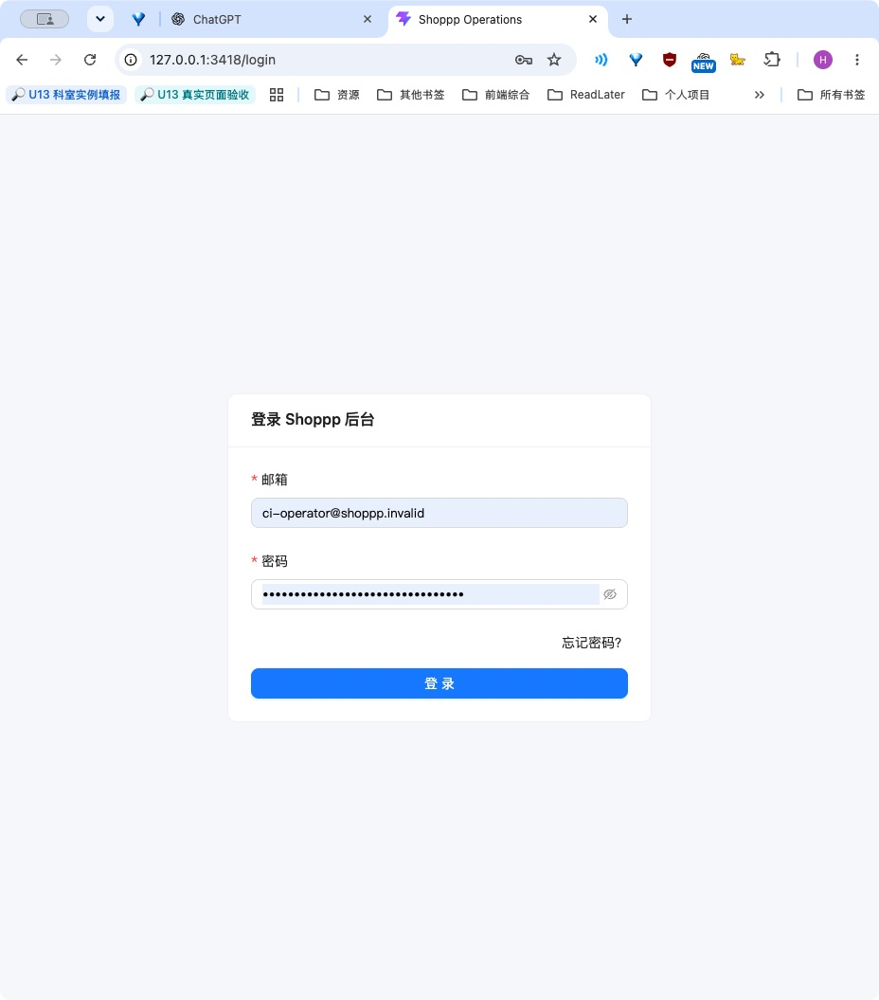

### N002 · U2 · 登录后进入开店指南 — 有摩擦

测试账号登录成功，进入开店指南。当前3/13项通过，商业、商品、配送、支付等尚未完成；支付凭证和Webhook明确缺失。各阶段默认全部展开，需要向下滚动识别任务。

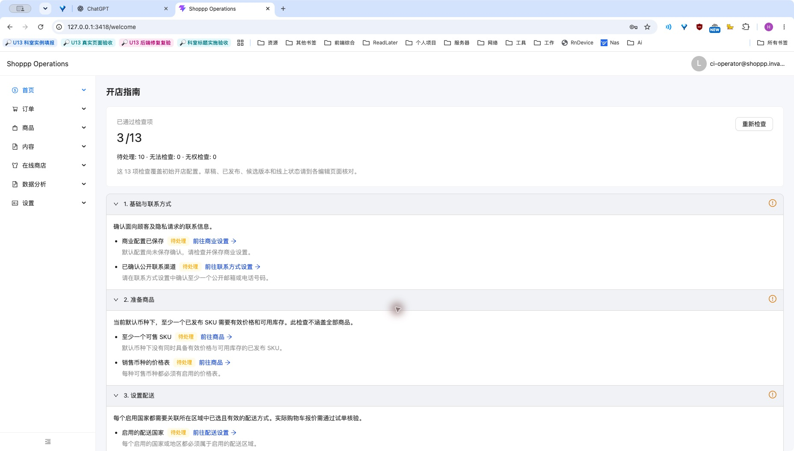

### N003 · U3 · 商业设置首屏 — 有摩擦

从引导可返回原指南，表单主次清晰。但商家需要选择“已启用的配送方式 ID”，值为长内部标识，无法直接辨识配送服务。

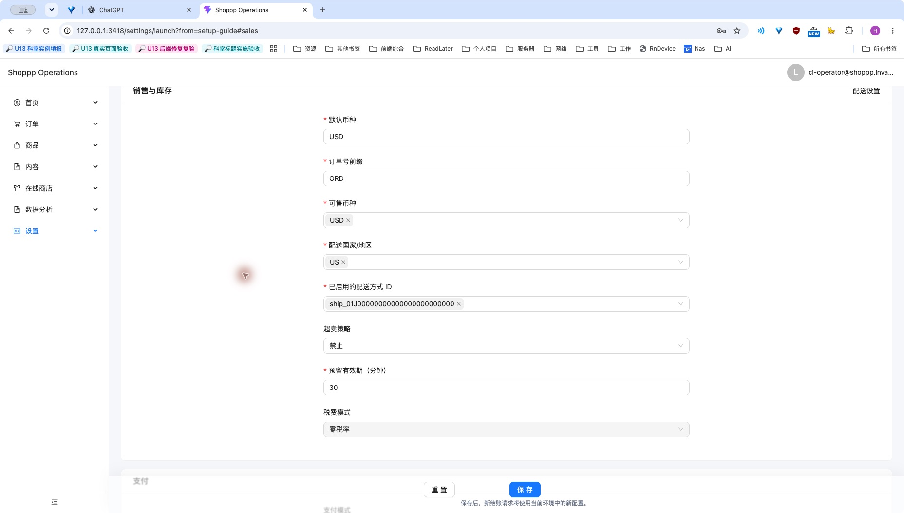

### N004 · U3 · 商业设置校验与支付配置 — 顺畅

空变更原因提交后，页面滚动并聚焦错误字段，提示明确。支付区清楚标明测试模式及两项缺失凭证；本轮暂不修改商业配置。

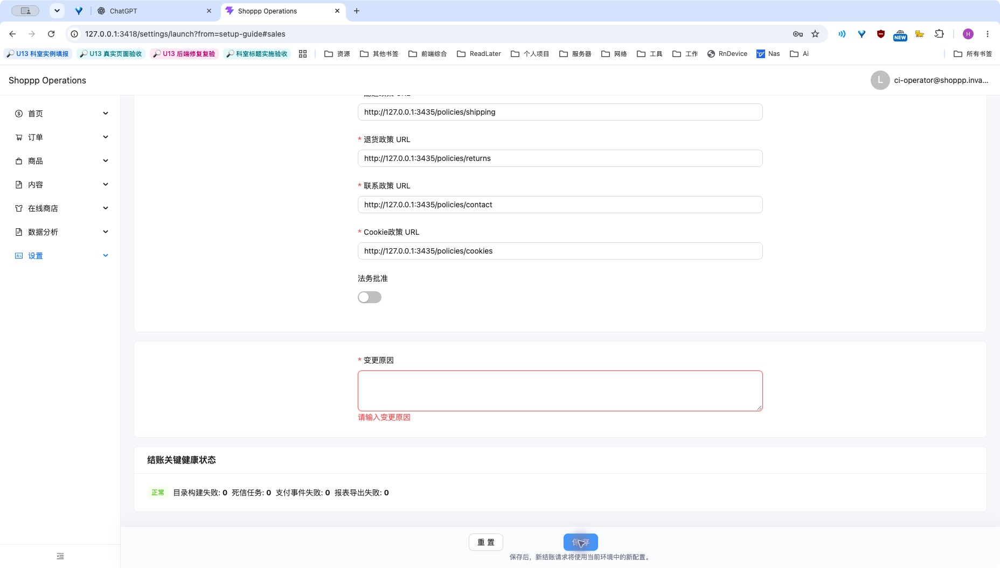

### N005 · U3 · 联系方式表单 — 顺畅

联系方式按全局渠道、地点、社交链接分组，公开开关与邮箱区分明确，提示版本保存语义。以测试电话验证保存与恢复。

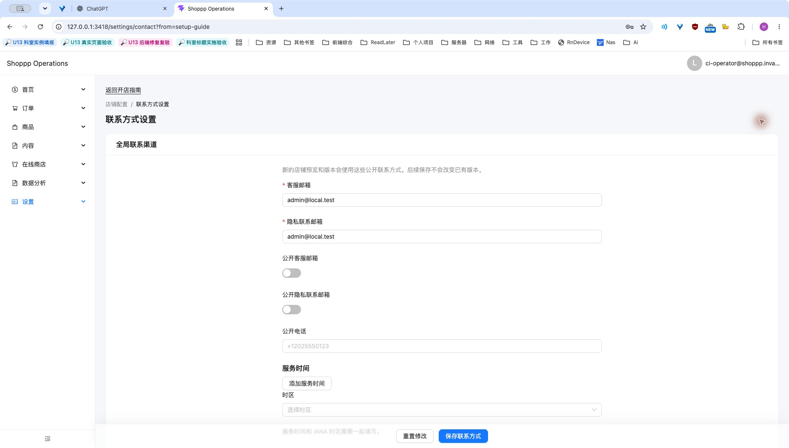

### N006 · U3 · 联系方式保存成功 — 顺畅

测试号码已通过界面保存；成功反馈说明已保存并记录审计日志。下一步恢复原空值。

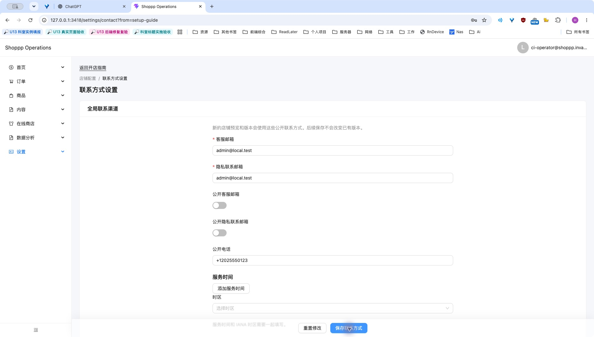

### N007 · U3 · 地点抽屉与两层保存 — 有摩擦

抽屉顶部明确提示“保存页面后才生效”，但底部仍叫“保存”，与页面保存同词。建议改成“添加到草稿/确认地点”，减少误以为已经生效的风险。测试未输入内容，随后关闭。

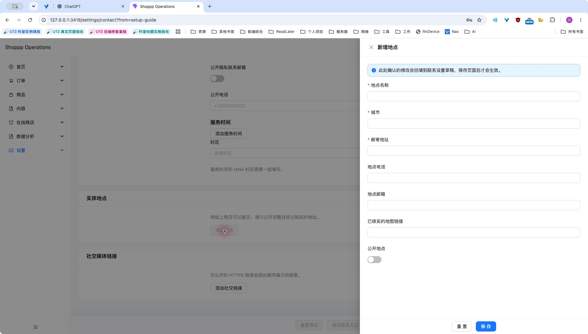

### N008 · U3 · 配送空状态 — 顺畅

没有配送区域时给出“新建配送区域”，但空白中央的次级行动是“重新加载”；新建入口仍可见。此环境没有可用配送配置。

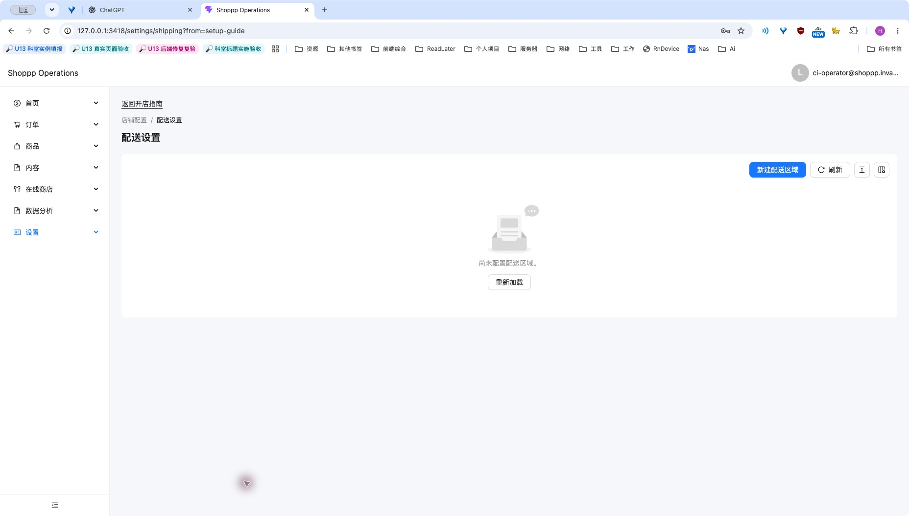

### N009 · U3 · 新建配送区域：金额与条件 — 有摩擦

配送表单直接使用“价格（最小单位）”，要求商家换算分/美元；固定运费模式仍展示免费阈值和重量上下限，字段条件不易理解。

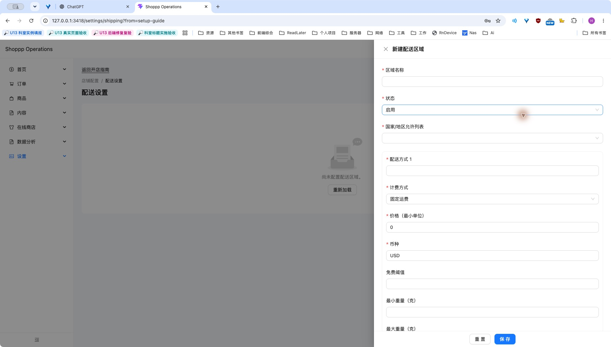

### N010 · U3 · 配送保存后的阻断式成功提示 — 有摩擦

保存配送区域成功后出现必须确认的居中弹窗；普通保存结果增加额外确认，打断继续配置。建议沿用轻量成功提示，直接回到列表并突出新记录。

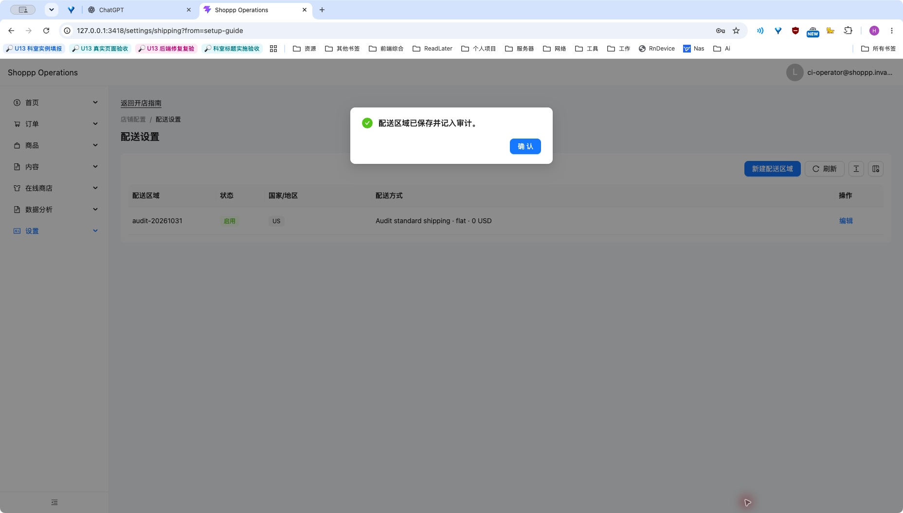

### N011 · U3 · 指南中的配送与支付缺口 — 有摩擦

新建配送区域后，国家检查通过，但“已选配送方式”仍未通过且只链接配送设置；实际启用选择位于商业设置。支付缺少服务商和Webhook凭证，明确属于环境前置条件。

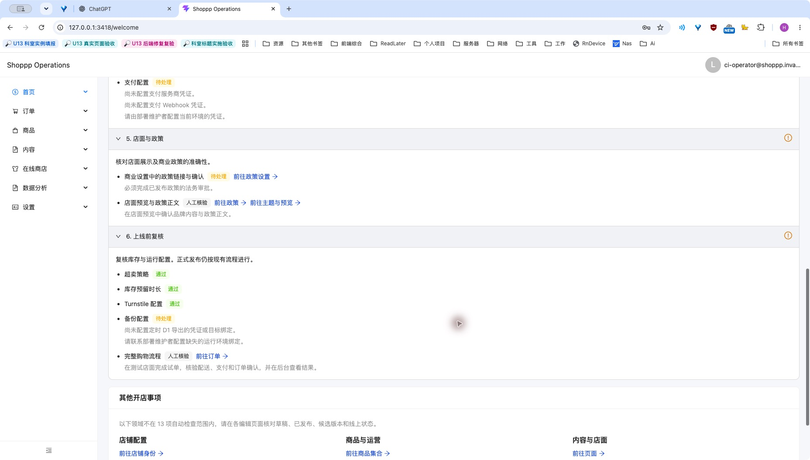

### N012 · U3 · 店铺标志资源入口 — 有摩擦

店铺资料要求必填主标志，但品牌素材只提供“选择已批准的商品目录媒体”，没有上传或去准备素材的路径。首次开店时难以理解为何标志依赖商品媒体。需进一步区分无可选资源与选择器不可用。

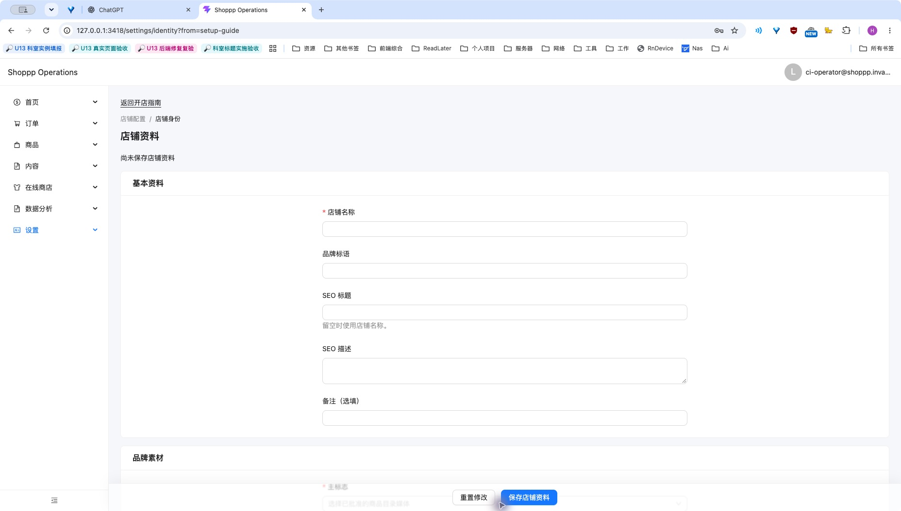

### N013 · U3 · 品牌媒体下拉无资源 — 受阻

滚动至品牌素材后打开主标志选择器，当前无可选媒体。必填字段未提供上传或准备媒体的下一步入口。

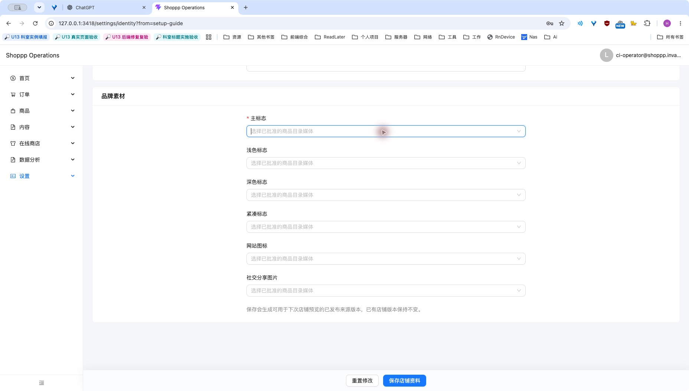

### N014 · U3 · 标志选择器明确无数据 — 受阻

下拉实际展开后只显示“暂无数据”，没有素材上传、资源库入口或准备步骤。此图确认为 UX-007 的直接现场证据。

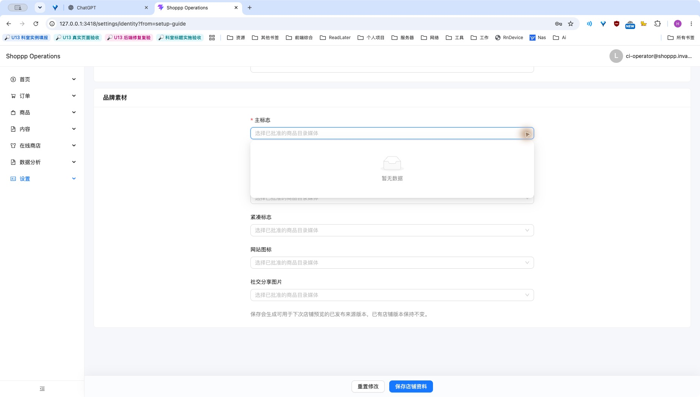

### N015 · U3 · 政策编辑起点 — 顺畅

政策区左右分为记录与编辑表单，空库可直接新建草稿。需要手工填写标识和生效日期，结构化内容通过添加块编辑；本轮仅检查草稿与校验，不代做法务审批。

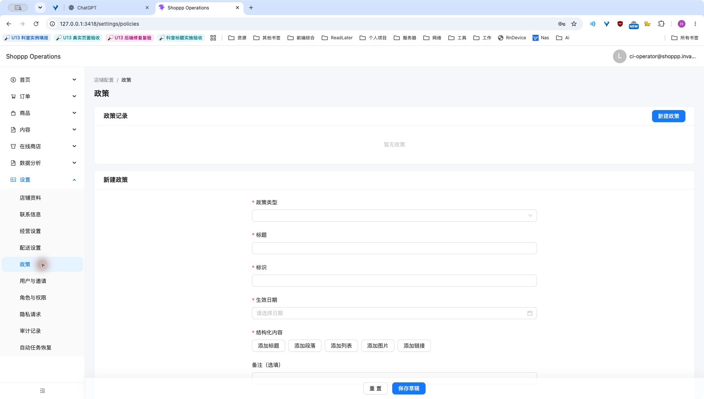

### N016 · U3 · 政策必填校验 — 顺畅

空政策提交后各必填项逐项给出错误，并聚焦首个类型选择器。政策记录和编辑区实际为上下排列。尚未写入政策。

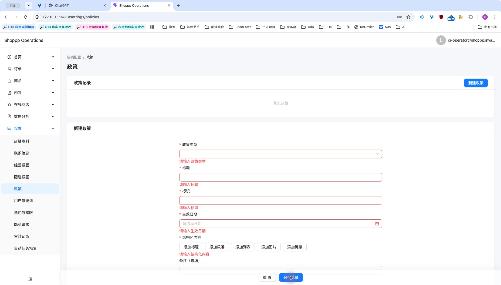

### N017 · U4 · 商品列表空状态 — 有摩擦

当前没有商品。搜索与状态筛选清晰；空状态同时提到重置筛选和创建商品，但中央只提供重置筛选。真正首次进入的空库可更直接引导“创建第一个商品”。

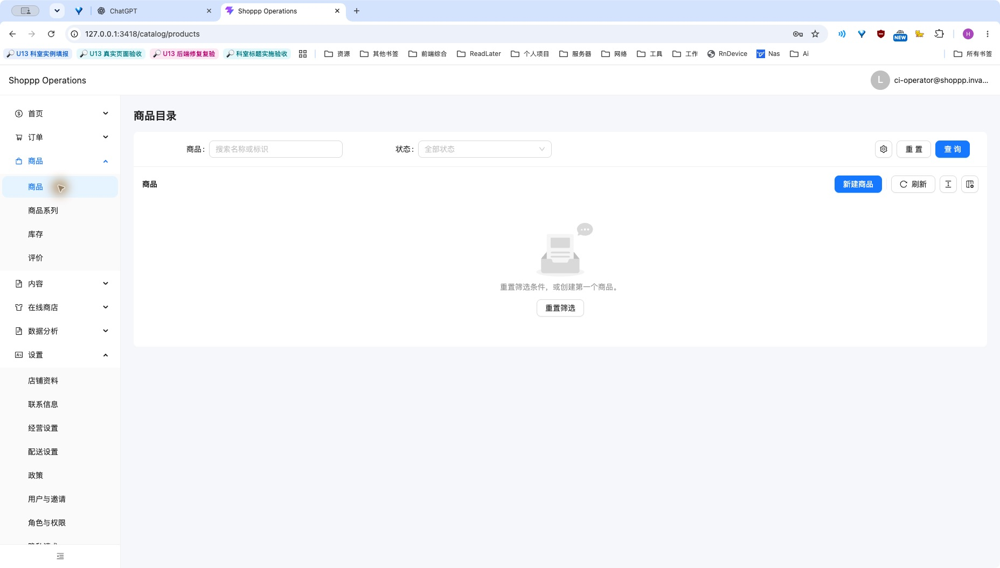

### N018 · U4 · 新建商品表单与新标签页 — 有摩擦

新建商品打开独立浏览器标签。基础信息与变体、价格、媒体、SEO均在同一长表单；物流尺寸、价格表代码、SEO都在初次创建时必填，首轮录入负担较重。

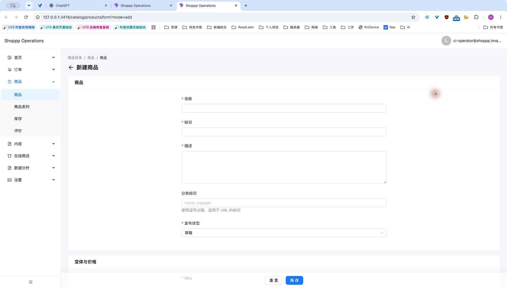

### N019 · U4 · 商品变体价格区域 — 有摩擦

变体需填写SKU、标题、重量和三维尺寸，金额使用最小币种单位。建议在界面显示可理解的币种金额，并为物流数据和默认价格表提供渐进填写。

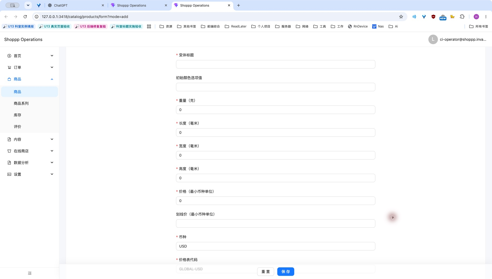

### N020 · U4 · 商品媒体和SEO区域 — 有摩擦

上传图片前暴露必填媒体Key、图片宽高和SEO信息。媒体Key为只读，上传后是否自动补齐继续验证；建议系统生成信息收起或显示为摘要，SEO提供合理默认值。

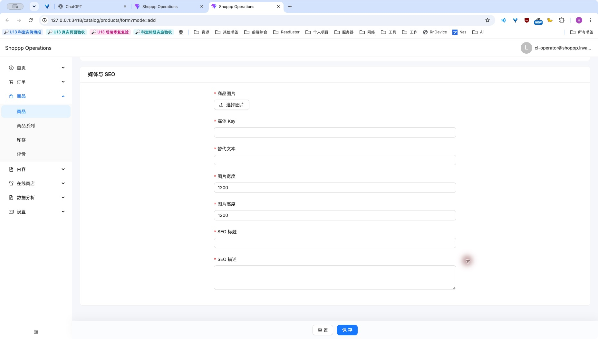

### N021 · U4 · 图片上传后仍保留默认尺寸 — 有摩擦

上传已有600×765图片后，媒体Key自动填充，但宽高仍为默认1200×1200（原图尺寸通过本地元数据核对）。需要人工修正，容易保存不真实的图片尺寸。

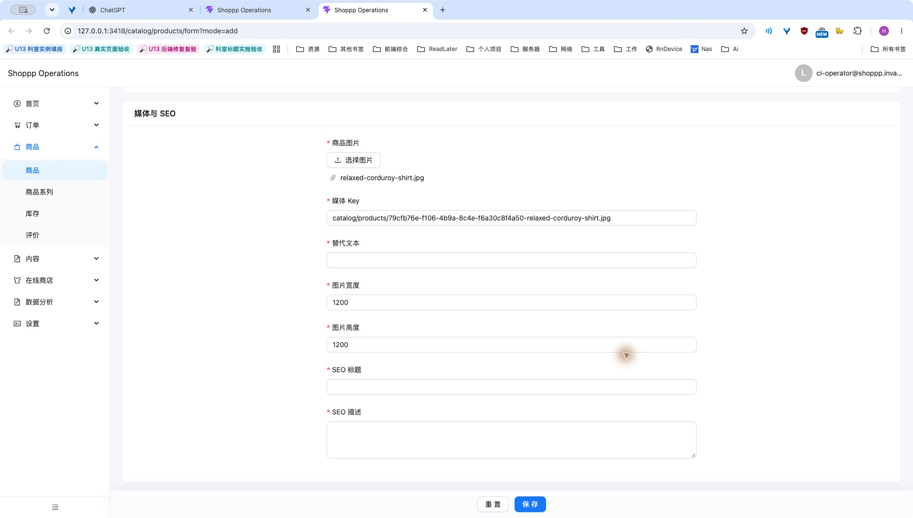

### N022 · U4 · 商品创建后返回列表 — 顺畅

商品创建成功后界面返回商品列表，需核对新记录、草稿状态与后续库存入口。

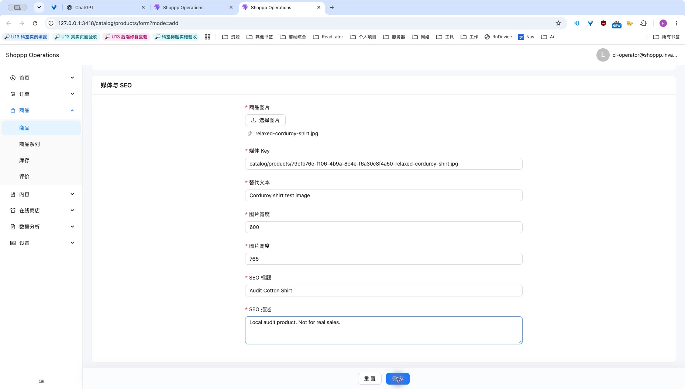

更正 N022：截图及随后状态核对显示，创建成功后仍停留在 mode=add，新建标题、已填写内容及“保存”按钮仍保留，并未返回列表。此处记为 UX-011，存在重复提交同一商品的困惑与风险；后续将手动进入列表核对，避免再次提交。

### N023 · U4 · 已创建商品在列表可见 — 有摩擦

手动进入列表后确认只创建1条草稿，名称和标识正确；创建后的界面没有自动切换为编辑或结果页，UX-011以SS022与本图组成前后证据。

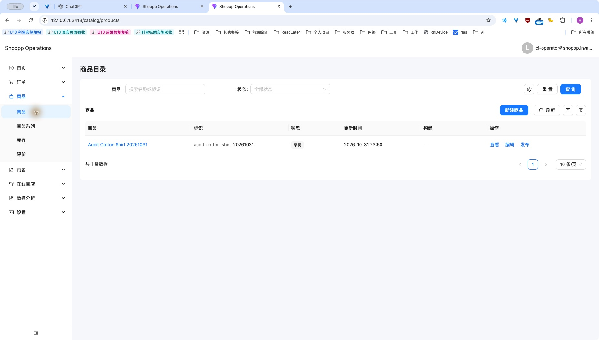

### N024 · U4 · 商品发布确认 — 顺畅

发布前说明会构建公开店铺版本，部署后更新展示，并要求发布原因。此确认符合业务变更性质；与普通保存成功的额外确认应区分。

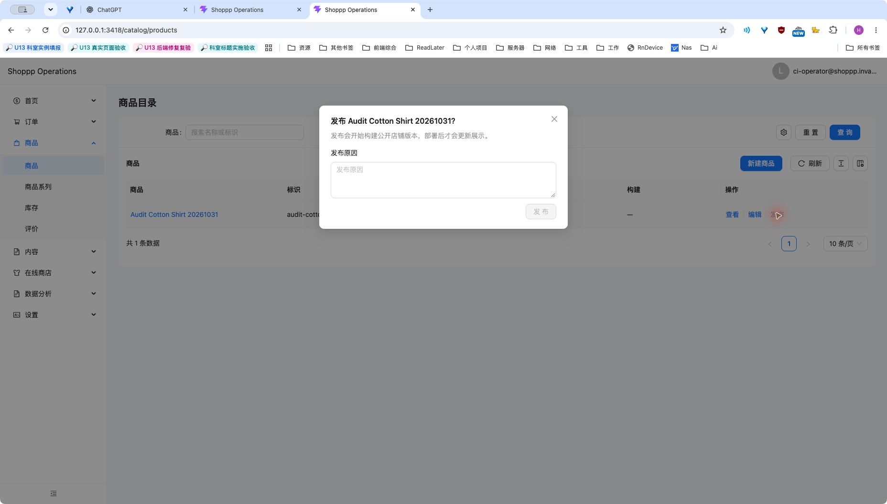

### N025 · U4 · 测试商品发布结果 — 顺畅

已发起本地测试商品发布，核对最终列表状态与构建反馈；不等同于生产部署。

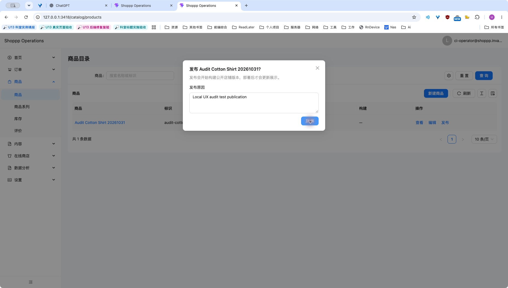

### N026 · U4 · 商品发布按钮无可见进展 — 受阻

填入发布原因后多次点击发布，弹窗保持、按钮没有持续加载、列表仍为草稿，未见可解释的错误或下一步；停止重复尝试，记录为需查证的交互阻塞。

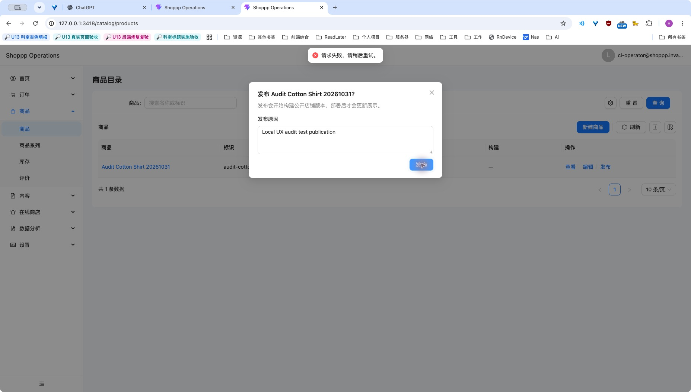

N026 补充：即时截图捕获到顶部短暂“请求失败，请稍后重试”。UX-012准确结论为发布失败只给泛化短暂提示，缺少具体原因和恢复路径，而非完全没有反馈。发布未完成。

### N027 · U4 · 新建商品后的库存空状态 — 受阻

商品已创建且包含SKU，但库存列表没有记录，也没有新增库存或去准备SKU的入口，只提示重置筛选。当前无法通过此页继续补库存；是否要求先发布需查证，界面未解释。

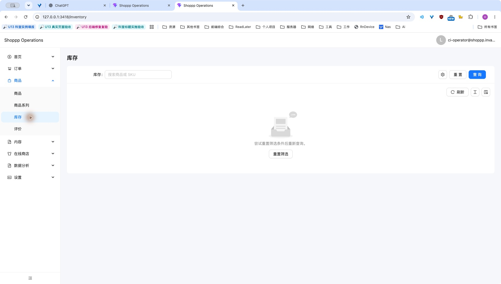

### N028 · U4 · 商品集合抽屉 — 有摩擦

集合以抽屉编辑，SEO标题可留空并使用名称，降低创建成本；与商品强制填写SEO的体验不一致。导航叫“商品系列”，页面叫“商品集合”，建议统一术语。

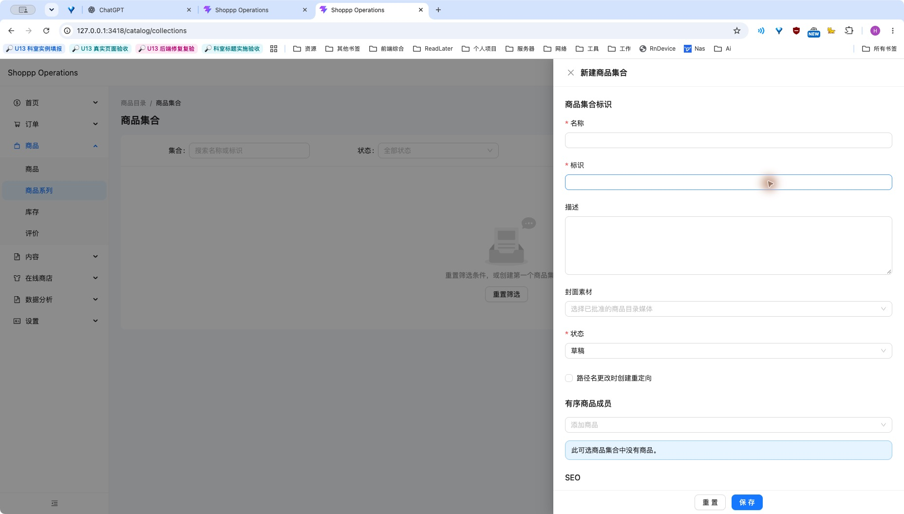

### N029 · U4 · 商品集合保存结果 — 有摩擦

新建集合成功，但中文界面显示英文“Collection created”，且再次要求确认成功弹窗。与配送成功弹窗归为共性反馈问题。

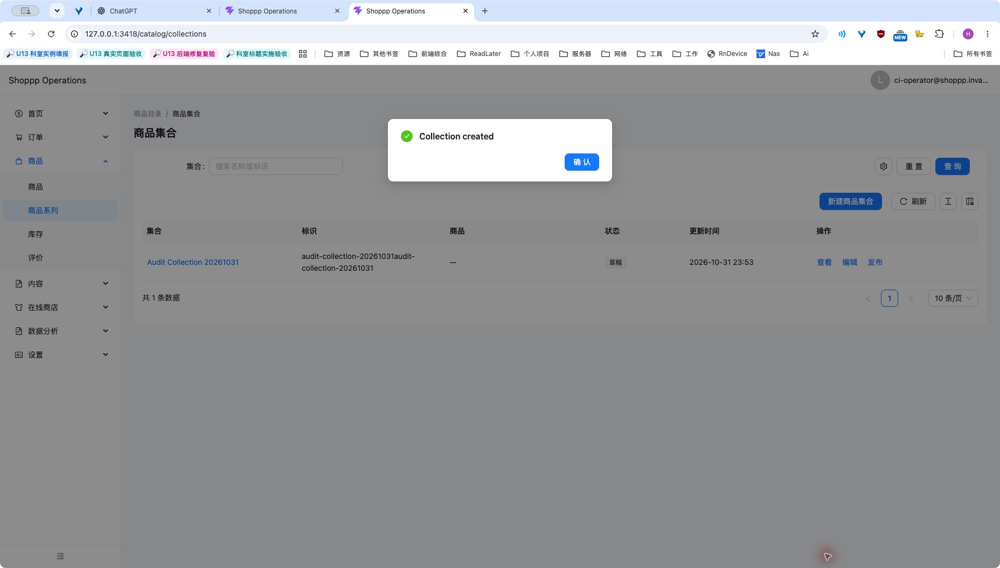

### N030 · U4 · 评价审核空状态 — 顺畅

无待审核评价，空状态解释与任务相符。当前无评价数据，审核动作未验证。

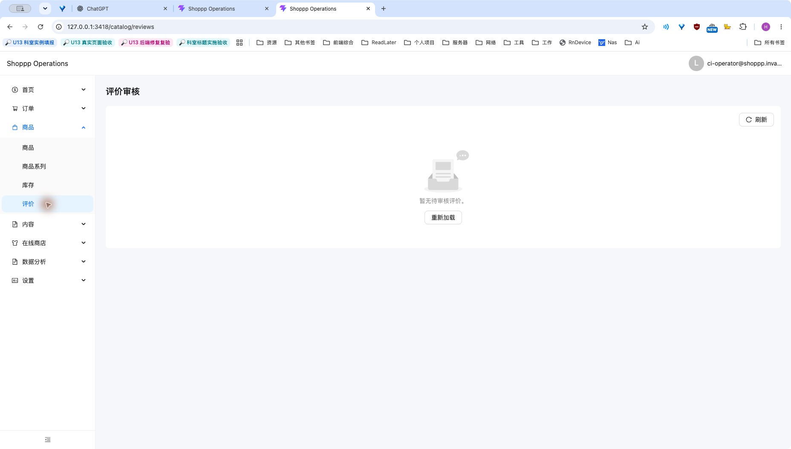

### N031 · U5 · 页面编辑起点 — 顺畅

页面标识、正文和搜索展示分组清晰，SEO可用标题默认值。正文需逐块添加，继续体验段落编辑、保存和返回。

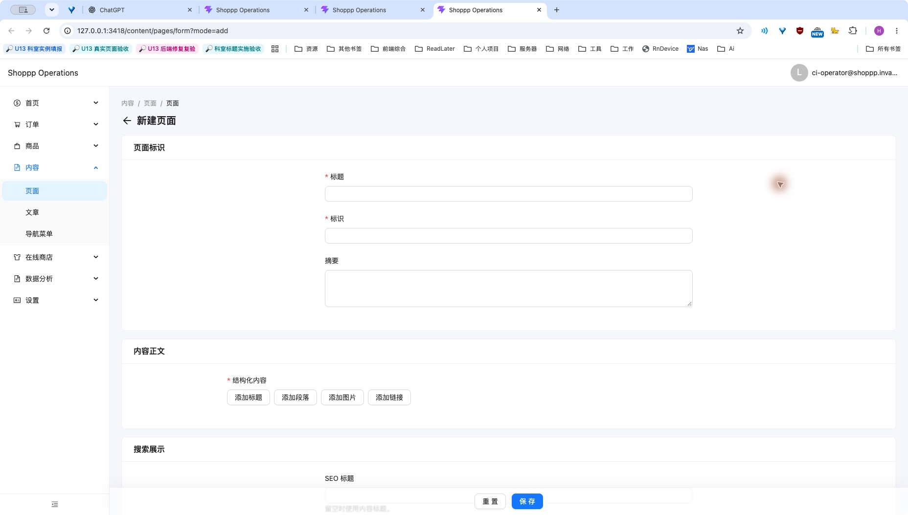

### N032 · U5 · 页面草稿保存后的发布入口 — 顺畅

段落内容保存成功，界面出现“状态与发布”、草稿v1与发布入口，SEO标题默认采用内容标题。这种保存后状态比商品新建更清楚。

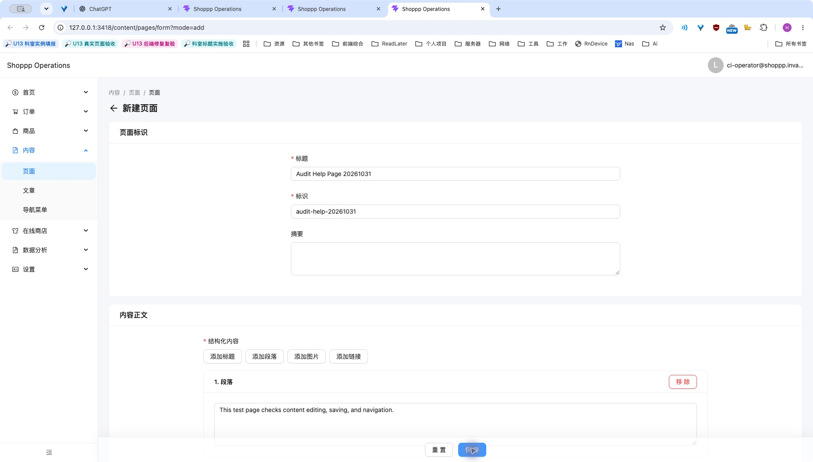

### N033 · U5 · 页面草稿状态与发布控件 — 有摩擦

已保存草稿显示 v1、版本详情和发布/归档入口；保存后仍显示“新建页面”标题，建议随已创建状态切换标题及稳定详情地址，避免身份含糊。

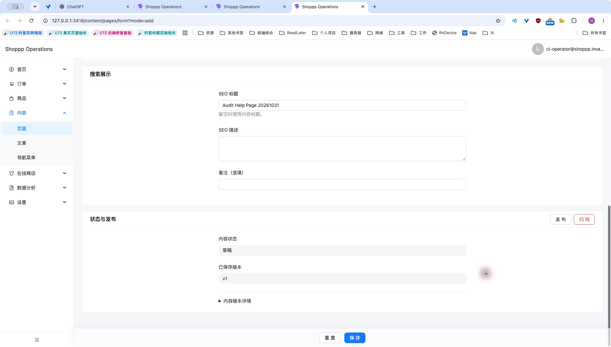

### N034 · U5 · 文章编辑与校验 — 有摩擦

文章编辑复用页面结构，额外封面字段仍叫“媒体资源 ID”。空提交可聚焦标题并给出字段错误。本轮没有保存文章；正文保存已在页面任务验证。

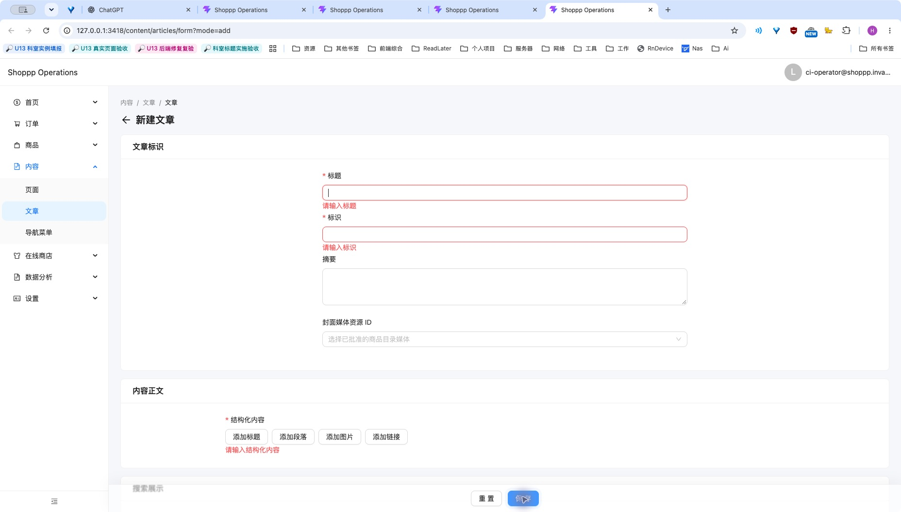

### N035 · U5 · 导航树与菜单详情 — 有摩擦

添加菜单项后，左侧树选中与右侧详情联动。默认“系统路由”要求手工填路由路径；资源选择需切换目标类型。草稿与发布区分明确。

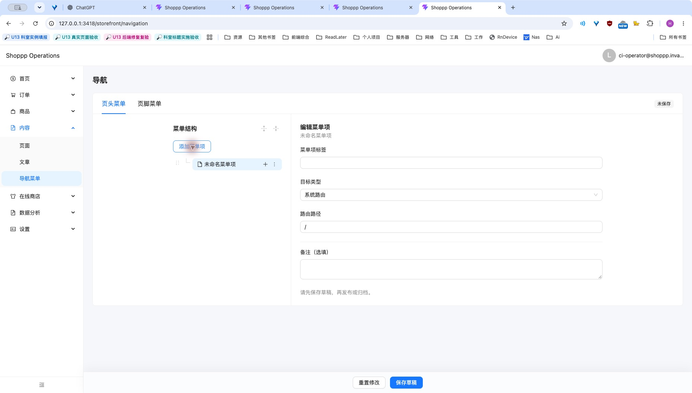

### N036 · U5 · 导航草稿保存成功 — 顺畅

页头菜单已保存为草稿，树标签与状态同步，发布和归档入口出现；尚未发布，不影响已有店面版本。

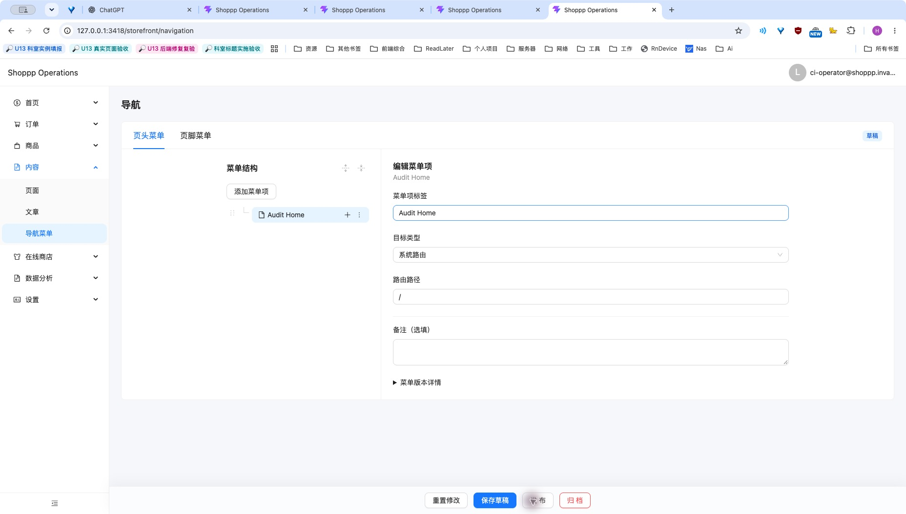

### N037 · U6 · 主题与体验草稿入口 — 有摩擦

主页面把主题包、体验草稿和线上版本放在一起。首屏含合约/架构版本、英文预设和ISO时间，信息偏技术化；商家需要辨认“主题包/体验草稿/线上版本”的关系。

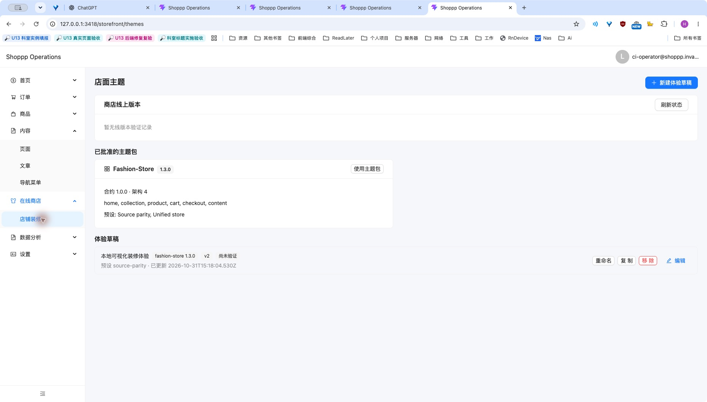

### N038 · U6 · 装修编辑器无预览数据 — 受阻

复制草稿成功，三栏编辑器可见；没有已发布数据时，中央预览为空，集合/商品选择器禁用，英文空提示。界面没有直接可执行的“准备预览数据”步骤，编辑者难以恢复。

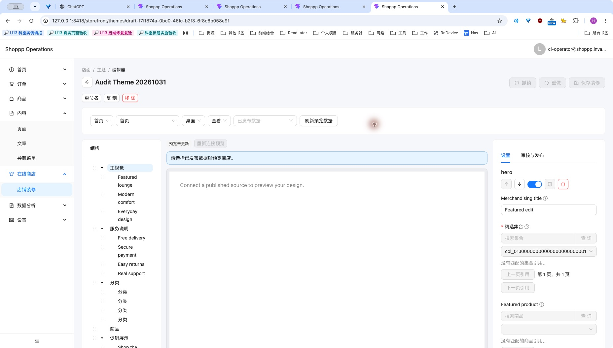

### N039 · U6 · 装修修改保存成功 — 顺畅

测试副本内容已保存，“保存装修”和撤销回到不可用状态，字段保留新值。没有可用预览数据，无法评价修改后的店面视觉效果。

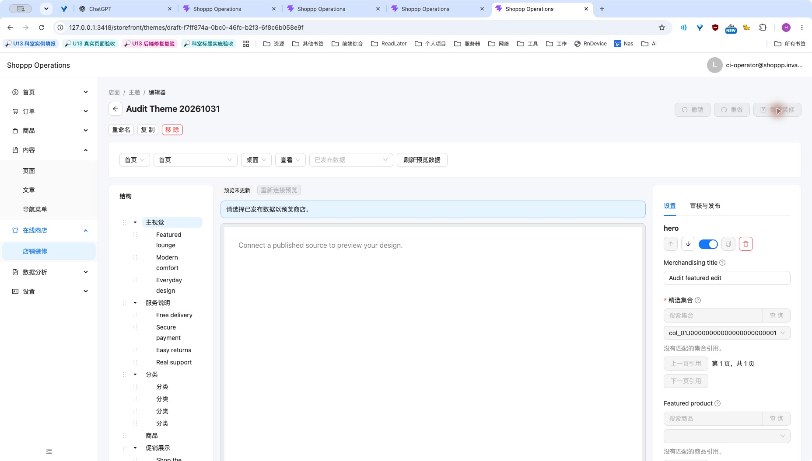

### N040 · U6 · 已保存装修仍提示先保存 — 有摩擦

已保存且保存按钮不可用，审核页却提示“发布前，请先保存或放弃当前修改”。同时缺少已发布资源，多个禁用原因混在一起；建议逐项说明真正阻塞与可点击修复步骤。

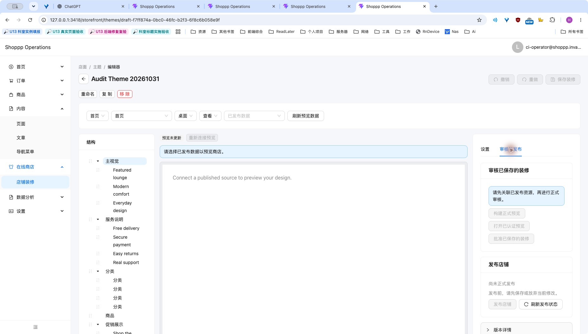

### N041 · U7 · 订单列表与支付筛选 — 有摩擦

当前订单库为空，支付/履约筛选可见，未能进入详情、取消、退款或履约。空状态只称“没有符合筛选条件”，没有区分尚无订单与筛选无结果。

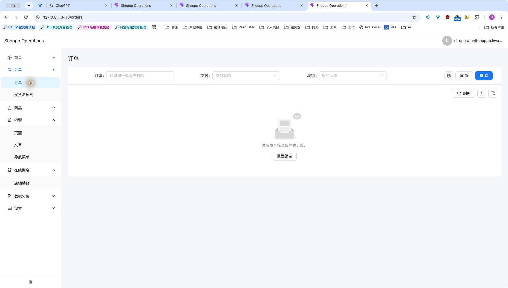

### N042 · U7 · 履约空状态 — 顺畅

空状态明确解释只展示等待履约的已支付订单。由于支付前置条件缺失及无订单，具体履约与退款步骤受阻，不作为已验证流程。

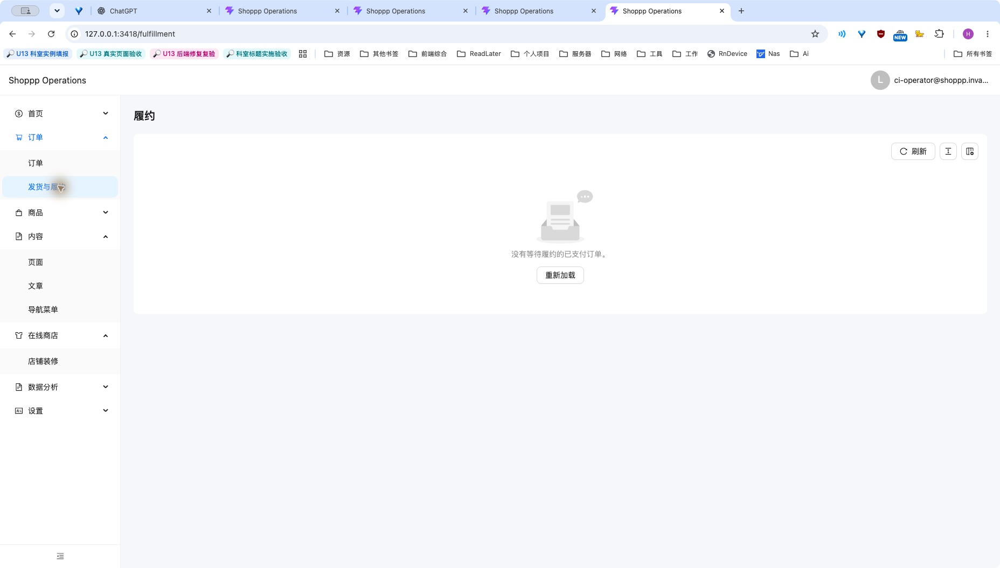

### N043 · U7 · 测试前台未运行 — 受阻

配置中的前台127.0.0.1:3435拒绝连接；加上支付服务商和Webhook凭证缺失，当前无法完成真实下单支付闭环。本地dev:fashion-store使用独立商品fixture，不能代替当前后台的真实闭环，因此不把它启动后的模拟结果算作通过。

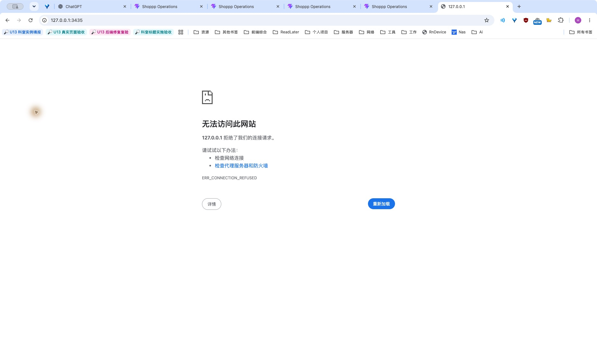

### N044 · U8 · 仪表盘缺少数据时的整页空状态 — 有摩擦

经营仪表盘仅显示“当前数据不足，暂时无法展示仪表盘”，未保留日期/指标框架，也不解释缺少什么数据或下一步。首次开店时无法建立指标认知。

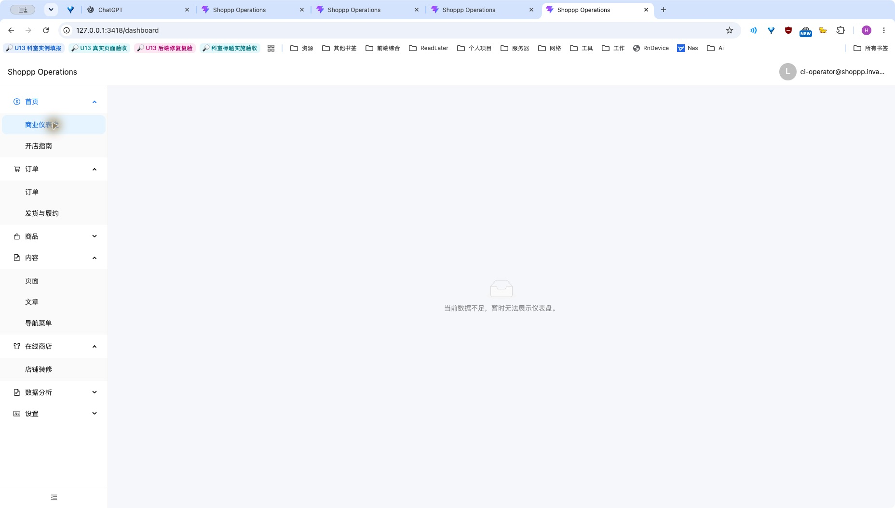

### N045 · U8 · 收入报表筛选与无事件状态 — 顺畅

报表明确展示币种、时区及日期范围，空状态说明是该时间段无订单事件，比仪表盘更有上下文。当前为10/2–10/31、Asia/Shanghai。

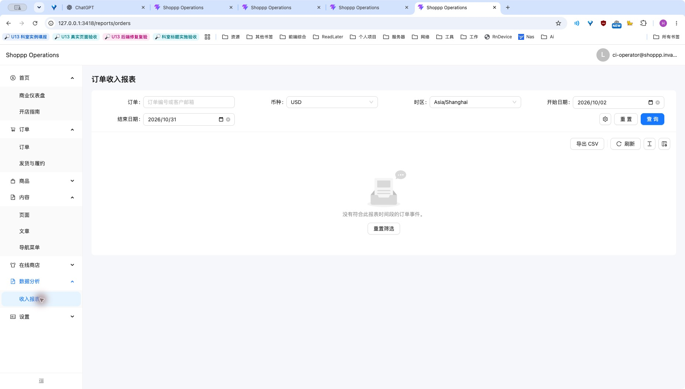

### N046 · U8 · 报表日期反向校验 — 顺畅

通过日历将结束日期选为10月1日，早于开始日期10月2日，再查询，观察日期校验与恢复提示。

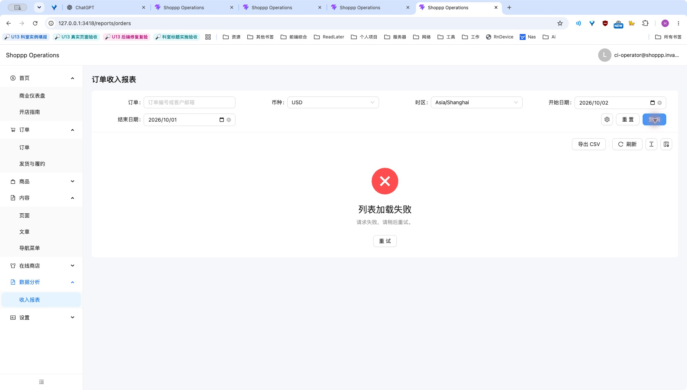

N046 有效补拍：已用键盘确实改为10/1并提交。反向日期没有本地字段提示，结果区报“列表加载失败/请求失败，请稍后重试”，记录 UX-019。先前加载中截图已被本节点稳定错误现场替换。

### N047 · U8 · 报表导出说明 — 顺畅

导出前说明含客户邮箱、审计与24小时链接有效期，并要求原因；说明对操作后果有帮助。本轮空订单数据，不包含真实客户信息。

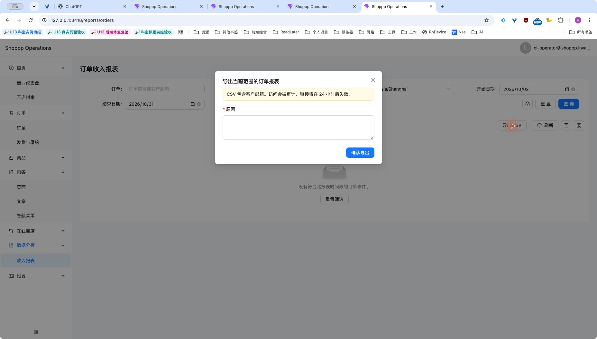

### N048 · U8 · 报表导出就绪 — 顺畅

导出完成后有持久“已就绪”状态和0行下载链接，明确结果；无需重复发起导出。导出ID以系统标识显示，可将可读文件名/时间范围放在主位。

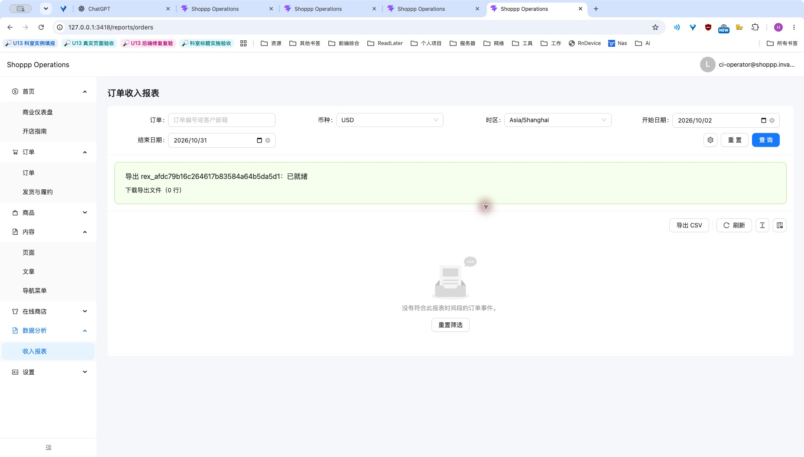

### N049 · U8 · 下载报表却回到开店指南 — 受阻

从“下载导出文件（0行）”点击后，未见下载结果，浏览器进入/welcome开店指南。下载链接为/admin/reporting/exports/.../download，需核对前端代理和后端下载路由；当前导出交付受阻。

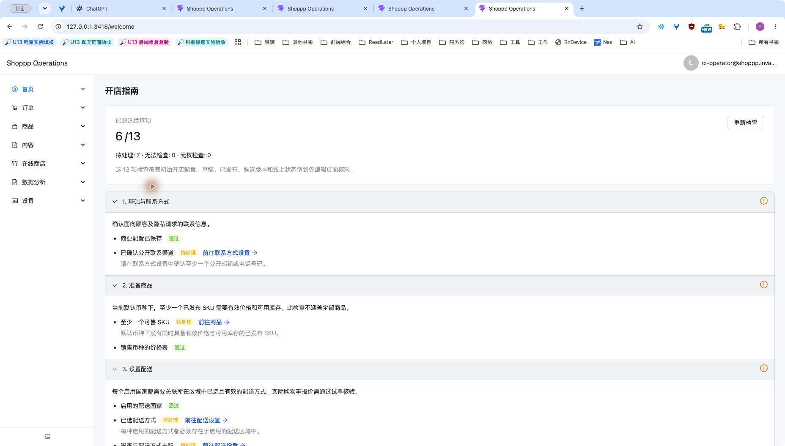

### N050 · U9 · 用户列表 — 顺畅

用户与邀请分标签，角色、启用状态和查看入口明确。当前只有本地管理员，不改动其角色或启用状态；测试查看、邀请表单及校验。

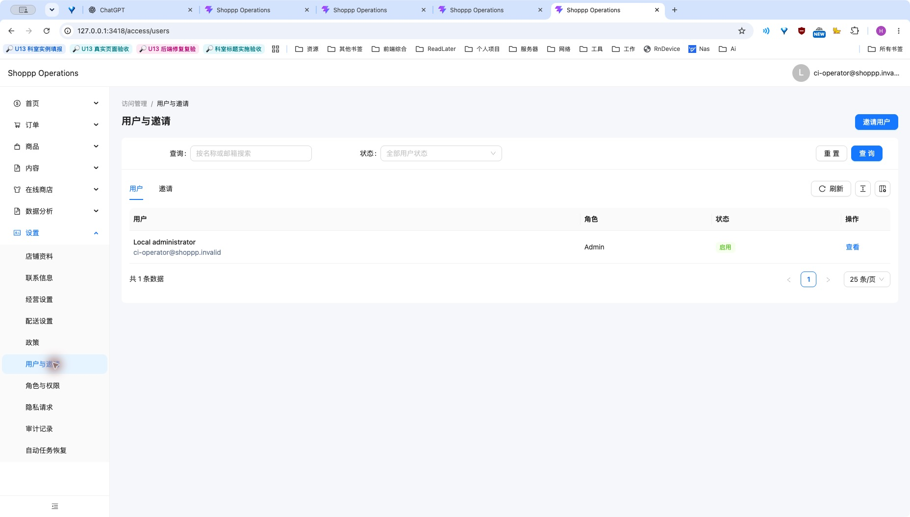

### N051 · U9 · 邀请表单必填校验 — 顺畅

空提交给出邮箱与角色错误，没有发出邀请。普通表单清楚、字段少；当前仅一个管理员且没有受控收件箱，邀请实际送达与受限角色登录未验证。

### N052 · U9 · 自身账号保护与只读详情 — 顺畅

自身账号角色/状态不可编辑，底部解释原因；只读资料分组可见。禁用显示名称是否符合产品权限需另行确认，本轮不将其当作缺陷。

### N053 · U9 · 角色权限编辑树 — 有摩擦

角色详情提供分组、选中数量、全选/展开/收起及搜索。默认39个权限全部展开，长抽屉滚动成本高；搜索适合定位，但可考虑默认仅展开已选组。

### N054 · U9 · 权限搜索过滤 — 顺畅

权限搜索“报表”后只保留报表组和查看/导出两项，选中状态保留。未勾选或保存任何权限变更。

N054 核实：搜索“报表”后截图仍显示商品/库存/订单等不匹配组，未自动定位报表或显示结果数；前述“只保留报表组”不成立。UX-021改为搜索的可见反馈不足，是否设计为仅高亮需技术查证；未变更权限。Escape后抽屉关闭。

### N055 · U9 · 隐私请求录入与验证 — 顺畅

记录请求前明确要求核验申请人身份；空提交给出主体邮箱、请求类型和原因的必填错误。没有创建或执行实际隐私请求，真实客户数据流程未验证。

### N056 · U9 · 审计日志核对本轮写入 — 有摩擦

日志能核对商品、集合、页面、导航、主题和导出操作；未见本轮角色权限写入。操作名、操作人和目标均以内部标识展示，筛选要求“精确操作名”，日常运营难直接理解或查找。

### N057 · U9 · 审计筛选成功 — 有摩擦

输入已知操作名后筛选出本轮导出记录，功能有效；普通用户须先知道英文精确操作名，建议可搜索的业务操作选项并保留原始代码供排查。

### N058 · U9 · 自动任务恢复空状态 — 有摩擦

没有可恢复任务，空状态仅建议重置筛选，无法区分“系统正常无失败”与“无匹配结果”。未执行任务重放；菜单“自动任务恢复”、标题“自动化恢复”可统一。

### N059 · U10 · 浏览器返回后审计筛选丢失 — 有摩擦

先在审计页筛选 report.export.create，只剩1条；进入自动任务恢复后用浏览器返回，筛选字段变空、全部日志重新出现。截图SS057与本图组成前后证据。

### N060 · U10 · 审计页200%缩放 — 顺畅

以Chrome键盘缩放至200%检查。保留筛选和数据入口，但全高顶栏与侧栏占用明显，数据表需横向滚动；下一步核对窄宽与焦点可见性。

### N061 · U10 · 约1440宽桌面布局 — 顺畅

通过原生拖动窗口调整到约1440宽（截图1441×1055）。审计表保持最小列宽并横向溢出，主要筛选仍可操作；截图包含浏览器工具栏，不把它称为精确1440×900内容视口。

### N062 · U10 · 约1280宽深色主题 — 顺畅

窗口缩窄至约1280宽后切换深色，筛选、状态和表格可读，未见本页主题错色；表格需横向滚动。侧栏仍占224px，数据区域较紧，但不是无法操作。

### N063 · U10 · 窄桌面深色表单 — 顺畅

联系表单在约1280宽深色下可读，固定保存栏可见，公开开关状态明确。本轮最初测试电话已为空，恢复值再次得到核对。

### N064 · U10 · 切换英文保留未保存输入 — 顺畅

在公开电话输入未保存测试值后切换English，页面标签变为英文，电话输入保留。后续放弃该未保存值，不写入业务配置。

### N065 · U10 · 未保存表单离开时没有提醒 — 有摩擦

联系方式中有未保存测试号码，点击Shipping settings直接导航成功，没有询问保留或放弃。下一步返回核对输入是否丢失。

### N066 · U10 · 返回联系方式后未保存号码消失 — 有摩擦

返回联系方式，公开电话恢复空值；先前未保存号码未恢复。SS064→SS065→SS066确认站内导航静默丢失编辑内容。

### N067 · U11 · 测试配送已停用 — 顺畅

本轮创建的audit-20261031区域已设为关闭并保存，不再作为有效配送区域。保留测试记录以便复现截图；商业设置的原配送选择未改动。中文与浅色已恢复。

### N068 · U2 · 无效密码登录反馈 — 顺畅

退出后使用一次无效密码登录，检查错误提示，不反复触发锁定。错误场景截图见本节点；后续将用既有测试凭证恢复。

### N069 · U2 · 密码找回的必填校验 — 顺畅

密码找回说明一次性邮件链接，空提交在邮箱处提示必填。没有向任何真实收件人发送邮件，也未修改凭证；当前环境未配置可用邮件接收流程，邮件送达和重设完成未验证。

### N070 · U2 · 缺少重设令牌的恢复页 — 顺畅

直接访问无令牌的重设入口，检查是否明确提示重新申请链接；没有输入新密码或执行凭证修改。

### N071 · U2 · 缺少激活令牌的恢复页 — 有摩擦

无令牌激活页给出无效链接提示。重设页只提供返回登录，建议在失效重设场景增加“重新申请重置链接”，减少绕行；激活需要联系邀请者时也应说明。

### N072 · U2 · 既有凭证重新登录成功 — 顺畅

一次错误登录后，用原测试凭证重新登录成功，账号未锁定；会话已恢复。开店检查5/13，测试配送已停用，未公开测试内容。

### N073 · U10 · 未知路由的实际恢复行为 — 顺畅

访问不存在的后台路径后自动进入/welcome，没有出现独立404提示。记录该实际行为供路由设计复核；不将其自动视作必须修改的问题。

