# Shoppp 管理后台全流程用户体验报告

> 2026-11-06补充：已重新拍摄当前运行版本，提供[31张新截图与25项标注／目标效果对比](../20261106-visual-comparison/index.html)。本报告下方原图仍为10月31日至11月1日的历史取证，当前复核结果另列。

本轮在当前可用本地环境完成全部 **23个菜单主入口的实地走查**，深入操作了可执行的创建、编辑、保存、校验、发布尝试、导出和恢复分支。共 **73个截图节点、25条发现与建议**：P1两条、P2二十条、P3三条。

**结论：基础页面结构与组件比较统一，真正影响效率的是任务衔接、保存后的对象身份、出错后的恢复，以及无数据时缺少下一步。** 优先处理报表下载、商品发布诊断、未保存内容丢失和日期错误归因，再统一金额/资源表达与保存反馈。

这是一轮真实操作的体验审计，**没有完成全链路业务验收**。前台未运行、支付与Webhook凭证缺失、无已支付订单，阻断真实支付/退款/履约；装修缺少已发布数据，未验证实际预览及正式发布。受阻分支没有记为通过，也没有用模拟成功替代。

- 时间：北京时间 **2026-10-31 23:43起至2026-11-01**，同一run跨午夜继续。
- 环境：本地Admin `127.0.0.1:3418` / API `127.0.0.1:8787` / 本地D1；含既有未提交改动的HEAD `b3680807f62ea70e4416415691c028be2880eb54`，不能等同于纯HEAD版本。
- 方法：真实Chrome UI操作、原生可访问文本和逐节点截图；应用内浏览器被Work设置禁用，未使用Playwright或网络响应模拟。
- 视图：首轮中文浅色、1856×1055窗口截图；补查1441/1279宽窗口、200%缩放、中英及深色。截图包含浏览器工具栏，不能声称精确1440×900/1280×800内容视口。
- 身份：已有本地测试管理员；首次用户视角为界面可发现性走查，并非真实陌生用户研究。
- 交付：本报告、[节点索引](index.csv)、[覆盖清单](coverage.csv)、[环境与测试数据回执](manifest.md)、[结构化发现](findings.json)、[原始截图目录](screenshots/)。[现场笔记](field-notes.md)包含即时判断和更正，正式结论以本报告为准。

## 问题性质分类

原有“UX-”是稳定发现编号，不代表每条都是UX问题。以下按问题性质分组，保留原编号和P1/P2/P3优先级；分类与严重程度分别判断。功能逻辑包含前端状态、校验、路由和接口集成，不能据此推定为后端业务错误。是否需要写代码也不是UI与逻辑的划分标准。

| 主分组                 | 数量 | 编号                                                                                                                                                                      | 判断口径                                                                               |
| ---------------------- | ---- | ------------------------------------------------------------------------------------------------------------------------------------------------------------------------- | -------------------------------------------------------------------------------------- |
| UI／信息呈现为主       | 6    | [UX-001](#ux-001)、[UX-002](#ux-002)、[UX-014](#ux-014)、[UX-015](#ux-015)、[UX-018](#ux-018)、[UX-022](#ux-022)                                                          | 布局、层级、可读名称、文案和语言一致性。未证实数据或业务结果错误。                     |
| UX／流程设计为主       | 9    | [UX-003](#ux-003)、[UX-004](#ux-004)、[UX-005](#ux-005)、[UX-007](#ux-007)、[UX-008](#ux-008)、[UX-009](#ux-009)、[UX-016](#ux-016)、[UX-021](#ux-021)、[UX-025](#ux-025) | 步骤、反馈、前置条件、空状态和恢复路径。部分方案需先明确产品规则。                     |
| 功能逻辑与UX交叉       | 8    | [UX-006](#ux-006)、[UX-010](#ux-010)、[UX-011](#ux-011)、[UX-017](#ux-017)、[UX-019](#ux-019)、[UX-020](#ux-020)、[UX-023](#ux-023)、[UX-024](#ux-024)                    | 涉及导航、数据同步、对象状态、校验、下载或状态保留；需要处理功能行为，不能只调整样式。 |
| UX已确认／功能根因待查 | 2    | [UX-012](#ux-012)、[UX-013](#ux-013)                                                                                                                                      | 已确认体验缺口和任务受阻；现有证据不足以判定业务代码、数据规则或环境哪一层出错。       |

UX-004未证实金额算错；UX-009涉及草稿/发布规则确认；UX-021不是已证实搜索算法失效；UX-012/013的业务根因待查。UX-019同时有日期布局问题与校验反馈问题；UX-024丢失的是未保存输入。

[查看逐项分类及逻辑判断](issue-classification.md)。本次分类补充日期为2026-11-02，依据2026-10-31至11-01的现场证据；没有重新验证当前版本是否已修复。四组互斥计数，交叉项单列；分类不改变原先的证据强度与覆盖限制。

## 建议先处理的事项

| 顺序 | 问题                            | 用户影响                                         | 证据                                                                                                                                                      |
| ---- | ------------------------------- | ------------------------------------------------ | --------------------------------------------------------------------------------------------------------------------------------------------------------- |
| 1    | UX-020 报表下载跳到开店指南     | 已生成文件却无法取得，本地下载链路断裂           | [SS048](screenshots/SS048-U8-export-ready.jpg)、[SS049](screenshots/SS049-U8-export-download-misdirect.jpg)                                               |
| 2    | UX-012 商品发布只有泛化错误     | 无法完成商品到可售的链路，不知道该修配置还是重试 | [SS026](screenshots/SS026-U4-publish-no-progress.jpg)                                                                                                     |
| 3    | UX-024 未保存输入静默丢失       | 跨页查看配置可能丢掉已填资料                     | [SS064](screenshots/SS064-U10-contact-english-dirty.jpg)、[SS066](screenshots/SS066-U10-dirty-value-lost.jpg)                                             |
| 4    | UX-019 反向日期被报为加载失败   | 用户被引导重试一个不合法的范围                   | [SS046](screenshots/SS046-U8-report-date-invalid.jpg)                                                                                                     |
| 5    | UX-011 创建后仍是新建模式       | 不清楚是否保存、如何继续编辑同一对象             | [SS022](screenshots/SS022-U4-product-created.jpg)、[SS023](screenshots/SS023-U4-product-list-persisted.jpg)                                               |
| 6    | UX-007/013/016 前置条件缺少入口 | 店铺标志、库存和装修预览出现任务断点             | [SS014](screenshots/SS014-U3-identity-no-data.jpg)、[SS027](screenshots/SS027-U4-inventory-empty.jpg)、[SS038](screenshots/SS038-U6-editor-no-source.jpg) |

这些是建议优先级，未包含任何自动实施或产品发布决定。P1为本轮核心任务阻塞，P2为明显摩擦或误导，P3为结构与细节优化；“改进建议”与“已确认问题”分开标注。

## 值得保留的行为

- 商业设置和内容表单能指出具体字段错误；商业设置能滚动并聚焦错误原因字段。
- 开店指南的返回入口和自动复核结果可用，能区分自动检查、人工核验及环境维护事项。
- 页面SEO默认使用标题；保存草稿后能看到v1和发布/归档入口。
- 导航树与详情联动、保存草稿与发布分离，状态表达较清楚。
- 联系方式切换语言时保留未保存输入；浅/深色代表表单与表格未发现明显错色。
- 用户详情的自身账号限制有原因说明；Escape关闭后焦点回到原“查看”按钮。未重复测试组件库完整键盘行为。
- 报表导出前说明内容、审计及有效期，导出完成有持久状态；需要修好最后的下载交付。

## 覆盖事实与限制

| 页面或任务                                  | 覆盖情况                                                           | 未验证部分                                                                              |
| ------------------------------------------- | ------------------------------------------------------------------ | --------------------------------------------------------------------------------------- |
| 经营仪表盘 `/dashboard`                     | 仅查看；N044                                                       | 数据不足，未展示指标与日期控件，不能验证指标和趋势                                      |
| 开店指南 `/welcome`                         | 已操作；N002, N011, N049, N072                                     | 已进入设置、返回并观察检查变化；未通过全部开店检查                                      |
| 订单列表 `/orders`                          | 已操作/详情受阻；N041                                              | 无订单；支付和履约筛选入口可见，订单详情与交易操作未验证                                |
| 订单详情、取消、退款 `/orders/:reference`   | 受阻；N041, N043                                                   | 无订单且缺少支付/回调配置；未伪造成功支付订单                                           |
| 发货与履约 `/fulfillment`                   | 仅查看/受阻；N042                                                  | 没有等待履约的已支付订单；未执行履约                                                    |
| 商品列表 `/catalog/products`                | 已操作；N017, N023, N024, N026                                     | 创建、列表核对和业务发布尝试；发布失败，未验证成功发布                                  |
| 商品创建、图片上传 `/catalog/products/form` | 已操作；N018, N019, N020, N021, N022                               | 创建成功；保存后mode=add问题已取证，未深测后续复杂变体修改                              |
| 商品集合列表及抽屉 `/catalog/collections`   | 已操作；N028, N029                                                 | 新建草稿成功；未添加已发布成员、发布集合或验证复杂排序                                  |
| 集合兼容独立URL `/catalog/collections/form` | 未覆盖；N028                                                       | 当前入口使用Drawer；独立兼容URL未另测                                                   |
| 库存调整 `/inventory`                       | 受阻；N027                                                         | 已创建SKU但无库存记录和初始化入口；未执行数量调整                                       |
| 评价审核 `/catalog/reviews`                 | 仅查看/受阻；N030                                                  | 无待审核评价，未执行审核                                                                |
| 页面列表 `/content/pages`                   | 已操作；N031, N032, N033                                           | 从列表新建并保存草稿；独立发布及归档未操作                                              |
| 页面正文编辑 `/content/pages/form`          | 已操作；N031, N032, N033                                           | 标题、标识、段落、默认SEO、草稿v1与发布状态区                                           |
| 文章列表 `/content/articles`                | 已操作；N034                                                       | 进入列表并打开新建；未保存文章                                                          |
| 文章编辑 `/content/articles/form`           | 已操作（表单/校验）；N034                                          | 封面与正文结构、空提交校验；实际保存与发布未验证                                        |
| 页头/页脚导航 `/storefront/navigation`      | 已操作（页头）；N035, N036                                         | 页头添加标签并保存草稿；页脚编辑、子项重排、发布未覆盖                                  |
| 主题与草稿列表 `/storefront/themes`         | 已操作；N037                                                       | 复制已有草稿创建测试副本；未移除原稿                                                    |
| 装修编辑器 `/storefront/themes/:draftId`    | 已操作/预览受阻；N038, N039, N040                                  | 测试副本修改和保存；无已发布数据，预览视觉、正式审核发布及回滚未验证                    |
| 收入报表 `/reports/orders`                  | 已操作/下载受阻；N045, N046, N047, N048, N049                      | 日期反向校验、重置、0行CSV导出就绪、下载跳转问题；非空报表口径未验证                    |
| 店铺身份 `/settings/identity`               | 已操作/保存受阻；N012, N013, N014                                  | 必填品牌媒体无资源，未保存身份                                                          |
| 联系方式 `/settings/contact`                | 已操作；N005, N006, N007, N063, N064, N065, N066                   | 测试电话保存与恢复、地点抽屉、语言切换、未保存离开；未新增地点或服务时间                |
| 商业设置 `/settings/launch`                 | 已操作（查看/校验）；N003, N004                                    | 配送启用ID、支付模式和凭证缺失、变更原因校验；未改变商业配置                            |
| 配送设置 `/settings/shipping`               | 已操作；N008, N009, N010, N067                                     | 创建US测试区域，收尾已关闭；商业启用选择未改变，实际购物车报价未验证                    |
| 政策 `/settings/policies`                   | 已操作（表单/校验）；N015, N016                                    | 编辑结构与必填校验；未保存、法务批准或发布                                              |
| 用户与邀请 `/access/users`                  | 已操作（查看/校验）；N050, N051, N052                              | 用户详情、自身保护、邀请空提交；未发送邀请、未变更账号权限或状态                        |
| 用户兼容独立详情URL `/access/users/:id`     | 未覆盖；N052                                                       | 当前入口通过Drawer完成查看；独立URL未另测                                               |
| 角色与权限 `/access/roles`                  | 已操作（查看/搜索）；N053, N054                                    | 系统角色详情及搜索；无角色/权限写入，未用受限账号登录                                   |
| 角色兼容独立详情URL `/access/roles/:id`     | 未覆盖；N053                                                       | 当前入口为Drawer；独立URL未另测                                                         |
| 隐私请求 `/privacy`                         | 已操作（表单/校验）；N055                                          | 空请求校验；未验证真实主体、导出或删除数据                                              |
| 审计日志 `/audit`                           | 已操作；N056, N057, N059                                           | 查看本轮回执、精确操作筛选、浏览器返回丢筛选、主题与宽度                                |
| 任务恢复 `/operations/jobs`                 | 仅查看/受阻；N058                                                  | 无测试失败任务，重试/重放执行结果未验证                                                 |
| 未知路由 `*`                                | 已操作；N073                                                       | 输入不存在地址后回到welcome，未显示独立404页                                            |
| 登录/退出 `/login`                          | 已操作；N001, N002, N068, N072                                     | 正常登录、退出、一次错误密码、原凭证重新登录；未执行改密                                |
| 密码找回 `/forgot-password`                 | 已操作（表单/校验）；N069                                          | 空邮箱校验；没有受控邮件链路，邮件送达未验证                                            |
| 重设入口 `/reset-password`                  | 已操作（无效链接）；N070                                           | 无令牌错误状态；未输入新密码，完整重设未验证                                            |
| 账号激活入口 `/activate`                    | 已操作（无效链接）；N071                                           | 无令牌错误状态；有效邀请激活未验证                                                      |
| 前台支付闭环 `127.0.0.1:3435`               | 受阻；N043                                                         | 拒绝连接；支付和Webhook密钥缺失。未完成下单支付、退款和对账                             |
| 语言、主题、缩放、焦点、离开 `跨页面`       | 已操作（代表页面）；N059, N060, N061, N062, N063, N064, N065, N066 | 约1440/1280宽、200%缩放、深色表格/表单、中英切换、Escape回焦；不是全量输入模式/读屏审计 |

本轮未完成：非空经营指标与金额对账、真实支付及服务商回调、退款/取消/履约、实际库存调整、评价审核、完整激活/重设邮件、受限角色登录、任务重放、复杂菜单排序和独立兼容详情URL。不存在相关数据时仅检查了空状态；这不能代表相应业务能力通过。

没有进行完整屏幕阅读器、颜色对比度数值测量、全手机端或每页每主题组合验证。可访问性记录仅适用于实际操作和观察到的组合，不能据此宣称符合完整WCAG标准。

## 发现与建议

| 编号              | 优先级 | 结论类型                     | 问题分类               | 问题                                       |
| ----------------- | ------ | ---------------------------- | ---------------------- | ------------------------------------------ |
| [UX-012](#ux-012) | P1     | 已确认阻塞，根因待查         | UX已确认／功能根因待查 | 本地商品发布失败，提示无法指导恢复         |
| [UX-020](#ux-020) | P1     | 本地环境已确认问题           | 功能逻辑与UX交叉       | 报表导出已就绪，但下载进入开店指南         |
| [UX-002](#ux-002) | P2     | 已确认问题                   | UI／信息呈现为主       | 商家表单暴露内部资源标识和路由术语         |
| [UX-003](#ux-003) | P2     | 改进建议                     | UX／流程设计为主       | 地点抽屉和页面都叫“保存”，实际生效层级不同 |
| [UX-004](#ux-004) | P2     | 已确认问题                   | UX／流程设计为主       | 价格以最小币种单位输入，配送条件缺少解释   |
| [UX-005](#ux-005) | P2     | 已确认问题                   | UX／流程设计为主       | 普通保存成功还要关闭一个确认弹窗           |
| [UX-006](#ux-006) | P2     | 已确认问题                   | 功能逻辑与UX交叉       | 配送引导没有指向最终启用选择的位置         |
| [UX-007](#ux-007) | P2     | 已确认问题                   | UX／流程设计为主       | 必填店铺标志无可选资源时没有下一步         |
| [UX-008](#ux-008) | P2     | 已确认问题                   | UX／流程设计为主       | 多个空状态把首次无数据与筛选无结果混为一谈 |
| [UX-009](#ux-009) | P2     | 改进建议                     | UX／流程设计为主       | 商品初次创建的必填负担过重，缺少分阶段准备 |
| [UX-010](#ux-010) | P2     | 已确认问题                   | 功能逻辑与UX交叉       | 上传图片后宽高仍是1200×1200默认值          |
| [UX-011](#ux-011) | P2     | 已确认问题                   | 功能逻辑与UX交叉       | 创建成功后仍显示新建标题和mode=add         |
| [UX-013](#ux-013) | P2     | 已确认引导缺口，数据规则待查 | UX已确认／功能根因待查 | 新建SKU后库存页没有记录，也没有初始化路径  |
| [UX-014](#ux-014) | P2     | 已确认问题                   | UI／信息呈现为主       | 同一功能的术语和界面语言不一致             |
| [UX-016](#ux-016) | P2     | 已确认引导缺口               | UX／流程设计为主       | 装修预览无数据时缺少可执行的准备步骤       |
| [UX-017](#ux-017) | P2     | 已确认问题                   | 功能逻辑与UX交叉       | 装修已保存，发布区仍提示先保存或放弃修改   |
| [UX-018](#ux-018) | P2     | 已确认问题                   | UI／信息呈现为主       | 经营仪表盘无数据时几乎整页消失             |
| [UX-019](#ux-019) | P2     | 已确认问题                   | 功能逻辑与UX交叉       | 结束日期早于开始日期，被表现为列表加载失败 |
| [UX-022](#ux-022) | P2     | 已确认问题                   | UI／信息呈现为主       | 审计日志面向运营却依赖内部代码检索         |
| [UX-023](#ux-023) | P2     | 已确认问题                   | 功能逻辑与UX交叉       | 进入其他模块再返回会丢失审计筛选           |
| [UX-024](#ux-024) | P2     | 已确认问题                   | 功能逻辑与UX交叉       | 站内导航静默丢弃联系方式的未保存输入       |
| [UX-025](#ux-025) | P2     | 改进建议                     | UX／流程设计为主       | 无效重置/激活链接缺少直接恢复指引          |
| [UX-001](#ux-001) | P3     | 改进建议                     | UI／信息呈现为主       | 开店指南展开全部阶段，下一任务不够突出     |
| [UX-015](#ux-015) | P3     | 改进建议                     | UI／信息呈现为主       | 装修入口的技术元信息压过商家决策信息       |
| [UX-021](#ux-021) | P3     | 改进建议，已查证现有设计     | UX／流程设计为主       | 权限搜索只高亮，结果可能在视口外           |

### UX-001 · 开店指南展开全部阶段，下一任务不够突出

**当前对比（2026-11-06）：** [截图标注与目标效果](../20261106-visual-comparison/index.html#UX-001) · 仍存在。

**P3 · 改进建议**

**问题分类：** UI／信息呈现为主。重点是开店指南的信息层级、密度和下一行动的突出程度。

**逻辑判断边界：** 未证明开店检查的计算结果错误。

**截图与复现节点：** [SS002 / N002](screenshots/SS002-U2-welcome.jpg)、[SS011 / N011](screenshots/SS011-U3-guide-payment-shipping.jpg)。按下文同编号节点查看操作前后图。

**复现路径与前提：** 以测试管理员登录，进入开店指南 /welcome；从首屏寻找当前可执行的下一项任务，并向下查看完整检查清单。

**实际现象：** 首次进入显示13项检查、6个默认展开阶段及额外事项，首屏只能看到前两三段。

**为什么需要改：** 新商家需要先读大量说明，才能决定先完成哪一项；总通过数没有转化为明确的下一行动。

**建议改成什么样：** 保留完整检查清单，顶部突出首个可完成任务及一个主按钮；默认展开当前阶段，已通过项和后续阶段可折叠；环境维护项标明负责人。

**修改后的验收：** 首次进入能直接识别下一任务；展开其他阶段仍能查全全部检查；返回指南后当前阶段和检查结果一致。

### UX-002 · 商家表单暴露内部资源标识和路由术语

**当前对比（2026-11-06）：** [截图标注与目标效果](../20261106-visual-comparison/index.html#UX-002) · 仍存在。

**P2 · 已确认问题**

**问题分类：** UI／信息呈现为主。重点是资源名称、标识和技术术语的可读性。

**逻辑判断边界：** 未证明底层资源引用或存储错误；新增资源选择器可能需要配套功能实现。

**截图与复现节点：** [SS003 / N003](screenshots/SS003-U3-business-settings.jpg)、[SS020 / N020](screenshots/SS020-U4-product-media.jpg)、[SS034 / N034](screenshots/SS034-U5-article-validation.jpg)、[SS035 / N035](screenshots/SS035-U5-navigation-edit.jpg)。按下文同编号节点查看操作前后图。

**复现路径与前提：** 分别进入商业设置、商品新建的价格/媒体区、文章新建封面区和导航编辑；尝试仅凭界面完成资源选择。

**实际现象：** 商业设置展示长配送方式ID，商品展示媒体Key/价格表代码，文章写“封面媒体资源ID”，导航默认要求“系统路由/路由路径”。

**为什么需要改：** 用户需要理解系统实现才能选择正确资源，跨页面对照长标识增加误选和跳转成本。

**建议改成什么样：** 主要显示配送名称、封面缩略图、可读资源名称和常见页面选项；内部ID放在次要详情/复制入口。高级代码字段保留在有明确用途的区域，保留既有权限和资源审批规则。

**修改后的验收：** 无需复制内部ID即可选择配送、封面和普通页面链接；必要时仍能查看原ID；提交的实际资源引用不变。

### UX-003 · 地点抽屉和页面都叫“保存”，实际生效层级不同

**当前对比（2026-11-06）：** [截图标注与目标效果](../20261106-visual-comparison/index.html#UX-003) · 仍存在。

**P2 · 改进建议**

**问题分类：** UX／流程设计为主。两层保存的实际作用没有通过动作名称清楚表达。

**逻辑判断边界：** 未证明保存逻辑失效；不应仅为统一按钮名称而合并两层保存。

**截图与复现节点：** [SS007 / N007](screenshots/SS007-U3-location-drawer.jpg)。按下文同编号节点查看操作前后图。

**复现路径与前提：** 进入联系信息 /settings/contact，展开地点抽屉；对照抽屉说明、抽屉保存按钮和页面保存按钮。此项未实际新增地点。

**实际现象：** 地点抽屉说明修改会回填草稿、保存页面后生效，但底部按钮仍叫“保存”。

**为什么需要改：** 提示虽已解释，按钮动作仍容易让用户误认为地点已经持久保存并公开。

**建议改成什么样：** 抽屉按钮改为“添加到联系信息”或“确认地点”，页面按钮保留“保存联系方式”；回填后在页面展示未保存状态。

**修改后的验收：** 确认地点后能看见草稿变化及待保存状态；仅关闭页面不会被误认为地点已生效；最终页面保存后反馈明确。

### UX-004 · 价格以最小币种单位输入，配送条件缺少解释

**当前对比（2026-11-06）：** [截图标注与目标效果](../20261106-visual-comparison/index.html#UX-004) · 仍存在。

**P2 · 已确认问题**

**问题分类：** UX／流程设计为主。金额表达要求用户换算，配送条件的单位与适用性不清。

**逻辑判断边界：** 未发现已保存金额计算错误。改用常用金额输入需要正确的币种精度转换，属于实现与回归要求。

**截图与复现节点：** [SS009 / N009](screenshots/SS009-U3-shipping-form.jpg)、[SS019 / N019](screenshots/SS019-U4-product-variant.jpg)。按下文同编号节点查看操作前后图。

**复现路径与前提：** 打开配送区域新建表单，选择固定运费；再打开商品变体价格区，检查金额输入单位、免费阈值及重量条件的说明。

**实际现象：** 商品和配送价格要求输入最小币种单位；配送固定运费同时显示免费阈值、重量上下限，部分字段没有清楚的金额单位与适用说明。

**为什么需要改：** 用户必须自行把25美元换算为2500，容易出现数量级错误；不清楚哪些条件需要填写。

**建议改成什么样：** 界面使用“USD 25.00”等通常金额表达，边界层按币种精度转换；保留内部整数合同。按计费方式显示相关条件，免费阈值明确币种、含义和留空效果。

**修改后的验收：** 输入USD 25.00保存后对应2500最小单位；回显仍是25.00；不同计费方式只要求适用字段，不能把零值和未填写混淆。

### UX-005 · 普通保存成功还要关闭一个确认弹窗

**当前对比（2026-11-06）：** [截图标注与目标效果](../20261106-visual-comparison/index.html#UX-005) · 仍存在。

**P2 · 已确认问题**

**问题分类：** UX／流程设计为主。普通成功反馈增加了无决策价值的确认步骤。

**逻辑判断边界：** 保存本身已成功；主要改变反馈方式和继续操作的流程。

**截图与复现节点：** [SS010 / N010](screenshots/SS010-U3-shipping-success-modal.jpg)、[SS029 / N029](screenshots/SS029-U4-collection-created.jpg)。按下文同编号节点查看操作前后图。

**复现路径与前提：** 在测试环境新建可识别的配送区域或商品集合并提交；观察成功后是否仍要关闭只有确认按钮的弹窗。

**实际现象：** 配送区域与商品集合保存成功后，出现只有“确认”的阻断式弹窗。

**为什么需要改：** 无后续决策的保存结果增加一次点击，连续维护数据时尤其打断节奏，也与其他页面的轻量保存反馈不一致。

**建议改成什么样：** 普通成功使用现有轻量消息，并在列表显示保存记录；只有确需用户决策的发布、冲突或后续操作才使用弹窗。

**修改后的验收：** 保存成功直接回到可继续操作的列表，结果可核对；键盘用户无需为普通成功多走一次确认。

### UX-006 · 配送引导没有指向最终启用选择的位置

**当前对比（2026-11-06）：** [截图标注与目标效果](../20261106-visual-comparison/index.html#UX-006) · 仍存在。

**P2 · 已确认问题**

**问题分类：** 功能逻辑与UX交叉。指南未通过项的行动入口没有衔接到实际启用选择字段。

**逻辑判断边界：** 涉及引导任务与跳转目标的映射；未证明配送报价或启用规则本身错误。

**截图与复现节点：** [SS003 / N003](screenshots/SS003-U3-business-settings.jpg)、[SS010 / N010](screenshots/SS010-U3-shipping-success-modal.jpg)、[SS049 / N049](screenshots/SS049-U8-export-download-misdirect.jpg)。按下文同编号节点查看操作前后图。

**复现路径与前提：** 创建有效US配送区域后返回指南，检查区域与已选配送方式的结果；点击未通过项入口，与商业设置的启用方式字段对照。

**实际现象：** 新建US配送区域后，区域检查可通过，但“已选配送方式”仍未通过。指南继续链接配送设置，而实际已启用方式选择在商业设置。

**为什么需要改：** 用户按提示反复回到已有配送区域，仍不知道如何完成启用和国家关联。

**建议改成什么样：** 把任务拆成“创建区域/方式”和“选择店铺启用方式”；第二项直接定位商业设置对应字段，或在配送页提供明确的启用衔接入口。

**修改后的验收：** 从指南的失败项可以到达实际修复位置；创建并启用完整配置后再检查，相关项结果准确。

### UX-007 · 必填店铺标志无可选资源时没有下一步

**当前对比（2026-11-06）：** [截图标注与目标效果](../20261106-visual-comparison/index.html#UX-007) · 仍存在。

**P2 · 已确认问题**

**问题分类：** UX／流程设计为主。必填资源为空时缺少素材准备与返回继续的路径。

**逻辑判断边界：** 空资源是现场前置条件；未证明媒体接口或审批规则错误。

**截图与复现节点：** [SS012 / N012](screenshots/SS012-U3-identity-media.jpg)、[SS014 / N014](screenshots/SS014-U3-identity-no-data.jpg)。按下文同编号节点查看操作前后图。

**复现路径与前提：** 在缺少可用品牌媒体的环境进入店铺资料 /settings/identity；展开必填主标志选择器，寻找可执行的素材准备入口。

**实际现象：** 主标志必填，下拉仅显示“暂无数据”，占位要求已批准的商品目录媒体，页面没有准备品牌素材的入口。

**为什么需要改：** 首次开店用户无法完成店铺资料，也很难理解为何品牌标志必须先成为商品媒体。

**建议改成什么样：** 沿用现有媒体审批合同，提供品牌素材的上传/选择路径；资源为空时解释前置条件并链接可实际操作的媒体准备入口，返回后保留已填店铺资料。

**修改后的验收：** 空媒体库用户能从当前页知道并完成素材准备，回到资料页选择有效素材；不绕过审批或擅自放宽品牌合同。

### UX-008 · 多个空状态把首次无数据与筛选无结果混为一谈

**当前对比（2026-11-06）：** [截图标注与目标效果](../20261106-visual-comparison/index.html#UX-008) · 仍存在。

**P2 · 已确认问题**

**问题分类：** UX／流程设计为主。不同空状态共用不合适的说明和行动按钮。

**逻辑判断边界：** 涉及状态呈现设计，未证明列表查询结果错误。

**截图与复现节点：** [SS008 / N008](screenshots/SS008-U3-shipping-empty.jpg)、[SS017 / N017](screenshots/SS017-U4-products-empty.jpg)、[SS041 / N041](screenshots/SS041-U7-orders-empty.jpg)、[SS058 / N058](screenshots/SS058-U9-jobs-empty.jpg)。按下文同编号节点查看操作前后图。

**复现路径与前提：** 在空库且没有筛选条件时进入商品、订单或任务恢复列表；比较文案、中央按钮和页面级创建入口。

**实际现象：** 没有商品/集合/订单/任务时，中央主要引导仍是重置筛选或重新加载；有的文案已经提到创建，但按钮未对应。

**为什么需要改：** 初次使用没有筛选可重置，重复操作也无法得到数据；无失败任务本应是正常结果，却表达得像查询问题。

**建议改成什么样：** 分别呈现首次空库、筛选无匹配、加载失败、无需处理任务。空商品库主按钮为创建商品；空任务说明当前无待处理任务；只有失败才提供重试。

**修改后的验收：** 清空筛选、输入无匹配条件和模拟真实错误时能看到不同状态与对应行动，不用同一套空状态处理全部情况。

### UX-009 · 商品初次创建的必填负担过重，缺少分阶段准备

**当前对比（2026-11-06）：** [截图标注与目标效果](../20261106-visual-comparison/index.html#UX-009) · 仍存在。

**P2 · 改进建议**

**问题分类：** UX／流程设计为主。草稿阶段录入负担重，缺少分阶段准备和合理默认值。

**逻辑判断边界：** 这是产品流程建议；放宽草稿必填项前需要核对草稿与发布合同，不能直接删除现有业务校验。

**截图与复现节点：** [SS018 / N018](screenshots/SS018-U4-product-form-top.jpg)、[SS019 / N019](screenshots/SS019-U4-product-variant.jpg)、[SS020 / N020](screenshots/SS020-U4-product-media.jpg)、[SS028 / N028](screenshots/SS028-U4-collection-drawer.jpg)。按下文同编号节点查看操作前后图。

**复现路径与前提：** 从商品列表打开新建，依次查看基本信息、变体、价格、媒体和SEO；对照集合/页面表单的SEO默认行为。

**实际现象：** 创建商品需一次处理名称、标识、描述、SKU、变体、物流尺寸、最小单位价格、媒体元信息和SEO；集合和页面却允许SEO默认值。

**为什么需要改：** 即使只想先存草稿也要完成较长录入，反复复制标题与描述，难以分清发布前必须完善的内容。

**建议改成什么样：** 明确草稿保存与可发布校验的差别；在合同允许的范围内提供SKU、SEO等默认值，将物流/高级配置分组渐进填写；用完整性检查提示发布前缺口。

**修改后的验收：** 用户能识别最小可保存内容及发布前必备内容；默认值可编辑；不能为了减少字段丢掉重量、金额、SEO或既有发布校验。

### UX-010 · 上传图片后宽高仍是1200×1200默认值

**当前对比（2026-11-06）：** [截图标注与目标效果](../20261106-visual-comparison/index.html#UX-010) · 未完成复现。

**P2 · 已确认问题**

**问题分类：** 功能逻辑与UX交叉。上传结果与图片尺寸字段没有同步。

**逻辑判断边界：** 实际600×765图片上传后字段仍为1200×1200，需处理元数据派生或同步；未验证前台实际展示已经受影响。

**截图与复现节点：** [SS021 / N021](screenshots/SS021-U4-media-uploaded.jpg)、[SS022 / N022](screenshots/SS022-U4-product-created.jpg)。按下文同编号节点查看操作前后图。

**复现路径与前提：** 在商品新建中上传仓库测试图 relaxed-corduroy-shirt.jpg（实际600×765）；上传完成后对照媒体Key和宽高字段。

**实际现象：** 本轮上传600×765的现有商品图，媒体Key已自动填充，宽高仍为1200×1200。之后人工改为真实值。

**为什么需要改：** 用户可能直接保存错误的图片比例元信息；要求人工识别像素尺寸也增加额外工作。

**建议改成什么样：** 上传后从实际图片解码结果自动填写固有宽高，并将系统派生信息显示为摘要；如允许特殊展示尺寸，另用明确字段区分。

**修改后的验收：** 上传非正方形图片后自动回显真实宽高，替换图片也同步更新，保存和预览不依赖用户手工修正。

### UX-011 · 创建成功后仍显示新建标题和mode=add

**当前对比（2026-11-06）：** [截图标注与目标效果](../20261106-visual-comparison/index.html#UX-011) · 仍存在。

**P2 · 已确认问题**

**问题分类：** 功能逻辑与UX交叉。创建后的对象身份、地址和页面模式没有一致切换。

**逻辑判断边界：** 已确认保存后仍显示新建；未验证再次提交一定会重复创建，不能将重复记录写成既成事实。

**截图与复现节点：** [SS022 / N022](screenshots/SS022-U4-product-created.jpg)、[SS023 / N023](screenshots/SS023-U4-product-list-persisted.jpg)、[SS032 / N032](screenshots/SS032-U5-page-saved.jpg)、[SS033 / N033](screenshots/SS033-U5-page-status.jpg)。按下文同编号节点查看操作前后图。

**复现路径与前提：** 填写有效测试商品并保存一次，观察提示、标题、地址和按钮；另进列表核对记录。页面草稿保存后也对照标题与版本状态。不要重复提交以免造重复数据。

**实际现象：** 商品提示已创建后仍保留新建表单、值和保存按钮；手动进入列表才确认存在1条草稿。页面草稿虽出现版本状态，标题和地址也仍为新建。

**为什么需要改：** 保存结果和当前对象身份不清，用户可能再次点击创建、关闭后难以回到同一对象；本轮没有重复提交验证产生第二条。

**建议改成什么样：** 创建成功切换到带对象ID的编辑地址并更新标题，或明确返回列表；持续编辑应围绕同一个已保存对象。

**修改后的验收：** 创建后能识别对象、状态和后续动作；再次保存更新同一对象，不再次发送创建；刷新可恢复正确详情。

### UX-012 · 本地商品发布失败，提示无法指导恢复

**当前对比（2026-11-06）：** [截图标注与目标效果](../20261106-visual-comparison/index.html#UX-012) · 仍存在。

**P1 · 已确认阻塞，根因待查**

**问题分类：** UX已确认／功能根因待查。泛化失败提示和缺少恢复路径属于已确认UX问题。

**逻辑判断边界：** 商品发布确实受阻；业务校验、配置、构建或服务错误的根因尚未确定，不能直接归为已确认业务逻辑bug。

**截图与复现节点：** [SS024 / N024](screenshots/SS024-U4-product-publish-confirm.jpg)、[SS026 / N026](screenshots/SS026-U4-publish-no-progress.jpg)、[SS027 / N027](screenshots/SS027-U4-inventory-empty.jpg)。按下文同编号节点查看操作前后图。

**复现路径与前提：** 在本轮本地环境，从测试商品列表打开发布，填写发布原因并提交；观察即时失败提示、对话框状态和列表草稿状态。尚无成功发布的对照。

**实际现象：** 已创建测试商品，填写原因后发布失败，只短暂显示“请求失败，请稍后重试”，弹窗和草稿保留，后续库存也无法继续。

**为什么需要改：** 核心商品到可售链路受阻。单靠提示无法区分业务校验、环境配置、构建或暂时服务错误，容易反复提交。

**建议改成什么样：** 先查明此环境的实际发布失败原因；在对话框内持久展示可理解的原因、可执行修复路径和可复制请求编号；只在确实可重试时建议重试。

**修改后的验收：** 当前测试商品可完成适用的发布流程，或明确列出尚未满足的前提；失败时原因留在现场、输入保留，重复提交受控。环境修复与产品体验修复分别记录。

### UX-013 · 新建SKU后库存页没有记录，也没有初始化路径

**当前对比（2026-11-06）：** [截图标注与目标效果](../20261106-visual-comparison/index.html#UX-013) · 仍存在。

**P2 · 已确认引导缺口，数据规则待查**

**问题分类：** UX已确认／功能根因待查。库存记录为空时缺少前置条件说明和继续操作入口。

**逻辑判断边界：** 是否要求先发布、如何初始化库存仍待核对；未证明库存查询、记录生成或数量计算错误。

**截图与复现节点：** [SS023 / N023](screenshots/SS023-U4-product-list-persisted.jpg)、[SS027 / N027](screenshots/SS027-U4-inventory-empty.jpg)。按下文同编号节点查看操作前后图。

**复现路径与前提：** 在商品草稿及SKU已创建、但发布未成功的前提下进入 /inventory；查找该SKU及可继续初始化库存的入口。当前不据此判定库存查询实现错误。

**实际现象：** 商品草稿与SKU已创建，库存列表为空，没有新增库存/初始化入口，只让重置筛选。发布失败可能影响前置条件，尚未证明库存查询本身错误。

**为什么需要改：** 用户不知道要先发布、初始化库存还是执行其他操作，无法从当前页面完成补库存。

**建议改成什么样：** 说明库存记录出现的条件；沿用现有业务规则提供可执行的初始化或前置任务入口，并从商品页衔接对应SKU。

**修改后的验收：** 新SKU用户能知道记录何时出现、去哪里设置初始数量；完成合法前置条件后可在同一SKU上调整并核对库存。

### UX-014 · 同一功能的术语和界面语言不一致

**当前对比（2026-11-06）：** [截图标注与目标效果](../20261106-visual-comparison/index.html#UX-014) · 仍存在。

**P2 · 已确认问题**

**问题分类：** UI／信息呈现为主。同一业务概念名称不统一，中文界面混入英文系统提示。

**逻辑判断边界：** 属于术语和国际化表达问题；未证明相应业务动作执行错误。

**截图与复现节点：** [SS028 / N028](screenshots/SS028-U4-collection-drawer.jpg)、[SS029 / N029](screenshots/SS029-U4-collection-created.jpg)、[SS058 / N058](screenshots/SS058-U9-jobs-empty.jpg)、[SS068 / N068](screenshots/SS068-U2-login-invalid.jpg)。按下文同编号节点查看操作前后图。

**复现路径与前提：** 中文界面中对照商品系列菜单与集合页标题；新建测试集合后观察成功提示；退出后用一次无效密码检查登录错误语言。

**实际现象：** 菜单“商品系列”对应页面“商品集合”；任务入口与标题叫法不同；中文界面出现Collection created及英文登录错误。

**为什么需要改：** 用户需要判断不同名称是否指同一能力，关键错误的理解门槛提高。

**建议改成什么样：** 确定每个业务概念的统一名称，覆盖菜单、标题、按钮、成功和错误消息；系统内置文案提供中英版本，用户自填内容保持原文。

**修改后的验收：** 同一对象在菜单、列表和编辑器同名；中文登录失败/集合保存提示为中文；切换英文后术语对应且未保存输入不丢失。

### UX-015 · 装修入口的技术元信息压过商家决策信息

**当前对比（2026-11-06）：** [截图标注与目标效果](../20261106-visual-comparison/index.html#UX-015) · 部分存在。

**P3 · 改进建议**

**问题分类：** UI／信息呈现为主。装修入口的技术元信息比商家的主要决策信息更突出。

**逻辑判断边界：** 属于信息组织建议，未证明主题版本或发布数据错误。

**截图与复现节点：** [SS037 / N037](screenshots/SS037-U6-themes.jpg)。按下文同编号节点查看操作前后图。

**复现路径与前提：** 进入主题与草稿列表 /storefront/themes；以商家视角辨认当前线上版本、测试草稿和下一步编辑入口。

**实际现象：** 主题入口显示合约/架构版本、英文路由列表、Source parity预设和ISO时间，而可见状态包括主题包、体验草稿、线上版本。

**为什么需要改：** 商家需要先理解内部模型，才能回答正在编辑什么、哪些已上线。

**建议改成什么样：** 用当前线上外观、可编辑草稿和下一动作组织主层级；时间本地化，主题预设配可读名称或缩略图，技术版本放到可展开详情。

**修改后的验收：** 不读架构/合约信息也能找到当前线上版本及草稿；支持排查的版本信息仍可访问；没有把未验证草稿误称上线。

### UX-016 · 装修预览无数据时缺少可执行的准备步骤

**当前对比（2026-11-06）：** [截图标注与目标效果](../20261106-visual-comparison/index.html#UX-016) · 部分存在。

**P2 · 已确认引导缺口**

**问题分类：** UX／流程设计为主。无已发布数据时没有清楚衔接资源准备与返回预览。

**逻辑判断边界：** 未发布数据是已知前置缺失；未证明有合法数据时预览仍不能工作。

**截图与复现节点：** [SS038 / N038](screenshots/SS038-U6-editor-no-source.jpg)、[SS039 / N039](screenshots/SS039-U6-theme-saved.jpg)。按下文同编号节点查看操作前后图。

**复现路径与前提：** 在没有已发布商品数据的环境打开测试装修副本；查看预览区、商品资源选择器及其空状态恢复指引。

**实际现象：** 没有已发布数据时预览为空，资源选择器禁用，只提示选择已发布数据；没有直接说明如何生成并关联这份数据。

**为什么需要改：** 编辑器的大部分视觉价值无法使用，首次装修者不清楚该处理商品、集合、内容还是店铺版本。

**建议改成什么样：** 在空预览处列出当前缺失的已发布资源和准备入口，保留草稿；若提供示例预览必须显式标为示例，不能冒充真实店铺。

**修改后的验收：** 无资源时能看到真正前置条件与可访问入口；资源准备后可关联并看到实际预览；准备过程不丢当前装修草稿。

### UX-017 · 装修已保存，发布区仍提示先保存或放弃修改

**当前对比（2026-11-06）：** [截图标注与目标效果](../20261106-visual-comparison/index.html#UX-017) · 仍存在。

**P2 · 已确认问题**

**问题分类：** 功能逻辑与UX交叉。已保存状态与发布区要求先保存的提示互相矛盾。

**逻辑判断边界：** 需要核对状态提示的显示条件；未证明后端发布门槛或权限判断错误。

**截图与复现节点：** [SS039 / N039](screenshots/SS039-U6-theme-saved.jpg)、[SS040 / N040](screenshots/SS040-U6-theme-review-blocked.jpg)。按下文同编号节点查看操作前后图。

**复现路径与前提：** 在测试装修副本中修改标题并保存；确认保存/撤销按钮不再可用，再检查审核与发布面板的阻塞提示。

**实际现象：** 修改保存成功，保存与撤销按钮已不可用；审核与发布面板仍显示“发布前，请先保存或放弃当前修改”，同时另有已发布资源缺失提示。

**为什么需要改：** 用户被要求执行一个当前不能执行的动作，难以识别真正的发布阻塞。

**建议改成什么样：** 按真实状态分别说明未保存、缺少发布数据、未审核和未批准等原因；无脏修改时不要显示保存要求，为每个可修复原因提供入口。

**修改后的验收：** 已保存时不再要求保存；审核/发布仍保持必要门槛，禁用解释准确对应当前未满足条件。

### UX-018 · 经营仪表盘无数据时几乎整页消失

**当前对比（2026-11-06）：** [截图标注与目标效果](../20261106-visual-comparison/index.html#UX-018) · 仍存在。

**P2 · 已确认问题**

**问题分类：** UI／信息呈现为主。无数据时页面框架、指标解释和下一步信息几乎全部消失。

**逻辑判断边界：** 未证明经营统计接口、聚合或金额计算错误。

**截图与复现节点：** [SS044 / N044](screenshots/SS044-U8-dashboard-empty.jpg)、[SS045 / N045](screenshots/SS045-U8-revenue-report.jpg)。按下文同编号节点查看操作前后图。

**复现路径与前提：** 在无经营数据的环境进入 /dashboard；检查标题、范围、指标解释和下一步入口，再与收入报表的空结果对照。

**实际现象：** 仪表盘只有“当前数据不足，暂时无法展示仪表盘”，没有标题、日期、指标说明或下一步。收入报表仍保留时间范围与查询上下文。

**为什么需要改：** 首次开店者难以理解仪表盘用途，也无法区分尚无经营数据、数据尚未汇总和加载异常。

**建议改成什么样：** 保留页面标题和适用筛选，逐项说明暂无数据及数据条件，提供开店/订单入口；未采集到的数据保持为空，不伪造零值和趋势。

**修改后的验收：** 空店铺仍能理解指标用途和数据来源；正常零业绩、未采集和加载失败分别表达，后续有数据时自然进入同一框架。

### UX-019 · 结束日期早于开始日期，被表现为列表加载失败

**当前对比（2026-11-06）：** [截图标注与目标效果](../20261106-visual-comparison/index.html#UX-019) · 仍存在。

**P2 · 已确认问题**

**问题分类：** 功能逻辑与UX交叉。反向日期范围缺少明确校验反馈，错误被归因为加载失败。

**逻辑判断边界：** 涉及输入校验与错误分类；后端可能已拒绝非法范围，需核对错误处理。起止日期分行是同项中的UI问题。

**截图与复现节点：** [SS045 / N045](screenshots/SS045-U8-revenue-report.jpg)、[SS046 / N046](screenshots/SS046-U8-report-date-invalid.jpg)。按下文同编号节点查看操作前后图。

**复现路径与前提：** 进入收入报表，将结束日期设为开始日期之前（现场为10月2日至10月1日）并查询；观察字段和结果区。随后重置恢复。

**实际现象：** 开始10/2、结束10/1提交后，结果区显示请求失败并让重试，没有指出日期范围不合法。开始和结束字段还被分到两行。

**为什么需要改：** 错误归因指向服务问题，用户重试无法解决；分离的日期布局加重比较成本。

**建议改成什么样：** 把起止日期作为一组，提交前检查范围并在日期组旁显示“结束日期不能早于开始日期”；保留上次有效结果，修正后再查询。

**修改后的验收：** 反向范围在界面得到明确提示，不产生伪装成加载故障的错误；合法范围可查询，重置可恢复默认范围。

### UX-020 · 报表导出已就绪，但下载进入开店指南

**当前对比（2026-11-06）：** [截图标注与目标效果](../20261106-visual-comparison/index.html#UX-020) · 仍存在。

**P1 · 本地环境已确认问题**

**问题分类：** 功能逻辑与UX交叉。已就绪导出的下载动作没有交付文件，而是进入SPA页面。

**逻辑判断边界：** 已查证本地下载URL与dev代理路径不匹配；属于本地请求路由或集成问题，未验证生产同样受影响。

**截图与复现节点：** [SS048 / N048](screenshots/SS048-U8-export-ready.jpg)、[SS049 / N049](screenshots/SS049-U8-export-download-misdirect.jpg)。按下文同编号节点查看操作前后图。

**复现路径与前提：** 在收入报表以测试原因为空结果创建导出；等待显示0行已就绪，再点击下载链接，观察实际目的页与文件交付。

**实际现象：** 点击0行导出下载链接后进入/welcome。只读查证链接为/admin/reporting/exports/.../download，而本地dev只代理/api；HEAD原链接返回text/html而非CSV。

**为什么需要改：** 用户得到导出已完成的承诺，却拿不到文件；关键输出链路断裂。当前证据只证明本地环境，不据此断言生产也失败。

**建议改成什么样：** 使用环境一致的API下载URL构建方式或同源代理，保留认证、授权和审计；下载错误应留在报表现场说明，不能落入SPA首页。

**修改后的验收：** 本地测试点击下载得到有效CSV响应和预期行数，包含正确Content-Type/下载行为；会话失效等错误可恢复，生产路径单独验证。

### UX-021 · 权限搜索只高亮，结果可能在视口外

**当前对比（2026-11-06）：** [截图标注与目标效果](../20261106-visual-comparison/index.html#UX-021) · 仍存在。

**P3 · 改进建议，已查证现有设计**

**问题分类：** UX／流程设计为主。高亮式搜索缺少可见匹配数量和定位反馈。

**逻辑判断边界：** 已查证组件采用高亮设计，不能称为搜索匹配算法失效。

**截图与复现节点：** [SS053 / N053](screenshots/SS053-U9-role-permissions.jpg)、[SS054 / N054](screenshots/SS054-U9-role-search.jpg)。按下文同编号节点查看操作前后图。

**复现路径与前提：** 进入角色管理，查看Analyst权限树，搜索“报表”；检查可见匹配、数量和定位反馈。未提交任何权限变更。

**实际现象：** 搜索“报表”后仍显示全部权限组，没有可见结果数量或自动定位。代码确认filterTreeNode用于高亮而非过滤，匹配逻辑包含中文标签。

**为什么需要改：** 用户看起来像搜索没有生效，仍需长距离滚动找下方高亮项；不能称为搜索算法失效。

**建议改成什么样：** 明确“高亮匹配”语义并显示匹配数量、上一/下一结果，或提供仅显示匹配项的视图；沿用组件树键盘与勾选合同，不重新实现权限交互。

**修改后的验收：** 搜索后当前视口能确认找到多少项并到达匹配项；清空搜索后勾选状态不变，搜索本身不改变权限。

### UX-022 · 审计日志面向运营却依赖内部代码检索

**当前对比（2026-11-06）：** [截图标注与目标效果](../20261106-visual-comparison/index.html#UX-022) · 仍存在。

**P2 · 已确认问题**

**问题分类：** UI／信息呈现为主。审计操作、人和对象主要以内部代码展示，业务语义不易读。

**逻辑判断边界：** 需要改善表达和筛选入口；未证明审计记录本身丢失或记错。

**截图与复现节点：** [SS056 / N056](screenshots/SS056-U9-audit-log.jpg)、[SS057 / N057](screenshots/SS057-U9-audit-filter.jpg)。按下文同编号节点查看操作前后图。

**复现路径与前提：** 进入 /audit，查找本轮报表导出操作、操作人和目标；尝试凭可读业务名称理解记录和设置操作筛选。

**实际现象：** 操作以report.export.create等代码显示，操作人只有identity-local-admin，目标是长ID；筛选要求精确操作名。

**为什么需要改：** 运营人员难以快速回答谁对什么做了什么，也难以查到所需记录。

**建议改成什么样：** 主位显示可读操作名、用户名称和目标摘要；保留原代码/ID及复制能力。操作筛选提供可搜索的业务选项，技术详情按需展开。

**修改后的验收：** 无需预知英文操作代码即可筛选本轮导出；可定位到人和对象，同时可取得完整请求ID供技术排查。

### UX-023 · 进入其他模块再返回会丢失审计筛选

**当前对比（2026-11-06）：** [截图标注与目标效果](../20261106-visual-comparison/index.html#UX-023) · 仍存在。

**P2 · 已确认问题**

**问题分类：** 功能逻辑与UX交叉。跨模块返回没有恢复已经提交的审计筛选上下文。

**逻辑判断边界：** 涉及路由与列表状态恢复；未证明后端筛选查询错误，跨刷新与分享URL的保留规则需定义。

**截图与复现节点：** [SS057 / N057](screenshots/SS057-U9-audit-filter.jpg)、[SS059 / N059](screenshots/SS059-U10-audit-back-loses-filter.jpg)。按下文同编号节点查看操作前后图。

**复现路径与前提：** 在审计日志按 report.export.create 查询到1条；进入任务恢复，再使用浏览器后退，检查筛选与结果是否保留。

**实际现象：** 审计按report.export.create筛到1条，进入任务恢复后用浏览器返回，筛选清空、全列表恢复。

**为什么需要改：** 跨模块排查需要重复输入，容易忘记原来的定位范围，分页上下文也缺少可靠依据。

**建议改成什么样：** 使用现有列表状态合同把已提交筛选和分页保留在URL或路由恢复状态，返回时恢复；重置按钮明确清空。

**修改后的验收：** 相同步骤返回后筛选值、结果范围和适用页码恢复；刷新和分享URL的语义明确，不保留不该持久化的敏感查询。

### UX-024 · 站内导航静默丢弃联系方式的未保存输入

**当前对比（2026-11-06）：** [截图标注与目标效果](../20261106-visual-comparison/index.html#UX-024) · 仍存在。

**P2 · 已确认问题**

**问题分类：** 功能逻辑与UX交叉。存在未保存输入时，站内离开没有拦截或恢复机制。

**逻辑判断边界：** 涉及脏状态与离开保护；本轮丢失的是未保存输入，不能称为已保存数据丢失或数据库写入失败。

**截图与复现节点：** [SS064 / N064](screenshots/SS064-U10-contact-english-dirty.jpg)、[SS065 / N065](screenshots/SS065-U10-left-dirty-form.jpg)、[SS066 / N066](screenshots/SS066-U10-dirty-value-lost.jpg)。按下文同编号节点查看操作前后图。

**复现路径与前提：** 联系信息中输入未保存测试号码；切换英语确认输入仍在，再点配送设置离开；返回联系信息检查值。测试号码没有保存。

**实际现象：** 填写未保存测试号码，切换语言保留输入；点击配送设置直接离开，无确认；回到联系信息后号码为空。

**为什么需要改：** 用户可能丢失一组已填写资料，跨页面查看前置条件时尤其容易产生重复劳动。

**建议改成什么样：** 复用现有未保存修改保护：仅在存在真实脏值时提示继续编辑或放弃；保存成功后清除脏状态。不要创建页面全局焦点状态机。

**修改后的验收：** 修改后站内离开可取消并保留输入，确认放弃才丢弃；未修改和已保存时不弹多余确认；语言切换继续保留输入。

### UX-025 · 无效重置/激活链接缺少直接恢复指引

**当前对比（2026-11-06）：** [截图标注与目标效果](../20261106-visual-comparison/index.html#UX-025) · 仍存在。

**P2 · 改进建议**

**问题分类：** UX／流程设计为主。无效重设或激活链接没有提供直接的下一步恢复路径。

**逻辑判断边界：** 令牌缺失被正确拒绝；未发现令牌校验失效，也未测试有效令牌的完整流程。

**截图与复现节点：** [SS070 / N070](screenshots/SS070-U2-reset-no-token.jpg)、[SS071 / N071](screenshots/SS071-U2-activate-no-token.jpg)。按下文同编号节点查看操作前后图。

**复现路径与前提：** 退出后直接访问不带令牌的 /reset-password 与 /activate；观察无效链接说明与恢复入口。未输入新密码或使用真实激活令牌。

**实际现象：** 没有令牌的重置和激活页明确报链接无效，但只提供返回登录。

**为什么需要改：** 已经无法登录的用户仍要再找忘记密码；激活用户不知道应该重新申请还是联系邀请者。

**建议改成什么样：** 重置错误直接提供“重新申请重置链接”；激活错误给出重新获取邀请的具体说明和适用入口，避免暴露账号是否存在。

**修改后的验收：** 失效链接用户能在当前错误页找到正确恢复路径；不要求先尝试登录，不泄露身份存在性或绕过令牌验证。

## 操作节点与现场截图

以下按实际操作顺序排列。每个编号表示任务判断或结果节点，并非每次点击。后补的登录与恢复属于U2，因此编号靠后；任务归属不变。截图没有用旧报告或生成设计图替代。

### N001 · U2 · 登录初始 — 顺畅

2026-10-31 23:44:02 +08:00 · 未登录测试用户 · `/login`

已有浏览器自动填充，尚未提交。

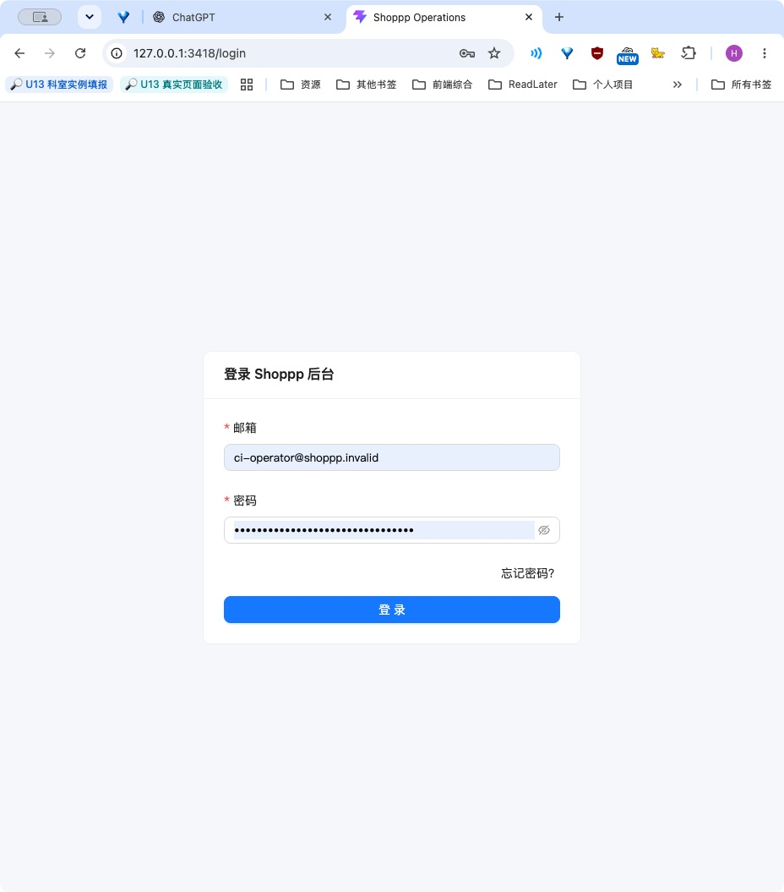

### N002 · U2 · 登录后进入开店指南 — 有摩擦

2026-10-31 23:44:02 +08:00 · 本地测试管理员 · `/welcome`

测试账号登录成功，进入开店指南。当前3/13项通过，商业、商品、配送、支付等尚未完成；支付凭证和Webhook明确缺失。各阶段默认全部展开，需要向下滚动识别任务。

关联：UX-001。

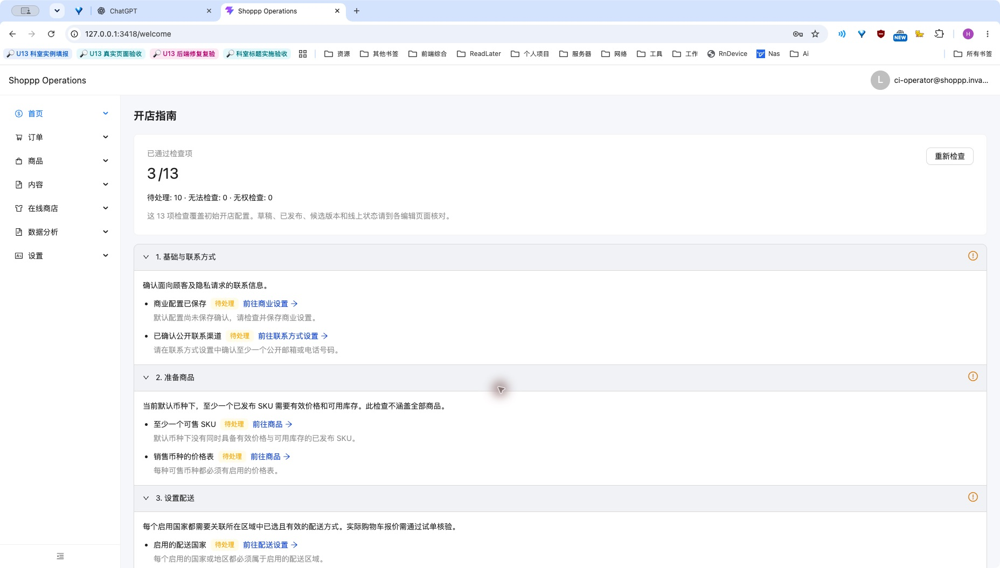

### N003 · U3 · 商业设置首屏 — 有摩擦

2026-10-31 23:44:52 +08:00 · 本地测试管理员 · `/settings/launch?from=setup-guide#sales`

从引导可返回原指南，表单主次清晰。但商家需要选择“已启用的配送方式 ID”，值为长内部标识，无法直接辨识配送服务。

关联：UX-002、UX-006。

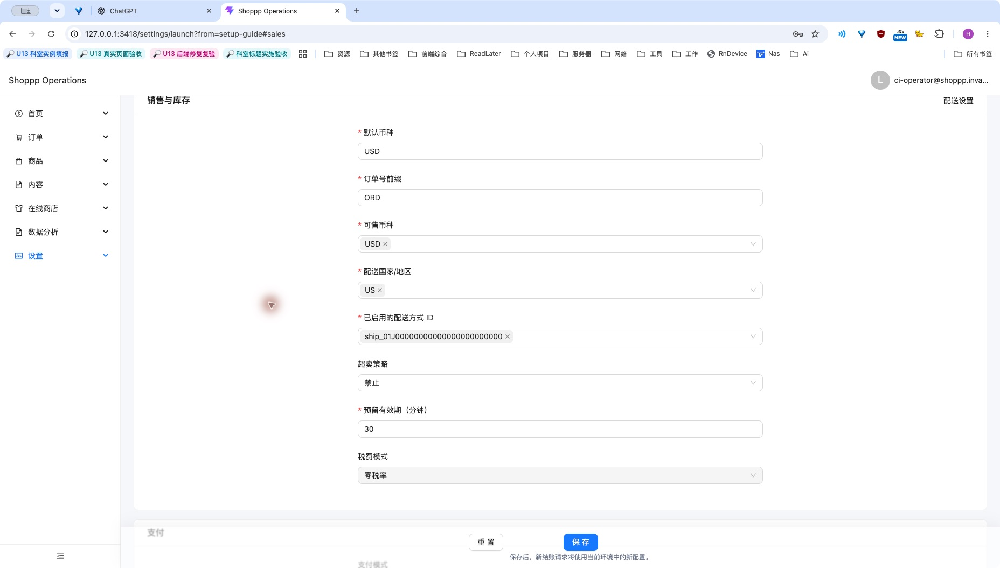

### N004 · U3 · 商业设置必填校验 — 顺畅

2026-10-31 23:45:04 +08:00 · 本地测试管理员 · `/settings/launch?from=setup-guide#sales`

空变更原因提交后，页面滚动并聚焦错误字段，给出明确提示。本图拍摄底部校验区域；支付模式与凭证另由页面可访问文本核对。

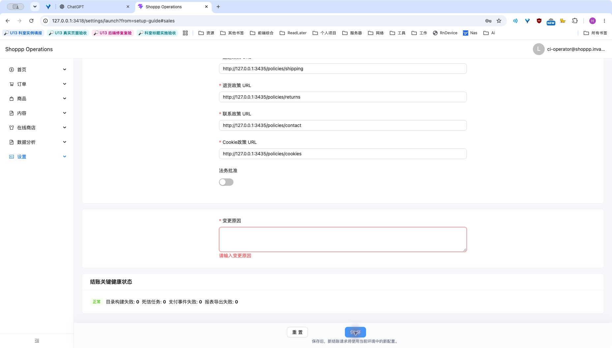

### N005 · U3 · 联系方式表单 — 顺畅

2026-10-31 23:45:17 +08:00 · 本地测试管理员 · `/settings/contact?from=setup-guide`

联系方式按全局渠道、地点、社交链接分组，公开开关与邮箱区分明确，提示版本保存语义。以测试电话验证保存与恢复。

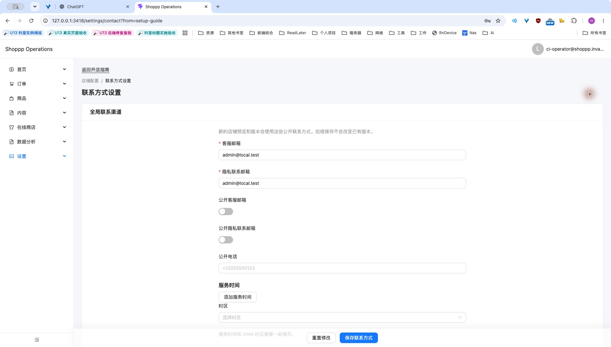

### N006 · U3 · 联系方式保存成功 — 顺畅

2026-10-31 23:45:32 +08:00 · 本地测试管理员 · `/settings/contact?from=setup-guide`

测试号码已通过界面保存；成功反馈说明已保存并记录审计日志。下一步恢复原空值。

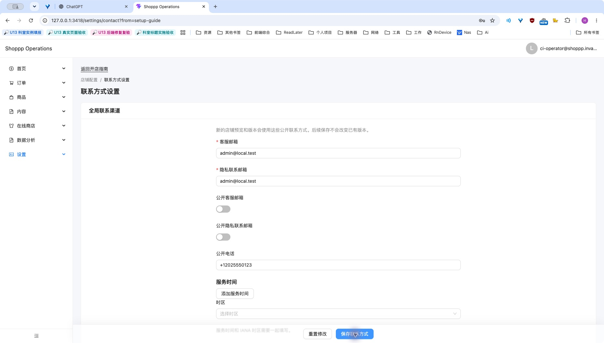

### N007 · U3 · 地点抽屉与两层保存 — 有摩擦

2026-10-31 23:45:52 +08:00 · 本地测试管理员 · `/settings/contact?from=setup-guide`

抽屉顶部明确提示“保存页面后才生效”，但底部仍叫“保存”，与页面保存同词。建议改成“添加到草稿/确认地点”，减少误以为已经生效的风险。测试未输入内容，随后关闭。

关联：UX-003。

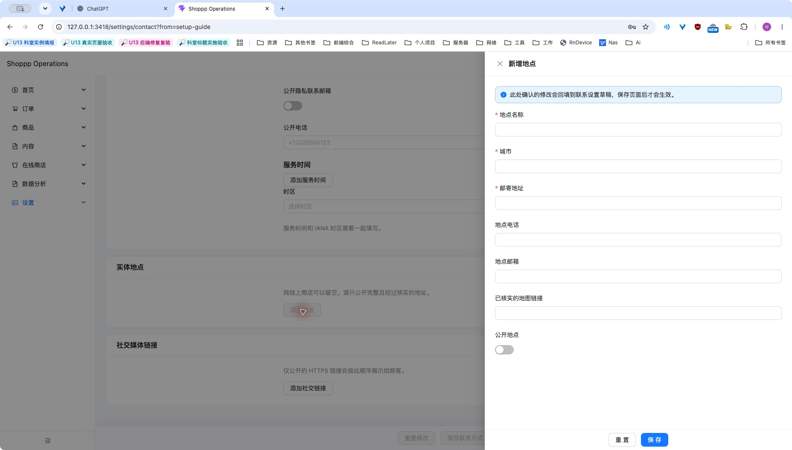

### N008 · U3 · 配送空状态 — 顺畅

2026-10-31 23:46:18 +08:00 · 本地测试管理员 · `/settings/shipping?from=setup-guide`

没有配送区域时给出“新建配送区域”，但空白中央的次级行动是“重新加载”；新建入口仍可见。此环境没有可用配送配置。

关联：UX-008。

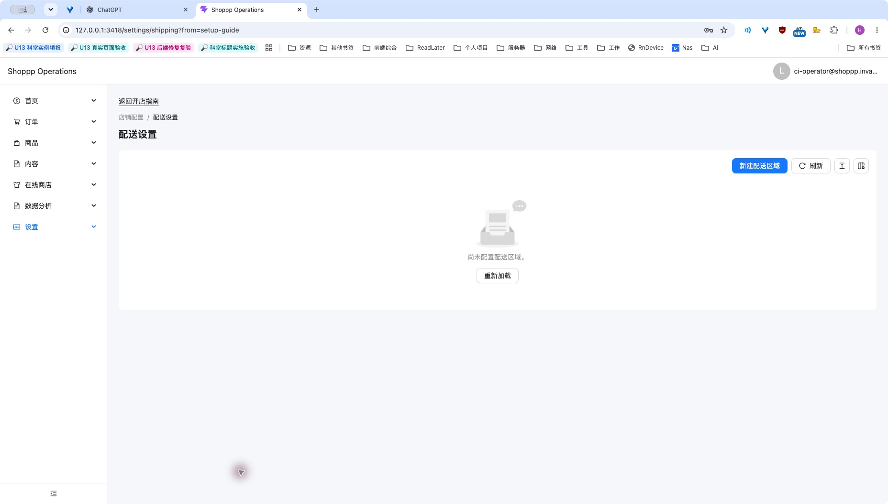

### N009 · U3 · 新建配送区域：金额与条件 — 有摩擦

2026-10-31 23:46:35 +08:00 · 本地测试管理员 · `/settings/shipping?from=setup-guide`

配送表单直接使用“价格（最小单位）”，要求商家换算分/美元；固定运费模式仍展示免费阈值和重量上下限，字段条件不易理解。

关联：UX-004。

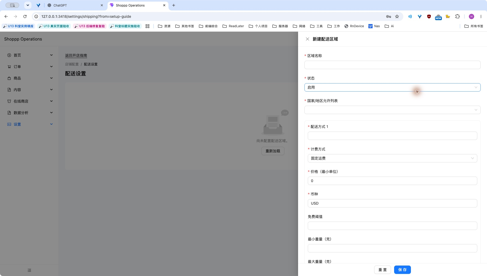

### N010 · U3 · 配送保存后的阻断式成功提示 — 有摩擦

2026-10-31 23:47:00 +08:00 · 本地测试管理员 · `/settings/shipping?from=setup-guide`

保存配送区域成功后出现必须确认的居中弹窗；普通保存结果增加额外确认，打断继续配置。建议沿用轻量成功提示，直接回到列表并突出新记录。

关联：UX-005、UX-006。

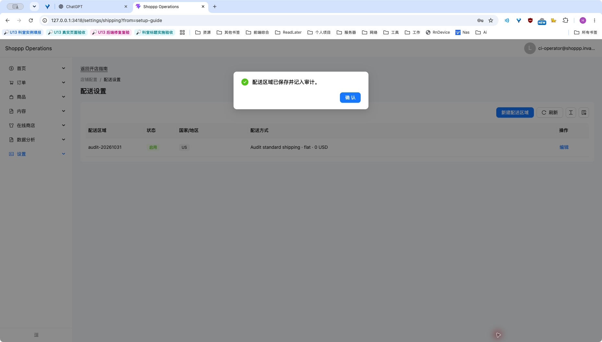

### N011 · U3 · 指南中的配送与支付缺口 — 有摩擦

2026-10-31 23:47:28 +08:00 · 本地测试管理员 · `/welcome`

新建配送区域后，国家检查通过，但“已选配送方式”仍未通过且只链接配送设置；实际启用选择位于商业设置。支付缺少服务商和Webhook凭证，明确属于环境前置条件。

关联：UX-001。

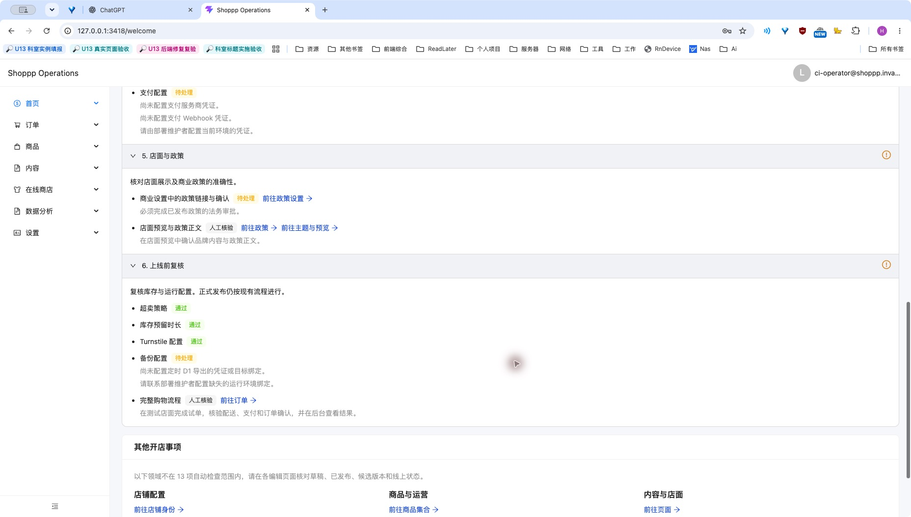

### N012 · U3 · 店铺资料首屏 — 有摩擦

2026-10-31 23:47:43 +08:00 · 本地测试管理员 · `/settings/identity?from=setup-guide`

店铺名称、品牌标语、SEO和素材分组；本图为首屏，下方素材空选择的直接证据在N014。

关联：UX-007。

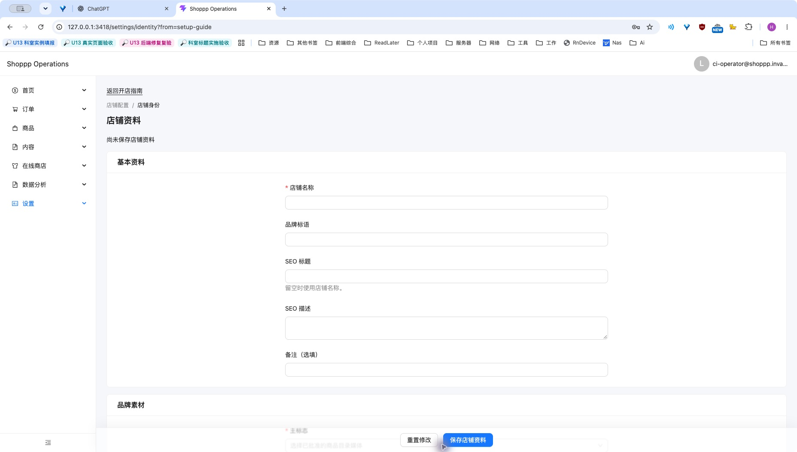

### N013 · U3 · 品牌素材区域 — 有摩擦

2026-10-31 23:47:56 +08:00 · 本地测试管理员 · `/settings/identity?from=setup-guide`

滚动到品牌素材；必填主标志只能选择已批准的商品目录媒体。该图尚未展开下拉，实际空列表见N014。

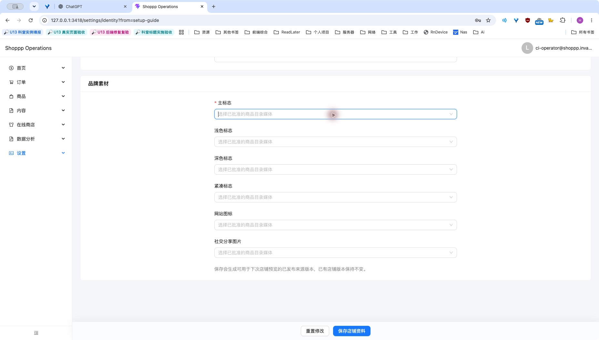

### N014 · U3 · 标志选择器明确无数据 — 受阻

2026-10-31 23:48:08 +08:00 · 本地测试管理员 · `/settings/identity?from=setup-guide`

下拉实际展开后只显示“暂无数据”，没有素材上传、资源库入口或准备步骤。此图确认为 UX-007 的直接现场证据。

关联：UX-007。

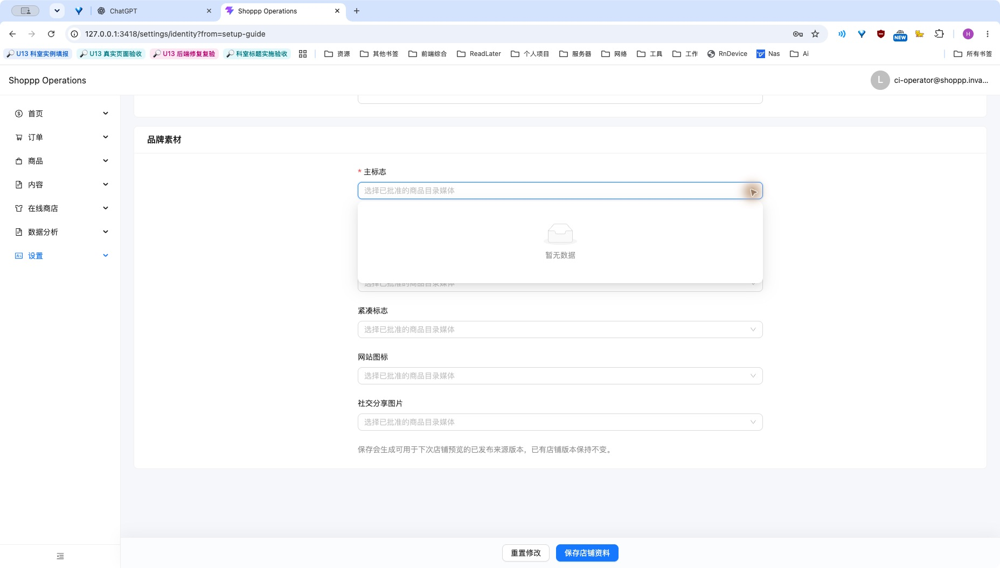

### N015 · U3 · 政策编辑起点 — 顺畅

2026-10-31 23:48:25 +08:00 · 本地测试管理员 · `/settings/policies`

政策记录与编辑区实际上下排列。空库可直接新建草稿，需填写类型、标题、标识、生效日期与结构化内容。本轮只检查编辑及校验，未保存政策或做法务审批。

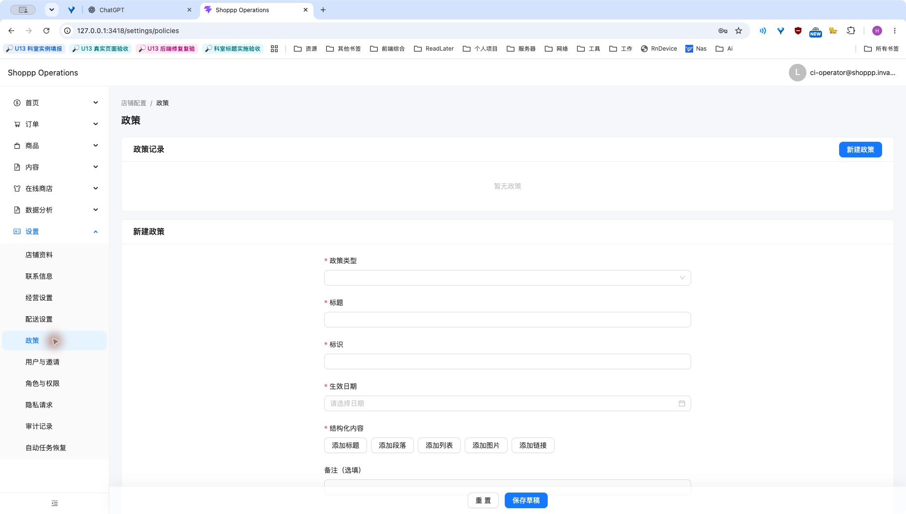

### N016 · U3 · 政策必填校验 — 顺畅

2026-10-31 23:48:35 +08:00 · 本地测试管理员 · `/settings/policies`

空政策提交后各必填项逐项给出错误，并聚焦首个类型选择器。政策记录和编辑区实际为上下排列。尚未写入政策。

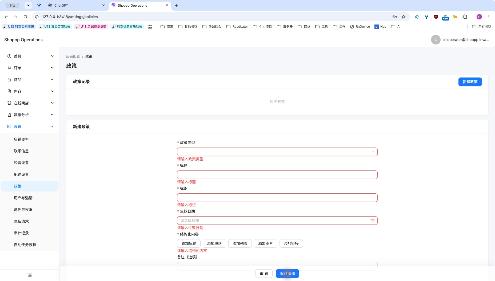

### N017 · U4 · 商品列表空状态 — 有摩擦

2026-10-31 23:49:08 +08:00 · 本地测试管理员 · `/catalog/products`

当前没有商品。搜索与状态筛选清晰；空状态同时提到重置筛选和创建商品，但中央只提供重置筛选。真正首次进入的空库可更直接引导“创建第一个商品”。

关联：UX-008。

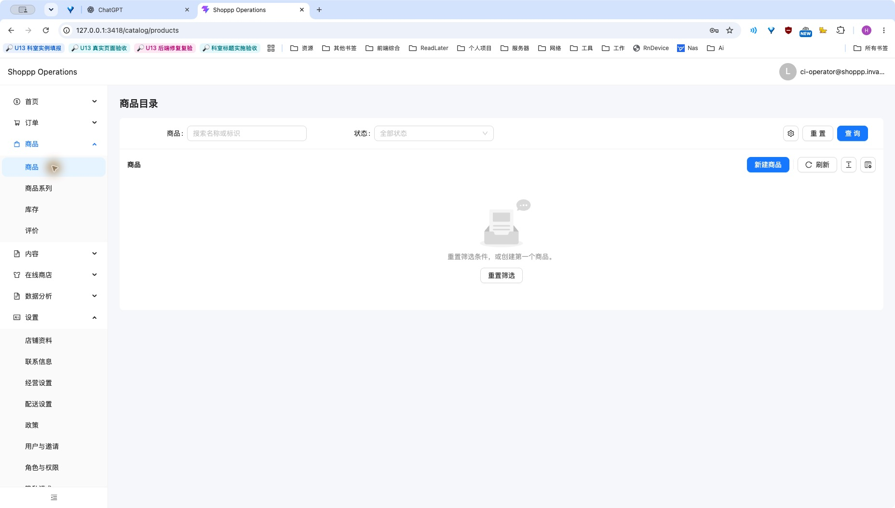

### N018 · U4 · 新建商品表单与新标签页 — 有摩擦

2026-10-31 23:49:28 +08:00 · 本地测试管理员 · `/catalog/products/form?mode=add`

新建商品打开独立浏览器标签。基础信息与变体、价格、媒体、SEO均在同一长表单；物流尺寸、价格表代码、SEO都在初次创建时必填，首轮录入负担较重。

关联：UX-009。

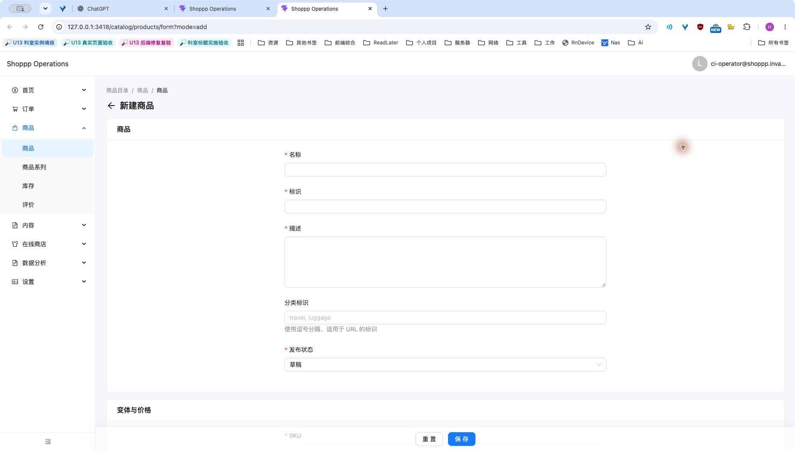

### N019 · U4 · 商品变体价格区域 — 有摩擦

2026-10-31 23:49:43 +08:00 · 本地测试管理员 · `/catalog/products/form?mode=add`

变体需填写SKU、标题、重量和三维尺寸，金额使用最小币种单位。建议在界面显示可理解的币种金额，并为物流数据和默认价格表提供渐进填写。

关联：UX-004、UX-009。

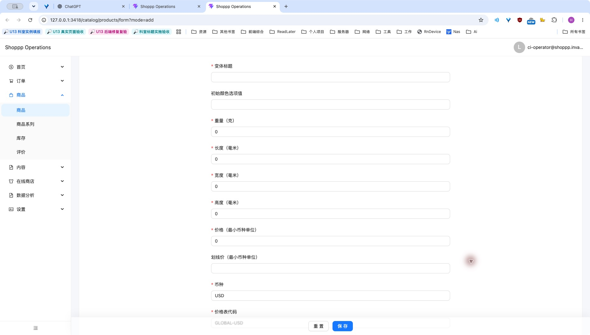

### N020 · U4 · 商品媒体和SEO区域 — 有摩擦

2026-10-31 23:50:09 +08:00 · 本地测试管理员 · `/catalog/products/form?mode=add`

上传图片前暴露必填媒体Key、图片宽高和SEO信息。媒体Key为只读，上传后是否自动补齐继续验证；建议系统生成信息收起或显示为摘要，SEO提供合理默认值。

关联：UX-002、UX-009。

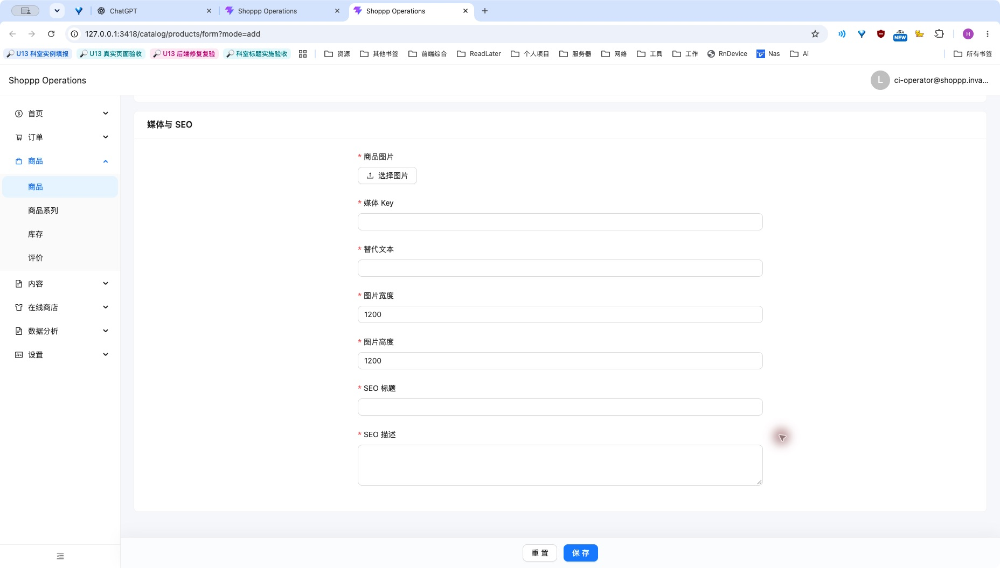

### N021 · U4 · 图片上传后仍保留默认尺寸 — 有摩擦

2026-10-31 23:50:35 +08:00 · 本地测试管理员 · `/catalog/products/form?mode=add`

上传已有600×765图片后，媒体Key自动填充，但宽高仍为默认1200×1200（原图尺寸通过本地元数据核对）。需要人工修正，容易保存不真实的图片尺寸。

关联：UX-010。

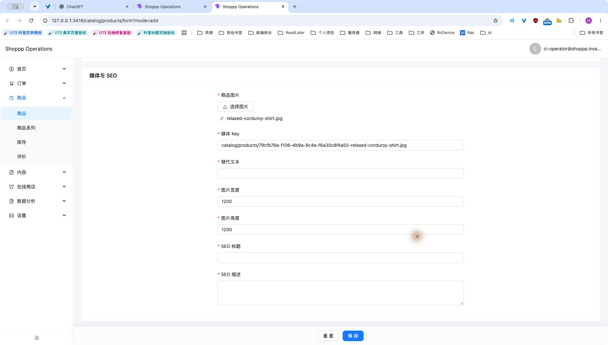

### N022 · U4 · 商品保存后仍停留在新建模式 — 有摩擦

2026-10-31 23:50:48 +08:00 · 本地测试管理员 · `/catalog/products/form?mode=add`

收到“商品已创建”反馈后，页面仍为mode=add，保留填写内容和保存按钮，没有切换为编辑或结果页。没有再次提交；手动进入列表确认仅创建1条。

关联：UX-010、UX-011。

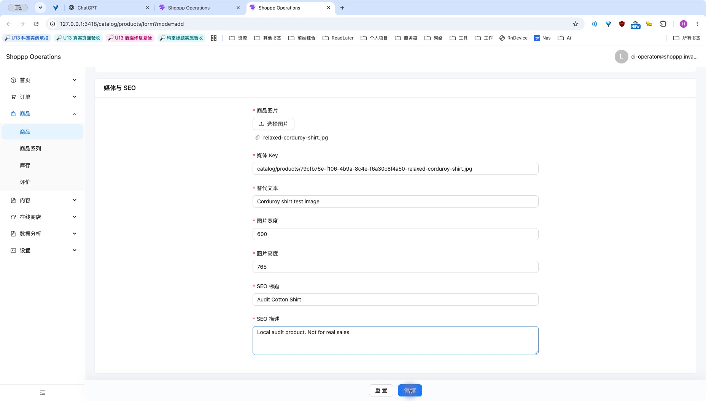

### N023 · U4 · 已创建商品在列表可见 — 有摩擦

2026-10-31 23:51:08 +08:00 · 本地测试管理员 · `/catalog/products`

手动进入列表后确认只创建1条草稿，名称和标识正确；创建后的界面没有自动切换为编辑或结果页，UX-011以SS022与本图组成前后证据。

关联：UX-011、UX-013。

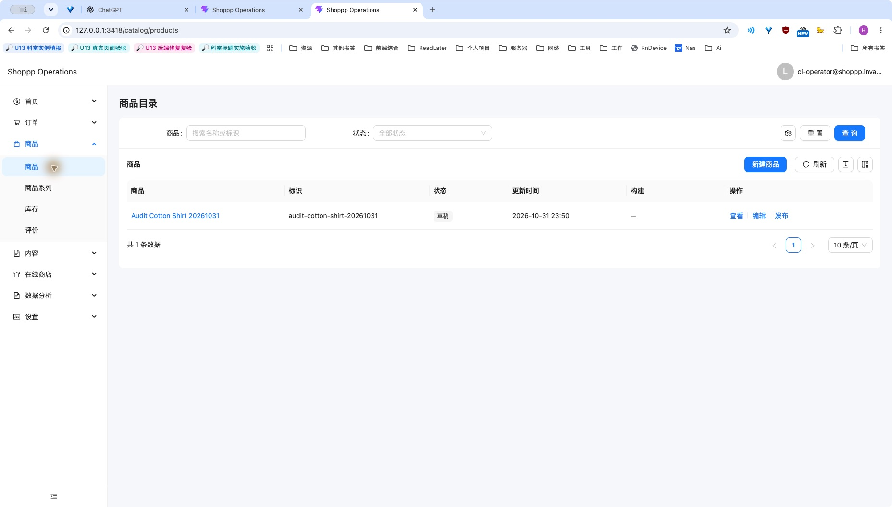

### N024 · U4 · 商品发布确认 — 顺畅

2026-10-31 23:51:20 +08:00 · 本地测试管理员 · `/catalog/products`

发布前说明会构建公开店铺版本，部署后更新展示，并要求发布原因。此确认符合业务变更性质；与普通保存成功的额外确认应区分。

关联：UX-012。

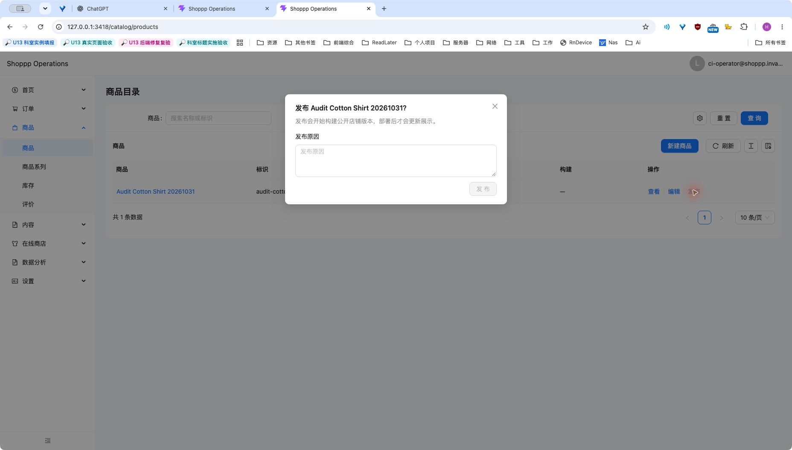

### N025 · U4 · 商品发布第一次尝试后的弹窗 — 受阻

2026-10-31 23:51:34 +08:00 · 本地测试管理员 · `/catalog/products`

填写发布原因并提交后，弹窗仍保留、列表为草稿。此图不能证明发布成功；随后即时捕获到失败提示，见N026。

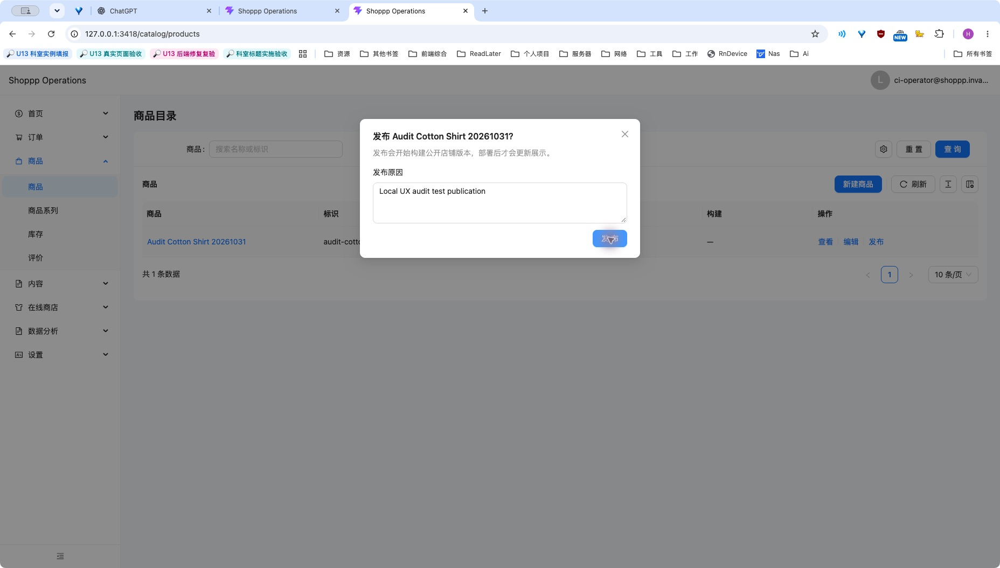

### N026 · U4 · 商品发布失败只给泛化提示 — 受阻

2026-10-31 23:52:04 +08:00 · 本地测试管理员 · `/catalog/products`

即时截图显示顶部“请求失败，请稍后重试”，没有具体原因或恢复路径；弹窗保留，列表仍为草稿。几次点击用于确认操作是否生效，随后停止，不声称已发布。

关联：UX-012。

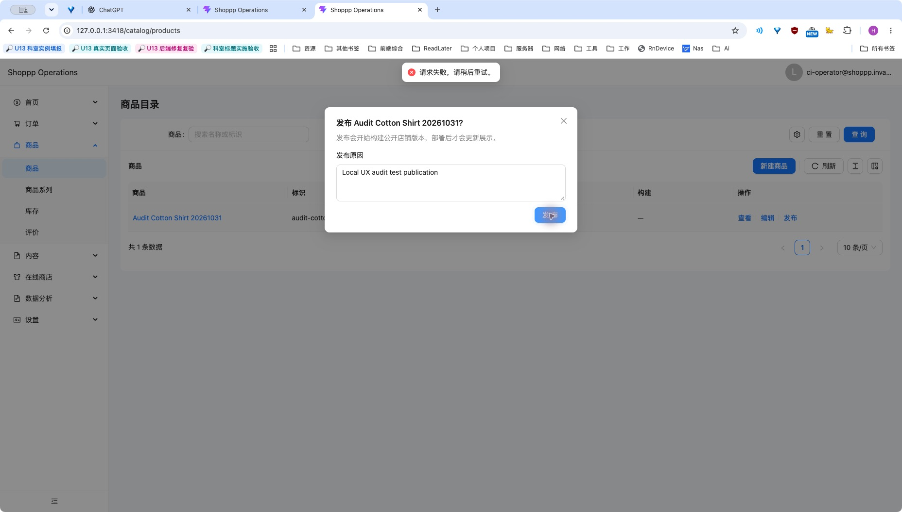

### N027 · U4 · 新建商品后的库存空状态 — 受阻

2026-10-31 23:52:42 +08:00 · 本地测试管理员 · `/inventory`

商品已创建且包含SKU，但库存列表没有记录，也没有新增库存或去准备SKU的入口，只提示重置筛选。当前无法通过此页继续补库存；是否要求先发布需查证，界面未解释。

关联：UX-012、UX-013。

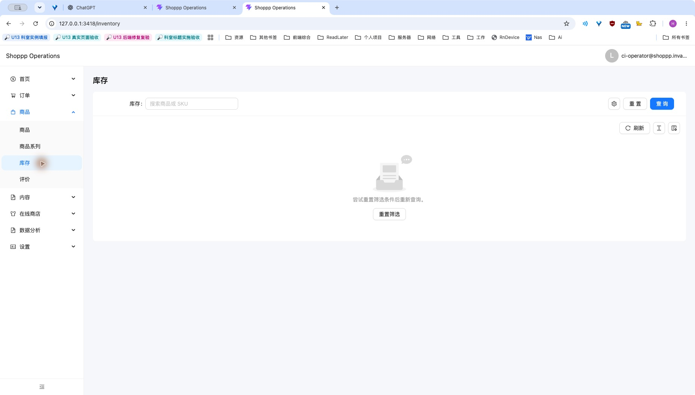

### N028 · U4 · 商品集合抽屉 — 有摩擦

2026-10-31 23:53:00 +08:00 · 本地测试管理员 · `/catalog/collections`

集合以抽屉编辑，SEO标题可留空并使用名称，降低创建成本；与商品强制填写SEO的体验不一致。导航叫“商品系列”，页面叫“商品集合”，建议统一术语。

关联：UX-009、UX-014。

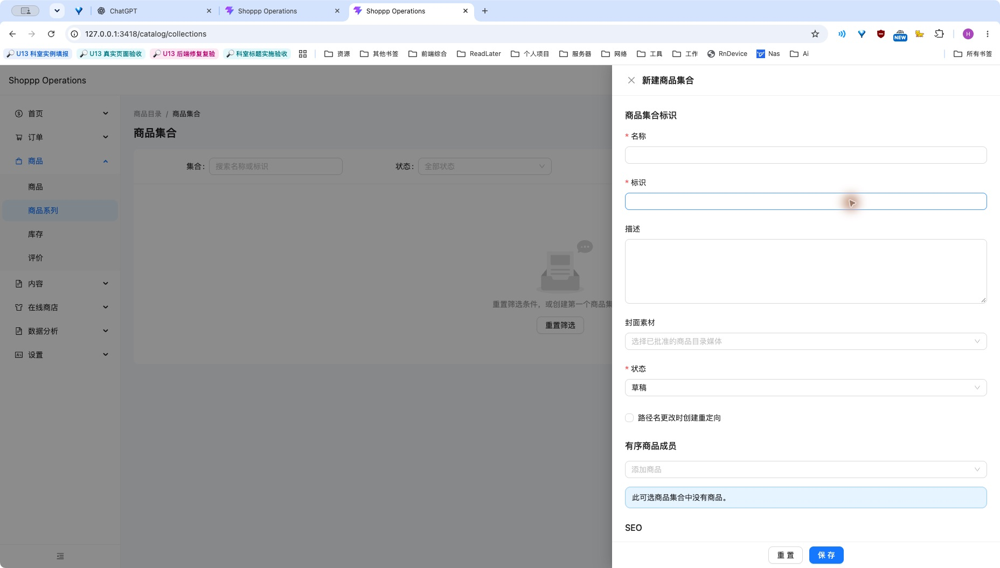

### N029 · U4 · 商品集合保存结果 — 有摩擦

2026-10-31 23:53:11 +08:00 · 本地测试管理员 · `/catalog/collections`

新建集合成功，但中文界面显示英文“Collection created”，且再次要求确认成功弹窗。与配送成功弹窗归为共性反馈问题。

关联：UX-005、UX-014。

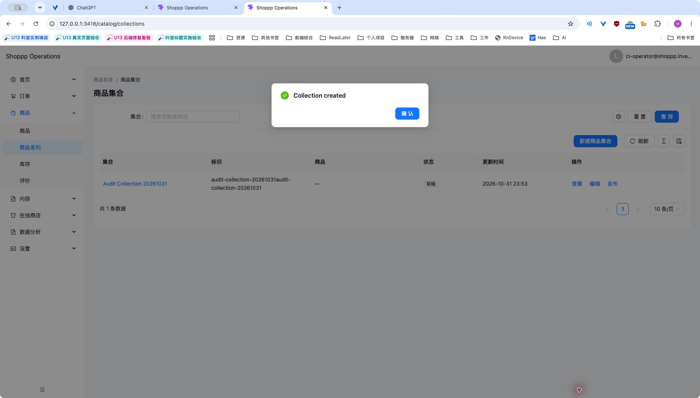

### N030 · U4 · 评价审核空状态 — 顺畅

2026-10-31 23:53:35 +08:00 · 本地测试管理员 · `/catalog/reviews`

无待审核评价，空状态解释与任务相符。当前无评价数据，审核动作未验证。

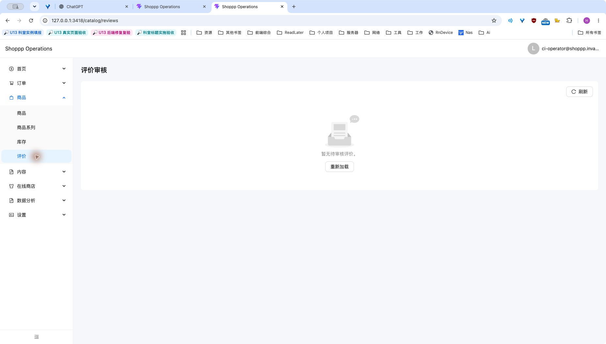

### N031 · U5 · 页面编辑起点 — 顺畅

2026-10-31 23:53:54 +08:00 · 本地测试管理员 · `/content/pages/form?mode=add`

页面标识、正文和搜索展示分组清晰，SEO可用标题默认值。正文需逐块添加，继续体验段落编辑、保存和返回。

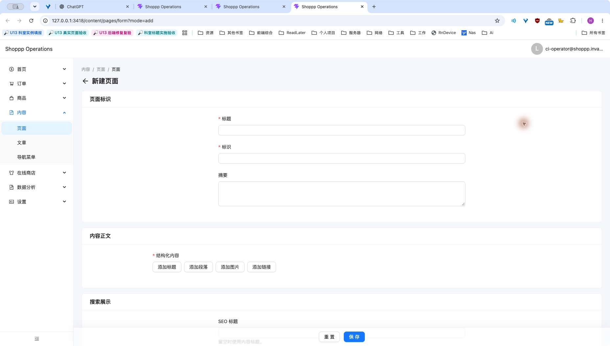

### N032 · U5 · 页面草稿保存后的发布入口 — 顺畅

2026-10-31 23:54:11 +08:00 · 本地测试管理员 · `/content/pages/form?mode=add`

段落内容保存成功，界面出现“状态与发布”、草稿v1与发布入口，SEO标题默认采用内容标题。这种保存后状态比商品新建更清楚。

关联：UX-011。

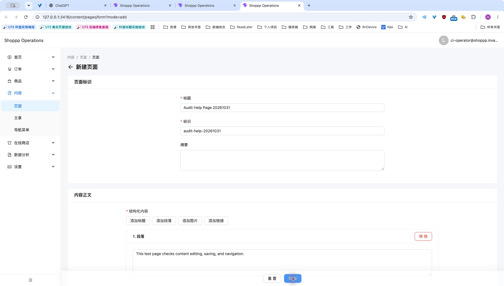

### N033 · U5 · 页面草稿状态与发布控件 — 有摩擦

2026-10-31 23:54:19 +08:00 · 本地测试管理员 · `/content/pages/form?mode=add`

已保存草稿显示 v1、版本详情和发布/归档入口；保存后仍显示“新建页面”标题，建议随已创建状态切换标题及稳定详情地址，避免身份含糊。

关联：UX-011。

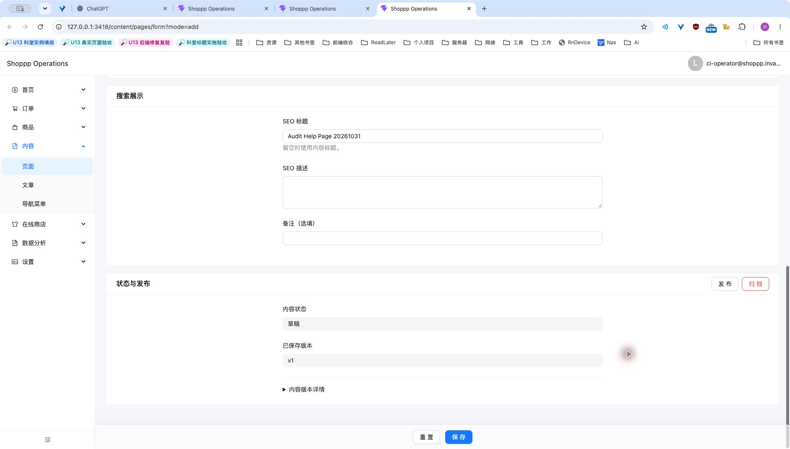

### N034 · U5 · 文章编辑与校验 — 有摩擦

2026-10-31 23:54:37 +08:00 · 本地测试管理员 · `/content/articles/form?mode=add`

文章编辑复用页面结构，额外封面字段仍叫“媒体资源 ID”。空提交可聚焦标题并给出字段错误。本轮没有保存文章；正文保存已在页面任务验证。

关联：UX-002。

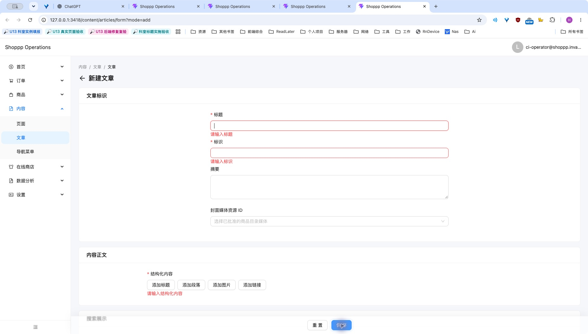

### N035 · U5 · 导航树与菜单详情 — 有摩擦

2026-10-31 23:54:59 +08:00 · 本地测试管理员 · `/storefront/navigation`

添加菜单项后，左侧树选中与右侧详情联动。默认“系统路由”要求手工填路由路径；资源选择需切换目标类型。草稿与发布区分明确。

关联：UX-002。

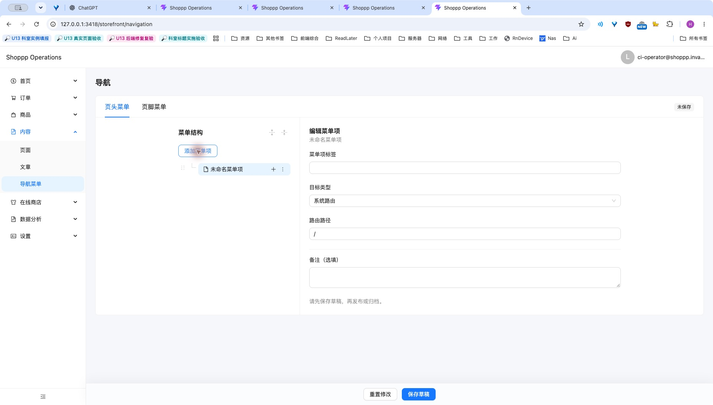

### N036 · U5 · 导航草稿保存成功 — 顺畅

2026-10-31 23:55:14 +08:00 · 本地测试管理员 · `/storefront/navigation`

页头菜单已保存为草稿，树标签与状态同步，发布和归档入口出现；尚未发布，不影响已有店面版本。

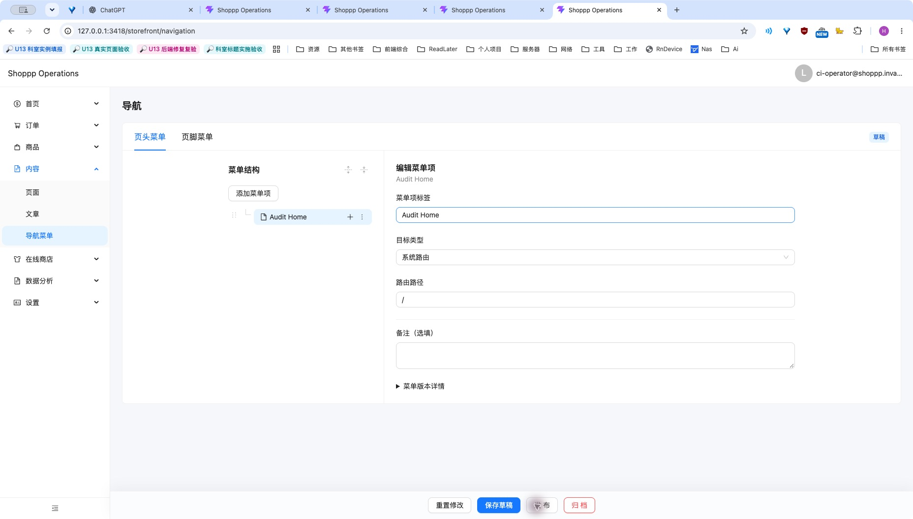

### N037 · U6 · 主题与体验草稿入口 — 有摩擦

2026-10-31 23:55:51 +08:00 · 本地测试管理员 · `/storefront/themes`

主页面把主题包、体验草稿和线上版本放在一起。首屏含合约/架构版本、英文预设和ISO时间，信息偏技术化；商家需要辨认“主题包/体验草稿/线上版本”的关系。

关联：UX-015。

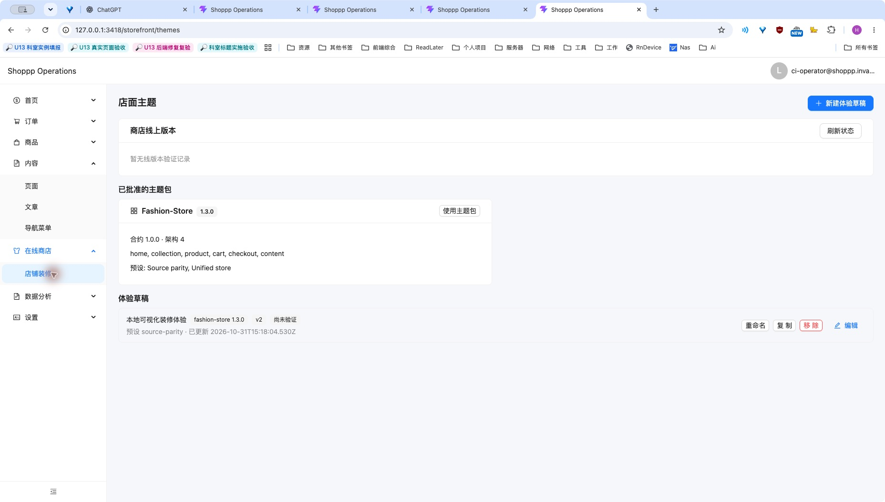

### N038 · U6 · 装修编辑器无预览数据 — 受阻

2026-10-31 23:56:12 +08:00 · 本地测试管理员 · `/storefront/themes/draft-f7ff874a-0bc0-46fc-b2f3-6f8c6b058e9f`

复制草稿成功，三栏编辑器可见；没有已发布数据时，中央预览为空，集合/商品选择器禁用，英文空提示。界面没有直接可执行的“准备预览数据”步骤，编辑者难以恢复。

关联：UX-016。

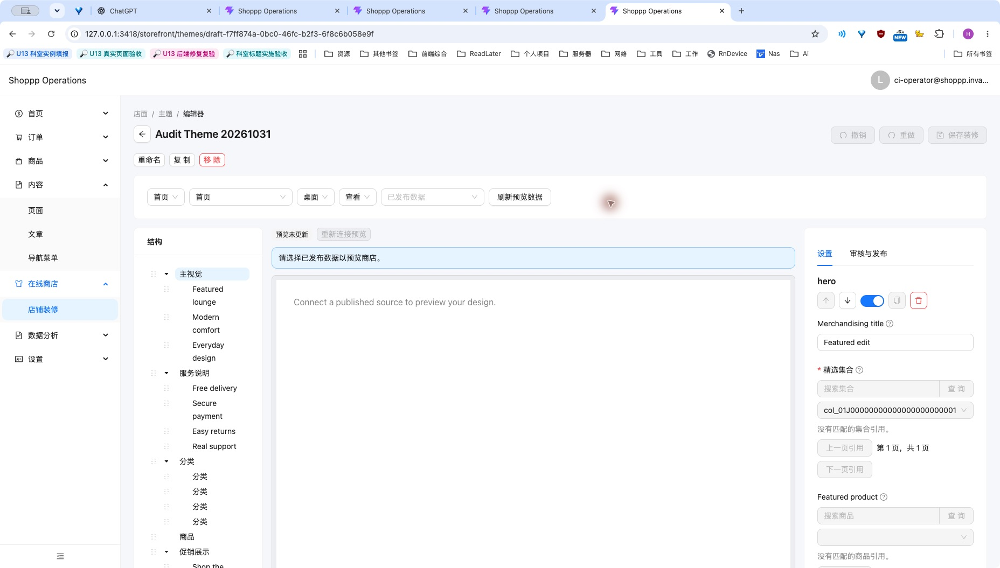

### N039 · U6 · 装修修改保存成功 — 顺畅

2026-10-31 23:56:31 +08:00 · 本地测试管理员 · `/storefront/themes/draft-f7ff874a-0bc0-46fc-b2f3-6f8c6b058e9f`

测试副本内容已保存，“保存装修”和撤销回到不可用状态，字段保留新值。没有可用预览数据，无法评价修改后的店面视觉效果。

关联：UX-016、UX-017。

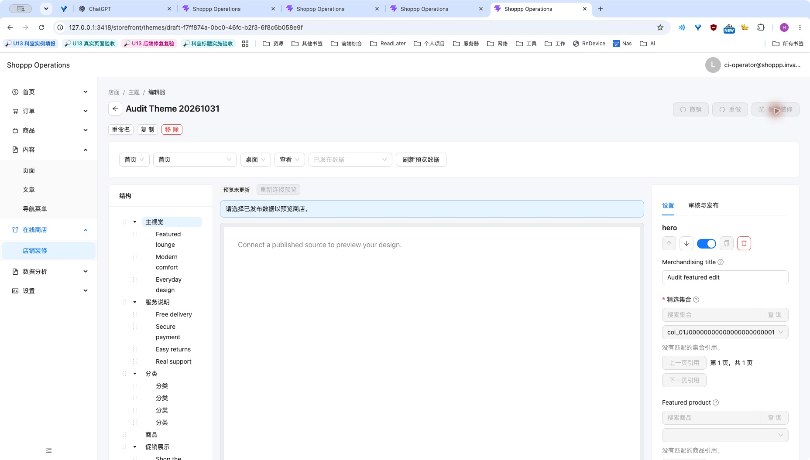

### N040 · U6 · 已保存装修仍提示先保存 — 有摩擦

2026-10-31 23:56:42 +08:00 · 本地测试管理员 · `/storefront/themes/draft-f7ff874a-0bc0-46fc-b2f3-6f8c6b058e9f`

已保存且保存按钮不可用，审核页却提示“发布前，请先保存或放弃当前修改”。同时缺少已发布资源，多个禁用原因混在一起；建议逐项说明真正阻塞与可点击修复步骤。

关联：UX-017。

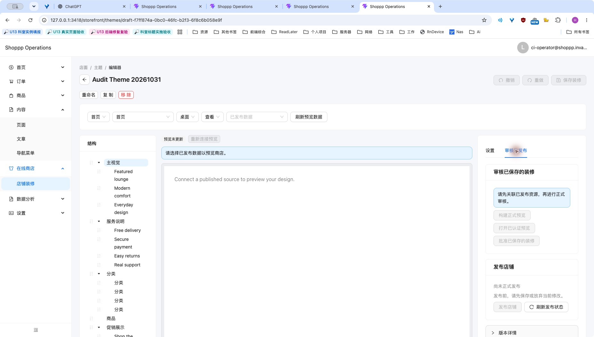

### N041 · U7 · 订单列表与支付筛选 — 有摩擦

2026-10-31 23:57:25 +08:00 · 本地测试管理员 · `/orders`

当前订单库为空，支付/履约筛选可见，未能进入详情、取消、退款或履约。空状态只称“没有符合筛选条件”，没有区分尚无订单与筛选无结果。

关联：UX-008。

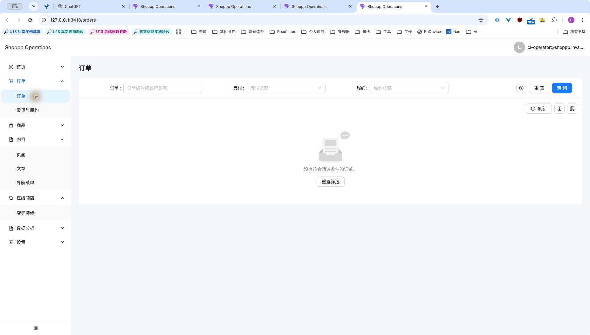

### N042 · U7 · 履约空状态 — 顺畅

2026-10-31 23:57:37 +08:00 · 本地测试管理员 · `/fulfillment`

空状态明确解释只展示等待履约的已支付订单。由于支付前置条件缺失及无订单，具体履约与退款步骤受阻，不作为已验证流程。

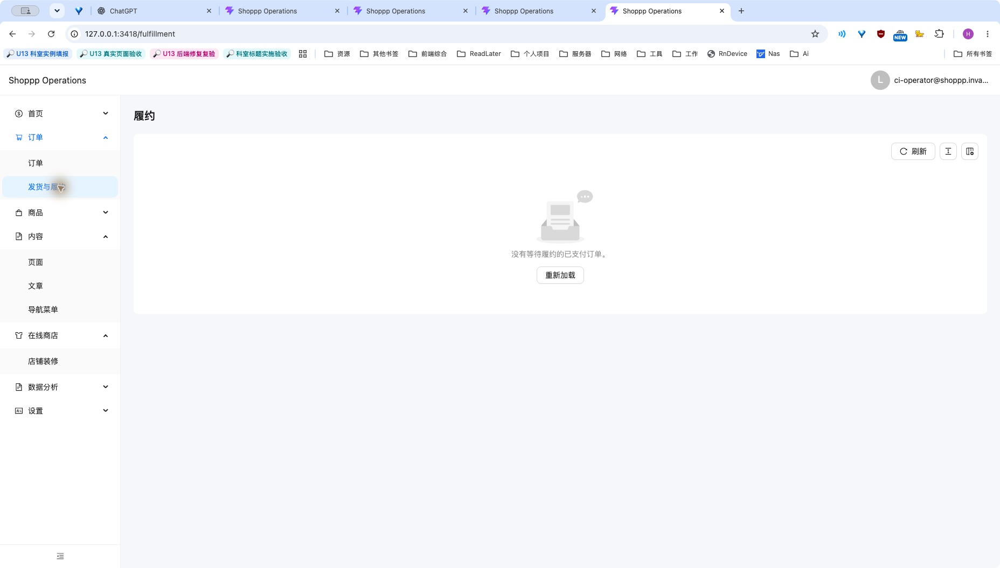

### N043 · U7 · 测试前台未运行 — 受阻

2026-10-31 23:57:49 +08:00 · 本地测试管理员 · `http://127.0.0.1:3435/`

配置中的前台127.0.0.1:3435拒绝连接；加上支付服务商和Webhook凭证缺失，当前无法完成真实下单支付闭环。本地dev:fashion-store使用独立商品fixture，不能代替当前后台的真实闭环，因此不把它启动后的模拟结果算作通过。

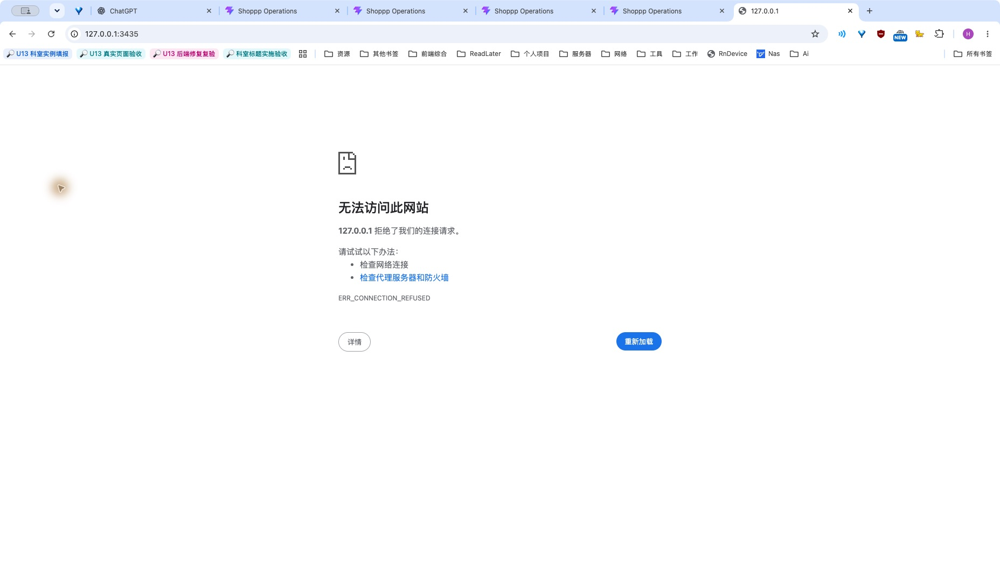

### N044 · U8 · 仪表盘缺少数据时的整页空状态 — 有摩擦

2026-10-31 23:58:11 +08:00 · 本地测试管理员 · `/dashboard`

经营仪表盘仅显示“当前数据不足，暂时无法展示仪表盘”，未保留日期/指标框架，也不解释缺少什么数据或下一步。首次开店时无法建立指标认知。

关联：UX-018。

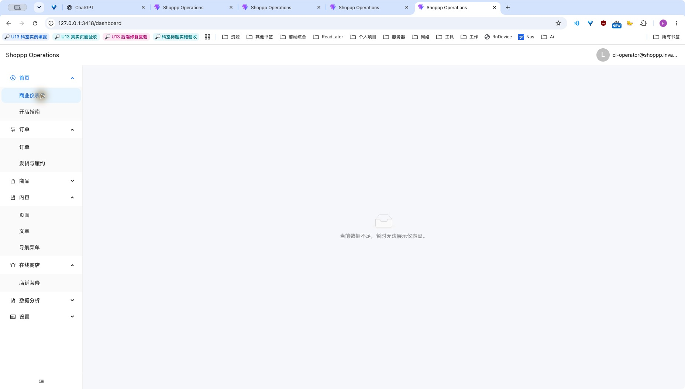

### N045 · U8 · 收入报表筛选与无事件状态 — 顺畅

2026-10-31 23:58:46 +08:00 · 本地测试管理员 · `/reports/orders`

报表明确展示币种、时区及日期范围，空状态说明是该时间段无订单事件，比仪表盘更有上下文。当前为10/2–10/31、Asia/Shanghai。

关联：UX-018、UX-019。

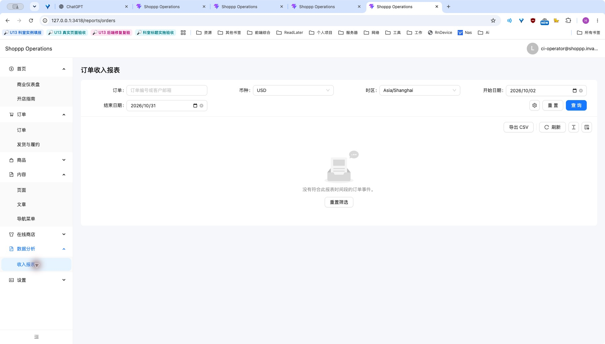

### N046 · U8 · 反向日期范围变成列表加载失败 — 有摩擦

2026-10-31 23:59:19 +08:00 · 本地测试管理员 · `/reports/orders`

用键盘确实把结束日期改为10月1日，早于开始日期10月2日，然后查询。字段未提示范围错误，结果区显示“列表加载失败/请求失败，请稍后重试”。初次加载中截图已由本图稳定错误现场替换。重置后恢复正常。

关联：UX-019。

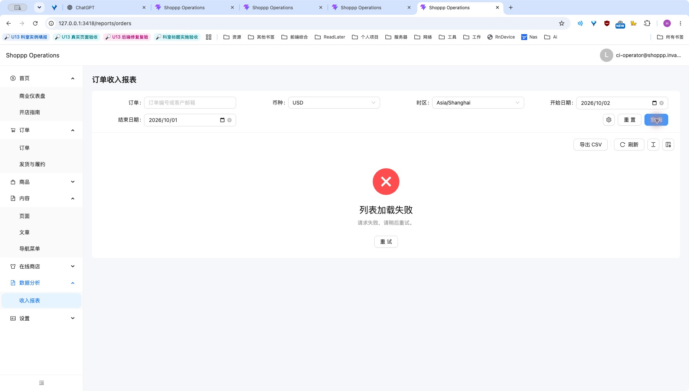

### N047 · U8 · 报表导出说明 — 顺畅

2026-11-01 00:00:08 +08:00 · 本地测试管理员 · `/reports/orders`

导出前说明含客户邮箱、审计与24小时链接有效期，并要求原因；说明对操作后果有帮助。本轮空订单数据，不包含真实客户信息。

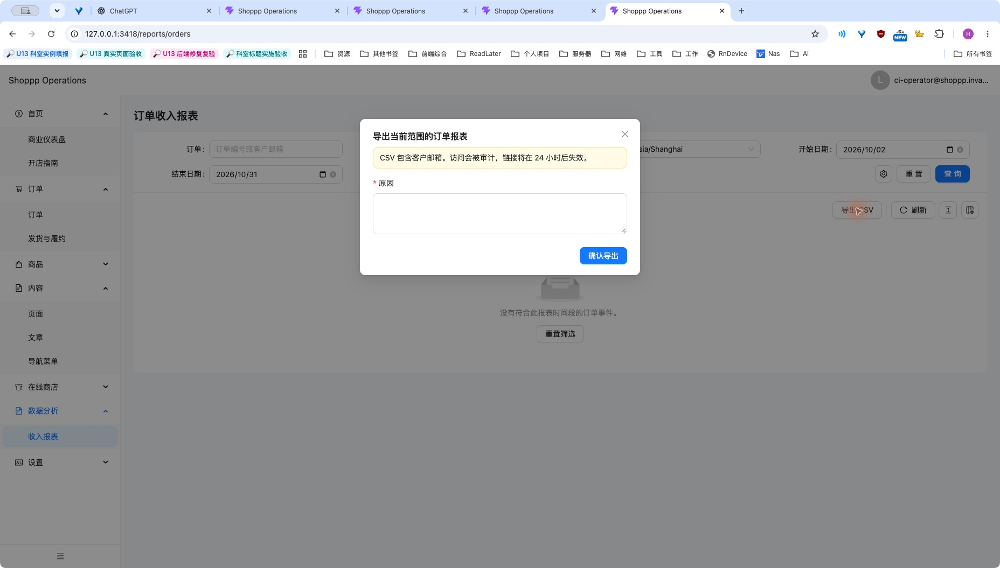

### N048 · U8 · 报表导出就绪 — 顺畅

2026-11-01 00:00:21 +08:00 · 本地测试管理员 · `/reports/orders`

导出完成后有持久“已就绪”状态和0行下载链接，明确结果；无需重复发起导出。导出ID以系统标识显示，可将可读文件名/时间范围放在主位。

关联：UX-020。

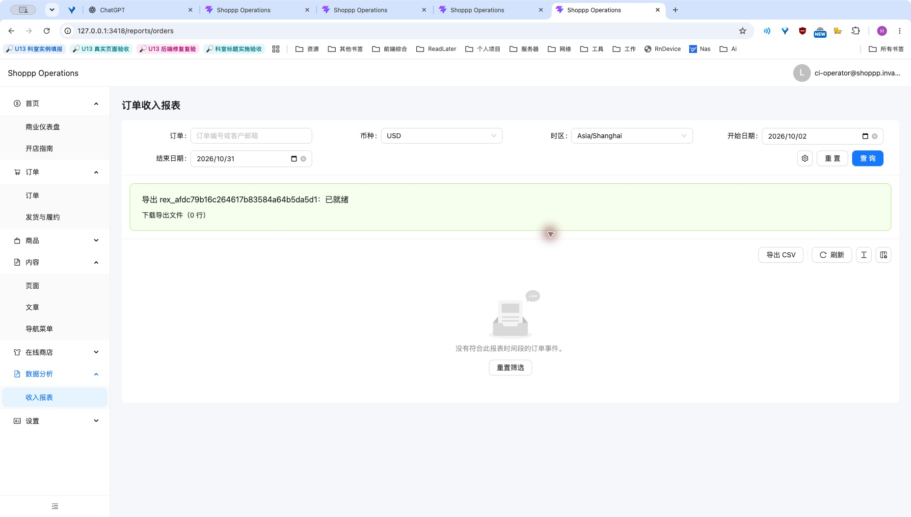

### N049 · U8 · 下载报表却回到开店指南 — 受阻

2026-11-01 00:00:37 +08:00 · 本地测试管理员 · `/admin/reporting/exports/rex_afdc79b16c264617b83584a64b5da5d1/download → /welcome`

从“下载导出文件（0行）”点击后，未见下载结果，浏览器进入/welcome开店指南。下载链接为/admin/reporting/exports/.../download，需核对前端代理和后端下载路由；当前导出交付受阻。

关联：UX-006、UX-020。

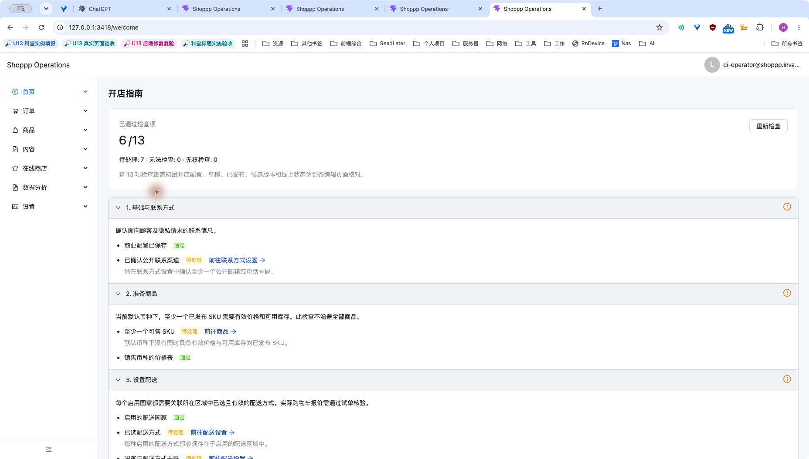

### N050 · U9 · 用户列表 — 顺畅

2026-11-01 00:01:06 +08:00 · 本地测试管理员 · `/access/users`

用户与邀请分标签，角色、启用状态和查看入口明确。当前只有本地管理员，不改动其角色或启用状态；测试查看、邀请表单及校验。

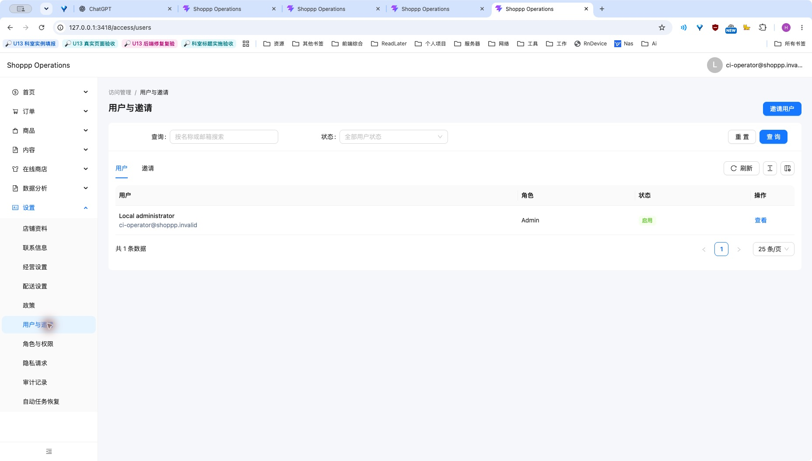

### N051 · U9 · 邀请表单必填校验 — 顺畅

2026-11-01 00:01:23 +08:00 · 本地测试管理员 · `/access/users`

空提交给出邮箱与角色错误，没有发出邀请。普通表单清楚、字段少；当前仅一个管理员且没有受控收件箱，邀请实际送达与受限角色登录未验证。

### N052 · U9 · 自身账号保护与只读详情 — 顺畅

2026-11-01 00:01:45 +08:00 · 本地测试管理员 · `/access/users`

自身账号角色/状态不可编辑，底部解释原因；只读资料分组可见。禁用显示名称是否符合产品权限需另行确认，本轮不将其当作缺陷。

### N053 · U9 · 角色权限编辑树 — 有摩擦

2026-11-01 00:02:20 +08:00 · 本地测试管理员 · `/access/roles`

角色详情提供分组、选中数量、全选/展开/收起及搜索。默认39个权限全部展开，长抽屉滚动成本高；搜索适合定位，但可考虑默认仅展开已选组。

关联：UX-021。

### N054 · U9 · 权限搜索未定位到可见结果 — 有摩擦

2026-11-01 00:02:30 +08:00 · 本地测试管理员 · `/access/roles`

输入“报表”后仍显示商品、库存、订单等组，匹配项在当前视口之外，没有计数或定位。只读代码查证该控件设计为高亮匹配而非过滤；本条建议改善反馈，不将其称为搜索接口失效。没有变更权限。

关联：UX-021。

### N055 · U9 · 隐私请求录入与验证 — 顺畅

2026-11-01 00:03:09 +08:00 · 本地测试管理员 · `/privacy`

记录请求前明确要求核验申请人身份；空提交给出主体邮箱、请求类型和原因的必填错误。没有创建或执行实际隐私请求，真实客户数据流程未验证。

### N056 · U9 · 审计日志核对本轮写入 — 有摩擦

2026-11-01 00:03:27 +08:00 · 本地测试管理员 · `/audit`

日志能核对商品、集合、页面、导航、主题和导出操作；未见本轮角色权限写入。操作名、操作人和目标均以内部标识展示，筛选要求“精确操作名”，日常运营难直接理解或查找。

关联：UX-022。

### N057 · U9 · 审计筛选成功 — 有摩擦

2026-11-01 00:03:40 +08:00 · 本地测试管理员 · `/audit`

输入已知操作名后筛选出本轮导出记录，功能有效；普通用户须先知道英文精确操作名，建议可搜索的业务操作选项并保留原始代码供排查。

关联：UX-022、UX-023。

### N058 · U9 · 自动任务恢复空状态 — 有摩擦

2026-11-01 00:03:51 +08:00 · 本地测试管理员 · `/operations/jobs`

没有可恢复任务，空状态仅建议重置筛选，无法区分“系统正常无失败”与“无匹配结果”。未执行任务重放；菜单“自动任务恢复”、标题“自动化恢复”可统一。

关联：UX-008、UX-014。

### N059 · U10 · 浏览器返回后审计筛选丢失 — 有摩擦

2026-11-01 00:03:58 +08:00 · 本地测试管理员 · `/audit`

先在审计页筛选 report.export.create，只剩1条；进入自动任务恢复后用浏览器返回，筛选字段变空、全部日志重新出现。截图SS057与本图组成前后证据。

关联：UX-023。

### N060 · U10 · 审计页200%缩放 — 顺畅

2026-11-01 00:04:30 +08:00 · 本地测试管理员 · `/audit`

Chrome确认缩放200%。侧栏自动收起，筛选入口可操作，数据表需要横向滚动；表格允许二维阅读，本轮不将其自动判为可访问性失败。

### N061 · U10 · 约1440宽桌面布局 — 顺畅

2026-11-01 00:05:00 +08:00 · 本地测试管理员 · `/audit`

通过原生拖动窗口调整到约1440宽（截图1441×1055）。审计表保持最小列宽并横向溢出，主要筛选仍可操作；截图包含浏览器工具栏，不把它称为精确1440×900内容视口。

### N062 · U10 · 约1280宽深色主题 — 顺畅

2026-11-01 00:05:20 +08:00 · 本地测试管理员 · `/audit`

窗口缩窄至约1280宽后切换深色，筛选、状态和表格可读，未见本页主题错色；表格需横向滚动。侧栏仍占224px，数据区域较紧，但不是无法操作。

### N063 · U10 · 窄桌面深色表单 — 顺畅

2026-11-01 00:05:44 +08:00 · 本地测试管理员 · `/settings/contact`

联系表单在约1280宽深色下可读，固定保存栏可见，公开开关状态明确。本轮最初测试电话已为空，恢复值再次得到核对。

### N064 · U10 · 切换英文保留未保存输入 — 顺畅

2026-11-01 00:06:06 +08:00 · 本地测试管理员 · `/settings/contact`

在公开电话输入未保存测试值后切换English，页面标签变为英文，电话输入保留。后续放弃该未保存值，不写入业务配置。

关联：UX-024。

### N065 · U10 · 未保存表单离开时没有提醒 — 有摩擦

2026-11-01 00:06:30 +08:00 · 本地测试管理员 · `/settings/shipping`

联系方式中有未保存测试号码，点击Shipping settings直接导航成功，没有询问保留或放弃。下一步返回核对输入是否丢失。

关联：UX-024。

### N066 · U10 · 返回联系方式后未保存号码消失 — 有摩擦

2026-11-01 00:06:38 +08:00 · 本地测试管理员 · `/settings/contact`

返回联系方式，公开电话恢复空值；先前未保存号码未恢复。SS064→SS065→SS066确认站内导航静默丢失编辑内容。

关联：UX-024。

### N067 · U11 · 测试配送已停用 — 顺畅

2026-11-01 00:08:20 +08:00 · 本地测试管理员 · `/settings/shipping`

本轮创建的audit-20261031区域已设为关闭并保存，不再作为有效配送区域。保留测试记录以便复现截图；商业设置的原配送选择未改动。中文与浅色已恢复。

### N068 · U2 · 无效密码登录反馈 — 有摩擦

2026-11-01 00:08:50 +08:00 · 未登录测试用户 · `/login`

一次无效密码登录被拒绝，错误以持久区域展示，但中文界面错误内容为英文“The email or password is incorrect.”。后续用既有凭证重新登录成功，未改密、未锁定账号。

关联：UX-014。

### N069 · U2 · 密码找回的必填校验 — 顺畅

2026-11-01 00:09:10 +08:00 · 未登录测试用户 · `/forgot-password`

密码找回说明一次性邮件链接，空提交在邮箱处提示必填。没有向任何真实收件人发送邮件，也未修改凭证；当前环境未配置可用邮件接收流程，邮件送达和重设完成未验证。

### N070 · U2 · 缺少重设令牌的恢复页 — 有摩擦

2026-11-01 00:09:23 +08:00 · 未登录测试用户 · `/reset-password`

无令牌的重设入口明确显示“重置链接无效”，只提供返回登录；没有重新申请重置链接的直接入口。未输入新密码或修改凭证。

关联：UX-025。

### N071 · U2 · 缺少激活令牌的恢复页 — 有摩擦

2026-11-01 00:09:34 +08:00 · 未登录测试用户 · `/activate`

无令牌激活页给出无效链接提示。重设页只提供返回登录，建议在失效重设场景增加“重新申请重置链接”，减少绕行；激活需要联系邀请者时也应说明。

关联：UX-025。

### N072 · U2 · 既有凭证重新登录成功 — 顺畅

2026-11-01 00:09:57 +08:00 · 本地测试管理员 · `/welcome`

一次错误登录后，用原测试凭证重新登录成功，账号未锁定；会话已恢复。开店检查5/13，测试配送已停用，未公开测试内容。

### N073 · U10 · 未知路由的实际恢复行为 — 顺畅

2026-11-01 00:10:11 +08:00 · 本地测试管理员 · `/audit-route-does-not-exist → /welcome`

访问不存在的后台路径后自动进入/welcome，没有出现独立404提示。记录该实际行为供路由设计复核；不将其自动视作必须修改的问题。

## 测试数据与交付边界

联系号码已恢复为空，语言/浅色/100%缩放已恢复，测试配送区域已关闭。商品、集合、页面、页头菜单和主题副本保留为未发布草稿，供问题复现；没有修改原主题草稿、账号权限或凭证。导出文件和审计日志属于本轮测试回执，保留并列出ID。详细对象与处置见manifest。

本轮只产生计划与体验证据，没有修改产品代码、提交、推送、部署或创建PR。建议实施前先修复可支付测试环境并补齐受阻链路，再基于本报告拆成有界修改计划；本报告不授予Candidate、DC或PG通过状态。
